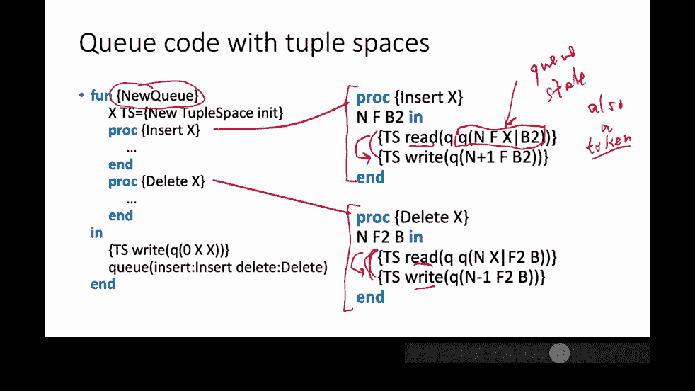
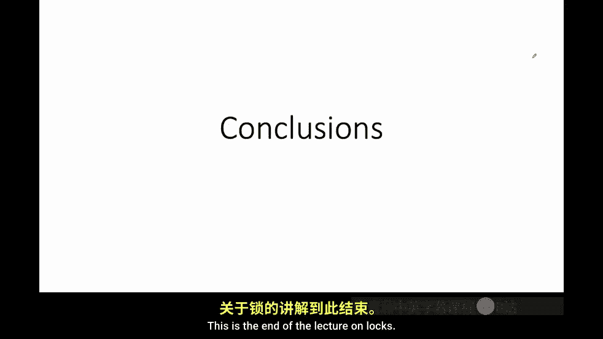
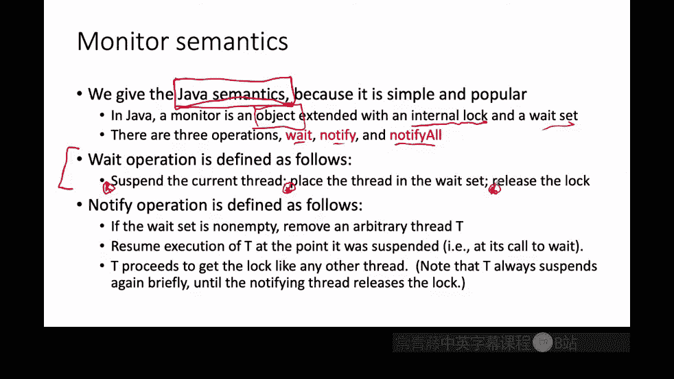
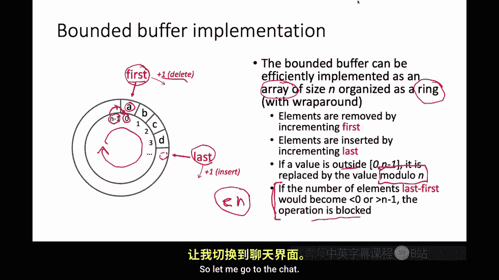
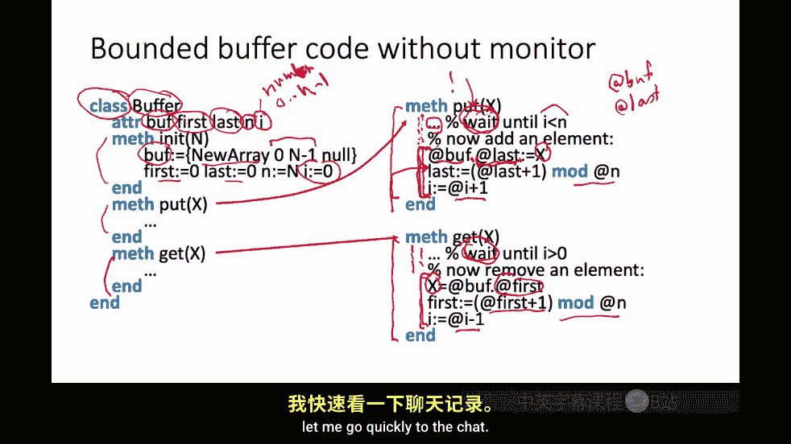
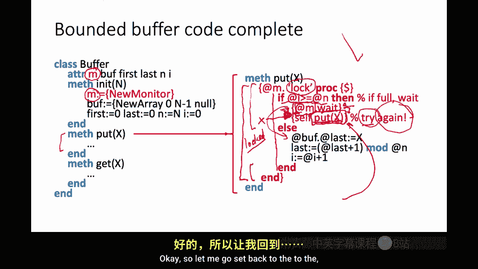
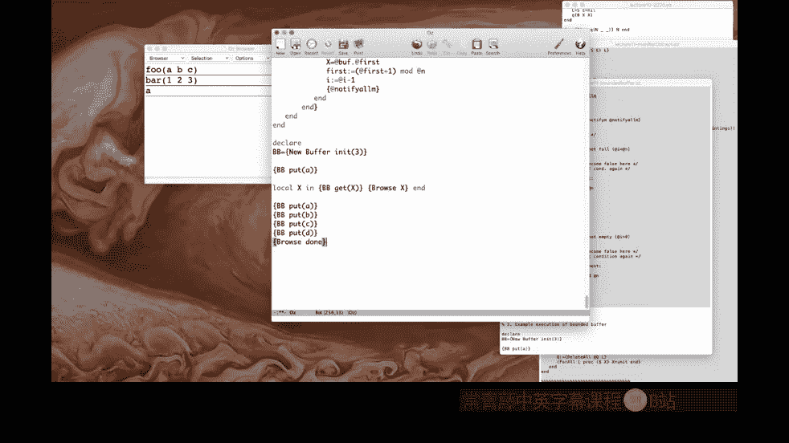
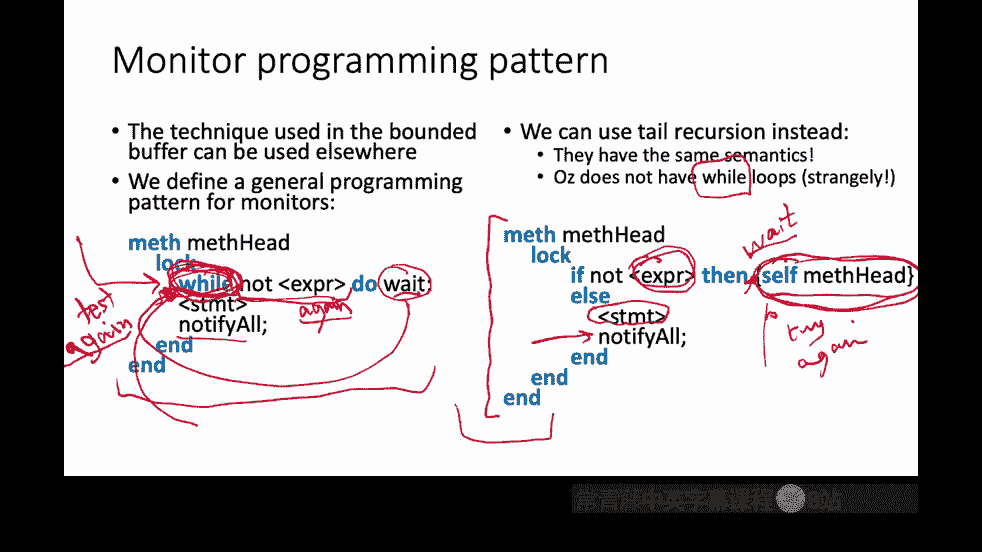

# 鲁汶理工学院【中英⚡高级编程语言概念｜LINFO1131, Advanced programming language concepts】 p11 P9 GI1131 Lecture 11 part 1 (2020) -BV1UDffBbEBZ_p11-

Welcome to the course for today。 Today， we're going to continue talking about shared state concurrency。

And so last time we started talking about locks and I started talking about tuple spaces。

 so today we're going to finish tuple spaces， I'm going to explain tuple spaces。

 it was a little bit fast last time and then I'll talk about monitors。Which are what's used in Java。

 and then finally， if we have time， I will start the presentation of transactions。So。

 let me start by。Go to the slides。

So last time we started talking about tuple spaces， but it was very fast。

 so maybe it was kind of hard to understand。 So let me present now tuple space。

 which is a really interesting concept that's in between。Shared state and message passing。

 It's actually used today。So a tuple space is a multi set， so it's like a bag。

 a multi set sometimes called a bag， and in there there's tuples。And the tuples can be the same。

 so the same tuple can go in there more than once。 So that's why it's a multi set and not a set。

 So a multi set， which is sometimes also called a bag。So there are three operations。

 you add a tuple with the right operation， you can remove a tuple with read。

 but this is actually synchronizing， so the remove is already doing synchronizing。

 it's going to wait until the tuple space has a tuple of the right form。

So originally this was pattern matching， but in the implementation I will show you today。

 we are waiting for a tuple with a given label to appear in the tuple space and we take one of them out。

And then there's a non blocking version of the reed， which does not wait。

 but returns immediately with a boolean true or false。

 true if it has a tuple and false if there's no such tuple。

So a Tuple space for history was invented in 1985 by a computer scientist named David Gallanter。

 and he called his concept Linda， so sometimes this is called Linda。

And his tuple space used pattern matching to remove a tuple。

 So we're going to only wait for the label。 So it's slightly less general。

 but still giving the tuple space idea。So this whole idea is sometimes called coordination model。

 so when people talk about coordination models， they mean tuple spaces and a language with a Tple space is sometimes called coordination language and today they' are very common systems called publish subscribe systems。

 where you can publish messages and you can subscribe and get messages。

 so these are actually tuple spaces， they're example of coordination models。

 they' variation on coordination model。So a topple space is actually a combination of shared state and message passing。

 it's very interesting because it has parts of both of them。😊，So let me explain。

 So like a shared state， it's shared。So different threads access the top space and do read and write。

 So this is kind of like a shared data， okay。So it's easier than regular kind of shared states because the write and read are already large atomic actions。

 putting a big tuple in the space is one atomic operation。

 reading is removing a tuple is also atomic operation。

 so they're already large atomic action so there makes it easy to program。

So that's why it's like shared state。 It's also like message passing because you can think of the tuples as being sent and received。

 So a right is like sending a tuple。And a read is like receiving。

 And the difference between regular message passing is that you do not know the receiver。

 So when the thread does a right， it's like a send。

 but the thread does not know who is going to take the topple out。

 So it's like doing a send where the receiver is not known。 Somebody is going to receive it。

 but we don't know who。 So that's the difference with message passing。

 the sender does not know the receiver。 So why is that interesting。 Well， here's an example。

 Let's say you have。A set of printers。 And you want to send print tasks to the printer。

 So I want to print something。But I do not care which printer is printing。

 So that means I can send the printer task to the printer pool。

 and one of the printers will take the task and print。 So I don't care which printer。

 So this is like a send where I don't care who is the destination。 Okay。

 So the you can see how it's like message passing。 So it's a send where you don't know the receiver。

 and it's like shared state because you have a shared topple space。 So you see。

 it's kind of a concept that's sitting in between the two。

Let me show you an example of something that we implement with tuple spaces。 Remember。

 we used our concurrent queue with insert and delete， and we implement it with locks。

 We implement it with exchange， but we can also implement with Tuple space。

 and I can show you the difference。 so you can see why it looks different。

So the tuple space will use a read。To put an element in the queue and sorry。

 to remove and a right for putting an element in and a read for taking element out。

 But it does not need the lock。 So that's a really interesting difference with what we did before。

 It does not need a lock because tuples are unique entities like tokens。

 You put a tuple in and it there is one more tuple。 You take a tuple out。

 There is one less tuple So taking a tuple is already like taking a token。

So you don't need to do locking because implicitly taking the tuple is already giving you exclusive access to that tuple。

 it's a token， its psyic token。So that's why it's actually a little bit simpler。

And so we have seen then three implementations of the queue。

 Let me show you the implementation with tuple space。 So here's the queue with a tuple space。

 So we have our new queue operation。 We have insert and we have the。

 noticeice the insert is doing a read and a write。And the delete is doing Read and write。

 So the the tuple space has one tuple， which represents the state of the queue。Q state。

So the reed will take the tuple state out of the tuple space。

 and then the right will put the new tuple state in there。And because it's a token。

 when the insert takes the tuple out， if you try to do another insert， the second one will wait。

 The second read will wait because the state of the queue is actually also a token。It's also。A token。

Which means it has a unique identity and there's only one in the system。 So if you take it。

 you have it， nobody else can have it。 So you see the delete is also removing the tuple state with a read。

And then putting the new state in with the right。So let me go quickly back to the implementation with locks。

 So I'm going to go back to an earlier slide。So here is the Q implementation with locks。

 if you remember， so here we have a lock。Then we read the cell and here we write the cell。

So we have a read， and we have a write。But this， but these are not tokens。 If you read the cell。

 somebody else can also read the cell。 So reading the cell is not giving you an exclusive access。

 It's not a token。 If you want exclusive， you need the lock， which gives you the token。

 It's inside the lock。Okay， so the Q with Lux。It's not enough to do read and write。

 You actually need the locks， whereas if I go forward again now to the tuple space implementation。

You can see that we don't need locks here because the reed taking the tuple is already giving exclusive access because a tuple is a unique entity。

 If you remove it， it disappears from the tuple space。 and you are the only one with access to it。

 So a tuple is already like a token。 Okay， so let me go to the chat now。

So is that clear， it was a little bit quick last time？

So maybe now I hope tuples that it's actually clear how the tuples work。Okay。

 so let me actually show you how to make it work。So here I actually have an implementation of tuples。

 I'm going to talk very briefly about the tuple implementation。

So here we have a tuple space that we're going to implement。

 So we're going to implement the tuple space。 We're going to use a queue internally。

 The tuples are stored in a queue。 So we need a queue to implement a tuple space。 So let me。

Implement this， implementation。Of。Couple space。So let me put the Q in here first。And I compile that。

And now I will put the actual tuple space， and then I'll explain a little bit how it works。

 so it's actually implemented as a class。You can see here。So here's the actual tuple space class。

Okay， sorry， let me select it。This。And then we can actually create tuple spaces so we can do something like。

Declare Ts is equal to nu。Tuple space。Oh， I'm sorry。 I'm sorry。 Oh I'm， I'm an idiot。

 I did it too fast。 Let me go to the。Okay， so now you should see the this the screen shot sorry about that。

 So here I'm going to implement the tuple space。 So I have the Q， I have the actual tuple space。

 which is a class。And now I can actually create a tuple space。And then we can use the tuple space。

 so if we put tuples in， they're like tonkens， so if we do tea， right？Fu ABC， this is a。A tu。

If we now do local T in T S read， I get a couple of label。Foo， and I browse it。Then， I will。See。

 the tuple appear。Here in the browse。 But now you can also do synchronization。

 So let me do another one。Let me read a couple which does not exist bar does not exist。Browse T。

 And so if I run this， nothing is displayed。 E seeia。

 nothing is displayed because the readed operation is waiting。

It's waiting because the topple is like a token， So if I do TS， right？And then， I put in。

A top of bar。Then the read will。Continue。 So you can see， for example， in the printer application。

 the printer can do a read。And it waits until somebody sends a print task。

 so the printer is always waiting for the task。Okay。So let me say a few words about the。

So is that clear， So let me say a few words about the。Tuple implementation。

 Let me go back to the slides。

So let's say a little bit how tuple space are implemented， so we need three things。Internally。

 it has a lock。We can't get rid of the lock， but now it's inside the Tple space。

 We have another data structure called a dictionary， and we have a concurrent Q。

 So we need three things to implement Tple space。 So you see， it's actually very interesting。 we。

Can do a queue with a tuple space， but the tuple space also needs a queue。

 So Qs and tuple space are actually kind of similar things。So the tuple space adds an extra thing。

 which is called a dictionary， so a dictionary is a kind of hash table， so it has pairs。

 key value pairs in there。So for example， it has a pair A and then some some tuple。

And then B some tuple。 so it has a set of pairs stored in there and you can index。

 you can look it up。You can say， does there exist a key of。A in the dictionary does it exist key B。

 so you can add， remove and test whether they exist。

 And the interesting thing is that it in constant time。And also it efficient space。That means if。

 if you add elements to the dictionary， it will grow in size， it will allocate more memory as needed。

 but as much as you want until the system is exhausted， if you remove elements。

 then the dictionary will shrink in size。 So it's not a fixed size array。 It's a dynamic hash table。

 So it's a very efficient data structure and it's implemented to give you constant time access。

 So dictionary is actually a very useful data structure that's often used。

So the dictionary here on the right。Each key， which is actually going to be the label of a tuple。

And each key， the value is actually going to be a Q of tuples with that label。

So this gives you the efficient access。 If I want a tuple with label foo。

 I look at the key fo in the dictionary and I immediately get the cu for that tuples。

 So I'm using cues so that tuples when they go in the dictionary， they come out in a fair way。

 So using a queue means that older tuples will be removed first the tuples can come in and I put them in the dictionary and the one that was put in first comes out first。

So that's how to implement a topple space。 So let me conclude。

 this is the end of the lecture on Mon on locks。 So let me conclude。

So we're talking about shared states concurrency。 Remember number of interleavings is exponential。

 we're building large determined actions。 So what I showed you so far is locks。And tuple spaces。

And the next。Two things I want to talk about are monitors and transactions。

 because locks and tuple spaces are limited in some ways， which I will explain。

 and we need to extend them to make monitors and transactions。So let me go to。The chat。

So is that is that clear。 So we've talked now about locks and tuple space is like a lock。 I mean。

 a because a tuple is a token， but it's also like message passing。 So it's an interesting。

Combination， and it's used today in publish subscribe systems。 So， but now locks are not enough。

 So now we're going to go to another concept， which is called monitors and monitors are。Kind of。

That be a dinosaur， because Java is using monitor still。 So many applications use monitors。

 but they're actually kind of problematic。They were invented long time ago。

 but they have some problems， So I will now show you the monitors and you see。Let me go to the。

Slides。

And we'll talk about monitors。嗯嗯。So monitors。So a monitor is a lock， okay。

 but it's an extension of the lock， so it's a lock plus something else。

And the reason is that a lock by itself is not enough。And let me say why， consider， for example。呃。

It's true for many dated abstractions， but consider a simple one called a bounded buffer。

 so a bounded buffer is like a cu， but it has a fixed maximum size I can put elements in the buffer until it's full。

But when it's full， I cannot put more elements， and I can remove elements from the buffer。

 Eventually， it becomes empty。But when it's empty， I cannot remove any more。

 so there is blocking going on when it's full and when it's empty。So we cannot。Do it with a luck。

It's not enough。 We cannot implement a buffer with a lock。 For example。

 what happens if a thread wants to put an element in the buffer and the buffer is full。Well。

 the thread has to wait。Okay， but locks， they don't do that。 Locks。

 they manage access to critical section。 As long as there's only one thread inside。

 this is the buffer code。 it runs。 So a lock will not make a thread weight when the buffer is full。

 It only manages the exclusive access。And the same happens if you want to remove an element from an empty buffer。

 Well， you have to wait until another thread puts an element in the buffer。

 So there has to be a way for threads to wait。So locks are not enough for this， we need locks。

 but we need something more。We need a way for the thread to wait until the buffer is either not full so you can put more elements are not empty so you can take elements out so this is a quite old concept。

Like many concepts in computer science， they were first invented by pair Bryrink Hansen in 1972。

 and the modern version of monitors were developed by CR so Tony Hor in 1974。

 So you see they're quite old concepts， but they're still widely used today in Java synchronized objects are monitors as we will see。

So let me explain how a monitor works。So let me first give intuition on the monitors。

So the monitor will add。Two operations to the lock called Wait and notify。

 and it adds one data structure inside internally to the monitor。

 there's a data structure called the weight set。So the weight set consists of suspended threads。

 so if a thread does with something with a monitor。

 it could go into the weight set and there it waits so the way the weight set is managed is by the weight and notify operations。

So notify is sometimes called。Signal， this is actually means exactly the same。

 It depends on the text youre reading。 If they talk about signal。

 you can say it's exactly like notify。 So wait and notify are used to manage how threads go in and out of the weight set。

 So the weight will put a thread in and the notify will take a thread out。

So another point is the wait and notify operations， you cannot run them anywhere。

 you can only run them when you're inside the lock， so there are things。

 everything happens inside the lock。Okay， so the weight operation。Okay， when a thread calls weight。

It is put in the weight set， so the weight is very simple。

 you call weight and you are put in the weight set。

And you release the lock on the weight is done inside， you release the lock。

 you're in the weight set， and so some other thread can maybe come in and do things。

The notified does the other thing。When a thread calls notify， it wakes up one thread in the weightet。

That wokeen thread will try to get the lock， but it cannot yet because。

The thread that called the notify is still inside。 So when the thread that called notify goes out。

 then the wokeen thread can come in the look。 Okay， so the wokeen thread。

Tryries to get the monitor lock again。At the place where it stopped。Okay。

 so you can call weight anywhere inside the。The the lock and it's weighted， you wait there。

 and when you wake up， you continue executing from that。Okay。

 let me now give more precise semantics for this。 The semantics I give here are actually the Java semantics。

 So this is exactly how monitors work in Java in other languages there can be slight variations。

 For example， Sometimes monitors have more than one weight set。

 you can wait on different conditions in the buffer。

 you could have one weightet for waiting till it's not empty and another one for waiting till it's not full。

 but Java does not do it like that。 in Java， the monitor for making a thing simple。

 the monitor has one weight set。😊，Okay， so a monitor in Java also is an extension of an object。

 so the monitor is attached to the object in some languages。

 it separate concept in Java it's attached to objects。

 So the object will have a lock and a weightet added to it and there are the three operations weight notify and there's a third one called notify all which I'll explain。

So the weight operation works exactly as follows。 so when a thread does weight first。

 it supends the current thread。It places the thread in the weight set。And then it releases the lock。

So all of these things are done in the current thread so nobody can interfere and then the lock is released and other threads could enter。

So the notify has exactly the following semantics。It only does something if the wait set is not empty。

 If the wait set is empty， it is no operation。 It does nothing。 So if the weight set is not empty。

 it removes a thread。But an arbitrary thread。 So it picks a thread。

 Which thread Well that depends on。Other things。 So for example， if you want fairness。

 then you could implement the weight set as a cu。 maybe you want to give advantage to older threads if you use a queue。

 but in general it could be a set it could be an arbitrary thread。

So you remove an arbitrary thread from the weightet and this thread you。Let it resume。

 It starts executing again。 It's no longer suspended。 You say now it can execute。

 and it starts execute at the point it was suspended。 So where it called weight at that point。

 It's like the call to wait returns。 O， When a thread calls weight。 It doesn't return。

 it's put in the weight set。 when someone else does notify it's like the weight call is returning。

And then。This wokeen thread， it tries to get the lock。

 so it does not have the lock when it's woken up。 It's outside of the lock。 It tries to get the lock。

 just like any other thread。 If there's another thread in the lock， then it just waits。Okay。

 so that's the semantics of a lock。Let me go quickly to the。Chat。

So you see it's kind of lots of things are going on， and so we'll have to see after to programming。

So there's a question， it's a bit like semahores in C。Actually。

 not quite a semaphore is a more primitive concept。 You can use semaphoes to implement monitors。

 but monitors do more because it's a lock plus the weight set。

 The semaphore is only managing the synchronization part of the exclusion。😊。

So semaphore is an early concept， So in the 1970s， there were many variations invented。

 People were trying to invent the right way of doing it。 So they invented semaphos。

 but usually now semaphoes are replaced by locks and monitors。So there's another question。

 what happened if the notify is called but the weight set is empty Well in that case。

 the notify is a no up but just does nothing。 it just it's like doing nothing。 Okay。

 that means that nobody is waiting so we don't worry it doesn't hurt because new threads if a new thread comes in the lock it just starts working。

 So the weight set is consists of threads that are waiting for something， waiting for some condition。

But if there's no such dread， we don't worry， then it doesn't really matter we do nothing。

So there's another question。Okay， let me translate it into English。

 I don't understand the goal because if a thread doesn't await。When the buffer is empty。

 when will it get the notify， Why， how will it know， Because the buffer is no longer empty。 Okay。

 that's a good question。 So the buffer is empty。 The thread tries to remove。

 So there's a thread doom get operation。 It tries to remove element。 It sees the buffer is empty。

 and it will call weight。So now it's just sitting in the weet。😊。

And now assume another thread does a put。Another thread will do a put operation。And。

After it does the put， it calls notify。So the other thread doing the put will will not do a weight because the buffer is not full。

 Let's say it's not full， but it will do a notify。 So whenever a thread does an operation at the end of the operation。

 it will always do a notify to see whether there's another thread that can use what it did。 Okay。

 so the thread that does a put does notify。 and the thread in the weight set is woken up and it gets the lock and it sees。

 hey， there's an element。And it takes the element and everything's fine。 So there's like a two。

 a communication between the two threads the getting thread goes in the weightet sits there。

 The putting thread will notify the one in the wakeet， which wakes up。

 So it's a way of making threads work together。😊，So there's another question。

What happens when a buffer is full？This is very good question。 As it is defined。

 there's no way to know whether we're waiting to have a non empty or a non full bufferer。

 that is completely right。 So we have a single weight set。 So a thread that is waiting。

There's doing a get， and it's waiting for non empty。 It will go on the weight set。

 A thread that is waiting to do a put， waiting for non full will also go in the weight set。

 So we're using the weight set for both kinds of threads。 So this can maybe give inefficiency。 So。

 for example， if I do a get an empty buffer， I will go on the weight set。If I do another get。I will。

Also， go in the weight set。 Okay， and so now I have two threads in the weight set。 if I do a put。

Okay， if I do a puts now。I will do notify。So it will pick one of those threads arbitrarily。

 and it will go， and the thread will then do the the work。

 So this is the weight set is being used for handling empty buffers。

 but the same weight set is used for full。Buffs， so soon buffer is full。 and I do a put。

Then I will go in the waitet。So the weight set has two kinds of threads。

 There's the threads that are trying to do a put， and the buffer is full。

 and the thread's trying to do get， and the buffer is empty。

 So we're using the weight set for both kinds of threads。 So how do we know the difference。 Well。

 the weight set does not know the difference。 But when it wakes up a thread。Then， the thread can。

The thread。We'll go into the lock and then it will check。So a thread trying to do a put。

 if it's woken up， it will go into the lock and it will check if there's room。

 if there's room in the buffer， it does it， if there's no room， it just goes to sleep again。

 So it's possible to have。Two kinds of threads， waiting， waiting on put and waiting on get。

 And the notify maybe wakes up the wrong one。It makes up the wrong one， so the buffer is is full。

And a thread is woken up， which is trying to do a put。 Well， it just goes to sleep again。 Okay。

 so there it's not a bug， but it might give some wasted work， okay。So let me show you。

 let me show you some code。 Let me do an application with it。 and then you'll see how it works。 Okay。

 so let me show you。

Some code here。So， okay， let me first talk about notify all。

 So I mentioned that there's a third operation called notify All。So usually the notify operation。

 it will resume arbitrary fit， so usually that's not what we want， okay。

Un you're very smart and you're managing your monitor as a super genius， you do not use the notify。

 so usually we use another operation called notify All。

Notify all is basically doing notify for all the threads in the way it set they're all resumed。

That's kind of funnyni。 maybe there's 10 threads waiting in the white set。

 Notify all will wake them all up and they all try to get the lock。Well。

 only one of them will get the lock。 It will do something。

And then the others will eventually get the lock one after the other。

 And maybe if they're all trying to do put。嗯。😮，Maybe there's 10 threads trying to do put。

And then I do a get。 So there's one available slot。Then one of the puts will be happy。

 and it will do the put。 The9 other ones will try， and they will go back to sleep again。

So you see that there can be some waste， the wasted operations。

 but the advantage of notify all is that the code is very much simpler， as we will see。

 notify is a problem because we don't。The arbitrary thread might not be the one we want。

 so notify all is usually this is the operation we will do in practice。

 So if you want to use monitors and you will want to be very careful that there's no bug then almost always you will do notify all because you don't know which of the arbitrary threads is the right one so the trick is to wake them all up and they will all try to do and the wrong ones will just go back to sleep and the right one will do the operation。

Okay， so one thread will get the luck。It will execute the monitor code， if it's the wrong said。

 it will be put back into the weight set， if it's the right thread， it will do the operation。Now。

 this， of course， can be inefficient if there's many threads in the weightet。

 but usually that's a rare operation。 If I have so many threads trying to use the buffer。

 that the weightet is full of threads， then something's wrong。 I have contention。 Okay。

 then then my application is starting to become overloaded。 So usually in a normal operation。

 there will not be so many threads in the weightet， maybe one or two， okay， but not100。

 but it's possible for there to be many。 it is possible and the system will be correct。

 even though it might be slightly less efficient。 so let me now show you an example application called bounded buffer。

 and you'll see how to program with monitored。So let me first define my bounded buffer。

So a bounded buffer， it's like a queue。But it has a fixed maximum size。

 so it's like an array and once it's full， it's full。So you can put elements in。

 so there's three operations， you can create a buffer of size n。

 so the size is an important parameter。 you allocate this memory fixed memory for the buffer。

 So the important thing about a buffer is that it will never overflow your memory。

 it's very important if you want to manage the memory。So you create a buffer of size n。

 and then you have two possible operations put。An element in the buffer and get an element out。

 So put X we'll put X in the buffer。 get X， We'll remove an element and bind it to X。

So the put will wait if the buffer is full。And the get will wait if the buffer is empty。 Okay。

 so that's how the bounded buffer handles the concurrency。

 So that's the definition of the abstraction。 So in the picture。

 I have a buffer with6 elements in there。 ABC， D， E， F。 So the if I do a get， the A will come out。

 So I can put another element in G。 This one has a size of 10。

So there's six elements so I can put in four more elements。So that's how it works。

So now we're going to implement it。😊，The way it's implemented。

 usually a very efficient implementation is an array of size n。

 but we organize the array as a ring okay that means we can keep going round and round and round。

 and the idea is that when we go beyond n plus1， we start again at 0。

And the way to do that is to take the index。😊，And if it's outside the range 0 to n -1。

 we replace it by the value modular n。 So it's always between 01 n plus 1 and n -1。

 So we can go round and round。 We can increment。And and so the buffer will be working like this。

 So the way then it works is that we have two pointers， a first pointer and a last pointer。

 So the first pointer is the head is the element that we will take out。 So here it's element A。

And the last pointer is the first empty slot， so here there's an empty slot。

So you can see that when we take an element out， we increment first， moves around。

 when we put an element in， we increment last。 So first and last are moving around they're chasing each other round and round and round。

 and as long as the number of elements is less than n。Then everything is fine。

 because if the last eventually will， if there's too many elements。

 the last will go around and it will hit the first on the other side。 Okay， and then we were full。

 We cannot put in any more。So if the number of elements。Is。Bigger than n。

 or it tries to become less than 0 Then we block the operation。

 So the number of elements always has to be between 0 and n-1 inclusive。 So you see。

 we can keep doing going round and round。 There's no problem with managing the。The elements。

 So now we can implement this using the the monitors。So， let me go to。

The chat。So is it， is it。Clear。Is it clear how the bounded buffer works。

 so you can see we're going to go round and round and round this circle？

And if the buffer gets empty or full， we have to block。 So that's why we need the monitor。 Okay。

 so that's the data structure going to implement。 This is actually a very nice way to do buffers。

 And real life buffers are usually done like this， okay。

So let me show you now implementation of this。

Implementation。So let me show you first implementation without the monitor。

 Let me just show you the code intuitively how we do it。

 So I'm going to implement it as an object class buffer。 So there's the buff， which is an array。

 first and last pointers， the n， which is the size， which is a constant， and I。

 which is actually the number of elements in the buffer， which is going from 0 to n -1。

So it's going to first allocate an array， so Oz has these vectors。

 so all languages have vectors of fixed size， so we're going to allocate an array from 0 to n minus1 the first and last are both equal to0 so that means that there's no elements in there so the last points to the first empty slot。

 but because first is pointing to the same place， it means there's zero elements and the i is equal to 0 so that's the initialization then we have put and get method。

So here's the put method。So the way the put method works， is let me show you the code here。

We put the element X into the last。 you see in our， we have to。

When we access the content of an attribute， we always have to use the read operation So we have to use access buffer access last。

It's never automatic。 So we take the buffer array dot。 So this indexes the last element and its's x。

 Then we increment last。 Remember， we increment last modular n and the size is incremented。

 So it's quite straightforward， okay。Now， there's a。A prefix here。

 There's something that happens before。 somehow were only allowed to do this if the buffer is not full。

 So we have to wait until I， the number of elements is less than n。 So I put it in dot dot dot here。

But we'll see how to do that， so that's what the monitor is going to do。Okay。

And the get is doing the opposite thing。So。The first。Pointer points to the element we remove。

 Then we increment the first pointer。 just like last， They both are moving in the same direction。

We do marginal n because it's a ring。And then we decrement the number of elements。 And again。

 there is a prefix here。 We have to wait until the buffer is non empty。

 So this weight stuff is going to be done with the monitor。 But the actual code here， you can see。

 you can see how it works。 Okay， so is that clear， let me go quickly to the。

Its the chat。So it's clear how the buffer is working。Okay， so you can see how the buffer works。

 Now let me show you how the monitor is going to help us manage that when we call the buffer from multiple threads。

Okay。So we're going to use a monitor abstraction， so let me show you the actual code。

 so there's no special syntax in us for monitors， so we define monitors as an abstraction。

We have a function called New Monit， which creates a new monitor。

 the monitor is actually a record with four fields， lock， weight， notify and notify all。

So we have the four operations with the following syntax。 The lock is just a lock。

 but without the special syntax it' we give it the statement as higher order。

And we have to use quotes because lock is a keyword in us。

 so that's the way to use it if it's already a keyword， then we have wait。

 notify and notify all So you can see it's a lock plus three more operations Okay。

 so we're going to add this now to the bounded buffer。So here's how we do it。So in the code。

 the complete version， we add another attribute， which is the monitor。

We initialized the monitor to a new monitor， and now we will update the put code。

 So all the red stuff is the new code that we add。To make the monitor work。So first of all。

 there's the luck。So we can see that the whole thing here is locked。Is。

Exclusive access and thenre here we're inside the Loka。And when we start， we check。

Is I greater or equal than n， If it is， that means the buffer is full。 I is the number of elements。

 okay。And if it is true， then we call weight。You can see the access M gives you the monitor record。

 the dot weight gives you the weight operation， and it's a zero argument procedure that we call it here。

And once some other thread wakes me up， I will return。 so the weight operation。

Will eventually return when somebody else notifies me， and then I can try again。

And the way to try again is to do a。Recursive is to try completely doing the put again。

 So then I can try again doing the put。 Not that when you leave the weight。

 you do not have the lock any more。 You're outside of the lock here， right。

 when you're leaving the weight， the thread leaving the weight does not have the lock any more。Okay。

 so it has to get the lock again。So the correct way to do this。Is to do is to try again， doing a put。

This is kind of subtle， you cannot immediately run this code， that doesn't work。We will see why not。

 You have to try again doing the put。 And maybe you're out of luck。

 Maybe some other thread gets in the lock before you。And already does the put。

 And you go back to sleep again。 Sorry， you have to wait until the next time。 Okay。

 so you try again when you wake up， but there's no guarantee you will probably get it。

 but there's no guarantee if there's another thread you might get it。 Okay。

 this is the correct way to do。 you can see it's actually not so simple。If you want to do naively。

 there's another way you can try。Maybe I just want to do like this， Okay， maybe I just。Here。

 I just wait。And otherwise， in if I return。I immediately get the lock and do the code。

This is incorrect。This is buggy。This。Code on this slide is incorrect。

So you can actually find a scenario of the scheduler that makes it go wrong。

 And the reason why it's incorrect is because when you exit the weight。

 you have to go into the lock again。But there's no guarantee that you're the first one in。

Some other thread might go in before you。And that other thread will。Take the slot that you wanted。

 So when you go in， maybe the buffer is full， and then it's a bug up doing a put in a full buffer is a bug。

 So this code is buggy。Okay， so if you want to do correct monitor code。

 you actually have to try again completely。 So you actually have to do a recursive try of a put again。

 because there's no guarantee that when you wake up after the weight that you will。Have the slot。

 maybe some other thread will。Pick it from you。 Okay， so let me go set back to the。

To the， so this is one of the reasons why monitor is kind of complicated is because you have to worry about。

Getting the lock that you're never the only one。 There might be other threats， okay。So is that okay。

 so this is actually important。

Okay。So this is actually important that when you wake up from a weight。You have to。

Try again the whole method。 You can't just start running the code in the method。

 You have to try again completely， okay。Okay， so let me actually show some code now for this。

This time I go to the screen。So here's the code for the tu， let me make some room here。

So I actually have a piece of code here that implements the monitor。

So the monitor also uses a queue for the weight set。Let me。😔，Copy it in。

 So this is the code implementing the monitor。So first is's a Q。

So this queue is used to implement the weightet。So， let me do it。First。

 you see the notion of a Q is very important and heres the actual monitor。

So this is actually a procedure returning the different。Returning the different。

Operations of the monitor。And then。We have the bounded buffer。So let me show a bounded buffer。

 So I'm not going to type it all in。 So here's a correct version of the bounded buffer。

So I think I have compiled it， yes。So。Here is the。The the bounded buffer。

 you can see here this is a slightly different version。

 we have one attribute for each of the monitor operations Here we call new Mon。

 which is a procedure with four results， and it returns these four guys。

And then here we have the put。Operation， the correct version， so it does a lock。

It waits until the buffer is not full。 So if I is equal to n， you see it's slightly different。

 So if the buffer is full， then we wait。And after that。

 we have to try again to do a put because the condition might become false。

 because another thread might get in before me into the lock and do already the put。

 So it's full again。 Okay， so I have to try again completely。And then this is correct。

 bounded buffer okay。So we can compile this and then we can actually execute the bounded buffer。

So we can say。The clear bounded buffer is equal to new。

 let me see what is the name of it's called buffer。New buffer。Size， let me make a small one。

 size three， so we can actually make it full。So we can put elements in there now， so we can say。

 for example， B B put。诶。So the a goes in there， and then we can do something like BB。Get X。Browse X。

And the a comes back out， okay， but we can also make the buffer go full。You put A in there。

Put B in there。Put C in there。Put D in there。Browse。Don。

So here I'm putting four elements into the buffer， but the buffer only has size three。

So nothing is displayed here。But if I remove one element。Get X， browse X。So I put a in the buffer。

 then I put B in the buffer， C， and I'm trying to put D。

But it doesn't work because the buffer is full。 so I'm blocking here。

But if I remove the element here， then the D will be able to get in。 So what will be displayed here。

 So I put a in the buffer and then B and then C and then D。

 So the first element coming out is going to be what it's going to be。A， of course。 So a。

 and then it's done。 Then you can see the buffer was able to put in the D， okay。

And now I can I can keep taking elements out。 I remove B。 I remove C。 I remove D。 Now。

 if I do again a get。 Now the buffer is empty， I will display nothing。But if I do put E in there。

Then the get is waiting。 You can see it's actually waiting here if I put an e in there。

Then the weighting get will display。 So you can see the buffer is actually coordinating the work between the different threads。

 Okay， so you see how it works。So of course， I'm going to put the code on the Moodle。嗯。Question。

 so there's a question。 Should we do a notify after adding the element， Yes， And in fact。

 the way the right way to do it is to do a notify all。 So you are correct。

 I actually have a bug in the code there。 Thank you for noticing that。 So if you look at the。

 let me show you here。Let me go back to the。Screenshot。If we look at the buffer element。Notify。

 notice that I'm actually doing notify here。 So you always have to start with a wait and end with a notify。

 So I think you are right。 I think there is actually a bug in my slide， which I will fix。 Thank you。

So let me go to the slide again。Very good。 I'm always very happy when people are paying attention。

 us helping me debug everything。😊。

So I made these slides very recently， so they are。They're still bug。 So as correctly pointed out。

 there should actually be notified here。So there should actually be a notify in here， okay。

Notify all。We actually have to do notify all here。And in fact， there's a programming pattern。

 So if you look at this code here， you can see we have a condition， we have a weight。

And at the end we have a notify all。So it's kind of a general pattern。

 So when you program with monitors。You have to do it like this always， unless you are a super expert。

 you always do like this。You have the condition here。To see whether you allowed to do that。If it's。

I keep making mistakes here。 so there has to be a wait。Here。Okay， so I'm I will fix the slides。

 Don't worry when I make put a fixed version on the middle。

So the idea is that if the condition is not true， so if we're not allowed。

 if we try to put in a put and we don't have any elements， so if the buffer is full。

 we have to do a weight and then we try again， otherwise we do the thing and at the end we do notify。

So this is kind of a programming pattern。 There's another way to write this using a while。

Which is maybe a little bit shorter。Okay。The wire loop。And the Y loop。

 you have to be a little bit careful here。 So let's say。I want to do put。But buffer's full。 I wait。

When I wake up again， the wire loop will test the condition again。You see。The wire loop。

 when the weight wakes up， it will go immediately to the while， and it will test the condition again。

 And the thing is， it might become false because another fate might come in before me。

 So it's not enough to do an if you have to do a while， or you have to do recursion like this。

 You have to try。Again。Or you have to test。The condition， again。Otherwise。Another you might be a bug。

 Otherwise， another thread might fill the buffer， and then you try to put and the buffers full。

So it has to be a Y loop or a recursive call here。So this is the programming pattern for monitors if you don't do like this。

 then it's going to be buggy okay？So in Oz， we will use recursion because， funnyni， strangely。

 Oz does not have wire loops， kind of a weird omission。But in a language like Java。

 you will do while loops。Okay。So that's the monitor。patternttern。 So when you program with monitors。

 then the recommendation is to always do like this using weight。

 using notify all and using a while loop for the condition。 Okay， if you do that。

 then it will be correct。

But if you use an if it would be wrong。Okay， let me go little bit back to the。Okay， question。

So there's a question。The wire loop。Does not recall the lock multiple threads。

 So we're assuming when you exit from a while from the weight that you will try to get the lock again。

 Okay， you're assuming that when you come in， you're always trying to。

 So when you somehow go into the code of a lock that implicitly。

 you are trying to get the lock again。 And that's how， for example， Java will do it。Okay。

 so you're assuming that there's no way really to wake up from a while and immediately go in there that you will automatically try to get the lock again。

Okay， and we'll see how it works when we do the implementation of monitors。

 so I'm going to make a small break， but then we will show the implementation and you'll see that when you wake up for a while。

 you actually try to get the lock again。

