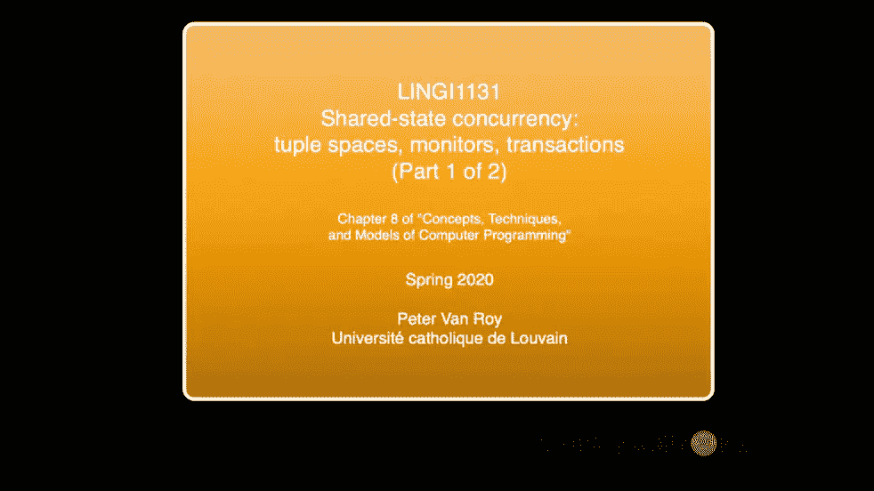
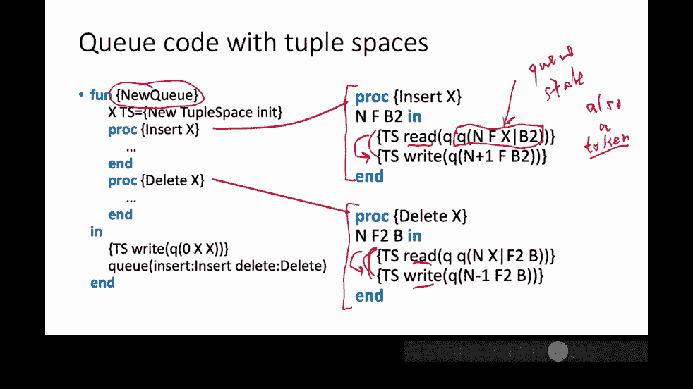
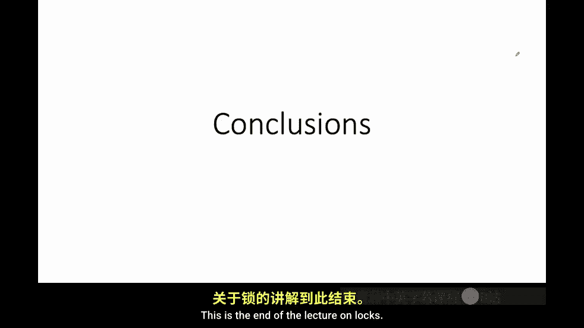
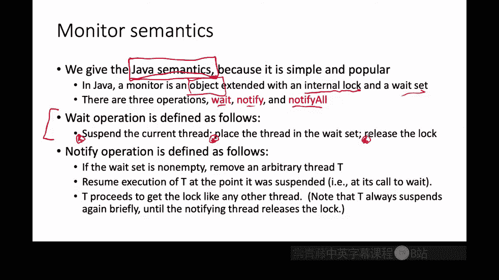
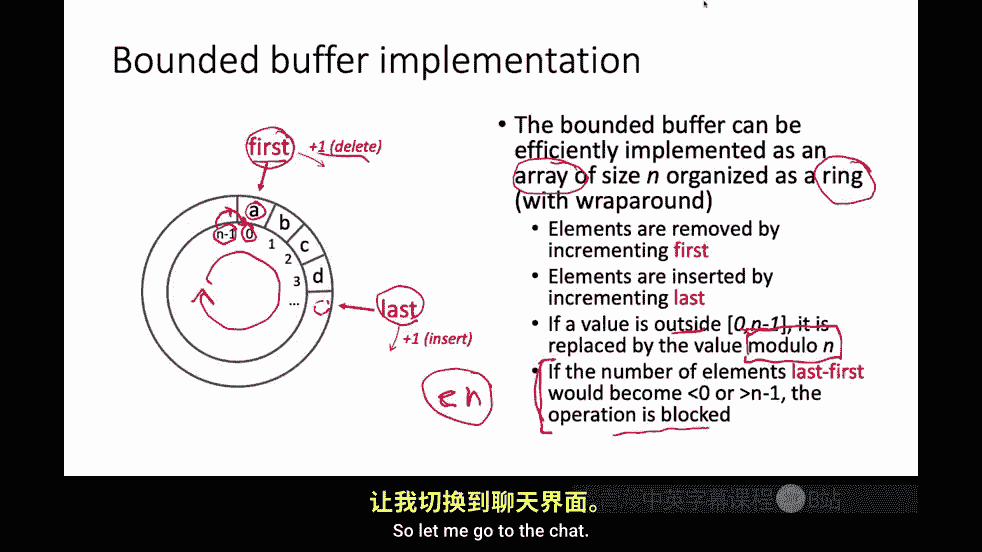
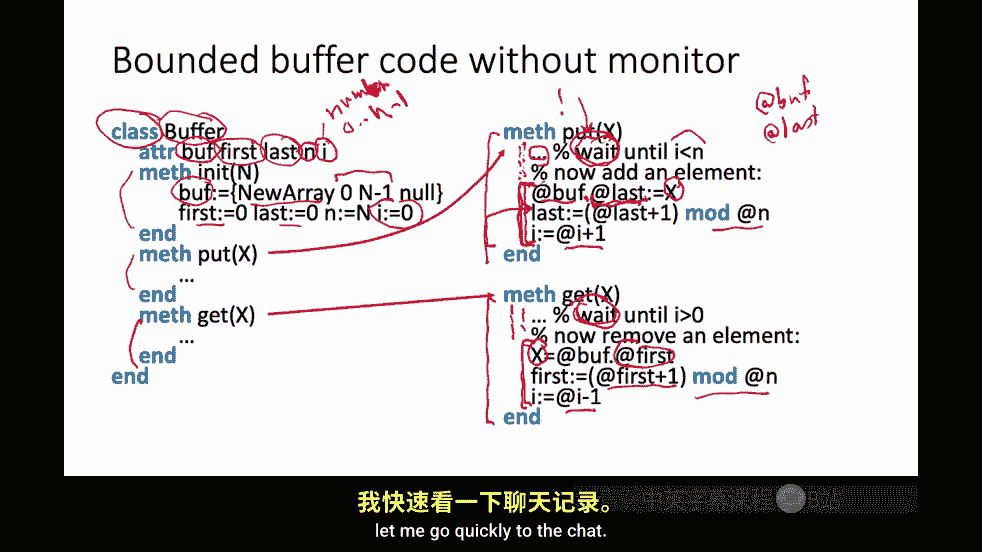
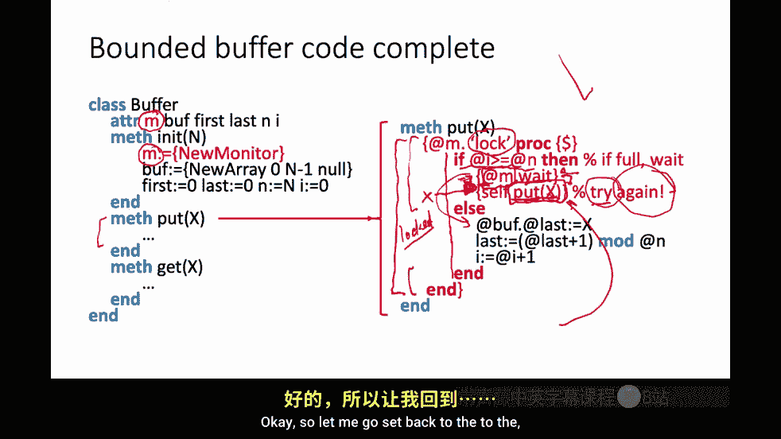
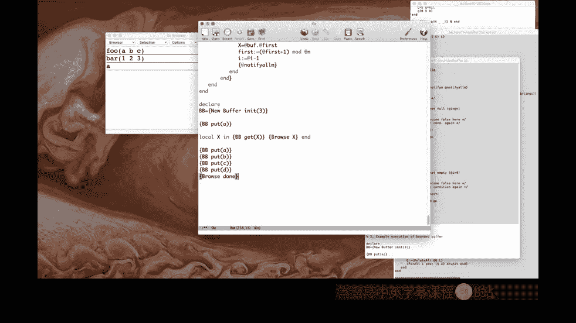
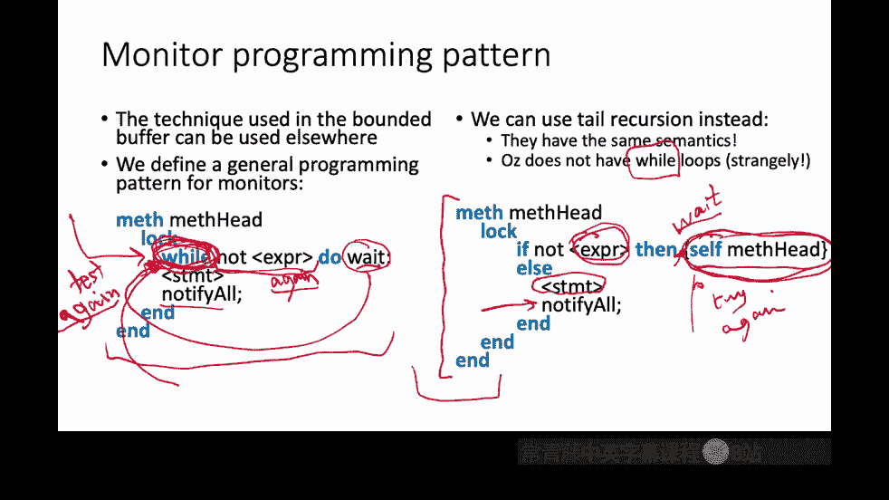

# 高级编程语言概念：第11讲：共享状态并发（第一部分）




在本节课中，我们将继续学习共享状态并发。我们将深入探讨元组空间的概念，并介绍监视器。元组空间是一种介于共享状态和消息传递之间的有趣模型，而监视器则是Java等语言中广泛使用的并发控制机制。

## 元组空间详解

上一节我们介绍了锁，并快速提到了元组空间。本节中，我们将详细解释元组空间的概念。

元组空间是一个**多重集合**，有时也称为“包”。其中存储着元组，并且相同的元组可以出现多次。它包含三个核心操作：
*   **`write(T)`**：向空间添加一个元组 `T`。
*   **`read(L)`**：从空间中移除一个标签为 `L` 的元组。这是一个**同步**操作，如果空间中没有匹配的元组，调用线程将等待。
*   **`readNonBlocking(L)`**：`read` 的非阻塞版本。如果存在匹配的元组则移除并返回 `true`，否则立即返回 `false`。



这个概念由 David Gelernter 在1985年提出，称为 **Linda**。它也被称为**协调模型**，现代常见的**发布-订阅系统**就是其变体。


元组空间结合了共享状态和消息传递的特点：
*   **类似共享状态**：多个线程可以访问同一个元组空间，进行读写。其 `write` 和 `read` 操作本身就是**大型原子操作**，简化了编程。
*   **类似消息传递**：`write` 类似于发送消息，`read` 类似于接收消息。关键区别在于，发送者**不知道接收者是谁**。例如，向一个打印机池发送打印任务，任何空闲的打印机都可以接收并处理。

### 使用元组空间实现队列




为了理解元组空间的优势，我们可以用它来实现一个并发队列，并与之前用锁实现的版本进行对比。

以下是使用元组空间实现队列的核心思路：

```oz
fun {NewQueue}
   TS = {NewTupleSpace}
   State = q(0 nil nil) % 初始状态元组
in
   {TS write(State)}
   proc {Insert Q X}
      {TS read(State $)} % 取出状态令牌
      {TS write(q(... X ...))} % 放入新状态
   end
   proc {Delete Q X}
      {TS read(State $)} % 取出状态令牌
      {TS write(q(...))} % 放入新状态
   end
   ...
end
```

**关键点**：队列的状态本身被表示为一个**唯一的元组（令牌）**。`read` 操作会从空间中**移除**这个令牌，从而自动获得了对该状态的**独占访问权**，因此不再需要额外的锁。相比之下，使用锁的实现需要显式地获取和释放锁来保护共享变量。



### 元组空间的实现

元组空间内部是如何工作的呢？其实现通常需要三个组件：
1.  **一个锁**：用于保护内部数据结构。
2.  **一个字典（哈希表）**：键是元组的标签，值是对应标签的**元组队列**。这确保了高效查找和公平（先进先出）访问。
3.  **一个并发队列**：用于实际存储每个标签下的元组。

因此，元组空间和队列是相互构建的有趣概念。

## 监视器介绍


锁和元组空间虽然有用，但在某些场景下能力有限。本节中我们来看看监视器。

考虑一个**有界缓冲区**问题：缓冲区有固定容量。当缓冲区满时，`put` 操作必须等待；当缓冲区空时，`get` 操作必须等待。单纯的锁无法实现这种“条件等待”，它只能管理临界区的互斥访问。

监视器解决了这个问题。它本质上是**锁的扩展**，在锁的基础上增加了：
*   **一个等待集**：用于存放被挂起的线程。
*   **`wait` 和 `notify` 操作**：用于管理线程进出等待集。
    *   `wait`：调用线程**释放锁**并进入等待集。
    *   `notify`：从等待集中**唤醒一个（任意）线程**。被唤醒的线程会尝试重新获取锁，并从它之前调用 `wait` 的地方继续执行。

在Java中，每个对象都关联着一个监视器，并提供了 `wait()`, `notify()`, `notifyAll()` 方法。`notifyAll()` 会唤醒等待集中的**所有**线程。




### 监视器的编程模式



使用监视器编程需要遵循一个特定模式，以确保正确性。以有界缓冲区的 `put` 操作为例，**正确**的模式如下：


```java
// 伪代码模式
public synchronized void put(Object x) {
    while (buffer.isFull()) { // 必须用 while，不能用 if
        wait();
    }
    // ... 执行核心操作（如放入元素） ...
    notifyAll(); // 通常使用 notifyAll 更安全
}
```

**为什么必须用 `while` 循环检查条件？**
当线程从 `wait()` 中被唤醒时，条件（例如“缓冲区不满”）可能已经再次变为假。因为被唤醒的线程在重新获得锁之前，可能有其他线程抢先进入并修改了状态（例如填满了缓冲区）。使用 `while` 循环可以确保在继续执行前**重新检查条件**。




**为什么推荐使用 `notifyAll()`？**
使用 `notify()` 只唤醒一个任意线程，可能唤醒的是“错误”的线程（例如，缓冲区有空间后唤醒了一个等待 `get` 的线程）。虽然被错误唤醒的线程会因为条件不满足而再次 `wait()`，但这可能导致效率低下。`notifyAll()` 唤醒所有线程，让它们竞争锁并各自检查条件，简化了逻辑，避免了“信号丢失”的复杂性问题。

### 有界缓冲区实现示例



一个有界缓冲区通常使用一个环形数组来实现，有两个指针 `first` 和 `last` 分别指向头部和下一个空闲位置。使用监视器实现其 `put` 和 `get` 方法，正是上述编程模式的典型应用。


## 总结

本节课中我们一起学习了共享状态并发的两个重要概念。
1.  **元组空间**：一种结合了共享状态和消息传递的协调模型。它通过将数据表示为可原子存取的无状态令牌，简化了并发编程，无需显式锁。
2.  **监视器**：锁的扩展，通过 `wait`、`notify` 和等待集机制，实现了基于条件的线程同步。我们学习了其标准编程模式（`while` 循环检查条件、`notifyAll`），这对于实现如“有界缓冲区”这类经典同步问题至关重要。




下一讲，我们将继续探讨更高级的并发控制概念——事务。