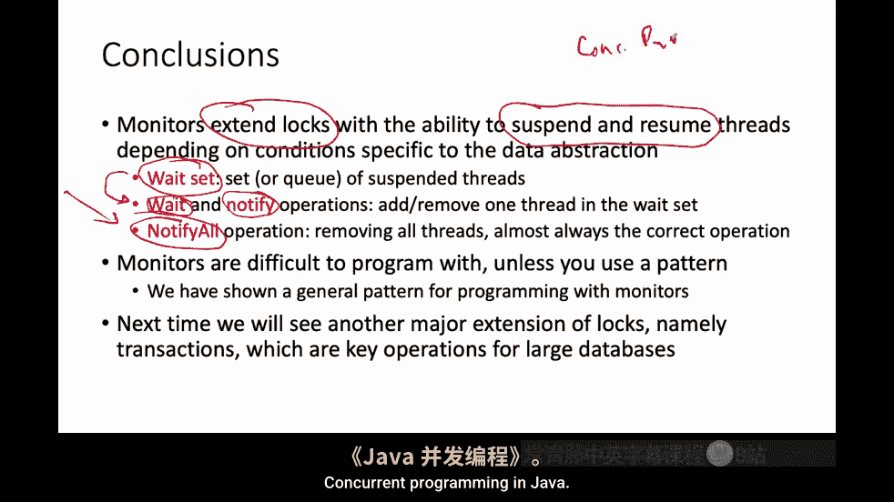
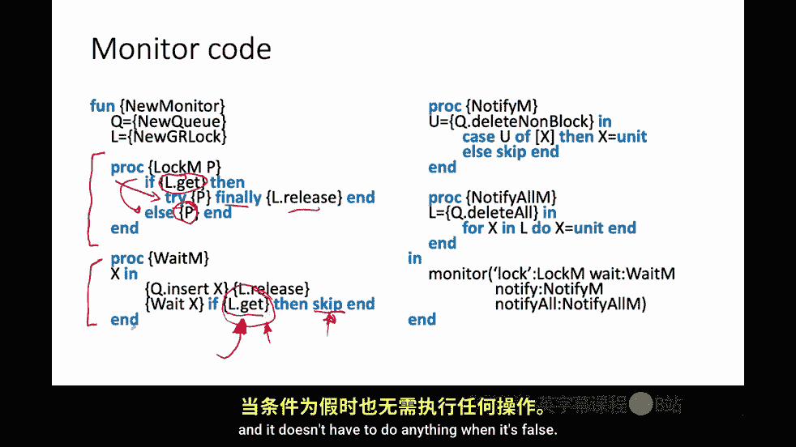
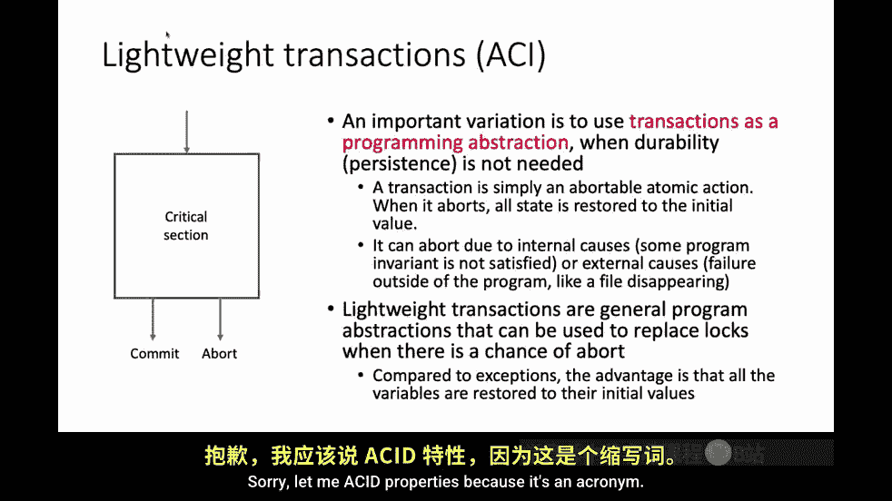
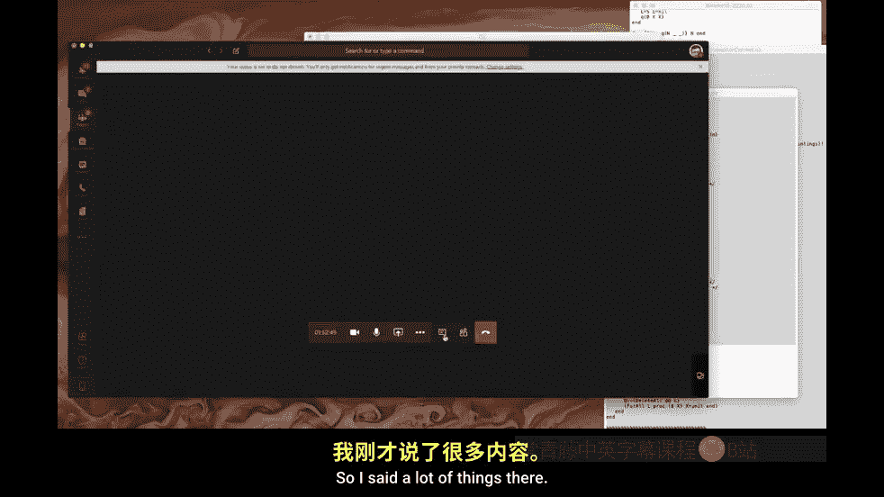
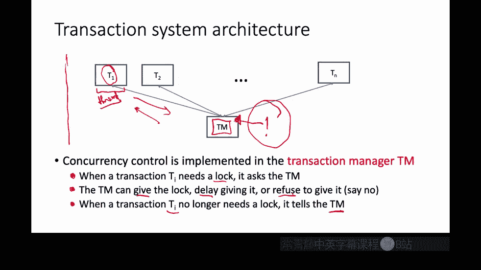
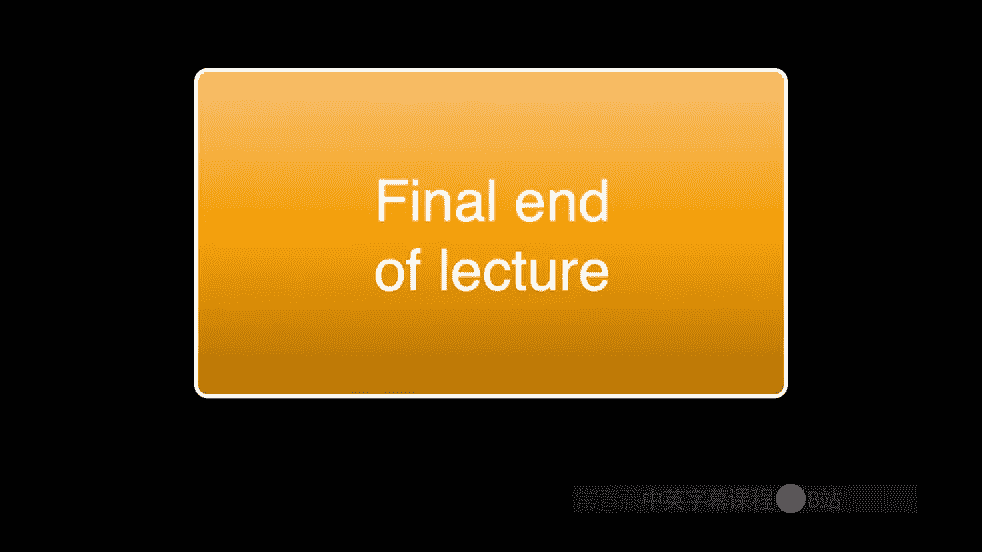

# 鲁汶理工学院【中英⚡高级编程语言概念｜LINFO1131, Advanced programming language concepts】 p12 P8 GI1131 Lecture 11 part 2 (2020) -BV1UDffBbEBZ_p12-

Let me start now again。 So we saw monitors。 We saw the programming pattern for monitors。

 Let me now show you how to implement monitors。 So it has an extension of locks。

 Remember as how the reenttrant lock works。 So let me go to the。The slides。

So let me show you now how to implement monitors。 So remember we saw the programming pattern。

 how to use monitors。 Now let's see how to implement them。So a monitor starts as a reenttrant lock。

 so remember how reenttrant locks work， they use exchange for managing the tokens。

They use the thread identity， current thread for checking to see if we're already in or not。

 And there's also exception handling with Tryfinally。 So we're actually extending this。

 If you think that was complicated。 This is a little bit more complicated。

 So we're going to make two changes here compared to reenterrant locks。 First of all。

 we're going to slightly modify the interface of the lock。 It's called a get release lock。

 So that entering and exiting our two separate operations。

 which we call get is to go in and release is to go out。 because of this。

 because we need to get in in different places。 So we get in when we have the lock。

 but the weight to operation also has to try to get in。 and it also has to release the lock。 Okay。

 so there is we're using it in several places。 So we are going to have a get release lock。😊。

And the second point is the weight set， we're going to add a Q。

 you see the queues are really used a lot， so the reason why we implemented it as a Q and the weight set is implemented as a Q because it ensures fairness。

So Qes are very nice for fairness。 You put a thread in the queue and the thread moves along the line eventually comes out。

 So the oldest threads come out first So it's not possible for a thread to stay in the queue forever if you're using it。

 the threads will always be moving through and the old ones will be coming out。

 This is also why when you go to a store， people wait in line in a queue。

 because they don't wait forever。 Okay， it ensures fairness so that everybody waits about the same time。

That's why it's not implemented as a stack。 If you implement as a stack， you put on the top。

 your move from the top， the threads in the bottom of the stack。 they might stay there for a very。

 very long time。 So stack is not fair。 So that's why we implement it as a Q。

 So the weight set as a Q。 and we extend slightly the Q that we saw before。 We have a delete all。

 So we have one operation lets you take all the elements。 We have size。

 which lets you find out what is the size of the queue， and we have delete nonb， which。

Immediately returns the element， or it's like a delete， but it also tells you if the queue is empty。

 it either returns a list of one element or nil if it's empty。

 so immediately tells you if it's empty。So with this， we can implement the monitor。

 So the first thing is a get release lock。 So this is actually a modification of the reentrant lock。

 So instead of having a procedure with the the exchange and the leaving the。

Around the procedure execution， we actually now have two operations。We have Getlock。😊。

And we have released luck， but you can see they're actually doing the same things。

So getlock is what happens just before the critical section and release lock is what happens after。

 So here the getlock is going to do the token managing here with the exchange。

 It's also going to check the Id， and it's going to return。True， if it actually had to go in。

 if it had to do something with the token， it would return false if it's already in and did not have to do anything else。

And the release lock here notice it's not doing the exception。

 We will do the exception and the other piece， it's just passing the token。 That's all。

 And we need another cell。To make sure that the get and release can talk to each other。 So the the。

 the new variable in the get is put in a cell token 2。

 so that the release lock can actually release it。 So we need this extra cell。

 and it has to be a cell because we can call get lock and release lock many times。 Of course。

 So it's not always the same。 It has to be updated。So the lock then has two operations。

 get and release。So that's get release lock， we also extend our Q。So here we have a queue。Remember。

 I'm going to use the one with cells and locks。 So here we have the cell with the Q state。

 the insert and delete lit as before， we also have a standard reenttrant lock to implement the Q。

You see， we have also we have a。Get release lock， but we have also a lock that we need to implement the queue。

 There may be more efficient ways of making it only one lock。

 But here I'm doing a separate lock so that we actually have a separate queue。

 We have the size operation。Which basically just tells me the size， returns the size。

 We have delete all。Which returns a list of all the elements。 Basically， it takes the S。

 which is the reference to the front of the queue。 It binds the tail to nil。

 and that turns S into a list。 And then it makes the Q empty。

It does an assignment so that everything is removed。 and then there's the non block delete。

 which checks to see if the size is bigger than 0。 If so， returns a list of one element。

 which is the delete element， or else it returns nil if it's empty。

So the delete non block will actually tell me if the queue is empty。

So this is my queue with my extra operations that I need for the monitor。 Okay。

 so get release an extended Q。And here's actually the code for the monitor itself。

 So I have a queue and a get release lock。First is the actual lock。So this is the lock as before。

 So the way it works， if L dot get， then try P finally L dot release L P。 So this。

 if you look carefully， this is exactly the same code as before for the reenttrant lock。 Okay。

 so this is a standard reenttrant lock。As we did before。

 it's already kind of a complicated implementation， but it's there。 now we have the weight operation。

 so this one is managing the insertion。So how do we insert a thread？In a queue， what is a thread。

 Well， basically， the the thing is we want to suspend the thread。Okay。

 so what we're going to do is we will create a new。Unbound fade variable， a data flow variable。

 We will put this variable in the Q。And this variable is how we manage the suspension。

 we will then do a weight on x。So that the thread suspends。

But you can see the x is actually in the Q， so if some other thread binds x。

 then the thread will continue。So this gives us the effect of suspending the thread and putting it in the queue。

 Notice here we release the law。So we insert into the queue and then we release the lock。

 this is why we need a get release locker because we're doing the release in two places。

Then we do the weight。 and after the weight， we do a get again。 So you see there's like a。

Combination of release and get in the lock。We will do get and then release。 But inside。

 when we do a weight。Remember， we already did a get in the main lock， we will do release。

And then eventually， when the thread continues， we do a get again。Okay。So there's always。Get release。

 Get release。 get。 They're always paired。The original one is get followed by release。

 But if we do a weight， then it will put a release and then another get。

 So if we get the effect of get release and then another get。 and finally， at the end of a release。

 So if we do more than once the weight， you will always get get release， get release， get release。

 So this is how we implement the weight。Now we have notify and notify all。

So the difference to notify notify all is that it's only one or it's all threads。

 so notify removes an arbitrary thread， so basically we do delete non block。So if it returns a list。

 that means we have one suspended thread。 we make the thread continue by doing x equal unit。

 so the waitinging thread will continue。Otherwise， if the queue was empty， we do nothing。 skip。

The notify all will delete all。😮，And so L is actually a list of variables。

 so it's actually a list of suspended threads。 So for all x and L， we do exeable unit。

 we start them all up again。We start them all up and of course。

 they're all going to try to do L dot get then。So you can see how it works。

 You can see specifically here。That the get operation， that after you do a weight。

 when the weight continues that it immediately does a get so that when you remove go out from the weight。

 you will immediately do again a get operation Okay， So that's part of the weight。Okay。

 for the implementation， this is actually quite a subtle implementation。

Original edition of the book actually had a bug in this implementation， but as far as I know。

 this is actually a correct。Implementation。Okay。Okay， so let me conclude now for monitors。

So you see that we actually extend locks。And we can suspend and resume threats depending on conditions。

 So notice that there is only one weight set。For the monitor。

There exist variation of monitors when you have many， as many weight sets as you need。

 you define a separate weight set for each condition。 So non empty is a weightet， non full。

 another weightet and so on。 So the programmer declares that。That some languages do that。

That gives you more efficiency if you have contention。So because in the Java implementation。

 the same weight set is used for all of the conditions， so if you have a lot of contention。

 it can be slightly inefficient， but it makes it much simpler and in practice usually you don't have so much contention if you have so much contention then there is something wrong and you have to restructure your application any case。

 so that's the Java philosophy。So the weight set is managed by weight and notify to add and remove one thread。

 And in practice， though， we're always almost always going to use the。Notify all operation。

 There's actually a book。On concurrent programming in Java， concurrent programming。

In Java， you can get second edition。By Doug Lear。Doug。There。

This is all about programming with monitors and things and so it gives you lots of special techniques。

So it can get complicated， but basically a lot of it is actually building abstractions。

 using monitors and using them， building thread pools， building tuple spaces and so on。

 So basically trying to get rid of monitors by using them to build abstraction to do something else。

 So monitors are actually difficult to program with unless you use a pattern。

So this is what I recommend for you。To always use this general pattern， because otherwise。

 you will be。We will have problems， okay？So that's about monitors。 So now after monitors。

 we will talk about transactions。 So let me go back to the。The chat。Okay， so is that clear？

So there's a question on the monitor implementation。

 why does L get in a condition statement that just skip Okay。

 let me go to the slide and I will show you the implementation that's a good question to understand how the implementation works。

So why is the L get？Here。So， the L get。So remember how Lge works。So the get， the L get is this。

 it's the get lock。It returns true or false。So it returns true if it's the first time that it's going in。

It returns false， if it's already in。这个。So if it's already in， then it doesn't have to do any work。

 and it would be buggy to do it。 You don't do anything。 But the first time it has to be true。

 So we have to understand that here。So here if L get returns true。

 then we have to do the try finally and we get in and the release， but if the L get returns false。

 we're already in， so it's enough to do P。Okay， so in the weight。We will also do a get。To get in。

 but maybe we're already in。 So if we're already in， we have to do we don't have to do anything。

But if we want to get in here。So if it returns true， then we're getting in the first time。Okay。

 but the weight does not execute any code， the code comes。After， okay， so the weight is。

So here we get， if it returns true， we don't actually have to do anything because we have just gotten into the lock。

 but there's no code here in the weight。 We're already in the the code will be。

 the thread is already executing the code。 We just have to make sure we get the token。Okay。

 so that's why it returns it does skip。 It basically doesn't have to do anything when it's true and it doesn't have to do anything when it's false。

Okay。So。Is that clear？How it works。 So it's the way it's because of the weight because the fact that you weight has to。

Get in。It's because the weight also gets in， but it doesn't have to do anything else than just get the token。

Because the actual code is already， it's the main lock has already done that。

 The main lock is already set up to do a try Finally。 Okay， all of that is already set up。

 The weight the I'll get in the weight just has to get the token to make sure that it's actually in the lock。

 okay。Se to。Cl， it's a kind of subtle implementation， so but it's good to see it。

To see how these kinds of abstractions are built in a concurrent system。

So in the just for a remark in the exam， I will。Ask you。

 I can ask you to tell me how reenttrant locks are implemented。But the monitor。

 I will not ask you to show me the code， but I might ask you to， I might give you the code。

 and then I will ask you to explain it。 Okay， so I will not ask you to reconstruct the monitor implementation。

 but I may ask you to。Reconstruct the reenttrant lock。

 So the reentrant lock is actually conceptually fairly simple。

 So I want you to be able to show me the code for reenttrant lock。

 So it's not needed really to memorize it。 You just have to understand how token passing works。

 You have to understand how。The thread identity works and that you need also to handle exceptions。

 and then you can rebuild the entrance lock。But I'm not going to ask you to rebuild the code for monitors。

 okay。So now， let me go to transactions。 Is that clear， So monitor is a complicated thing。 Yeah。

 you can see it。 now we're getting into complicated things， in my view， monitors。

Are not a very good way to bake concurrent programs because they're complicated to use。

 They're also somewhat inefficient because of the contention issues， but they're still widely used。

 So many languages like Java use them all the time。But so if you have to manage these applications。

 you have to understand it， how it works。 But if you want to write a new application。

 I do not recommend that you use monitors。 Okay， so let me now go to。Transactions。So， the next。

The final concept that we're going to see on concurrent systems in this course。

 which is transactions。

So， let me go to。The slides。Here。So transaction。Again， is an extension to a lock。

But a transaction is a concept that's used for databases。

 so now we're not worried about managing multiple thread and abstraction， now we're managing data。

Okay， we have a large database， a huge amount of information that we have to update。

So we will update the database。But the database is important， so we want it to survive。

 even if there's a crash。So we will have concurrent updates。And we will have crashes。

 So the database has to survive crashes。 So this is the critical problem we're solving that transactions solve for us。

 So large databases are incredibly important。Okay， so many large companies are based on that。

 100 years ago， it was all written in books and people who were writing down the books。

 but nowadays all of the critical information of large companies is stored in these large databases。

And if the databases disappear， the company will basically go bankrupt。

 it will not be able to continue， so it's critical。So it's the core of large companies。

 Your bank account is stored in a database， the amount of money you have it's stored in a database。

 Okay， all the personnel， all the parts， procurement， everything is all stored in databases。

 So a database is a critical part of the computing infrastructure。And。

It is implemented to be completely resilient to crashes。

 So it's probably the most reliable software that exists is the software for database。

 It has to be resilient。 So resilience is a technical term。

 resilience means that it survives crashes。 We can even say how many crashes。 So the information。

Must survive， even if the computer crashes or the disk that stores the information crashes。

 The information must survive。 So there's a whole。Take a whole course and books are written on how to make systems resilient。

 The basic idea is to use redundancy so the database is stored in multiple copies So if one copy crashes the other copy survives and then when you update the database you have to update both copies。

 but the problem is also that you can crash during an update。

 So you can see it's very tricky and will explain how this is done so the crash can happen any time during the update or after and the database must survive。

 so this is why it's implemented。The second。Is performance。

 So we really are very demanding on this thing。 databases is not enough that they survive。

 They have to be fast because the bank will have customers。

 And if the customer has to wait days for doing a transaction。

 the customer will not be happy and will go to another bank。

 So the transactions have to be done quickly。A large rate of concurrent updates。 and finally。

Scalalable。Large numbers of clients， banks and companies， big companies。

 They have thousands or millions of clients。 Okay， so a bank， typically， a large bank。

 typically has millions of customers and all of the information for all those customers is stored in the database。

 So you can see the database is one of the most impressive pieces of software that exists today。

Okay and transactions is how the database is accessed。

 so the question is how do we achieve all these three properties and it's not simple but they are achieved。

 so this is one of the most impressive results of computer technology that we can actually achieve it。

So let me show you some example to motivate how it works。So here's my database。It has information。

 So we represent it as an array of cells because we can update them Here we have 1000。

 but in real databases， we can have much more than that。We can have billions of these guys。

So it's huge。And we want to update this database。 So let me start first on the update。

 and then we'll talk about resilience。 Many clients want to update。So how do we do it？

We have this huge database， and many clients are doing concurrent access。 Well， it's very simple。

 right， We use a lock。To protect the database。So。We can have a lock。

 let's say we have a single lock protects this whole array。But that's a problem。

 we have millions of clients。Maybe 1 thousand clients want to do transaction at the same time okay。

 whenever you go to ATM machine to take money out of the wall， you're doing a transaction。

 it's doing a transaction whenever you buy something with a credit card， it's doing a transaction。

On this database。But this single lock is a bottleneck。If the client locks it。

 no other client can do anything。So if there's a client doing this apart here， there's a client to A。

Then client A， client B。Is blocked。Okay。So client A is doing stuff here， it's very happy。But。

 clientlyde B is blocked。But why is that that's not logical because clientde B is using completely different part of the database。

There's no reason really why client A should be blocking client B。 It's kind of artificial。

 So this is a very naive implementation。 So the real system， we want to do much better than this。

 Okay， this would be very， very slow。Okay， so let's improve it。Let's improve it。

 let's put in one lock。Peril。Okay， so the Ls are logs。The Caesar so。

This is much smarter because we can have a client here。Client a。And we can have client B here。

And they don't interfere if they use different parts of the database。

 they can actually run at the same time。So that the system will be very fast。But what if there's a？

Conflict。Let's say we have a bank account here。Okay， each of these stores money and amount。Okay。

 let's say we have a transaction T1 that transfers money from C1 to C2， these are two accounts。

 transfer money。Let's say we have another transaction， T2 that transfer money from C3 to C2。

 so C2 is very happy because he's getting money from C1 and getting money from C3 okay。

So how do we do this with the locks？We have to be very careful。

So what if these two transactions are overlapping， what if T1 reads C1？T 2。Reads C 3 and writes C 2。

 Okay， it's complete。 and then T 1 writes C 2。Well。

 the C2 is going to forget the number coming in from C3， so the value in C2 will be incorrect。

Because there's interference between them。So the updates have to be atomic。

And they have to not interfere。Okay， so atomic means we will remove money and add money。

 So the total amount of money is the same。But not interfere if the two of them are concurrent。

 they shouldn't step on each other's toes。 So this is。

What we want to do to get the high concurrent updates。 We want to guarantee this。

 But how do we do that， So that's the question we are going to solve here， okay。Okay。So。Let me now。

 summarizerise。The， the。What transactions are doing？And why we need this transaction concept。

So first of all。Each transaction I call update， can do many operations。 You're transferring money。

 but it's not only transferring money。 you're also updating the auditing you're doing。

 you're keeping track of other information。 So a bank keeps track of lot of information。So again。

 we have a large atomic action。Kind of like the reason why we need locking。Also。

 the they we don't want to have interference。 If I have two concurrent updates that are modifying the same part of the database。

 they should not interfere。So that's the first thing。Second thing。The system can crash。Okay， again。

 now we're talking about resilience。 it can crash at any time。

And in order for things to be permanent， the database is stored on a disk。

But many things can go wrong。 The computer can crash。 The disk itself can crash， can break。Okay。

 and so everything has to be， stay correct。So if I'm doing an update and the system crashes during the update。

 maybe it's not possible to finish the update。 So what can we do。

 There's actually only two things we can do， either we commit。That means we do the update。

 or we abort。 That means。We do not do the update， and it's as if we do nothing。

So if the update is done only partially， there's no way we can make it complete。

 We actually throw it away completely， and we keep the。Initial state。 So when you do a transaction。

 you can always have an abort。 That means that you keep the initial state。The transaction。

 when it aborts。That all the work you did， maybe it did some of the work， it all is thrown away。

 and you guarantee to have the initial state。So how is this implemented， but look at me an idea。

So the update can do many things。What happens if there the computer crashes？Okay。

 if the disc crashes， we will have another copy of the disc。

 let me just say what happens if the computer crashes。

And then you reboot and the disc has corrupted information on it。So how does that work？Well。

 the way to do it is that while you're doing the update， you store it in a special place on the disc。

All of the new things。When the update is complete。You will switch the old data to the new data on the disk。

 And in order to do that， you write one word to disk， basically like a switch。

Ching from the old to the new。So this assumes that the disc that you can write words atomically。

 and this is actually correct。 you can actually write blocks atomically on the disk。

 So Qing is correct。 If the disc crashes before this one word right。

Then the new information is thrown away。 It's an abort。 If the disk crashes after the one word right。

 then it doesn't matter because the data is already existing on the disk When we reboot the disk。

 we will see the new data and it's a commit。Okay， so it's this one word switch that makes sure that the disc is actually。

Correctly， doing commit or aort。So that's the this。

 so I'm not going to say more about this technology。

Though this is something you can read about otherwise。

What I will talk about is that you can have many actions in parallel。

You can have multiple updates accessing different parts of the disk at the same time before performance。

 as long as they don't interfere， they can execute in Para。

And you have to make guarantee that they will not interfere。 Okay。

 so that's the real trick for transactions。 How do you guarantee that they don't interfere。Okay。So。

Transactions， you see that they have a bunch of requirements。 They are actually。

 there's a huge implementation behind this transaction thing。And people talk about acid properties。

Sorry， let me。

Asd properties， because it's an acronym。 Okay， for some reason。

 there's four important properties for transactions， and they start with A C， I and D。

 So people say transactions have asset properties。 So these are the most important properties of transactions。

So there's atomic。Consistency， isolation and durability。 So atomic means that。The。

 the disc will do everything or nothing。 It's what I just explained。It's like a single operation。

So that's atomicity， the operation is atomic。Consistency means that we respect the invariant of the database。

 When I do an update。In a bank。For example， I'm transferring money from one place to another。

Then the total amount of money in the bank should not change If I remove 100 from one account。

 I add 100 to the other。 I will not add 95。 O， and stick 5 in my pocket。 No， that's not allowed。

 I have to respect the invariance。 So that is called consistency。That's the second property。

 notice this property is actually the responsibility of the programmer。

Whereas atity is a responsibility of the implementation of how the transaction is implemented。

And then we have two more properties， isolation， this is what happens when you have concurrent。

Transactions that are doing the same data。Transferring money between the same accounts。

 they shouldn't interfere。So isolation means transactions don't interfere。

 We know that they're atomic， but that's not good enough。If the two transactions are concurrent。

 they shouldn't actually be able to step on each other's toes Okay， so this is called isolation。

And it's also called serializability， but people like isolation because it fits better in the acronym。

 but people talk about serializability。 So the idea is if you do two transactions that access the same data。

 it's as if they were going in some order。 So it's as if as if it's sequential。

 So the implementation is actually parallel， but semantically one of the transactions will always be before the other ones。

The other one。 And so it's as if the database will change as if they're done sequentially。

 even though they're actually executing in parallel。 So that's called isolation or serializability。

 So this is very important， of course， for performance。And the final one， durability。Durability。

 is also called persistence。 It means that it survives crashes。

 That means that there is a stable storage， like a disk。U。Stable storage。

That even if the computer powers down， even if there's no power that the system will survive。

 So this is important for all real world implementation of transaction， durability。 very commonly。

 this is also called persist。The data persists， even if the power is done。 Okay， let me go to。Chat。

 so I said a lot of things there。 you can see transaction is important。

Okay， so let me look at the question。 there's actually another question。On。Another question on。

 I'm not sure if it's about transactions or monitors。Keeping track of changes。Okay。

 so I think this is a question about。I think this can be a question about monitors， so I do a put。

 I do something and then I do a get and I do a put and I do a get。Well。

 you can do some kind of optimization。 The question is， we combine somehow the rights。

And then into a single thing， and then we combine somehow the reads。

It is possible to do things like that， to do kinds of optimizations。

To be smart and to combine multiple operations in one that is possible。

 And sometimes it's good to do that。 But I do not talk about now because I want first to explain the main concept。

 So I'm not sure what the question means。 The question from Lorenzo。

Let me go to a question from Seymour。How can transactions work to be as if sequential but parallel in truth？

Well。That means that if the two transactions are not interfering at all。

Then they will be actually in parallel。 That's clear。If they are partly interfering。

 maybe there's one cell in common， then you arrange it for one of them。

To do that cell before the other。 So it's like partly sequential， you see。

But still as much parallel as you can。So， the idea is that。

If you have two transactions really interfering with each other a lot。

 they're using exactly the same cells and they're doing stuff。 then， of course。

 you cannot run them in parallel。 You have to really run them sequentially。But in the program。

 I have two threads doing。Transactions， so it looks parallel。 Okay， look they're concurrent。

 It looks like they're running parallel。But in really they'll be doing sequential。

 so in order for that to be very clear， the programmer imagines that even if I'm doing lots of transactions concurrently。

 the system will be very smart and will make them sequential if necessary。

And the ones that are independent will be parallel， so it will be as if they're sequential。

 so I can assume they're all running sequential， but the system will make the ones that are not interfering will make them in parallel。

 Okay I'm not sure if that's completely clear。 So it's a question between semantic and implementation So the programmer thinks everything is sequential。

 looks like it's sequential， and the system tries to make it parallel。If that's allowed。

For the sequential semantics， if the two were independent， the system tries to run it in parallel。

But still making it seem that it's doing sequential。

 It only works if they're independent if they're really interfering， it has to really do sequential。

 you see。So the idea what the programmer can reason about transactions can do is thinking as if they were running sequentially。

So that's how things can be simple for the programmer。 Okay， is that kind of clear。So。

 let me go back to the。

Sllides here。Okay。So here's there's also a concept of lightweight transactions。

 so remember in a bank。The transaction is stored on a disk。And it's persistent。So it survives。

 even if you have a crash。 but sometimes that's not needed。 Sometimes you don't need persistence。

 you want。The nice ability to do commit or abort。 But you don't care about persistence。

 They're like programming abstractions， is transactions。 Okay， it's simply an aorable atomic。Action。

 so if there's some problem。Then， the。Program code is fixed。Actually。

 this is kind of a smart version of exceptions。 Remember， we do exceptions。

When there's a problem like you try to read the file， but the file disappears poof。 Well。

 then you have an exception and the program has to fix all the wrong variables。

 Well the transaction will do that automatically。All the variables are restored to your initial values。

 and this is all automatic。 The transaction do does this。

So a language that provides a software transaction or lightweight transaction， what's called a。

Software transactional memory， that's usually what it's called so the lightweight transactions。

 they're not durable， they're not persistent。But if there's a problem。

 all the variables are automatically restored。 So this is of course， more work。It's not so efficient。

 but it's much easier for the programmer。 So there are languages today。 This is also called STM。

 sometimes software transactional memory。Software transactional memory。

So when you see people talking about STM， this is what they're talking about。

 it means that you have everything except not persistence， that you don't care about discs and stuff。

 but you want to do your program might have problems so you want to handle it。

So this is a variation of transactions when you don't need persistence。Okay。

So let me now talk a little bit about how we implement transactions， so it's a big area。

 implementing transactions is a huge industry， you can imagine that because there's so much money involved because it's so important for companies。

 banks and industry， that there's a huge amount of work。

And so all the techniques that people use to build transactional system that has a name。

 it's called concurrency control。It's kind of a strange name。

 but whenever you build a transactional system， you need to do what's called concurrency control。

Okay， so we're going to explain。Part of concurrency control。

 We're going to give you introduction to concurrency control。

 We're going to actually show you how to implement these light transactions。

 We're going to give you an actual code for implementing this and the algorithm we're going to do。

Is a very specific form of concurrency control called Op concurrency control with strict two phase locking and deadlock avoidance。

So the red parts are special ones that we choose and we will explain all of that。

 so you will understand it， so we're going to give you the full code for optimistic concurrency control with strict two phase locking and deadlock avoidance。

 which is already a nice way of doing transactions。 Of course， there are other ways too。

 but this is the way we're going to show you。And we will。

 there's actually an implementation of this in the book。

So I'm not going to go through this implementation in detail because it's kind of complicated。

 but we will show the algorithm。We're going to show the algorithm。As a state diagram。

And you will see exactly how it works。How do we do all of these things together。

 It's actually the most complicated algorithm in the book。 It's two pages of complicated code。

But the ideas are very straightforward， okay？So let me give you a simple explanation of how transaction systems work。

So the way it works， a transaction system looks something like this。

 When I start a transaction like T1。I have here a thread。A thread actually running a transaction。

 and it does things， reads and writes and reads and writes da da da。 But inside。

 like inside the lock。And it talks to a special piece of the system called the transaction manager。

So whatever each transaction， when it needs a lock， it will ask the transaction manager。Okay。

When it needs a lock， it asks， please give me the lock for cell 55。 transaction manager says， okay。

 here the lock is for you， but the transaction manager can do many things。It can give the luck。

It can delay。It can ask that transaction。 It can let that transaction wait because the lock is maybe somewhere else。

 or it can refuse to give it。 It could say no。No， you don't get it。 Please abort。 You must abort。

 So the transaction manager decides how to give the locks。And when the transaction then T。

When it has the lock， eventually it does not need anymore more。

 it gives it back to the transaction manager。 So see the transaction manager is managing all the locks for all the cells in the database in a smart way so that all of the transactions are running as much in parallel as possible。

But still it's serializable， it's as if all the transactions are running in some sequential order。

 semantically， the state changes in the databases are like that。Okay。

 so the transaction manager is the magician handling the interface between the illusion。

Of sequential，s the serializability and the reality of the actual parallel implementation。

 So the transaction manager is actually the core。Of the system。

 And this is the part we're going to talk about。 And we're going to show you how the transaction manager does this magic stuff。

 Okay， so let me go back now to the。

Let me go back now to the chat。So。This is all I'm going to say today。

 you can see transaction is a very interesting area。

 super important for computing in industry and quite complex。

 so I'm going to try to explain it all to you in a nice way so that you understand how the transaction manager works。

Okay， let me go back to a question， so the question from the Lorenzo is about transactions。

So transactions are doing changes， but they might be interfering on a single cell。

 like one transaction might be putting money into the account。

 the other one is removing money and they're using the same account。And the question is。

 what but keeping track of changes？We could have a single thread doing actual rights。

 another thread add changes to a Q， so if I understand right。

 the idea is that if I add money to an account and another transaction removes money。

 somehow I can combine those two， if one transaction adds 100， the other one removes 20。

 then it's like I'm adding 80。And the answer is， yes。

 that is actually a useful optimization for money。 So the money obeys some kind of algebra。

 It is commutative。 It is associative。 And because of that algebra。

 we can actually combine transactions and go even faster。 so we can even make two。😊。

Interfering transactions， we can actually make them run really in parallel by merging them。

 in a sense。 Okay， so that is possible at some very high performance systems。 They do that。 Okay。

 so the question it's very good question is definitely possible， but I will not talk about it。

In this course， but in a real some very high performance systems for certain application like banks。

 where money， for example， obeys certain laws， certain algebra。 This kind of optimization is done。

 and， of course， it makes the implementation more complicated。But it can give a boost。

 a boost in performance。In the parallel performance。So the question is it is definitely possible。

 but I'm not going to talk about it because I want first to show you how the regular transaction manager works and you can always optimize so this is an optimization that can be done。

Okay， for the question by Lorenzo kind of answers it。So if you you can look around on Wikipedia。

 Google can Google is your friend and can actually give you some of these protocols。

 But the first thing is to understand the regular transaction manager。 Okay， so let me stop here。

I'm not sure if people have other questions， so we talked about Tple space。

 So it's actually a very nice thing， publishub subscribe。

 I talked about monitors and you can see that it's an interesting way of managing threats。😊。

In that collaborate using a weightet。And finally， I'm starting now talking about transactions。

 which is about how to update huge quantities of information in a very robust and high performance way。

 so that's a very important use case for shared state。Okay， so that's all for today。

Thank you very much for coming here so early in the morning。

 So I know it's very difficult to wake up so early， So I'm very happy for everyone is here。

 I will stick around a little while to answer any more questions that people have。

 but now the course is done and。😊。

You are free。

