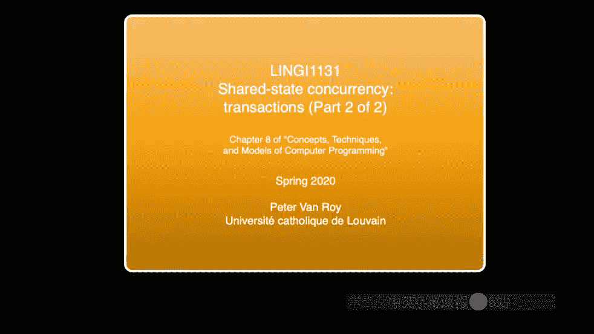
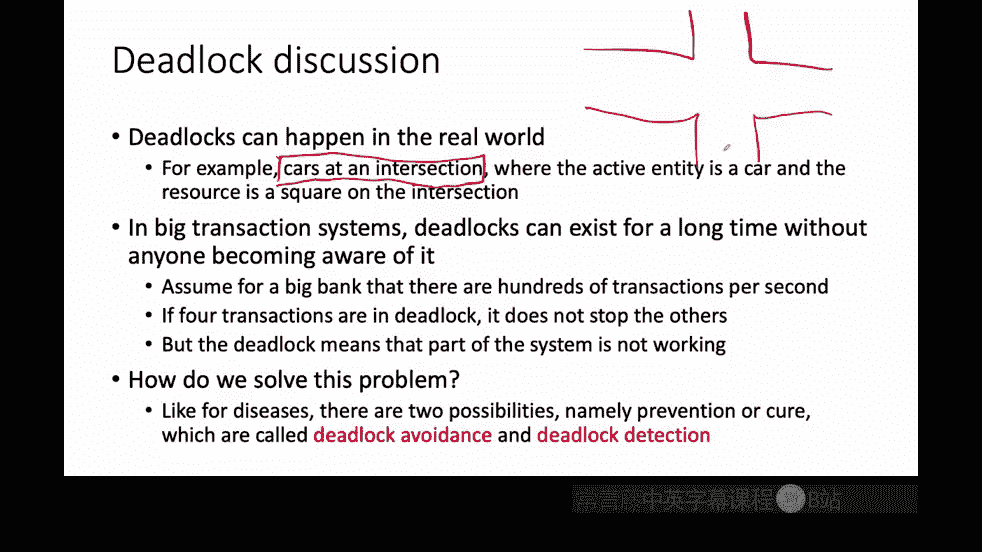
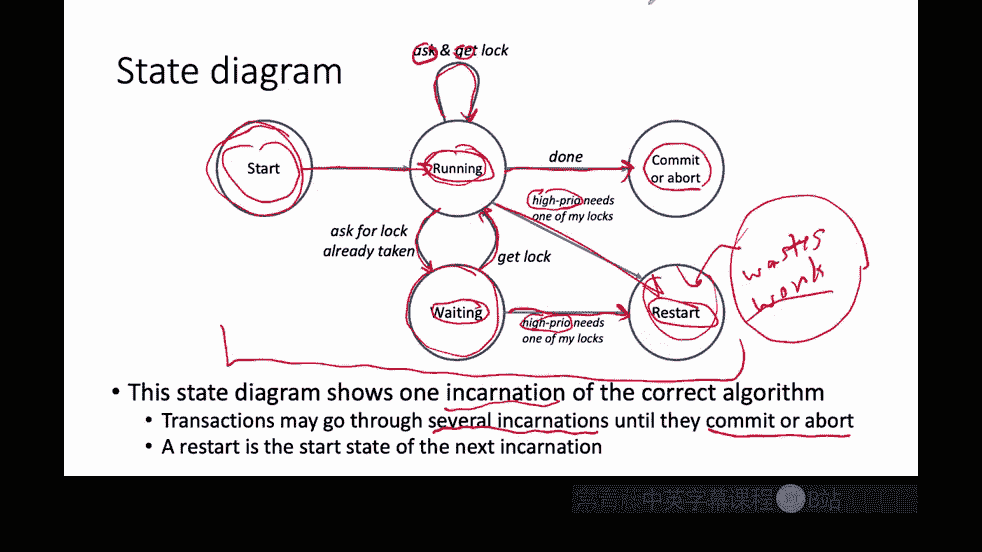
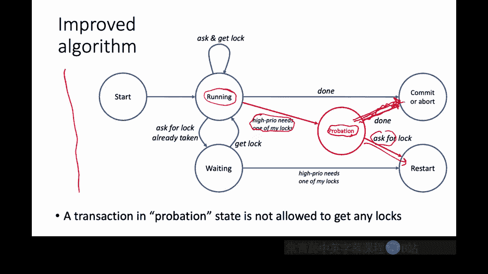
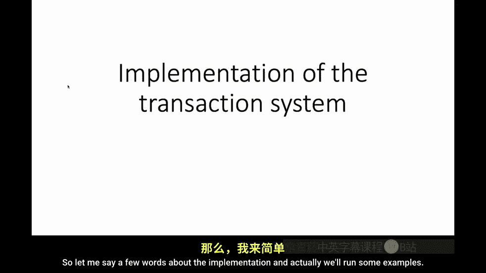
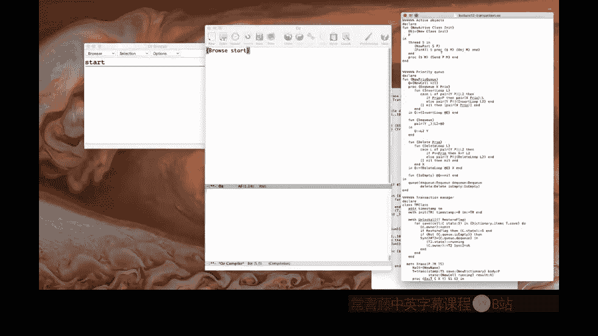
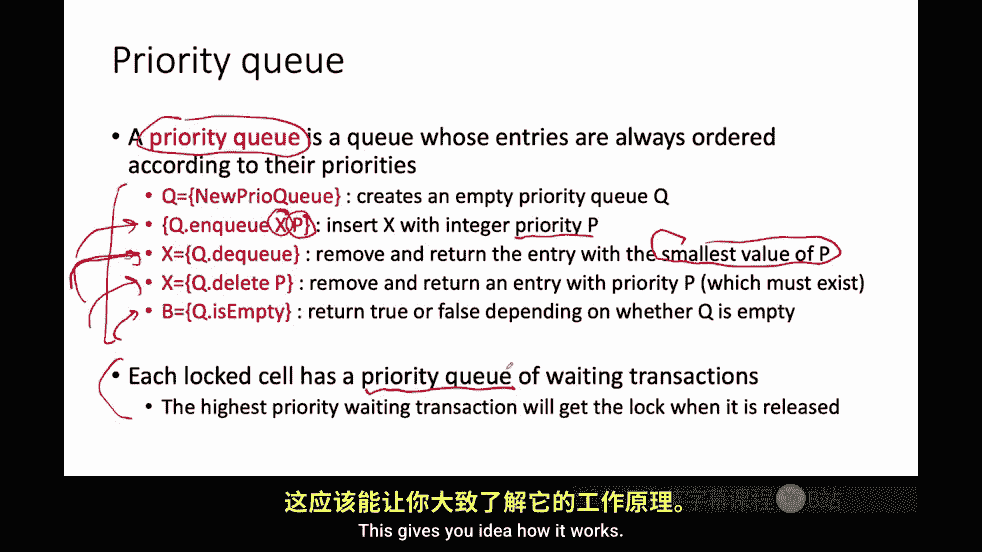
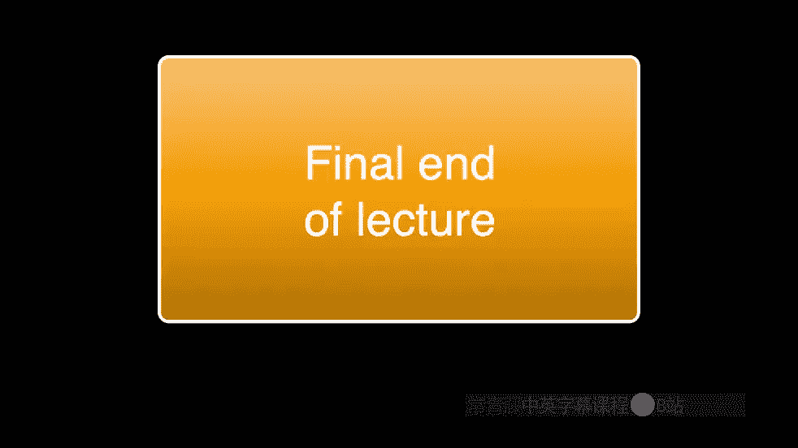

# 鲁汶理工学院【中英⚡高级编程语言概念｜LINFO1131, Advanced programming language concepts】 p13 P7 GI1131 Lecture 12 part 2 (2020) -BV1UDffBbEBZ_p13-

I'm going to start again now。After the break。 so now I'm going to show you a real transaction manager。

So let me go to the slide。So let me start with。The simplest possible one， a naive one。

 and we'll see how it works。 So we're going to do a simple transaction system。

That does optimistic concurrency control， and it has strict two phase locking。

So here's the algorithm， it's very simple。When a transaction requests the lock of an unlocked cell。

It gets the lock right away。 Transaction manager says yes， please。If the cell is already locked。

The transaction will just wait until it becomes unlocked because it's because there's another transaction using it。

 so first the second one will wait until the first one is done and then it will get the lock。

And when the transaction commits or aors， it releases all the locks at once。

 So this is a case of strict two phase locking。 So there's a growing phase。 it's getting locks。

Maybe it's waiting in the middle but eventually it will get all the locks and then when it's completely done。

 it releases all the locks。So this algorithm is doing strict to phase locking。

The algorithm is also optimistic。Because it always gives the lock to a transaction that asks it doesn't。

 are you a train going on a track。 And no， no no， it doesn't worry about that。

 It always gives the lock when it's unlocked。 So it assumes that giving the lock will not lead to problems。

So this is an algorithm。That uses the techniques we saw up to now。But this algorithm has a big。

Problem。It suffers from deadlock。There's another problem and this is a new problem。

 we have not seen it yet， so this algorithm actually has a really specific problem called Dadlock。

And it's a new problem。 I mean， we're doing nothing wrong here。 We have optimistic。

 strict to face locking。 It's fine。But still something will go wrong。

And let me show you a scenario to show you how the Dlock problem appears。So here's a scenario。

 assume I have two transactions， T1 and T2， so I can actually make a diagramma， so I have T1。And T2。

So each one of them uses。2 cells。 So T 1 will use C1 and C 2， and T 2 uses C1 and C2。

 But T 1 starts by using C 1。And it will use C2 later on。 T2 starts by using C2， and then later on。

 it will use C1。Now it depends on how the timing works。Maybe T 1 executes。

 and then much later T2 executes， there's no problem。 But if there is some concurrency。

 some overlap between the execution， then there might be a problem。 And here's a problem。

 So assume that T1 gets the lock for。C 1， T 2 gets the lock for C 2， and they're both running。

 And now it wants the lock。4。C2， so T1 wants the lock for C2 and T2 wants the log for C1。So T1。

 according to our algorithm， once the lock for C2， it will wait。Until T 2 releases it。

 But what does T 2 do， Ti 2 wants the Laan。See，1。L1。 So what will it do。

 It will wait until T1 releases it。 So T 1 will wait until T 2 releases the lock。

And T2 will wait until T1 releases the lock。 You see， this is a circular weight condition。

They will both wait forever。So， the system is。Blocked。

 and this is an example of a deadlock situation。 And so this is a problem with liveness。 Okay。

 so not no， the transactions are doing nothing incorrect。 It's just that they do not progress。

 So this is a problem of liveness。Okay， so let's。T to understand the problem。

And then we'll see how to fix it。So this is actually a very general problem。Deadlock。

So it can happen in any kind of system， not just transaction。

So they're a system with two kinds of entities， there's transactions。Which are active entities。

 And then there are cells， which are resources。 So the active entities need resources。

 So when I take a resource， somebody else does not have the resource and has to wait。

 So only one active entity can use the resource at a time。So when I have this kind of a situation。

 I can make a graph and this is called the weight for graph。

 So this is a graph with two kinds of nodes， transaction nodes and cell node。

 So here's a transaction node， transaction node， and this is a cell node cell node。

And then I have edges。Or arrows。I have an arrow from a transaction。To a cell that it needs。

 and I have an arrow from a cell to a transaction that it is locked by。So T1 is waiting for C2。

But C 2 is locked by T 2。 But T 2 is waiting for C1 and C 1 is locked by T 1。 So this gives me a。

Cycle in the graph。So a deadlock formally is defined as a cycle。In the weight for graph。

So here I have a cycle with two transactions， T1 and T2。But in real life。

 I can have cycles with more with three，4，5 transactions。 I can have T1 waiting for T2。

 T2 waiting for T3， T3 waiting for T1。 So I can have a cycle with 3 or 4， any number。 So 2。

3 for any number above one， of course， So2 is kind of the smallest one。

So this is how we define a deadlock and it can happen in any kind of a system where we have resources。

So。In the real world， you have already experienced Dlock。

 So a typical example of Dlock is cars at an intersection。

 So let me make a diagram here of an intersection。

So this is two roads。And here I have an intersection。With， with different。Pieces。

 so I have a car moving up here。So maybe there's a car here and tries to go forward。

 maybe there's a car here trying to go forward， car here。

 trying to go forward and a car here trying to go forward。So the cars are the active entity。

 and the resource is a part of the intersection， so this square here is a resource。

And when one car is on this square， another car cannot go on。

So here I have a circular dependency between four active entities。 so this car here。

 which I'm coloring in， it needs this resource。 Let me call the resources A B，CD。

 so this car wants resource B， it wants to go forward。But B is already taken， but B wants C。

 C wants D and D and once A。 So I have a cycle again。In this weight for graph of dependencies。

 So this is an also an example of deadlock。So a deadlock is a resource allocation problem。

It happens when we have resources that are allocated。

And when we have a circular dependency in resources。So it's not only a problem with transactions。

 of course it happens a lot in transactions because locks are resources when I when a transaction takes a lock。

It only can be held by one transaction。 So it's a resource in that sense。

 and another transaction cannot take it。 So this is a typical resource allocation problem。

But this is a real problem in big systems， this can give real problems。 so assume you have a bank。

A big bank， okay and and a big bank。 It has ATM machines。 It has many agencies。

 and it has a huge database managing all the transactions。

 This database can have hundreds of transactions per second， Okay。

 so you maybe will only go once to the machine every couple of days。

 But if you have a million clients， it makes a lot of transactions。

 So there can be hundreds per second。Assume that there are four transactions in a deadlock。

Four in a circle and they stop。Liveness problem。But it does not stop the other ones。

 So there's hundreds of transactions going on and four of them are in a deadlock。

Maybe we don't even detect it。 Maybe we're not even seeing it。 Okay， part of the system is dead。

 is stopped， but the rest is running fine。 So it's even kind of hard to detect this。

 So we have to be very careful。 this big bank。A huge number of transactions。

 many of them can be deadlocked， and we won't even know unless we really look specially to see if we can find them。

So deadlock is a real problem in big systems and yeah and you've seen it's a system with cars on the roads。

 if there's a lot of cars， Delock is also a problem so it's a real problem in systems when you have a lot of active entities with a lot of resources。

😊，So how do we solve it？Because we have to solve it。 Okay， we have to solve this problem。

 So we're going to solve it。 And there's actually two ways。There's two ways to solve it。

 It's like for disease。 How do you solve a disease。

 Well there's prevention or cure prevention like vac。Or cure， which is like antibiotics。

Either you wait until the system has a deadlock， and then you。

 you do a calculation on the weight for graph to see whether you can find a cycle。

 and then you abort， you force one of the transactions to abort， and it breaks the deadlock。 fine。

 That's called deadlock detection。The other way is called deadlock avoidance here when you you。

 you are very careful when you start transaction， so the transaction manager will only give you locks。

It will manage the locks。 So there's no deadlock。 Okay， so we're going to show you an example of。

Deadlock avoidance。 Okay， so is it clear， the deadlock concept。

 So deadlock is an important concept that exists in all。Systems。Not just transactions。Okay。

So all systems that have resources can have this problem。 So you understand how it works。

 You have this circular dependency in this resource graph called the weight for graph。 So this cycle。

 and the cycle means the system is part of the system is not。Progressing。

 so it's a problem of liveness。So is that clear how we do that， how deadlock happens？

So now I can explain how we fix the deadlock， Okay， how are we going to fix this？

And you'll see we you have to fix it。 There's no way you can have a system having deadlock。

 It just will not work。 Well， okay， you have to fix it。So the way to fix it。

 so we will take our naive algorithm。And we want to do deadlock avoidance。

 So the way we're going to do it is we're going to break the cycles and the way to break the cycles is。

To make sure they're not symmetric。 If I have T1 waiting for T2 and T waiting 2 waiting for T1。

 it's like a symmetric situation。 But we want to introduce some asymmetry。

 something that's not symmetric。 So we're going to add priorities to the transaction。

Some transactions will have higher priority than others。

 and we will give the earliest transaction we give the highest priority。

So the first transaction the system has highest of all， the second one has lower and so on。

 and it keeps going down。And now we can do deadlock avoidance when a transaction tries to get a lock。

We will compare priorities， so if I try to get a lock and somebody else has the lock。

 then we will compare the priorities of the two。If I have lower priority compared to the guy who already has the lock。

 then I have to wait， the higher priority one gets precedence，But if I have high priority。

And there's a low priority transaction that has the lock。 Ha ha。

 Then I will restart that low priority。 That means I will force it to release all its locks and to start all over again。

And I will take the lock okay， so if the lower priority transaction has the lock。

 then the transaction manager forces it to restart， to release all its locks。

And then the higher one gets it。 and then the lower one， of course， it tries to start running again。

 so it will try to get the lock again， but it won't it'll have to wait because the higher one now has the lock。

 okay。And the other case was the first case。 So if I'm trying to get a transaction and a higher priority one has the lock。

 the lower one just waits。 Okay， so the new idea is that I have a priority and I can restart transaction。

 so the transaction manager can actually have a strong effect。

 It can force a transaction to release all its locks to restore its state and start all over again。

 So it's not an aborta because it might still commit， but it has to do all the work over again。

And it's important because maybe the values of the of the cells has changed because the higher priority one maybe will modify them。

 but it has to start running its code again。We can prove now that this approach will avoid all the deadlocks。

We approved by induction on the order of transaction creation。

So the very first transaction in the system。Of course， in has highest priority， nobody can stop it。

 Okay， if it gets tries to get a lock， it will always get that lock。

 so nobody can stop it and it will complete。Once it's completed。The second transaction。

Has the highest priority。 And again， nobody can stop it。 So by induction。

 eventually all transactions will complete okay。So that's how it works。

So we can actually make a protocol now， and then I'll run the code for this。

So when I create a new transaction， I give it lowest priority so the priority is always going down。

 down， down forever， and they're like integers， so I'm incrementing integers and the higher the integer the lower the priority。

And when a transaction tries to get a lock， so if it's unlocked， I get the lock。

 so I'm still kind of optimistic here。If it's locked by a transaction with higher priority。

 I just wait。I am very humble to let the high priority guy finish。If I am locked by transaction。

 if it's locked by transaction with lower priority， then I have priority over that guy。 So I will。

 so the transaction manager will restart that low priority transaction。 So basically it forcibly。

 it's not really an aborta。 I'm calling it an abort。

 It forcibly causes that transaction to restore all the state release all the locks and start again。

With the same priority， that's very important， So it's always the same transaction。

 So a transaction will never change its priority。 It might be restarted several times。

 because of higher priority ones， but it will never change its own priority。

 So it will still eventually become the highest and then it will go on。 I'm not allowed to。

 if I change the priorities to make it lower， then I could have starvation。 You see。

 it's very important that the restart is done with the same priority。

So the high priority then gets the lock。 the low priority one tries。

 but does not get the lock and waits。 Okay， when a transaction commits。It releases its locks。

And there could be waitinging transactions。On its lock and it dees one so the weighting transactions can go forward and when a transaction aors。

 it does the same， but it also restores the state。So it's like nothing happened and also one weighting transaction per lock is deed and can execute okay。

So you see how it works though。This algorithm。So there's actually I make a state diagram to show how this algorithm works。

 so the algorithm， the transaction starts here and this is a state start。And it goes， starts running。

 so it's running the code。Now different things can happen。

 it can ask for a lock and get the lock fine。Keeps running。It can ask for a lock。

That's already taken。Fine， usually what happens it just waits until the lock becomes available。

 it gets locked， and keeps running。Okay， and eventually it's done。😊，And then it commits or aboards。

 So that's how the normal lifetime is。 Now， while the transaction is running。

 maybe high priority needs one of my locks。h， bad， so I have to restart。So I will restart。

 So restart a restart is like a start state again。 So this， this is called an incarnation。

Of the transaction of the algorithm。And a transaction may go through several incarnations until they finally commit a abort。

So it might be that it's running and it gets to restart and then it runs and maybe it restarts again。

 who knows， but eventually it will be done and it will commit or abort。Now。

 the the restart can happen also in the waiting sta。 I'm waiting for a lock， but。

A high priority transaction needs one of the locks I have already。So I also restart in that case。

 Okay， so there's two ways that I can restart。 So restart actually waits， waste some work。

So the restart， of course， is kind of inefficient because all the work that the transaction did is wasted。

 and it has to start over again。 So the price we have to pay here for deadlock avoidance is somewhat lower performance。

 Okay， because of their restart。 But this is unavoidable。 It's very hard。 You have to pay some price。

A deadlock detection algorithm will also pay price because it has to go and analyze the weight for a graph to see whether there's a cycle。

 that also takes computation。 and then it has to force some transaction to abort or to restart it has to force that。

 So again， there will be some wasted work。 So the deadlock solutions are always going to have a price。

 Okay， here the price that there is going to be some wasted work when a transaction is restarted。

 So we hope that there will be not so many restarts。 Okay。

 restarts happen when many transactions are trying to access the same。The same cells。

If they're all trying to look at the same thing。 so it's kind of what's called a hot spot。

 if there's hots spots in the database， then maybe we will have some performance problem， okay。

So you see how that works。 Let me go to。

，Cha， so you see how Dlock avoidance is working now。 So the priorities are solving that。So。

 so we have two things， one is that the strict too phase locking is solving safety。

It's making sure it's serializable。 That means the system is safe。 There's nothing bad happening。

But still deadlock can happen， so deadlock avoidance is solving a liveness problem。

Because nothing wrong is happening。 It's just the system stops， okay。

 so we want the system to keep going。So deadlock avoidance is making the system live。

 is making sure transactions can progress。So you see how we're solving the safety problem。

With strict too face locking， making it serializable， and we're solving the liveness problem。

 Tedlock。Using priorities。 notice deadlock is a。A fundamental problem。 It's not artificial thing。

 Any system with resources will have this problem。 Okay。

 there's no way to get around that the deadlock will happen。Okay。

 and you have seen deadlock in real life。You have seen it。 You have seen it when you're。

 if you drive around or you're in a car and if you're in a crowded city， you have seen deadlock。

 So how does the deadlock get solved on an intersection when you have cars going go。 Well。

 it's actually very hard。 The cars have to back out。

 Maybe they go on the sidewalk Somehow they have to make room。

So this is actually a deadlock detection algorithm。And in fact， if you look at the traffic rules。

 the traffic rules are designed to do deadlock avoidance。

 So there's actually a rule that says you are not allowed to go on an intersection。

If you're not sure that you can go out after。 So if there's no room to leave the intersection。

 you are normally not allowed to go on。 You have to stop before。

 So if there's a huge bunch of cars on the other side。Then normally。

 you're not allowed to go along this intersection until that cars。

 until that car moves that you have some space on the other side。

 So there's actually a rule that says that you're not allowed to go on intersection unless you're sure you can go off。

 And that rule was actually implementing deadlock avoidance。 Okay。

 but people don't always follow that rule when they're in a hurry。Okay， so that， is that clear。

 let me go now to the slides， Let me talk about something else not an implementation issue。

So this is a nice algorithm， okay？This is actually quite nice algorithm。

But and we're going to implement this algorithm， but the algorithm has like has a implementation issue。

Okay， well， like I can say it's a nasty kind of issue。 The problem is that we terminate。

We restart these transactions。Anywhere。 so it's running。So a transaction has a lock， it's running。

And high priority transaction comes in。And it will restart that other one。Plume right away。

 And where is it could be anywhere the that low priority could be running anywhere。

 So it's terminating。Or actually restarting。So restarting the running transactions at arbitrary point during their execution。

That's not really very nice。 how do we implement that do we kill the thread or what you know so this is actually not so nice for the implementation and if you do it wrong you can have the rank problems in the runtime data structure。

We actually want。A more disciplined when we， when we restart。

We want to restart it at a well defined point。 We don't want to restart that poor low priority guy anywhere。

 We want to restart it at a well defined point。 So the data structures are nice and everything is nice。

 okay。And what is a well defined point， for example， when the transaction asks for a lock？

So let's refine our algorithm and that will give us the final algorithm and when it restarts algorithms。

Restarts transactions。 It will restart them at well defined point in their execution。

 So everything is very nice and disciplined。So how do we do that Well。

 we have to be a little bit more careful when we restart， so instead of restarting immediately。

 we mark it。We pull a little flag on it。 We say， you are marked。

And when that low priority guy tries to get a lock， if it tries to get a lock。

It doesn't get it because it's marked。 it restarts。 okay， if it tries to get a locked later。

 it restarts。You see how that works， so instead of restarting immediately。

 we mark it and when it tries to get a lock， it actually restarts instead of getting the lock。

And actually， this actually increases little bit to performance too。

 because maybe that low priority guy does not need to get a locked anymore。

 and maybe it's almost done。 and maybe it is。 in that case， we let it finish normally。

 So that means we're actually wasting less work。 So this new version of the algorithm is actually more efficient too。

So this leads to。An updated state diagram。So this is our state diagram。

 so the transaction is running。Okay， and it's very nice running， minding its own business。

 and then some high priority transaction comes along。And needs one of my locks。of， Well。

 I don't restart right away。 I I keep running， but I go into a special state。

 I call it probation state。 This is the marked state。And and I'm still running。And， and if I'm the。

 if I finish。I can finish normally， yaea， that might happen。But if I ask for a lock， then I'm。

 then I'm done for， then it's over。 Then I have to restart。 Okay。

 so this would be a well defined point。So the low priority transaction is put in a special state where it's allowed to finish。

 But if it tries to get a lock， it's restarted， So it will actually restart on a well defined point。

 But maybe the high priority one will wait a little bit longer。Because the low one。

 maybe it's going to do some computation here， but it doesn't need any more locks。

And the high one will wait， but it knows that the transaction will eventually finish。

 so it will actually get the lock eventually。 So the high priority one might have to wait a little bit longer。

But the low priority one will have actually a chance to finish。It won't be restarted right away。

 So that means that the system actually even has higher performance with this improved algorithm。

 okay。So this is the final algorithm that we implement here。

 So this is actually quite nice algorithm doing optimistic。strict two phase locking。

And deadlock avoidance。With probation。Okay， so you see， it's actually kind of subtle algorithmma。

 It's not that simple， right， I mean， it seems quite intuitive。 Everything has a reason in there。

You have to， you can understand why it's doing it the way it's doing it。

 but you can see getting all the nice properties， it gives us this very kind of algorithm doing lots of things。

 Okay， you see that。Okay， great。

Let me now go to let me run this thing。So let me go first back to the transaction。This slide， sorry。

So okay， so I'm going to show you a little bit about how this is implemented。

So this is a state diagram， it's very clear， but in fact， when you actually write the code。

 you see there's lots of little details you have to be worrying about。

 so let me say a few words about the implementation and actually we'll run some examples。

So we will actually define an abstraction。 So this is explained in the book。

And then I'll show you a implement。 So this is an ACI transaction。 there's no persistence。

 no durability。 I don't have disk， but it's still a transaction with aort and commit。So each time。

So I actually create a transaction manager， so new trends will actually create a new whole system of transaction manager and there's two operations。

 trans for starting a new transaction。And new cells for creating cells。

 cells that are managed by the transactions。So I have these two operations， so new cell。

 it looks just like the old new cell， I call it new cell T。

It creates a new cell C with initial value x。And trendsnce。Actually， is a higher order。

It takes this expression here。As a function。This expression is actually the code of the transaction。

 itss reading and writing cells。Okay， and B is the end。

 it will be bound to commit oror when the transaction is done。So how does the expression。

 this expression， how does it do the cell operations， Well it's because of this T argument。

You see how the transaction is cleverly designed here。This T is a record。With hatched four fields。

Which gives access assign exchange operations。 So these are actually the standard three cell operations。

 And there's another one， a fourth one called aort。 We can force the transaction to a。

So inside the expression。We can run T dot access， T assign T exchange and T aor。 You see。

 it's kind of complicated Of course， we can give syntax to this。To make it look very， very nice。

 But you see that the abstraction here， we're using this high order。

 but does have this extra argument T because we need to use these special cell operations， okay。

So how can a transaction abort well a transaction either abort when it raises an exception。

 so we're assuming an exception is an abort situation， it will restore all the state。

 or it calls T do abort。Explicitly， okay， so let me actually run this。In the system。Okay。

 so you see that abstraction。 It's not so simple because we don't have special syntax。

 but it is providing you transactions。So let me see if there's a question。

The question is about priorities in the transactions。 It says。

 could we assign priority depending on how much time a certain transaction is waiting to be completed。

 kind of aging。This could avoid starvation。 Okay， so the first thing is， well， the， first of all。

 there's no starvation。 Okay， any case， there's no starvation because the highest priority will always complete。

 Nobody can stop it。 And so they will all complete by induction。 So first of all。

 there's no starvation。The second point is maybe we can optimize the priorities。

 It depends on the how we use the transactions， okay。

Maybe so transaction was waiting for a long time。It's usually going to have higher priority than all the others already。

 Okay， all the ones created after it will have lower priorities。

 So if the transaction is really waiting for a long time， it will get it will be at some point。

 it will be the highest priority， and nobody can stop it。 So this is already avoiding starvation。

 Okay， so the algorithm I show you already has no starvation。

But maybe you can optimize a little bit the priorities and maybe some transactions you want to give them really low priorities。

 but you have to be careful that you don't introduce starvation， okay。

 all transactions must eventually complete for sure。

 So this's a kind of fairness properly again you want the system to be fair。

 so the priorities will guarantee that in the algorithm I show you。Okay。

 is that answering kind of the question？

Let me go to。System here。

So here is my transaction manager。 so I'm it's using active objects。 so the transactions。

And the transaction manager implemented as active objects， so they're exchanging messages。

We also use what's called a priority queue。 This is like a Q。

 except elements have priorities and the highest priority you guys automatically go to the front。

 and then we actually have the code for the transaction manager， which is somewhat complicated。

 So let me copy all this。So I bring it into。The system here。So here we have the transaction manager。

 so this is actually somewhat complicated， but it's running exactly the algorithm I show you。

So let me first define the active object。Then I will define the priority Q。

Let me make some space here。There priority Q。And now I define the actual transaction manager。

I forgot to do the declare。Okay， sorry about that。This should be fine now。Okay， we good。Compiled。

And now the transaction manager， so it's actually defined as a class。

 so I have an active object here。And I have a procedure called nutrients。

 my nutrientutance procedure。So here I've defined everything here。嗯。

So we notice everything is compiled and now let me show you an example of how it works。

I have an example ready here， but you can do your own examples。Just a simple example。

So here is a simple example， So first of all， I call nutrients。

To create a new transaction manager that lets me define transactions with a new cell T operation。

 So each time I call nus， I have a whole new， a whole new world， a new transaction manager。

 which is independent of the others here Well second， I will make a small database。

 So let me call this。😊，In the second example here， I'm actually making a database， a small database。

 so I'm making a tuple with 1，000 elements， and for each of those thousand elements I create a cell。

And the value is going to be I。Okay， so the index。 So I have 1 thousand0 elements。

Indexed from  one to 1000， and the initial value of each one is 1，2，3，4， up to 1000。

 So I have little database here。 It's like little in memoryory database， okay。

And now I can do transactions on this。 So here I have kind of a complicated transaction mix。

So assume this database is like a bank。 okay， each cell gives you how much money there is in the account。

Okay， so cell number 10 has 10 euros。 cell number 20 has 20 euro。

 So now I'm going to shuffle the money around。Okay。I'm going to take three accounts， A。

 B and C here randomly。 So I'm going to pick random numbers from one to 1000。

 I'm going to take three accounts。And the first account， I'm going to put。

The money from B and remove the amount that was in C。 The second 1， I will do a minus B plus C。

 and the third 1， I'll do minus a plus B plus C。 You see。

 I'm shuffling the money between three accounts in a funny way。I also have this abort。

I randomly do a boardt in there if I is equal to J or I is equal to K or J， then aort。

So some transactions will theboard to， Okay， so this mix procedure will， whenever I execute。

 will do a transaction。Okay。But it will not change the total amount of money if you notice a plus b minus C。

 A minus b plus C and minus a plus B plus C。 if you add those up together， you get a plus B plus C。

 so the total amount of money in the bank does not change。So here's another transaction called sum。

So this transaction trans fun here， will， I will create a new cell。With0 in it。Okay。

 I will assign0 into this cell。And then I will do a for loop， I will sum all the money。

 so I will add up all the money in the bank。T S is going to be access S plus access D dot I D dot I is the cell in the database。

 and the return result of this is going to be the result。 So this is actually a function。

 It's returning a result here。 I don't care。 I'm assuming it's going to be always committing。

 So I don't care about this commit abor thing。So I compile this。So if I execute some transaction。

You see that it's displaying 500500。 This is the initial sum because I have 1，2。

3 up to 1000 euros in there， sell 100 as 100 euros and so on。 If I add them all up， I get 500，000s。

500。And now I will mix things together。Po， I will do 1000 mixes， but I will do them in threads。

 So each mix is doing a transaction， So I have 1000 transactions pounding on this database。

 doing mixes， and they're all concurrent， running on。1 thousand threads。So I run that。Okay。

And actually， I can see that it's。Mixed， so if I look at elements D1 to D 10， I will browse them。

 So I have a transaction actually， to display elements。 fine， Let me do like that。

You can see the elements are weird mixed things， minus 795， minus1，2，3，4。

 so the mix really mixed things。But if I run some on all these elements。Okay。Sorry， let me。

If I run some， I have to。I still get the same sum。 So depending on even though I have all this mix。

 I'm still getting the same result。 Okay， so you see。

 I actually doing kind of complicated transactions here。But you can see how it works。

You can try it yourself。 Ill put the code on the。On the Moodle。Okay， so you see with that。

 I actually have created a little database in the system。

 and I can do transactions on that little database。Okay。

Let me now say a few words about how I'm implementing this thing。

Okay。Let me。Go to the slides now。Here。Let me say a few words about implementation。 Now。

 this code is not so simple， so I'm not going to show you all of the details of the code。

But I will give you some information so you can see what it's like to build a real transaction system。

So you can see that it's using active objects okay。

 each transaction has one active object and so it's running in one thread。

The transaction manager is also implemented as one active of objects。

 So it's actually implemented using message passing。 And it's interesting。

 I have this shared state abstraction。Which is transactions on shared data。

 but I'm implementing it using message passing。 It's very fine because this is actually the easiest way to implement。

And the transactions are sending messages to the manager。

So the different kinds of message it can ask for a lock。It can save the state of a cell。Okay。

 because we need to save the state， because if there's an abort， we have to restore the state。

 It says that it commits or it says abort。 Okay， and the transaction manager has to do a fair amount of work。

 It manages the cell locks。 Of course， we saw that already giving the lock or。

Refusing the luck which causes restart， it also manages the states of the cells。

The saving of the states and the transactions themselves， the commit， the abort and the restart。

So if you look at the messages， so here on the right we have our transaction system。

 so each transaction is an active object and the transaction manager and they're sending messages between each other。

And these are the messages。 So if a transaction wants a lock。

 it asks it does get locked for a transaction in a cell。And then it returns。

Transaction manager returns eventually。 S is O。 That means， yes， you have the lock。

 You can go forward or sink is halt。 That means sorry， I refuse the lock， and you have to restart。

 So the transaction will actually have to restart。え。And the save state。

 a transaction when it updates the state of a cell， it actually runs save state。First。

And then the sink says， okay， I have saved the state so that we， if we do an a board。

 we have to restore the state and。Transaction can also do commit or a board at the end。

So the transaction manager keeps track of all those messages。

So let me say just a little bit about the data structures inside。And that's all I'm going to say。

 I'm not going to show you the actual code because it's kind of going too far。

 So each transaction is stored in a record。It has the following data in there。 It has the time step。

 Like we said， this is the priority and the lower value is higher priority， so it's incremented。

It has the saved states。 So there's actually a dictionary。 Remember the dictionary with the tuples。

 it has for each cell。It has a record of the cell and the initial the state that it saves。

So it has a dictionary containing its saved state， so each time you are doing more and more updates。

 this dictionary will grow and keep track of all of the saved state。It has the body。

 which is the one argument。Function that is the body of the transaction， as we saw。

And it has the actual state of the transaction。 And there's three states。 There's the running state。

 There's a wait state。 But here it's waiting for a lock on sea。

 And then there's this probation state that we saw。 You see。

 So it's kind of very similar to the state diagram We saw。 There's a little bit of extra information。

 There's the saved states。Per extra。 Okay， And when I'm waiting also， I know where I'm waiting on。

So the cell also has a record， so the cells， which are the resources。So the cell。

 each cell has a unique name。So this is a name that we define explicitly。

 We're actually reinventing the cell here。 It's not the built in cells。 We actually have the owner。

 then the owner is the transaction that is currently locking the cell。 So here I say it's new cell。

 So the owner can change。So the owner field is actually referring to a cell。 It can be updated。

It's transaction currently locking the cell and its unit if there's nobody。Then there's a queue。

 this is a priority queue， it's the transactions waiting for the sales lock。

Maybe there are many transactions waiting for that luck。

But the highest priority of those waitinging transactions will get it first。

 So it's not a regular cu， but it's a Q that's ordered in terms of priorities。 So priority Q。

 And finally， the cell's current state。 See how the cell。

 So there's little bit of extra information to manage。The information we need to manage。

 And let me say a little bit about priority cues now。

So in order to implement the transaction manager， we need this priority queue。

So each entry x has an integer priority。And when we de cu an entity。

 we'll remove the value the entry tree with the smallest value of Q。

 So they're always like sorted inside the Q。 When I put a new entry in， it doesn't go in the back。

 It goes in a place depending on its priority。 If it's the highest， it goes completely to the front。

 okay。And I have a few other things， I N queue， I DQ， I have delete operation。

 I can also remove an entry from the middle。Remove an entry with priority P。

 Maybe that's because the the。Sometimes I have to actually remove a transaction in the middle。

And also， I have a check whether it's empty or not。 So each locked cell。

 each cell that it's being used by transaction has a queue of waitinging transactions。

 but it's priority queue okay。So that's it。 I'm not going to show you the code。

 This gives you idea how it works。 Let me go conclude now。

So large atomic actions， committing or reportinging。Managing large databases， okay。

 they have strong implementation constraints， both safety and liveness。 So resilience。

 performance and scalability。 So resilience is a safety property。 That means things are correct。

 even if there's crashes。 that safety doesn't break。Performance。

Is a aliveness within a certain time Things happen。 I that a liveness property and scalability。

Exactly both safety and liveness， because as the size increases。

 we want to maintain resilience and performance。 Okay。

 the safety and the liveveness have to be maintained as the size increases。

 and we saw a beautiful algorithm that does optimistic concurrency control to strict two face locking and deadlock of avoidance。

 And you can use that to impress your friends。 Okay， so let me go now quickly back to the。😊，Chat。

So that's all I want to say。So with that， you actually see you might have a foundation of how real transaction systems are working。

Okay。And a real algorithm and all the real problems and and a way to solve them。

 So this gives you good foundation if you want to study more how transactions work。😊。

So next week we're going to talk about distributed programming in airline and so we're not going to talk about transactions anymore。

 but transactions are extremely important， they are crucial for big companies that are doing using computers okay。

So transaction is a very important concept。Okay， so thank you very much。

So I'm going to stop the course now it's 1030，1033。 So the course is now done。 You are free to leave。

 I will stay stick around a little bit if you have any questions。 so thank you very much。

