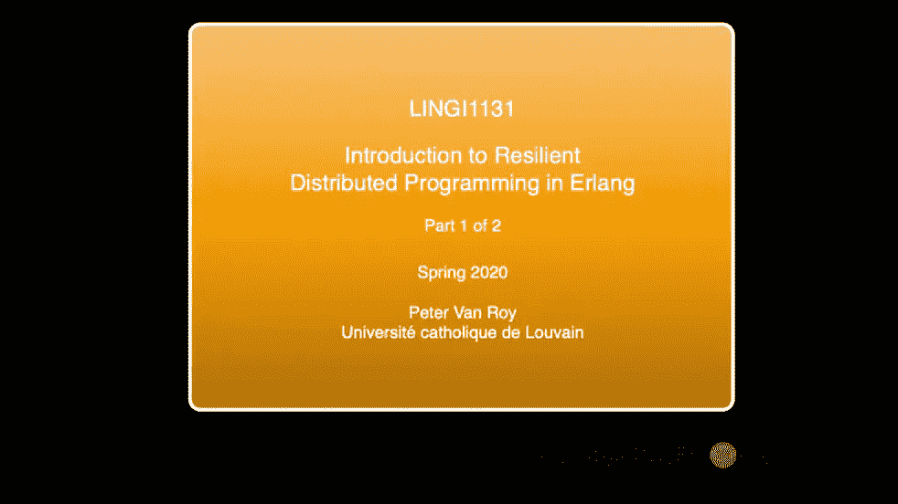
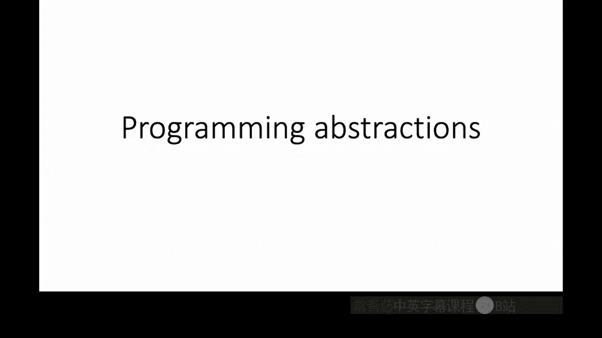
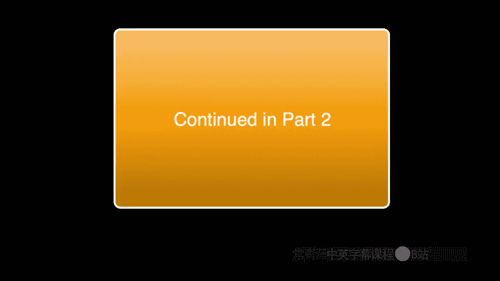

# 鲁汶理工学院【中英⚡高级编程语言概念｜LINFO1131, Advanced programming language concepts】 p14 P6 GI1131 Lecture 13 part 1 (2020) -BV1UDffBbEBZ_p14-

Welcome to the course 1131， this is the last lecture of this semester。

 and in this lecture we're going to talk about real world resilient applications using everything we learned in this course。

 So I'm going to tell you about how ErL， the Earlang language and system。Plies。

All the principles we learned in this course， plus new principles invented by airline for implementing robust systems。

 so let me go to the slides。So we're going to talk about resilient， distributed programming in EarlL。

So this lecture takes information from many documents of airline， so if you want more information。

 you can find it in the bibliography at the end of the slides。So the way I'm going to show it。

 I'll first give you some idea of what are the strengths of airlng。

 why airlng is an interesting system。And what it's used for。

 then we'll talk about the basic concepts of airlinel。 And this builds on what we know before。

 It builds on functional programming， and it builds on message passing。🤧。

Which are two areas that we already learned about。 and the airline support for functional and message passing is very similar to what we saw in this course。

 So airline is a very natural continuation of what we saw in this course。

But airlineirling adds more things for building robust systems。Allows processes to detect crashes。

 failures， and keep working。It also allows dynamic code update so the system can keep going even when you update the software。

 you do not have to stop it。 So these are the basic concepts on top of that。

 AirL builds some very nice abstractions so it makes it very easy for programmers to build robust application。

 If you want to build a very solid application and airline， it's very。

 very easy airlineling provides the abstractions to help you。For that。

So I will explain the basic principles of airLng， how it's designed， the philosophy。

 also the stable storage and the testing tools which are very important。

And then the main part of airling support is called behaviors， so a behavior in airl。

 it's very similar to programming patterns like an object oriented programming when you see design patterns Well behaviors are patterns for concurrency and airlink provides five behaviors。

 generic server， generic finite state machine， generic event handling。

 supervisory trees also application handling， and I'll show you how it works。

 I'll show you how the server works and how the supervisor tree works for making the application robust。

So simple introduction。 So we already saw a little bit introduction to Earl。

 so let me refresh your memory， so airline was developed in Sweden by a very large telecommunation company called Erickson。

 which maybe you know some of you maybe have phones made by them。😊，And this was done in 1986。

 so it's very similar time to Java， which is from 91， so it's actually a system with a long history。

 and it comes with a lot of libraries and this is called airlineang OTP Open Telecom platform。

And there is also a foundation called the AirirL Esyst Foundation to support AirirLang and user community and if you want to download。

 you know already you can get it for free。So airline programs do message passing。

It's called in airline， the basic concept is called a process， which is very。

 very similar to a port object， as we saw in this course。

 an active agent communicates through asynchronous PO message passing。

 This is also called actor model as proposed by Carl Hewitt to 1973。

 So this message passing model is actually a fairly old idea。

So airlineing processes do not share anything。All information is copied。

 there are no pointers between processes。The airirling processes， they have a mail box。

 So this is the difference with a port object。 A port objects read the messages in order。

 but in air length， the processor read messages using the mail box and it's accessed by pattern matching。

 So messages can be removed if they match。 so you can removed them out of order。

 You can receive messages， and maybe the third one is removed， and then the fourth one。

 so they don't have to be treated in the same order。

 They are treated in the order that they are removed with pattern matching。

So airlineling OTP supports long lived reliable systems。Using the notion of behaviors。

 which I mentioned， which are generic concurrency patterns， Supers also are very important。

 So a supervisor is a pattern to handle failure。 So a supervisor process。

 observes the other ones that are working。 And when they crash。

 the supervisor intervenes and can restart， it can either force processes to crash if needed and restart them。

 So the supervisor pattern is very important。And an example of this。

 one of the most famous examples of this is the Erickson， so Erickson made telecommunication systems。

 the AXD301 is an ATM switch So ATM is a form of networking where you make circuits。

 asynchronous transfer mode or you're actually making circuits which is important for telecommunication if you want to talk on the phone。

 you need a guaranteed bandwidth， so it makes circuits， So the ATM switch AXD301 handles a very。

 very large number of simultaneous circuits and it's extremely reliable system because of course telephone systems have to be very reliable。

😊，It has more than 1 million lines of airline code， and the documents claim 99。9999999% availability。

 What that means is that the probability。Of the system working when you access it at a random time is this percentage。

 Now， I'm not sure if it's actually so high， but it's extremely high。 So over the space of one year。

The system will be down less than one second okay and this is guaranteed。

 so this is extremely viableable。 It's one of the most reliable computer systems ever built and especially since it's so complex。

 so the reliability with the complexity is extremely impressive and it shows really that the airing ideas are working very well。

😊，Okay， so let me now give you some ideas of what the strengths are airline compared to other systems。

 so the airline performance in certain areas。So first of all， process creation， so airline processes。

 port objects are very important things。 they basic airline creates many， many， many， many。

 many of them。So they have to be fast。 If you look at here the number of processes on the x axis this is a logarithmic。

 So here we have 10000， for example， and the microseconds we're starting them。

 So these numbers are measured in 2002 but the relative numbers are still valid today So here in green and in blue we have Java and C sharpp which are mainstream languages used for more typical kinds of data processing applications。

 you see that a creation of a process which is a thread in Java or C sharpp but corresponds to a thread takes several hundred microseconds and there is a limit in the number which is several thousand which can maybe seem a lot but for airline that's not very much so airlineline can easily create tens of thousands and this was in 2002 and the creation time is just a few microseconds and you see if you have less than 101 thousand processes the creation time is even。

Below the scale， it's a fraction of a microsecond。 So process creation is extremely fast。

 And like we said in this course， remember， we talk about。😊。

Concurrency for dummies and threads are cheap， while an airline processes are very cheap。

 so you can create them as many as you want。The second thing is message sending when you send a message from one process to another。

 So assume now that in Java or C sharp， you would have two threads implementing active objects。

 sending messages。 The message sending time is several tens to。Thousands of microseconds per message。

 Okay， so it's very slow because it depends a lot on the operating system overhead。

 and it's limited to several thousand processes where in airline length。

 the message sending time is on the order of one microsecond and it goes to tens of thousands of processes。

 So the performance of airang for messages and for processes extremely high and is the best that exists in the state of the art。

So let me show you now two use case of application of airline。So first application is a web server。

So in AirL， the web server is called YaS， which means yet another web server。

 so this is written in Airang running on the NFs file system， if you look at the graph。

You have here in the horizontal access the number of processes， so 10，0020，000 and so on。

 So this is the number of concurrent requests to the web server。

 so assume the web server is being accessed by many， many， many， many， many people。

 many clients and they're sending concurrent requests and you have tens of thousands of them。

So the throughput is the performance of the web server， how fast it can actually deliver results。

 so you can see the throughput here when you have very small number is around 800 kilobytes per second。

 so this also is in the year 2002， but the numbers are still valid today。

So these numbers are coming from a talk by Joe Armstrong。

On concurrency oriented programming in airline。So if you notice when the number of processes increases。

The red is the airline throughput。 The throughput decreases。

 You see when the number of processes goes to 10000， goes to 80000， the throughput decreases a bit。

 It starts very high。 It can go to down to 500。And the reason is that airline has to treat all of the incoming requests and this causes overhead。

But this， if you compare this to the green， which is Apache running on local disk or the red。

 which is Apache on NF file system， they can only handle 4000 processes。

 so Apache crashes at around 4000 requests and you can see that the performance goes down very quickly。

Because system， this system is not designed to handle very many concurrent requests。

 whereas in Erling， this is extremely natural， so Ering handles overload situations very well。

 very gracefully， even if you have very， very many concurrent requests。

Let me show you one other graph and then we go into the concepts so this is the AXD 301 ATM switch。

In this graph， we're going to measure the offered load， so these are connections。

 connections in an ITM network that are made managed by the AXD 301。

 and the offered load is how many connections are attempted。They are phone calls。

 they're called calls here， they're like phone calls when I make a phone call。

 I have to make a connection。And here on the vertical axis is the throughput is how much performance。

 how many calls this switch can handle。 So you can see there's 100% throughput here up to 100% throughput。

 the the ATM switch is able to make all satisfy all the calls。 Okay，100%。 It's linear。

 But if you try to make more calls。 and the system is completely loaded， Then it becomes overloaded。

 and you can see how the AX D 301 handles overload situations。 So when you go to 150%。

 you can see that the number of。Accepted calls does not change。

 We have the maximum performance of the system。 But when you keep increasing the the requests。

 you overload the system that you can see that the performance。Slowly goes down。

 And this is because the ATM switch has to spend time managing the rejected calls。

 The more there are attempted calls， the more work there is。

 And you can see this is done very gracefully。 The graph goes up to 10000 10 times overhead 1000 per cent overload。

 So 10 times the maximum performance of the system。

So you can see that the system does not crash when there is an overload situation。

 it gracefully degrades。 It's clear that when theres an overload。

 you have to handle all the incoming requests， you have to do something to reject them so the part of the performance is going for that。

 So the more you load the system the performance was slightly go down so you can see the performance is smart going down and you can see that there is no crashing going on and this is very important。

😊，For example， this ATM switch is used for example， in emergency situations， when many people call。

 make phone calls， and there is an emergency and you have thousands。

 millions of calls happening at a very short time， then you have overload where the system must not crash when there is an overload。

And Air has a very graceful handling of that because of the way it handles concurrency and fault tolerance。

So the throughput drops linearly when overloaded。Also some more information。

 so this is a slightly different version than the one I showed before， this one， the release 3。

2 has a million lines of errorang， but also errorng OTP has errorang， it has some C C+ plus 900。

000 lines。460，000 in the airling OTP and a little bit of Java for interfacing with other kinds of systems for 13 and 15000 lines。

 So you can see that in real industrial situations Air length performs well。

 and we're going to see now what are the basic principles for this。

 So I'm going to show you first the basic concepts of airang。

 and then I'll show you the abstractions that airling builds on top of that。But first。

 let me go back to the。Chat to see if you have any questions on that。So is that clear。

 so I give you the situation of ErL， we have seen the basic concepts of already an introduction to EarlLng。

 and we have seen functional programming and message passing which are key。Parts of airline。Okay。

 so now I'm going to show you the basic concepts of airline。

And then we'll show you the abstractions but first the basic concepts。

So we've already seen a quick introduction to airlang and you've made it a little bit of exercise on airl。

 So I'm not going to go over that again， but I'm going to show you the new things that are in air lung that help it handle concurrency and failures。

 So it has to handle failures。 So， first of all， airl。

 the core of airang is a pure functional language In each process。 It runs purely functional。

 So it's like a sequential functional programming。 Vas are single assignment whenever you declare variable you bind it immediately and you cannot bind it again。

Functions are values like we saw in the course and it has lercalscope higher order inside the process。

 This is all very similar to what we saw in the course。

 you also have pattern matching this is also very similar to what we saw in the case。

 also in the if statements。And later， we will see the received statement also has pattern matching。

 All the data structures are symbolic values。 So this is very similar to what we saw in the course。

 There are arbitrary precision integers floats。 Sic constant atoms。 lists， for example， tuples。

 So there is not really the notion of a record。 And the tuples。

 you can see the tuple syntax is kind of interesting with the has braces。

 The lists are slightly different syntax in us。 It has the commas。

 But the symbolic structures is very familiar to what we have seen in this course。

 Strings are lists of ASI codes。So list of integers。

And there's a new thing compared to what we saw before。

 Something that we have not seen in the course is that they are binary vectors。

 These are bit vectors where you can look at bit fields of different widths。

 And this is very useful for low level protocol computations。

 So you can use airlineang for implementing network protocols。

 And it has a support for that with these binary vectors。 So that is the core。

Airline is a dynamically typed， but a strongly typed language。That means that types are enforced。

 You cannot break the type representation inside the language。

 So many languages that people use are strongly typed Java is strongly typed scheme， Hasco prologue。

 many languages are strongly typed。 there exist also weekly typed languages。

 the most common ones are C and C++ and they are weak because you can use casting to access the complete internal representation。

 So that can be important if you're doing very low level machine level things like drivers。

 for example， so but for large applications， this is not useful So airlineirling is strongly typed。

But strongly type languages can be dynamically or statically typed。

 So a dynamically type languages where the variables type is only known at runtime。 So at runtime。

 you combine the variable to entities of any type。And in aesthetically typed language。

 you know the types at compile time。So there is， of course。

 large discussion between dynamically typed language and statically typed language people。

So static typing allows catching more errors at compile time because the compiler can check that the types are correct。

But， in fact， they're not really more resilient。 This is kind of a somewhat controversial。

 static typing allows catching。Surface errors， like simple errors， but deep errors， errors of logic。

Are not easy to catch using static or any other system。 So airlan programs。

 even though they're dynamically typed， they most， they're the most resilient softwareer artifacts ever built。

 So an airlan program is much more resilient， for example。

 than a program written in any statically typed language such as Haskell because Airlan provides the mechanisms to overcome the deep errors。

 And so that's what we're going to see in this course。So an airang module。

 so airang source code is organized in modules。 typically they are in files。 So this is very simple。

 So errorang has actually a very simple structure。 So a module has a name here， math。

 for example it can export operations， which are functions and import operations。

 So here we have a definition of a function areas L。 we have higher order lists sum， we have here。

 higher order function。 you can see because it's not that much different from the syntax we see in this course。

 you can see that it's fairly straightforward area here has topple arguments， square x rectangle X Y。

 So square is an atom X is a represents a variable。 So you notice that airang also uses。😊。

Capital first letters to represent variable identifiers。

 this is a historical thing that comes from the prologue language， which uses that convention。

And you have you can import and export from the modules and this gives you dependency graphs so airline is basically a flat structure。

 we have a set of modules and modules that can depend on each other。So。After that。

 now let's look at processes。So an airline process can。You can create a process using spawn。

 you give it a function， which defines the behavior， and PID is the process name。

 the process ID or name， the function can be anonymous or can be named。

 so you give it a function to the the behavior， typically this is going to be a tail recursive function。

And the name is a unique constant， so every process has a unique name in the system。

 and you can send using an exclamation point using the bang notation。

 so you're sending message to process ID。Messages are sent asynchronously。

 all data is copied and they can be received using the receive statement。Okay。

 so let's look at receiving now， so each process has a mailbox。

 so this is the main difference compared to port objects。 The mailbox is a new thing。

 It's actually a fairly complicated system。You can extract messages from the mailbox using receive。

So the receive has patterns， so it looks very similar to a case with pattern matching。

And you can have patterns， you can also have Boolean functions， guards， and when the pattern matches。

 you execute an expression。So you in typically， you would be suing sending P ID send。

 and you'll be doing receiving The receive also has a timeout。

Optional time out after certain time to do this， because if the receive does not find a pattern。

 it will wait。 and if there's no time out， it will wait forever。So。

I will give the precise semantics of the receive， because the air length system is really based on using receive。

So if the mailbox is empty， the receive will block。If the mailbox is not empty。

The receive will take the first message。 So you have a list a sequence of messages。

 It will take the first message and try patterns in order to see whether it matches。

 if it finds a matching pattern， executes and continues。

 If no pattern matches for any of the messages。They receive blocks and waits for the next message okay。

So messages that do not match， they remain in the mailbox。

 and they can be removed by future received calls。 So this is very interesting because you can have different parts of a process。

 two different pieces both of them call receive。And one of them handles certain kind of messages。

 and another handles another kind of messages。 So one received might handle messages of a certain form and the other one handle message of another form。

 So this means that we see that messages can be removed out of order in a different order from when they arrived。

 So you have to be careful with this， if you don't take the message out of the mailbox。

 it will stay in the mailbox forever。 And this can be actually by a memory leak。

 and this can be a source of box。 So you have to be careful to remove eventually remove all the messages。

And the patterns are very similar to the patterns we saw in this course。

 they contain variable identifiers and guards， simple boolean built in tests。Okay。

 so let me go to the。So this is very similar to what we've seen before。

 and now after now now I will introduce new things。 So up to now。

We have seen this is all similar to what we have already seen in introduction to Erangng。

 So starting now， I will end start adding， introducing new things that we have not seen yet。Okay。

So if that's okay case， everyone's following the airline。How Erlingng is working。

 Because now we go to the new ideas of Erlng。So let me go back to the slides。First of all。

 one new idea is process registering。You can take a process ID and register it with a name。

 which can be an atom。So this is a symbolic name that you can actually display on a screen and print and so on。

 it's with characters as an atom。So this makes the process globally available。

 anybody who knows the atom can send a message。To the process。This is actually a very important idea。

 it's not just because atoms are easier to use than process ideas。

 this allows you to keep interfaces unchanged。Even if processes crash， So for an atom。

Maybe it's called server1。 If server1 represents the process。 If that process crashes。

 then a new process can be created to take over the work of that process that crashed and we can register the same name。

 server1 to that new process。 So from the outside， the name of the interface does not change。

 even when failures are handled and processes change。 Okay。

 so that so a process registering is very important for keeping the interfaces the same。

Even when you have crashes。 So there are several operations。

 Register gives process ID D the name Adam。 You can also unregister。

You can also take an atom and find which is the process ID with where is。

 and there is a function registered which can return a list of all the registered processes。Okay。

 so that's the first concept process registering。The second concept is called。Linking。

I mentioned it very briefly before。But linking。Has to do with failures。

So you can link two processes together。 so if I have a process here and another one， P1， P2。

 I can link them together。Like this。So P1 can call link P2 or vice versa。

 but the linking is bi directionional， it does not matter who calls the link。

 the connection goes both ways。When a process terminates now。It could terminate normally。

 or maybe it crashes。 There's a reason for that termination。Whenever there's a termination。

 theres a reason for it， this is sent as a signal to all linked processes。

 So a signal is a message sent when a process terminates。

 So a signal is kind of a special kind of message。 it's sent when you have termination。

So it's sent to all linked processes。 So if I have another process P3， which is linked to P2 here。

And if P1 crashes， then P1 will send that exit reason to P2。And P 2 will then handle it。 Okay。

 so when the process terminates normally， the exit reason is the atom normal。 Otherwise。

 there's an exit reason that tells you why it crashed。 Maybe it definedied by 0。 Maybe there's。

Some weird thing that it could not do right， square root of negative number。 Who knows。

There some reason for the error。And this is part of this tuple， which is the exit reason。

Now normally， process termination is propagated， it's transitive。So when I， when process P1 crashes。

 it sends exit signal to P2。 when a process receives an exit signal with a reason different from normal by default。

 it will also crash。And it will send the exit signals forward to the other process。

 So all of them crash。 And if there's even more linked together， they all crash。

 So you can see all the linked processes are actually they behave as if they're grouped together。

 This is called the link set。 because of this transitive connection。 if any one of them crashes。

 They will all。😊，Be forced to terminate。 You will force them all to crash。

 even if baby they're not doing anything wrong。 They will be forced to crash。 Okay。

 so the default behavior， when a process receives an exit signal with a reason different from normal is to terminate itself。

 So P2 will terminate when it receives a link， an exit signal from P1。

And it will send the same reason to its linked processes so it propagates and all the linked processes the link set will crash。

So that is the default behavior。You can actually modify that。

 you can turn the process into what's called a system process。 You can trap exit No。

 so a process can protect itself by calling trap exit true。And for that process。

 maybe P4 is a special one。It's linked here。 It will not crash， but it will receive a message。

So the processes that are。Have this flag enabled， they will not crash。

 but they will receive a message。So the exit signal is transformed into this message。

 exit from PAD where it's coming from and the reason， and exit is an atom。

And it's put into the mailbox of the process。Before here in this diagram。

 So you can see that by default， they all crash， but you can have one that's not crashing if you set the trap exit flag to true and it will receive the reason as a message and will not crash。

 So this process is actually observing the others。 It can see when the others crash。

 And then maybe it can do something。 So this is the basic principle for building what we will call supervisors later。

So this mechanism， the linking mechanism with trap exit， is what's used to build supervisors。

 which we will see later， but this is the basic mechanism well you see the link set。

 default everyone crashes except for the ones with trap has exit true。So process linking。

So a little bit more on how it works， so inside a process。If a process throws an exception。

 so inside of process you have exception handling， so it's basically functional programming with exception handling and you can throw exceptions and catch exceptions。

So if the exception is not caught at the top level。

 then the process terminates and it broadcasts its signal to all link processes。

 so typically uncut exceptions in a process cause the link set to terminate。

And then there's a few additional operations that we need to manage this。

 So maybe you want to change a little bit the behavior。 So you have an operation called exit。

 So this one sends an exit signal。Without terminating。

 so I can actually send an exit signal without terminating myself。 So this， with this way。

 a process that's like a supervisor can force another process to terminate。

 even though it might not be linked。 Okay， you might need that for managing。

 So for building supervisors， you need this kind of operation。 and you can also have。

An unstoppable exit。 So this one will force the process to die。

 even though it might have a trap exit set。 And this is because supervisors。

 the ones who observe the other ones。 Sometimes they also have to be terminated。

 So this is important for building the supervisor tree abstraction。 Okay， So here in the right。

 there's some code。 So here I start， I spawn。This function with zero arguments。

 So this function sets trap exit equal true and it loops。 So the loop here。

 So normally this will be a recursive thing when it receives exit， it does stuff。

 and then it does something。 So basically， this process on the right would be observing other processes that might crash。

 Okay， so you see how linking works。There is so linking is very important， so we start registering。

 which is important for keeping the interfaces the same， even when processes change。

 linking is important for managing failure of groups of processes when one process fails。

All of the ones that are working together have to fail。 So basically。

 the idea is that all these processes are working together。 they're collaborating。

 and one of them fails。 Then logically， the others cannot continue。

 even if they don't have a problem， so they have to fail too。

 So linking guarantees that they all fail， okay。There is a variation of linking called monitoring。😊。

So this has nothing to do with monitors as in Java。

 this is monitor is just an asymmetric version of linking or a process will monitor another one。

And when that other one crashes， it gets a message right away。

So if a server crashes in a client server。Maybe we want to kill the clients， but if a client crashes。

 we do not want to kill the server， maybe we have 10 clients talking to a server。

 if the client crashes， there's no reason to kill the server， okay。

 so it's asymmetric so this is an asymmetric version of linking when we don't want to kill certain processes。

So you can create make a monitor。Of a P 1 will monitor P 2。 and if P2 dies。

 then you will get a message saying down of PD 1 okay。So there's monitoring。Which is asymmetric。

 it's a variation of linking that's asymmetric。So so far we have registering and linking。Now。

 let me mention a little bit how we have a distributed airline length system。So so far。

 the airline system runs on one machine。But we can have an airline system running on many machines so we can have many airline runtime systems。

Each one of them running on a different computer。They are calledners and they are communicating with each other。

And you use message passing between the node as well。 So if I have one node here， node and one。

 another node here and 2。If I have processes on these nodes， these processes can communicate。

 but they can also communicate between the nodes。And this is transparent。

 which means it uses the same syntax between the nodes and inside the nodes。

 That means when I send a message to a node to a process， maybe the process is on another node。

 and I don't know。So this is a transparent， this is called transparent distribution。

You can also spawn processes and other node， So there's a variation of spawn where you also give the name of the node。

呃。Also for registered names for the registering， registered names are local。

 if you want to specify a node， a process fully， you need to give both the node and the name。

And the way that nodes connect。The first time you use the name of the node。

 the system will make a connection， maybe it's choosing TCP or UDP。Connections are made transitively。

 so typically if you have a bunch of nodes together in an airline length system。

 this is a fully connected mesh mesh。 so all nodes are connected together。So if you have n nodes。

 this will give n squared connections。 So this is not scalable。

 but this is the default for airang for running on clusters for recent versions of airang that are running more on internet。

Allow more scalable， but the default is that you have transitive， fully connected mesh。

 So this is important because for reliability， the full connectivity is very important。

 If I want to send a message from node 1 to N 2。 I want to send directly。

 I don't want to hop to node N 3。 So if N3 crashes， I still want to send message from N1 to N 2。

 So the fully connected mesh is the default for building reliable systems， but， of course。

 you can change that for large systems to make it less fully connected for scalable。

But if you don't do anything， it will be fully connected。 Okay。

 so you see how distributed airline works。 It's transparent。

 It's fully connected by default and registered names are local。

Now let talk let me go a second back to the chat。Before I talk about hot code updating。Okay。

 so you see what we've seen so far。So registering， linking and distributed airline。

 you see distributed airline is very simple。And you can program distributed systems without knowing anything about networking or network protocols。

 It's completely transparent。 So airline makes distributed programming very easy。Okay。

And so registering linking and transparent distribution。So let me go on。

 there's one more basic concept I have to introduce。

 and then we have seen all the basic concept of air learning。

The one more basic concept is a very important one for alarm lived systems。

So this is called dynamic code change。And this is because in real time systems。

 we would like to change the code without stopping the system。

 This is something maybe you don't have much experience with。

 but in a system that does real life behavior。 you do not want to stop the system when you update the code。

 you upgrade or you fix a bug， you do not want to stop。Some systems are never supposed to be stopped。

The example given by Joe Armstrong is the X2000 satellite control system developed by NASA。

But there's another example we saw in the。In a project， which is the Danish national。

National medical。Database。So in Denmark， there is one national database。

 which contains all the patients， all the Danish people， all the doctors。

 all the hospitals and all the pharmacies。 So if you go to a doctor and he gives you a prescription。

 he will enter it into this database。 you can access this database for your own use。

 and you can go to a pharmacy and they will see the prescription in the database。

 So this is how it works for several years now， this Danish medical database is built using a database called Re。

Which is written in airline。So the Danish National medical database is written in Air and it's not supposed to stop。

If I get sick and I get a prescription and I go to a pharmacy， I have to get my medication。 Okay。

 so this system is not allowed to go down。 so it's always up。

 So this system is using dynamic code change in the airline lung implementation。

 So this is extremely highly available system。So the way it works。In Erirlo。Well， first of all。

 it works because processes are not。Sharing。 so two processes are not sharing。

 So if I update the code in one process， it will not affect the code in the other one。

 So it's easy to update part of the system because there's no share。

So airline provides a mechanism each module。Has two versions of the code of code， an old version。

 and a new version。Okay， if you create a new process in the module。

 you will get to the latest version， the new version of the code。

But if a process is running with the old code and the new version is installed。

 the process can continue with the old or use the new。 So whenever the code of the module is updated。

 all the running processes， they are running with the old code。

 but they will decide when they are ready to switch to the new code。

 So each process will then decide。 So eventually so you basically will send a message。

 all the processes will eventually update themselves to the new code。

So this is how the system works when you， you put the new code in the module and then you tell the processes the new code exists and the new processes when they are ready for it will。

Locally， decide to use the new code。So this is supported in the language。 So here we have a module M。

And here we have a loop。😊，Inside of a process doing work。 So this loop receives messages。

 and it calls itself recursively tail recursively。 So basically。

 this is very similar to port object You receive a message， and then you continue running。

So you have two versions of the loop peer。 The left version calls itself as M。Colon loop。

And the right one just calls loop。So M called the loopop will always use the latest new version。

But loop by itself will keep using the old version。 So when a new version arrives。

if you process will call loop， it will not update， but then you can send the process a message saying there's a new version。

 please update and the process will say okay， and it will get ready to update and when it's ready to update it will call M colon loop。

Okay， so this is the basic mechanism。 It's used by libraries that manage upgrading of releases。

 So Erling has a libraries that let you。Structure it， how a release can be upgraded。

 and it uses this mechanism。 So you see in the language。

 there's a difference between M colon loop and loop by itself。

So you have the old and the new version， and there's only two versions。Okay， not ever three。

So when you upgrade and there's an old version in a new version。

 you cannot put in a third version doesn't exist。 So you have to wait until all the processes are upgraded to the new version。

And then the old version can be removed。And then if you want to upgrade again， you can upgrade again。

 But at any moment in time， there is only two versions in the system， the old and the new。 Otherwise。

 it's too complicated。 and that is is quite normal because usually the updating is not done so frequently。

 you don't update the system so much， Maybe if you have a lot of development。

 It's updating every week or every month or who knows。

 but it's not going to be updating every minute。 Okay， so two versions is very reasonable。

 and it makes the system manageable， okay。And then there's one more detail of this。

 So this system is based on modules。Which store two versions。

 There's also another way to do the dynamic code change。 This is called hot code swap。

You can do individual processes。 So if you don't want to upgrade the modules。

 but you have one process。Running， and you want to change the code just of one process。

 Then you do not need the big module mechanism。 You can use higher order。So here's a server。

And this function is the server functionality。 So the server does。Fun of the query and the data。

 okay。Now， notice that the fun is an argument。So。This is function can be updated when the server receives the the message new fun。

 This has another function， fun1。So you can see you can use higher order to change the abilities of the system。

And you can， for example， here this on the right here， you would have a way how the server is called。

 you call it using RPC， this is the normal call。But then you have a special message called NewF that allows you to upgrade the server。

So this way， you can actually use higher order to update individual。Processes。

 that's a very small mechanism， but for applications， you use the other mechanism。

 the mechanism that's based on modules， the two versions。

 so you can see that the module mechanism is important because the system is structured with modules。

 but you can still of course use higher order for individual processes。Okay。

So that's all for the basic concepts。So let me go back to the chat now。

So those are all the basic concepts in airlineline。 You see it's not that many。

 There's a few interesting ones。 So， of course， there's the message sending and receiving port objects。

 We saw the port objects are functions， pure functions。Then there's registering。 you can have names。

 atoms as names that you can。You have the same atom， Even if the process changes。

 you have linking for managing failure and termination and for forcing all of the processes to terminate when one of them goes bad。

And then you have monitoring， which is a restricted version of that。

 you have distributed air language which is transparent。

So you don't see in the sense whether it's local or not， the send looks exactly the same。And finally。

 you have the dynamic code changing ability， where you have two versions per module。And with this。

 you can manage the upgrading of a system without stopping the system。Okay。

 so that gives me all of the basic abstractions for ErLng。

I don't know if you have any questions on that。Is that clear。

 So these are the basic primitive concepts that are in the low level system， how the processes work。

 On top of that， airirling has built abstractions。Which I will talk about in the second part of the course。

 Okay， so I don't know if you have any questions now。Please feel free to ask questions。

 Maybe I'm going too fast。I don't know。Okay， so this now we have seen now the first。

 the basic set of basic operations。 Now I'm going to make a small break。Okay。

 I'm going to make a small break， five minute break， and then we'll talk about the big ideas。

 the big libraries that Erlng puts on top of that， basically the behavior。

 I mentioned the concurrency patterns and the supervisors and so on。

 how Erl uses these basic mechanisms to make it very easy for programmers。So if you're a programmer。

 you're not going to use the basic ones directly， you're going to use the libraries usually， okay。

 so I'm going to make now a small break。

And then in five minutes， I will continue with programming abstractions。

