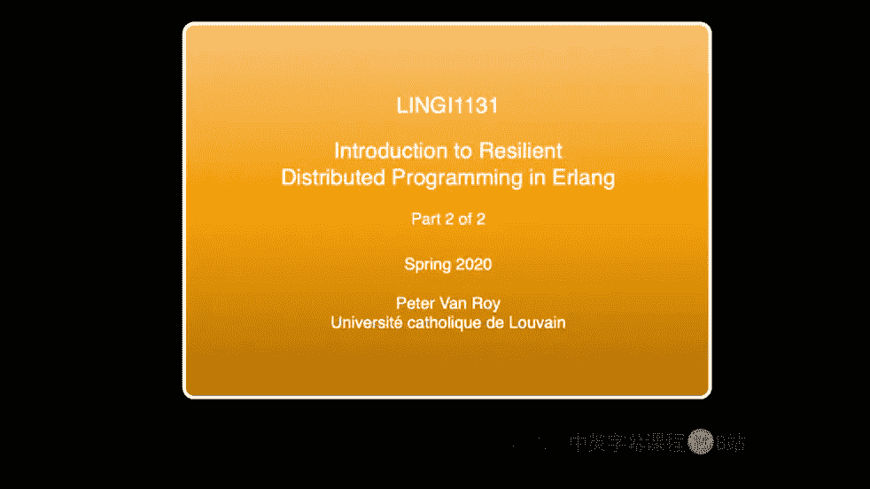
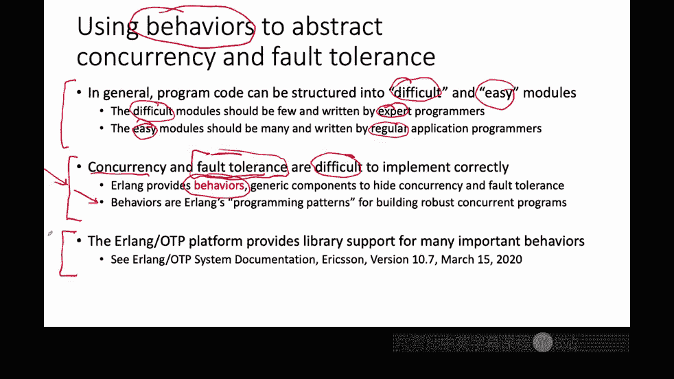
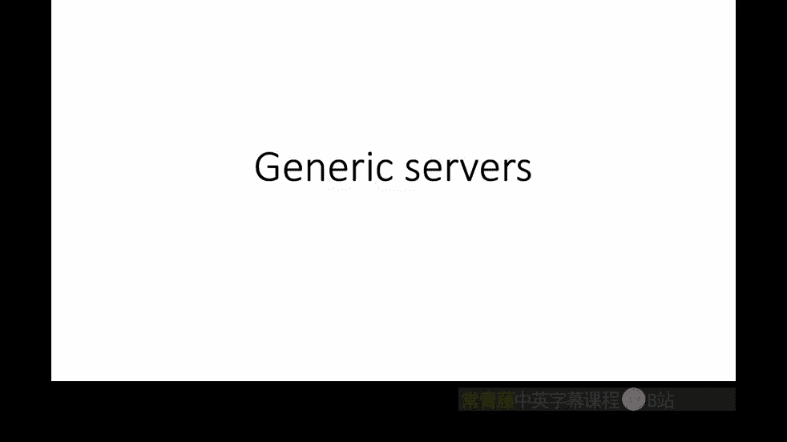
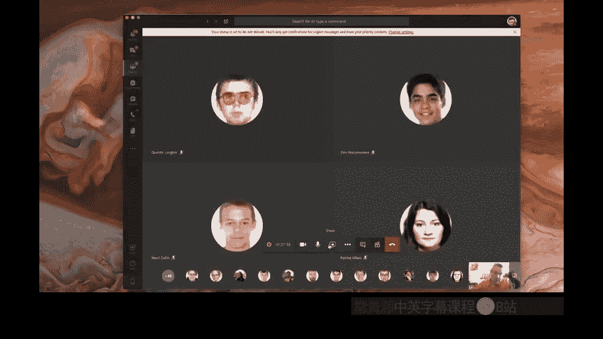
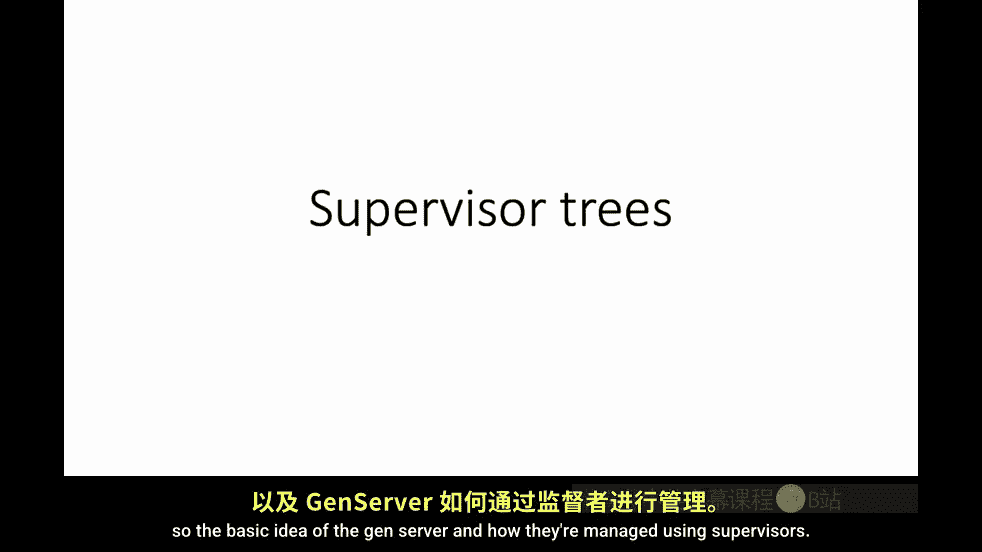
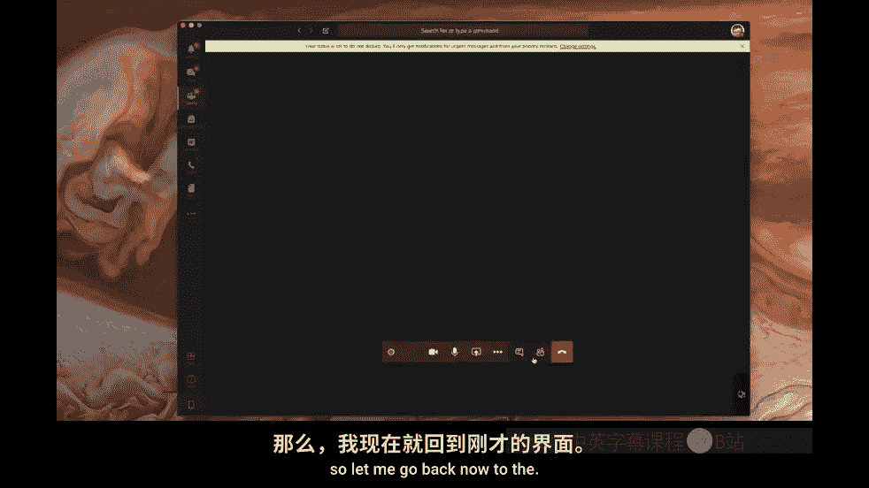
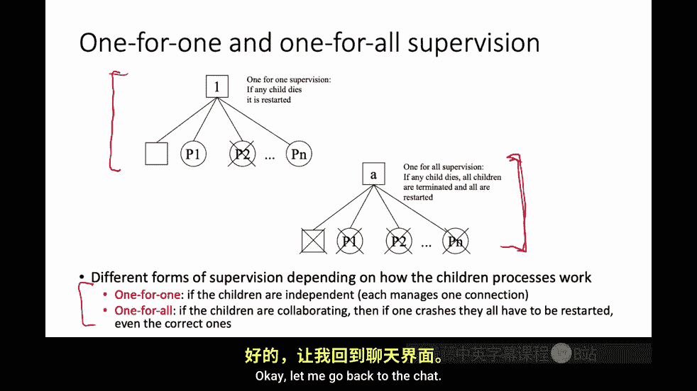
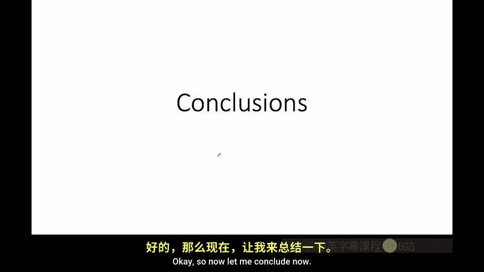
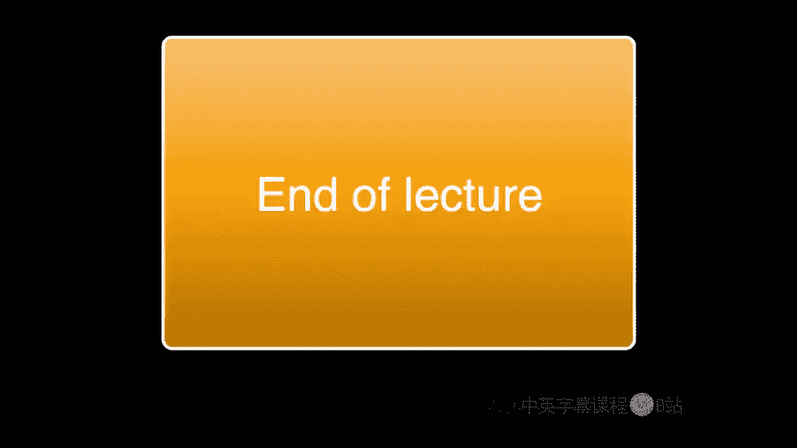

# 鲁汶理工学院【中英⚡高级编程语言概念｜LINFO1131, Advanced programming language concepts】 p15 P5 GI1131 Lecture 13 part 2 (2020) -BV1UDffBbEBZ_p15-

Let me continue now after the break。 So there's one question in the chat。

 So the question is on dynamic code updating。

So the question is。If one process can keep the old version of the code。

 is it possible that we can't make new updates because of one process never updating。

 So the idea is you have many processes running in the module。And we want to update。

 but one process never updates。 It keeps running the old code。 So， yes， that would be a bug。

 So if one process for some reason does not update the code。

 then the module cannot be completely updated。 So that's a bug。

So it depends on the reason why the process is not updating。 If the process is not updating。

 because it has a bug in there， or maybe it's not updating because it's waiting for a message from another one。

And it's not。 the message is not arriving。 And so it cannot update。

 It does It's not ready for updating。Actually， there is a way at air length to solve that problem is you terminate that process。

 So the supervisor。Can actually notice that that the process is not updating and can kill the process restarted。

 So there's actually a way if the updating is not happening because of a。

Problem and error somewhere that you cannot avoid。 Then the supervisor can actually force that process to die。

 and then you can update。 So， so so the question is actually is very interesting question because there's actually ways in airline to force。

Then the process， the module to update， okay。So it depends on the application because you cannot get rid of bugs in general。

 sometimes if a process is buggy， you have to terminate it。

You have to kill it。 This is the airline philosophy。

 So let me now go to the second part of the course and talk a little more about the airline philosophy of how to build robust software。

 So this is a very interesting philosophy。 And Let me go to the slide now。😊，Okay。

 so Air provides some programming abstractions for building robust systems。

So let me talk a little bit about Earlling philosophy because there's a lot of discussion around airlineling philosophy and the airline programmers are very strong believers in this philosophy。

 so it's actually very interesting philosophy and it's very important to understand how EarlLang is thinking。

So the question is， how can we make robust software that keeps running forever？And popular languages。

 for example， Java and Python are completely inadequate。

 They do not provide the mechanism necessary in from an airline point of view。

 Java is extremely unreliable， the airline programmer would oh would hate running writing thing in Java because it's always crashing and he cannot do anything。

 So the question how can we make robust software。So Errling has built a system based on some principles。

 So these principles I'm taking them from Joe Armstrong's PhD thesis。

 so Joe Armstrong is one of the main designers of Erlingng。So he has written a lot。

 and he has written some very nice books on how to use airline。 So the principles。 First of all。

 first principle， you cannot eliminate errors。So people， when they write software。

 they try to reduce errors。 Okay， you fix bugs， people fix bugs。

 but there will always be some bugs remaining。 So the airlineing principle says you cannot reduce the errors to 0。

 There will always be some errors left。So even if you do really， really， really good effort to debug。

 there will be some errors left。 So， and that's actually。A true principle。 It's what we observe。

 Even if you make your program very solid and you test and you debug。

 there will still be some errors left。Therefore。You have to handle them。 Okay。

 You cannot assume that the software will not have errors。

 You will have to assume there will be errors。 So you need mechanism to handle them。

 And we're talking about both hardware and software errors， not just software。 Any kind of error。

 Maybe the process crash because of a hardware problem。

 Or maybe it's a software problem for airlineing。 it's the same。 We have to handle it。Okay。

So the second principle， then， is the unit of failure。That we need strong isolation。

 So we divide our system into parts， into boxes， components。 And when one of the boxes fails。

 the others do not fail。 So it's a unit of failure。 error。

 an error occurring in one component will not。Affect the others。 So we have isolation。

 So we have separate boxes。 This is very different from Java in a Java program。

 The whole program is monolithic。 It's one big box。 If something fails， the whole thing fails。

So in airline we say no， we don't build our software like this。

 We build it as separate boxes that are isolated and if one box fails， the others do not fail。

 so we have this isolation and boxes are units of failure。Now the third principle is fail fast。

So when。A program is doing something wrong。Don't try to fix it inside。

 Just fail as quickly as you can。 Fa fast。 When there's a problem。

 don't try to fix it inside the process， but fail immediately。

 So either you are working correctly or you stop quickly。 So fail fast。

Fourth principle is that failure should be detectable。 If one component fails。

 the others should see that。 They get notified。 Now this is actually what linking is doing。

 of course。And then the fifth principles， no shared state。

 So this is actually consequence of the second principle。 but message passing。

 So the components are talking through messages， But there are no shared state。

 There's no pointers going between them。 There's no memory that is accessed by all components。

 They are not sharing any state。 Okay， So these are the principles。

 So how does airline build on top of this。 So we'll see now what airline does。

 So airline actually has a few slogans to help you understand how it's doing the most famous slogan of airline is called let it crash。

If you can't do your job。Crash。So when a process is running。Something is going wrong。

 Maybe it receives information of the wrong type。 Okay， from another process。 it's not its fault。

 It's receiving something wrong， or maybe tries to open file doesn't work or something goes wrong。

The air length philosophy says， don't try to fix it， just crash。Okay， one simple state crashed。

 So when a process cannot work， it just crashes。So that is the philosophy。

 All the possible failure states are mapped to one state， which is crashed。 Okay。

 this makes things very simple。So then how do we fix it， then it goes to another。Slogan。

 let someone else do error recovery。So if one process crashes。

The problem will be fixed by another process。Okay， and the reason is that。

Hardware and software errors。Can both happen and trying to solve them inside the process is complicated。

 but we don't want to make the process complicated。Okay， the process crashes。

Problem will be solved by another process。 Another process will detect that this one has crashed and will do something to fix the problem。

 Okay， so let it crash， and then someone else will solve the problem。And then a third principle。

 which is a very interesting one， is do not program defensively。

 Maybe you have heard of defensive programming that a program should always check things。

 It should check the types of when it receives information。

 It should check the result when it does call the function。 Check， check， check， check。

 always be very， very defensive。So the airing philosophy is this is not useful。 it's not productive。

 First of all， it makes the program complicated。 and what do you do when a chick fails？

Do you try to fix it？Do you what， what do you do。And in any case， they will not remove all errors。

 The checks will not be completely solving the problem。 There will still be errors。

They will still occur， and they still need to be handled。 So the best way。

Is not to do defensive program。 Keep your program simple。And if it goes wrong， crash。Okay。

 map all errors to a single false state， namely crashed。 So no matter what happens。

 if something goes wrong， crash。 Okay， so that's the airlineang principle。

 processessses don't worry about process crashing。 You have to encourage crashing。 Crashing is good。

 okay， Failure is good Failure helps you。 So in many systems， you try to avoid failure。

 airlineang systems do not try to avoid processed failure。

 They say we encourage processes to fail because we will fix the problem at another level。 Okay。

 so that's the airlineang philosophy can seem very strange if you're not used to building robust software。

 but actually， it works very well。 and they designed it over many years。 and you see how it works。

So in an airline system， so airline， the platform is called OTP。An O TP supports a number of。

Ill hit hierarchy when I'm building a big system， there's different kind of system。Okay。

 so the main system is called the release。So a release is the full thing is all the information necessary to build and run the complete system。

 including software archive。And a set of procedures for installation， including upgrading。

 So this is the full deal。That's the biggest one。 The second one。

 little bit simpler is called an application。A single application。 So this would be like。Yeah。

 a web server or text processor or some big data tool， whatever， a database。

 It's not the entire system， but it's just one application。So very often。

 a release consists of multiple applications that could be independent。

 or maybe there's a dependency。 And maybe there's a database application。

 And then there's a web server application， and the Web server uses the database。

 Those are two applications inside the release。 So applications are also units in airlinelink that can be managed。

And then in the next smaller step。And this is the one we're going to look at very closely。

The next one is called behaviors。 So this I mentioned already。

 so a behavior is a concurrency pattern。A behavior is a set of processes that together implement。

Some kind of concurrency pattern。So for example， there can be a generic server， any client server。

 there's a client server behavior。Or another one， a very important behavior is called supervisor。

A supervisor is a tree of processes。 It's a hierarchy with one root and with subre。

 And the children on the bottom are the workers doing the work。So， the。

Supervisor will monitor the behaviors。 will monitor what's going on。 The child behaviors。

 and it can stop them。 It can terminate them。 It can start them。 It can restart them。

 So the supervisor is actually observing the system。

And then the very lowest thing are the actual workers。

 so these are the actual processes that are implementing the behaviors， so Gen server behavior。

 Gen event behavior or Gen finite state machine behavior okay。So let me say a couple words about。

Behaviors。 and then I go to the chat。 So behavior is a very important concept。In airline。

 So what's the idea。Well， assume now you're writing a program， okay。

 some parts of the program are hard to write， some parts are easy。Okay， the hard ones。

 you want them to be written by experts。 Okay， it's clear。

 you don't want everybody to write very complicated stuff。

The easy ones can be written by regular programmers。

So the way to do it is to put all the hard stuff into a special place to make it generic。

So that's the idea。 So now let's look at concurrency and fault tolerance。 So these are difficult。

 So concurrency already is difficult in message passing。 It actually can be difficult。

 Fult tolerance when things can crash is even harder。So they are difficult。So how do we handle it？

 Well， we put the difficulty inside。Of behaviors。 So a behavior is a generic component that hides the concurrency and the fault tolerance。

 The complicated bits are inside the behavior。 So the programmer that uses the behavior。

 only asked to plug in simple things。 Okay， so behaviors are very similar to programming patterns。

 but they're actually libraries。 They're kind of like higher order libraries。

 you instantiate the library， and you plug in。What you need to do and then the behavior provides the functionality。

Okay， so that's the basic idea you want to hide these things。Okay， let me go quickly to the chat。

 So of course， OTP provides many， in fact， all of the really important ones you need for applications are in OTP。

And it's explained in lot of detail。 you can look at system documentation of OTP from Ericrickson。

 The latest version is from March 2020， and it huge document with many。

 many examples how to use the behaviors。 So if you want to write concurrent fault tolerant programs in airline。

 it's actually very easy by using behavior。Okay， let me go quickly now to the chat。

So you can see the idea。

Let it crash philosophy。And then we will see how airline supports this。 So there's a question。

What is my point of view on defensive programming， Actually。

 I agree with the airlineling point of view If your system supports it， so in airline。

 you don't do defensive programming， but instead you use supervisors and you do let it crash。Now。

 if you write Java programs。There's no supervisor。 So you have to do some defensive programming。

 if but defensive programming is a very weak idea。 It's kind of a hack。 Okay。

 it's not a real good solution。 Sometimes you have to do it。

 If your system doesn't provide anything else。 But if your system provides a better mechanism。

 then don't do defensive programming。 So in airline。

 the supervisor mechanism using let it crash is actually much better mechanism than defensive programming。

 Okay， so that's my answer for defensive programming。 Sometimes you're forced to use it。

 If you're writing in Java， you have to do it because crashes in Java are very nasty and you don't want crashes。

 So you have to do some defensive programming。 but it's kind of a hack。

 because Java does not really support。Building robust software。

 This scheme's kind of strange to say that， But from the viewpoint of an airline programmer and from who has extremely high reliability systems that never go down。

 he looks at Java， and he sees。How can I write a robust programming Java。

 The system does not help me。 Okay， so airlineirling has these mechanisms that are used instead of defensive programming。

 So try not to use it。 but sometimes you're forced to， but try not， if you have a choice。

 don't use it and use a system that gives you better mechanisms， okay。So that's okay。

 So let me go now。 I'm going to now。Start presenting more of the ideas。

 and then I'll show a little bit more in detail how the behaviors work。

So let me go back to the slides now。So first of all， let me show you what are the standard。

The standard behaviors。In airline OTP。So there are standard， there are five standard behaviors。

And actually， you will be somewhat familiar with some of them。 you'll see。

 So there's the generic server behavior。This allows you to build client servers， robust。

 fault tolerant client servers very easily。 It allows。 It has registration built in， starting。

 stopping of the server。Timeouts， managing the state， synchronous or asynchronous calls。

 error handing。 It's all handled in the genetic server。

 and the whole thing is concurrent and fault tolerant。 very easy。So that's the generic server。

 the second one is the generic event handler。So events happen very often in concurrent systems。

You can have， for example， events coming from outside。

Pressing a key in a text editor can be an event， but you can also manage events in a database。

 You need to log the events， sometimes keep them on a permanent storage。

So you need to send notifications to parts of the system that are waiting for events。

 So event is kind of important information traveling around the system。

 and you have to collect it and notify the right people。 So there's a generic event handler。

And then the third one is one that we have seen in this course。Is the generic finite state machine。

So this one is actually very nice。 Remember the lift control system where we had state machines where we have to。

 how do you define a message passing application， You have to define these state machines。

 Well the generic state finite state machine is helping you for that。

 It does all of the low level thing stuff for that。😊。

So applications are modeled as finite state machines。 So you have seen， we have seen how that works。

 So airline gives you strong support for that。 So this is very similar to what we saw。

An application is in a state， it receives an event， and it transitions to another state。

And it does some actions， so this is actually very similar to the state diagram we have seen。

 it's actually exactly the same。Okay， so that's the generic finite state machine。

So this one will often be the heart of an application。 Okay。

 you will have a couple of finite state machines， the lifts， the floors。

 the controllers talking to each other。You see， so Iling supports that very nicely。

The fourth one is application。So an application。Is an important unit。

 It gives you a whole bunch of packaged functionality。 You can start it， and stop it。

Altogether and you can reuse it in other systems， for example， a database could be an application。

 maybe you need it in a web server， maybe you need it in some other kind of application。

So airline provides support for treating that as a box as a unit。

And then the fifth one is a very important one。Which I have mentioned a few times。

 which is the supervisor。So the supervisor is the generic toolkit for implementing the supervisor hierarchies。

 which are the basic mechanism for making applications robust where whenever you're running。

Someone is looking at you， which is the supervisor， okay。

 and the supervisor sees if you're doing if you have a problem。

The supervisor can restart to you or can observe whether something is going wrong。

 So all airlinel systems don't run。By themselves， they're always being supervised。

 There's always some one looking at them。Observing them to see whether everything is going fine and fixing a problem。

 if there' is a problem。 Okay， so this is the basic mechanism for Erling that you use instead of defensive programming。

 You will always use the supervisors。 And it's very interesting。

 Supers are automatically part of all these other behaviors。 All these other behaviors are designed。

To work。In supervised fashion， you have to do almost no effort。 This is built in to airline。Okay。

So these behaviors will hide most of the complexity of each of these concepts。

Finite state machine server event handler concurrency fault terms are extremely simple using behaviors。

And all the non supervisor behaviors now these four first ones are designed to be pluggable directly into a supervisor hierarchy。

 so everything that runs in earling can be supervised so the supervising concept is very important。

Okay， now there's a cup before we explain exactly how it works。

 So I'm going to explain the server and I going to explain the supervisor。

 So you see how these things work。 I'm going to explain two other things provided by airline first。

One is the stable storage。So it's clear when when a supervisor sees there's a problem and it has to restart the process。

The process has to restart in a consistent state。 So you need a kind of。Database， a stable storage。

 So the stable storage is。The friend of the supervisors。

 So the supervisor and the stable storage are working together。 Okay。

 so the stable storage is an important part of the airline length's resilience。

 So it's actually what the supervisor uses to restart the system。

So airlineling provides three levels of stable storage， which are more and more flexible。

 but also more and more。Time consuming。 So the simplest one is called Erling term storage。

 This is in memory storage。And so this one has limited size and concurrent ability。

 but it's extremely fast。So this one is what you use when a process fails。But the node does not fail。

 A process fails inside the node。 You can use ET S to restart that process with consistent data。

 So this is extremely efficient， okay。Then there is disk paste E T S。 same abilities is the S。

 but stored on a disk。 So this is if the node itself fails。

 then you have to go to disk the stable Sturge。Okay， so both of these are limited to single nodes。

 and then finally you have a full blown transactional database。It's built on top of ETS and DETS。

This is much more expressive。 This is called mennesia。 So mennesia is。

A full fledged like S Q L relational transactional database。

 supporting distribution and replication on multiple notes。 So this。

For very complex applications where you have to store complicated information。

 you want to use ammennesia。 So you have these different levels。 You start with E T S。

 and you can go further。If you need the expressiveness， but ETS is extremely efficient。

 it's blazingly fast， as they say。So that's a stable storage and a final point is testing。

So what we've seen up to now is designing for resilience。

 We've seen the fact of using behaviors and supervisors。And let it crash。Is giving you a good design。

But that's not enough。 You still have to test， of course。

 and you've seen maybe in other courses that testing is important。

 So airlinel provides a whole spectrum of tools， starting with very simple unit testing。

Including test generators， a higher order programming for generating test and what airline calls fixtures。

 This is if a test needs some input to be set up before and something to be done after to get the information out。

 So this is this E unit framework which supports test driven development。

For testing modules and libraries。The next one is called common test。

 This is a system testing framework with this。 You can test the whole system。

And you can do important things like testing。Race conditions。 and fault injection。

If I have a concurrent system， I have test what's called test groups。

 I can run tests in random order。And to see whether there are non determinism issues in the test。

I can call test suites。To handle independenceencies， and I can also simulate abnormal termination。

 fault injection。So if my system is robust， if it survives a crash， I have to test that。

 so the testing will force processes to crash。 it will do fault injection。As part of the test。

 So this is the common test。Full featured framework。 And then there's an interesting tool。

 There's a couple of very interesting tools。 In addition to that， one of them is called dialolzer。

Dionizer is actually a type checker。It it does type inference。 So remember。

 we said error long is dynamically typed， not statically typed。

 So you can have kind of type errors sometimes。 Well dialzer kind of fixes that in many cases。

 it actually will find type errors。It will find errors that mistakes in the types。

And so it gives you already back some of the advantages of static typing if you want those advantages。

 okay？So that's， so that gives you the basic idea now for airline， you have the。The behaviors。

The generic behaviors and the supervisors。You have the stable storage。

 which is the friend of supervisors together， they manage the fault tolerance。

And then you have the testing， which is the friend of the design。The design is good。

 but it has to be tested， of course。 But， of course， the testing will usually be straightforward。

 and the design is made to be fault tolerant， but you still have to test it because maybe you did a little bit something wrong somewhere。

But once you test and it's， you see that it's solid to the design。

 then the system will be extremely reliable。 Okay， so that gives you then the basic。

Pincipleles of building applications in airline。What I want to do now is talk about how servers work。

And then I'll talk about supervisor tree， which is a very important concept。

 But let me first go back to the chat。

Okay。Okay， so you've seen there's a few questions， but let me first say。

 so you've seen now the basic principles， so let it crash， which mean。Crashing is good。

 That's another slogan。 Failure is good for process。 So if a process is a problem， let it crash。

 and then you have a supervisor looking on top。 You have the stable storage so the supervisor can restart the process with a new state。

 And then you have behaviors。 So you don't have to write any code for this。

 It's done already for you。 The Arang OTP supports all of this。

 So this makes it very easy for the programmer。 Let me answer another questions。So a question。

 what if a supervisor crashes？That's a very good question。

 so the supervisor is actually looking at these process node。So one way， the supervisor。

 the supervisor itself can have problems。 so the supervisor will see there's a problem and will restart。

Okay， it sees there's a low level problem， maybe contention， maybe a conflict。

 maybe low level overload， maybe an error in the computation， it restarts。

And then the system keeps running。 And another time it has to restart。

 So the supervisor may be restarting the， the processes。Many times。But maybe too many times。 you see。

 maybe the same error is always coming back。 So the restarting is not solving the problem。

 In that case， the supervisor itself will fail。And the supervisor will actually have another supervisor。

 which is higher up。 So it's a tree。 So the supervisors actually manage the behaviors。

These are the first level supervisors。 They're looking at behaviors。

 but all these first level supervisors are。Managed by a second level supervisor。

 which is looking at the supervisors。 So if part so the second level supervisor will see if there is a part of the system having a problem。

Maybe it requires some other kind of aff。Maybe the system is attempting to do too many calls and we have to do some other fix like reducing the throughput or something。

 So there's actually a second level supervisor that you can write。

 observing the first ones and if you look at Ax D301。

 it actually has a two level supervisor hierarchy so it has the supervisor observing the behaviors and it has a second level supervisor and actually I asked Joe Armstrong。

Whether you need more and he says， no for the X D301，2 level supervisor is enough。Okay。

When a process crashes during handling a message， this message is re in the mail box or not。

 So the message comes into the mail box， and then the process crashes。That message will disappear。

 okay， it will not be put in again。And the the so there will not be the message comes into the process。

 and then the process crashes。 when it's restarted， the message will not。Be reappeared。 It's gone。

 Okay， that's why you have to。Termininate all of the processes in a link set。

 because maybe another process send me a message， and I crash。And I'm restarted。 But the other one。

 there's a problem still because the message has disappeared。

 So the other one cannot continue either。 So that's why you have to。BRestar the whole link set， okay。

A question is the supervisor and crash concept available in other languages？Partly。

 in other languages， typically you will use fault tolerant libraries。

But the system itself has really no mechanisms， basic mechanisms for handling fault tolerance so。The。

 the concept， as far as I can tell， is。Still very attached to Erling。

 And the reason is that Erling is completely built on message passing。

 whereas other systems like Java are built on shared state， So they have a different foundation。

 So you cannot use supervisors on a system built with shared state。

 because you don't have the independence， Okay， so the answer is that the concept is still mostly existing in Erl。

 but there are a few message passing systems So is a system called Aka。

 which is built on top of Scala， which are incorporating some of the Erling ideas。

 but it only works if your system is doing message passing， okay。Otherwise。

 for shared state systems like Java， you cannot use supervisor concept because it is designed for message passing systems using independent。

Active objects， okay。So it's kind of still very specific to Erling。 You see when Erling was designed。

A lot of people have been working at Erling， so Erling has a head start。

 Other systems are starting to copy now the earling ideas and make systems with agents。But Erling。

 people have not been sitting still。 O， all the ideas I show you now are still being developed。

 and new ideas are still being added into Erling。Okay， let me。Now。

 show you how the servers work first， and I'll show you how supervisors work。 So supervisors。

 generic servers， very interesting。And you'll see it's very easy to understand if you understand a little bit higher order。

 how that works。So let me first explain generic servers。Okay， so here， let me show you a server。

Let me show you a very simple client server， and then I'll show you how to make it。

Generic and specific。 So let me show you first， a simple server。As a single piece of code。

 And then we divided it up into two pieces， a generic。Part。And a specific part。Okay。

 so this slide here shows you a simple server。The simple server has a。It does something very simple。

 so basically it keeps track of chance。 So the idea is the following。The server does the following。

 It manages。A data structure called channel。And it allows you to allocate and free channels。

So I have a set of channels。And I can call allocate if I want to use a channel。

And I can call free when I don't use it anymore。 And internally。

 there's the system manage this as a data structure。Okay。So the channels are represented by atoms。

 so I have a set of channels， I allocate I get one。Okay， so there's an allocate function。

 which returns a channel。And then there's a free when I want to free the channel。

 I put it back into the free， so it's basically you have a set of allocated channels and a set of free channels when I allocate one I move I move it from free to allocate it。

 when I free one I move it back from allocate it to free。

So I have a simple data structure managed by channels， allocate and free。

 so these are the basic functions， and the server turns this into a server。

 so it receives allocate message and receives a free message okay so this loop basically implements the server。

It can receive these two messages， it does some work here， it calls allocate， it calls free。

So I won't show you right away so channels allocate and free。

 There's actually an implementation of that a few slides farther。

 So it's actually here on this slide， so but I won't I include the slide to make the example complete。

 but for now you can assume that channels allocate and free are functions that exist okay and I want to turn them into a server so I create a server here。

Notice the server， I register it， I call it。C H1 channel 1 server， and it will run in a loop。

And it will take two kinds of messages， an allocate and a free。

 And then I have an interface here where I can turn them actually into functions where the allocate function will send allocate message to the server。

 and it will receive the allocated channel， and the free message will send the free to the server。

 okay。So you see how it works， so the allocate。An allocate will send a message to the server。

 So here is the server。And it will return to the allocated。

Resource and the free message will send the message to the server， but it doesn't need any reply。

 okay。So this， this whole slide shows you this one application built on top of this channel data structure and allocateator free。

 You see， it's a very， it's。Very straightforward kind of application I'm not trying to do something complicated and it's actually something realistic。

No， so this is a s。Let me now split it。Into a generic part， which is the actual server loop。

 So this is the server looper。And then the specific part， which is this functions。

So if I want to write another server， I would have to write this loop。

 and I would fill in new functions here。So let me write now a generic server。

So here's a generic server。Okay， this server will do any kind of。Sing。

And the way it works is that it will do a call and it will not do allocate。

 but it will do any kind of a call that receives a message。 It will also do a cent without returning。

 So in earn， this is called a cast cast means throwing something So the call does round trip。

 and the cast does a simple scent。And the server loop is here。So， the。It's a loop doing receive。

 It does recursive call here， and the red。Code is actually the functions I want to do。

 So there's an init function。There is a handle call and handle cast。 So this is a generic server。

 and the way to make it specific is to fill in the blanks is to define in it。

 define handle call and define handlecast。 And then it turns into specific server。 okay。

 but this generic server code on this slide will let me build any kind of server。Of course。

 this is a simple1。 This one is not doing fault tolerance。 Okay， it's not doing。

Things like start and stop and registration automatically。 And it's not doing a lot of things。

 Loging。 It's just doing the basic server。 So the real gen server is doing a little bit more。

 But you can see this is the basic idea。 This is a generic server。And now， to make it specific。

I have to fill in this three red。Functions。So here's the filling in。

 this is called the callback module。So to make it specific， I have to define a callback module。

 this is the only thing the programmer needs to write。

 so the generic server is already in the system。So here in the red box is the connection between these。

Generic things。 and the actual。Calls I need to do。 So in it， handle call， handle cast。

 I have to define them。 So in it is calling channels。 Hand call of Eoc is calling Eloc。

 Hand casta free is calling free。Okay。So this is the connection between the generic part and the specific part。

 And then I can do other things。 I can， I can。Define the ac and free。 If I。

 if I want to turn them into actual kind of。To make them look like procedure calls， I can do that。

 But the basic connection is done in this red box。 Okay， so you see how it works。

 I have a generic server here， generic server loop and the filling in the blank is the red part。

 And then I just have to write the callback module。

 So the programmer only has to write the callback module。 okay。So here's the channel implementation。

 I won't go into so much detail。 So channels are managed as a tuple of two。Things。

 a list of allocated channel and a list of free channels。

 Aloc will take a free one and put it in the allocated list and free will take a an allocated one and put it back in the free list。

These are the functions I'm using in the previous example。 so I won't go into detail here。

 You can look at it if you want。 It makes the example complete。Okay。The channels。

 this is the functionality could be anything。 This is how I'm using it in this example。Okay。

 so the full。Gen Ser。Provided by OTP is extending this example Okay this example shows you the basic server and what can you do So the basic server lets you start and you need to have a callback module and then you have two kinds of server requests synchronous request which goes round trip an asynchronous which is only going one direction。

 So in Erling this is called call and cast the cast is the asynchronous call as synchronous。And then。

 of course， I can stop it。 What I did not show is that the real gen server。

Can be part of a supervision tree。The server will automatically be terminated then by the supervisor。

 It can also be restarted if there are problems。 So I won't explain the details of that。

 I can just say that the server， the gen server， can actually be part of a supervisor tree。Okay。

 so that's the Gen Ser example。So I will go back to the chat now。

 but and then I will explain supervisor treesce。 So the basic idea。

Of the gent server and how they're managed using supervisor。 So let me go back now to the。

So you see how thejectx serververse works。 So I've shown you the example in error length code。

 but it's actually kind of higher order exampleampla。 I have a template。

 and I just have to plug in the higher order functions that I need to make it specific。

 So it's not really very miraculous。 It's very straightforward in a language that supports the higher orderness。

So you can see how it works for the server。But the real genover is doing a lot more work for you。

 The real Genover is living inside of a supervisor hierarchy。Okay。

 so you see how the gen server works。Let me now show you the supervisors。

 the famous supervisor concept that I have already been so much talking about。

Now I will show it for you。Give you more information on how supervisor works。Supervisor trees。

So what is the principle？So we want to build fault tolerant systems。

It turns out most faults and errors are transient。For example， a message is dropped。On the network。

 for some reason。That's transient， because if you try again， maybe the message will go through。

Or there's some kind of timing problem。 part of the system Time out。 congestion， for example。

 or start up problem。 The system is starting up concurrently because of timing issues it starts up in the wrong order。

 and there's a problem。 Some maybe there's a deadlock。 Deadlock is a timing problem。

 So timing problem， for example， Delock is a timing problem。 If you restart and execute again。

 the deadlock will probably not occur。 Remember， we talked about deadlock。

 it actually depends on precise timing。So the supervisor tree will actually fix deadlocks。

So the way it works is the basic strategy is simple retry。It's very naive， actually。

The basic strategy of a supervisor is to。Restart the problem。 and to let it run again。

So the supervisor tree is favoring， retrying。 It's not the only thing it does。

 but the first thing it does。Is simple retry。So a set of processes are supervised。

 that means there is a process observing them and seeing whether they're running normally or failing。

Okay， the supervisors have authority over the supervised process。 They can stop them。 They can。

Cause them to terminate， and they can restart them。Okay。

And supervisors can themselves be observed in some cases， as I mentioned in the question。

And the supervisor tree themselves is carefully implemented。

 So there's no internal problems like race condition and so on。

 So the starting of a supervisor tree will be synchronous。 So this is already implemented。

 The programmer does not have to worry about this。 The supervisor tree itself is very carefully implemented。

So that's the basic principle。So a supervisor tree is a hierarchy。So it has a root。

It's kind of like a tree。It has of a set of supervisor node， so here are some supervisor notes。

And then there's some worker notes underneath， which are supervised。Okay。

So a supervisor node can start， stop， and monitor its child processes。

And all the early behaviors that we saw。That I mentioned server。

 event and FSM are working with supervisors。 So there's the basic restart principles。 First of all。

 there's the restart strategy， and then the restart frequency。

So the restart strategy is the two important ones are one for one and one for all。

 There's also a third one called rest for one。So I'll explain a little bit how they work。

 So one for one means if all the processes are doing independent work， if one of them fails。

 you just restart it。 One for all means they're actually working together。

It's like they're all linked。 If one of them fails， they all have to be restarted。Okay。

 and rest for one means that that there's some kind of a chain。 if you， if you， one of them fails。

 some of them have to be started， but not all。So the restart frequency。

So this is depending how often you restart。So if I'm restarting。But then the problem occurs again。

 and I have to restart again。And then the problem occurs and even again， and after restart again。

 if this happens too often。If a process dies repeatedly for the same reason。

Then then the supervisor strategy is not working。And the supervisor itself will terminate。

 So this actually is very effective。 Most errors are。Fixed by restarting， but not all of them。

The ones that are more complicated are fixed at a higher level。So in the AXD 301。

 there's actually one higher level that does this。Okay。So here's an example of a hierarchy。😊。

So these the circles are the workers， okay， these are worker processes。

 and you can have more of them even if you want。And you have two kinds of supervisor here。

 the one for all and the one for one。So the one for one will， if one of these has a problem。

 it will only restart one of them。Whereas the one for all say this is a one for all one。 It will。

 if this one breaks， it will restart all of them。It would force them all to fail。

 and it will restart completely。Okay。So basically it works like this。

 so the two main forms of supervision are one for one。And one for all。And one for one， for example。

 is happen when you manage telephone circuits。If I have a bunch of independent circuits。

 each managed by a single process or by a subre。If one of the circuits has a problem and has to be restarted。

 the others are independent。 so they don't have to be restarted。 So that's one for one。

 I only restart the failed process。But that's not enough。 Sometimes I need to do more。

 And there we have one for all。 So assume we have。An application doing things。 We have database here。

 We have a computation task here。 We have user interface， We have networking layer。

 They're all working together。Assume now， one of them crashes。

Then we have to restart all of them because they're actually dependent on each other。

And if you stop one， the others cannot continue。 So Erling let it crash as we force them all to crash。

 and we restart them in a consistent state。Okay， so that's one for all。

 So that's those are the two basic supervision strategies。 Okay， you see that。 see how it works。

 It's rather straightforward。 It works because of the airline share nothing philosophy。

 you see this approach works because the whole system is built on independent processes。Okay。

 let me go back to。

The。Chat。

So you see that。Any questions on that， so you see supervisor concept is very important。

And it's connected to the behaviors。 So all the behaviors are taking advantage of it。

 And you can see that the FSM behavior。 You have seen that。 We've seen it in the coursesa。

 The lift control system is exactly using this behavior。 So with airlineang。

 you could build a completely fault tolerant and robust lift control system very easily。

 It would be able to control your whole lift。 even if you have parts of the system crashing all over the place。

 They would still work。 You see， so the lift control system。

 we gave you an application code using port objects， but is not fall tolerant。 Okay。

 whereas the airlineang one would automatically be fault tolerant with very little effort from the programmer。

 Most of the hard work is already done。😊，Inside of the airline。So you see how that works。

So let me give you a very brief explanation of the other。Of the other generic behaviors。

 I'm not going to say so much。Because and this is just one lecture and we've seen the generic server。

So a very important one is the generic finite state machine。So this one， you understand well。

 because we saw the lift control system。 So this one is exactly。Doing that。

You have this function going from states and events to actions in state。

 This is exactly the state diagrams we saw。If we saw in a state S， and event E occurs。

 so this is a state S going to S prime。So we have an event or occurs， and we have actions。

 So this is what we saw in our state diagrams， exactly。And this Gen FSM。Lets you do many things。

 It handles all the notifications you managing the actions， starting stopping。

 and it can be part of a supervision tree。 Okay， so that's Gen F FSM。

There's also generic event handlers。 This is similar to the couple spaces。

 an event is a message that's sent when some condition happens。

 So when there's an error you can have an event， an alarm event do do do do somethings going wrong or information has to be logged it has to be stored on stable storage the database when it's doing things。

 maybe want to collect this information to store it。So the event manager handles。

Manaages the event handlers。 Okay， and the notifications。 And again。

It all lives inside the supervision tree environment。

 So you see all these behaviors are part of the supervision trees。Okay， so now let me conclude now。

So we have seen in this lecture a very quick summary of the basic concepts of airline。

And of the philosophy and the behaviors concept， and especially the supervision tree and the generic behaviors that Erirland uses to build。

Fall tolerant and long lived applications。Okay， so airlineline OTP。

Provides you a huge amount of library support for this。 You can get it。

 and you can see it's actually very easy to use。 So the airlineang languages gives you the basic principles。

Active agents that share no state and that send asynchronous messages。

 and their processes are pure functions。 They support dynamic code update and failure detection through linking。

 And then on top of that， we have behaviors， supervisor trees。The testing， also， the stable storage。

 I should mention it。Here。😔，And that gives you a full fledged。

Package that makes it very easy to build very robust long lived application。

 and it's used in many industrial applications。Actually， there is a talk。There is maybe you have。

Played the game。Call of a duty。Black ups or other games。Black ups。

This game is actually built on top of an airlinel infrastructure because it's a worldwide game with many users that has to be extremely reliable。

 So there's actually， I have actually some slides on that that I can send。

 but it's an example of an industrial application using airl。😊，I also， I can mention elixir。

 which provides Java like syntax that has airlineling semantics。

 and both airlinel andelixir are supported by the。Airline ecosystems Foundation。

