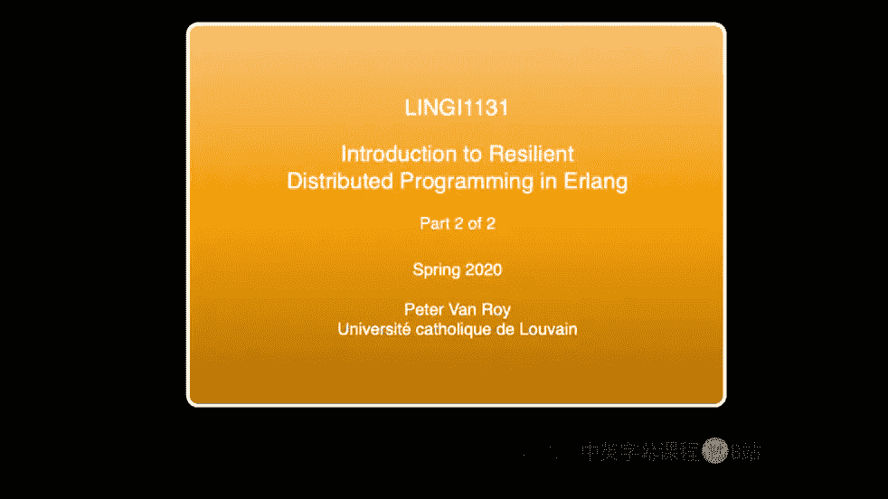
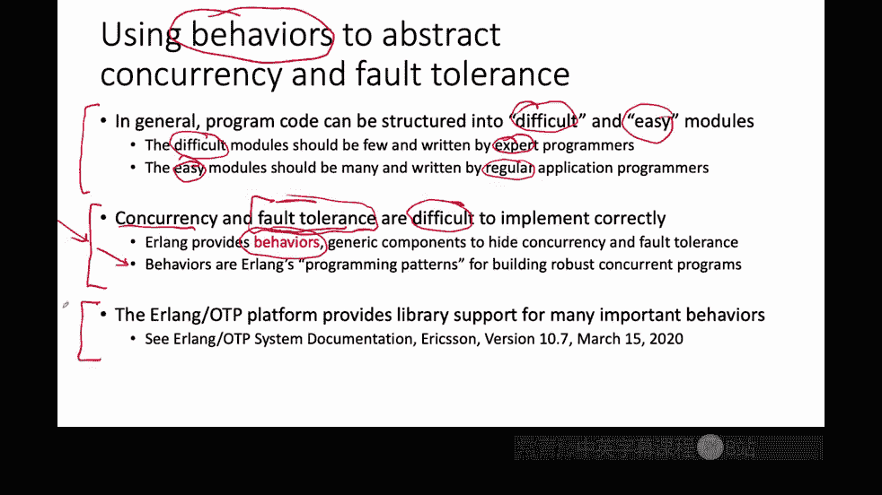
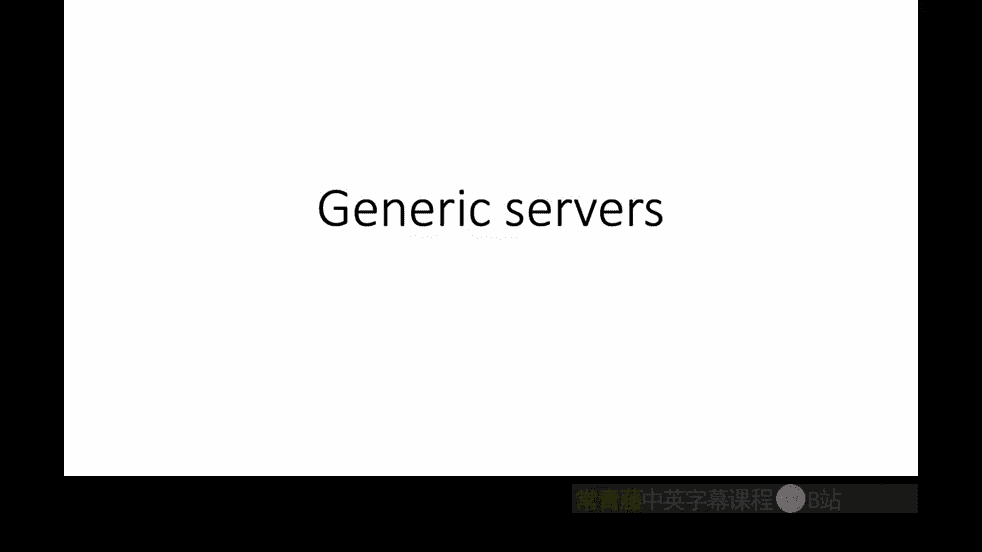
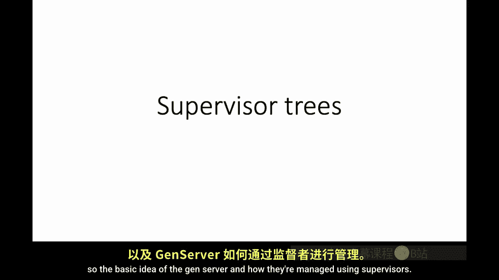
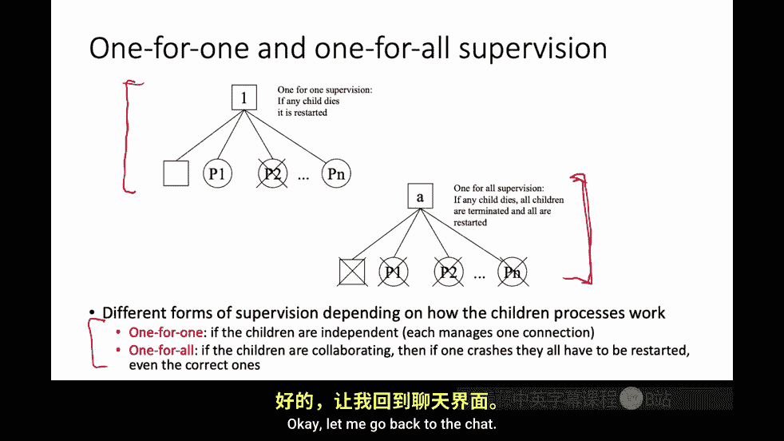
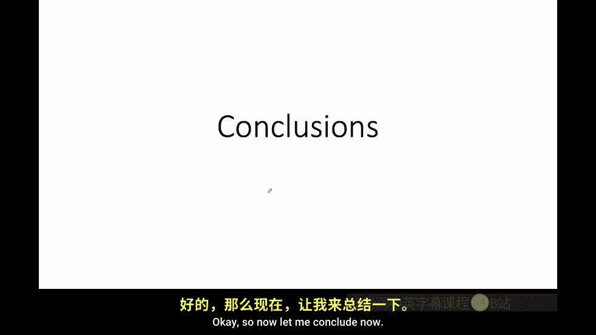
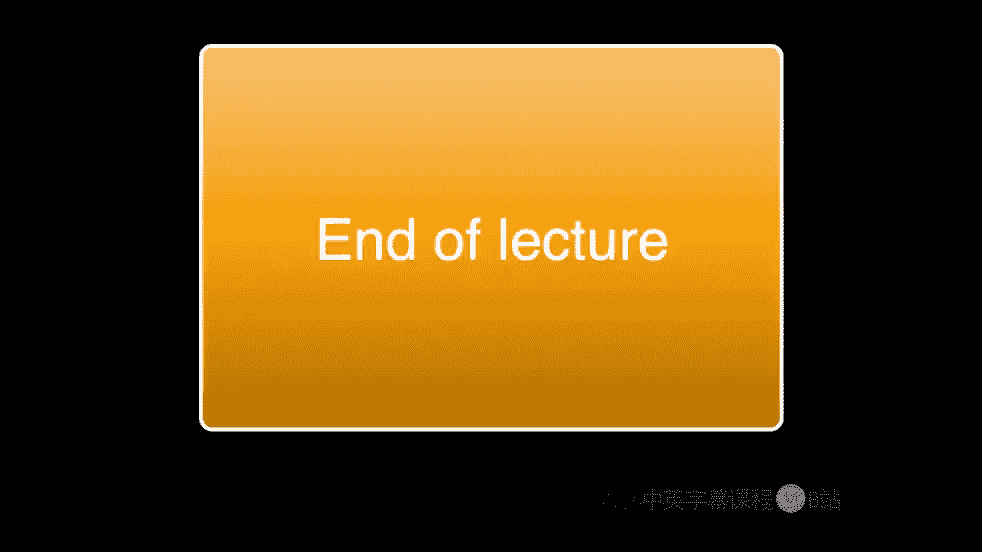

# 高级编程语言概念：13：Erlang 哲学与OTP行为模式

在本节课中，我们将学习Erlang语言的核心设计哲学，以及其OTP框架如何通过“行为模式”和“监督树”等概念来构建高容错、高可用的软件系统。

---

## 概述：Erlang的容错哲学

上一节我们介绍了Erlang的动态代码更新。本节中，我们来看看Erlang如何构建健壮的软件。Erlang的设计哲学与Java、Python等主流语言截然不同，它认为错误无法完全消除，因此系统必须内置机制来处理错误。

---

## 动态代码更新的潜在问题

在继续之前，我们先回答一个关于动态代码更新的问题。

问题是：如果一个进程保留了旧版本的代码，是否会导致整个模块无法更新？

答案是肯定的，这会是一个错误。如果一个进程由于某种原因（例如自身存在Bug，或在等待一个永远不会到达的消息）没有更新代码，那么整个模块的更新就无法完成。

Erlang提供了一种解决方式：监督者可以注意到该进程没有更新，并强制终止该进程，然后重启它。这体现了Erlang的哲学：如果进程有问题，就终止它。

---

## Erlang的五大设计原则

Erlang构建健壮系统基于以下原则，这些原则源自Erlang主要设计者Joe Armstrong的博士论文：

1.  **错误无法消除**：无论进行多么彻底的调试，软件中总会存在残留的错误。因此，必须假设错误会发生，并设计机制来处理它们（包括硬件和软件错误）。
2.  **故障隔离**：系统应被划分为独立的组件（“盒子”）。当一个组件失败时，其他组件不应受到影响。这与Java等语言的单体架构形成对比。
3.  **快速失败**：当程序出现错误时，不应尝试在内部修复，而应立即失败。进程要么正确工作，要么快速停止。
4.  **故障可检测**：一个组件的失败必须能被其他组件察觉和通知。这正是“链接”机制的作用。
5.  **无共享状态**：这是隔离原则的必然结果。组件之间通过消息传递进行通信，不共享任何内存或状态。

---

## Erlang的核心口号

基于以上原则，Erlang衍生出几个著名的编程口号：

*   **Let it crash（让它崩溃）**：如果一个进程无法完成工作，就让它崩溃。将所有可能的故障状态映射到单一的“崩溃”状态，使问题简化。
*   **Let someone else do error recovery（让他人进行错误恢复）**：当一个进程崩溃后，由另一个进程（通常是监督者）来修复问题。这使得工作进程的逻辑可以保持简单。
*   **Do not program defensively（不要进行防御式编程）**：Erlang认为过多的类型检查、输入验证等防御性代码会使程序变得复杂，且无法根除所有错误。更好的方法是保持程序简洁，如果出错就崩溃，由监督体系来处理。

这种鼓励崩溃、在更高层级统一恢复的哲学，对于构建需要长期稳定运行的系统非常有效。

---

## OTP框架的层次结构

Erlang/OTP平台为构建大型系统提供了分层的抽象。以下是主要的层次：

*   **发布**：包含构建和运行完整系统所需的所有信息（包括软件、配置、安装和升级程序），是最大的单元。
*   **应用**：一个独立的功能单元，如Web服务器、数据库。一个发布通常由多个应用组成。
*   **行为模式**：这是我们将重点关注的层次。行为模式是一种并发模式，是一组进程的模板，用于实现如客户端-服务器、事件处理等通用模式。
*   **工作者进程**：实际执行具体任务的进程，它们实现了特定的行为模式。

---

## 行为模式：隐藏复杂性的关键

并发和容错是编程中的难题。Erlang通过“行为模式”将这些复杂性封装起来。

**行为模式就像一个通用的、高阶的库**。它将并发、消息传递、容错等困难部分实现为通用代码。程序员只需要“填空”，即提供特定的业务逻辑回调函数，就能轻松获得一个健壮的并发组件。

OTP提供了几种标准行为模式：

1.  **`gen_server`（通用服务器）**：用于构建客户端-服务器系统，内置了注册、启动、停止、超时、状态管理和错误处理。
2.  **`gen_event`（通用事件处理器）**：用于管理事件通知和日志记录。
3.  **`gen_fsm`（通用有限状态机）**：用于实现状态机，与我们之前电梯控制系统中的概念完全一致。应用处于某个状态，接收事件，执行动作，并转移到新状态。
4.  **`application`（应用）**：对完整应用的生命周期（启动、停止）进行打包和管理。
5.  **`supervisor`（监督者）**：最重要的行为之一，用于创建监督树，监控并管理其他进程（工作者或其他监督者）的生命周期。

所有非监督者的行为模式都设计为可以轻松嵌入监督树中。

---

## 监督树：容错的执行机制

监督树是Erlang实现容错的核心架构。其基本思想是：大多数故障（如消息丢失、临时死锁、超时）是瞬时的，简单的重试往往就能解决。

**监督树是一个层级结构**：
*   根节点和中间节点是**监督者进程**。
*   叶子节点是**工作者进程**（如`gen_server`）。
*   监督者负责启动、停止、监控其子进程，并在子进程失败时采取重启策略。

主要的重启策略有：
*   **`one_for_one`（一对一）**：一个子进程失败，只重启该进程。适用于子进程相互独立的场景（如管理多条独立的电话线路）。
*   **`one_for_all`（全部为一）**：一个子进程失败，终止并重启所有子进程。适用于子进程紧密协作、相互依赖的场景（如数据库、计算模块、用户界面组成的应用）。
*   **`rest_for_one`（剩余为一）**：一个子进程失败，终止并重启该进程及其后启动的所有子进程。

如果某个进程在短时间内反复崩溃，超过监督者配置的重启频率上限，监督者会认为问题无法通过重启解决，进而选择终止自身，将问题上报给更高级的监督者。

---

## 稳定存储与测试

为了支持监督者的重启机制，系统需要**稳定存储**来保存和恢复状态。OTP提供了不同级别的稳定存储：
*   **ETS**：极快的内存存储，适用于进程在单节点内崩溃恢复。
*   **DETS**：基于磁盘的存储，适用于节点崩溃恢复。
*   **Mnesia**：功能完整的分布式事务数据库，支持复制和复杂查询。

此外，强大的**测试工具**也是构建可靠系统不可或缺的部分。OTP提供了从单元测试到系统测试的全套框架（如`EUnit`、`Common Test`），支持测试驱动开发、随机顺序测试、竞态条件测试和故障注入。

---

## 示例剖析：通用服务器 (`gen_server`) 的工作原理

让我们通过一个简单的“频道管理服务器”例子，看行为模式如何将通用代码与特定逻辑分离。

**1. 特定服务器实现（传统方式）**
一个管理“频道”分配和释放的服务器，需要手动编写消息循环、状态维护等代码。

**2. 通用服务器骨架**
我们可以抽象出一个通用服务器循环，它处理消息接收、循环、状态传递等通用逻辑。它定义了几个回调接口，如 `init`（初始化）、`handle_call`（处理同步请求）、`handle_cast`（处理异步请求）。

**3. 回调模块（程序员编写）**
程序员只需编写一个“回调模块”，实现 `init`、`handle_call`、`handle_cast` 等函数。在这些函数中填入具体的业务逻辑（如调用 `allocate` 或 `free` 函数）。

通过这种方式，复杂的并发服务器逻辑被封装在 `gen_server` 行为中，程序员只需关注业务逻辑。真正的OTP `gen_server` 还集成了注册、监督树集成等更多功能。

---

## 总结

本节课中我们一起学习了Erlang构建健壮软件的核心思想：
1.  **哲学基础**：接受错误必然存在，通过隔离、快速失败、消息传递和无共享状态来设计系统。
2.  **核心机制**：采用“Let it crash”哲学，配合监督树进行错误恢复，取代复杂的防御式编程。
3.  **OTP框架**：通过**行为模式**（如 `gen_server`， `gen_fsm`， `supervisor`）将并发与容错的复杂性封装成可重用的通用模板，极大降低了开发难度。
4.  **支持设施**：利用**稳定存储**（ETS， DETS， Mnesia）保证状态持久化，并通过强大的**测试工具**确保系统可靠性。

Erlang/OTP的这一整套理念和工具链，使其非常适合构建需要极高可用性和容错能力的长生命周期系统，例如电信交换机、大型多人在线游戏后台等。其思想也影响了其他基于Actor模型的语言和框架。