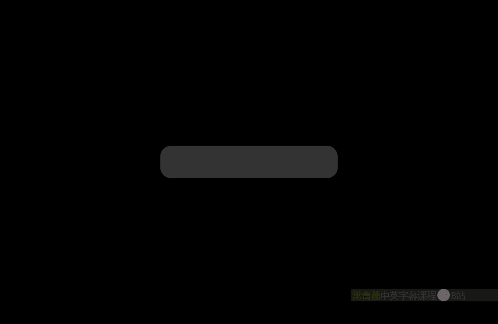
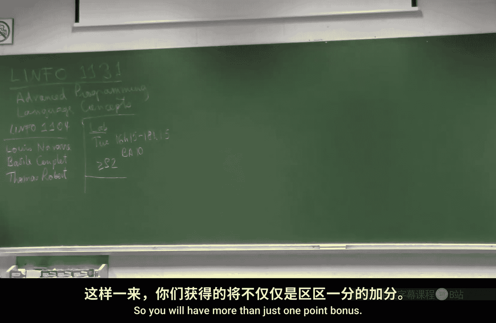
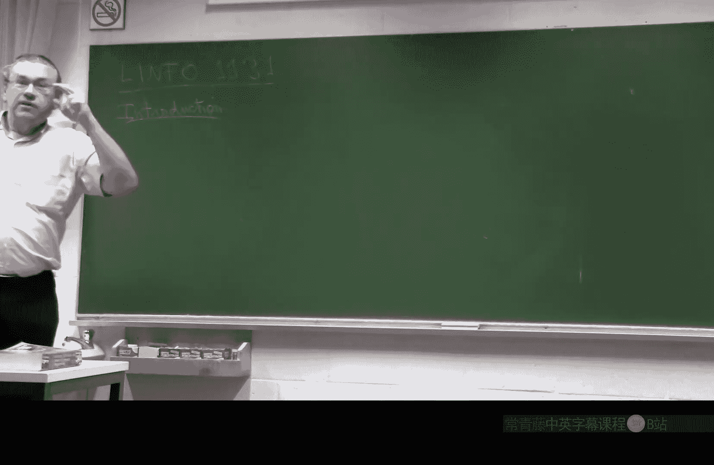
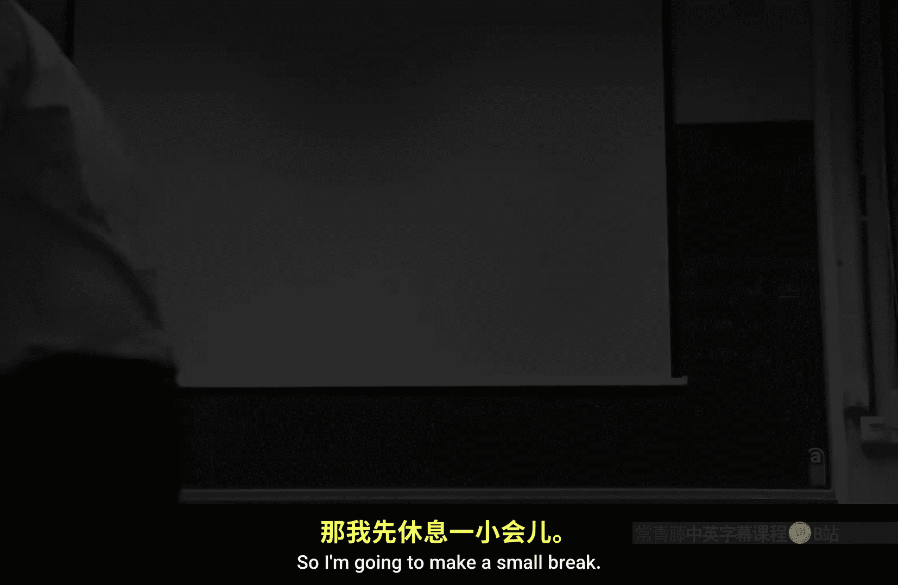
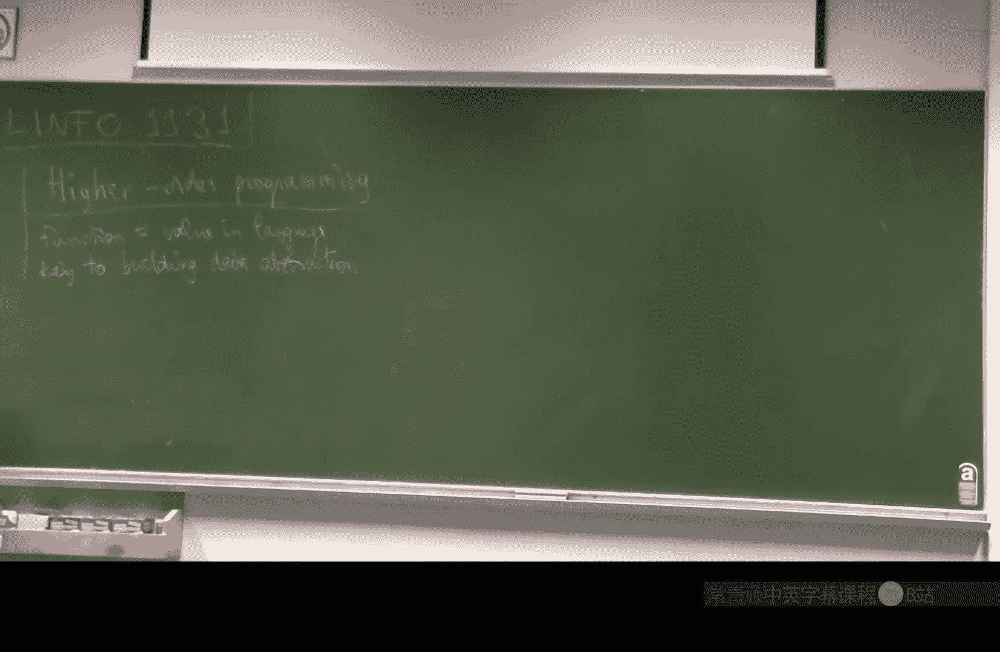
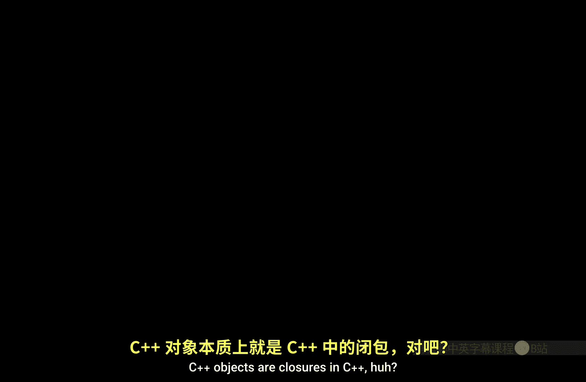
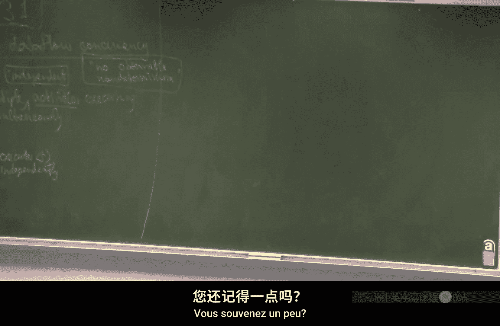

# 鲁汶理工学院【中英⚡高级编程语言概念｜LINFO1131, Advanced programming language concepts】 p16 P16 FO1131 Lecture 1 (2021) -BV1UDffBbEBZ_p16-

。

This course is a kind of successor to the previous course， LM41104。

So today I'm going to refresh your memory， I'm going to assume that you have forgotten everything of what you learned in the previous course。

 this is usually a reasonable assumption， okay， so hopefully after today you'll remember everything again。

So there are one teaching assistant for this course who is Lu Na lada。

Who is a PhD student in the department me？And then there would be two tutors。

The third was in Cooper and Thomas Ho。Who will。Arranged for the practical lab sessions so there's one course on Wednesday this morning。

 today， every week， and there is a lab session， so the lab sessions are on Tuesdays。From 415。To 6，15。

In Bton。They start the second week， so next week they start。So there's a lab session every week。

 so I'm going to try to make a scheme to encourage you to attend the lab sessions。So the idea is。

And each time you attend the sessions， we will check the present。And that will count as one mark。

And at the end of the semester， if you have all the marks。

 you give one extra point on the final exam on that it's a good deal。And if you miss them。

 it's proportional。So if you are half of them， you will get back。

So this approach will have double benefits。So first of all， it gives you an extra point。

 That's a benefit， but the real benefit for me。 So my goal is that you learn what we。

Teaching this course。And the only way to learn that is to do regular work。

So it's really not possible to learn everything the day before the exam， it needs time to mature。

 so you have to think about the things every week。so I really want to encourage presence every week and that you do exercises every week。

 if you do that， you will do already better， so you will have more than just one point bonus。

 you will actually do better on the project and on the exam if you do it okay even with almost no study if you do that every week。

You will already understand most of the material and you won't have to even and study so much。

So it's really to encourage a good practice that I do like this。So how are we going to organize。

 so let me explain how the course is organized， so this is typical for the courses I give。

 so this is an approach that I think works pretty well， there will be a project。We's five points。

This project is mandatory， you have to do it。During the semester。Do not do it after。

And it's done in groups of two people。So this will be your second half。

So this project will use what we learned in the course to do something bigger， something bigger。

And you will have plenty of time to do this， so if you organize your time well。

 everybody should get good points of the project。Okay。Then there would be a midterm。Again。

 so the last time was not possible to do a midterm because of COVID。

 so I'm very happy that we can go back to teaching normal in a normal way。

 so I'm very happy to actually see everybody and not just as images on a screen okay so we will be able to do the midterm again。

The midterm is around the seventh week， don't exactly we'll have to organize that it's going to be one hour。

It's usually during the course。And it's also worth five points。This one is not mandatory。

 it's optional。You don't have to do it at all， but there is an advantage of doing this， as you see。

 first of all， it gives you a chance to already learn material。

 but it also has an advantage for the exam。So the exam will be on 15 points。

 which is actually five plus 10 points。So part of the example corresponds to the midterm。

And I will take the maximum of the two points。This means if you do very well in the midterm。

 then you are actually don't have to learn that anymore for the exam。

 but you are still able to do that and it will never be a penalty to try to do this part in the exam。

You can only do better。Okay。So this midterm， then if you study well for that and if you do well on the project。

 you will already have almost 10 points， okay？So this is for me。

 my goal is that you learn the material in the course without so much stress， okay。

 so I really think it's a bad idea to put too much on the final exam。

 so that's why there are several ways to get a good result in this course。

And it's designed that if you do get a good result。That my goal。

 which is that you learn this stuff material is satisfy。So I guess you have two goals。

 one is to learn， maybe I hope second is to get good points with not too much effort。Well。

 you could satisfy both goals， I think。And this approach。

Okay so this course will be on advanced programming language conis。

 so see we're going to use more material in1 books that we used for 1104。

But we're going to go much more into sophisticated techniques that we did not see before。

So these techniques are， we're going to program them all practically。So in order to do that。

So we're going to use the same Oz language that we did in the previous course。

And the reason is that you can program all the techniques in this system so you learn them。

 of course， you can use the techniques in any language， the languages have some support for them。

And some very smart techniques， if you don't know them， the language maybe will not help you。

 but if you know them， then you can do them in any language。Okay。

 we will also see another language called Earlland， so we saw an introduction to Earl。04。

we're going to see more about Erling in this course。

 we're going to see more about how EarlLling is able to do generic behaviors and how Earlling is able to do full tolerance。

 so for internet applications Erling is really one of the best language， so for example。

 many cloud tools like large cloud databases are built in EarlL。

This is you don't really see that because companies don't tell you how they implement their stuff。

 So for example， companies like。There's a bunch of this but I number one called BeT 360。

 which lets you do online betting。I'm not advising you do online bedding。

 but this company uses Re database， everything in airline， which is written in airline。

So this whole software this company is within another。

And there's many other companies that that do that。

So we're going to see more about airline and how it actually lets you do concurrent and even distributed applications。

So Arling is very easy to install， it's a system that is maintained by Garrickson。

Wwhich is a very large Swedish company which has a team to support Erling。

 so that means it's very easy， it's a little bit like some Java supported by Oracle。

 Erling will be supported by Erics。So the first thing to do would be to install。Mozart。

 early we will do later in the course。And site Mozart2。org， so if you follow the course 1104。

 it's the same Mozart2 system that we use there。Okay， now the way I teach this course。So for me。

 this course is a way to present many things to you。So the course is not always going to be the same。

And in fact， it's a fairly new course。This is the second time I'm teaching it。

And the first time was using COVID was broken because of this COVID thing， so it was taught online。

 which means that this is really the first time I'm really teaching this course in a class。

 so this is a new course， so that means that I'm going to be adapting the course。

So I'm going to give a schedule of the kinds of things we see， but it it's not。

I'm not sure how long everything will take， so we'll see how the course evolves， okay？

So you guys are a little bit giineddy pigs Koba。This is the first course。

 so some I would like also some feedback from you on how the course。How the course works。😔，Okay。

So that's basically all I want to say about the organization of the course。

 so I think that's clear right。So I hope so I will try to make videos。😔，Of this course。

 depending on the technical。Part hopefully it will work。

 but I'm not guaranteeing that there will be a video every week okay。

 so you cannot rely really on the fact of video， not promising 100% that there will be a video。

 but I will do my best to make videos forever that。But still。

 it's good for you to come and to take notes。So I hope that most of you will still come。

Even though I know 830 in the morning was extremely early， okay？For students。

But I think it's better to actually be there and you can ask questions and do things。Okay。

 let me now give an introduction of what we're going to see。Of course。

And then the rest of the course today I will present。

I will refresh your memory and all of the important concepts that you have to know to start the course。

Okay， so we're going to see many concepts and many programming paradigms。

 more than we saw in the previous course。One concept we're going to see that we did not see before is called lazy evaluation。

So this you can add this to concurrent deterministic， and this is a much more powerful。

 but it adds a lot of power， you can actually compute with infinite data structures。

 you do not have to worry about termination so it's really a nice way to program。

 and it's still declar if it's still a kind of functional programming。

So the license is still declarative。We're also going to see some advanced programming techniques。

 advanced algorithm design techniques。For functional programminging。Okay， so。

There are functional programming is a very powerful， strong paradigm。But because of that。

 some things maybe are harder to do， but there are actually techniques for doing almost anything you want in the future paradigm。

So I'm going to show you some of these advanced techniques。There are。

It takes a little bit of time to really understand to how they really work。

 so I'm basic Google to combine laziness and concurrency in a very smart way to make efficient algorithms。

That are purely functional， okay。You might not think that you can do them like in purely functional algorithms where you have constant time。

 insert and delete in a queue， for example， in a functional， purely functional setting。

 so we're going to see that so this is important because actually you can use them in any language okay。

These advanced algorithm design techniques， they're not limited to Oz or functional programming again。

 it's just a technique。Of course， if you use a bad language。

 it's harder because the language does not support it。But you can still do it， okay。

So we're also going to do other things like。Multi agentent。

 a stronger form of multi agent programming。So we have many， many agents。

 concurrent agents talking to each other。In a complicated system。

 how do you make it work so in the first course we saw that you could do message passing between agents。

 okay， but we didn't or do very complicated things。

But now this time we're going to start doing multi agentent in a very powerful way where you can build very complicated real world systems and they're not easy because they're extremely concurrent。

 of course。So one of the themes in this course。Is concurrency？あ。

So concurrency is actually quite hard in the general way if you do it in a language like Java and if you want to prove。

Correctness of concurrent programs in a paradigm like shared state of Java is' quite complicated。

But concurrency is much easier in other paradigms， so we started looking at this in the 11th04。

 remember that deter deterministic data flow which is a very nice paradigm。

 so we're going to build on this and do much more work on concurrency here。So。

Another thing we're going to see is what's called shared state concur。

So this is concurrency where you have mutable state， so this is the hardest。For of concurency， okay？

It's the hardest， it's difficult to program， and usually when people think about concurrency。

 they think of this one。But actually， for historical reasons， this one is we're very widely used。

 many people use this， but it's actually the worst one。It's the worst way to do good programming。

There are much better ways， so the termministic data flow is already much better。

 where the voltage agent airline style is also much better。

But still shared stake of currency is important， so we're going to see concepts in this。Blocks。

 monitors。And transactions。Okay。So monitors are what Java people call synchronized objects。

So they are the usual way of making。Threats collaborate。

 cooperate between each other in the language like Java。But。In my view， they're very bad。

They should be deprecated， they should be thrown in the garbage can。

But there's huge amount of legacy software still using them。

And so you will almost surely be confronted with them。When you're looking at this legacy subt。

 that's why I'm going to talk about monitors， okay， even though it's probably the worst way。

To do concurrent programming， so if you talk to older people in the industry。

 sometimes some of these people really believe this approach monitors because they don't know the other approaches。

But this is really a bad approach okay so if you follow from the other courses。

 you know that I'm sometimes opinionated， I have strong opinions on what's good and what's bad from experience。

So I will tell you my opinions， I'm not going to be quiet on that。

 so one of the opinions is it monitors are terrible thing okay。

 but you're going to see them in this course also。So add a final one is transactions。

 This one is actually extremely good and useful， so this one I like a lot。

 this one is actually very good。 It's the only shared state primitive there's actually， in my view。

 a very good one and all internet。Large operations like databases depend on transactions。

 okay so we're going to see quite a bit on transactions in this course and how to implement that what they do。

 so you will understand hopefully very well the transactions at the end of this course。Okay。

So that's kind of an overview and this view and there's some other things and these are highlights。

 but there's many other things that we're going to see。Okay。So。Let me start today。

 so today I want to talk about the following things。I want to。デビう？The refresher。あ。

Functional programming。Recursive functions。Okay。And it'll be recursive function。

 so basically's looping。Higher order programming。and then a very important special case。

 extremely important primitive， which is called fold。What it does is abstracting in a human ear。

So I' explain what that means。So fold is one of the most important。

Primitives and functional programming， and you see it everywhere， even in multi agentent programming。

 F is done in cloud alytic tools。Fol is done。So there's a famous cloud。Primitive called mapRduce。

 which was the first very big data analytic tool that was invented， mapRuce is just a form of folder。

 reduce。It's just another name for the full operation？So fold is one of the most important。

 so it's important to understand that。Okay， and then final thing I'm put to see today。

Is there pressure on the deterministic data flow？Concurrency okay so this is the refresher things that I'm going to show today so today there will be nothing really new hopefully you will get everything back okay。

 your memory will come back to you and then we will continue next week and next week I'm going to talk about。

Lazy evaluation。Okay。So， let me first say。Introduce a little bit about functional programming。

So functional programming is the most important programming parameterclaim， you have pure functions。

 if you have single assignment， there is no state， so no variables that you can assign multiple times。

So this one is modeled by the lambda calculus。So we saw the lambda calculus in the last year。

 but I'm not going to repeat the lambda calculus， so you know that the function programming has a very simple core。

 which is the lambda cculus。So I'm going to rely on that。

 but I'm not going to refresh you on the Lada calculus， okay。

 it's important to know that it's a theoretical foundation。But it's purely mathematical。

It's not something to be use in practical。Okay， so functional programming is the by far。

The best paradigm。And it's best， but you could not always use it。So in this course。

 I'm going to try to use it as much as possible， so it's the best one。It's the most powerful。

 so for example， testing is easy。Maintenance is easy， proving correctness is easy。

 so there's a lot of things that are easy in functional programming。

 but you can't do everything in it because it has no memory， okay？

There's no variables that you can assign。So， testing。Maintenance。So that means updating the program。

Proroving correctness。But好。programming much easier than in any other parent。

So this is not still not so。In the heads of the people in the industry， a little bit。

 if you look at cloud analytics tools， okay？Cloud analytics， big data tools。Okay。

If you follow the course of cloud computing， which I recommend a lot。

 then you will see that these tools are actually all doing functional programming。

 because it's the only way you can make it work on huge distributed system with hundreds of machines。

And we will push this prayer down as far as it can go。Okay。

So we will push this paradigm by adding so this concurrency， of course， deterministic data flow。

 but also adding lazy evaluation by doing advanced algorithm design。

 so up to here we will be doing functional。Pure functional stuff。

So I'm going to push functional programming as far as it could go。As far as I know now。

 maybe it can do better in the future but push it as far as it can go， and this is for your benefits。

 when you build a bid application， you have to try to stay as much as possible in there， okay？Okay。

So that's all what I'm going to say on the board now what I want to do is。Present some programs。Well。

 it seems not to be starting。So I'm going to call the operator， so I'm going to make a small break。

Let me start again， so I don't know when the technician will arrive。ButI will start writing codes。

 but I want to do a little bit of preparation。On the board here， before I start writing code。

So people sitting in the back， unfortunately， I'm going to be writing on this board。2呃。

So maybe I can write it through the front。不是。So I guess the technician is very busy。

Helping everybody。So I don't always need to arrive， so I don't want to waste too much time。

 so me start I want to explain something here。So I want to get you back into the frame of mind of thinking of functional programming。

でごとな。Okay。So functional programming。So one of the important concept stuff is loops。Okay， it programs。

And so in functional programming， we very often have recursive functions。

Which are functions that call themselves， so the basic rule。Is that。Ted recursion。Equs while。Okay。

So let me give you a very simple example， which we saw before actually， to refresh your memory。

 let us calculate factorial。In functional program， in O but functional style。

 but also in C Java style， okay in order to do that。We alwayss have to start with。And there。

So starting from the invariant it's very easy to write the code。

 So the invariant I want to do factorial， so I do n factorial is equal to。I factor。Times。

The number A。So the idea is I split the factor of the n， so this is a constant。

 this is the number I want to compute the factorial of， okay， I split it into two parts。Okay。

Li it to two parts that are vering。Okay， and the idea is that the I and the A together。

Will give you the n factorial。 So then the idea is to decrease the I and increase the A and maintain the truth of the environmentvari。

So I decrease here and I increase here。うん。So the idea is I will have， for example。

 I minus one factorial， and then I use the property of factorial I times a。

 so I take one of the eyes' out because I have I effectual equal I times I minus1 factorial。

So this will be the new eye。And this will be the new A。

And the variance is maintained okay so you always start from an variance。

 so you see this is nothing new okay， you see this。

 but if you want to make a good loop that's correct， this is the way to start。

And then if you write this， if you take this and you write it in job style。

 you get something like this。Ins1 manial。Okay， so this is like jut int。

A is so I have a local variable A， which is equal to1， a local variable I。

 which is equal to n initially， so n is a constant during the loop。

It's the argument here that here I have a while loop。Well I bigger than zero？And I have day is。

It's I I times a and I is I minus1， okay？And then I return。Okay。So， this is the。This style。Okay。

 so you can see here， it's very easy here I'm maintaining the invariance I'm doing steps of this okay。

 of course I have to do it with the right order if I'm updating AI。Actually。

 it would be better if I could update them at the same time， and not one after the other。

 you I have to be careful here， so I have to do the this， okay？

But you can do the same thing in a pure functional style。So if I do something like this。

So the A and the I will be the arguments here。And the loop condition i greater than zero is put in an if statement。

And the recursive call is like to do the loop again， okay？Like this。But else。

 and here's where I return paid。Okay。And then I can do something like X。Is able to factorial。Can。

To get the answer。And here I can do x is equal to factorial。

Here I actually have the loop variables explicit as arguments， one pen。

And I get the same result so these two things are exactly the same okay so a recursive tailor recursive。

 so tailor recursive so the recurive call is the end。

 this is exactly a loop and if you look at the code generated by the compiler for these two。

 it's identical code okay there will be loops， there would both cases be the loops in the instructions so the process。

Because it starts from the doing， so this is a refresher， you always。

I can get chunk that gives me darker things。You always start from。Thevari。

So this is really the starting point， okay， and then the coding is。It just depends on the language。

 but the coding is very simple once you have this。So now I want to show you this code。

But unfortunately， I can't show to you right away。Okay so this actually shows you that when you do regular kinds of functional programming。

 it's almost the same， see this is not very different， it's a little bit different style。

W is actually corresponding to a recursive call，So otherwise， that's just exactly the same。

Okay so let me now show you some other examples， so what happens is when the technician arrives。

 I will show you all the running code。But in the meantime， I will explain it on the board， okay。

 of course I like to show running code， it's better and people can see how it works。But呃。

We have to do what we can with it。Things we have。So that's the first thing I wanted to refresh your memory on。

So in the functional paradigm， we will very often be writing recursive functions， of course。

 and tail incursive functions， and these are based on invariance and it's exactly the same as Y loops。

The next property of functional programming， and this is one of the most powerful properties is higher order programming。

The fact that functions are values in the language， okay？Fction。Is a value。

That means like a number or record or whatever。Value in the language。And a value that you can create。

 you can make local values， you can pass this argument or you can return。Okay， so this is the key。

For many things。So it's the key to building。They have abstractions。Okay。

 the concept that's behind all data abstractions。That you use in all languages is this concept。

Is this idea。Objects， for example， semantically， they are just。Functions， okay， which。

We used as higher order。And for example， when you create an object from a class。

You are doing higher order program。So we saw already some of this。

 but I'm refreshing your memory here。

So Ill give you some simple examples of this。So here's a function。And then。It's an argument N。

 and this function will return another function。But it will return a function， an anonymous function。

So I don't give this function a name， so here's the name they identify error。

So this one does not have a name， so basically it corresponds to a lambda expression。

 remember a lambda calculus so in a lambda calculus。

 the lambda expressions which are functions are just values。That you compute with， okay。

 so this is actually like a lambda expression of。And if I do n equals five。And then I do F5。

And I call Evan。The5。This returns a function， so add 5 will be function， so I've created a function。

Okay， just thing here。And if I do energy， equal equal to 10。And I have another， I call it again。

I created another function called。在。Again， I've created another function that adds 10。

So to add five and that tender functions， so this is like a class and these are like objects。

 you see that it's exactly the same only objects have different syntax and objects usually have state inside and they should have mutable variables inside。

 otherwise it's exactly the same。Now there's a really important concept here。

You see if there's an ending in here。This end。It can have different values， so when I call add add5。

 the add5 will add5， so n is equal to five here。But when I call add N 10， I have a function add 10。

 when I call this one it adds 10， so here the n is equal to 10。 So each time I call add n。

 I have a new。A new value of n， so how does that work？Okay。

 so this was very important in the previous course，So you remember how it works， you remember right。

 do you remember？I hope many of you remember， so the idea is that a function value。

 it's not just the code of the function， so this is the code， this is compiled code。

The instructions of the function， but in the when you do something like this， it's not just the code。

 it's code plus。Plus， all of the。Identifiers inside that you need to know， so it's two things。

 it's color plus an environment。Okay， the code is this code。

 and the environment here will be n pointing to some variable little n。

 which will be equal to five in memory。There's an environment here。

 and here it will be code with another environment， so the same code is another environment。

The M will be now 14 to little M。AndM is equal to 10。So each time I create an anonymous function。

 it's not just the code because there's this n here and what is theed it's determined by the lexical scope。

 okay， the n is the same as what this argument is。So when I create this， I have to capture that end。

So that's hugely important so this thing。Has a name。Has many names actually， many， many names。

 sometimes it's called a closure。Or a leically scoped closure。And whatever you read， government。

You will see name Sir。I also call a procedure value。Okay， and in French。

 it would be called the Fement material you。Because why is it called the closure fe clothes。

 because of the end here， when I create this， I'm making a package。And closing over the environment。

 creating this environment。It's like a package an onrage。So that's why it's called the closure。

This thing， this idea， was probably the most important invention。In programming languages。With this。

Everything changed， so this was invented like in the 1960s。And before this。Everybody did it wrong。

 okay， it was list before fortune which were completely broken and before and after that。

Everybody did it right。Okay， so they did a version of Li that they write， which is called scheme。

And all languages after that。this does it this way。And all languages use this。

 and this is all data abstraction is built on this idea of closure。

 it's interesting the closure idea is covering all the update abstraction and all the languages you use。

So they seem very different to these languages， Python， Java， Scala， Haskell， whatever， many。

 many different languages， C sharpp， C++。Z plus bus， actually。

It doesnn't really have to do it in the right way， it was kind of done too early but you have to do it in the right way if you want to really build correct。

Data abstraction， you have to do it like this。And it's very logical that this function is sitting in a place where n already has a value。

So when I create this， it has to use this n。So when I call each time I call at end。

 the arguments might have different values， which means I have to have a different one each time。

That's why you need an environment here。So people didn't know that in the early 60s of the war。

 they figured it out， somebody figured it out。I think it was it was a few people to figured out。

 but one of the main bur's people was Peter Land in the。S0s and after that， people realize， a yeah。

 it has to be done like that， okay， and eventually then all languages do it like this。

Every single language， there is no exception， Okay， so if you know this， you know。

 you know many things， Okay， so this is a this is。The key。So with this idea。

 we can build huge software， we can build software millions of lines of code separated into abstractions that are libraries that are called from one to the other。

But if you didn't have this idea， you could not do that， so this idea is a crucial idea。

 you see that super important idea， and it's probably the most important idea because with this idea now we can build huge software。

All the stuff we do today， you know， Internet。The mobile phones， everything， machine learning。

 everything。They gets building on this。You see that？You see how while is simple。

 it seems quite simple， inventing it was very hard。Inventing this idea was really。

 really hard and it took many years and then until people were using it everywhere， it took many。

 many years， so even in the 1980s when it was C++ was invented。

 the languages did not all do it in the right way but if you don't do it in the right way。

 you are handicaing yourself， you cannot build big programs in an easy way if you don't do this。Okay。

s then什么。L we saw this in the last course and so I'm refreshing you， but I think it's good。

 there's an expression in French or false clue。So eventually。

 I think now you could probably understand it better than you did in the previous course， right。

 that why this is so important。Okay， so we're going to build on that in this course， of course。

 we're going to build many， many things on top of it。Okay。So closures are a really big idea。

 people don't really talk about it， you see when you read documentation on languages。

They won't really mention it like that， so simply。But it's always there。

When you see and you learn a new language and you figure out how to do things and they show examples。

 they're not really going to talk about this， sometimes they do when the guy writing it his knows。

 but many times they will not mention this thing， okay？But it's always there behind the scenes。

You can see that even if they don't know what they're talking about。Which is very common。

Another writers documentaries and so on。It will always be there。

And sometimes they reinvent it and stuff so you will always have。That idea， always，s2。

 there's no exception。Hundreds of languages， all the languages you learn。

If they don't do it this way， they're broken， there are still a few of them are broken。

It'reU made by physicists。People don't know， physicists think they're very smart。

When you may talk to someone who is doing physics， they think they are the smartest。

But physicists do not understand abstraction。That is a computer science concept。

And this is how you build abstraction。Okay。So let me give you now another example of high order。

This is the map function from the previous function， I created closure as an output。

 now I'm going to give the closure as an input。ok。So I have map which takes a list so I'll explain I will refresh your memory on lists and it takes an anonymous function。

 which is a closure， basically or a lambda expression。A line of the expression is exactly a closure。

When remember what we learned of Atlanta lamb cculus？So these lambmbda functions are closures。

 they're functions that don't have a name， they're pure functions。オ。So in this。

 let me introduce some rotation。So here I'm introducing some donation。

 which I'll refresh your memory on。オッケー。So here we have the map function， which takes two arguments。

 L and F， so here I have an instruction called case。And here this is called pattern。

So this will use the lists， so in order to explain this， let me explain how lists work， okay。

So the list， so in the previous bars we saw lists and trees， which are recursive day structures。

 okay？And I told you the list is the most important day structure in all of computer science。

And the tree is the second most to port quo， okay， so if I a list。

 I can define the grammar of a list using EBNF， which we introduced。So this is a grammar notation。

Invented by two guys named Baptus an Aur， so it's called extendedend Baus Nur Formism in BNF。

 but it's very simple， okay？A list is either nil or。Some elements。Followed by a vertical bar。

 followed by a living list， so this is a recursive grammar definition that L is on both sides。

It's interesting also because you have different symbols， you have this vertical bar。

 this one means or in the ground， that means a list is either nil or an element followed by a vertical bar。

 followed by another list。So this is recursive definition。So you can see functions are recursive。

And data structures are also recursive， recursion is a big thing。Okay。So in Java。

 if you want to traverse a list， you use a widerwo。In functional。

 I wish you use a recursive function。But actually， the functional language is closer to the。

To the data， because the function is recursive and the list is recursive。

 so this is a close connection， okay。You can also see another important thing here。

 which is the notion of a meta。Syntax here at the vertical bar， here also at vertical bar。

This vertical bar is part of the grammar notation， but this vertical bar is part of the syntax we are defining。

 it's not part of the grammar notation， so in order to distinguish them you put quotes around so the notion of quoting。

嗯。Quoting， which is distinguishing an object。Used as itself， but also used for something else。

 So here the vertical bar is just a vertical bar。 but here the vertical bar， it means something else。

 It means or。So quoing is used all the time if you ever build scripts。

In any kind of shell not or in Python， you will be always doing quoting。

 you have already some experience of that。So this is also an important thing that the difference between an object used as itself or used to represent something else。

So this is a list。And then we have- so this is a fundamental data structure so we can have。

 for example， one， two， three， n。So it actually you have to put parentheses around it it's like this。

It's a one followed by a bar， followed by another list， which is a two， followed by a bar。

 followed by another list， which is three bar nailil。So it's one bar two by a few bar now。

 so this is right to subciative， so the vertical bar is a binary operator。

But this is kind of cumbersome， so there's shorter ways to write this。

So this is another concept of style。Which is called syntactic sugar。The secretcent sick。Computers。

 scientists， they love to make weird names like that， so this is sugar。

 why is it called sugar because it's nice， it's agreeable， people like sugar。

So this is a shorter notation， but these two were actually identicalable。さこさ。

This notation is only for the comfort of the programmer in eternal to the language。

 it's exactly the same there's no difference it's just。

The upper layer of the cake to what the user looks at， but internally these two are identical things。

 okay， so that's another concept， syntactic sugar。That we saw。

And then there's the concept here of pattern matching。This is also very widely used。

If I have a list here， so one， two， three， nil。So you can write this as a tree， okay。

 vertical the first vertical bar is the root and then we have the one and then we have another vertical bar and a two。

 another one three。So you can write it as a tree where the vertical bars are roots and you have。

The one has the left subre and this list has the right subt because here it's kind of like a tree that has a left on the right part。

And then we can compare this。To a pattern。Here， for example， vertical bar H T。

 here I introduce just identifying。So we match these two patterns。We can allocate。

 we can make correspondences。So the H will correspond to。

The one and the team will correspond to this list， two， three now。

So this is also something that's used a lot。In computer science。Because it's a way of。Making big。

 complicated data structures look simple， okay？So this will cause H to be declared。

And we're point to one。So in the semantics， remember the semantics。

 there's actually a variable in memory and the variable is bound to one up， remember that。

 and let's show you that there's a variable， so what this is doing is actually creating an environment。

Where the big H is referred to the variable which is bound to one， so this will actually here。

When I do this pattern match， it will actually create an environment and the T also。

 so there's a variable which is bound to this list pair vertical bar。

 so the T is actually referred to a variable， so when I do pattern matching I'm actually creating a new environment。

I'm just telling you that to help you understand really what's happening semantically。

 all of this is easy to explain to the semantics the meaning of this。

But it makes the code very simple because the pattern is just like a picture， okay。

 and then here I'm building a new list。Where I applied the function F on H。

And they then called them man from Christmas。So here I'm creating a new list with a vertical bar。

 and this is actually a tail recursive columna。This column Tayloror recursive because of single assignment variables。

 okay， so it's important that it becomes tail recursive， of course otherwise it's not a loop。

It's only tail recursion gives you while loops， if you do recursion and then something else。

 then it's not a wild loop anymore， it's more complicated。Okay， so if you want Y loop。

 then you have to have tail recursion。And why is that important because it's constant memory science。

When you lu it， you're not increasing the memory size。So that's important。

 So here's actually heteropress， this is a good definition。So this is an example of high orderra。

So the F is a closure or a procedure value or a anonymous function， or a lengthda expression。

 all those things are the same。As an argument here， and here I'm applying it。Okay。See how it works。

So now you're back， right， your memory has swapped in all of the knowledge from of course， 1104。

 right？啊， good。Okay。There's one other example I want to give， which I mentioned before。

 which is the fold。Fuold is really important。Foold is one of the most powerful and useful of the higher order primitives。

对。And it's used everywhere。And the reason why it's important is that it abstracts OA and accumulator。

 so that's an interesting way of saying something， so what am I saying here？Well。

 actually fold is a loop。Fold is a wild loop。That is generic， in factor。So if I have。A list。

A0 to a n minus1。And I have some functions so bringing， for example。

 plus I want to do a0 plus a1 plus。Plus a minus n minus1。So， I will。

Combine all the elements of the list with this function。ok。

So the generic way of specifying this is to say that the fold does something like this。

 so I have a unit element， U， I have a binary function F and I do a0。Okay， and then I my F。With a1。

And I keep going F to a n minus1。So this is kind of sorry this should be one。

So there's parameters here， there's the U as a parameter， there's the F， and then there's the list。

As。So this is basically a generic loop that computes one value by combining all the other values。

 so you can see where they in comes from， a hook P， P。

 another name is also reduced because it takes n elements， and it compresses them and makes one。

Ele so and it reduces。Okay。So fold is one of the most important。Functions for。

Used in functional programming and the reason is that it's。It's what it's doing is very。

 very powerful， there's an aumtic parameter， so let me show you the code。For， for fold。So， fold。

So this one is called fold L because it's left associative。

 there's also a fold R right associative one， but it's not very different。Pleaseill， okay。

So we have three arguments， the list。The binary reflection and the starting elements。Okay。

 so I'm using。Pattern nurching again。Of new than you。Otherwise， H bar。

and now I have my workers of poem。T F is the same， and then I have here F。And then I have U H， okay。

As you see， it's what it's doing here。H， so the H is the element of the listerof。Okay， this。

So you can see what's happening here。So here I have an argument to you and in the recursive call it turns into this FUH。

So this is actually an accumulator。Which is the same as the A， the A is a factorola。

 which accumulates the result， the view is an accumulator， but it's hidden inside the fold。

 you don't see it outside， okay。So with a fold， you can。You can hide this accumulator。

 abstract it away， when I say abstract it away， it means I'm creating an abstraction that internally has an accumulator。

 but you don't see it on the outside。So the programmer or the user doesn't have to worry about the acinator any invariance。

 whatever， it's default is doing all that， okay？So that is very important。

 so it's a kind of abstraction of folder。It's kind of data abstraction where you hide an accumulator。

And it's used in so many places， so one of the places we used it was in defining an agent to remember。

 so a fold is actually the internal function。Of a concurrent agent。

Where the U would be the state of the agent， the H would be a message received from the agent。

 and F is the state transition function， this gives you the next state of the agent。

So fold is the core of an agent， the heart of an agent。オッケー。Okay。

 I would love to show you old the code running。For this。

It seems our technician guy a little bit laterh？But for some reason。Okay。

 there's one more thing I want to explain。Which is a deterministic data well。

But maybe I'd make another little break now， okay， so we make the break until。tennis。

And then the final thing I want to explain to you is the currency， is the termistic data flow。

 and after that you will be back up to speed， okay， and then next week we get。Do Okay。

 so we'll make a straw break until。あ tell天是吧。给。So that's basically seven minutes。Exルで。

It's not a closure C plus plus objectsject are closures in C plus plus。But the C language。

 which is coming before C plus+， and which was used to make unitsix， this one。

 when you create a function value， it's just the code is nothing else。

You could build your own closures if you want， of course。

 by creating a name structure where you point to function code and you point to variables。

But that's a lot of work you have to do yourself， okay， whereas in C++。

 you have objects where it's automatic。Okay， so thanks very much for the correction。

 so I don't want to set you wrong things up， sometimes I say mistakes that you have to correct be。

So now I want to talk about concurrency。And all the nasty things that come with concurrency like non determinism。

and this is what we saw in the last course， we saw a very nice paradigm called deterministic data flow。

And it's actually kind of functional programming， it's functional programming。Plus， threads， okay。

And it's still functional， this paradigm， still deterministic， and that's why it's interesting。

So it actually is a very easy form of concurrernce。So let me introduce first what it is。

 so what is concurrency， concurrency is when you have multiple activities。Executing at the same time。

Executing simultaneously。ok。So this is how the real world works。It's clear。

So in the program we want to do the same thing， but of course you can see that it's hard because these activities they each them doing their own thing。

 how do you make sure they work together in a nice way。

That they don't step on each other's toes and they're in the shared state or the Java style。

 this is actually very hard。It's very difficult。But in the termminist d flow， it's easy。

 so that's the reason why this is so nice， this is the only really only paradigm where concurrency is easy。

So it's very important paradigm。To know to understand。 Okay， so you have multiple activities。

 So in the language。We introduced a new concept。It is called a thread， okay？

So this is an external language concept， which is understood by the implementation so you have to implement it and I will explain。

 so a thread is it's basically an activity that is executing independently and other。

 so it executes S。Independently of anything else。Okay。

So you can create multiple threads and inside the thread， you can create more threads。

 so you can create many of these activities and each one of them is executed。

So that is not actually so simple to understand， so here we have a thread， it's executing。

 so I have how does that work， you have an execution state。And then in the abstract machine。

 you go forward by doing execution steps， so you have some kind of execution state。

And they use steps。You have steps here。Basically you execute one instruction。

 so this value is executing instructions。And by itself。And you can have another thread。

 execute instructions。By itself， too。And both of them are executing， so how do you implement that。

 so there's now a lot of issues。Okay， there are lots of。Of呃。Concepts。

 ideas that we need to introduce。So， threads。2。Conceptual activities， okay。

 so at one level I have here all these activities， so these are all activities。

So here I have a thread T1 and T2。T3 these are all activities。Maybe there's thousands of them。

This is like the program review， I have100 threads or 10 threads。

 and then here I have the hardware platform that they run on。Okay。

This hardware platform has processor one or more processors，In the simplest case。

 there is one processor。Executing one construction stream。 and this is the case。

 the default case that is always going to be。What you do unless you do something else specifically。

 So they basically going to a single processor。So you have to execute many threats， many activities。

On one processor。So this is the basic case Sir。If you have multi corere system。

 the problem is the same， what if you have four cores and 100 threads。

 the same problem how do you get 10 things running on four things？

So the simple case is where they all run in one process。

But the same problem occurs on any kind of multi core architecture as well。

 because the number of course is not the same as the number of activities here you can have hundreds or thousands of them。

In an airline program it's very normal to have thousands of these。

 whereas the number of course is usually a small number， okay so this machine I have four courses。

 but so if the basic notion there is one so let's talk about one if you have four that you still to do the same problem still happens you see because you have to map many。

 many activities onto one piece of hardware that is executing one sequence of instructions okay so there's one instruction sequence。

Here。So this is the whole problem， how do you get these multiple activities to run on this piece of hardware。

 physical hardware？Okay。So this is where you have to introduce。Some new concepts。

 so what concept introduces interleieving。So you basically choose the threads。

 you choose an instruction from thread one then two then one and two， so the threads are executing。

 it's say an interleaved fashion， okay that means the hardware processor at each step。

 it's doing one of the threads。Okay。So let me explain now。

 so I'm now explaining very fast something that we。Took several lectures last year to do a。

 I'm going over it very faster。 So you basically have to， you have many threads。They all threads map。

没。To one the hardware。Instruction sequence。And it's clear that， of course， the same is for multira。

 the same problem。So they all went up to one， so how do you do that， you basically interleave them。

That means， at each step。You chooseose a thread。Choose a thread and you execute one thread。

 one step of that thread， so in the hardware processor I have something like this。

 I have these hardware instruction steps。Now I'm doing a step from T1， then from T2， maybe T3。

 maybe T1 again， T2， so each step I'm choosing which thread I execute in instruction。オケ。I choose。

Now the problem is who chooses， how you choose？So the programmer does not choose。

From the programmer point of view， these two are completely independent。

 it's not the programmer who decides because they are two separate streams of instructions if the programmer would decide now I'm choosing T2。

How does it know that T2？Is going to be at a certain point， okay。

 the programmer T1 does not know what T2 is doing T2 does not know what T1 is doing。

 they're independent okay so these are independent activities。Independent， that's the point。

They are separate， each one is like a separate program running， okay？

So the choice has to be done in kind of a。Outside of the program， okay。

 so they're actually part of a system that does this。

There's a system component that does this choice。That you have to build in any con system。科告してはちょうだす。

So this we saw this year。And this is not a simple component so all concurrent systems have a scheduler。

 so Mozarrks has a scheduler for the threats it implements。Mac O or Windows or Linux。

 They have processes which are also concurrent。 So they also have schedulers。 Okay。

 so every concurrent system has a scheduler and the role of the scheduler is choosing at each step。

 which thread。オ。So the scheduler chooses。Okay。But the scheduler chooses in a way that has to satisfy certain conditions。

 okay， so the scheduler cannot just randomly， whatever， there has to be some rules there。

According to。Some rules， okay。Because if you want your program to run in a nice way。

 if you want to prove things。The schedule catches be some hack， okay， it has to do it in a nice way。

So the most important rule of the scheduler， and it has to be fair。The scheduler must be fair。

 and that means that every thread。Will eventually get chosen it's not allowed to forget a thread Of course you see that's not very smart that's stupid that's like a bug yes it's like a bug so the scheduler has to be fair。

And that means that every thread which is able to execute。

Will have to be eventually chosen when I say eventually， I mean in finite time。

So the word eventually。Toku in French eventually in computer turns terminology means in finite time。

 so not forever， okay so the schedule has to be fair， that's the first rule。

And then there are other rules， so this one is the most important fit。

 because then you know that all the threads are actually running， okay。

 and you can assume that every thread will keep running until it finishes。

And then you can actually reason about your program。So fairness is the most important rule。

 but there are other rules。Another rule is time slices and a final rule is priorities。

So these two rules are basically。For。Reasons of efficiency and organizing your program。

 So the tiny slices。Is an efficiency thing。Because technically， the scheduler can change。

Between threads after every instruction。But that's very small time and instruction， okay。

 so in hardware， that's like less than a nanosecond。And the scheduler is a piece of software running。

Which chooses， so you don't want the scheduler to choose after every single instruction。

 that would mean enormous slowdown， okay。So usually what the scheduler does is that's the threat run for a certain amount of time。

no with no hindrance， so typically something like 10 milliseconds or something like that。

 so for something like current systems like Mac OSOS， it's typically something like 10 millisecond。

So the thread， if it's computing， it's allowed to run for maximum 10 millisecond， of course。

 if it finishes before then， then。It goes back to the scheduler and the scheduler picks another thread。

 but it's allowed to run up to 10 millisecond， and then there's usually a hardware interrupt。

 So you don't want after or every instruction to count。Whether the time is passed。

 so in hard it we easy you have a separate piece of hardware， which is a clock。

 which after tender sampling makes an interrupt so there's no overhead for this okay so that's one thing and the second thing is priorities so some threads are more important than others。

Or this is actually most important for the processes。In the operating system， for example。

 in the Mac OSOS or the Windows or Linux。Some are more important than others。

If a packet arrives from the network。It must be treated immediately。

 you cannot wait 10 milliseconds before treating it， okay？Because packets arrive very quickly。

 gigabits， internetnet， ethernet， whatever， so the processes that treat income and packets have a very high priority。

 they are chosen immediately okay so this is actually they have a very high percentage of the CPU。

Which means if you send a lot of packets， you can actually overload the processor and it's not doing so much other work。

 it that's something that happens， the user interface。S stupida， the user interface， what I see。

 I move windows around。I move my mouth。When I move a window around， it has to move fluidly， smoothly。

Okay， but that takes processor power， if you notice in a system like this。

 if you move a window very fast， if you look at activity monitor。

 you'll see that the window manager percentage goes up。

So the user interface to give a very high priority because you want smooth user interface。

 So this is the product so this is basically。So this is all I'm going to talk about。

TheSo in the semantics， each thread has its own semantic stack。When we create a new thread。

 I'm creating a new semantic stack， and I will always have a set of them。

A set or a multi set depending， so theres always be a bunch of these which correspond to the threats。

 so the scheduler is part of the semantics okay。So you have to specify。

 so that's all the theory I want to say， and now how do you see how does that work in practice？

It's very easy in practice， actually。Now there's maybe one other thing I want to say。

 so this is a very important concept in computer science that people often do not understand。

 it's the concept of nondeminism。What does it mean to say that a system is non deterministic？ok。

 well。Sometimes people say it's non deterministic， when you run it two times。

 the results can be different。Yeah， maybe， but that's not non determinism， okay？

Nondeminism is when the program makes a choice that is not decided by the programmer。

When somebody else controls。So the scheduler clearly has control and it is able to do things that the programmer does not know。

 okay？So at the currentren system。If it has more than one thread， with one thread。

 it's deterministic， but with more than one thread， it is inherently non deterministic。

So nonterminism is a very important constant， it basically means that there are choices being done about execution。

 external。To the program。Somebody else is a choosingr。So it could be the scheduler， for example。

 but in the real world， the scheduler is not like God。

 it's not all powerful if I have a client server application。

The message coming in from a client arrives。And then it has to execute right then。

So the scheduler is forced to choose the thread when the message arrives。

 so it's a question of priorities。So the scheduler is not the master。

 the scheduler is actually obeying the real world in the senseson， so the choice to be timing。

 so if I have server here and that client，Sending messages。than one。

AndWhen the message arrives at the server， I have to execute。When does it arrive？No。

 depends on how long it takes here， depends on many things， maybe 10 millisecond， 100 millcond。

 35 millisecon who knows， also depends on when the user here。

 clicks on the button makes it an order to Amazon， for example that so there is non determinism here。

So the source of the nondeminism is actually the users's here。So the users of the system。

 they click they make a request， a message is sent， eventually that message arrives here。

And so the Fed has to execute。So there is choices of execution being done outside of this program。

So that is an undedeterminism， okay？And concurrent systems are always obey that always okay。

 because scheduler is always choosing multiple threads， if there's more than one thread。

 if there's only one thread， it has to be at least two threads。So it's not implemented。Okay。

 so non determinism is actually。Very nasty。It's considered to be like a demon or something。

 it's your program has to work， be correct， no matter what the external choices are。

So in a real life concurrent system， non determinism is a real pain。Okay？

So now I'm summarizing a lot of what we saw in very short sentence。

 so because your program has to be correct for all possible external choices。

 if I have a client server with 100 clients， it has to be correct in any order that the messages arrive and there can' be thousands of orders more and it always has to be correct。

That's not so easy to do，So that's why deter termministic data flow is so nice。

Because all that nondeminism has no effect here。This is the only paradigm which is immune todomterminism。

We say it has no observable nondeminism， this is why it's so interesting。ok。

So all the non determinism that comes from concurrency， you don't see it。In this paradigm。

 okay you don't see it because it's functional because it's designed because of the design。

 it's not just random because it's actually obeying the rules of Lada calculus。

So it's obeying something what we call the church，russs or theorem or confluence。

 do you remember that word？Confluence， so what that means is that。

A lambda expression will give the same result no matter what order you reduce the pieces。Well。

 a functional programming is just a big London expression。

And adding threads is just making the reductions kind of more random at different places。

 okay but according to Churchruser it always gives the same result。

 so this property is very profound， okay it's not just a fluke， this is a very strong property。

 and it's actually not so easy to prove， we did not see the proof of churchruser。

 you can prove it mathematically。And it's essentially not so simple to prove， okay？

To prove this for any mild expression， any reduction order。

 you get the same result what it terminates。That's a very strong property yet。

And that's what makes this paradigm so nice。Okay， so let me show how it works。So practically。

 just a very simple。So the basic notion is data flow synchronization。So if I have two threads。

So I have x is equal to y plus 10。And then I can browse X。And here I do X， I do something。

 and then I do y is equal。5， for example。So x and y， Y is a shade variable， so I have local y in。

And so the wide variable is shared between two threads。It's used in both threads。

This thread will be an activity at this one， so thread end when you execute it。

 it doesn't actually execute all these instructions， it just creates a new threader。

 the thread end instructioner， and then the schedule is what chooses after。

So this one will create this thread， this one will create this thread。

 and they start executing and whatever happens is whatever the scheduler chooses。Okay。

 so we don't really know that what's going to happen， okay， scheduleular is in control here。

So what happens if I do y plus 10 and the y is not bound？Well then we have data flow synchronization。

 that's the key thing， data flow synchronization means that this addition operation will wait until the data is available。

 so all operations that need information， if the information is not there， they will wait。

And this is called data flow， so data flow is a very important concept。

This was also invented a long time ago。It was invented in the 1960s， okay。

 and it's used very often there's many systems that use data flow。

 so this is an example of a data flow system。So data flow means that the instructions are executed according to。

The data being available， okay， so this instruction will execute when why is bound。So。How do we know？

What it's going to do， what we don't really know because the scheduler is controlling it then if this first threat goes very fast。

Then y is equal to 5。 And then the y will be equal to5 when I do the addition。 So x is 15， and we。

Print 15。Whereas if this one is very slow， the scheduler is allowed commitment this one slow and this one is very fast。

 then this edition will notice that y is unbound and it will wait。

If the thread will not be executable anymore， the scheduler will see。

 the thread will tell the scheduler I cannot run anymore， the scheduler will say， okay。

 I've removed you from the runable instead of runnable threads， I will pick in on the thread。

And then this thread is picked， it binds y is equal to5。

 but at that point this other one becomes runable again。

 so how does this one know that that's part of the implementation of the edition knows it's waiting on why。

And when I find y， then I know that I have to try this one again， okay。

 so the variables these variables are very important that， so the implementation knows data。

It knows that this edition knows it's waiting on why， and when y is bound。

 then it knows that this thread might be executed again。So when this thread binds y to five。

 this one is try to get。And maybe it will run or maybe not， maybe it'll block again。

 but in this case it will run。5 plus1 it will print 15， so in both cases， it prints 15。

So you can see that no matter how the scheduler chooses。Any different way。

 the result will always be the same 15， and the reason is is that this is a pure functional operation。

These are single assignment variables， so I have no functions here。

 but single assignment is a pure functional concept， okay。So that this is purely functional。

 so the result is always 15， see， no observable nonterminism， we don't see the scheduler actions。

Okay so that's very important and now this is a simple example， we did many things last year。

 remember we even did very complicated things like digital logic simulation remember that with latches and full adders and stuff。

 lots of threads in there。And it all works very fine。Even with hundreds of threads。

 so maybe you try to make an out of the 64 bits。And that would have like。

Several hundred threads running in there， okay， no problem whatsoever。

 all the threads are doing very nicely and because of this property， okay？

So this is a gi in this course we started from data。And we will build on that okay？Remember。

 we'll soon name third？

So we did something extreme， let me just make one simple example， so basically we have。

A function creating， let me know it is。And things。And plus one。And then the function。This。

Which takes a list。Case。对。Those。H。あで。停。So this function， what you call it。

 will be infinitely creating a list of vintages。So we can create the program now。S equals one。

And another thread。This。Yes。S is common in between， so S is like a list。

 so this of course usually you want to make a delay here， if you run it like this。

 it's going to blow the memory up。So usually I put to show it。

 I usually do some kind of a small delay so this will tell the scheduler to not pick this thread for 100 milliseconds。

 so the delay is actually a message to the scheduler says。

 please do not pick this thread for the next 100 millisecond schedule says okay。

And so this one would be slower。So this will create， this is like an agent。So I had things。And this。

So this one will create one， two， three， and this one will display them， okay， forever。

So here I have a concurrent program， which is basically a pipeline two。Consume producer， consumer。

 okay。So you see how easy it is to write concurrent programs in this paradigm and just a couple lines of code and I have a very nice concurrent program okay so we did all this last year we did many things so you can refresh and look at the examples so I put the slides of last year course on the moon but maybe you have them already somewhere take a look at some of those examples because we're going to start from that。

When I talk about la evaluation， I'm going to add laziness to concurrency next week okay。

 so please make sure you understand the concurrency for next week。

Or else when I start talking about laziness， you get confused， okay？Okay， very good。

 so I'm very sorry that I was not able to show code， usually every week I run code。

So I will talk to the technicians and make sure that it works next to the gun。Okay。

 so thanks very much， and there is a live next on Tuesday。

