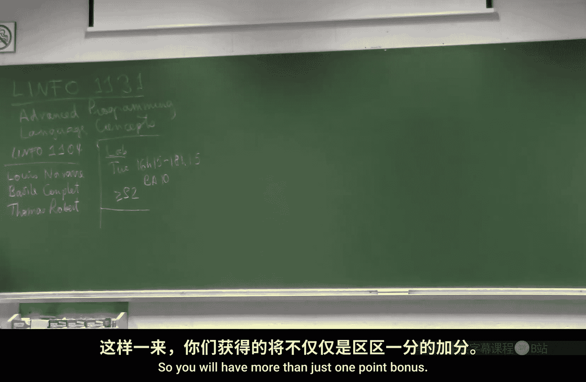
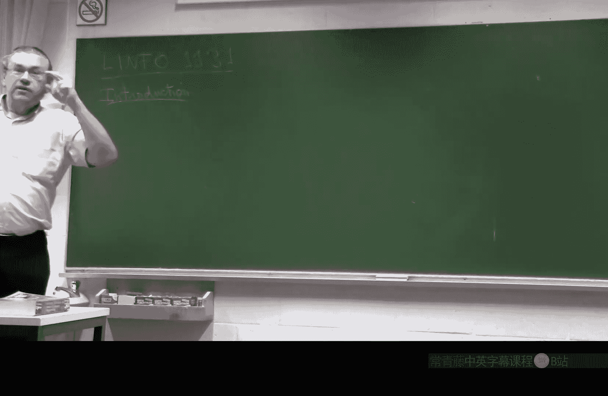
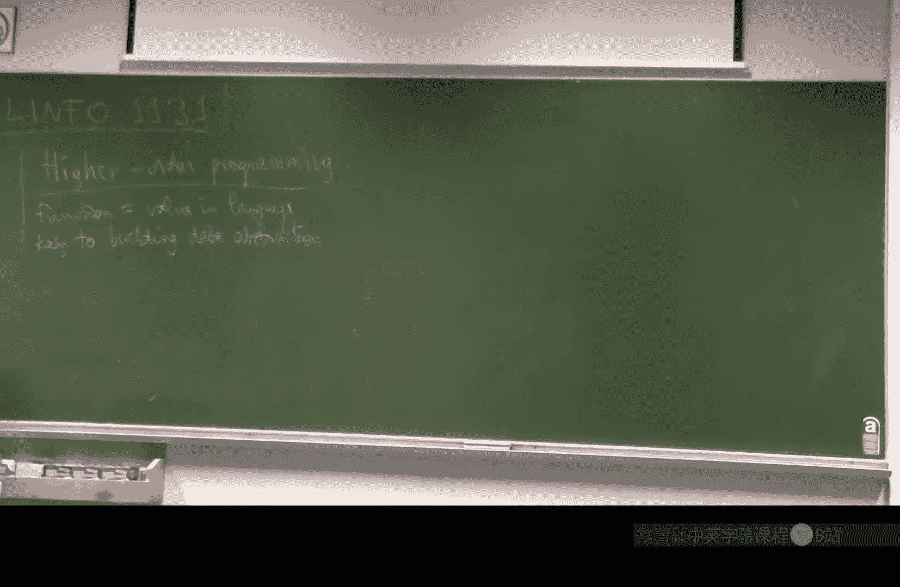
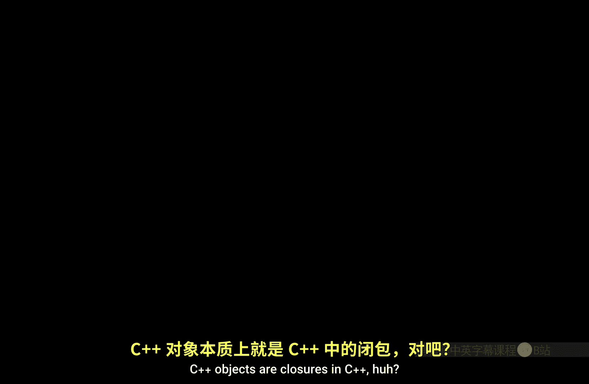
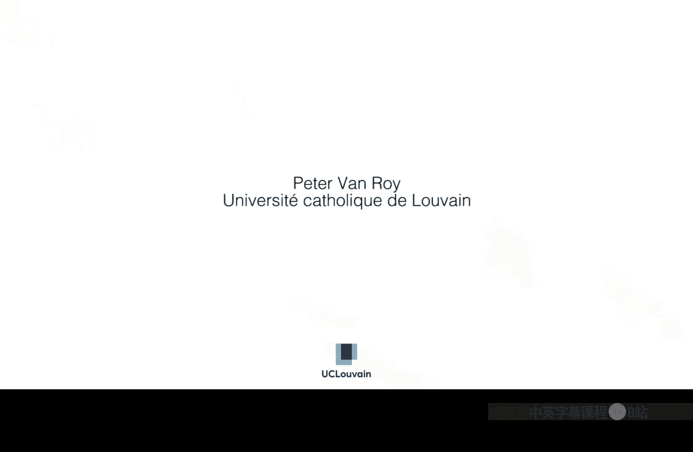

# 高级编程语言概念：1：课程介绍与基础回顾 🎓

在本节课中，我们将学习《高级编程语言概念》这门课程的整体安排，并回顾函数式编程、高阶编程、递归、`fold`操作以及确定性数据流并发等核心概念。这些是后续学习更高级主题的基础。

## 课程概述与安排 📅

本课程是之前课程 `LM41104` 的延续。今天的内容旨在帮助大家回顾，并假设大家已经忘记了之前课程的所有内容。这通常是一个合理的假设。希望今天之后，大家能重新记起所有内容。

本课程有一位助教 `Lu Na lada`，他是系里的博士生。此外，还有两位导师 `Cooper` 和 `Thomas Ho`，他们将负责安排实践实验课。课程在每周三上午进行，实验课则从第二周开始，在每周二的下午4:15至6:15进行。

为了鼓励大家参加实验课，我们设计了一个方案：每次出席实验课并签到，将计为1分。在学期末，如果你获得了所有分数，将在期末考试中获得1分的额外加分。如果只参加了一部分，加分将按比例计算。这个方案有双重好处：首先，它提供了额外的分数；其次，更重要的是，它鼓励大家进行规律的学习。只有通过每周的练习和思考，才能真正掌握课程内容，而不是在考试前一天突击学习。

### 课程组织方式

本课程的组织方式如下：
*   **项目**：占总分5分，是必修内容。项目需要两人一组完成，旨在运用课程所学知识完成一个更大的任务。只要合理安排时间，每个人都能在项目中获得好成绩。
*   **期中考试**：大约在第七周进行，时长为1小时，通常在课程时间内完成，占总分5分。期中考试是可选的，但参加有好处：它提供了提前学习材料的机会，并且对期末考试成绩有积极影响。
*   **期末考试**：占总分15分，实际上由期中考试的5分和期末的10分组成。期末考试的这部分成绩将取期中考试和期末考试相应部分的最高分。这意味着如果你期中考试考得好，期末考试时这部分内容就不必再学了，但你在期末考试中仍然可以尝试，并且只会取更好的成绩。

这种设计的目的是让大家在没有太大压力的情况下学习课程材料，并通过多种途径获得好成绩。

### 课程内容与工具

本课程名为“高级编程语言概念”，我们将使用 `1104` 课程中使用过的教材，但会更深入地探讨之前未涉及的复杂技术。我们将实际编程实现这些技术。

我们将继续使用 `Oz` 语言，因为它可以在这个系统中编程实现所有我们要学习的技术。当然，这些技术可以应用于任何语言。我们还将学习另一种名为 `Erlang` 的语言。在 `1104` 课程中我们已经对 `Erlang` 有了初步了解，本课程将更深入地学习 `Erlang` 如何实现通用行为和容错，这对于互联网应用来说是非常优秀的语言。

首先需要安装 `Mozart` 系统（用于 `Oz`），`Erlang` 的安装将在课程后期进行。

### 教学方式与反馈

这是我第二次教授这门课程，第一次由于疫情是在线上进行的。因此，这实际上是我第一次在课堂上教授这门课，这意味着课程可能会有所调整。我希望从大家那里获得关于课程进展的反馈。

我会尽力录制课程视频，但不能保证每周都有。因此，大家最好还是来上课并做笔记，这样可以提问和互动。

## 课程内容导览 🗺️

接下来，我将介绍本课程将要涵盖的许多概念和编程范式，这些内容比之前的课程更加深入。

我们将学习一个之前未涉及的概念：**惰性求值**。它可以与并发确定性结合，功能非常强大，允许计算无限数据结构，并且仍然是声明式的函数式编程。

我们还将学习一些**高级编程技术**和**函数式编程的高级算法设计技术**。函数式编程是一个非常强大的范式，但有些操作可能更难实现。实际上，有一些技术几乎可以在函数式范式中实现任何你想要的功能。我们将学习如何以非常巧妙的方式结合惰性和并发性，来创建高效的纯函数式算法。

此外，我们将学习**多智能体编程**的更强大形式，构建由许多并发智能体相互通信的复杂系统。

本课程的一个主题是**并发性**。在像 `Java` 这样的语言中，并发性通常很困难，但在其他范式中则容易得多。我们将在此基础之上进行更深入的学习。

另一个要学习的内容是**共享状态并发**，这是最困难的并发形式，因为它涉及可变状态。我们将学习其中的概念，如锁、监视器和事务。
*   **监视器** 是 `Java` 中实现线程协作的常用方式，但在我看来，这是一种非常糟糕的方式，不过由于有大量遗留软件仍在使用它，我们仍然需要了解。
*   **事务** 则是一个非常好且有用的概念，被广泛应用于数据库等大型互联网操作中。

以上是课程内容的概览和重点。

## 今日回顾内容 🔄

今天，我将带大家回顾以下内容：
1.  函数式编程
2.  递归函数（本质上是循环）
3.  高阶编程
4.  一个非常重要且特殊的原语：`fold` 操作
5.  确定性数据流并发

希望通过今天的回顾，大家能重新记起所有内容，下周我们将开始学习惰性求值。

### 函数式编程回顾

函数式编程是最重要的编程范式。它使用纯函数和单次赋值，没有状态（即没有可以多次赋值的变量）。它的理论基础是 λ 演算。

函数式编程是最好的范式，因为它使测试、维护和证明正确性变得容易。虽然由于没有内存（没有可赋值的变量）而不能做所有事情，但我们会尽可能多地使用它。在本课程中，我们将通过添加并发性、惰性求值和高级算法设计，将函数式编程推向极致。

### 递归与循环

在函数式编程中，我们经常使用递归函数。一个基本规则是：**尾递归等价于 `while` 循环**。

让我们以一个简单的例子来回顾：计算阶乘。我们总是从一个**循环不变量**开始。对于阶乘，不变量是：`n! = i! * a`。我们的想法是将 `n` 的阶乘分成两部分，`i` 和 `a` 一起给出 `n!`。然后我们减少 `i` 并增加 `a`，同时保持不变量为真。

在 `Java` 风格中，我们使用 `while` 循环和局部变量。在纯函数式风格中，我们使用递归函数，其中 `a` 和 `i` 作为参数，循环条件 `i > 0` 放在 `if` 语句中，递归调用则相当于再次循环。这两种方式生成的代码是相同的，都是循环指令。关键在于从**不变量**开始思考。

### 高阶编程与闭包

函数式编程最强大的特性之一是**高阶编程**，即函数是语言中的值，就像数字或记录一样。你可以创建局部函数值，将其作为参数传递或返回。这是构建所有数据抽象概念的关键。

例如，创建一个返回另一个函数的函数。每次调用这个函数时，都会创建一个新的匿名函数（闭包）。闭包不仅仅是函数代码，还包括代码加上其内部所需标识符的环境（即代码 + 环境）。每次创建匿名函数时，都必须捕获其词法作用域中的变量。

这个想法被称为**闭包**或**词法作用域闭包**，可能是编程语言中最重要的发明。所有现代语言都以某种形式实现了它。它是所有数据抽象的基础，使得构建由数百万行代码组成的大型软件成为可能。

### `Map` 函数与列表

另一个高阶编程的例子是 `map` 函数，它接受一个列表和一个函数（闭包），并将该函数应用于列表的每个元素。

首先，回顾一下列表。列表是计算机科学中最重要的数据结构。我们可以用 `EBNF` 语法定义列表：`List ::= nil | Element ‘|’ List`。这是一个递归定义。

列表可以写成树形结构，其中竖线 `|` 是根节点。我们使用**模式匹配**来分解列表。例如，模式 `H|T` 会将列表的头元素匹配到 `H`，剩余列表匹配到 `T`。模式匹配实际上会创建一个新的环境，将变量绑定到相应的部分。

`map` 函数是尾递归的，这意味着它使用常量内存空间，就像一个 `while` 循环。

### `Fold` 操作

`fold` 是最高阶、最有用的原语之一，它抽象了一个累加器。`fold` 是一个通用的循环，它通过一个二元函数组合列表中的所有元素。

例如，对列表 `[a0, a1, ..., a_{n-1}]` 求和，可以看作是用加法函数 `+` 和初始单位元 `0` 进行 `fold` 操作：`((...(0 + a0) + a1) + ...) + a_{n-1}`。

`fold` 的代码隐藏了累加器 `U`，用户无需关心累加器或不变量。这是一种数据抽象。`fold` 用途广泛，例如，在并发智能体中，`U` 可以是智能体的状态，`H` 是接收到的消息，`F` 是状态转换函数。因此，`fold` 是智能体的核心。

## 并发性与确定性数据流 ⚡

现在，我们来谈谈并发性以及随之而来的非确定性等问题。在上一门课程中，我们看到了一个非常好的范式：**确定性数据流**。它本质上是函数式编程加上线程，并且仍然是确定性的，因此非常有趣。

### 并发与线程

并发是指多个活动同时执行。在程序中，我们通过**线程**来实现这一点。线程是一个独立执行的活动。在抽象机器中，每个线程都有自己的语义栈。调度器负责在每一步选择哪个线程执行，这被称为**交错执行**。

调度器必须满足某些条件，最重要的是**公平性**：每个能够执行的线程最终都必须被选中。其他规则包括**时间片**（为了效率，线程通常运行一段时间后才被切换）和**优先级**（某些线程，如处理网络数据包或用户界面的线程，需要更高的优先级）。

### 非确定性

非确定性意味着程序做出了程序员无法决定的、由外部控制的**选择**。在并发系统中，如果有一个以上的线程，就本质上是非确定性的。非确定性可能来自调度器的选择，也可能来自现实世界（如用户何时点击按钮发送消息）。你的程序必须在所有可能的外部选择下都保持正确，这并不容易。

### 确定性数据流的优势

确定性数据流之所以如此优秀，是因为它对所有来自并发的非确定性**免疫**。在这个范式中，观察不到非确定性。这是因为它是函数式的，遵循 λ 演算的规则，特别是 **Church-Rosser 定理** 或 **合流性**。该定理指出，一个 λ 表达式无论以何种顺序归约，只要终止，都会得到相同的结果。函数式编程就是一个大的 λ 表达式，添加线程只是使不同位置的归约更加随机，但根据 Church-Rosser 定理，结果总是相同的。这是一个非常深刻的属性。

### 数据流同步

其基本概念是**数据流同步**。例如，有两个线程共享一个变量 `y`。一个线程执行 `x = y + 10`，然后打印 `x`；另一个线程执行 `y = 5`。`x = y + 10` 这个加法操作需要 `y` 的值。如果 `y` 尚未被绑定（即没有值），该操作会**等待**，直到数据可用。这就是数据流：指令根据数据的可用性来执行。

无论调度器如何选择执行顺序，最终结果总是 `x = 15`。因为 `y` 是单次赋值变量，这是纯函数式的概念。我们观察不到调度器的行为，这就是“没有可观察的非确定性”。即使有数百个线程，它也能很好地工作。

我们可以轻松地编写并发程序，例如一个生产者-消费者管道，只需几行代码。这展示了在此范式中编写并发程序是多么容易。

## 总结 📝

本节课中我们一起学习了《高级编程语言概念》课程的总体安排，并重点回顾了函数式编程的核心概念。我们重温了如何通过**递归**（特别是尾递归）实现循环，理解了**高阶编程**中函数作为值的威力，以及**闭包**作为构建数据抽象基石的重要性。我们还学习了强大的 `fold` 操作，它抽象了累加过程。最后，我们回顾了**确定性数据流并发**，理解了其通过数据流同步消除可观察非确定性的原理，这是编写可靠并发程序的关键范式。这些概念是后续学习更高级主题（如惰性求值）的基础。请确保理解这些内容，以便跟上后续课程。