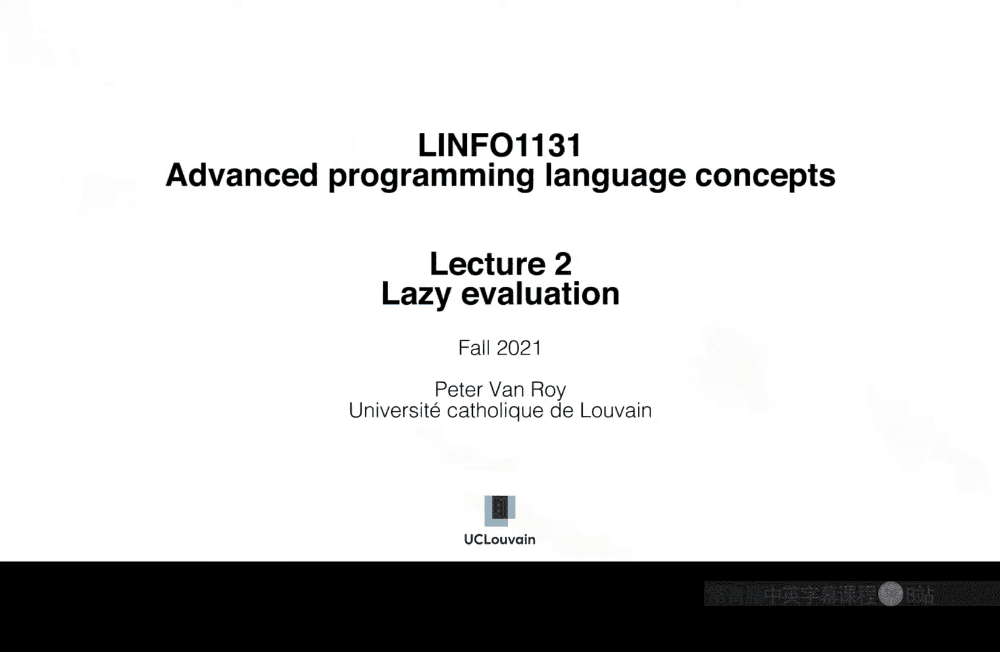
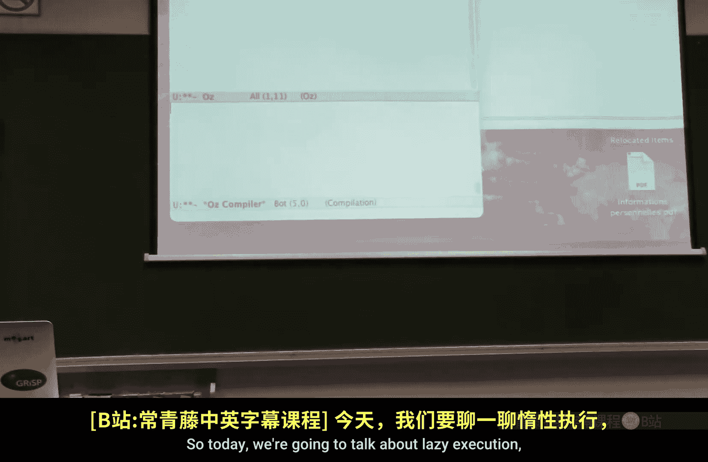
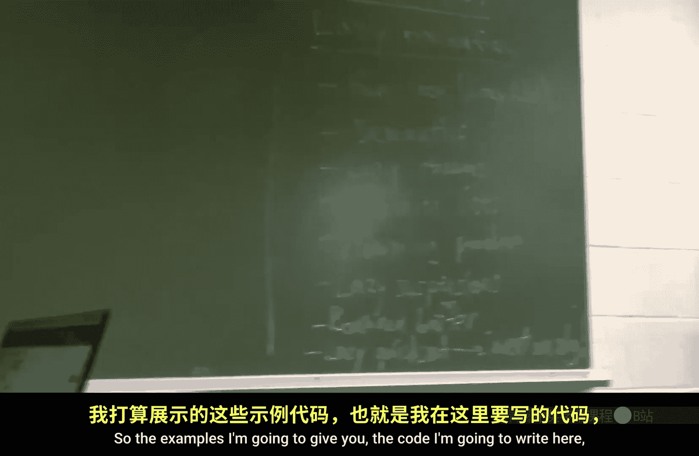
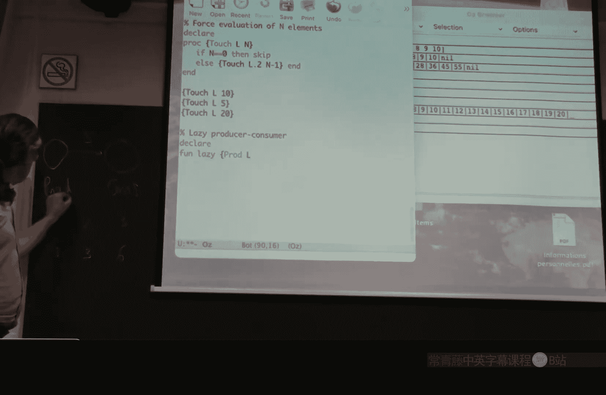
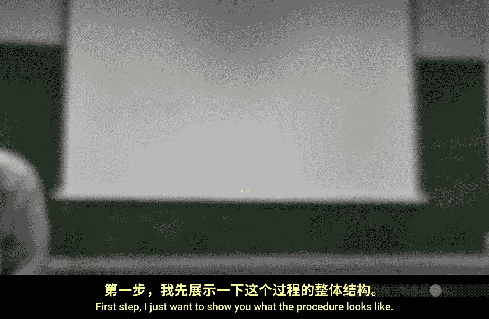

# 鲁汶理工学院【中英⚡高级编程语言概念｜LINFO1131, Advanced programming language concepts】 p17 P17 FO1131 Lecture 2 (2021) -BV1UDffBbEBZ_p17-

So today we're going to talk about lazy execution。

Something that all programmers don very much。as little work as possible。

 but here it's the program that's doing a little bit of work。

So I'm going to talk about lazy evaluation， La evaluation is just a form of functional programming。

So first I'm going to give many examples。Laazzy， I'll show you how it works。

By defining some lazy functions。I will give you the semantics， so you see exactly how magic。

Is working。And then we'll talk about。How to use it， lazy streams。I'll talk about。Infinite listzs。

I'll talk about some interesting problems， what is called the heing problem。

Which shows you the kind of programming techniques you can use when you have lazy evaluation。

And then we'll go into how it executes。So I talk about lazy suspensions。So in this course。

 it's not enough for you to program with lazy， you have to understand how it works also。

And then I'll give a more complicated and more sophisticated example。Called the bound at buffer。

And I will end with lazy quickword。Here is where the laziness will actually invent。An algorithm。

So the lazy computation will do as little work as possible。

 so this is a property of how it evaluates and in fact in the previous course we saw in the lambda calculus。

 we saw that there's applicative order and normal order。I didn't say so much about it。

 but appative order is the normal way of executing when you execute the arguments before calling the function。

When in normal order， you will not do that， you do just the opposite。

 you will execute as much as possible of the function and only execute the arguments if you really need them。

 Okay， so that corresponds to。Lazy evaluation。Okay， so this time I'm going to give you a lot of code。

Code examples。So let me first， so the examples I'm going to give you the code I'm going to write here。

 I'm going to put it on the Google after。

So let me first start by doing a simple。Introduction。To continue what we did last week。

The deterministic day flow of streets。This will you put you in the mindset of this kind of concurrent programming。

 so I will have two agents。One of them is a producer。The other one is a consumer。

Making a stream and these both of these have be executed concurrently。嗯。So let me define a producer。

This will the final list。A list of numbers going from L to H。So simple， actually。

If that was greater than page。Then no otherwise。L， followed by crowd。L plus1 H。Okay。

So that's a producer。And then I will actually let me in order to make this。Clear what it's doing。

Let me put a delay here。So the delay will tell the scheduler to wait for 1000 milliseconds。

So the threat will go slower so we can see how it's executed。And now they you make a consumer。

 so this consumer will take the stream as input。And let's say it has an accumulating argument。

 so' compute the。The accummulative sum of this list， so one，2， three， for example。

 if one of them produces one，2， three， then it will be  one， three， six， and so on。

 it'll do the accmulative sum。so I will read the list H。

And the result will be accumulated plus H followed by recursive cough， okay？And when it's done。

 it's done。Okay， so this is a consumer。 So you see these are two very simple list functions producer just makes a list and consumer just。

Compututes one this is another。And in fact， you can call them as normal list functions。

So let me compile these。对。So for example， I can do。Brows。Proud 1，10。Okay， it's actually。Right it now。

It's not giving anything， you know what because of the delays？But after 10 seconds。

Then the function completes。So you see basically you have to wait for 10 seconds。

Before it shows you the result， but then it shows everything， okay？Let's now run this concurrently。

Okay， so now I have the same program as before。This producer， and I hope to display the results。

As the producer runss。So remember before we had to wait 10 seconds and then we saw everything， okay。

 but when we run this concurrently， it's going to run differently。嗯呀。So you can see every second。

 a number of peers， and both of them are appearing concurrently。ok。

Now you can see the results here are the same from one to10， from one to10。

And then there's also the second result， it's displayed a little bit differently。

 but these two lists are identical of。It's using the bracket notation。

 the browse uses the bracket when it knows that it's list。Whereas when I credit incrementally。

 the end is still unbound variable， so it doesn't know so that's why I use the vertical bar notation。

 but in fact both of those are exactly。The same okay so this is an example of the deterministic data flow concurrency。

 so this is a pipeline between producer and consumer okay so this I show you this。

 this is actually continuing what we started last week to refresh your memory on the deterministic data flow。

Now in the previous course we saw many bigger programs。

 okay remember we saw even a digital logic simulation where you can do adders and latches。

Huge things with a huge number of threats and it's all deterministic data flow。

 so I'm not going to repeat that today， I just wanted to show you how that this deterministic data flow。

Between this producer consumer makes everything go increment。Okay。Okay。

 so that's continuing from last week。Now let me talk about lazy computation。

So here's a simple example。Let me define a lazy function。

And in thus you can do that by using the keyword lazy when you define the function。

 let me call this one lazy add。X plus y， it's very simple that you's doing addition， right？

So this function lazy add is just doing it next plus y。And now let me do。The sum。

 let me call lazy the ad。This is and ten。我知。Where else was this。make。クす。

So here I'm calling the function。And then I will display the result。Amazing conversation。

So you can see that nothing is displayed here， an unbound variable。

So what's happening here when I call this function。It does not actually execute the function， okay。

 a lazy function， it actually creates a lazy suspension， which I'll explain in a minute。

And it does not actually evaluate this function。So how do we evaluate the function then here the browse will display something without evaluating it done it will just display so it displays un variable here。

So this lazy suspension is waiting until the result of the function is needed， okay？

So the lazy evaluation will only evaluate things when they're needed。So here。

 so what does that mean needed， okay， well， it's explain it to you。

S is needed when I do another operation。That can only complete with the value of S。 so for example。

 if I do browse s plus 100。I do an addition。In addition， we'll need S。In order to complete。

 the addition needs to。Needs the value of S， and this will trigger。The evaluation。

So you can see that the evaluation is triggered in the opposite direction from regular computation。

 regular computation， I call a function， and I evaluate， and then I call another function。

 I evaluate and so on。And this evaluation does not work like that， so let me exit this。

So when execute this， you can see I now display 30 and 130， so now I evaluate this。

So this lazy addition is only evaluated when I need the value of S， okay， so that's actually a very。

Simple idea。Let me explain the semantics of this。So how does this work。

 how does this lazy function work？Let to see if I can。Write down。

 let me explain how it works and then we'll show some programming techniques。

 so this is a very simple example。But you can do extremely sophisticated programming using this idea。

 and that's what I'm going to show you today。So if I have a function。

Let's see if I have a piece of chalks that gives me a darker。哦。This is very cheap。Sure。

Maybe this one is better。The did not see it。I think I would have to bump my own shop。

This one is better。Good to see it。It's a little bit better。Fun， lazy。Lazy and。X，Y。It does x plus one。

But how is this actually executed？Well， it executes， it has a new operation。

 there's a new operation in the language。Called weight needed。 So in fact。

 I'm going to translate this to kernelnal language。So that you can understand how it executes。

So remember in the previous course， we saw the semantics of all the operations。

 and you can do that by translating them into kernel language。

And then giving the semantics of the kernel language operations。So this is translated as follows。

 it's translated into a procedure。Oh， lazy ad。X y one extra argument， which is the result。Okay。

It creates a thread。呵。嗯。And inside this thread， it does an operation called weight needed。儿。

And then it does R equal x plus y。So the body of the function here， you can see it again here。

But you can see we're doing something around it here。

We create a thread and this thread does an operation called weight needed。On the result。

 so it waits until the result is needed by somebody， so I'll show you in a minute how that works。

 and when the result is needed， then it computes it x plus y so R equal x plus y。

That means when you call the function。It creates this thread that waits。This thing I call it。

A lazy suspension。Okay， so a lazy suspension is actually a thread。

That will wait until the result is needed。Okay， let me show you how the weight needed works now。Okay。

So let's explain the weight needed。Operation。So let me declare a variable x。And I do weight needed。X。

 and then I do x equals。100 okay。So this。Will block。So I execute this。

And now I'll going out display play X。It's displaying an unbound variable to see。

 so what happens is this operation will block the thread， it will wait。

It will wait until x is needed， so that's something that we have to define， okay， so it blocks here。

 so what does it mean that x is needed？So it will wait until X is needed。

I put it in course because we have to define this。So need it means。

That another operation needs the value to complete， so for example， if I do x plus 10。

This operation needs space。Or if I do a case statement。嗯。If x is a list though， in this case。

 it's not a list， again， the case statement needs the value of x， okay？Or if x is a record。

If I do x dot。And in some fields name， which is a record which is because it's a record， again。

 the doc operation needs X。Okay， so the weight needed will wait。

 will block until I do something that needs X， something like this。Okay so browse x does not need x。

 so you see the browse is a very special operation when I display with B X。

 it doesn't actually need the value of x to display it so this will block。Forever。

 until somebody needs X。Okay， so yeahep。What is the cost of waiting for the cost of waiting forever。

 okay， so what happens is that when I execute this， this is operating in a thread。

 this thread will block here。Until x is needed， so x is if x is never needed。

Then the thread will basically exist forever now if x no longer has a reference。

 if there is no reference of x anywhere in a running thread。

 then garbage collection will remove it so this will wait forever as long as some running thread still has a reference to X。

If all the references to X are in blocked threads。Then the garbage collector will remove it Okay。

 so garbage collection also works for threads question sit on busy weight say so it's not a busy weight So this thing what it will do is on it will attach。

A suspension to the variable， so the way this is implemented is that the variable knows what are the threads that are waiting on it okay so the variable X here will have a suspension attached to it。

That will basically reference this thread。So that requires no execution time。

 so this is completely efficient as ahead of signal， okay？So then when I need x， when I do x plus 10。

This will。Do basically the plus operation。Requires both of its arguments。

 So this will actually do a weight on X will wait and the weight X。Implemented。

 so if there's any suspension on X， it will actually。

Unblock the way it needed and it will continue so if you have recursive functions。

 so this is a so in a very smart lazy language like HaSco。

 all the lazy suspensions are reused and it's very efficient in laziness whenever you do lazy suspension it will create another thread。

But threads are very cheap is the idea， so that's not so expensive actually。Okay。

 so in order for this weight needed to unblock。Let me just unblock it first if I do a browse。

X plus zero。So。X plus zero will just return x， but this addition operation needs x， okay。

 so there's actually a weight that the plus operation needs both of its arguments to be values。

And this is the weight needed to unblock， okay， so if I execute this。Then I can see that。

The results coming， okay？で長こと。For processor。so the threads are actually。

The cost of the threat is just the cost of saving the thread state。

 so there's basically a small set of registers and also。

A stack so that you have to also keep the stack going to。So the threads are extremely lightweight。

 so you can actually say they're only a little bit more expensive than a procedure call， for example。

Because compared to a procedure call， they have to save a few registers on the heEAP， okay？

And it depends on how much states the threat has， okay so a thread that is doing very small amount of work。

 the state is very small， so basically it's just a little bit more expensive than a procedureural call。

 but you should not worry about the cost okay， because a small cost of execution。

Is compared to a much simpler program， okay？So premature optimization is very bad， okay。

 so there's a famous computer scientist Donald Canth who says that premature optimization is the root of all evil okay and he knows what he's talking about。

So you should not worry about the cost of the threat at all。

So you should write a program which is very simple and at the very end when you're actually se or something。

 then you can profile and see where the time is going。

 but usually most of the time is going in a small part and usually most of these things will be very small percentage of the time so you really should not worry about the time percentages here okay？

Okay， so let me now give you a more a smarter， a more interesting example。Let me do an example。

Where we see and recursive functions， let me show you an example with an infinite list。So fun lazy。

It's n， we return n followed by。Its。N plus 1。Okay， so this is a recursive function which never terminates。

So if you don't make it lazy， you should not write it like this okay because it would be an infinite loop。

 but in lazy programming， you don't have to worry about termination so this can make the programs much。

 much simpler， okay so let me show how this works， this infinite list。

So let me create an infinite list that starts with one。Okay。Browseville。

So you can imagine what this is going to display， okay， when I run this function。

 it's not going to make an infinite loop。So the nice thing about lazy functions is you don't have to worry about infinite loops。

 okay， so this recursive function is an infinite looppa。

 but we're only going to execute small pieces of it。So when I run this。

This will basically do nothing， well it creates a latest suspension does nothing。

 so how can we force this function to calculate。Well。

 the only way to make it do something is if we actually need the result， okay， so for example。

 if I want the first result of the list， L do1，有。If I want L do1， the do operation will do a weight。

 and this will causes， the body of the ins to be executed。But it will only do one step， okay。

 basically the recursive call will create another lazy suspension and it will wait again。

You see so it will only give you the first element， but then the rest will wait again okay。

 so let me translate this。Into kernel language。So this will be a procedure。

I'm not going to actually compile it， but one code so ends。N R is the result， I have a thread。And。

Okay， inside this thread。And doing what needed。On R on the result。And then I do the recurive call。

And followed by。N plus one so this is not a complete translation to kernelnal language because this part I'm leaving it the way it is here so this is the body of the function。

So I create a thread。I do wait needed on the result。And then I do a recursive call。

 That means if I need R。Then I will this will unblock and then I will execute this。

 so if I do L dot1， this dot operation will do a weight on L which causes the weight needed to unblock。

And it helps to do this。So r will be bound to one， followed by then。

 so this its recursive call because this is a lazy function， will create another lazy suspension。

 okay？So the ins， when you activate it， it will only do a strong piece。Of the computation。

And then it will go back to be lazy to sleep again， it， it goes back to sleep， okay。

 and it waits for another needed。So that means each time you need a little bit more of the list。

Then you will activate a little bit more and then， but the recursive call will immediately create another lazy suspension so if I want to see the second element。

So L do 2。1。Is the second element of the list。So this will display， so this one will cause this。

One to wake up because L dot2 here。Eta2 will be the variable that's bound to this， okay。

 if you want to really see the variables， you have to translate it into kernel language， okay？

So if I do L do2 that1， you see now I should display two。And now the L， which is here。

Is one two underscore， so this final underscore is another way to another lazy suspension so you see it only does little pieces。

Each time， okay， so what if I need more？Elements。Let me let me show you an interesting function。

Let me define a procedure that takes a list that's lazily generated and forces n elements to appear okay。

 I'll call this one touch because it's like you're touching。The elements， okay。

So if n is equal to zero。Then iss nothing。Else。I do touch L dot 2 and minus1。

So this is a very simple function。Okay， if n is equal to one。Then I will do touch of L dot2。

With zero。Which forces an element because the dot operation will need L， okay？

So you see this function really， this procedure really doesn't do anything， okay？

But it forces the end elements of the list to be evaluated。Okay。Oh， I have to do it declare， sorry。

There。That should was a mouse。Okay and now I can do touch。

And so L is the one we saw before is this thing let's say I want 10 elements。If I do touch L of 10。

 I force 10 elements to be computed。Okay。If I do。Touch L of five。

This will actually not do anything because these five elements。Already exists Okay。

 so if I touch on five， it doesn't do anything， but if I do touch。L20。

 then the first elements already exist， but once it gets to the 11th element。

 it will force the daisy suspension to wake up again，And then， you get。It is the 20 dollars。Okay。

 so this is an example。Of forcing the evaluation， so I have this infinite list here。

Whi is going on forever， but it's not an infinite gl， so everything is very well controlled here。

 okay？Let me give you now another example。Do a lazy producer， consumer。Remember。

 I showed you in the beginning of the course， this producer consumer， well， let's make it lazy now。

Let's make a lazy producer consumer， yeah， question。ムムのですレシション消えてやっぱりごでまあたャネルある。と第。

so you can do a lot of optimization here this is only the semantics system is like this but you can actually reuse the thread and have the same thread here the thread terminates but you can actually reuse this thread here with the source transformation so I'm not going to talk about these optimizations but you can do it。

We been from book I feeling book I thing you see。So the idea is you could take this n plus one and some of the computation here and do it before。

Okay， but that will not really improve the performance though because you have to do it anyway before and after Mr。

halard。If it's in parallel US， so okay， so you can do that， that's optimization。

 if you have a multico system， you can do some of these on different course， okay。

 but you have to be very careful。Because the whole point of lazy computation is that you don't have to worry about infinite loops。

So when you do in optimization， like moving this n+ one somewhere， you have to be very careful。

 you're not creating an infinite loop， okay， in this case it's easy n plus one but this might be big computation。

 I might be calling many functions here， some of these might also be lazy。So if you do them early。

 maybe you're creating into the roof。So the whole point of lazy is that you do the minimum complication。

Okay。So let me now do a lazy producer consumer。Okay。Remember， I did producer from L to H here。

That means there was a maximum。Well， now I'm going to the producer with no maximum。

 so this function is actually the same as the intz function。L， followed by Pro L plus1。Okay。

And then there's a consumer， then we make it also lazy。With an accumulator。This will take。

My keyboard is doing weird things。え？So here I will do that to us。H， followed by。这么。知道 that。主。H。

So this is calculating the accumulating sum。Notice I do not wait for the nail here， okay？

I don't worry about the end。Because I don't worry about termination here I'm creating an infinite。

Producer for infinite stream。 And here I'm taking an infinite stream as input。

And making another infinite stream as output。But because the functions are lazy。

 there's no problem with that。Okay。所为。Compile them， let me'll show you how this works。

So let's browse S1 and S2。LetSorry， let me put a delay in here。

So that you can actually see the laser computation。Otherwise， it goes too fast。

I wantant you to see how it's working。S1 is equal to producers starting with one。And。

S2 takes the consumer of S1， starts with zero。And does like this Okay。

 so this is very similar code to the code before if you look at the code before， let me go back up。

So remember， this is the code we did when the functions are not lazy。

Notice that we have this upper value， upper limit here。

And notice that we have this mill case because the consumer has to stop， okay。

 we have an upper limit， so the producer has a limit。Okay， that's the eager case。

 so in the case where it's not lazy， we call itea and the producer has to stop。

Otherwise it's an infinite loop， okay， but if we look at the lazy case。第二。

The producer does not have an upper limit here， the producer can go in forever。

But it's not a problem because the producer is lazy， okay。

 the consumer also does not have an upper limit， okay， so the zero is the accumulator。

 there's no upper limit， so this program can go on forever。So let me run this。So this does nothing。

 okay。Both of these functions are lazy。And I don't need anything yet， so how can I force it， well。

 I can use the function touch to force this to make an output， okay？So if I never do touch。S 2。

And I say I need 10 elements。Okay， now look at' what's happening on the right。Oh， let's still done。い。

Yeah。I don't know why I turned it off， so yeah， well let me do again。Let me now do。

Let me run again so you can see it。Okay， I do touch。嗯。So every second。

 the producer and the consumer will make another element。So this is a lazy computation。

 so there's two streams。Okay， so if I make a picture of it， I have the producer。I have the consumer。

This is S1， there's S2 here。And here I have touch。The touch is what it needs。The S2。

 so the touch will force。Force evaluation， so the touch will say I need S2， it will be S2 do2。

 this will cause the consumer to evaluate。And the consumer will do L of H bar T， which is S1。

So the consumer will say， I need S1 and it will go back to the producer。

 so you see it goes step by step back from the output back to the input， then？

So you have to understand how this thing is working， so there's no magic here。

 you are basically going from the output。And the control is going from output。To input。谁。

So in a normal execution， the control goes from input to output the producer is producing all the data goes through and lazy it's exactly the opposite。

 okay， everybody is waiting for the output， the output needs something。

 it asks for something from cons。Its from the。Consumer。

 and then the consumer needs its own input to an assets producer。

 so the control is going exactly back。From output to input。

 and this is working through the weight needed operation。

The weight needed is making the control go back。From the output back to the input。

But you see the program is very simple。So you understand how it works internally with what needed。

 I showed it to you。But I know from experience that it's actually hard to understand this in real how this is really working when I have a chain of things。

Okay， it looks very simple I have a producer withs an infinite list， a consumer。

 which is an infinite loop here。There's no termination here。

 and then I just call both of them so simple， so the code is very simple。

So the programmer has a very simple view of things， but internally it's actually complicated， okay？

So let me explain that to you in a more detailed way。So the way I'm going to do that is I'm going to。

Right on the board here。So， let be。I want to write this on the board。

 I want to show you really how this thing is working。え？So let me see if I can make it like this。

 so I keep the code here so you can see the code and I will write here and hopefully things will go well。

 okay。So I have a producer and a consumer。So let me translate them into kernel language。

So the producer looks like this after this is probably， not going to works so lot。It's better。

So the producer， okay。The producer is going to look like this。So， NR。Thread， white needed。R。

 and then R。Equal to n。Followed by producer。And this one。Okayて。And the consumer looks like this。

And then finally I'll show you the touch。Okay。And then we'll show you， it's important。

 I will go through all of the details so you can see really how it。きとのてり。Consumer。

 so let me see that I get the arguments。Right here。So there's an L， a9 related。As a result。嗯。不是不是。

The red end。Awaight needed。Okay， wake needed of R。And now the interesting thing about the consumer is it has a case statements。

Cace oh。H bar T， then。the make little bit。ig， so this will give you accumulator plus。H。Consumer。T。

 a cuator plus H。好。AndR is not needed to function。that。Okay。So you see this part， which I will。

Make an orange rectangle around， this is actually the body of the original functioner。

 and here also it's the body of the function。So it goes after the weight needed。Okay。

 this is actually R。テで。And then we have touch。O so the touch。Is it procedure？Touch L and。

So here I'm just going to do touch the way it is normally if n is equal to zero。

There is nothing I've done， I don't need anything。Else。I do touch。L dot 2 n minus1。嗯。Okay。Okay。

 so now I'm going to execute this and let me show you the body now。呃。Where is the eraser I here？

So you can see how this flows from the back to the front。Okay， I have a thread。I have S1 is producer。

1。I have a thread。S2 is equal to consumer。S 1，0。And I have a touch。S2， maybe 10 or something。

 so this is my program。So when this first executes。As one。S1 here is A。Is this R here。

 so it will do a。This suspension。Okay， so I'm going to write it like this， S1。Is actually。呃。

Waiting in this way needed， okay？So I'm going to write it like this。

S1 is a lazy suspension waiting for this。And here， S2 S2 is this a。And it's way in here。

There there's another weight needed， so S2 is going to be waiting and here at have a bigger piece of code。

 the case statements。Okay， L here。Is S1。Okay。And now I do。Touch。Of S2。10， okay。I'm doing the touch。

 so what happens？So when I do the touch。The touch here， it does。S2。2。

 it causes this weight needed to wake up， this to execute， okay？And this L is actually S1。

 so let me say this is actually S2。And this is S1。So you see when I do the touch。

 it causes the consumer weight needed to wake up。Because this R is actually as two。

And then it executes the body of the consumer， this。Now。

 you see when it executes the body of the consumer， it's executing case S1 of H bar。

 case S1 of H bar。Needs S1， so now we make one more step here。

 this case is now going to wake up this one， okay。So this R is1。So when I do this case。

 it will wake up this way needed and then it will execute end bar。Proud and might plus one。

So the S1 will be actually bound to one bar this， so you see how it goes backwards？From touch。

So that this is actually S2。touch Institute tube causes this to wake up， then I execute this body。

Executing this body， this case causes this one to wake up。

 okay then I execute this and now things are going forward again。

 now I bind S1 to this okay I bind S1 which allows this S1 to execute。

S1 is now bound to one bar of something。One bar， something， and now I can execute this。

And now in this recursive call， I'm going to do another way needed up and this one also。

 and it blocks again， so you see I make one step forwarder。So S2 here is bound to0 plus one。

 so one bar this。So the S2 do2 is actually equal to this。So I actually have。

Created a piece of the list， okay， so this is actually S2。1。If I display S2。1。

 it will now display one， okay？So you can see how the control goes backwards。

Through the way it needed。From touch to consumer and from consumer to producer。

 and then I bind something here， and this allows this thing to go a little bit forward。

And it allows this thing to go a little bit forward so it goes back。

And then I bond things and I could go a little bit forward。And then I had my recursive call to touch。

And if the n is 10， then I have touched Elda to9 and then will do I will do all that again。

 so it's like waves going back and forth。I go back， touch consumer producer。

 and then I bind one element， and if the touch is not happy， if it continues。

 it happens again until the touch。Ends n equals 0。Okay。So that's how it actually executes。Now。

When you write programs with this， usually you don't think of the execution， okay？

But since in this course， I want you to understand the things I want you to understand how it executes Alola。

😡，Not just how to write lazy programs， but also how to execute them， how they execute them。Okay。

 so now I will make this happen down yet。So this can actually be pretty complicated executioner。

And we'll see more complicated examples later out in the course。But the code that you write。

It's very simple you see here。It's super simple and it's very intuitive， okay？Okay。

 so let's make a small break now and after the break， I'll show you even more sophisticated things。

 lazy program。とて。

Let me know。Continue with the lazy execution。 Let me now show you some。

More sophisticated programs using laziness。So the first problem I want to show you is called the hemock problem。

This one I will first do it on the board， and then I will show you how to execute， okay？

Because it requires some explanation and such， it's a very interesting problem。

And the solution using laziness is extremely simple。😊。

And if you want to do a solution using another approach， it will be much more complicated。で？

So let me show you that problem and how we solve it using laziness。So first。

 I want to explain it on the board。And then I will show you the code。

So this is actually a famous problem made by a guy named Richard Hemi。So here's the problem。

 I have numbers of the form two to the A，3 to the B，5 to the C， where A。

 B of C are integers greater than equal to zero。So I want to make a sequence of these numbers。

An increasing order。So I want to generate the sequence of all numbers of this form， so two， three。

 and five are prime numbers。2 to the A times3 to the B times5 to the C， but in increasing order。

 you see it's not that simple about because when you increase these numbers， they get all mixed up。

 but you want them in increasing order， okay？So this sequence will start with one， of course。

 me call a sequence H。So it starts with one。This is when A， B and C are zero。

And the next number is two， okay？This is two times and then these two are both zero。

 and it would be three， and now it's not five， but we have four， we have two squared。

 so we have four。5， okay， now we have 6， two times 3。Okay， we do not have seven。But we have eight。

Okay， so the seven is skipped。This is two to the third， and then we have nine which is three squared。

 and then we have10， which is two times five。The 11 is skipped， we have 12。

 which is two square times three and so on。So you see these numbers are actually。嗯。These numbers are。

Actually。Genrated from this formula， but we have to make them in increasing orange。

Without skipping any， so we have to generate them in increasing order。

 so that's the problem we went through a program， also an efficient program。

That generates that an increasing order and using laziness probably gives you the simplest possible solution to this probe。

Okay。So the idea is the following。 I start with H， which starts with one。

 So I know it has to start with one， Okay now I make。Three sequences， to H。3， H and five H。So two。

 what H starts with one。2 H will start with two， okay。

Three H will start to three and five of H will start with five。

And now we can actually find the next element。Okay。

 the next element will be the smallest number from these three sequences。So two， three， five。

 so the next element will be two。From here。But since H now becomes2，2 H will be 2，4。3 H would be 36。

And 5 h should be 5， 10， so now I have used up the two。Okay， and now we continue。

We look at the beginning elements that we have not used yet， four， three， and five。

And we picked the smallest one， which is three。Okay， this is the next element of the sequence。

Okay so it's used up。And since now H has a three， we can say2 h is 246，3 h is 36，9， and five h is6。5。

10，15。 So now we have4，6，5。And we picked the smallest one， in this case it would be four。

OkayAnd we go on like this， you see how it works？So we are generating in a kind of recursive way。

We start from the beginning of H， we find these three sequences which are all the possible next elements。

 all the possible next elements will be either two times the previous element or itll be three times or five times the previous element。

 okay， so the smallest of these three will be the next element。Because it has to be one of these。

 Okay， the next element that's not。Written yet is always going to be either two times the previous element or three or five times the previous element。

So this is actually a proof that this is actually a correct algorithm。

So we have this recursive approach。So how do we do this。

 we can actually program this using lazy streams。So lazy extremes。We have two， we have a function。

We can call it a function， let we call it times。Which takes a stream。And multiplies this。

 so for example， times two will'll make it all the elements multiplied by two。

 okay and then we have a function called mergech。Which takes three streams。S1。

Its2 S3 and creates another stream， which is always the smallest elements。

 it me these the way I merge these， okay？So with this， I can actually implement having a problem。

So I start with H， okay？So H。Is equal to one followed by。And here I will now merge。Merge of。Times2。

 H。Times 3 H。And times five。So basically this is the solution， so you can write it like this。

So H goes to the times two。Times three。And times five。These are merged together。And this gives me H。

Okay。So it's actually a recursive。Programmed using lazy streams。So if I use regular streams。

 non lazy， then it's a problem because I have to tell you the limit， okay。

 so if I use non lazy streams。I need。The limits， that the end。I need to know the limits。

 so if I do non lazy streams in times to H， I need to tell how many elements I need to do there。

 but that's not so easy to find okay because to H I need maybe。Less elements in five than in two。

 and as the H is growing， then maybe I need to change the limits。

 so this is actually very hard to program。The limits， okay。

So this is actually very hard to program using non lazy streams because each of these functions needs to have a limit。

And what happens if I need more well I have to cover it again with the higher number。

 so it's very hacky， okay， but with lazy streams， I don't need to do this at all。

This is completely unnecessary。Okay， let me show you how it works。

 so that's enough now I can show you the code。Is it a theory for this problem？So I have the times。

Times function。And the merge function。Actually， let me do to make it a little bit simpler。

 let me do a two argument merge。Instead of three。But that's not changing very much。

 I just have to call it twice， okay， so this makes it a little bit simpler。

So let me show you the times now。Time H， but times n。So this is a lazy function。

 and takes a stream H。And it a stream where all the elements have multiplied by n。Okay。Case。Age of。

This is called with this。S of H bar T， then n times。H fallen by。Times。T and okay。

So that's very simple。It's an infinite loop。It takes the stream as， it takes the first element。

 multiplies by n， and goes to on。So remember that this is actually a tail recursive。Function so this。

 but here in the lazy function， you can see that if I call it with S。And I need S。

 then I will do this， but the case S， sorry， I called when I need this。

When I actually need the result of times SN， it will run case of H bar t and it will also need s。

 so the need will propagate backwards of the result to the argument。Okay。

 let me now define merge also lazy function。S1， S2， okay here I'm going to do。First。

 let me take one element of both。So let me do it like this。H bar， team bar。

So first I need one element of each。Okay。So basically。

 I'm taking these two streams and I will output whichever of these two values is less。

the smallest one。So if。H1 is less than H2。Then I will output H1。

And I will follow it by the recursive call to merge again。Here I put T1 S。这个。诶。

So you see what I'm doing here， if H1 is less than H2， then the output would be H1。

 so I'm always taking the least though。And then when I do the recursive call。

 the argument is T1 since I've already used up the H。But it's S2 because I have not yet used H2。Okay。

So if H1 is greater than H2， then it's H2， which goes to the output。And here it's going to be S1， T2。

and here the final case side of H1 is equal to H2， and then can come。

So you see how I'm worth doing it， though？S here it' H2， if H1 is equal to H2。

 that's very interesting because it's possibleh。This is possible here， for example， age six and six。

If it's equal， I have to eat both of them。Because the six only appears once on the output though。

So I actually have to， I can take H1 since they're equal， it doesn't matter。

 but when I call the mech， I have to eat both of them， he wanted to see that。Here I have to eat。

The age in both stream。That's important， so this is not the same merge as a sorting algorithm path if you do like a sort a merge sort algorithm。

Okay， then all the elements and the input。If there's two sixes in the input。

 there have to be two sixes on the output because you cannot eat up the elements when you sort a list。

So this is not the right me for a merge sword， but in the hanging problem。

 the elements only appear once on the output， so if I have two sixes I have to make sure that only one six appears on the output so I have to go farther in both of them you see that so it's important to be very precise so this is almost the whole program now。

So now I can actually do the create H， H is equal to one followed by。Merge。He， this is it。

 so this is my programr。I merge times H2 with。Times H3 and times H5 so I have two calls。

 so the reason why I do two arguments merges to make this code a little bit simpler。

 you could do three my way merge two， but then you have to do all the different cases of。

And there's many cases and sometimes the elements are going to be the same。

 sometimes they're not the same， so I don't want to do complicated。

 so the simplest this is the two argument merchant， notice there's no nil case here， neither here。

 no nil， no terminations， all infinite lists。And so this recursive thing where the H is both on the left and the right side。

 this will actually compute the value the result You see how short it is this programmer。

So I think Gil's age to see the result。So if you want to program this in another language。

 you can program this in Java or whatever。The code is much more complicated okay it's maybe a good exercise to try。

 but you'll see it's a lot more complicated， the laziness here is completely automatic okay but it's no magic in fact it's doing all the way it needed stuff that we explained it so this is actually working exactly the way I explained before the break。

So you can see here。It's showing one， it so far it's not doing anything。So if I want values。

 I have to ask for them。So I have my nice little function procedure touch that I can use。

So I can say， oops。I don't want to remember everything I can say。Touch。H5， if I want five values。

Well， I get one33 for five， okay？Let's ask for a little bit more。特取。Hge10。

Now I see a little bit more， six， eight，9， 10， 12。So I get values and I can do as many as I want like this。

Now the nice thing is that this program is incredibly efficient。Okay。

 because it's only using as much memory as you need for this。And there will be five lazy suspensions。

 okay， at the end。At the ends of this streams， okay？

And we will only create as much of the stream as you need and no more。

So if I want 10 or 1 thousand00， I don't have to allocate any memory。

I don't have to prelocate an array of 300 elements or whatever， no， it's automatic。

The laziness will automatically make the lists just as long as they need and no longer。Okay。

So this is a nice example of how laziness can make problems very simple。

 and this is extremely efficient because it uses the minimum memory， minimum resources。

 and it only allocates the memory when you actually need it， okay？So that's nice， right。

 having problem？Okay， let me show you now another problem。Which is called abounded buffer， okay？

So for this one also， I will explain some things。诶。So I will go again。

 explain them on the board first， and then I'll show you the code。

So a bounded buffer is something that's。Everywhere。

 it's something that's used in a lot of software and it's usually not so easy to implement it。

But I will show you how to implement it first I'll show you what it is。

 and then I'll show you how with laziness in a few lines of code we can implement around the buffer。

Okay， if you want to write abundant buffer in Javaa， though。

 it would be more lines of codes than I show you here， okay？So round。

So what's the idea of a bounded buffer， So a bounded buffer is actually used everywhere。

 It's a very common。Compon。It's used to smooth。It's used to smooth。

Difference in speed between producer and consumer。I'll show you what that mean。Between producer。

And a consumer。So let me show you a simple example， here I have a producer。And here I have a costume。

 okay。And there's a stream here， S。And the producer is making elements。

And the consumer is consuming them。And this is like a pipeline。Yeah， this is like a pipeline。

And the producer maybe it's doing computation， whatever these could be things like video frames or web pages or whatever there's a street or biketes going through Uni's pipeline。

 okay？Now， the consumer will ask。Foreign element。Okay。

And this will cause the producer to produce an element。

And then if the consumer needs another element that asks for an element。

And the producer will produce another element， okay？So this is the usual lazy approach。

But this actually is not so good， we can actually do better。Because this is actually taking time。

 so if you look at the time here。Here's time。Here's the producer。

The consumer so the consumer is here asks for an element。It sends a message to the producer。

 the producer produces the album here。Okay， it does a computation produces。クル。Element。

 consumer does something with that element， that it asks for another element。

And the producer produces and so on。Back and forth， you see it so actually this is。Not so nice。

And the reason is that。Why the consumer asks for an element？And the producer is making the element。

The consumer is waiting here。Okay， and then what the element is done goes back。

And when it asks another element， again， it has to wait until the producer makes the element。

 and also the producer will be have time where it does nothing。And these times。

 so the time is kind of wasted here。It's not so nice。So the bound and buffer solution。

 the idea is to let the producer go ahead of the consumer。Okay， so here we have wasted time。

So the bounded buffer solution。Is let the producer get ahead。That producer make。More elements。

Then the consumer asks。That means， let's say the producer makes three more elements。Okay。

That means while the consumer is doing something else， the producer is producing more elements。

That means when the consumer asks。The element is already there。The element is already。

available immediately。So when the consumer asks for an element， it's already there。

 the producer actually has made several elements， and it's already so the consumer does not have the ways。

That's great。😊，And the consumer asks again very fast and again it gets the development immediately。

So the consumer can go much faster and also the producer is using these wasted times。

To produce extra elements。 So， in fact， using the bound buffer approach。

The producer and consumer can build a lot faster。So buffers are used a lot in rail systems because it smooths the difference。

 you see， instead of wasting the time， you let the producer get ahead so it can use all the empty time。

To make extra elements， even when the consumer is not asking。

 and then when the consumer asks it immediately gives you an element， okay？So how does this look？

In the system。So the bottom buffer is actually a component。オケ。It's an extra component。

let me make a picture like this， so this is with no bound but by a producer。They a consumer。

And both of these aret lazy， okay？It a stream， this is with no bound buffer。So with bounded buffer。

It looks like this， I have a producer， consumer just like before。

 but I add an extra component in the middle which is the bound of buffer。And all of these three。

 these two are lazy。And the abundant buffer is very interesting because it's a combination of layers and eager。

 so we're going to show you how to do this。So the code for the producer is the same as before。Okay。

 the code is none changed， S code。Here also same code。Reffic change。

So the producer thinks that the bounded buffer is the consumer， there was a string as wells too。

 so from the producer point of view， this is the consumer。And from the consumer point of view。

 this is the producer。Okay。So how does this thing work so assume the consumer is not asking。

 say the consumer does not ask for any elements yet， later， maybe， but not right away。

The bounded buffer， when you started it out， it immediately asks for elements。It says。

 giveive me three， I need three elements to the producer immediately。

 even though the consumer has not asked for anything yet。Okay。

So the bundle bufferer has a given size， then let's say the size is three。

That means it has space for three elements， it can be bigger of 10 or 100000 in risk systems bound the buffers can be very big。

 let's say it's very simple， three。That means when the system starts up。

 Deed buffer asks for three elements。From the producer。

 even though the consumer has not done anything yet。And eventually。

 the consumer will ask for an element。And it asks them on the buffer and the other with is already there。

 so he gets it immediately。The consumer is very happy， okay。

 and the Bo buffer gives one element then to the consumer。But now we only have two elements inside。

 So we immediately asks another one from the producer because he always wants to stay ahead of the consumer。

 Okay， the bond and buffer always wants to have three more elements。Than the consumer。

 so each time the consumer asks the button and buffer will ask the producer for another one so that it can fill it up again。

Okay， so it doesn't always help， but let's say the consumer needs four elements。

So it asks the first three gets them very fast。But the fourth one by the bottom of buffer。

 it's only size three， doesn't have the fourth one， so then the consumer has to wait as before。

 so when the buffer is actually emptied，then it's the same as the previous， okay。

 but if the buffer is reasonably sized like three or 10 or whatever， that's very rare operation。

 it depends on how the speed of the producer and the consumer are fluctuating but on average。

 on average， the bond buffer will not be empty。OkayAnd if the bond of buffer is not empty。

 the consumer will immediately get things and the producer is always happy because it's also it's producing more elements。

 So the producer point of view。It doesn't really see much difference。

The producer is producing elements。And the consumer is getting them faster， okay？

So you see a bounded buffer is a very useful component in a stream system。

 and it's used everywhere in computing systems， you can write it in Java， you can write it in。

Pyon been right in February。But it's actually really interesting to see how it works。

When you use lazy evaluation is then you can really see how the bond buffer is doing its job， okay？

So I'm going to show you how this bond of buffer， we're going to build it together。

 it's only a few lines of code。But it's using lazy a very nice way。

You see that you see the butter buffer now now I'm going to write codeda。

 you understand what it's doing， no questions on this。 you see it's very useful。

 So this is actually a generally useful component and whenever you build computer systems you need buffers so there's hundreds of buffers everywhere in all the operating systems everywhere and this is the reason why you have them so bonded buffer is a really useful and ubiquitous component and you see it's extremely modular because the producer and the consumer they don't even know it exists。

The code is not even changed at all。So it's actually extremely nice， you can easy to maintain。

 and you can tune it， you can change the size here， and so there's a trade offer。

 the bigger the size， this will take more memory， of course。The higher the size。

 the bigger the memory， you can say let's just make it really， really big， well。

 you don't want memory overflow， okay？So usually it has some size。

And so the amount of smoothing it does， the speed increase。

Do you usually like an optimal point because when you make the size too big， it uses too much memory。

 okay？So usually the size is not enough to make a big problem but still so if you use Unix pipes。

 for example， they are buffered automatically yeah。

 if I have in sockets or pipes between two Unix processes。

 there's buffer in there okay automatically the operating system is giving it to you。

 I don't know exactly a big of this but it might be。

 I don't know 10 kilobytes or something there's some buffer there， so these buffers are everywhere。

Okay。Okay， so you know this， now we go to the writing of the code， okay， everybody？

I can go to the code now， now we will build this using laziness。And you see。I do step by step。

To try to make it extremely intuitive， okay， because it's a small program。

 but it's doing exactly the right thing。Okay， so let's。Right now， bounded buffer， okay？什么？First step。

 I just want to show you what the procedure looks like， it looks like this。

There's a declare， but let me only put the declare and when it's completely done。

There's an input stream， an output stream and a size。Okay。

 so that wait a minute until the screen is brighter。So let's just start by writing this component。

 so remember we did producer lazy producer consumer run。

 so this bound a buffer you can stick it in the middle without changing the code and these two these two are both lazy okay？

So producer and consumer will both be lazy。And the bounding buffer is in the middle。

So the bonded buffer， this is how it looks， it's a procedure that has an input stream has one。

 an output stream has two， and it has a size。So when I call this， this will create my buffcom， okay？

每一个。Okay， let me now do a second step。I want to just pass elements。From S1 to S2。Okay。

 so I keep the same。As before。Okay， so this is the first step， this is a simple thing。

Here I have a loop。Which reads a stream S1。And it outputs the same stream， it's doing nothing， okay。

 and the boundary buffer is S2 equal loop of S1。So basically this is a bound buffer that's not really doing anything as two is just getting the same elements are being passed。

 this is very similar to functions we wrote before。

Remember the sum and the times and so on to take an input stream， so I'm reading it here。

 output stream， notice this is a lazy。Okay， that changes everything， of course。

 that means there's a weight needed here，h？And so I S2， when I need S2。

 I will activate this lazy suspension of the loop。And then inside the loop， I will need S1。

 you see when I write the loop， so this will activate the egg suspension of the producer。

 So you see how it's growing So this is the first。对。I pass elements from S1 to S2。Okay。

 but but my real abundanted buffer has to do more than that，h？

So this is fine because that's what the boundary buffer does， it passes elements。

 the same elements is two as S1， that's fine。But the abundant buffer does a little bit more。

When it starts out， it immediately asks the producer for n elements。Okay， so basically the producer。

 it lets the producer get ahead of the consumer， so when it starts up， this is fine。

 I can keep this I can keep this。But it has to do a little bit more。

It has to ask the producer for n more elements， and elements when it starts up immediately。Okay。

 so we'll add that， and then the next thing it has to do is whenever it passes an element onto S2。

 it has to ask for one more。It has to stay ahead， the producer has to stay ahead of the consumer okay。

 okay， so let's do now the third step。So， basically， ask for。And elements。嗯，自带的。Okay。

 so when the thing starts up， it has to ask for n。 So how do I do that Well。

 I'm going to do something like。来 touch。But I would use a listit function。

There's actually a list module， I'm going to do a little bit simple here。

 there's a list module in Mozarrkt system。With lots of list functions。Okay。

 so I'm going to use one of those to immediately， what does it mean to ask for elements。

 well it means I need the first n elements of S1 so I need。And elements。From S1。So S1 is equal to A。

 B，C， D。et cetera， and assume that n is equal to 3。Okay， but they're not computed yet， though。

 I need these three。嗯。And then it continues， So I need these three elements。

So there's actually a function called list drop， I'm going to use that just to be a little bit。

Simimpr。Take a list and it removes the first elements。I mean， it's a function。

 so it returns some value。And here there's some value so I'm going to do this， I take S1。

And I'm going to remove， so this drop basically is like a touch a little bit。

 but it removes the first n elements from a list。And the result is this。

 but if as one is a lazy list， this is going to cause the list as one to be needed， of course。Okay。

 so this asks fored elements， okay， very good。Okay。So that's another thing， but we're not done yet。

 okay， this is good， okay， asks for N elements immediately on startup。嗯。😮。

But we have to do a little bit more。Whenever the buffer passes H1 from input to output。

 it has to ask for another element。So it's not enough to ask for end at the startup。

 it has to keep asking during the execution， okay whenever the consumer takes an element。

 it has to ask for one more because it always has to stay ahead。So in fact。

 we need to do that inside the loop whenever we ask。Pass an element to the consumer。

 we have to ask for another element， okay？Okay， very good。We're almost done though it， actually。

This is the fourth step。Forourth。ね。So ask for an element whenever。Whenever a consumer asks。

Okay so this actually has to be done in the loop， okay， make sure I'm doing it completely right here。

So we need to this end。This end is actually n elements ahead as one。The end thing here。

And is actually here，S1 is ABC， but end is actually here。 It's n elements ahead。

 but if I give one element to the consumer， then I have to move end farther down Okay。

 the end has to stay ahead of the。What idea did啊。So basically， I'm going to put end as an argument。

Inside of the loop。Unfortunately， probably I will have to put this on another line。😔。

That is because it's otherwise it's going to be too long。So I do like this。

 but not completely like this， so the loop is actually going to say end as an argument。

ButBut we need to ask for one element， but how do you ask for an element， okay。

 how do you ask for an element？Once it's very simple， you do end up too。ItGo to the next one。

Maybe if I do like this， I can keep it on one line。I like when the pms is short， okay。

So now we're basically done， okay？This thing starts up。It asks for n elements。And this loop。

As soon as the consumer needs an element， it will activate this and it will immediately give H1。

And they will do recursive call and they will ask for one more element from the producer， okay。

 like this， so that they asks are。Going back like that from consumer to producer。

There's only one small problem here。That we can fix with concurrency。

So this is completely logic is completely fine。 The only problem is that this list the drug called。

It will only return when n actually gets the n values。But I don't want that。

 I want immediately to do this， this has to be done concurrently actually。

So the final step is to put all these asks in their own thread， and then it's done。

All asks in their own。Because we don't want them to block the program。

 you see we're actually combining lazycurr， so how does it work， well it's very simple。

 this thing has to be in a thread。Okay，Otherwise， otherwise。

 it's going to block here until the producer actually gives you the an。So there's no advantage。

 but there's the reason that we have to wait， this we can be waiting can be done in another thread？

There's no reason why this should keep us so this will run by itself concurrently and it will ask elements from the producer and hopefully it gets ahead of the consumer and this one the loop will run will keep elements to the consumer。

 okay。So we're almost done now， if you're alert， you will notice there's one other small thing we need to do。

 do you see what it is？It's almost the same as this， we need to do one more thread actually。No。

 you don't see。So there's two places where we ask the producer on a startup， we ask for n elements。

 and whenever the consumer gets an element， we have to ask the producer for another element。

So we do end up2。But we don't want this either to block the executioner。

So you notice that it's an interesting combination of threats。Of threads。And。So let me make it now。

Let me make a few extra lines， whatever。I don't like extra nines， but in this case it looks nice。

So this has to be in its own threat too。Oops。And now it works， okay？No， this is it。

 this is a complete running bound buffer， it does everything perfectly。

So it passes elements from consumer， from producer to consumer。

 it asks for n elements in the beginning， that's how it should work get。

And whenever the consumer gets an element it asks for another one from the producer。

 so the end is always staying ahead of S1， n is always n elements farther than S1。

 or it tries to be because it depends on the speed of the producer。

 it's always trying to be n elements ahead。Okay。Okay。

 so this is the most subtle program that I'm going to show you today on laziness。

 you see that introducing the lazy concept and that you do very interesting and smart programs so if you want to write this。

In another language， it will take three or four times as many lines of code。

And you will never be able to do it so short， but this is tell you exactly what the bonded buffer is doing。

Okay。And maybe one final comment here， so I will show it but maybe next week because we're at the end now。

 so one final comment here， the bounded buffer is actually switching between eager and lazy。

That means the B bumper asks for three elementss， right， so the producer is pushing the three。

 but once it has the three， it stops asking。Okay so then the producer stops。

 so while it's asking the producer is actually eager， but when it stops， the producer is like lazy。

 so it's like switching between eager and lazy， that's another way to see it though when it fills up。

It becomes purely lazy， but as long as it's not full， it's actually eager。

 the producer is running freely， as long as the buffer is not full。

 this guy is running running running as fast as in Canada， so it's eager。But once the buffer is full。

 then it's only the laziness that drives it。Okay， on this side。But of course， for the consumer。

 it's better to bufferpoa than the consumer will immediately and be whenever it asks to get something run away。

 okay？Okay， so let me stop here today， so this is a fairly subtle lazy programmer。

I think you' agree with me， right， that it's not so simple。

But it's worthwhile to really understand how it works。Because this will。

 if you understand really how this one works， then you really understand laser？

And you can use it in your programs， so this is a general technique， Laia。

 sometimes it's called pull， there's push and pull on， you can program it inland。

But usually it's more lines code than here， question。Yes， I will take this file。

 I will add a few comments to make it nicer and I put it on the Mola I will do that today so this why I will go up and Mo。

Okay， very good， so that's all for today think。

