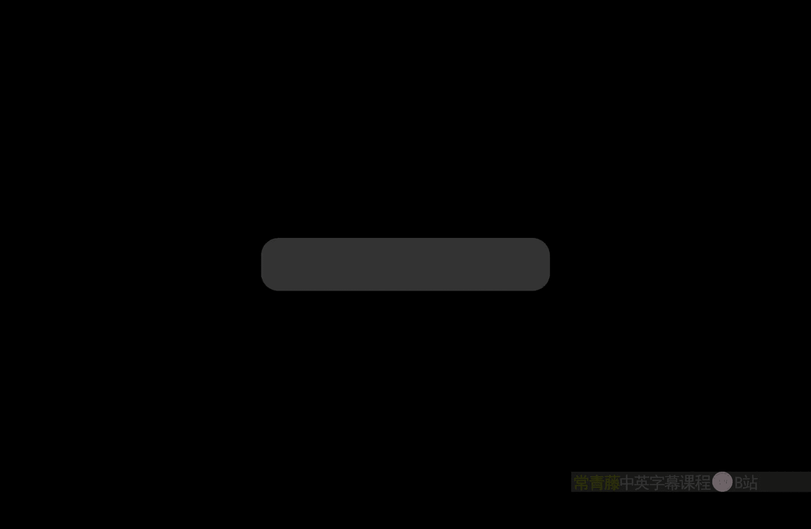
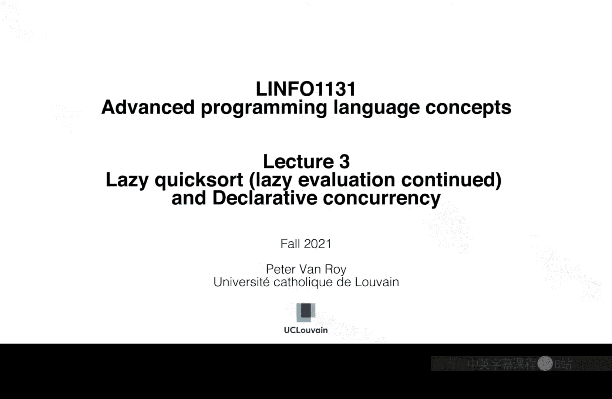
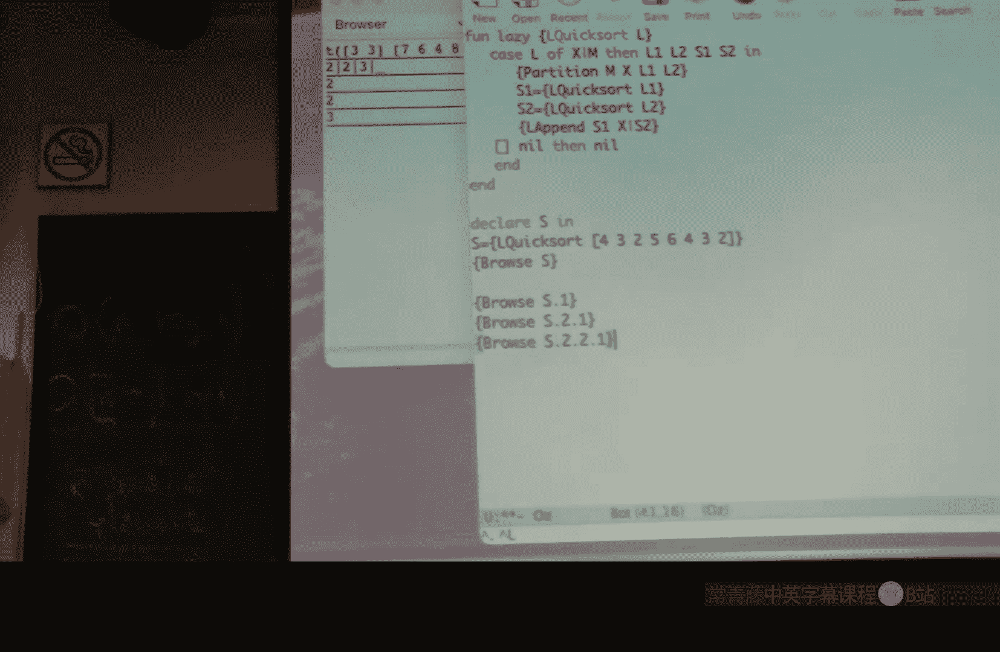
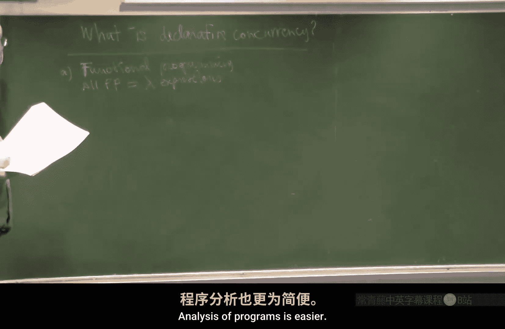

# 鲁汶理工学院【中英⚡高级编程语言概念｜LINFO1131, Advanced programming language concepts】 p18 P18 FO1131 Lecture 3 (2021) -BV1UDffBbEBZ_p18-

So the first thing I want to show you today。Is lazy an example of a lazy sort algorithm。

Where the laziness。Lazy evaluation。Invents an efficient algorithm。

So I'm going to show you a regular program， Quick sort， sorting algorithm。

 and we want to make it lazy， and the lazy version will be extremely efficient， it's a new algorithm。

And I'll show you how it works， so this is important because we're going to go step by step。

Through this algorithm， so you see exactly how that the laziness only does what it needs and that this can really make things much。

 much more efficient。Okay， so that's the first thing。We're going to do today。

The second thing is a little bit more。See you ready。

We're going to try to explain what is thelarative concurrency。Exactly。

So we saw deterministic data flow， functional programming， lazy programming。

So what is common for all of those， why are all of those special what makes them？lar。

W are they all functional？So we saw sequential functional programming。We saw deterministic data flow。

You saw a lazy version of this。So the question is what's common。

 so this will be kind of a theoretical discussion and will present to you exactly what it means and so that when you program something later。

You have some way of foundation， some way of understanding really what it means。So what is in common？

Between all these things。So this is part going to be a little bit more。Theoretical。

So I sent a message on the moon giving you the sections of the book for this。

 so this is actually section。4，1，4。ok。And then I'm going to give some more discussion on。哦。

Declarative。Paragramms and the different languages。That do them。

So there's many programming languages that some of them maybe never heard of them。

 but that are used by many people and there are different kinds of declarative language。

 this is section 452。So this will give you kind of an overview of the whole spectrum。

Of declarative paradigms， okay？So let me start now by talking about lazy Quickwords。

So let me first explain the Quick sort algorithm。So you saw already sorting algorithms a with the tree。

 so did you see who has already seen quick sort， you know quick sort， no， you know mergerch sort。

 maybe。So Quick sort is an efficient sorting algorithm。So which is N log n normally and it's kind of。

A different approach from merge to。So it's also an interesting algorithm by itself。

So let me explain how it works， it's a recursive approach， it's kind of divide and conquer approach。

So I have a list here， let's say I have a list。No。And I want to sort them， so these are all elements。

And I want to sort them in increasing order， so the way it quicks so it works。

At first you do a partition。So you pick an element X。And this element is called the pivot。

So this can be any of those elements。And you take this list and you split it into two lists。

 one which is all elements less than x。And the other one is which is elements greater than or equal to x。

Okay， let me call this L1。L2。So that's very easy， so this can be done in order endhuh。

You just traverse the lists and you make two lists， and then you do recursive call。

So you do recursive call quick sort here and here， and you create two sorted lists。

Two recursive calls。And once you have these two sorted lists， you just have to append them。

 concatenate them since all the elements of S1 will be less than the elements of S2。

 so here you have an append。And then you get the F finals。それです。

So this is very easy kind of algorithms， it's a divide and conquer。

 you divide the original list into two lists， and then you sort the tool list recursively with quick sorts。

And then you appendum， so the append is also order n。

So the total time for this will be upper bound of endlock。Okay， so it's similar to。Merge sort。

 so this was one of the first very efficient sorting in algorithms that Fler was found。オッケー。

It's okay， it's reasonable， so I can show an example of this， so for example， if I to list7，3。

Let me pick this list because we're going to get it later also。Seven。

3286419 let's take the first element as the pivot。Then we have the items that are less than。

 so three， two。Six，4 one， and here we have eight。Nine or seven， eight， nine。

Then we do two sorts here。So one， two， three， four， six。7even， eight， nine。

And then you append these two。 just give me 1，2，3，4，6。そができ。

I want you really to understand this algorithm。Because when we make it lazy。

It's important to understand how it works because the laziness head will be。

Working on this execution。Okay。So let me first now show you。This algorithm。啊。So here's the partition。

L， X， L1 and2， and it takes L。It takes the first element of L as the pivot。

And it takes all elements that are less than a pivot， puts them in L1。

And the elements that are greater than are equal going to help。Okay， so that's。Straightfor。Okay。

 so here in this example I have。3，7。6。4， eight， six，5，7，3。So the pivot is going to be。3。Okay。Sorry。

 the pivot I've taken for is the pivot， so all of it less will be put in three33 and the others 7648657。

 you see it's just very simple four。So I'm showing you this very simple thing so that you can understand better or what happens when it becomes is。

Okay now I will do the append。So this is a standard append except that I market lazy。

That means if I have functions computing the two arguments。It will only。Execute them if I need them。

 so if I only need the first element。Of the result， it will only compute L1， and not L2。

 so that's an easy impact。And then the final thing is the lazy cooker itself。Okay。

 so here's a lady quick sort。So the body is very simple， it takes a list L。Okay。

 it takes the first element of this list。X， it partitions。

Whatever the list is remaining M so into L1 and2。It does two recursive calls。

And then it apps the result with X。So because the x is not inside of M。

 it has to put the x in between， you see at first L S1， then x followed by S2。

So this is very straightforward to algorithm。Okay， let me compile it now and run it。

So here's an example。And'm going to sort this list。And of course。

 you know what's going to be displayed when I run this？So what's this going to display now， me。

What's going to be displayed here？Sorry。Nothing yeah， well an unbound variable。

 so basically no result。So there， so that's the lazy。So in order to force the computation。

 I need the result。So to meet the result， I have to ask for elements S。So for example。

 I could ask for。SW1。Okay。啊嗯。Here。So that will display two and the first browse。

 which is still active， displays two and the actually is underscore， so that's the smallest element。

Okay。And if I want more elements， I can display more elements。So this is the second element。

Which is also two。And we also do the third element。It should be three and so on。

So each time I ask for another element， I get a little bit more of the list。

So somehow the LA computation is doing part of this work。

But the question is exactly what part is being done here？And it turns out it's very interesting。

 it's the part is going to be really minimalist， okay， it will only do a very slow part。And in fact。

 the complexity of the algorithm is incredibly much better。So then the original quickword。

So let me first tell you what the result is， so the original quick sort， if I do the whole list。

 it will do n log n computations， whereas the lazy version。We'll do n plus。K六 k。

Where I am asking for the K smallest。Eleence。So if I only ask for one element， the smallest one。

 it's going to be order n because this is going to be like small constant？As for two elements。

 it would be。N plus2 L2， but if a general enough ask for k elements， it will only do。

 it's like it's sorting only k elements。Instead of sorting everything and log N。

 it's only sorting the ones that I need plus an overhead of Nna， there's an overhead of N。

 but this is a linear overhead， not N log N。Which means that I have now an algorithm for giving me the K smallest elements out of N。

Okay， so that's nice right， actually this is very powerful。

 One of the thing is K is not known in advance。If I ask you。

To write an algorithm that gives me the two smallest elements of a list。

 you will have a small two variables， we store the two smallest ones and you go across the list。

 finally， if I ask you to write an algorithm that gives me the three smallest elements。

Then you have a small vector of three elements， you traverse the list。

 and you put the three smallest ones in there。But if I'm not asking you for K。

Where I don't know the value of k， in fact， when I run this algorithm I can keep asking for elements。

And it will keep giving me more and more the smallest elements。

So if I were to ask you to write an algorithm that does this。How would you do that， it's not so easy。

I want to ask you now to write an algorithm that gives me the K smallest elements out of end。

Where I do not know K in advance， so for example， I can keep asking for elements until I reach a certain value。

 so the K is not known in advance， it's only known when I'm asking。

And I still want my algorithm to be efficient， that's not so easy to do， okay。

 in fact it's quite hard， and I'm not even sure you did an algorithm like that。

 it's a very incremental algorithm。Okay。So that's what the lazy algorithm gives me。

So how does it work？So I'm going to now explain to you how this actually works。

So this will be I will do this on the board， okay we're going to do like a theoretical analysis of this lazy code and I'm going to show you how it executes so you really understand。

Where the power of the laziness come from， so it looks， if you look at it like this naively。

 it's kind of magic you go from n log n to n plus K log N， how is that possible？It's like the magic。

 you just put lazy， put the word keyword lazy there。

 and you immediately have a super efficient algorithm。How does it work？Well， in fact。

 it all comes from the laziness we saw last time there's nothing extra。

 so I'm going to explain the magic， okay？So， let me。

So now we go， I'm going to some do more theoretically。So that called that's all the code。So。

 but I will have code on the importanthouse。Okay， so I'm going to explain how the magic works。

This is actually my biggest critique of all the Harry Potter books。これで同。

They never explain how it works。So I'm going to explain here how the magic of the lazy evaluation action works。

So you have the algorithm in your head now， because you have to understand the algorithm to understand how the laziness will attack it and make it。

And make it work efficiently。手一边叫叫。The actual lazy quick sort of function here。

 because we're going to look at it。Fun lazy。case。L of。X or M， then。Partition。M X of102。S1 is equal2。

And week。L one， so these are the two calls。2。And then we have here El dependss。As one。But two。

The other is the milk case。没有呗没有。En， end。Okay， so this is important。

 so I'm going to show keep this on the board and this is the body。

 so I'm going to put a box around it。So this is translated。Into another form， which I will put here。

A procedure。L quick LR， where I showed the result。I have no thread。I do really needed。A the result。

Then I R is equal to。The body。And and。So this rectangle is the same as this one。This is the bodydy。

This is this whole button。So that's it， that's all what laaziness is doing。

Now let's see what happens when I do computation on that。S is equal to。呃，佢。Let's just do。

So I pick a list that actually makes it。Clear， so I'm going to use the list that I have here。7，3，2，8。

6ix，4，1，9。Like this。So this does nothing， but then I'm going to do browses。S dot one。

So the duunt operation on S。Needs the value， so dot is in operation with two arguments of the。

A record or a list and a field name。So it needs the arguments， so this will cause the weight needed。

To continue， okay？So what's going to happen is that this body， this body here， will be executed。Okay。

 okay， let's do it。This will execute the body。Of Creek。Okay， because S is needed。

So here it is the body， let me forget the case because let's do a little bit。

 we know that the hell is this big list。So the case will take the first element and the rest。

 so let me just show you this piece， okay， because it's going to execute this part。Porfition。

And the list M is going to be three，2， eight。Six，4，1，9。The x value is7 and the first element。

 L1 and2。Then I have S1 equal to L click。one as2。Is able to El。L2。And then I have。The result。

This append here is the result of it。Is this R， so I can actually write it like this。

 The result here is S S is equal to L ofend。S1。X bar S2， so x is7。For seven years。That's it。

 so that's what's going to run now。So I well， this browse will cause this to be executed because of the way you need it them。

So what's going happen？Partition is not lazy， partition is a regular procedure， it's not lazy。

 so it will execute。Completely and they will create L1 and L2 so the L1 will be。Three， two， six。

 four， one of the elements less than seven， and now two will be eight， nine， okay？

So part will execute completely。Now what happens to these two？So S1 is L quick of L1。

This will actually create a lazy suspension。Let me呃。R is this one say Peter。So basically。

 it's going to do weight needed of S1。They out quick。It's going to do a weight needed of the result。

 it does a weight needed of the result， it's this translation。

So this is going to do a weight me of S1， which will suspend。So this will create a lazy suspension。

Okay， and the same here。Wight he F2。Will create a lazy suspension。What about the lazy pen now？

The lazyend is going to do weight needed。Of S。So what's going to happen here？嗯。Well。

 I already woke up， S is needed in Elqui Fi。So again， in order to get the value of S。I again。

 I call now a weight needed， so this is the weight needed that's inside the lazy appendda。

So what's this going to do？You tell me。W needed X？But this too。叶唱呢。Nobody wants to say something。

I'm doing S。1， it's the same S as here it the result。

So this is going to not weigh down someone to ask for S。

 it's going to ask for S exactly this white needed is not going to block， okay， it will not block。

Not rock。It what execute you the body。The body of a pen。So this will execute the body。Of a pen。

So you see how the weight needed， the S。Is part of this body。

 so again we have an weight needed and it will not block because we need S number1， we still need S1。

 it still needed， okay that doesn't change。So this is connects you to body of depend pen。

 Well let me write down the body of depend pen now case S1。Of H bar T。人。H bar out of the pen。T。

It's S2 because the argument， sorry， it's set7 bar。

SI'm filling in the actual arguments S1 so in the definition I have L1 and L2， but it's S1 and7 bar。

Next to。Seven bar two so the mill case when the first algorithm is empty。So this is the body。

Of a paint。So what is this going to do？I actually have a case now。That's one of。H partT。

 that's going to meet S1。S1。別に出。Here。But not S2， only S1 is needed。

But I have a weight needed of S1 appeared。Which has suspended。And a weight needed the best two。

 so S1 is needed， so that means this。This。Lazy suspension will wake up。

 but the second one will not wake up。Okay， so basically I'm going to execute the body。Both。

Of S1 is equal to L quick。And one， okay， basically this first call up。

I'm going to execute that party， but not accept second one because I don't need it。

So you see how the need actually propagates， it starts by needing here to L quick。

And then it needs the other parent。The S and here now。I'm the S1， so this S is causing S1。

To be needed。 Okay， in the body。So now I need test one。So the body is going to be executed again。

So then you right's small here， so this is going to do partition。Of。what's the argument， what's S1？

Sorry， it's going to be the partition of Elwaana。It's L1 here， so what is L1？So I erasseed it。

 but L1， we know it's here。And one is going to be。3，2，6，4，1。But in fact。

 I'm going to remove the first element， so this is the Elwaana。

 I'm going to remove the first element， which will be the pivot and the rest is M。

So this will give me。2， six， four， one。Three， let me call this one L1 prime L2 prime。

This is also L1 and02， but it's in the recursive call。

 so just to make sure there's no confusion call it L1 prime。That too prime。

And I will have S1 prime equal to output quick。Both。L1 prime S2 prime is equal to。呃，对。And to prime。

And I will have again。Okay， now I have。S one。So here S1 is the result。 So S1 is equal to。Elephants。

Of S1 prime。3 bar S two。So this is what's going to be executed here。

And more ways lazy suspensions are going to create it， so this one will create a lazy suspension。

This one will create a easy suspension。But what will this one do？

So here I'm going to do a weight needed of S1。Inside the elephant。

And to execute the body of the other end， well， S1 is needed。This one will not work。

So you see how the laziness is picking things， the executor。

 so this will cause the first L quick to activate。But not the second one。

This woman his stay suspended。And it will keep going like that。Until the list gets very small， okay？

At the very end。So what's going to happen at the very end at the very end？

That the list L is going to be empty and there will only be this element。

The completed element and that would be the smallest element。

 so we're going now recursively down this。This。团子。And the second part will stay suspended。

So you see how things are moving down then。Okay。Okay， so you're seeing how it works now。

 now let me make a picture of the whole thing。Just a picture to give you a general idea of how it's working。

Let me start by go。嗯。So there are an eggs in the beginning here。I will now do partition。

Let me make this one a little bit wider like this。So there would be L1， L2。Now。

 this one will stay suspended， but this one will again you a partition。Okay。

And then this one will this is have1 prime now to the prime， this one will stay suspended。

 but this one will again do a partition。At this， okay。Eventually well， this one will refine a result。

This will do the append。Okay， this one is not executed。 This one do another append。 So this is again。

 this is。S1 prime， but the S2 prime， I don't have it yet， I don't care。

 I'm only worried about the beginning part。And then I have this part here。Which is going to be S。

 which is S1 and S2， but I don't have S2， but there's nothing under that part。

So you see what it's doing， each time I go recursively down， it's completely executing a partition。

 so this is N。And over two。And then so until it goes down to one element。

So the partitions is going to be n plus n over2， plus n over4， et cetera。Plus very small number。

 so this is going to be。To N， it's proportional to A。

 that's the amount of work done by the partition。The appends are not going to do any work proportion of the end because it's almost interested in the first。

Eleementer。Now， if I need more than one element， two or three。

 if all the elements I needed are in this part。If L1 has， let's say L1 has four elementss。

And if I'm asking for three hours。That means all the elements I need are in here。

That means S2 prime will never be executed。The append will never exhaust， will never finish the S1。

 and it will never ask for S2。Okay。So you can see that the amount of work I'm doing。

 it's like a smaller version。Of the whole algorithm。

A smaller version of the Quick sort in a smaller list。

So that's how I get k log k the K log k is what's happening inside here。

 so basically I keep going down。And if I ask for more elements now， maybe I ask for four， five。

 six elements， then I will move down to this list， and eventually the Eloend will exhaust S1 prime and it will need S2 prime。

 and then I go up one level。Then I'm going up one level。Here， but only one level up。

But then if S2 prime is exhausted， then I will actually have to go up to another level。

 so it's only calculating the minimal。Part of the sort， okay？

And it knows that all these elements are the smallest because of the partition。

 all the elements in1 are less than。L two啊。So it knows that all the elements in here are the smallest elements。

Okay。So you see how it's working？So this is an analysis。

 we see how the lazy algorithm works now when you write the lazy program。

You don't have to worry about all that， but you can imagine intuitively。That the laziness will only。

Activate the part that's needed， so because the apparent here， it will first activate as1 before S2。

So it's going to cut the problem down， down， down， down， down， down， okay？So this kind of analysis。

If I give you a small， lazy programmer and expect you to be able to do this。

 this is actually it's actually not complicated because it's just using the definition of laziness we did。

You see there's no magic， the magic is explained here。So what do you think of that？

So you see the laziness is actually doing something very smart it's picking only the things that's needed and if you write your algorithm in a nice way where you separate the different parts。

Then the laziness will only use the part that it actually needs， okay？You see that？Okay， so okay。

 so that's the lazy quick sort example。What do you think of that？It's nice。

 so laziness actually is a very powerful technique that you can use in any programming language。

You just have to divide up the work into pieces that you need。

But don't compute them until you actually need them， okay？

Now if you have a language that supports laziness， not here， in O I have a support for this。

 but other languages also support laziness， like the most famous one is a language called Pastor。

 okay？This kind of language will automatically do this for you。So that means as a programmer。

 it's very easy to use， okay？So I show you the analysis here because this is a university course and so you are supposed to understand the things that you do。

 it's not just a cookbook recipes and so on。Okay， so that's all for the laziness。

So the next part is going to be the。Declarative concurrency。

 but let me make a break now because it's 920 something already。

 so I think it's good to make a break。

So now I want to do a little bit of a theoretical investigation， I want to answer this question。

What really is the declarative concurrency？Now first。

I want to refresh you on what it means to be declarative so remember。We saw functional programming。

And all functional programs。Can be written as lambda expressions。O。Okay， so don't worry。

 I'm not going to go completely into lambda calculus， but I just want to explain the principle。

So the power of functional programming is that maintenance testing is much easier， okay。

 analysis of programming is easier， so functional programming is the basis and we have a very important result。

Called church Ru，Okay。So assume that you start with some expression。E1 or something expression。

 this is any functional program on it。And you reduce it。Okay。

And you reduce and you get some other expression， let me call it Eb。

But the church roster says that if you take this one and you reduce it in a different way。

 in different order。That these two actually are equivalent。

 so you can actually keep producing and keep producing。You can come up with the same one。

That means if you reduce an expression in any or you get this one。

 if you reduce an expression in a different order because it can be concurrent。

 so this is like the deterministic end flow。You could always keep going。To end up with same fate。

So this， we say that the lambda calculus is confluent。That's another way of saying this， confluent。

 the word means that it flows together so no matter which order you reduce。

 you will end up with the same result。The result of a computation is the same no matter what order it's done。

This is the fear of this is why functional programming is so powerful， why it's so nice。

s because of that。Okay， so that works for sequential functional programs。Okay。

 but we have more than that now。We have。That mean we can have streams。So we have。Concurrence streams。

Concurrency， streams。ok者咧。So streams， it means that。The program is never done， okay。

 so concurrency means that we have many activities， but that's okay。

 this lambda expression can model concurrency。But how do we ignore streams？How do we model streams？

And we also have data flow variables。We have data flow computation。So we can have unbound variables。

So。When we do functional programming in this classical way with lambda cculus， we don't have streams。

And we don't have data flow， we have an expression， and we reduce it。

A functional a function calls and reduce and that's it， so this can be concurrent， that's okay。

 but it doesn't have streams and it doesn't have the data flow。Okay， so basically。这 me呃。

The first one， the first problem is the streams， so let me explain what it means。

 so basically let me call this partial termination。So we have a program here。

And has input stream as1， and output stream as two。Okay， so this is like an agent。

And let's say the input stream is one， two， and the output stream is doubleubling。

So we have a stream program。But the program is never done。

It's never finished because this stream can always be extended。Oh2。46。1，2，3。4our，2， four，6。诶。

So this one will never terminate。So it's not this like this where the program actually terminates。

I have one expression which terminates， but here it never terminates， okay。So basically。

 what do we have to do here？That we have to say there is a concept here。

It's called partial termination。So we have to figure out how we can express this。

In the language of functional programming。Because here we never have termination。

So in order to solve that， we assume。We can introduce a concept called partial termination so the program。

Termininates， but temporarily， okay？So that means if。S1。Does not change。It's fixed。

 then the output has two reaches。final。A final value， okay。So the idea is that if the S1。

Its one two and it stops， then the output will eventually this program will terminate and the output will be two four。

Okay。And so that's actually a temporary termination。So this is what I call partial。Termination。

Because it's only temporary。There's also， it's also called。In the theory。

 it's sometimes called a resting point。So when the input stops changing， so when the stream is fixed。

And you let the program run。Then the output will eventually also stopinate， and give a result。

So then we have like a functional program， one， two， we'll give two， four， okay。

 this is a functional。And when we extend the input， we'll add a three here。

 the program starts running again， it starts up again， more information arrives。

But then if we have one， two， three， and it stops。Then eventually the program will start up again。

 but eventually it will stop again and it will give a final result。

So each time we add information to the input。The program can start up again。

But only for a little while and then it actually terminates again。

 so there's many possible terminations， okay， you give it a little bit of information。

 it does a little bit of computation and it stops， you give a little more information。

 it starts up again， keeps going， but it will stop again， okay。

That means if you give a certain amount of information， the program will always stop。

So that's the first。Okay， so this way， in this way。

 we can handle a stream computation as if it were functional， okay？Each time we give an input here。

 it's like one function call， we give a little bit more input， it's like another function call， okay。

So it's like we have many successive function calls and each one of these calls。

 we can apply the church rosters， okay， so that means we can extend declarative。

Concurrency here to the case of streams， when the program never really stops。

 it always can keep going h？Whereas on the left here， it's like very simple。

 you have an expression and it stops them。Okay， so that's the first thing。

So with partial termination， we handled the case of streams。But there's another problem here。😔。

Because we have the data flow variables。The single assignment variables。singleing those assignments。

 so here we have in the lambda calculus。All the expressions are values。

 we never have unbound variable that you combine， okay？

But the data flow does not hurt the declarative programs。Data for a variable are single assignment。

 so they're still functional。They will never be assigned more than once。So how do we express that？

So in some sense， it's still functional programming， but how do we express it， how do we？

Make this idea precise。Well， for example。So there's many examples。

 but let me see if I can have a simple one。I have。A concurrent program with data flow variables。

 and it binds the variables。Okay， so let's say I have a program。 So here's an example。

I have a program。Thread X equal。F。CW and。Thread。Why equal fool。It's kind of an artificial example。

 but it shows the principle thread。X equal y。Okay， so this is an example of a declarative。

Couldcur program？So I have three， I have two variables， x and y， I bind x to this record4 ZW。

 I bind Y to4 ZW， and then I also bind x equal y in three threads。Now， how does this execute？Well。

 it's a concurrent program， so there's a scheduler so it can execute in different ways。

 so for example， in one execution。The first two threads will execute first and the last thread will execute at the end。

 so you call this one T2， T2，33， so T1。two exclude first。And be three at the end。

So what does this give？So in memory， so if t1 and2 execute first， in memory。

 there are variables so I'm looking at the memory。Two of the W。W of the W。

And then I execute T3 Well T3 will bind x and y， but x and y are already bound。

 so it will just make sure that they're still equal is x equal to y so FzyW Fzy demo is equal so the bindings will be this in the store。

 okay this is in the store。So this is fine， as a result， X and Y are both bound。

But it might be that it executes in a different order， okay。

 it might be that we have T1 and T3 first。And then T2 at the end。Okay。So if we do T1。

 let's say T1 first， then we have x equal to4。ZW。If we then execute T3。This one will bind y， okay。

 Y will be bound to x。And then if we execute T2， y is equal to4 Zw， y is equal to x。

 x is equal to- zw， so it's okay。Okay， so we get this in the store。So you see the two stories。

They look different， the findingss are different。X equals4， y equals4。

 and here it's x equals4 and y equals x。And you can only bind themvent once each variable。

 so it depends on the scheduler。So it looks oh terrible。

 it looks like it's not declarative anymore because we have two different results remember I said that a declarative program is deteristic it's always the same result。

But in fact， these two are not different。Theyre same。

They are actually the same value in both of them， x is equal to4 Zw and y is equal to4 Zw and here also y is equal to x and x。

 so y is also equal to4 ZW。These are equalities。Mathematical equalities。So we need to def that。ok。

So let me say then how it works， how do we define it？Actually， we can say in these two stores。

We can say that they are logically equivalent。Find a way to express that these are actually the same。

So they are the sameh？It's just that the bindings are different。So thes。

 the actual bindings are different。But the values。Of x and Y。Are actually the same。Okay。

 the possible values。So if we introduce data for variables。

 it seems like the results are different because the act of findingss in the store can be different。

But， in fact。The bindings is not the important thing， it's the values of the variables。

 so x and y in both of these stores are the same。Okay。So let me call this， so this stores。Sigma 1。

 this store is Sigma 2， Okay， two stores。So let me call this。Sigma1。Is。Equal to。X equals4。TheW。

 and so I write it in a logical way， why it will prove。

WSo this is actually a logical expression in first order logic。

 so I'm not going to make a course on logic， but I want to just explain how we can make them be the same because they're actually the same and sigma2 is x equal4。

CW and y equals x。So these two。Expressions are actually logical expressions that constrain the value。

 so they determine what the possible values are， so x has to be a record full with two arguments。

And it's the same in both Y is a record food with two arguments and in the second one it's also a record。

 y is equal to x and x is equal to food， so y in the second one is also。

A record okay with two argumentss and Z and W are unwellmed so they can be anything in both of them。

 they can be anything okay， any we don't know they could be bound to any values。Okay。Okay。

 now I need to make a little bit of room， so I will erase this part。So we say， we say。

That's Sigma1 and Sigma 2。Are logically equivalent。Because they express the same values。

Because they express the same values and how will make the definition of that。The same values。

So the possible values of x and y and z and W here are the same in Sigma 1 and Sigma2 so to really make the semantics of this。

 you have to talk about logic， so I don't know， maybe some of you have seen first order logic。

Have youAre anyone here I used to give a course in logic？Does anyone see it for urlog？Yes or no， no。

No， there's also a course from Eve deV kindT where he talks a little bit about logic。

 but I'm not going to give a full course on logic， I just want to give you the basic idea here okay so you can understand why that the data flow is still functional okay so it's still functional because Sigma1 and Sigma2 express the same。

Vs。So we can actually make a formal definition of this。So there's different ways to do that， then。

So I'm not going to introduce a full course logic， I just want to fix the idea so you understand why that the state offlow variables are still functional。

 okay。So in order to define it， I introduce a function。Values。X sigma。Is？

The set of all possible values。Set of all。Possible values of x。Given the store Sigma given。

That the store is sigma。So for example， values。Z of Sigma 1 is all the possible binding。

 it's all possible values， whereas values of x sigma1。Values x sigma1。

s only it's basically the set of all records。Of the form who there's two arguments。

Values x of Sigma 1， so in fact， the x in sigma1 is always a record of two arguments。

 but the same is the case for Sigma 2。So you can say that。Sigma1 and Sigma 2。

Are logically equivalent。If。If there's two conditions， one， they have the same variables。

They have the same variables in there。And two for each of those variables。To each variable is V。

We have values。V sigma1 is equal to values。We table2。So the V in this example will be X， Y， Z。

 and W of， so for each of these variables， Sigma 1 and Sigma 2 give the same possible values。

So then that means that Sigma1 and Sigma 2 are actually equivalent。Okay。So basically。

 to summarize it， when we add data flow variables to our functional language。

The store of bindings can be different。But they're still equivalent， okay， they can look different。

 but they still actually express the same values。So there's no different than that。

 so I'm not going to make a proof， but it's intuitive and I just want to show you what it means here so no matter how the scheduler picks this。

 you might get different bindings。Of the variables。

 but it's always each variable will also always have the same set of possibilities， okay？

You could represent this also in logic。For those with no budget。It's something like this， okay？

And I know we have C1， a single one。They put to sigma2。

So Sigma 1 and Sigma two are logical relations we have here。

So this is a logical formula I'm just given you for those who know logic。

 but I'm not going to show a person logics to tell you that logically what it means is that for all possible values。

So， this means。Okay， now I'm just telling you this is for information in all possible models of this。

 that Sigma1 to sigma 2 are actually the same， that will be true for the same values but forget that okay I'm just saying that there's some logic behind you。

But I just want to tell you now that。It doesn't matter if the bindings are different because the values are the same。

 okay？Okay， so those are the two things， and now I can actually give you a definition。

A formal definition of declared concur。诶。So thelarative concurrency。The definition of thelar concur。

 So we're going to use the logical equivalentence and the partial。

Now we can actually define it and we can move from church Rosser to our declared tomorrow， okay？

So a concurrent program， an unique concurrent program。Is declarative？If。です。For all possible inputs。

对 it has。We have the following possibilities。へ？All executions。For a given set of inputs。Will either。

呃。All executions would either not terminate， so they all go into infinite loops。Or they hold。

 they terminate。So they they reach partial termination with the outputs are logically equivalent。And。

Results are logically included。Okay， so this is the definition。

 so I take any concurrent program you write in any language。You wasn't。

I say it's declarative and for all possible inputs。For a given set of inputs。

 I look at all the executions， either all the executions will go into in loopops， all of them。

 it's not just some of them， all of them go into in loops， or all of them reach partial termination。

And each partial termination results logic equivalent。

 so basically I'm saying is that it's deterministic here。

 it's just a way of saying it's deterministic。So。That means either it's going to go on tune in for the loop。

 and then you know it's always going in tune it for the loop。

Or it actually reaches partial termination and the outputs are。Equivalent， okay。

 the bindings in the score might be different， but they are logically equivalent， okay？

So basically what I'm saying here， this is actually a formal way of saying there's no observable non determinants case。

So in the previous course in the previous。Lectures。

 I keep saying that it's deterministic that there's no observable nondeterminism that means when you run programs you're always getting the same result well what that means is this okay this is the precise meaning of that。

So I'm giving you this precise meeting so that。You can stand on a solid ground。

 okay if there's any doubt of what happens with streams so with unbound variables。

 this definition makes it clear。Okay， so that's one thing。

And now I want to say something about programming。Techniques， application techniques with this。

So when you write an application， so not give you advice when you write an application。

It should be as declarative as possible。Okay， that's my advice to you later。Because。

When you make it non declarative， then it gets much， much harder。

 the fact that you have no ob nonminism makes things very easy。Okay， so that's the general advice。

But sometimes。Sometimes a program。Will。Become。Nondelarance。And how do you fix it？

So how do you fix it？So that's what I wanted you to know an example of that， okay。

 let's say I have program thread。X equal one and。T y equals2 end。是。X equal y， oops， and。

So this is like a program， I guess you could say has a bug somewhere in there，嗯。Because。

There's no way you can do all three bindings， x equal1， y equal2， but x is not equal to y。

 and you can only bind once。So what happens？When you read this。

What happens practically because there's no way this can run。Dlaratively， so its。

 it hits some kind of a wall。 Okay， this is no way you can run this declarly。

So what happens when you run it， when you actually run it？Well。

 the way that it runs in a practical system like Mozart。Is Mozart is a multipar system。

 it also does non declarative things， so Mozart will not crash or blow up or anything like that。

But it will raise an exception。Okay。So it basically signals that it's no longer declared。

So it raises an exception to say it's no longer declarative， and in fact。

 the scores could be different？So depending on how the scheduler picks it。

 maybe x will be equal to one。Y is equal to two， and then I do this poo exception。

 or maybe I have x is equal to1， y is equal to1， and I have an exception。

 or maybe I have x equal2 y equal2， so this is all these are all possible stories。

Depending on how the scheduler picks these three threads。I can have。di stores。

 and then when it hits the contradiction， it raises an exception， so here I do x equal1 y equal 2。

 and then I try to do x equal y， I raise an exception。Or here I do x equal 1， x equal y。

And then I tried to do y equals two exception。And here I do x equal y equal2， x equal y。

And then I try to do x equal1 exceptions， so all three are possible。

So this is basically non deterministic。The stores are different。

So the whole thing is non deterministic。So I'm not declarative anymore。

Nodeminism is I have observable nondeminism now it's not the clear to anymore。

 so what do I do in this case？So， let me。Explain what does the programmer do in this case？

So here I have basically left。I leave。The declarative model or the declaranceative paradigm。

See here I'm leaving the declarative model。So after I do this， it's not declarative anymore。

 but that's kind of a bummer because you want your application to be declarative so when you introduce this kind of a nonatism。

 you want to。You want to tame it， you want to capture it， okay？

So basically what you do is what we want to do。We want to go back。So this is。EF， we want to go。

 we want to go back。To the declarative model。So how do we go back once we have done this？We have。

No theism is terrible， we， we break our beautiful ecle program。

But the way to go back is to use a technique called。Failure confinement。

The idea is to hide the non deterterminism。We want to hide it。

And it's just a programming technique based on exception handling， so we use the exception sir。

We use the exceptions that are erased。So when this happens。The Mozar system will keep running。

 it just keeps running， it's just not declarative anymore。

 but it will keep running in a non declarative paradigm。So we can actually。

Write the program so that it goes back into the declarative by hiding the nondeminism。

So if we do this， for example， let me show with this example， okay？Then we do a different code。

 so we want to hide this。Want to hide these three stores。So how do we hide it？Actually。

 it's very simple。 We have two variables， X and Y， so x and y。Are the global ones， the visible ones。

And so these have to be bound。Deterministically， okay， what we introduce。New variables。

Let me call it x1 and y1。hi are local。And possibly。No the two minutes。

So the code is actually very simple， let me show you how it works。And we use exception handling they？

So we have x equal1， x1， equal 1。Why， one， why。1 equal2， x1 equal y1。 This is the programmer。

This is my program that actually gave a pro。And this is running in a thread。Thread end。The first one。

Td end。The second one and threat end。I made some space because I'm going to add some code。

And then we add some code here。We actually catch。The exception。Sorry if we have a try。Cry。Catch。人。

And then there's an error。This is a signal。Here we say S1 is OK， so S1 error。But otherwise。

 we have S1 is equal to。O。And here we have another try。Cach。Then S2 basically to an error。

And here we have the third one。It's three equals the。Catch。人。There's three equal error。So basically。

 we use the exception handling to catch the exception。Catch the error。And then at the end。

 after executing this， we check if see is an error if S1 is equal to error。Or。S2 is equal to error。

Or let  three is equal to error。Then。Then there's an error。Else。Okay。

 and now what we do is we can define our x and Y。て不ロとはす。是。Okay，If there's no error。

 x will be equal to x1。And why is equal to y1？Whereas if there's an error。

We can actually hide it by giving。The same value， so for example。

 we say there's a default value which is 11 in case there's an error。Okay。

 so this is kind of a technique for going when you go out of the declarative model to hide the meterism and go back in。

You see， now we're getting really into a pretty gritty stuff here。

But the important thing is once you do this。The rest of the program is still declar。Okay。

 so this is called failure confinement， so basically you want to hide the nondeterminism。

So that's basically。The technique that I want to show。So if you somehow have an error and you leave。

 you introduce some line of termminism。You can actually hide it in this case I'm using the exception handler。

 but there's other ways to hide， you just want to make sure that the rest of the program does not see the the。

Okay， so let me now finish， so this is all I want to say about thelar of transparency。

So you know what it means with the definitioner。And you know that you want to hide no determinism if your program actually has a bug and it shows no determinism。

Let me finish by explaining all the possible paradigms。可以。

So one of the things I want to do in this course is to show。All possible paradigms。

So let's take a look at all。Thelar。Programming paradigms。And the programming languages that use them。

So we have actually， so we make a table here。There's actually six possibilities。Okay。So here。

We have eager， this is the non lazy。Then we have lazy。Here we have sequential functional programming。

Here we have sequential functional programming with。They low variables。

And here we have concurrent functional programming。We've made of those variables。Okay。

So each of these boxes， there's some programming lineages in there。

Okay so the first box is the simplest one。This is sometimes called script functional programming。

 and you can have languages like scheme。And1 L are in there， okay？The second box is called lazy。

And the most popular language in here is called Hasle。诶。And now these models they get more。More。

There's not so many languages that do these months， okay？So this is the model of。

Chapter two in the book。You can also see this as the。As。The prologue language。

But only the deterministic subset。This is kind of exoticica。

 so prologue is a logic programming language。And it can do search。

 but if you look at the deterministic subset of product， it actually fits here。Okay。

 and here we have。Lazy functional programming with Dataflow。And here again。

 prologue is the only one that has something here。Its basically the co routineing subset of prolo。

Ces。And now let's go to concurrent functional programming。

 here we have a model that you know very well。No very well， our deterministic data flow models。

And actually， a lot of the cloud tools are here。Matt produce。Apache fl。

Which is a cloud analytics tool。They are sitting here。Okay。And the most general one。

Is the lazy deterministic data flow？马路。Which we saw last week。This is section 451 in the book。

Actually， there's no。Languages。Really， except for usz。

 which is an experimental education language that supports this。This one is not so much used。

 but maybe in the future it will be more used。So here。I can make some comments on this。

 This is actually an interesting diagram。 So these are actually the。Classic。Functional languages。

 isn't it？So scheme is actually form for this。You heard of Liz。

Haskell is actually a very popular language used in the functional programming community today because of the laziness。

 but these are kind of traditional languages。Here we are getting into the cloud。アの analytics。

Butlatform。Okay。So these platforms are。Functional but also concurrent。

So the idea is that they're functional。Plus， concurt， why is that so important？Functional。

 that makes it easy。To test。第把。Right programs。And concurs。It's because they run on the cloud。

 because they run on many， many systems， this is actually because of the distributed implementation。

Because they're running on many。They run on many， many those。They communicate together。

So how do you write a program that runs on 100 nodes？And it's still efficient。Well。

 the only way to really make it work is to make it functional。

 so the cloud has sort of migrated to this box， okay？Because you need it， one。

 you need it easy to program， but you also need speed。So that's why they run in many node。

 so you need this。You need to combine these two and the only way that it really works。Is it。

The termminity data film， okay， and maybe in the future。They were migrate grades。To this。

 maybe it's my guess。So this diagram is kind of giving you a view of the future paradigm in this course。

 I'm not just giving you programming techniques， I tried to give you an overview of things that happen of many things。

 okay so traditional functional language are here。Sequential functional datab is not so much used it actually fits more in terms of the logic programming。

Programming style。嗯。So this is not so much used and then the third one。

 concurrent functional programming， which is always based on Dataflow。

 that's the way to make it really work well， this is where the cloud tools are coming here。

 that's very interesting actually。So the cloud tools have come here。And probably in the future。

 they will become more lazy， that's my guess， because the laziness is a way to make them more efficient。

Some of them maybe are already a little bit going in this direction，Okay。

 let me now explain one more thing here just to organize this diagram。

So there's an organizing principle。Of this。So when I have a variable in a day or so variable， okay。

 in a language， in a functional language。In general， a data flow variable。

There's actually three special times in the lifetime of this variable。

Theres the first time is when I declare when I created。The second special part。

Of the lifetime of this variable is when I specify the function that will compute its value。

Computer staff。And the third moment is when I actually evaluate that function， okay。

 maybe I don't do it right away。So there are three moments in the lifetime of a variable。

 okay so why am I defining these three moments because all of these different paradigms can be organized in this way？

So the first box。The1， plus two and plus three are all together。

You declare variable and you immediately。Specify and run the function， for example。

 I do x is equal to y squared boom right away， I define x。I calm white squared and I bind。

So the three of them are together here okay？Whereas in the lazy case， the third one is separate。

 youunder it that I first specify the function， but I don't evaluate what it gets。

I only evaluate it when it's needed， so one plus two or together。But three is separate。Okay。

And here in the concurrent。Function a programming with data flow。This is not lazy。

So I declared the variable first。我。And I evaluate it later。

 so I can have unbound variables so the declaration can be done before I specify the function。

 so we use that you can put a hole inside of the data structure and pass it on somewhere else and bind it later。

 okay。Whereas this third one is the most general。All three of the steps are separate。

This is the most general declarative paradigm。And it's still not so much used， okay。

 so in some sense， this lets you look into the future。So when this book was published。

When this thing was published in 2004， that's a long time ago go， what？Then the data flow analytics。

Was not really big thing in those days， but they were coming out of。

They come up like starting 2010 and so on， you have these cloud analytics。And they moved here。Okay。

 they come here， a system like a punchy flt。So the cloud analytics that came here。

 so in some sense it gets you see into the future so what's going to happen the next 10 years。

 so what I think is going to happen is that things are going to go is were going to become more late。

So these platforms will start becoming more lazy， and the reason is performance because the lazy lets you do the minimum amount of computation and only it's on demand。

Like in the lazy Quicksorttta， you have the smallest K elements， but K is not known in advance。

 that means the person querying the system can ask for more information and the system will compute the analytics only when the person is asking。

 so that way it's much more efficient so the idea is that things like lazy Quicksortt will be also used in cloud platforms。

So my suggestion for you now is to follow the course on cloud computing and you will learn how about this and you will see how some of these platforms are maybe becoming more demand driven。

 more lazy。Okay。Okay， so let me end for today now， so today's course was very conceptual and maybe you are scared that I'm going to be very conceptual。

 but actually it's the only one starting next week you start writing code again。

So the rest of the course should be code， so I apologize for people who only want to see code。

For this today course。诶。I think it's important that you do more than just see code。

 that you also can think about what's going to happen in the future and so I tried to give you the。

いま是不だ。

