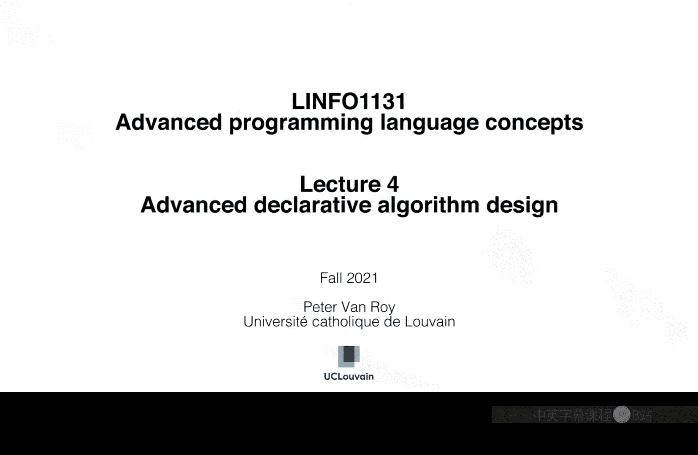
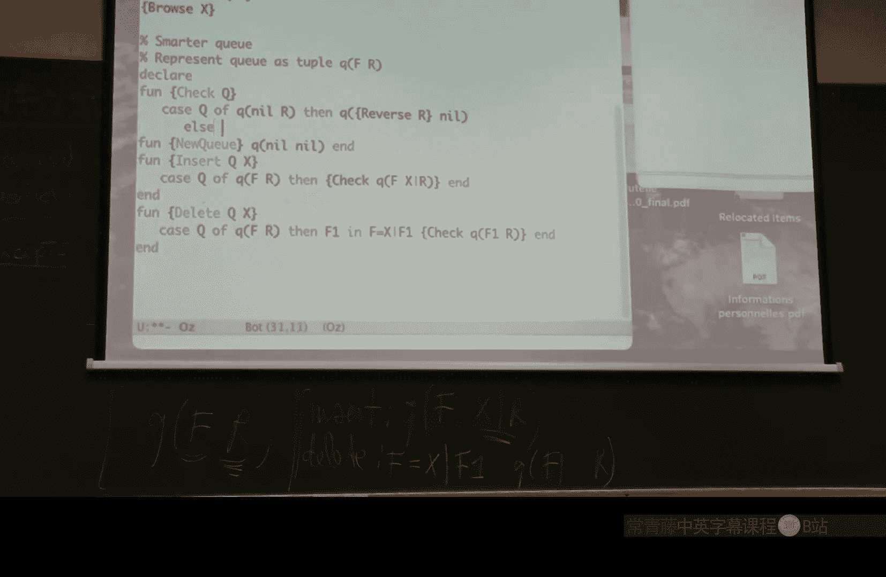
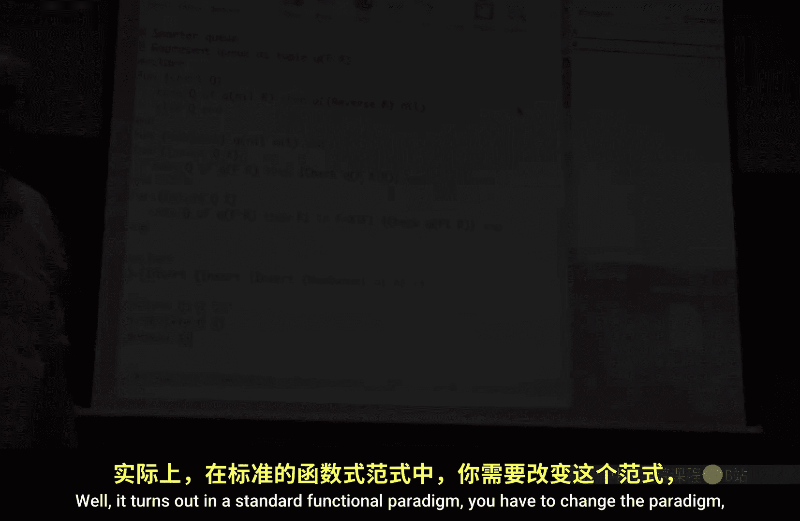
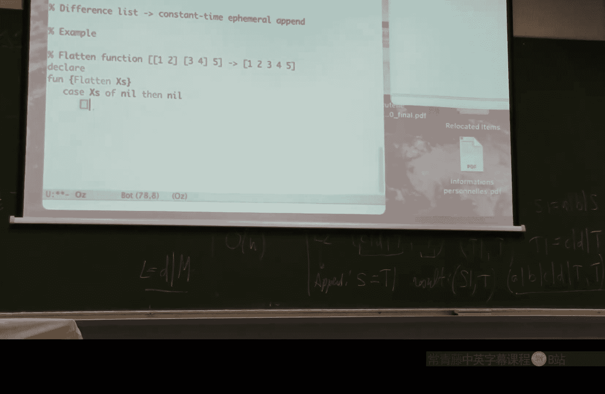
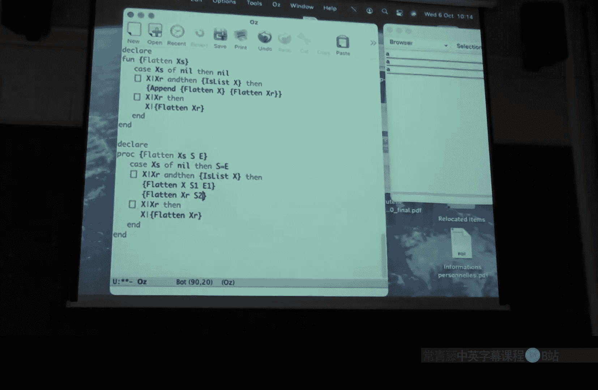

# 鲁汶理工学院【中英⚡高级编程语言概念｜LINFO1131, Advanced programming language concepts】 p19 P19 FO1131 Lecture 4 (2021) -BV1UDffBbEBZ_p19-

So the first part of the course， as you know， it's all about pushing the collective programming as far as it can go and the reason is that when you build applications。

 you want them to be mostly declar that enormous advantages， okay， like I said before。So today。

I'm going to talk about algorithms。How to design efficient declarative alls and we're going to see some very interesting and clever techniques。

And in order to explain that， I need first to introduce。Some concepts about algorithms。

Because we're going to look at different kinds of algorithms。

So the first thing I want to explain is what is amortized？Versus worst case complexity。Good time。

I also want to explain an interesting concept called an ephemeral versus a persistent algorithm。And。

And what to talk about and see。呃。For lazy functions。I want to talk about。

Incremental versus monolithic。分クしす。

This is all for understanding algorithms。So we're going to make efficient algorithms。

 so it's important to know what is the time complexity of these algorithms。So I'm going to explain。

The concept of amortized。Time complexity。So usually when you make an algorithm。

 you have operations and each operation takes some time。Okay。So usually we have operations。

And you do worst case complexity， so in the worst case complexity， you have an operation。For example。

 that is constant time upward bound of1。So F operations。Willll take any time， okay。

But for some algorithms， we cannot do that。Okay for some algorithms we have。The operations。Can be。

Sometimes they're cheap。Sometimes they're expensive。So if we do operations that are cheap。

 maybe they're order of one。But the expensive ones order of n， so that means in the worst case。

 it's always order n， okay？But maybe we can actually say something if we do N operations。

Maybe if we do N operations， there's only very few， very few expensive ones。

 maybe the expensive ones are very few。Infrequent。So that the overall time is still very low。Okay。

 so maybe we have this。But maybe we still have N operations。Order N。

So maybe there's only a very few expensive ones， so if we have operations， 01，02，03， up to ON。

Maybe there's only one expensive one in here。Okay。And all the others are constant。

So sometimes we have an expensive operation。But most of the time it's cheap。

So that's almost as good as。Worst case， orderer one。It's almost as good because on average。

 it's still order of wana。So N operations are over n。Even though one operation。

Could still be expensive， so this is called advertised complexity。

So the idea is if you have N operations。In general， then our order of F of N time。

Then we can say one operation。Has amortized complexity。Of order F of N。Divided by10。Okay。

So this is always true， but sometimes it makes a difference， okay？Sometimes we have an algorithm。

Where the N operations are order N， but still sometimes there's expensive operations。

So this is almost as good。As the worst case， you see， so the expensive of operations are rare。

So that's the first concept。So we're going to explain sometimes。

 sometimes it will not be possible to do worst case， but maybe we can do amortized。

 that's almost as good in practice。Sometimes it's not sometimes every operation has to be cheap。

 but if they're just cheap on average， maybe that's good enough， okay。

 so we're going to talk about amorize。Complexity for some of the algorithms today。

So that's the first thing。And I want to explain。The next thing is a very interesting concept called ephemeral or persistent algorithm。

ok。Probably， I don't think you have seen this concept yet。But sometimes it's important。

So an ephemeral algorithm。An eemeral algorithm only has one version of the data structure and let me explain what it means。

So， let's say you have。For example， a queue。Data structure， okay？

And let's say you have concerns and elite operations， okay？So for example， I have。

Q2 is equal to insert。Q1， and then I put something in the Q。And then Q3 is。Concerts。

Q2 put something else in the queue， so I'm putting doing operations。So you can make a picture。

 I have Q1。I do some kind of insert operation。Q 2。And I can do another insert， and I have Q。Okay。

 so this is reasonable for data structures。Now， in an ephemeral data structure。

 there's only one version that means once you have Q3。The variable Q2 is not。

 the previous version does not exist anymore。Okay， that means if I do Q2 is insert Q1。

If I want to do Q2 prime is insert。Q1。If I wanted to use the same Q1 here。This doesn't work。

Because once I create Q2， Q1 doesn't work anymore， there's only always one version of the data structure。

Okay。So most data structures are like that。So most data structures。

 most algorithms that you've seen before， are ephemeral。

So if I have an object that implements a stack or whatever in your algorithm course。

 and I update the object。I changed the state。The previous state doesn't exist anymore， of course。

Algorithms。Written with。Mutable state。22。Ephemeral， okay。

Which means there's only only always only one version。Of the data structure。

 because once you update the data structure。Of course， the previous version doesn't exist anymore。

 okay？So you can say， sure， that's normal， right， that's the one you want。

 but sometimes don you want something more than this， okay？

So sometimes you actually want to more versions。And this actually is important in practice。

So for example。Let's say you use software development and you use something like。Get you know。

But sometimes you need more than one version of。You need more versions。Okay。So for example。

 if I do gi。I do software development， I have repository。Somebody can create a branch。

 which is another version， okay， so have repository。I can pray a branch of this。

And I can do modifications of this， I can create another branch。So now I have two versions。

And I can independently modify and both versions are created from the original one。

So git is actually smarter than this idea， Git is not ephemeral。We say that it's persistent。

So the idea is that you can have multiple versions of this。Of data structures。あ。So。

The data structure will be persistent where we can have multiple versions。So in the queue。

 for example， I can use Q。Is insert。2，1， a。But I can do Q2 prime business insert。Q1， B。

 and now I have two versions。But if the Q is implemented using state or in naive way。

 you cannot do this， okay？So you can make a picture， so I have here a few one。

And do insert operation。And I have Q2。I can do another insert starting from the Q1。

And I get Q2 prime Now if  Q1 is an object。Which attributes the update， you cannot do this okay。

 there's only one version always， but here now I have two versions and I can modify these two versions separately。

And I can even have more versions， and sometimes I can merge the versions together。

 sometimes it's possible to merge versions。Okay， back together into one version。So Gi has this。Okay。

 databases also can do that very often， you can have multiple versions。Of different data。

So databases can also often have versions。Okay， in collaborative work。

Where more than one person edits the document， you can also have multiple versions。

So if you want to do offline work。For example， I' documented with no internet connection。

Then you have your own work， okay？So versions are sometimes important。

 so I'm going to show today also have to do persistent。Algorithms。That are declared。

 so this is actually a very strong point。I declarative algorithms。

 it's actually much easier to do persistent algorithms。In a declarative paradigm。

 then in a stateful paradigm。オッケ。So that's ephemeral versus persistence。

Now we're going to see examples。So yesterday I sent a message on the Moodle， so I have on the Moodle。

Put in a code file with lots of the examples and explanation。 So I help you looking at that。 Okay。

 so the what I'm going to say today is already on the Mole in this。Vi。

So the final thing I want to say。Is that。Lazy functions。The notion of incremental versus。Monalistic。

オッケー。Incremental versus monolithity。So an incremental function。呃。If you want part of the result。

It only has to do part of the computation， okay。That's what it means。 So it's lazy。 So you want。

Part of the result。Such as。The first element of asorted list。For example。

 it only does parts of the computation。So that means the laziness is actually reducing the amount of work you do。

 okay， so in the quick sort is an example of yourself。Which it reduces a lot it goes from en energy。

To end， if you only want the first element。But not all functions are like that， unfortunately。

 some functions。If you want the first element， it has to do everything。

 and these are called monolithic。So if you want part of the results。The problem is it has to you all。

The computation。So the laziness doesn't help。Okay， for these functions。

 the laziness will not help you。So the idea is that we will， if we see these functions。

 we try to get rid of them， okay， when we want to make lazy， we try to make them incremental。Okay。

So one of the techniques I'm going to show you is how to turn monolithistic。Into incremental。

Functions。So let me give you an example of a monolithic。

 so we saw many examples of lazy functions that typically the incremental， so the stream。

The stream functions， where you put a stream on the end and the stream on the output。

 they're all incremental， of course。Because if you just want one element， on the output。

 you only have to send in one on the input。The quick source is also incremental。

 so there's lots of incremental functions， but some functions， unfortunately are monolithic。

And let me just give you one example of that。Of a monolithic function。

 it's one that we're going to see in the examples。So here's an example of a。Molithic function。

It's the reverse， this reverse。So I want to reverse the elements of the list。

So lazy function reverse with an accumulator。So， if。Evis knew。人 a。Otherwise， I will。いう。

So curse of calm。T H bar A。呢嗯。And then you could call it， for example， reverse。1，2，3。

Now so the starts now。Now if I want to display the first element。Of this。This is a lazy function。

 I want to display the first element。So I hope it only has to do part of the work， but no。

Unfortunately， it has to do everything， so in order to display the three here。

It has to do everything。Okay。So you can actually see that。If you look at the computation。

That this thing is doing。So if I take this。Function， and I should show you how it's encoded。

Now they are。I have a thread。And。Where pages are？And then I have the body。

 so this is the body of the function。Which goes here。Case L of the middle。Then our。A， otherwise。能。

Reverse TH R AR。Okay。So this is the body goes here。So this is the function。

Now let's say I want to do brows L。1 for this thing。So it's going to compute the body here。

So this will compute it will the L is needed， okay， so the L is the same as the R here。

 let me call this R to make it。The confusion。So this R is the same as this R。So art is needed。

So the w needed continues， so I execute this。So the L here is one， two， three。So basically。

 I'm going to do。It's not new， it's  one，2，3， so I'm going to do H R T， so I'm going to do this。

 so this turns into reverse。T， which is two， three。And one。For news are。Okay。So I do this。I got one。

 so I'm calling reverse here。And when I call reverse， I activate the lazy suspension。

 and the result is I'm calling reverse again。You see， this is another call to reverse。

And this call to reverse。Well。R is still needed， okay？So in this call reverse。

 I will also do the way it needed。And R is needed， it's still needed， once it's needed。

 it's needed forever， okay？So that means it has to keep going。And they will keep going。

Until eventually， binds R to。3，2， one。 so it does everything。You see that。

 you can see it's monolithic because the call to reverse。When I activate the lazy suspension。

 it turns into another called reverse。There's no， I don't know the first element yet。Okay。

 so reverse is monoolithic。That's a pain， okay， that's a bummer。That's not lae。This reverse function。

 it's also intuitive。If I want to reverse a list one， two three。

And I want to know the first element of this the reverse list。

 the first element is going to be the last element。Of the original listta。

So it's kind of logical that I have to go all the way and get the last element of。😊。

So reverse is monolithistic。So that's going to be a problem for one of the examples。

We're going to use a technique， we're going to have a technique。To turn this reverse。

It was something。Increment， okay。So you can see that some functions。

 the laziness does not do it does not help you， okay？Because you need everything。

 you need everything to get the first element。And sometimes it's very logical if I want the first download to reverse list。

It's the last of the original list。So that's kind of budget。Okay， so that's the third。Concepts。

I'm me introduce。Now， I'm going to explain kind of。

What kind of declarative paradigms we're going to use？We're going to use three。Pentans。

We're going to use。呃。So this is in the in the。It's explained in the file。

 so we're going to use one sequential function of programming。With values， so no data flow variables。

So this is many languages give you this。It'Really the player So a language like scheme will give you this。

 you can either do this in Java。Well listen gives you this。

The second one is sequential functional functional of programming with data flow variable。

 single assignment。This gives you some extra power。And the third one is lazy。Functional programming。

Like we saw before， but I'm going to do only the sequential version。

 so I'm almost going to show you sequential algorithms today sequential。

So these three paradigms are all declarative， and we're going to show how to do。Things in this out。

Okay。So let me first summarize what we're going to do。

So we're going to build- I'm going to show an example data structure， which is a two。But in fact。

 there's many other data structures。And fact。If you really want to。Find out how techniques。

 how these techniques work。There's a really nice book calledPly Funal Data Structures。

By Chris Okasaki， and this explains。A reallyally， really huge number of algorithms and how to do this。

 okay， so if you want to build really smart declarative programs， then you should look at this book。

 okay？So but I'm going to show you what I'm going to show you is partly。From this book。

And partly it's。Something that comes from my book also。

 but if you want to really be smart in doing declar algorithms， this is a really good thing。Okay。

 I don't know， maybe。So what I'm going to do is this following thing。

I'm to show you a Q data structure， so a Q abstraction。I I'm going to give you some algorithms。

 so let me first summarize what I'm going to show you today。And next week。ok。

So first I'm going to show you ephemeral algorithms。

Adortized constantant time and worst case constant time， and then I will show you persist。

Perstionions of the cube。Again， amortd。Constant time and。Worst case comes to country。Okay。

So this is the algorithms I'm going to show you。First I'll show you I ephemal ones。

 these are not standard， but then Ill show you the really strong ones with multiple versions。

Persistent ones that are also efficient， and it's all declarative， okay？

But it's not in the same paradigm， so this one is going to use a sequential function of programming。

The worst case is sequential functional programming。Muss the data for variables。

And these two are going to use。Lazy functional program。Okay。So these two。

The persistence actually comes from the laziness， laziness can give you persistence。オケ。

Whereas amortized constant time is pretty easy to get。

You can do it already in a very simple paradigm， but if you want the worst case。

Constant time and they're not lazy。That you。Can use data flow variables so of course。

 worst case persistent is also ephemeral， e ephemeral is a special case where you only have one version of here of it。

So this is what I'm going to show you， I'm going to show you the code。

For all this and how you design it。 So if you want to design smart algorithms。

Then this is going to help。オケー。So that's the idea。Let me start now。On this。

 so eventually I'm going to show you the code that let me。Start now on doing things。

So let me show you first。First， I'm going to show you a naive cu。

In sequentialequial function of programming。And then， we go to。Smth the smart queue。

Also in sequential。Butun the program， okay。So this is the first one， this is going to be amortized。

Constant time。Efeeral。Okay。The smart one。Whereas the naive tube is not constant timea。

Some of the operations will be expensive。So this is just a smart programming technique。

 so all of this is going to be regular functional programming， Okay。

 so now let me show you some cover。なに提強します。Okay， so let me do first an Iive cube。这すそ。

The queue is going to be represented by a list and it's going to be insert。Operations in the front。

And the link is going to be from the guy。Okay， so that's。TheQ。

Let me define first to help if function should。🤧。Which is called but La。

 which takes all the elements except for the last elements。So， this was。都这夫。Re。L minus less element。

And x is less。Okay。So this is your typical naive。Functional thing。

So if the list has just one element。Then x will be equal to y， and the result will be mill。Okay。

 everyone。Then I。Will continue。Okay， so this is my。This is a function that takes the hell。

And it will return L minus the last element， but it has to traverse the whole list to do that。

So here's the few。So that's a key， right， very simple。But this one is not very efficient， thoughh。

So what's the efficiency of this one？This one is actually a naive one， so insert is constant time。

But the link is not constant time。So the delete。It dependss on the size of the Q。

 so if  Q has n elements， the delete would be over n so if I insert n elements in a cube。

 and then I delete n elements。The whole time will be order and squared。

So this is very bad naive implementationhu？It's。Basically， order end。And if you do N operations。

Then the time will be n squared， you see that up？So this is very bad implementation。

Now let can make something little board clever。Okay。Let me now do- so this is an naive one。

 let me now do a smarter。Smarter， cute。It's still going to be functional。

So we're going to make it amortized。Constantine。Instead of being。Order n squared。

 if I do n operations， we're going to do a smart implementation that only takes order n and it's still functional。

 okay？So how do we do that， well we have another representation。So we represent it as a tupo。オッケー。

Instead of just a list。It would be now two lists。F and R， so front list。And a back。

 less than the back。So how does this work？There's some space here， so the actual content of the Q。

 so if I have Q of FR。The content of the queue is a combination of these two， okay。

 it's basically a pen。F and U R。That's the content。

 so basically the F is elements on the front of the queue。And R is the elements on the back。

 but reversed。O。So I'm not going to run this， is just。To show what the content is。

So now insert and delete are very simple。Insert and delete are very simple if I want to do inserts。

I insert。On the front and it's constant time。Okay， if I want to。Sorry， if I want to it sorry。

 the insert is at the end， of course， in the back， so I insert by adding to R。So it becomes2 F。

Some element。XR， that's easy so there I added it in the back so you know how a cube works I added elements in the back and it takes them off。

算。And the lead is basically going to look at F， okay？So F would be equal to x bar F1。

And the new cube would be。F1。2。So the delete， I remove elements from the front。That's easy， right？

This has also comes to the time。So the insert now is constant time。Great。

And the delete is constant time。Wonderful， of course。

 it's not that easy there's something missing here。So I can't really do naive the only that。

 I have to do something else， you see what's missing here， I have to do something else， of course。

So the point is here that。Let's say I insert a lot of elements that come here。

And then I want to remove an element。But they are here， they're not here yet。

 so I need a way of transferring elements from R to F。You see that。

 I need a way of going from R to F。Moving elements from art T and that's why it's not going to be worstcase constant time but only amortize。

 so these two operations are both constant time。But sometimes I have to transfer from R to F。

 and that will be a little bit more。Expense。Okay？So， that's the。The smart one。

 but let me show you the code for this。So it's exactly the same interface as before， new Q is Q n nu。

That all of the cues I'm going to show you will have exactly the same interface from the outside。

So only the inside will be different。Okay， here's the insert function。Okay。Pase Q of。To F Rs。

 I'm looking at F and R。And then I will do Q F。And the。This。Okay。But that's not good enough。

I still have to move things。But let me first write it in the naive way and then I'll make it work。

So the delete。So it will bind x to the result。嗯。儿。ISa as before。Then I have to remove elements。

 so I will have F is equal to x bar。At one。And the result of the Q as1 r。诶。

So this is not good enough， I mean this is both these are constant time。

But if I do an insert of one element， then I put it here。😔。

And then let's say I want to delete the same element， I delete from F。

 so somehow but the element is not in the F， it's in the R。

 so I have to have something that moves the R to the F okay？So I'm going to do a function for that。

So basically， I need to add a function that moves things from art to F。

 so I'm going to call that function。Check， so that's the way Okaki calls it。

So there's a check function here。And here also there's going a be shit。对。诶。So you see the idea。

 so let me now implement check。So the check function will move from。R to F。 Okay。

 so I look at if I have n。New are。Then I will。Move it， but I have to reverse it though。

It has far as the elements in the bathroom reverse。

So that's the check function。So if I have a newll， if ever is nil。And there's an R。

 I will move the R to the F， so I will reverse the R， put it here， and the new R becomes n okay。

So the check is moving elements from F。From R to F。And then this works。

 this is now a complete implementation of a queue。And now we can actually run it using exactly the same interface。

Before。诶。And it gives me A again， exactly the same，So this is still a sequential functional program。

So， but it's much smarter than the previous one， you see how how clever it is it actually has。

An f and an R that are separate， and sometimes it moves from R to f。

 so this one is amortized constant time。So for example， if I do 10 inserts。

 if I do 10 inserts now here， then I will build 10 elements here， and then if I do 10 deletes。

 after that I do 10 deletes， well the very first delete will do a check。And it will do a reverse。

 and it will bring all the tell elements into the S。And all the other deletes。Will take elements out。

 okay， because it's not milled here so they will do no more reverse， they only do one。

 so you're only doing one reverse。For all 10 elements。So if you compare this to the previous one。

 you can see that this one is n insert such order n。10 deletes。 that's order n plus one check。

 which doesnt reverse， which is also order n。 So the whole thing is n。

But it's amortized because the first delete， the very first delete is going to be expensive， okay。

 because it's going to do this reverse。You see how it works？So what you think of that。

 it's clever right， it's nicehu， and it's still purely functional。So now we have an Amortimeist。

Nephemeral， amortized。Constant time Q， and it's still perfectly functional standard sequential functional program。

Now， this one is not persistent。The reason why it's not persistent is that if I do a bunch of inserts。

 and then I make a second version。And I do two versions， I do deletes in the separate versions。

 each version will have to do the reverse， so it's not persistent。Because I mean it will work。

 but it will not be constant time if you use it in a persistent way， okay？

But if you use it ephemeral， then it will be amortized constantantine。Okay。

So what do you think of that， so I'm going to make a small brick now。So that's nice， right？Okay。

 so let me make it smaller。But peoples。

Well， it turns out in a standard functional paradigm。

It's not possible to do that okay we can make it amortized。

 that's as best as we can do if you want to make it worst case constant time。

 you have to change the paradigm。Okay so let me show you how that works。

 so this is still sequential function pure sequential。Now we have。

 so this is I call this a smarter cube。And this one would be even。Here order Q， okay？这是一。So this one。

I want to do now worst case。Constant time。Ephemeral。Q。

 but this one will be in sequential functional programming plus data flow theory。Then we can do one。

 okay？Then we can make it。Then we can make it worst case constant time。

So you can see this is already an interesting algorithm， but it's still not worst case。

So how can we make it worst case so this is the bestA if you have this in many cases this is enoughA because very often ephemeral data structures are enough。

 you don't always need persistent one after that we'll talk about persistence。

So in order to make it persistent， we have to introduce laziness with laziness。

We can make the data structures persistent， so you can see this is another。

 this will be another showing of the power of lazism。So remember last week we saw a quicksort。

 so on the Moodle I put a big file showing exactly how the Quickor is executing it。

 so I assume you all looked at that you see how it's running。

 then you can see exactly why it's only doing the left recursive parts。

And so it's increasing the efficiency by a loss。But that's not the only power of laziness。

 with laziness， we can make data abstractions persist。Okay， so this one is not lazy yet。

Lay of course requires more mechanisms you need lazy suspensions。

 this is only using the single assignment variables， but this is in many cases good enough。

 so here we'll have another representation。Okay。So the representation here is。

Will the a district one。So remember here we have we represent the cube as a top open。Of tube lists。

Okay。Here we will represent the cu in a even different way。なすね。Okay， we represent the Q as。

That also has a tuple， but a different tuple。Okay。Q is a different tu with three elements。

 so n is the number of elements。N is number of zones in queue。诶。Yeah面。え？E is a。Difference lists。

This is a new thing， a difference list is。It's related to a street， okay？

The nice thing about a difference list is that you can add elements in the front and in the back。

Okay， and we'll see how to do this。 So this is a new concept。But it's built using data flow there。

Okay， so I have to explain now difference lists。So I'm going to do that by。Raising the screen， okay？

And then we will get our worst case， constantantine declarative。

So when people say declarative programming is not efficient。

 people will still have this idea that functional programming is not efficient。

 that's completely bogus， okay， those people are stuck in the 1980s okay but in fact。

There's no efficiency issue really， so let me show you how different lists work。

And then I'll show you how we get our worst case constant time ephemeral Q。

 so I have to explain the concept of a difference list。Okay， so to explain difference lists。

 let me first start with the regular list。So in a regular list， you have。A recursive definition。

With this vertical bar elements。And at the end you have in the middle， okay， so we solve this。

 you know very well， but it's a a list。A difference list is another representation。For this， okay。

It's another representation。That uses。That uses single assignment variables。

So it's another representation for this。So the list ABC new will be represented as two lists。

 so a difference list。So it represents。A list。Using。2。Two elements or two two variables if you want。

 two elements， two parts， let me say two parts， in two parts。

So the list ABC no will be represented as A， B， C。And then an unbound variable both L。

 and the second part is L。So it's represented in two parts， so you can put it in a topple up。

So the first part is come connecting ABC。And then instead of ending with nil。

 we ended with an unbound variable。And then the second part is the variable。

 is that the same variable， okay？So now now we can。We can manipulate to this。

 so if we want to add an element。To the front。So let's say we have A， B。CLL。

 let's say we want to add an element to the front， the element D， okay， D。

Then the list ABCLL becomes。D AV。C到。Oh。That's very simple， you just add deep to the front。

 like it's very similar to doing it in irregular list。But we can also add an element to the that。

In constant time。So here we have A， B， C，L，L， let's say we want to add an element to the back。

Of this。So how do we do that where we will bind El？

We will say L is equal to D followed by some other variable like M， for example。

 and then it becomes A，B， C。哎。And。So you see what we're doing， this is a little bit trickier。

 so you have to look at carefully， so I'm going to bind and hell。So I bind L。

 and since L is at the end， the element D comes at the end。

But then the trick is we have a new unbound variable。Which points to the new end of the list。

 you see the new end here's M。It's a little bit longer， so we change the second part。

Of our representation， you see， you have to understand that it's like an abstraction。

 we represent a list like this。In two parts。So if I add an element at the end。

I'm changing both parts， in fact。But this can be done in constant time， too。

So you can see that with a difference list， it's possible to add an element to the front in constantantine and element to the back。

 also in Consantine。Whereas for regular list。You can only do at the front in constanttant time。

 we do D， A， B，C， N。But if you want to add an element to the back。The results will be this。

We have to do traverse。Oh the list。The wholeでた。So this one will be order N。

Where n is the length of the list。So you see the regular list representation adding element to the back is expensive。

Whereas in a difference list representation， adding an element to the back is constant time。那这自的。

The point is that this is still declarative。Of course。

 in Java you can make linked lists and you can add element wherever you want in the linked list。

 but it's not declarative。It's not functional， it's not following Churchruser。

 and if you use it in concurrency or de testing， it's much harder。

 this is still purely declarative about。So with this representation。

 we can add an element to the back。It comes to the time。And with this idea。

We can now build a worst case constantantine ephemeral Q， okay？Okay。

 you see how you see the idea here， how it's working。Okay， so let me now again show you some code。

So here now we can actually again implement another two。With exactly the same interface。

So I will start by implementing new P。So it will be a tuple。

 so the first element n is the first is the number of elements， and now we have a difference list。

So we have to represent an empty list in a difference list， so an empty list is like this， okay？

But I have to declare help of course。You see what we're doing here， so now we have this。

LL is actually an empty difference list。Instead of doing A，B， C， LL， this part has no elements。

 so it's just LL， this is an empty difference list with zero elements， okay。

Now we can implement the insert and delete with exactly the same interface as before。哎？

So let me do a case to get the elements out of the。QNSE。人呢。Okay we add an element， so n plus one。

And the insert puts the elements in the back of the QA。

 insert puts the elements in the back and delete takes them out of the front。

 so we have to put the element in the back here。So the back is E。

So we have to do something like this。E is equal to x， followed by a new band， which is E1。

And then the result will be m plus1， the S。A one。we have to declare we。なで。Yeah。

You see how this is working now， SE is a difference list， so SE is like this， ABC LL。

So S will be the elements and at the end an unbound variable E。

 so e is the unbound variable of the end。So I want to insert here， I have to bind the end。

So I want E to x followed by a new end， so e is the new end， so the new。2 will be n plus 1 S E1。

 So S E1 is the new difference list。So it's like adding element to the back it's exactly like what you can still see on the board here ABC LL becomes ABC DMM。

 so the back。Is now a new variable okay now the point is that this is constant time。

 always constant time。Okay。And now we can do。De lead。So delete is actually very similar code， okay？

Again， we take the。Elements out of the pe。So now we have to remove that element from the front。

But S is the fronter。So S is the front， so we're moving from the front。

Means that you have to take the first element， so the front is this， so S would be this。

So we say S is going to be equal to。Okay， S will be equal to。X， followed by a new front。

 which has less one element， we have to bind。Yes。It's like this son， I'm doing it right。

So S will be something like this。ABC，E。Okay， if I want to remove it， this will be X。

Will be A and B CE will be the new S S1。So this is x bar S1。So S will be equal to x bar。S1。

There's one element less element， so it's n minus1， and the new front of the differences will be S1。

 which has one less element， and we have bound x this has bound x。To the first element， so to A here。

So you can see also， this is constant time。It's interesting。

 they're kind of symmetrica the inserts in the deleteletta。

 the front and the back operations are kind of symmetric' binding。One side or the other。

But you see how it works， you see how the representation how I'm adding and removing elements。

So now again， we can use do exactly the same example as before。So you can see again。

 the interface is exactly the same as before。So mean for bio。人民也愿意。

Just use exactly the same example as before。Because the interface is the same？And now we do this。

And again， an IC A。Because it's the same cu。But this one is now worst case。Constantine ephemeral cu。

Okay。So the advantage of this over the previous one is that its worst case。

 that you don't have the check operation， you don't have to move elements from the R to F anymore。

Because the difference list representation lets you。

Add elements on both sides so that the insert and delete will work。Both in constant time。

 okay so this this is we get this from the unbound variables。

 but they're still declarative because they're single assign。Okay。

So this is actually a very practical implementation， you could implement it like this in Java。

 of course， it would be more lines of code， but you could do the same algorithm。The unbound variable。

 it's like a point here， but you can only change it once。Okay。

In order to guarantee that it's still declared。Okay， you see that。

So compare this one with the previous one。So adding， changing the paradigm。

 adding something these data flow variables lets you do a smarter algorithm。

 you can see it how it works。And this one is still declaredlar， okay？So that's interesting， right。

 and this is one stepa later will' show you with lazy evaluation， you can even do more。

 even smarter than that， you can become persistent。This in lazy， okay？

But before showing the lazy example， let me， I have to say something more about the difference lists。

In fact， it's interesting。That the difference list lets you do。

Constant time append Yeah question in the inserts。 how does the X is being saved in the list？

AIt's because the E is the end of the difference list and if I find E。

 then x goes into there and E1 is the new end okay， I can make a picture if you want to。

 this is the place on the left here。So if I have something like this。

So let's say I have a list with AA。E， E， okay， so this is S， so this is a Q with one element。

And now I insert B。Okay， what it will do here is it will bind E， so this E will be bound。

So E will be bound to B bar E1。So this becomes A bar， B bar E1。And you see I'm binding the E。

And then I have a new end。It's not E anymore at the end here， it's E one now。

So you see this is a new difference list and this one has A and B in it。You see。

 so the trick is that the E is changing also。It's not the same E anymore， of course E put E1 here。

 but if you look at this， it's also a different this put A and B in there。See how it works？

It's nicer， and it's constant time though。But before showing you the power of laziness。

 I have to say something more about difference lists。

 difference list lets you make constant time aendant operation， okay？Now that's very interesting。

 so whenever you build something using a pen， a pen will append two lists。A pen is actually slow one。

 a pen has to traverse the first list。But using difference lists， we can make a constant type append。

So I'm going to show you that now because that's a really important idea that you can use very。

 very often， okay at constant time of pen， so Q shows you what use of difference lists。

Because you can add elements on the front and the back。

Where you can actually do more with difference lists， you can do constant time append。

So let me show you first append， okay？A pen L1， L2。Okay， which。Combinines。

Two lists and builds in new lists。 And it looks like this。 Okay， L1 of Neil。Then。So，2。Otherwise。

H bar T， then。H bar。Atend。TL two。Okay。So this is aend。

 this is declarative way of combining two lists， but these lists are。The regular representation。

 okay？嗯。So if I have A V n and C D n， this will return A， B， C， D， no。哎。This is a regular app。

The problem of this is that it's not efficient。The execution time is order of the length of L1。

So1 foot tab1 is10。Then the time of this will be bounded by n， it will upper bound n here。

It's actually theta n if you want to be very precise， that it will always traverse L1。

So that's not very efficient。And when you have a big program that's building a list using a pen。

 that's not efficient。But actually using different lists， we can do constant time。Constant。Time。Okay。

Okay， it will be ephemeral constant timer， you can only do it once。

But usually that's enough when I have a big program that's building a big list。

I usually build only once the answer， okay， so this is good enough， so if I have my L1。

 which is represented like this。AB呃。Let me call this one S， S and L2。Which is C。T t。

So these are two different lists for the same L1 and L2s era。

If I want to now do the app of these two。What do I do？It's actually very easy。

 but I can only do it once，Basically， I have to add L2 to the end of L1。

I have to add L2 to the end of L word， and the way I do that is I have to buy S。

So S is the end of L1， and this is the beginning of L2。Okay。So this is actually a variable。

 these are， I mean， there will be if I represent it， it'll be like this。でい。Yeah。In the program。

 we will be like this where S1 is A BS。And T1 is see the。T鹅。So basically， I have to bind S to this。

Which is the first part。Of L2， so basically I have to do S equal T1。嗯。

And then the result is a new difference list。S1 T。So the result is the first part of the first difference list followed by the second part of the second one and these two parts are。

Bound together。So I do s is equal to t1， and I return S1 T。And I have done an appant。Because S1 T。

 it's actually this， it's A， D， C， D， T， T。So this is a difference list that has all elements in there。

Okay。So you can see that using difference lists， you can do constant time append。

That's really useful， okay？Constant time hand is really used and the point is it's still declaredlar。

 so let me show you an example， an example of that。Of how you programd with that。オ。

Of course it's ephemeral， but most of the time that's enough， okay。

 it's only start to connect applications which need persistence。Abstraction son。诶。

Let me show you now。Example。So the point is with difference list。You can do constant time。

Atend ephemeral at constant time， ephemeral。So let me show you an example of this。Of how in it is。

 so let me define a function。Called the flat function， which maybe you have seen。嗯。

Which takes a list of lists。And returnsturn a list where there's only one list and all the sublists are disappearing。

 so if I have a list with some of the elements are lists。

 it will gather up all the elements into one top of a list， okay？

So let me show you a simple definition of flat。Okay。Let we call this this XS。So if it's new。

 then new。

Otherwise。I will take an element。And if x is a list。So they are using a built in function hour。

I look at the first element of XS and the rest。This the built in function of the system will tell me is this x a list because if it's a list like one。

 two， then I have to append it。オッケー。So the way I have to do that is I do like this。

I call flatin recursively on X。诶啊。です。Okay， like this。Okay。And in the final case， oops。

Then x is not a list that a at。OkaySo this is a simple definition of flatta， if you see how it works。

 if it's nil， I return nil。If the element x， like one two is a list。

Then I call flat and recursively on X because maybe there's lists inside there too。

And I call flatten of it has to be Xr7 the above。嗯。Okay。And I call it on XR， and then I do a pen。

So I do a pen， so this is simple， right？And it will work。But I'm calling the pen。

Which means that if flat is a long list， it's going to。

Traverse this whole long list so it's going to be slowing things down。

 I'm appending this to make my answer。But this flat on X is only appendant onces。

This is used in an ephemeral way， okay， I'm not appending flat and X more than once。

 more than one version， I'm only appending it once。So， that's。

An indication that you can actually use difference lists for this。So with this。

 I can actually make a better implementation of flatter， okay。

 so I can make an implementation using difference lists。Oops， let me show you how it works。

So I take the original code。I will try to make it as clear as I can。

 so I will turn it into a procedure so you can see the result okay。

And the result will be a difference list。So a difference list is two things，h。

 it's a pair of two things。So I will add two arguments。

 so normally there's only one result here at which is a list。

But my new result is going to be a difference list， so the result will be two things。

 so that's why I write it like the procedure， you could also pair it， you could make a tu。

But that's kind of。Cumbbersome maybe， so I'm just going to add two arguments。Okay。

Okay and now I will make it。Diffence list， Okay， so now things will be a little bit different here。

 okay， first of all。If excess is new。对。I don't return new， I return an empty difference list。

But what's an empty difference list I building the difference list here， so when I call this。

 these two variables are unbound， but an empty difference list is one where the two variables are the same variable。

So the empty differences is just。S equal E。 okay， that's n。Okay， and now let me do the append case。

 so I don't do aend anymore。I have these two recursive calls to flatten， okay？I have flatten X。

So let me do call this one， S1， B1， and flatten Xr。Yes what。Sa。你 good系好似。

共有あ。I'm， I'm rich don bear b in the universe， Okay， so now I have these two it calls to flat。

But this one will make one difference list and this one will make another difference list。

How do I combine them？Well， I have S1 will be the result， S E2 will be part of the result。

 and I have to bind E1 to S2。you see how it works， so when I append two different lists。

The end of the first one has to be bound to the beginning of the next one。

And the new difference list will be the beginning of the first one and the end of the next one。

 okay so let me do that。So first of all， I can do part of it like this。O。

But E1 and S2 is actually the same variable。But I can just use the same variable。

 although I don't have to do E1 equals 2。 They both do variables。 I can just say E1 here。

I have to declare he won。So that's it the。This will do the append。And it's constant time， see。

 it's very simple and it's kind of like。A snakenake， if you want。

 the way I see it is that I start from S and and an E， so I start S。

 I go to E1 and then I go from E1 to E so you can kind of see it like that。

 I'm first taking this part and then I'm taking this part of the differences。Okay。

So that's this part and now we do the end so here we have one element added to a difference list。

 okay， so adding one element to a difference list is。Very easy。So the S。

So it'll do something like this。So the S is the beginning， so it starts with x。

 and then it continues with S1 E， so I am basically putting x in front of the S1。Of course。

 I have to declare S1 there。Make it work。なだ turn。So this is。Adding one element to the front。

 we saw already before that this is easier。Adding one element to the front here we're doing an append。

In constant time。And here we just have an empty difference list。So these two flattens。

Are actually doing the same thing， only the second one is going to be a lot more efficient。

Because it's the appends are all constant time， let me call this one。D flat。 So there's no confusion。

诶。So here we have two flats。So let me run them now to show you how it works。This is the original one。

So for example， I can do browses。不然证。1，2，3，4。5。So this shows one， two， three4 five， okay？

But now let's call this one， here we have to call it now a difference list。

So the call would look a little bit different。で。We have to actually declare some variables。

 but let me going like this first。So if we call flatton， defflatin， sorry。One， two， sorry one。2。

 three， four， five。And now we have SE。Which is my difference list， S。

But let me know display like a regular list。Actually。

 you can convert a difference list to a standard list by binding the second variable to Nil。

That's like appending it to nil if you want them， you can bind it to nil。

 and then S will be a regular list。So I can do something like that， I can say e is equal to nu。

Browse S， okay？啊。Well， I have to compile the first bit first。That's。嗯。And then I get one， two， three。

 four， five again， so the two functions are actually doing exactly the same thing。

Only the second one is much more efficient。So it's pure game， okay， there's no， I mean。

 except that you have to use different lists instead of regular lists if you look at the code from the tube。

You can hide it you could hide the different list operations inside。Because it's like a pear。

 it's like a tupoola。But you can also just add it as two arguments。

So you see the code is very similar。And if you want to calculate the complexity of this。

You have to calculate how many sublists there are， okay， each sublist here has to be appended。

So here there is two sublists with four elements in O。

 which means that you will need to do two calls to append with this one and this one。

 all the sublists need to be appended。So if you have a very deeply nested flatten， okay。

 it's going to be very expensive。With these a。Whereas this one。

It's going to be the d makes no difference in this one。

 it only is the complexity only depends on the number。Of elements， okay， of course。

 you will do a recursive call here， but you will not do in the pen。Operation。Okay。

You see how that works？So that's something you can do very often。Okay。OkayLet know。The one， so now。

Now I have one more thing to show you is using laziness。Okay， but let me just give you an idea。

How it works。Delaziness， so we won't have enough time to see the code。

 So this is the flatton example， let me。Makes some room。

So we're going to see how to do an emor tires。Constant timing。Persistent cue。

So this is actually very sophisticated。A persistent queue。

 it's not easy to implement that in any language， okay， because you can have many versions of this。

So we're going to do。So the idea is going to be similar to the idea of。The previous ones。

 so remember previously。We had。To。FR。And we to so we have to sometimes。冇。From to R， okay。

From sorry from R to F。Sometimes we have to move relevance from R to f， so we insert in the R。

 we delete from the F。 and when F gets empty， we move。There， okay。

 so we're going to use a similar idea now。So we can use the same idea。

But we're to make it persistent。Okay， so in the previous case it was not persistent。

 so let me show you an example， so let's say I have a queue。I do an insert。 So Q1。I do insert。

To three， I do insert。Before。Okay， let's say I do another insert here。This is Q4 prime。

 now I have two versions。Okay， and now we do delete。To father。And if so on。So in the previous case。

In the previous case， I had to do a reverse here。And that to do reverse here。Okay。

So this actually increases the complexity。Okay， I have to do reverse in both cases。Okay。

And if I have many versions， I have to always do reverse。不来吧嗯。This also has to reverse。

 so I'm doing the reverse many times。谢。Okay。So that's a problem that makes it not persistent， okay？

So what's the trick。To do the reverse。Only once， okay， or only once for all versions。

So how do we do that？That's actually a very subtle thing。

 How do we make do the reverse only once Well， the only way to do that is to put it somewhere here。

So basically， we have to put the reverse early， so we have to somehow move it。Earlier。

But we don't want to do it， so we put a reverse somewhere here。We move it earlier。

But we don't execute it yet。So we move it earlier， but only execute later。So that's the idea。

 but I will show you next time how really works， it's intuition， the intuition is we move it early。

 but as a lazy suspension。That means it's there， but it's not executed yet。

And then once it gets executed。So it's execute here。All of them will see the same value。

 so I don't need to execute it more than once。All will see the same value， all will see it。

See the results。The reason is that the result is some variable。That was already defined here。

 which will be the same and all these。 So when I actually executed in one of these versions。

All of the versions will see it， so instead of executing reverse many times， I only do once。Okay。

 so that's the basic intuition。O。I'm just telling you now to give you some idea。

 but we don't have time to do now， so let me stop here today。So， next week。

We're going to see how to do aorized sponsorons time Per Q。And。

More evidence of how the power of lasers okay？

