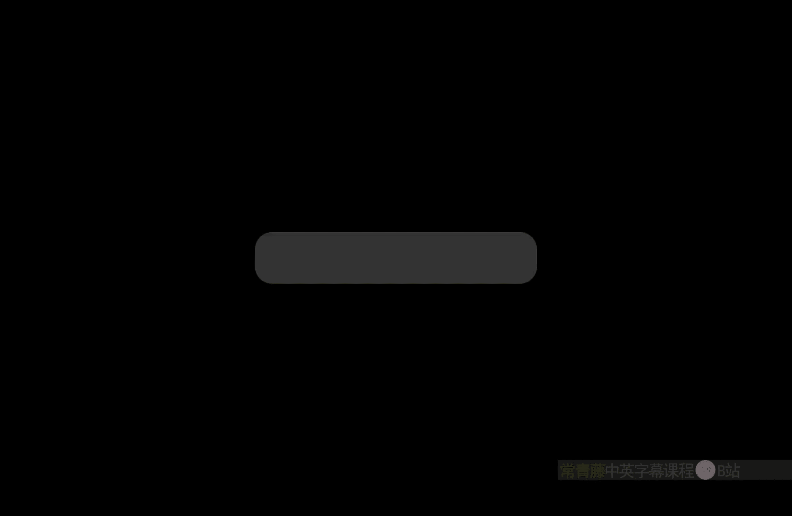
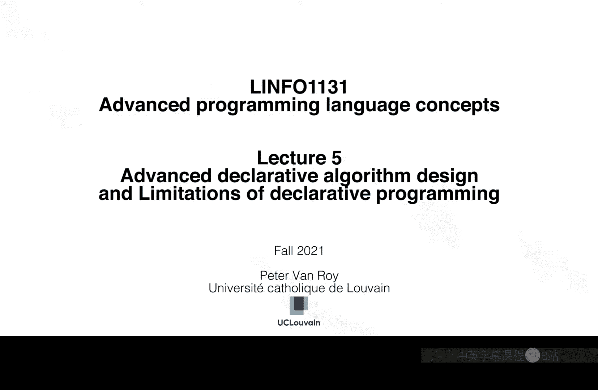
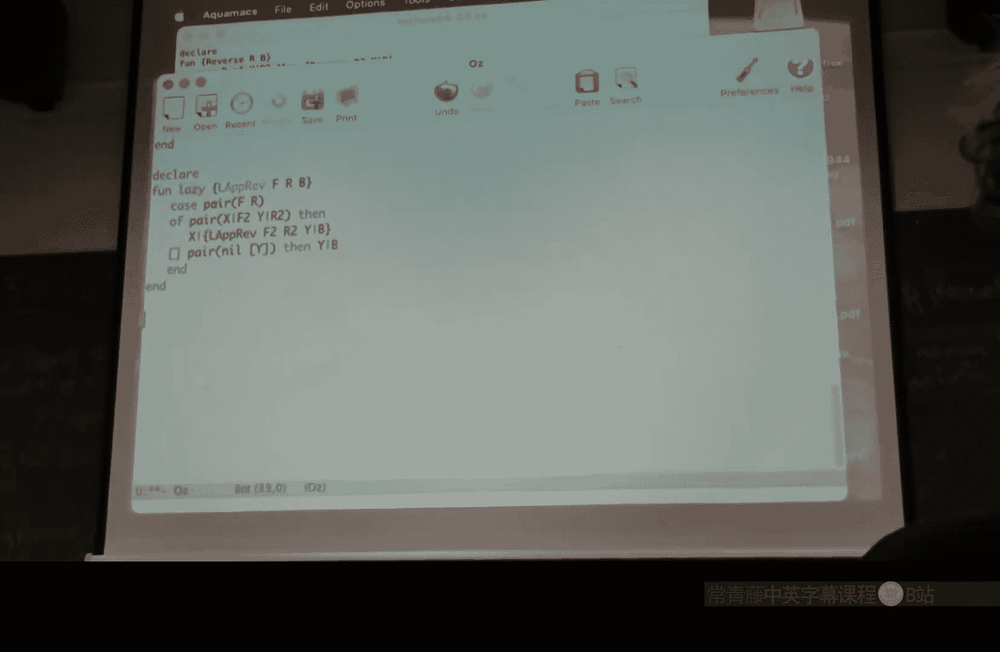
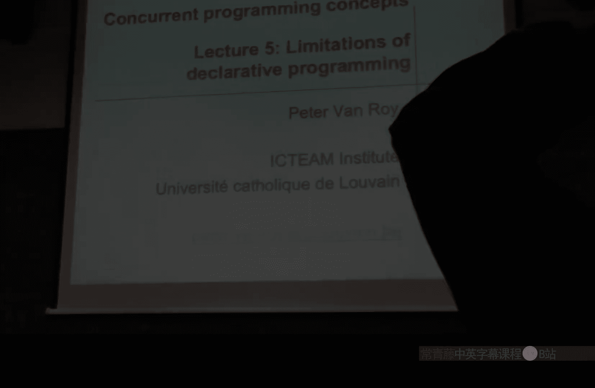
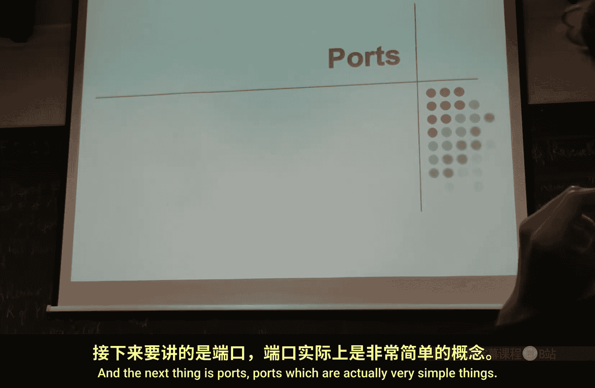

# 鲁汶理工学院【中英⚡高级编程语言概念｜LINFO1131, Advanced programming language concepts】 p20 P20 FO1131 Lecture 5 (2021) -BV1UDffBbEBZ_p20-

Okay， so we' can start。Re。So today I want to explain two things one I want to show you。

Some very clever techniques for lazy evaluation。So this is finishing what we started last time on advanced to declare this algorithms。

So last time we saw。A bunch of Q data types， so I made a。Worst case of amortized。Ephemeral。

 constantine Q， and worst case， ephemeral constantant time Q。

 So last time we looked at we saw ephemeral。Ces。And I showed you how to make them very efficient。

But today I want to show you persistent cues， so persistent data structure is very sophisticated because you can have multiple versions of it。

And it's not so easy to do it。In fact， the code is very simple。😊，For these persistent cues。

 it's a very short code。But I want to explain how it works because it's kind of。

Clever and not so easy to understand how it works， even though it's only a few lines of code。Okay。

 so first I want to start。By presenting the ephemeral cue we saw last time。

And showing you why it's not persistent。オ。And that's the first step。

And then we will show how to make it。Persistence， okay。

 how using adding ladies evaluation can make it persistent。Lazy evaluation allows to do the reverse。

 remember we have to do a reverse sometime so the problem is the reverse is going too late。

 it's lazy we can do the reverse much earlier。And that makes it persistent。

But it's still only amortized。And we can also make it worst case， constant time using。

Another technique。The problem is that the reverse is monolithic。

But we can combine the reverse with the append to make it。Incremental， I remember for lazy functions。

That our monolithic wise means you have to evaluate the whole thing if you just want one piece， okay。

 so that's not very nice。But we can make the reverse。Incremental， okay。

 and this will be our most sophisticated。And it's only a few lines of code。

 but it's doing something really nice， okay， so let me start。

 let me first show you again the ephemeral cu。So remember the cube was implemented as a tuple。

Front and the back。 and when we insert， we insert in the back。

But sometimes we have to move the back to the front。

 so we have this check function that will move through a reverse and add this back to the fronts in some cases。

Okay。So， let me explain now。So the delete now will take F andR。And。It will take。

F the x is the outputta， it will take it from the F。Now， the problem is that the F might be empty。

But when we do an insert。If the F is empty， it's going to do reverse and move the R into the F。

So let me show you how this runs， let me do some example execution。So we start with Bill New。Okay。

So the check function will reverse if the F is N。So let's say we do an insert。那么哎。

So this is going to give cu now。A有。Okay。It's going to add it here。

But the check function is going to check that the F is mill and it's going to do reverse。

 so it's actually going to do a check。And this is going to be。And know。没有。Okay， like this。

Now if we do another dessert。Okay。This is going to do。诶 no。And the result would be B。No。

And this time the check will not do anything because this is not known okay。

 now let's say we insert a lot of elements。To the。We have a few a mill。

And here we have a huge number of elements。Okay， so it looks like this。

So we have done a whole bunch of inserts。And now if we do a delete。It's going to take the A。

 if we do， then another delete， it will take this one。 So if we do a delete， it will take the A。

But since。The F1 then is going to be new， the check will' move this。Back to there again。

 so the delete， so we can do a delete now。Okay。So let's say this gives us， this is Q0。This is Q1。

Pute。You问。い通。Okay， let's say whatever this is Q。26 or something like that。So we have  Q26。

 we have done all these inserts。And we get to this。Now if we do delete。This one。

It's going to take the A off， but since the result is new， it's going to move through reverse。

So it's going to do Q new。三ワイビ六。オッケ。And the x will be today， but then it will do the check。Okay。

 and the check will do the reverse， so this will give us B， C。Like this and。谁咧？

So you see how works up， and so this is amortized constant time because delete will only be done。

The reverse will only be done once， and then you can remove all those elements。So this is ephemeral。

Now what happens if we try to use it as persistence？So is it persistent？Well。

 persist means you can have multiple versions。So here we have had Q0， we did insert Q1 up to Q26。

 and now we do delete。This gives us Q27。This is only one version you see yet， if I。

 I only' only have one version。But if I want to do persistent， I will do another delete。On Q 26。

And now I have two versions， you see so if I do a second delete on 26。I will now have two versions。

 and I can make more versions if I do another delete here。

Now I have three versions all coming from Q26， so you see how it works with multiple versions。

Now each of these deletes。Is going to do a reverse。So let's say we do n the。

 now to say we do n inserts first。This is N inserts and then end。From Q 26， from the final version。

This gives us two n operations， right，2N。The inserts are going to be constant time。

But the problem is that each one of these deletes is going to do reverse。

And reverse will be order n will be Consantine n。So that means there would be n times n n squared operations。

ok。See that。The n squared operations。For sorry， n squared yeah， time， if you count the time。

 n squared number of things you have to do， but I only have had two NQ operations。

That means it's not amortized， it's not constanttantine anymore。

Because n squared divided by2 n is proportional to n， but for amortized constant， it should be one。

So this thing。It's not constant time anymore， you see so it's correct， it's not wrong。

 the result is not wrong。It's just taking too long， it's not constant time。

 so if I use this cue in a persistent way。This implementation。I will have a order N。

Aortize time and not order one， okay？So you see this one is not。It's not。

Constant time anymore if I use it persistently。Okay。So， but we want to make it comes to time。

 so how can we do that？We're going to do something quite clever。Well I think it's clever。

We to use laziness。So let me make a picture and give you some notion of what we're going to do here。

 so let me erase this。So the code is all in the mood there so you can look at the code then let me make a picture and show you what's happening。

喂。Then we'll see how we can make it better。So in the eorra one。

We had like this let me just make a picture， we have a queue， we do another insert。

We're doing inserts， we keep doing inserts。And now we have。A bunch of versions。Like that。

And this is a delete。This is a delete， this is a delete， this one is going to do reverse。

 this one is going to do reverse。This one is going to do reverse。

So all of these thes are going to do reverse， ah， that's kind of a pain？Now。

 how do we make it persistent？Well， we want to do the reverse。Before。We want to try to make them。

The idea is to try to make these reverses come earlier， okay， so the idea is to move the reverse。

 to make it earlier。So we what to do it here somewhere。This reverse， okay。And if we do that。Then。

It won't be having the problem here。Okay。So let me make a。

To show kind of an example of how we're going to do it。Okay。

 so the problem is it still has to be amortized。Okay。So that means when we added them。

When we do the reverse。We only do it。When。When we can pay for it， though。

So this is a typical way of doing amortized algorithms。 So this is called。The banker's method。

So have you seen amortized algorithms in the previous course？Was a we that no。

In your algorithm course， you didn't see amortized algorithms， Yes， a little bit。

 the banker's method。The intuition is the reverse is like expensive。Taking money out of the bank。

Okay。The reverse is taking money out of the bank。And you only take money out of the bank when the money is in the bank。

So the banker's method。Whenever you do a small operation。

 you put a constant amount oflin in the bank。So after you do end operations。The bank has ended。

Pieces of money in there， and then you can do the expensive。Operation， okay。

 and it's amortized because it's spread over all the times you put the money in， okay？

So the banker's method is remaking and amorized。That was okay。So that's what we're going to do。

 we're going to so let's say if we do insert here， we have inserts。Okay。

And each time we do an insert。Okay， we put money in the bank。Okay， but we can only。

Do the reverse when the money is in the bank。Okay。So let's do like that。So here。

 let me now make a different representation of the Q。So making it persistent。Okay。

 let me do a slightly different representation of the cube。Like this。Remember here we had。

F and R with the forward and the reverse list Here we have F。And儿。

But we also keep track of the lengths。'The length of F and the length of R。

 because keeping track of the length lets us count how many operations we did。

So we can use the bankers method， okay？So we have Q0， is's going to be this one。

So now we get  to zero， now let's insert。이렇게이。This gives us。0， no。1， a。没有。Okay。Like this。

And now we can keep going we can add more elements at some point we need to do。

We'll need to do a check yet。So we can keep adding elements。

But now let's try to be smart so we can keep going and let me go to the number here。え？Okay。

So here we've added a lot of elements。We have this， but at some point we have to do this reverse。

So how do we do the reverse？Well， we can do the reverse。So let's do the reverse。

While we're doing this， so we want to do the reverses early。

We want to do them early and now we're doing all these inserts， and if we don't do any reverses here。

 then we have the same problem okay we want to do the reverses。Here， okay。

So we want to do the reverse early。Okay。Okay， so let's see how we can do that。Do zero mill。

 zero milll。So now let's insert A。Okay。We get。0， new。1， a R。Okay。And now let's do a check。

 so let's do reverse now。Okay， so the idea for doing the reverse is that if the x is new。

 then we do the reverse， so let's do reverse。Like this。Okay， and here we have。The computation。

 the reverse computation。研究で。Okay。Okay， that's good， right？So this one will be a no。

 itll be reversed here。But let's keep doing inserts now。Okay， let's do another insert。On here。

 that gives me Q1。So this competition I write it like this。1ビ0。Okay， now the question is。

 do we want to do another？Reverse， see， the problem is we have to be smart in how we do the reverses here because we can do a long sequence。

A long， long， long sequence of inserts。But somehow we have to already do some of the reverses， okay？

So we did here the first one， fun。Okay。But we want to we don't want to do them always so the idea is。

If we， let's say I do now another insert。So when you see what happens when I do another insert。

 this number will increase。ok。So I want to decide when I do the reverses here。

Now you see that each time I do an insert， this number will increase。Okay。Well。

 if I use the banker's method here。Then the reverses are paid by。The elements in the front。

So what this number？Is about the same approximately the same as this when I can do reverseers， okay。

 let me make meet。Some picture here。Sorry。So let's do like this。

So have now I have something like this。F。呃。This is the length of F， sorry。The they are。

And I have two lists here if I not do it and insert。Then I will add an element here。

 I will have LR plus1。And if I do another insert。And I LR plus two。

And then if I do it a check with reverse。Then this one goes back to zero， okay？Like this。

Now I do check， this one goes back to zero， but now this one will be L plus LR plus2 because it all moves in here。

Okay， and here we have lists。They grow it。So you see that eventually when I do this reverse。

 I move all these elements to here， so this length goes bigger， but this one goes back to zero。

But if I do another， insert here。Okay， then again， this will be same number as before。As if prime。

 this one will go one。And again， it would increase。One， two， okay。

 so the idea is that I'm counting here。These are increasing。Okay。

 but I can remove them up there when I can pay for it。Okay， so this reverse will take time here。

So the idea is that I will only do the reverse。When the LF。Is paying for it。So thisF。

 so when this LR becomes about the same as LF， then I can do the rumors， so the ideas of forward。

 I have F and R。Okay。So when I do it， inserts that r is increasing， so it starts from zero。

 it's increasing， and when it gets to the point of LF， then I can do the reverse， okay？

Then I can move it in and then make those back to zero and then I do again。

 so again so I'm basically moving from R into F。Whenever the R is big enough。Okay。

So that's basically the idea。Okay， and in order to。呃。So I don't in order to do the computation。

Only when I need the result， so I don't need to do this reverses until I do the deletes， okay？

I don't want to really do the work here or else this is going to be expensive。

So I'm going to only do am going to make them lazy。So let me show you。Code for this。よしい。

Now let me first give you a scenario。So here's the scenario。Here's the execution scenario。Okay。

 so I start with zero。没有。这种 milk。And then I do an insert。就诶。That I take zero， new。One， a no， okay。

And now。We're going to say we're going to do the thirdb who first， we're going to do a first。

Reverse here to put something there。This will be one。And here I will actually have。A reverse。

Function call here。This one goes back to zero n。Okay。

So this is what happens when I do a first traverse， have first been served。

Now if' I do a second insert。Okay， then I get。When。1。No。企。And now I do。A third one。我。2 see B new。

You see this one is growing now， and as soon as it gets bigger， a little bit bigger than this。

 then I will do reverse again。So， this gets me。Three， so one plus two。

And here is now another computation， so this computation goes in here。

 but I have another computation adding this one。There and we go back to zero。So basically。

 it's growing piece by piece， and it starts。When I have the first one， and then it goes three。

 and then it will basically almost double each time。Okay。So， let me show you the code。For this。

So here is the code。So the Q is created zero mil， zero mil。When I do an insert。

So I take the Q length of F， F， length of R， and I add one at the end here， x bar R。

 and I increment the R by1。And when I do a delete。I will take an element off of F。F equal x bar S1。

And I will do length of f minus1， and the r does not changed。So here I have the check function。Okay。

 so the check function basically compares the two lengths， so you see how it works。

 the length of F and R。Whenever I do an insert， the length of r is increasing。And what I do。

 I reverse。The R will be moved to f， and then the f will increase and the r goes back to zero。

 So basically it goes like this。 the R goes to F。F goes up， and then when I keep doing inserts。

The R goes up again， when it gets to the level of the F， it goes back， so it's like this。

So the F's will only increase when I do this check function。Okay。

So you see that I'm comparing the length of F and R。

So the r starts by being zero and each time I do insert， it goes higher and as soon as the r gets。

So there's it's actually has to be to make it work， it has to be one higher。

 it has to be just about the same as F。 So when the R gets to the level of F here。

Then I moved the R to the S。So how do I do that， so all I will pen F。And the reverse of R。

So basically the F here is not nilh？The F is not new so。

I don't actually want to do an append here because it's going to take time So if I actually do the append here。

 it's go to append F plus the reverse of R。 but the F is not Nilla because the F I'm still only doing insert。

 It's all growing。So I will do a lazy append of F。Together with a lazy reverse of R。

So I combined F plus the reverse of R。But I'm not actually doing it yet。😡，Because。

I'm not actually doing it yet here。Because I don't actually want to run that L pen of F yet。ok。

Because each time I do it will give me extra overhead， okay， so I'm not going to do it yet。

 but I make a lazy call here S plus the reverse of R。Okay， and then the R goes back to zero。

And then if I keep doing inserts。The R is increased again。

And when the R goes back up to the level of F。Then诶。Rverses it does again， it combines it again。

 the R is moved again to F。And I create another。Lazy function call。ok。

So I'm creating while I'm doing inserts， I'm creating all these lazy suspensions。

That are moving the R into the F。Okay。But I'm not doing it yet。

Because there's no reason to do it until I actually do the delete， okay。

 there's no reason to actually do that to move it in there yet。

 so I create lazy suspensions so then when I do a delete。When I do with delete， I need。F。Okay。

 and this will trigger a part of this execution here， okay this will trigger the lazy append。

And the reverse。But it will only trigger a piece， a part of this， because lazy appendice increment。

 okay？But when it does reverse， it does the whole thing because reverse is monolithic。

 so if the F is different from mi， it will do this and it will take off an element X， okay？

So it will do part of this to get the first element and then it makes length of f minus1 and it has F1。

 which is one less element。 So if I keep doing deletes。

It's going to keep doing part of this computation。So how does this work now when I have multiple versions。

 so I'm telling you this is persistent now。So when I have multiple versions。

The leak will only be done once。And the reason is that I'm doing the the I'm creating the lazy suspension before I split into multiple versions。

So let me make a picture of this。Just to give you idea。So here I have Q0， I'm doing insert。语文。

Up to2 26。And now， let's say I split。227。So now I have multiple versions， so here I do delete delete。

But the lazy suspension is createdd here。Okay。And when I need the value。

This delete will cause this lazy suspension to be activated。Okay。

But the lazy suspension actually binds the result。So once this is executed， this calculates。The F。

 the new F firm。This second delete。Also needs the values，But because it's a lazy suspension。

It's already evaluated in the first delete， that means the second one does not have to evaluate it again。

It's already been evaluated。And lazy， the result F is shared between the two versions。

So that means the reverse is only done once here。And not twice。ok。Remember in the old version。

The reverse was done each time I created delete leads， each time here it makes it n squared in all。

But here， because I have lazy suspension in advance。

The reverse is only done once and the result of this lazy suspension binds。

The variable here and the second delete will see already the result。Okay。

Doesn't need to evaluate it again， and it only evaluates once。So that means that the lazy suspension。

 because it's created in advance， this variable F is actually shared between the two versions。

 and so it's only computed once。Okay。So that means that this is actually。呃。It's persistent。

 amortize constant time persistence。Whereas the other one was not constantantine。

Because you had to do the delete。Everywhere， okay。So you see doing these lazy suspensions before early on。

Will make it persistent。 So the trick really to make it work is to do them at the right time。

 So that's why we have this。Condition here， we only want to do them when when we are allowed to。

 we don't want to make things more defensive by doing them everywhere。 if we do them everywhere here。

 then we would have to do many， many pen and we would not gain anything， so we have to do them。

Rarely infrequently here。So in fact， we're only doing them。

Once here we do it once and then R goes back to zero， and when the R goes back up to F。

 then we do it again， so this condition here makes it that we don't do these lazy suspensions very frequently。

 very rarely。Because otherwise we would not gain anything， okay？So with this code。

 then we get an amortized。Persistent， constant time。So the persistence。

Comes from the laziness where the suspension is created in advance and is only calculated once。Okay。

 when I do delete， one of the deletes。And it's。Constant time。

 because I do I only have a small number of these， you see I have this condition here。

 so I'm not creating this every single time that would be too expensive。

So basically the F is grow is doubling each time， so I have F and R。

I move R and f and then r goes back to zero and the f is twice as big。

 and then the r goes up again and then I move R and F so the F is basically doubling each time。

 so these are actually done very infrequently okay。

It's only done whenever I double the size of the cube， okay？

So you can see this very simple code here。Is。Doing something quite smart， Okay。

 so in order to understand this， I really encourage you to run this code and to look at this。

To look at this。Values while you're running it， okay， do inserts。And see what happens， run the codes。

Okay。So this now is giving us。Adortized。Pist amortite constant time， persistent Q， okay？

Using the lasers。And then there's just one more thing I want to say。

Is how I make it worst case constant time， so this guy is still amortized， unfortunately。

 because we have this reverse in there。So reverse is a pain。

 remember I showed you last time that reverse is monolithy， if I reverse N element list。

 it takes order N。That means these lazy suspension， when there's a reverse in there。

 I'm going to do a lot of work， okay？So if I delete one element and I have to do reverse。

It's going to reverse a huge list。So that's why it's not worst case constantized。

 that's why it's amortized because some of these deletes will be this one。

 the one that does the reverse will be order n。She is a pain， okay。

But we can actually make it also worse case， constant time。

And that I just want to show you the technique we use for that。

So let me show you one final technique。全わか。That you write it on the board。So we have now。

Let me first summarize what we did， and then I show one more final technique。

 and then we're done with the advanced so you really know the full power of laaziness。

So we have now an ephemeral。So this is all advertiseord， that we have a persistent cube。

AndBoth of these are amortized。Now let me try to make it worst case。Coms can time。Okay。

So let me explain now what's going on here， I want to make now the step from amortized persistent。

To a worthy case， persistent。So remember， we made the step from ephemeral to persistent。

But both of them are amortized。Now I want to make the step from amortized to worst case。

And it will still be persistent， then？So going from advertised。T worst case。クて。Okay。

 the problem is this thing。The problem is the elephant。In the check。So， there's a lazy。

So this is basically a lazy reverse though。So I have a lazy pen。And this is actually， it's so lazy。

Reverse。So I take the reverse and I put it inside the lazy function。But it's still monoolithic。

 so this is lazy Penn。The problem that this one is monolithic。That means when I do the reverse。

 when I activate this suspension， when I need the elements here， I'm going to do the whole reverse。

That's a pain， okay？So how can we get rid of this？😔，So we want to get rid of this。

Moondodeistic perverse， so this is the called this。That we want to keep。

But somehow you want to change this so that there's no more。の冷テ。Reverse。Okay。But how can we do that？

Well， we are saved in a sense， because there's a lazyend here， we're doing lazyend of F。

With reverse of R， and F and R are going to have almost the same length when I do this。

 when I do this reverse。The length of F and the length of R will be almost the same。 Okay。

 So the idea is to combine。Append。And reverse。So the idea is to make another function。

That does both of these， okay， so I will create a new function。Let me call it。Out rev。At pen reverse。

 okay？And it has both F and R as arguments。Okay。And it also has the accumulating parameter of the reverse。

So I will take this append of F。So that's the F here and the reverse of R。

And this is the accumulating parameter， and I will make one function that combines those two。

And the idea is that while I'm doing the append， each time I do a little bit of the append。

 I will also do little bit of the reverse。Okay， so that makes the reverse incremental。

So let me show you。The code more detail to show you how that's working。So here。

 let me show you first an append。And then I'll show you how they're combined， so have any pen。

Let me say F of G， so I check I picked the names。Of the variables， F of x F2。Then X。Append。F2 B。

And no then be。So this is a pen， okay。It's a pending F and B。Now I let's make the reverse definition。

So reverse R。B， so B is the accumulator。Pase are of。Why are two？人。Re verse are two。怖呀。诶。

So this is this reverse。So this is a standard appendda， you can see I'm appending F and B。

Case F of x bar2 x。Or a pen F2 B， this is just a pen， and this is the inner loop of the reverse。

 So the way the reverse works is that I take an element off of R。And I move it into B。

 I do a recursive call y bar R B， and when the R becomes n， the result is B so the B is accumulating。

The results。Now I combine these two。So， let me call this one。啊。Pb LRV。And now， sorry， F RV。

 so I'm looking both at the F and the R here。The F and the R。

So the idea is I'm going to do these two steps at the same time。

 here I'm taking one element out of F。Here I'm taking one of them out of R。

And I drew a person call in both cases。So I'm going to do both of these at the same time。

So I'm going to take both of these。So let me make a topple pair FR。Okay。Here。It's of two。1 or two。

So you see all I'm doing is combining these two， the F goes into XF2 like here。

And the R goes into Y R2 right here。So in a sense， I'm merging the reverse into the appendda and'm adding some extra stuff here。

Okay。And then I do the result， so I'm still doing an appendda， so I still create the result X bar。

Appre。Okay， and here I have F2。But also R2。And then why bar B？Okay。

So you see here I'm doing the append part。This is the dependent part。

 but I'm also doing the reverse part here I'm taking an element off of R and putting it in front of B。

 just like here taking a off of R， putting it in front of B。

 I'm also taking an element in front of F。And putting it into results。Okay， so you see I'm combining。

 so this is a function that does both append and reverse。Okay。And how does it end？Well。

 at some point， F is going to go to new。The F will be empty。But what is the value of R。

 when we have actually length of F， remember we have this condition。

We have this condition in the check that the r and the f are almost the same length， in fact。

 the r will be exactly one higher than the f because when the r starts from zero it grows and when it's just a little bit higher than F we do。

The checkck， Okay， So that means when the。F gets to new。The R will have one element left。😡，Okay。

 which I put woman here。And then the result is Y and D。Okay。So here。

 what is this function actually doing now， it's actually app F with the reverse of R so when I call Af。

Of L of oh， sorry，F。Our news。It's actually computing。It's doing the append。Of F with the reverse。这是二。

That's what it's computing actually， because while it's recursing down the F。

 it's putting the x's in front， so it's recursing down the F， and when the f goes to nu。

It returns y bar B， so y bar B is actually the reverse， so while it's recursing down the F。

 it's building the reverse。The R goes to y bar R2， and it builds the reverse。

 exactly like in this function， so when the F goes is exhausted。It returns the reverse。

That means while it's doing the append of F， it's building the reverse。Okay。

Now why are we doing it like that and so why do we have this little bit complicated function here？

Well， because this complicated function is incremental。系。

So instead of doing L append and then lazy reverse， we do L app Rev。Like this， okay。

 and here we put Nila， it starts withNil。So if we replace this lazy call by this one。

 how we make this lazy？That this function is incremental， so you see the trick。

 we have moved the reverse into the append， so while we are doing the append。

 we're also doing the reverse。That means there is no more order and operation。

 every single step of this append is constant time， okay， because while we're doing theend。

 we're doing also the reverse。And this gives us the final code。The final one。

 so let me show it to you。So the code is almost the same as before， except now we use app rev。

Instead of a pent of reverse。で。So this is a function that does both aend and reversea。

 it appends F with the reverse of R， you see that， and when you call it。

 you start by calling it with B is the accumulator， so you start with nil。

 so this will do a pen of F with the reverse of R。This is our。App breath function？

And once we have that。The final Q is this。This is our most sophisticated cube。

So this is the final queue that we have， so again we have to insert and delete。

So you see the insert is kind of simple， it's putting the X here。

Improving the R by one and then calling check。And the delete is removing an element from F。

And doing then f minus1， F1， so the insert is increasing R and the delete is reducing F。ok。

And then we have this check call。And if L F less than L R。

So what this basically means is that the r is growing's just when it gets higher than F。

So if s plus one is equal to R， then I do the。The reverse， the moving of this， the R to the F。

 and here I call L app breath。The function I just defined， the lazy function？

So this lazy function is completely incremental。That means none of these operations will ever take order N。

And also when I do a delete， when I do several deletes in different versions。

 only one of them will compute this， the others will use the result because they have access to the same value。

So this。Code is a persistent worst case constantstantine Q， okay？

So the code is not so complicated a number of lines。But to really understand how it works。

 you see it's a little bit subtler， I think you agree with me that it's a little bit subtle。

But you can see the power of laziness era。So the power of lasers is so here we really have a worse time。

The worstors case， constantantine， persistent Q， this is actually a very sophisticated algorithm if you want to implement this kind of algorithm。

In Java or non declarative， it's very hard because they will always be ephemera。

 whereas here we have a persistent thing， so if you need a system that has multiple versions。

This is a very powerful technique。とって？So that's all that I'm going to say about these advanced algorithms。

 there's actually more stuff， so I only am talking about a small piece of this book。

So this whole book is giving you clever stuff， but this gives you a good flavor of the power of laziness。

So what I want you to remember from this when many years is that lazy evaluation is actually extremely powerful and it can make very efficient algorithms。

 even worst case persistent。Verss， okay。Okay， so let me be making now a break here。After the break。

 we go completely different。对。

So now we're going to。Finish the part of the course on declarative programming。

And so now we are week five， in fact， let me first make an announcement for the midterm。

So the midterm will be all the material up to today。So up until the end of declarative programming。

 so week five。So that would be the materials for the midterm。

I would prefer to do the midterm during week seven， which is the smart weekend cement Smart。

So I want you to tell me what is the good time for the midterm？

So I want you to tell me you have to organize yourself and tell me what you think is a good time because I know you have other courses with deadlines and other midterms and things。

It's up to you to arrange it so that you don't have so many conflicts， okay。

So you should tell me what you think is the best time。For the midterm。

 so the midterm will be one hour。诶。I remind you it's to can give you up to five points for your final grade。

 but there's no penalty， if you do very bad on the midterm， if you don't do it。

You have no penalty because you will see the same material on the final exam and I take the maximum amount。

So it's if you do well in the midterm though， you have already got points for the final threat， okay。

 so that's something that I just want to announce， so please tell me when we would like to do the midterm。

I'm expecting you to figure it out and tell me what are the best possible times。

 so I would prefer doing it in the cement mush， the smart week， which is the seventh week。

 which is in two weeks， hour or the fifth week。And because that's what it's made for。

 there's no courses during this week， so midterms and things normally would go down in there。

So someday the smart week。What you tell me what are the possibilities so you should organize yourself to make sure if somebody has a constraint and they have another midterm。

 for example， on Tuesday， then probably we don't want to do this one also on Tuesday。

 okay so you want to spread out a little bit。Okay。So I wait for you to tell me that。

 so I'm very flexible so you can do the midterm so we can arrange it。

 but I'm expecting you to tell me what are the good times for you during the cement Mil， okay？

So the material is open to including today。So the material from next week is part of the course。

 but it's not part of the midterm。Okay， so today I want to finish by now we leave declarative programming。

 so up until now I have shown you only declarative paradigms， equivalent of functional programming。

 and I've shown you that they're actually quite powerful， you can do concurrency。

 you can do high order， you can do very efficient algorithms， persistent ephemeral and so on。

But you can't do everything。There's limits， actually。

So that's too bad because thelarative is actually the best way。

 because it has lot of advantages but you can't do it。

So I want to look carefully why you cannot do everything and how we go beyond。Okay。

 so I'm going to start by first saying what exactly what is it declarative execution。

 it's actually an execution of a lambda calculus program okay you didn't see it in this notation you don't see it so much but on the foundation。

 all declarative programming is lambmbda calculus， pure lambda okay and we will see that this has actually limitation we'll see that a lambda execution cannot interact。

With the real world while it's executing， that's kind of a very weird thing。

 so I'm going to explain it to you。So in order to interact with the real world。While it's executing。

 we need to extend。And then we leave thelarative， then it's not declarative。

 that's why we need mutable variables， sort of communication channels， or even a hardware clock。

It's part of the real world， though？So we're going to make some extensions and the two most important ones are mutable variables。

 which you use very often like in Java， which are called cells here and communication channels which are called ports in this course。

 so you can say this is Java and this is airline okay if you want to connect it to two languages。

 so Java goes this way。And Carolline goes this way。

 those are two ways that you can go to go outside and declare this， okay？Okay， so up until now。

 we have seen declarative， up until now， I have been force feedingeding you。

 declarative and telling you how great it is， et cetera， so we've seen sequential functional。

 we've seen concurrency， deterministic data flow， concurrent programs， we've seen lazy evaluation。

And I show you that it's all very efficient， there's no efficiency problem。

 you can actually make very efficient algorithms using the color of techniques。

 so that's all very good。And ideally， so my view， after many years of writing lots of big software and trying to make it work and so on。

 so I've been writing lots of software， the point is your program should be completely declarative that's the ideal okay because it makes lots of things simpler and you will see that later on。

Debugging， so correctness， testing， maintenance， so upgrading， it's all a lot simpler。

If your program is declared。And you will see that， and in fact。

 the industry is moving in that direction and all the cloud alytic tools， for example。

 are actually quite declarative。They're very large distributed fault tolerant systems running in the cloud。

 doing very powerful computations。Well， they aren't declarative because that's the only way to really make them work if they're at such a big scale。

 okay， otherwise it would be too complicated， so the industry is actually moving in this direction。

But the point is now you can't really do everything， there's actually limit to declarative。

You cannot write your whole program like that， and it's not because any of any。

Problem with declarative programming， it's because there's a fundamental thing there。

So I'm going to show you why not， okay？So we need to add stuff that's non declarative。

To make it really work in the real world。But luckily we don't really need so much。

 we need just a little bit of non declarative， so most of your program can still be decative。

 so you still want to try to make most of it。So why can you do everything？Okay。

 it's actually very simple。Declarative execution is equivalent to a reduction of a lambda expression okay so I'm not going to show you again lambmbda okay if you've seen the previous course 11 or4 how you know what it is lambmbda is this very simple clus that actually lets you do all kinds of computation okay you start within an external expression which is like a functional program and you reduce it in reduction steps and get final result that's it okay and this is term complete so you can do any kind of computation here which you will understand if you have seen the previous course okay all kinds of things。

 numbers， lists logical operations list you can do everything recursive functions。

 everything in this calculus okay so you've seen that I'm not going to repeat that。So we assume that。

 okay？But then we have something else。We have this calculus actually has some power。

And the power comes from this church roster theorem， it has a property called confluence。

 this is the real power of thelarativenessa。That means no matter how you reduce in any order。

 so sometimes you have a choice you can choose different reduction orders。

 you will always get the same result So there's nothing like race condition or nondeterminism no you will always get the same result。

 the final result the is independent of the reduction order that's very powerful this is really the reason why lambmbda is such good I mean there's two reasons one is that it's turned complete and two is that it's confluent So this is the real power。

And this is an amazing property， so we are blessed with this great property here， okay。

 but this power is also the weakness。The power we get here。Will also be the weakness。

 so how is that possibly？Okay， well， it's very simple， you start with E0 and you go to EM。

So all the information is already in there， this is your whole program， okay， is your。

 so while it's executing。No information can go in there。

 this thing cannot interact with the real world wireless executing。It cannot， for example。

 you're typing on a keyboard and you want to put in some information while it's executing。

 you cannot do that。Because， well， yeah， you can do， but it's not declarative anymore if you do that。

 because in the London， everything is already in the initial expression。

All information is in the initial expression， you're not allowed to add anything later。

 so this is what you have to give up。So if you want power。

You have to give up something that's very normal kind of， so if you want this confluence power。

 you have to say that nothing can be added later。This is the sacrifice you have to make in order to get confluence。

So that's very nice and in many cases it's okay if I have a big computation。It's fine。

 but what if I do want to add something later， well then I'm not dec of anymore okay。

 so you see it's actually very simple。But many people don't understand this and it took me many years to understand this seems crazier。

 and then 20 or 30 years ago I did not understand this simple thing， this simple thing。

 say how is that possible and in fact most people even today will not understand this simple thing。

 because it's too simple。People love to understand complicated things。

 but there's been long discussion on what is functional programming and so on。

But people really don't understand the limitation。 So I'm presenting。Something very simple here。

 so you don't need to look very far here。There's no hidden weirdness here， it's very simple。

 actually。So let's say I want to interact with the real world。

 let's say I have a program that's running like a text editor， and I'm typing in text。

Why it's running。Well， a running program is a sequence of。Reductions so this is a running program。

Okay。Each of these steps， each reduction step。Takes time， of course。

 this is implemented on a computer。This is using transistors and logic gates and whatever and it's clocked and it's very complicated。

 but the point is it takes time。Okay， so this whole thing is going to take some time。

 that's very reasonable that's logical。But the execution happens on a computer。

 which is a physical artifact in the real world， so this is taking time。

And this execution can be very long， and if it's a text editor that's running， can run for days。

 an operating system can run for weeks。嗯。If it's not buggy。If it's buggy。

 it crashes and you have to reboot， but actually good operating systems can run for weeks or months。

Without stopping， so this thing can go on for a long， long time。

So but but interact with it doesn't just sit there and do a computation， it interacts with the mean。

 okay， so if I type something， I'm putting in information here。

 S0 is going in or if it's displaying something on the screen， information is coming out。

During the execution， this。S0 and S1 is not lambda anymore。Because Lambda does not allow that okay。

 Lambda is only that。So if I want confluence， I'm not allowed to do this for that。The input S0。

Affects E2 sum input coming in。And the output E for S1 is an output which is not the final result。

 so this is a weird output that has nothing to do with Lambda。

 and this is an input that is changing the computation。So both this and that are not yo anymore。

So that's the very simple thing， so once you allow those this kind of thing， you don't have lambda。

 so you don't have the power。You've given up the power。Okay， so this is something you see a lot in。

And the。Things like anime and stuff so I'm a big fan of anime and usually when you have a very powerful character。

They have to give up something to get that power， it's fair intuitive， actually it's the same here。

 so if you want the power， you have to give up this interaction。If you want confluence。

 which is really where the power comes from， you have to give it up。

So I like to give you kind of colorful explanation。

 but it's very similar to these overpowered characters？They are giving up something。

 usually they are giving up something to get the power。Okay。So summarizing the good and the bad。

 okay？Lambda cculus is confluent， but there's no real world interaction。

Lambda cculus is the confluent reduction of an initial expression to a final result。

 so this has very strong mathematical properties and it's basically the conch roster or theorma。

 but this lets you reason about programs easily debugging is eased， testing is much。

 much easier when you want to test multiple components。

Then each one can be tested separately and the complexity is additive， whereas if it's not decative。

 it's multiplicative， so it's much harder so testing is easier here， optimization is easier。

 maintenance is easier， also for parallel and distributed execution。Like cloud tools map produce。

 Apache， flame， whatever， these cloud tools。It's much easier and there's no efficiency penalty。

 you can see you can do very efficient algorithms here， okay， so this is all very good。

But there is a weakness。You cannot interact with the real world。

 so during execution we would like to accept inputs coming from the real world and outputs going back I'm typing text into my text editor and I want to see the display text。

That's not declarative， okay？The execution is a step by step reduction of an initial expression to a final result。

 reduction steps take time and inputs will arrive during this time。The reduction cannot use them。

lessUnless you could put them in the initial expression。So you can say， yeah。

 it's like the initial expression is different。But you cannot do that because you do not know the inputs in advance。

You only know them during the execution， so you cannot put them。You might say we do a trick， okay。

 all those inputs， it's as if they were in the initial expression and were done。

But you can't really do that trick because you don't know them in advance。

Because if you would know them in the beginning， it's like looking into the future。

 you don't know them in facts。So you can't do that， okay？So， that's the thing。Okay。

 so what do we do now？We want to interact with the real world。

So we have to leave declarative programming， it's terrible， we have to go away and do something else。

 which is not declarative。To interact with the real world we need to add something to these declarative paradigms。

 we need a way to get input and output during the execution。

 which is not declarative's usually this is called imperative programming so imperative as opposed to declarative so when people talk about imperative programming on one side and declarative on the other side。

 this is what they mean by imperative。So this lets us interact with the real world， good。

But we have to give up the goodness， the power of declarative programming， so then the question is。

 well， I don't like it to give up all this power。I want the good interaction and I want to keep my power。

 of course。Can we have the declarative properties and interaction？In fact， we cannot， okay。

 nobody has figured it out and I don't think it's possible， we cannot。

So we have to give up the power if we want to interact。Okay， but it's not that bad， okay？

You don't have to give up the power all the time。😡，You can in fact， keep it most of the time。

So most of the programming can actually be written declaratively in real world programs。

 you can see that。Most of the code can be actually purely declarative if you only need small pieces。

Where is actually doing the interaction， okay and usually there's very few places， small number。

 so I'll give you examples of this。 You see many can see many examples of this。

So usually most of the color will still be declarative， which is good。

 most of it will be declarative。Okay。So。I can say a few things about legacy code， existing systems。

So usually they're not really designed like this。Because people didn't really get it， okay。

 usually they do too much imperative。They are too much。

Written as if they could interact with the real world any time and that you giving up the power all over the place。

 so old programs in Java are typical that exempt， okay。So if you want to improve。

 someone is giving you legacy code and you have to maintain it。

The way to do that is to try to make it more declarative if you want to make your life easy。

 make it more declarative， but of course there's huge amounts of legacy code and you're going to be stuck with that okay so I cannot help you with that。

 I can only help you with。How to make it better after。Okay。

 so how do we interact with the real world？How does a program interact？So there's many ways。

 so fundamentally。It's not just like。Displaying the screen。

 we're looking at it now in fundamental way from the viewpoint of the lambda reduction。

 what does it mean to interact？So here I give you three ways。

 but there's many ways because it's all information going into the reduction or leaving。

 there's many ways you can do that so here's three。Typical waysです。That this works one way。

 one of the simplest is a hardware club。I have a clock that's counting nanoseconds。Qurks， crystal。

 whatever， a nice clock， okay， and whenever I read the clock， it tells me the time。

That's not declarative， okay， the reduction。The time of the reduction has no significance for Church Rera。

 the time that I read when I do a reduction doesn't mean anything， and maybe when I do it again。

 I will read a different time。So this is not declarative。

 this is information coming into the reduction。O。But even things so simple， like a mutable variable。

A variable that you can update more than once。That's non declarative。You write to the variable。

 I call it a register here， but it's any variable you write。And later on， you read。

So the writing is leaving production and the reading is information coming from outside。

And it all depends on the order if I write twice to the same register。

The latest one is going to be the value if they're concurrent， for example。

 then maybe it changes during one reduction to the other so I'm giving up。T trust you。

 when going I do this，huh？So a mutable variable is already something non declarative。

 and there's another way which is also very common。Which is a communication channel。

So the difference between a variable and a channel is that in a variable。

 you only see the last value。So if I write twice to a variable， you only see the last one。

 whereas a channel you will see all of them。Okay， if I send two things to the channel。

 I can read both of them， so the channel does not lose any information。

So that's another way of doing this so there's basically these two ways are both reasonable and many systems will do one or the other okay。

 so the mutable variable is the Java style I call our color。

 the communication channel is like airline style， okay。

But both of them are non declarative so with all of these。

 the executions would give different results depending on the exact timing and order of their reductions。

So this is not church trust， this is not confluent， this is proving these are not declarative， okay？

So they're not declarative。Okay， so let me go and more be more precise， so here's the hard clock。

So here's my reduction。My declarative production， but some of these are actually reading。

 so this from E0 to Iwa， I'm actually reading the hardware clock T0。So E1 will know this value。

It reads time T0 and from E2 to E3， I'm reading again the clock and from E4 to E5。

 I'm reading the clock and I get these different numbers coming in。To the reductioner。

And the exact times they read。Will depend on the timing of this。

So it depends on the implementation and how the clock feed and everything figure。

So totally non confluenta。Totally non lender， okay？For a lambda reduction。

 it doesn't matter how long it takes， it doesn't matter what the order is。

 the result is always the same， but here the results will change。

If you change the clock speed or if I。If I heat up the quartz crystal。

 it will run at a slightly different speed， so there's lotss of effects。So。It's not lambda， okay。

 so reading hardware clocks is already not lambda。But we can do more things。

 so here's the beautiful variable case。So this is a slightly different kind of interaction。So。

I'm writing into a register or I'm reading， so assume I have one register， okay。

 you can have many variables in this case there's only one register like one variable and you can write and read。

So the read will return the value of the most recent right。

 of course if you write twice the second one over else。

So here is0 to e1 will actually write x into the register。E2 to E3 will write Y to the register。

And E45 is doing the read， so you would actually read one。

AndYou read y and that x does the Y is after the x so it's overriding x， that's how variables work。

 it's very simplehu。So here again， the result of the reads depends on the order。Okay。

 if I switch the total order of these two， then I'm going to read X。

But church Ruer would not care about that。If I switch the two order， the results should be the same。

 but it won't be the same。Because I will read X instead of y。The city。So for a labda reduction。

 the result will be independent of the order， but here done it's not independent of the order。

 so it's not labda anymore。So that's an example of an interaction。

 your regular old Java variables are already that okay。Here's another one slightly the difference。

But it resembles it this is the communication channel。Example， so let say we do a FiIfo channel。

First in， first out， that means the information will come out in the same order it goes in。

So here again， we have viral reduction。We send x on the channel， so E E1 will send x on the channel。

E23 will send why？E 45 will receive from the channel， but it will receive pes。

Because X was sent first， okay， this is PIFO， the first things that are sent are the first that are coming out。

 it's like a pipe bump， things are going through。So E45 will receive x and E56 will receive1。

The order of the values。Depends on the order， if we flip these， then it will be Yx， okay？

So the order of the received values， again， it depends on the reduction order， so it's not confluent。

And this could be concurrent and so it's not confluent again， so communication channel is another。

Way of being non declared。Okay。So you see here we have three different ways。

 and this is very I am showing it in a very fundamental way here。

 in terms of lambmbda with something added。So in the real world languages like Java。

 that's all hidden， you don't see all the lambda underneath them。

But it's all like this so all programming languages will do something like this。

 so all languages to beautiful variables， they will behave like this。And if you write。

A variable from two different threads。Then the one that's last will be the one you read， okay。

 that's all languages in like that， okay。So this is extremely general it's true for all languages。

Okay， let me now show you an example。Let me now show you an example of an application。

That is mostly declarative， this is the same example as we saw in 11 zero4。

 if you remember that course， but now maybe you can understand it a little bit better。

We're building client server。Amazon， okay， so the server is Amazon making huge amounts of money。

 Jeff Bzos， very rich guy trying to go into space because you're paying him whenever you buy something。

But we're not talking about that， we're talking about the code here。

 so the client code is running in your browser。And there's another climate and there's millions of climates。

So everything here can be declarative except for one thing。

It's where the server receives the requests from the clients。Okay。

 so this application has a liveness requirement。Okay。

 the server must accept each incoming client request in a reasonable time that depends only on the travel time from the client to the server。

 so when client one sends a request， the server has to accept it。

In a reasonable time it depends only on the travel time and it does not depend on client two， okay。

 for example， if client two sends a request， it should not affect client1。

Now notice the order of the quests。Cannot be determined in advance because it depends on the precise timing of the clients。

So the server does not know what order the client request are coming in， could be any order。

 and even if the two clients。If client1 is doing his order before client two。

 maybe this is a very slow connection， and this is a very fast one。

 so even then client two maybe comes first okay。So this is an example of a communication channel。

 so this is exactly an example where it's using this channel here right。

So there is actually a channel here from the clients to the servers。

 the clients are sending into the channel and the server is receiving from the channel， okay？So。

 but there's only one channel here。Maybe the server has millions of lines of code and it does。

 if it's Amazona， there's a huge database， there's all kinds of stuff here。

 even your browsers are a complicated piece of software in era。

 and there's all the networking software and everything。All of that can be declarative。

There's only one。Peace。That's not declared here， it's the point where the server receives from the client。

So this is an example。Where you can see that most of the program will still be declarative。

 and we only need a small piece of non declarative。So this is very usual， okay。

 most systems will be like that。 Most systems only have a small part that has to be non declarative。

 so you can still everything I taught you on declarative programming。You can still use it， okay。

 you don't have to throw it away because most of your code will be declared。

 hopefully if you write it good。So this is an example。So it's same example。

 I like this example because it's very simple and still very realistic， okay？Okay。

So it turns out the two most important。Non declarative operations that people invented。

 so over the years people invent many weird kinds of operations。But after all that。

The two most important ones that are considered today are the mutable variables and the communication channels。

ok。So we're going to show both of them in this course， and many systems are using these both。

So the mutable variables， we are going to give them precise meaning， we are going to call themselves。

Because you can update multiple times， so it's like a box， so we'll call it out of itself。

And languages like Java are using this approach， this leads you to things like locks， monitors。

 systems of transactions are doing that。This is a very common approach。

The other one is the communication channel。Which I showed you。

 so in this course we're going to call those ports。

Information comes in through the channel this leads to message passing so this is also a popular approach。

 so a lot of internet networking is doing that of course。

 but there's also programming languages like airline which is used based on this approach so this is something called multi agentent programming。

So a lot of telecommunication systems are built on this， but you can use it for general implications。

 so these are like the the two common。Approaches， okay so in the rest of the course we're going to focus on these two and I'm going to show you really nice advanced techniques in both of these。

Okay， these are the two important non nuclearclarative points。

So I'm going to explain a little bit cells。So this is partly a review。

 so some of this in the beginning it'll be similar to what we saw in previous course。

 so a cell is just a box。You can call it a register。The box has a content。Inside， it also has a name。

 the box has a name， and that's called the address or the identity。

So that's something that's very common in programming languages。

 you can have the name of the variable， but in the implementation。

 there's actually going to be a physical part of memory。Which which has an address。

So the processor actually is going to know the address of the variable。Okay， in our model。

 the content is going to be a variable， a similar assignment variable。

 but you can change the content。You can replace the content by another variable。そて。

So there's three operations。You can create a cell。So here we have to create it explicitly。

 so if you don't create cells， your program is by default declar， so that's really good。

So all the programs you write， they are totally declarative unless you create cells or reportss。

And you can do an assignment。So this uses colon and equal notation。

 this is a pretty standard notation， and then you can read the content。

So this uses this move the access notation。So if you want to read it， you do like that。

How cells work and it's very intuitive and you know them already， so here's a cell。

With the content zero， I can change the content of five。If I do y is equal to x。

Then actually I have a second reference to the same self。

So this is called aliasing and this is something that you see in languages with pointers。

 you can have two variables pointing to the same content， for example。

 and if I do y gets the value 10， then of course x will see the same change so that's all stuff you know what so this is kind of a common thing。

And if I have two cells with the Z content。X and Y， they both have the same content。

 but if I compare x and Y。It's not the same cell。 They have different cells。

 so you have to distinguish the cell， the identity of the cell and the content。

 which is not the same thing Okay so this is something that most languages have it can be it's called references or pointers。

 pointer B referencing whatever。 So languages will all most comparative languages that use mutable variables will do something like this。

 If you do content of X compared with content of Y， this one will be true。

Because the content is the same， okay？And I give you some semantics here。So I want to be precise。

So so far we have a single assignment store。With variables that are single assignment。

 so we add a second store to this。Sigma 2， which I call the cell store， which contains pairs。

 so the full non declarative store is actually Sigma is actually the union of these two。

So and then you can actually give the semantics， so a new cell。Is actually creating a pair。

So in the next slide， I give a picture and a cell will have a name。

So I use Greek letters for that because I'm not using them for anything else， these are constant。

Unforgeable constants， so C is the name of the cell， C here， and x will be the content okay。

So C and x are both in Sigma 1， but the pair is in Sigma 2， of course。

 and then I have an operation called exchange。So exchange is actually doing an assignment and a read together。

 so in fact we only need one operation， you don't need to do both assignment and read。

 the exchange will do both。So x， so here I have a cell C， x gets bound to the old value。

 and so the cell is C column z， so that's the old value。And the new value will be y。

 so the new pair will be y， so this thing will read the old value of date in one operation。Okay。

So I like to make it as a picture， so here's a picture。So here we have Sigma 1 and Sigma 2。

 So Sigma 2 has the。So I neither wanted to change。So x will be bound to z， which is the old value。

 and the cell gets a new value。Which is wine， okay？And there is an argument。呃。

This is but too many arguments there， sorry about that。I have to update that。

 I don't know why I was rain wave。So C X Y， so the Z is not part of that then， so I will fix that。

So the read and the update are atomic。Which means the scheduler will never stop in the middle。

 it does both of them in one indivisible operation that's important to when you look incur okay so that's it for cells and the next thing is ports。

Pourse of which are actually very simple things， so this is the communication channel。

You can actually see them as named streams， so remember in the language you have stream。

 which is a list with an unbal。And。And there's two operations， New port and send。

It's the same like for the seller， you have new cell in exchange here， you have Newport and send。

So you create a port with the stream S and you add x to the end of the stream。So with this。

 we can actually solve the client server programmer。With a million clients。

Each client will send its message to the port and the server will read the stream S。

 so this allows you to solve the client' server， or you need one port， okay？

So here we can do some examples。If I pray to port。If I send A， I get A bar underscore， if I send B。

 I get A B。I just score if I do the two cents in different threads。

Then the result is aninterministic， it all depends on the scheduler， right？

So what are the possible results in those two cents you tell me you know what it is？ you know。

 you should know， because the scheduler depends on how it schedules those two。

So the semantics is very easy。So again， we have the stimulus sign store Sigma one。

 and now we have a port score， let me call it Sigma 3。Which also contains pears。

Remember the Sigma  two is the cell store， so when I create a port， I will create a pair。

 so a port is also pair like a cell。And when I do a send。I will actually bind。S。To x bar S prime。

 So basically I'm extending the stream。 Okay， this is a list。P컨は。So if you make a picture of this。

Looks like this。So here is port S is the end of the stream， I do asend。

And I get s prime and s is bound to x bar s prime so I've extended the stream and the port also always puts to the end and again the sand operation is atomic。

 etca， so this is the port so those are the two things cells and ports okay。The full store。

Has a single assignment part and a multiple assignment part。

 so you can consider Sigma two and Sigma 3 together actually because they're both containing pairs。

 okay， I call it together I call this the multiple assignments store。

And they can have both cells and tors。O。So if you look at the client server now。

 I can give you the code。So here's the code， it's so simple， so I had created port。

Each client will do a send。M to the port and the server is just a loop。That reads the stream。

 it takes off the message M， it handles the message， so it does your Amazon order， or whatever。

And then it does recurive call， so the server is reading all the messages on the stream and each client is sending messages。

This will solve completely a fine server。Ex，So you only need one torque for that done。

So now we're done for today。So declarativeative paradigms are best that cannot always be used。

So they have power， confluence， but the power comes with a sacrifice。

It do not interact with the real world。So in order to do the interaction。

 you have to add imperative concepts， so the two common ones are cells and ports。

 so basically Joline Ulanga。And the lesson is you should use thelarative as much as possible and add imperative only when you really need it。

 and usually there's only a few cases， but current languages are way too imperative。

They're too much imperativehu， so both Earl and Java are way too imperative， in fact。

Why is that because they were both invented in the 1980s and in the 1980s people didn't understand this。

 okay？So they're both very old， in fact they're about the same age。

 they're both invented in the late 1980s。John was a very old languageer。

And it's got a lot of old weirdness in there era。But there's better languages coming。

 but Java is still a big thing and airline also it a very old language。

 I mean they're nice in some ways。But they're much too imperative。And that's a default。

 a fault that comes because they're ohh， it doesn't mean it's the right way to do it。

 it's not because the languages that you use are doing it that it's the right way。

 it's only for historical reasons。So now we know better。

But between knowing better and changing languages in industry is' 30 years， okay。

 so 30 years from now， when you guys are close to retirement， this will be all over this issue。啊。

And I will be in the retirement tunnel those days on。

I will be sitting there watching with TV or something。

 but it's the difference between research and industry it's always 20 or 30 or。

 so I know that this is the way to do it， but that's not what the industry is not going to change immediately。

 of course not， there's so much invested。Millions of programmers they know these systems。

 there's so much code written in them。And so it's not changing。

 even if they know how to do it better， you can't reedate millions of programmers， they won't do it。

 they won't go the only way is to create a new generation of programmers that knows how to do things better and that's you guys。

哦。The right that's the way it goes So that's the real worlds hard things are hard to change。

 even if you know what the right thing is， but still you have to go in that direction so I'm telling you the things in the way I think are the best。

Okay， so I'm very old， I'm 61 years old， and I have lots of experience with programming， so many。

 many years and I have made lots of stupid mistakes when I was young and so on。

 so I try to tell you how to avoid all that。So I'm trying to tell you the right way。

 so it's up to you to accept what I'm saying or not， you guys are free agents。

 but I try to give you the good arguments， okay？So Java and airline are very old but better things are coming。

 and actually it's the cloud systems that are the advanced guard。

Because the cloud tools have to run on hundreds of machines， okay。

 they have to run when there's failure。AndThe only way really to make that work is to make them declarative because it's much too complicated if it's not declarative。

 so by force the cloud is pulling the rest of the industry toward declarative systems。

 so if you take the cloud computing course， which I recommend。

You will use these cloud tools and you'll see that they're very declarative。Much more than。

Java or airline。Okay， so let me stop here， so these slides are on the Mole。

 so starting today we will have slides right then， so there will be slides from Hawaii。So。

 that's all。

