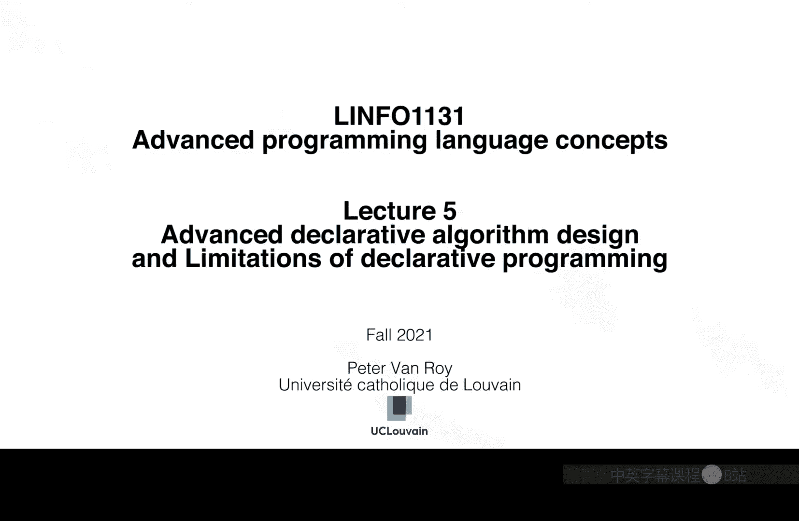
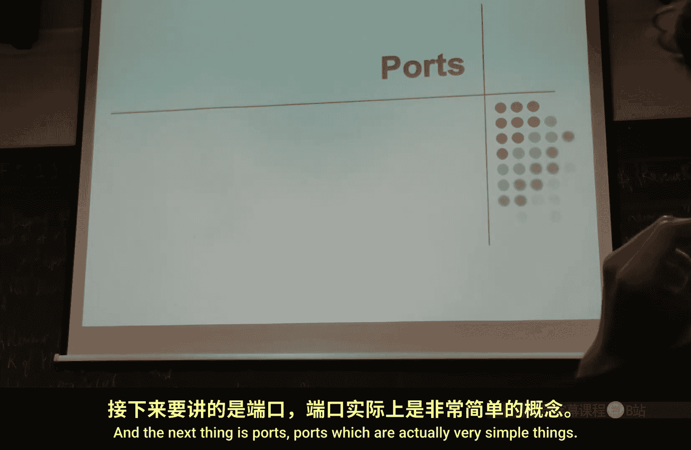

# 高级编程语言概念：5：惰性求值与持久化数据结构





在本节课中，我们将要学习如何利用惰性求值技术，将之前介绍的高效但非持久化的队列数据结构，改造为支持多版本操作的**持久化**数据结构。我们将从分析问题开始，逐步引入惰性求值、银行家方法等技巧，最终实现一个**最坏情况常数时间**的持久化队列。

---

## 回顾：非持久化（瞬时）队列

上一节我们介绍了高效的**瞬时**队列。它的核心思想是使用两个列表 `F`（前端）和 `R`（后端）来表示队列。插入操作在 `R` 列表末尾进行，删除操作从 `F` 列表头部进行。当 `F` 列表为空时，我们会将 `R` 列表**反转**并移动到 `F` 中。这个 `reverse` 操作是昂贵的，但通过**摊还分析**，可以证明每个操作的平均时间是常数。

然而，这个队列设计存在一个问题：它不支持**持久化**。持久化意味着我们可以同时拥有并操作数据结构的多个历史版本。在瞬时队列中，如果从同一个版本进行多次删除操作，每次删除都可能触发一次昂贵的 `reverse` 操作，导致总时间复杂度变为 O(n²)，不再是常数时间。

---

## 迈向持久化：惰性求值的威力

本节中我们来看看如何利用**惰性求值**来解决持久化问题。核心思路是：**提前执行昂贵的操作（如 `reverse`），但以惰性的方式**。

### 问题根源：重复的 `reverse` 操作

假设我们有一个队列版本 `Q26`，它经过了多次插入，`R` 列表很长。如果我们从这个版本派生出多个新版本（例如 `Q27`, `Q28`），每个版本都执行一次删除操作，那么在瞬时队列的实现中，每个删除操作都会独立地触发一次 `reverse` 操作，因为每个版本都“看到” `F` 列表为空。这导致了 O(n²) 的总工作量。

### 解决方案：银行家方法与惰性求值

我们可以采用**银行家方法**进行摊还分析。将每次插入操作视为向“银行”存入一笔钱（一个信用单位）。昂贵的 `reverse` 操作则被视为从银行取钱。我们只在银行有足够存款（即 `R` 列表的长度接近 `F` 列表的长度）时，才“计划”执行 `reverse` 操作。

关键改进在于，我们并不立即执行 `reverse`，而是创建一个**惰性求值**的“承诺”（或称为挂起计算）。这个承诺封装了 `F` 列表与 `reverse(R)` 列表的连接操作。当后续的删除操作需要访问 `F` 列表的元素时，才会逐步**强制求值**这个惰性承诺。

由于这个惰性承诺是在版本分裂**之前**创建的，所有从同一父版本派生的子版本都会**共享**这个承诺的计算结果。因此，昂贵的 `reverse` 操作只会被执行一次，其成本被摊还到创建该承诺之前的多次插入操作中。这样就实现了**摊还常数时间**的持久化队列。

以下是队列数据结构的核心表示和检查函数：

```oz
fun {Check Q}
   case Q of q(F LenF R LenR) then
      if LenR =< LenF then Q
      else q({LazyAppend F {Reverse R}} LenF+LenR nil 0)
      end
   end
end
```

其中，`LazyAppend` 是一个惰性函数，它不会立即连接列表，而是返回一个承诺。

---

## 实现最坏情况常数时间


上一节我们利用惰性求值实现了摊还常数时间的持久化队列。然而，它还不是**最坏情况**常数时间，因为惰性承诺中的 `reverse` 操作本身是**整体性**的：一旦开始求值，就必须计算整个反转后的列表，这需要 O(n) 时间。


本节中我们来看看如何通过一个巧妙的技巧，将 `reverse` 操作变得**增量式**，从而实现最坏情况常数时间。

### 合并 `Append` 与 `Reverse`

问题的症结在于 `LazyAppend F {Reverse R}` 中的 `Reverse`。我们可以创建一个新的函数 `AppRev`，它同时执行**连接**和**反转**两个操作，并且是增量式的。

`AppRev` 函数同时遍历 `F` 列表和 `R` 列表。在每一步中，它从 `F` 中取出一个元素放入结果列表（执行 `Append` 的部分），同时从 `R` 中取出一个元素放入一个累加器（执行 `Reverse` 的部分）。当 `F` 列表遍历完毕时，`R` 列表恰好只剩下一个元素（因为我们在检查条件 `LenR > LenF` 时才调用它），此时将累加器中的反转结果与这最后一个元素组合即可。

```oz
fun {AppRev F R B} % B 是反转结果的累加器
   case F of nil then
      case R of nil then B
      [] Y|R2 then Y|B % 注意：这里是将 Y 添加到 B 的前面
      end
   [] X|F2 then
      case R of nil then nil % 理论上不会发生，因为 LenR > LenF
      [] Y|R2 then
         X|{AppRev F2 R2 Y|B} % 增量式地构建结果和反转结果
      end
   end
end
```

这个 `AppRev` 函数是增量式的：每次递归调用只处理一个元素，是常数时间操作。我们用惰性版本的 `AppRev` 替换掉原来的 `LazyAppend` 和 `Reverse`。

### 最终的持久化队列

将增量式的 `AppRev` 函数以惰性方式集成到检查函数中，我们就得到了最终的、支持持久化、且所有操作都是**最坏情况常数时间**的队列实现。

```oz
fun {Check Q}
   case Q of q(F LenF R LenR) then
      if LenR =< LenF then Q
      else q({LazyAppRev F R nil} LenF+LenR nil 0)
      end
   end
end
```

这个实现虽然代码简短，但融合了惰性求值、摊还分析和增量计算等多个高级概念，展示了声明式编程在实现高效、持久化数据结构方面的强大能力。


---

## 声明式编程的边界与现实世界交互

本节课我们一起学习了如何利用惰性求值构建强大的持久化数据结构。然而，纯粹的声明式编程（如 λ 演算）有其根本性限制：**它无法在计算过程中与外部世界进行交互**。

### 声明式的优势与代价

声明式执行（即 λ 演算的归约）具有**汇合性**：无论以何种顺序求值，最终结果都相同。这带来了巨大的好处：易于推理、调试、测试、优化以及并行/分布式执行，且没有效率损失。

但是，为了获得汇合性，我们必须付出代价：**所有信息都必须预先编码在初始表达式中**。程序在执行过程中（即归约步骤之间）不能接收新的输入（如用户按键）或产生新的输出（如更新屏幕）。因为任何外部交互都会影响归约的顺序或内容，从而破坏汇合性。

### 引入非声明式构造

为了与真实世界交互，我们必须超越纯粹的声明式范式，引入一些**非声明式**（或称为**命令式**）的构造。最重要的两种是：
1.  **可变变量**：我们称之为 **Cell**。它可以被多次赋值，读取时返回最后一次写入的值。这类似于 Java 中的变量，引入了状态和顺序依赖。
2.  **通信通道**：我们称之为 **Port**。它是一个流，可以向其发送消息，并从中按顺序接收消息。这类似于 Erlang 或 Actor 模型中的消息传递。

这两种构造都破坏了汇合性，因为操作的结果 now 依赖于操作发生的具体时间和顺序。

### 实际应用中的平衡

尽管如此，在构建实际系统时，我们仍然可以遵循一个黄金法则：**尽可能使用声明式编程，仅在必要时引入命令式构造**。

例如，在一个客户端-服务器系统中（如亚马逊）：
*   服务器端处理订单逻辑、数据库查询等绝大部分代码都可以是声明式的。
*   只有**接收客户端请求**的那个点——一个从多个客户端并发接收消息的 `Port`——需要是非声明式的。



这样，我们既享受了声明式编程在主体部分带来的所有好处（易于测试、维护、并行化），又通过最小化的命令式接口实现了必要的现实世界交互。

现有的主流语言（如 Java, Erlang）由于其历史原因，往往包含了过多不必要的命令式特性。而现代大规模分布式系统（如云计算框架）由于其复杂性，正被迫更多地采用声明式范式，这代表了未来的发展方向。

---

## 总结


本节课中我们一起学习了：
1.  **惰性求值的高级应用**：通过银行家方法和惰性承诺，将高效的瞬时队列改造为**摊还常数时间**的持久化队列。
2.  **增量计算技巧**：通过合并 `Append` 和 `Reverse` 操作，实现了 `AppRev` 函数，进而构建了**最坏情况常数时间**的持久化队列。这展示了惰性求值实现高效算法的强大能力。
3.  **声明式编程的边界**：纯粹的 λ 演算具有汇合性，但无法与运行时的外部世界交互。
4.  **命令式扩展的必要性**：为了交互，需要引入 `Cell`（可变变量）和 `Port`（通信通道）这两种基本的非声明式构造。
5.  **实践哲学**：在构建系统时，应最大化声明式部分，仅将命令式构造严格限制在必须与外界交互的少数接口上。这是构建健壮、可维护系统的最佳实践。