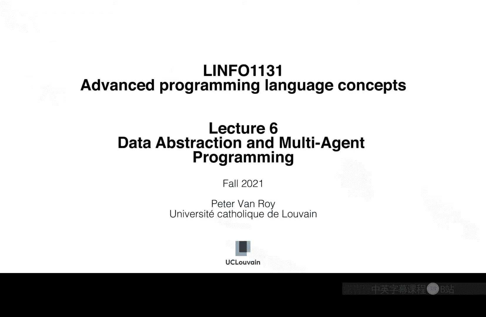
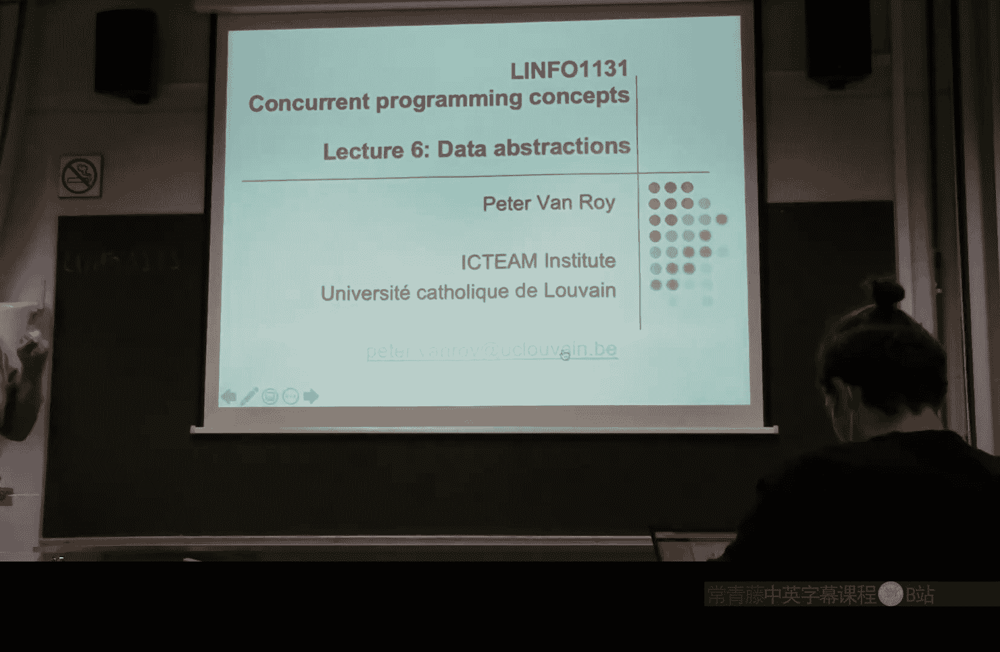

# 鲁汶理工学院【中英⚡高级编程语言概念｜LINFO1131, Advanced programming language concepts】 p21 P21 FO1131 Lecture 6 (2021) -BV1UDffBbEBZ_p21-

to the doors。So next week， I hope is going to be the midterm。ok。

The smart week is when we put all the。Extra stuff。So I should try to do the midterm next week。

Tuesday， Wednesday or Thursday。So， hopefully。We will fix the time。

 so I think there was a possibility of Friday。Right。But if everybody can do it on Friday。

 then we can do on Friday。

So within a couple days， I will fix the time for the midterm， so it'll be sometime next week。嗯。

Today I want to talk about。They get distractionion。This is very important。

 this is kind of refresher from 1104。But since it's so important。

 I think it's important that you really understand it and especially。

There special kinds of abstractions， functional objects。For example。

 and state for abstract data types。Which are kind of exotic。

And also how to build secure abstract data types， so there's abstract data types。There's objects。

But in fact， there's four kinds in all。And there's a couple of exotic ones。

 and that's important to understand because more languages are starting to use these。

And also how do you build a secure abstract data tab so you cannot break the extra。

 so I'm going to explain that。And then the second part。Of course。Today。

Will be on multi agent programming。So this is basically using communication channels。

 so remember we saw these communication channels called ports， we can build them into kind of agents。

Which I call port objects。There's also another kind called active objects that they use classes inside。

And then I want to compare this with the termministic data flow。So you know， in this course。

 it's very important to understand that we started with declarative programming the power of declarative programming。

 and one of the powerful paradigms is determinist and cathedial flow。

So I want to compare it to active values。It's very important to understand how to compare the paradise。

 so I'm going to give you an example。A problem we're going to solve and we're going to compare them。

This is actually a very interesting problem。It's called。F loveavi， Joseph is proud。

And there's actually a guy named Vus Joseph Sis， who was a historian 2000 years ago and he brought some very interesting thingss。

 and so one of the things he wrote is going to be the basis of this interesting example can do that。

Okay。So this we're going to use Flavius' as ideas to compare the termist negative flow and active options。

So you can really understand what they mean because it's very hard really to。Compare them。

 they're very different。But once you can see the same application in both。

 you can actually make connections between them， okay。But first。

 let me talk about data abstraction today。So data abstractions。

So this is very important and I'm going to go farther than I did in 1104 in the previous course。

 I want to go to the more to foundation， so there's two kinds of data abstractions。

 fundamentally different objects and abstract data types。

 so if you remember in the previous course you maybe remember a bit but I will refresh your memory and then we will go a little bit deeper into it。

So each of these two can be declarative， so pure functional or non declarative。

 which means it uses mutable state， so that makes four kinds。Perhaps data abstractions， okay？

So we're going to show how to define all for them。And especially we're going to show lexical or static scope。

 higher order programming， and a new concept。Called an un key。 So in usz， this is called a name。

 This is a constant。That cannot be forged， you cannot fake it。And with this。

 you can build fewer data abstractions。So with these concepts。

 you can actually build all four of them。Okay。So it's important to see how that's done， I think。

 to really understand it。So let me the first data abstraction， so this is a kind of refresher。

So a then abstraction is part of a program。And it has an inside and an outside。

 which is the rest of the program and an interface。 so here's an example。

 so this is this code in here and here。So this code does not have to be together。

It can be in different files spread around， but conceptually it's part of the same abstract。

 okay and the inside is hidden。 You cannot see it from the outside。

And the only way to access this data abstraction is through the interface， so this part here。

 which is a set of operations that you can use according to certain rules， that's the only way taxes。

 you cannot go in and mess around with the code who inside here。Okay。

So this is the portrait because it means you cannot break what it's doing and you can only the accent through the interface。

So the programming language has to support that。And some languages support it better than others。

A language like C or C++ has basically no support。Because you can look inside and do anything you want by doing casting。

So C++ is very bad。But an language start job is much better because you cannot go inside。Look。

Within the language if you go outside of the language and start muing around in the files。

Then you can look at things， but within the program， you could not do that。Okay。

 so that's the abstraction。So we're going to show how to build it。

So I'm going to show use a simple example， a writing example， which is a stack。

Okay so a stack is a nice kind of data structure， so here I'm going to implement the stack of the list。

 so a new stack is empty so that's nil， if I push Sx on the stack S。

 I get x bar S so it's a list and the first element is the top。If I pop the top element。

 then x will be equal to s dot1， which is the top s is a list and the result is s dot 2 remember the lists the left and the right parts are actually tuppled so the number one and two in the fields and finally I can have a check whether the stack is empty is just comparing to them。

So this is a stack。But this one is not encapsulated， okay， it's not protected。

 that means anybody can go inside and look inside here so it's implemented these lists。

So anybody using this stack can muck around with it， I can fake a new stack。

 I can do things with the list， I can reverse the list， which I can't really do in the abstraction。

 okay， so if I use this implementation， I cannot guarantee that it's used correctly。Okay。

 any program can mess around with the。Okay， so that's the reason why we need to protect it。

The internals， so you see this is the basic example。

 so this is not a data abstractioner because it's not protected， it's uncapsulated。Okay。

 so now we want to protect it。We want to make it so you can only access to doing some operations。

So there's two ways， so the same stack we're going to show both ways。

 so it's important to compare the two because they're actually very different and if you do mathematical study in languages you see they are actually quite different。

They're fundamentally different， okay， but you can do the same data abstract。 So the same stack。

 you could make it object or abstract data Okay， so there's two kinds of data abstractions。

Called objects and abstract data types。So an object， there's only one kind of thing。So this groups。

 the value and the operations in a single entity。 so you have one thing and you can send operations and then transform it。

But an abstract at type has two kinds of things。The values and the operations。So if I have integers。

 five and six， and do five plus six， the five。Is just a value and the plus is an operation， Okay。

 but in an object， the find would already have the operations inside of it。

 there would not the other kinds of。テs。So if you use a programming language like small talk。

If you ever used small talk or squeak， if you've heard of squeak。

 which is a modern version of small talk。Everything is an object， even in the integers。

 so if you want to do five plus6， you have to send a plus six message to the object five。Okay。

 and then you get another object， it becomes subject。So you only have objects。But in fact。

 there's two kinds， so typical example in the real world。

 so this is actually something you can see in the real world too。

 like a television set or this computer up。Or a mobile phone， television is maybe be an old example。

 okay？This is an object。Because everything is in one kind of thing。It has the interface。

 buttons and things and controls。But there's only one kind of thing。😔。

But if you have a vending machine， which gives you。Soda or something， Coca Cola。

Then it's an abstract datatype because you have the machine and then you have coins and you have the sort of cans。

 so you have different kinds of things， you have the values which are the coins and the cans and the machines。

 two kinds of things。Okay。So these are naturally different。Okay。You could combine them in weird ways。

 you could have a television set that only works if you put coins inside but you can have like a pure object and a pure abstract date。

Okay。So let me talk first about abstract data types。

So there's a set of values and a set of operations， two kinds of things， so typical example integers。

 one，2，3 and operations plus minus et cetera you know that in a language like Java you actually have numbers as abstract data types but also you have them as objects that's kind of a weird thing for Java you can take numbers and convert them to objects and back to values why does Java do that well because Java is coming from C where the integers are。

The abstractivity typess and the abstract data typess corresponds to。

What the microprocessor is able to do directly。So for efficiency， for simplicity， they add that。

 but since job is an object going to language they also add integers as objects。

 so that shows you a kind of a w thing but you can see that the same kind of data can be both things。

So usually， these two things are constant。So there's no state here， that's the interesting thing。

 there's no state at all here nothing is modified， its purely declarative。

 so these values cannot change two is two。And the operations have no internal memory。

 plus is the same piece of code that won't change。Okay， so so this is all purely declarativeative。

Okay。So let's implement a stack。As an abstract data type。So the values are values of the stacks。

 a particular value of the stack， and the operations we can define these forra New stack pushp is empty。

So an operation will take a stack as an input。And an element and returns a new stack。Okay。

 so a new stack is here a function that returns an empty stack push will take a stack S an element and return another stack。

 pop will take a stack S and unboundunk variable X。

 it will bind x to the top and it will have S2 which is the pop and so on on。

 so then you can do these kinds of operations on and take a new stack and push A I push B。

And the stack S will be B， A and B on top。And if I do pop S X， then X will be the top put。

 it will be B， and the returning stack will be just a here I'm representing them as lists。

So this is the stack as an abstract data type。Okay。

But this implementation we saw before is not their abstraction because it's not protected。

OkayAnd the stack is represented as a list。So we want to protect this。

So this is something I want to especially talk about today is this notion of this protection， okay。

 how can we protect？This and make it a true abstract datatype。

 So the ways we have to predict the values， we have to make sure that nobody can see。

The stack values accept the operations。So how do we do that？ Well， it's。

 we can do a kind of encryption if you want them。 We can take the value。

 We can encrypt it to make some kind of。Box， which is encrypted， and then to unencrypted。

 only these operations will have the key。 will know the key for encrypting and unencryed。

So that's basically the idea。Of a secure abstract in time。

So it will be very close to some kind of an encryption， okay？So we will define two functions。

Wap and unwrap， which you can call them also encrypt and decrypt I say rap because it's at your wrap in。

The value。So wrap is a function given a value return a protected version， wraps version。

 and unwrap will take the protected version return value， so unwrap and wrap are special functions。

And inside wrap and unwrap， there's a secret key， okay， we're to show how to implement these。

 there's a secret key， and so unwrap wrap knows the key so does unwrap。

So the stack operations will know these two functions， but nobody else knows them。

They will be hidden and we will use lexiical scope to make sure that they are only known by the operations in the abstract data type。

 okay so this is you can see it like they're doing encryption and encryption。

 they don't actually have to do that in the language okay， but they could。

If you want the value to be protected even from people to look at the binaries。

 you can actually do an actual encryption， okay？But in fact。

 you don't have to do an actual encryption in the language， you can do something simpler。

 but if you do that that it's not actually protected， the binary then not protected have。

 but from the language viewpoint it looks like encryption and encryption， okay？Now。

 these functions are special。 they know a key。That means each abstract phenotype that we make。

Has to have a different key， of course because if you use the same key for all of them。

 then they're not protected， then you have like public， it's not protected。

 so you have to create a new version of rap gun and rap。For each abstract data type was a new key。

 okay？So that's very important。So we will have a procedure new wrapper。 when you call this。

 it actually defines the two functions because inside of new wrapper， you're going to create。

A secret key。And these two functions will know the secret key。Okay。

 so that's the idea and I will show you how this is implemented in the language so you understand exactly how it works。

Okay。Okay， so what we're going to do here then is called secure encapsulation。So this， the language。

 the programming language has to support it， some languages do not support it like C or C++ or JavaScript。

 which are basically。Messy things， okay， I don't really recommend using them for big applications and there's better languages today like breast。

 for example， Java is also better because it has realcap。So if you are using a language。

 you should ask yourself。Can people break up my applicant my abstraction。

So the language has to support unbreakable abstraction boundaries。

 that means nobody else inside the program can do usual language operations to look inside。Okay。

 in Java， it's impossible to look inside a primitive type， like an integer。

 You cannot see the machine， how the computer is actually representing。So it's completely protected。

But this is not true in C or C++ C++， you can do a cast and you can even look at the stack。

 you can look at everything。You can really， and you can see exactly what's going on in terms of machine instructions。

 so it's not protected， okay， it looks like youre abstraction moved not really abstract。

So this is important， the lab has to support it。But if we want to make abstract data types。

We need a special concept in the language。An unforgeable secret at key， a value。

 which is a value like a constant of one， two， three， but they cannot forge。

 that means if I don't know the value， I cannot create it。Okay， integers， of course。

 are not like thatftA。I can take the integer 25 and any program anywhere can make 25。

 so it's not ungeable。So I need a special kind of constant。That cannot be forged， okay？

So we have to add that constant to the language。Okay。So we're going to add two concepts。

 so first of all， the unfortunate constants and second of all， a box。That you can open with a key。

Which I will call secure records， So there's actually two concepts we add。

 the keys and then the boxes。So this is actually very interesting because many languages do not support this or do not give it to the programmer。

 they might have it internally languages that you build abstract T apps will do this inside。

 but they might not let the programmer look at it so here in this course I want you really to understand。

 so you will see these things we'm going to program thedema。So the unforgeable constants。

 this is a very unusual kind of thing？Most languages that you use will not show them to the programmer。

 they might have it internally if they have some kind of protection or key。

 but the programmer has no way of getting to it that's hidden inside。

But I'm going to show it to you here。And this is a very special， weird kind of thing。So in us。

 this concept is called the name。And there's a function called new name that returns that creates a new fresh。

Name value， so an ungeable constant。So this value end， you cannot print it。You cannot guess it。

If I try to print this， it will just say name， it will not。

 there's no print representation for this string or whatever integer， you can print them up 25，2。

5 print integer and if somebody sees that。You can write the integer 25。

 can print it on a piece of paper。But a name cannot be printed on a piece of paper。

 you can store it in a file， but only as a file that contains language value。

 so a text file cannot store this。Okay， so it's a very special kind of thing。

And then the second one is the box， which is a secure record。 So the way we're going to implement it。

 we need a box that we can。Lock with the key， so the key name will be the key。And the record here。

It's the box， it's actually going to be a record， you know。

 records already let you combine things but with a record you can combine fields together。

But records have lots of values， you can find out， you can print them， you can。

Find out what are the fields of the records， but these records are very limited records。

 There's only one operation。Well， two， you can create them， that's one operation。

 and you can access the field with the dots。That's all you can do， you cannot do aity。

 you cannot find out how many fields there are with which you cannot print them。

You cannot do anything， except that。So it's like a very limited form of record okay and in Oz these are called chunks。

 okay， so Oz has these two concepts that were added so that you can build real secure abstractions okay so in Oz this is called a chunk。

And the idea is you can take any regular record or any record and convert it into this secure record。

 so this chunk is a limited record that you can only do dot。So the dot lets you access。

 but it will not tell you what the fields are， it will not tell you anything。

But you can do C dot something。That's what you can do and that's all you can do， okay？So these are。

 you can see them as a limited form of record， but you can also see them as a box with a lock。

That you can key or a room with a lock come the door okay in order to get in。

 you need to have the key okay so with these two concepts we can build rap and unwrap so the only thing language has to provide is these two okay and then we can make it so that it's provably secure。

So here's one way of defining rap and unwrap， so here this is new wrap era。So first of all。

 we create a new name。 So this is。A key， so I call it key because it's like a secretfo key。

 Not this key is only known inside the scope of this procedure， it's not known outside。

And now I' define two functions。So wrap of X will create a chunk。But it will it will have a record。

 so I use a very simple record here， a W， which is the label key is the field colon X。

 So it's a record with only one field， which is key。

 but you can add more information if you want you can add metadata。

 you can make this more complicated， but this is very simple。 it will only do the record。

 so basically I take X and put it inside a record。And I convert it to a secure record。

 so the only way to access X is to do the chunk dot。Key。

 so the only way to get back the X is to know the key。 So unop will'll just do W dot key。

So W will be one of these chunks， so this is a secure record and the only way to access the element here is to do dot key。

 okay。So I know the key， so this is provably secure， the key is ungeable。

 and it is only known in this part of the code， nobody else knows it because of lexco's scope。どてれ？

So these two functions will know internally the key。

 so you can see the key is actually part of the contextual environment。Of these two functions。

 so you can see this is actually an example of higher order。

So the contextual environment is like a hidden environment inside of a function。

So we're actually using that to store the key and someone who knows rap。Cannot find what the key is。

 It's impossible。 And if you know unrap， you cannot find what the key is either。 It's impossible。

 Okay， so these two functions， they both know the key。 It's shared。

They have this access to the key both of them， but nobody else knows it， okay？Nobody else knows it。

Okay， you can actually make it a little bit more robust。What if somebody makes a mistake？

And tries to access W。A key that does not exist to the wrong or W is the W is the wrong thing。

 It does not have a key。 Well， this will raise an exception。

So I can handle this and make something nice okay so you can make this nice so it does the nice thing it gives you good error messages and stuff if you use it wrong。

 you can assume that people who make mistakes sometimes。So you can do that。

 but it's still completely secure， this exception will not expose the key， the key is not in there。

 the key is never an output tira。I mean， if you made a mistake。

 the programmer has some responsibility， if you output the key as a result of the function。

 that's stupid because now the key is known， but here the key is never output。

And here these are right？Okay， so once we have this。We can actually build a true。

Stack abstract anytime， one that's completely protected and there's no way to break。

 so here is our stack。Our trustee is that， we're going to put it inside a local end。

So I'm going to define two local variables， so the identifiers wrapping un wrap up。

 but they are only known here， nobody else knows them。

So notice the static scope or lexoco is super important here。

 so your language has to support lexicalco， but that's okay。

 most languages today they do support that。It's very important。 So when I do a new stack。

 so nil is my empty stack， but I call wrap of nil， so I'm going to return a protected。뉴스ス大。Now。

 if I want to do a push， I want to push X on the side。Well， how do I do that。

 We first I have to unwrap it。So I call unwrap of W and then I do x bar that。

 so I put x in front and then I wrap it again so basically one of these functions when you come into the function。

 the first thing you do is unwrap。Okay， then you do your operation and before you leave you wrap you put it again。

 so this is very normal like it's like what happens in a bank with a secure box up。

So what happens if I have a secure box I the safe and I'm carrying it around。

Now bring it to the bank， the bank will go to a secure room， so this is like a secure room。

 they will open it with the key， so that's the unwrap。

 they will look at the papers and stuffs inside， they do something， sign the documents。

And then they close it again and again they lock it， so before you leave the room， you call wrap。

 you lock the box again。So this is very much like the way banks and secure organizations handle secure data if I have what's called a diplomatic pouch。

 I want to send secret information to the Belgian consulate in Russia， for example。

 I will do like that， I will have a box or something which is sealed。

And I will only open it locally in a secure place。And then I close it and when the box goes outside。

It' sealed and when it arrives at the other side， they will put it into a secure room again and they will have a shared key and they will open it okay。

 so this behaves in the same way。Okay， but inside your language。

You can see this that it's inspired from real world secreia。But this works very well。

So push and pop also， it will first do unwrap of W， so that's S。X is the top。

 so then it binds x to s do1 so that the top of the stack it's given out that x's not encrypted up。

 and then I wrap s do2， I again lock the rest。Okay， so I always have wraps and unwraps。

 except here is empty， I'm only checking something， I'm not creating a new thing。

 so I only have unwrappped here。I do unwrap W and then I compare it to Neil。So from the outside。

 there's no way to see。That these things， what's inside a stack， no way to see they're hidden。

 so wrapin and wrap are hidden from the rest of the program， okay？So I want to show you this。

 I want to show you some code now。How it works。So it's important to run this stuff and to see how it works。

So for example。Okay， here I do a browse of 25。And I see the 25th year， okay？

But let me show you how names work now。So I create and end everything in a variable new name。

So this is an unforgeable constant。Okay so what happens if you browse it？You try to show it。Well。

 the browser knows that it's a name。But there's no print value， it will just say this is an name n。

Okay。And so this has no， no。Prince value。They not printed。If I cr now another one。And two。

 for example， this is another name。Hey by the browses。I see。It's a name。

 so N and N2 are two secret keys， they unforigible constant。So I can do some， I can prepare them。

That's what I can do to them I and see， are they the same？No。False。Is n equal to N。That sorry。True。

 okay， so I can compare them and this I can see they're different or not different。

But I cannot actually look at them。So this how do I do this， how does the language do this。

 Well it doesn't， it's part of the language semantics， okay， that this does not have a print name。

So when I in the language semantics， remember I sometimes use these Greek letters for the constants。

 so when I create a cell， for example， the name of the cell will also be a name。

 that's a semantic thing。They exist in the semantics。But they don't have any print values。

 They don't have， there's no way to bring the value outside， okay， and there's no way to forge it。

 If I don't know the value， there's no way to create it。

So the only way to get the value is if somebody gives it to me， okay？So I can do a new wrap。Ofで that。

So I will first create a new name， okay。まあ地う。🤧So， let me you。Some value X， so here I will do。

 so I will some record。Does that the field name would be the key。

So here I have a record I just create some record but the interesting thing is the name of the field is key。

 so records are allowed to have these funny constants that can be the names of fields of records。

And junk will convert this record into a limited record which I call secure record。

 and the only thing you can do with one of these chunks is do dot。Opers okay。So here I the thatW do。

Okay so that's it， so this is actually very simpler once you have the names and limited records。

Then you could build this rap around。 So how come it works。 Well。

 this is the language semantics again， that the language is designed。The chunks do not have。

Almost any operation is part of the language design。え？So now I can create a pair of these。

And now I create them， so I call them a wrappper now。So these are functions。If I呢。This is AW and X。

It' say x is equal to 3023。Okay。Brows eggs。The browses 23。But now let's say w is equal to RA。Of eggs。

It browse。じブ言。It will tell me it's a chunk， so the browser knows the title。

But it will not do anything that the language doesn't let me so the language can tell me what is the type so the browser knows that it's a chunk which is a limited record and so it's a record。

 so it says that it's like a record there might be stuff inside。So it's telling me that。

 but I don't know what's inside， Okay， so I have no idea what's in there in this W could be anything in there。

Okay。The only way to find out is to do unra。Now then I get 23 again。But if I don't know I'mrapped。

There's no way I can do the。To find out， I cannot find out what's inside。对。

So that's actually a very important thing。Let me。Maybe it okay。 So that's good。

Let me go back to the slides now。Okay， so this shows you then how to build。

Secure abstract data types using secure keys and boxes。Like that you can lock the secure records。

So if your language does not support those things。Then you cannot implement。

What I'm showing you here。So there are many languages that do support abstract data types。

 but they do not show this what I'm showing you here to the programmer。

 so all of the internal mechanism that I'm showing you here is hidden okay but that's not good enough for this course in the course I want you to understand how these things can actually work so it actually needs new language concept。

Okay， so let me make another comment， so new name returns a fresh new name。Each time you call it。

 it returns a new， different name。So it's not declarative， okay。

 it's not a declarative function because if you call it twice， if it would be declarative。

 you call the same function twice， it returns the same thing。

But here each hand color it re something new， it flew fresh made。

 but you can still use it to build declarative。They have abstractions， okay， so here， this thing。

 the stack here is declared it。And the reason is that all you have here is constants。

 there's no beautiful state。And the key， it's only when you create the data abstraction that you create a new key。

 while it's running， you don't have to create new keys， okay？Of course。

 you can use names in very clever ways， you can actually build secure protocols by creating new names on the fly。

 while the program's running。So in a networking protocol， this is sometimes called aN。

 a NS is like a new fresh key that you create just once。But here you're using the same key。

Once the obstruction is done， you always have the same key in here。Okay。

 so it's still completely declarative。 Okay， let me make some remark now on abstract phenotypetypes。

 So this what I'm telling you is not new。 it's actually very old。

So there are languages that are not object oriented， but are abstract dayotype languages， okay？

And the first one is called clue， probably nobody has remembered， remembers it。

 So this was developed by Barbaraliov。So Barpo Lisov was one of the founders of data abstraction the substitution principle is sometimes called the listsC substitution principle。

 object order languages， remember that if a function takes an object。

 it also has to work with the subclasses。That object。

 that principle is very important and that web principle was discovered also by Barbars。

And she also won the Tum Award， which is the Nobel Prize for computer scientists okay so the first languages using abstract data types was developed in 1974。

 that's long time government on， the early days of computers。

 actually it's only a little bit later than the first object oriented language which is similar 67。

 so objects and classes comes from S， okay。And then later on came to small talk and C++ and tell。

 but these languages were the first okay。Cllue and similar。

So this clue language let you build new abstract data types。

 the same way Java lets you define classes and clue you can define new abstract data types， okay？

And in fact。If you look at Java， Java is not a pure object or the languages， a Java integer。

 Java objects are also partly abstract data types。Wwhich is very weird actually people sometimes don't know it So two Java objects that inherit from the same class that can look inside each other's attributes that's kind of weird for objectsNormally you nobody can look inside。

 but if they have the same pair class they can do it that's kind of like an abstract data type So Java objects are actually mixing。

Abstract data type objects okay， so the abstract data type concepts。It's not disappears， okay。

 it's very strong in alive today， and usually people talk about object oriented languages。

 but in fact， object oriented languages are just as much abstract data type languages only it's not mediaized so a better thing would be to say that they're data abstraction languages okay so programming languages today。

 they learn from these。Ancestors so that you can use them to build data abstractions。

 So instead of calling them object or the language。

 you should probably call them data abstraction languages because they also support abstract data type even if they don't say it。

Okay， so that's a fonder mark， so abstract data types。

 it's not like a contest where it was eight abstract data typess fighting against objects and one of them one。

 no， they in both are fundamentally useful and today's languages are using boths。He。Okay。

 so that gives you， I hope， a good idea of abstract data types and how to build them and how what they mean actually fundamentally。

 okay。Okay， now I want to say a few word on objects， but you know objects already。

 and maybe that can go faster here， okay？So objects， a single object represents both to value。

So there's not like one plus one equal2， no， the one is an object and the plus is part of that。So。

 instead。You can say S pushback。Or S top x， so you give it the operation。

 so there's only one thing actually， which is S。It's not like you have operations， push pop。

 push your function， so the way you find them before， if you look here。

Push is a function that takes a stag and returns the stack。

So the push and the stack are different here， there's only one thing S。

 and you can tell it to do a push and the push happens internally， okay。

 so the stack value is stored inside the object。Okay， so that's a basic idea。

 but I do want to give you the cementman tipss of it very quickly to refresh your memory。Okay。

So if you want to define。An object semantically， most languages they give you syntax for that。

 that you can define a class and methods and do new objects and then out。

 but that's not telling you what it means， that's your syntax。

So you have to define it in terms of the primitive operations。

 so here is the definition of a static object， okay？

So this function new stack will return a stack object so an object is represented here semantically as a one argument procedure。

The argument is usually called the message you have the funny terminology of object languages。

 M is the message， and these three operations。Which are the case。 So depending on the value。

 the message， push X， popex is empty。 I do a different operation。

 So these operations are usually called methods。So of course。

 the object ored community has to define its own words for these things。

 but the operations are called methods and the actual argument here is called a message to the object。

So this object has a state inside， so you see it has a cell which you can update and the push operation。

 so this is actually usually called an attribute in an object go into language。

 so the attribute would be the internal value of the stack。If you push X。

 C will get x bar previous value， so this is the previous value but the axis of the C x bar and this colon equal is an assignment。

So here I'm actually updating the state， okay？So each call to a new stack would create a new stack object。

 so you can see there's only one thing here， these one are procedures and the operations are inside them。

So here you've combined the value of the operation， so the value in here this n thing。

 and these three operations are combined together。So the object is a one argument procedure。

And here it's doing what's called procedure dispatching。

 so there's something that object orientedated which is do， which is called dispatching。

 which is when you send a message to an object， it chooses the method。

So there's many ways to do this here it's a case statement， but you can also look at the types。

 you can have messages that have integer arguments or real number arguments or whatever。

 and then it will choose the method so there's different ways of choosing the method。

And the the hiddenness， the protection， so the internal value again is protected here。

 yeah question why not the re the？A record。Yes， we can return a recall you can return a record Yeah。

 that's another way of doing it yeah， so that's called record scratching。

 so you can here I represent the object as a one argument procedure。

 but you can also represent the object as a record。

And each field of the record is one of the operations， okay that's another way， it's just as good。

So there's different ways， but the point is you have to combine them all into one thing here。

 so here I combine it into a procedure， but you could combine it into a record。

So I'm not going to show you that， but it's in the in the book and maybe I think he saw in the previous。

Previous course， okay。So here we do not need these secret keys。

So maybe you can see it's a little bit simpler， but you do need cells here， okay， using cells。Okay。

 here it's nice to compare them。So here here is I think this is going to the question year。

 so here is the same stack as an abstract data type and as an object。

So this is the code I showed before with the wrap and the wrap。Here I have a cell， here。

 instead of a procedure， I return all the operations grouped together into a record。Okayケ。

So this is another way to represent an object。It's different and the interesting thing is now you can actually see what are the methods。

 okay？So you can see。That it's the same stack。But here everything is together。

 there's one thing and here you have separate， I have the push and the pop and is empty are separate from the stack values。

 you give W to a push and returns to new W。So in fact， any data abstraction can be one or the other。

 there's no limitations like that。Okay。Okay， so。Maybe some historical comment again。

So remember I mentioned S 67， actually if you want to look at S， it's actually amazing。

 you look at it， it looks very modern， okay， it's like not so much was invented since then。It looks。

 the syntax looks really modern if you look at S 67。And after it came a language called small talk。

Which was over 10 years， starting in '71 and C++。And those two languages were influencing all of the big modern。

Abjectored language， Javava Sihar， Python， Ruee so。

So all of these modern languages actually it's better to call them data abstraction languages because they have both objects and abstract phenotype types in there。

 okay？🤧。Okay， now I want to say a few words on the fact that there's four kinds of data abstraction。

 and I want to show you especially functional objects。They're a very special kind of objects。

 and they start to be very useful in cloud analytics。

 so this is not just theory it's actually used in modern systems。But let me make a small break now。

 and then I'll show you the weird and exotic that Jack， what I showed you now was the normal ones。

 okay， but there's some weird ones that are not so much used。But this is interesting to see them。

 So I showed them to after the break， so it makes more break。

So let me finish now the extraction from here to multi agents。So so far， we've seen these two。

After data attacks， which are declarative and objects that have cells inside their non declarative。

 this is the most common one。But there's two other ones that are kind of weirdered。

While weird because languages don't really use them， but it's interesting to check them out。

 you can have abstract data types， you have state inside or you can have pure functional objects。

So those actually very interesting pure functional object。So that makes four in our bottom。

So if you make a graph， so here on the horizontal you can see whether the things are grouped together。

 which I called bundling or whether sorry， when they're grouped together objects and when they separate the abstract data。

 and here's whether they have no state， but no cells or cells inside。

So you have these four different kinds。So this one is like Java integers。

 this one is like Java objects， but here these functional objects are funny。

 now used to be that nobody used them， so this is exactly like Java objects， but there's no。

 you cannot update them。It's weird， so I will show you how these guys work。 So in tomorrow。

Big data analytics tools， these are actually used， and the reason why they're used is because they're transmitted around the network。

And so it's very hard to update an object when you transmit it because everybody has to see the updates。

Okay but if it's a functional object， then it's like a constant， it's not changing。

 so you can very easily copy it from one computing node to the other。

 so on a big cloud analytics tool where you have hundreds of machines connected together。

 regular objects are actually complicated to do because if you update them。

 everybody has to see the update for consistency but if it's a functional object。

 you can just copy them。Around， and they can be pipelined。Around so these。

 and this is called fluence。 So actually the scholar language actually supports this in the syntax。

But these are used to be very weird they abstraction， but it's nice in this course we see。

 I'm showing you the whole spectrum。And it used to be years ago， let's say， 10 years ago。

 that this was not used。But now。In 20202021， you can see that this actually is coming up as a really interesting new kind of big abstract。

So if you use the cloud tools， so you you take the cloud computing course， actually。

 even though you're not talking about it so much， these platforms are starting to use this thing inside them。

 okay， things like Apache Blink and soa。Okay对。So functional objects。So they like objects。

 but the pure functional there's no cell inside， there's also stateful abstract datatype。

 but let me just focus on the functional object， okay。So this one is。

 this is now the same stack as we said before， but implemented as a functional object。

So this is actually， the code looks very simple， but it's actually very interesting。

Here I have a function called stack object。Okay， so this stack object function here。

So the end of this here is this thing。And internally， it has the operations， so it returns a stack。

 so it's like an objectta， it's a stack with several operations， push P is empty。

But when I do an operation， when I do push， for example。I don't update the cell。

 I create a new stack object。So I give a stack object。So I have a stacked object here。

 which has nailil inside if I now do a push。On this， it's going to return a new stack object。

 so the original stack object does not change。So this is actually very。

 very interesting and very kind of strange。When you update an object。

 usually the object is changing here the objects do not change， but when you update an object。

 you create a new object， so push will call stack object to create a new object with a new stack inside。

Or pop we call stack object with the pop stack inside， okay so whenever I do a push or pop。

 I'm creating a new stack object okay， the interesting thing also about this is that it's in the language it's very simple。

 I don't need cells and I don't need the secure reckon。So in the previous one。

 abstract and type and regular objects。I needed new extra language concepts。

 I needed cells to do objects。And I needed names and secure wrappers to do the abstract data type。

But this one does not need any of that it's just a pure higher order program with static or lexicalcoing。

 okay that's all it is。It doesn't need any other language mechanism。

 so in some sense functional objects are the simplest data abstraction。

It's kind of funny because for many years， no languages were using this。

But now this is starting to become used， okay？So I'm not going to say so much more about this。

But if you use cloud tools， you should be conscious that these functional objects are going to be inside that。

So there is a recent language called Sca。Which has a pcyclch evolution of Java。

 it has both functions and objects。But we can define an immutable object that returns another immutable object。

 so these are exactly， so what a Java is called an immutable object is exactly the function object I showed you。

Okay。嗯。So in Java， you can define immutable objects which are exactly functional objects。

And the scholara notation is sometimes used for。Big data analytics tools。

 So this is a moderate trend to going toward functional objects， okay。

So that's something I wanted to mention to you so that later on you won't be surprised when you see these kind of weird objects。

 these functional objects。The other one， the fourth one， is a stateful abstract data。

This is another weird one because it's an abstract data attack， but it's not a constant。

That means it's a box with a value and if I do push， I change the value inside。

 but the push and the value are still separate， so I do push of a stack。

I unwrap it and I change it internally because internally there's a cell。So it's very funny。

 there's a it's a wrapped cell in the st cell， so when I create a new stack。

 I have a wrap of new cell。Butm来 do push。It's not a function。

 it's a procedure because I push an element on the stack， so E is a new element on the stack。

 S is therup stack， I get the unrad， put C a cell inside。

 then I update the cell so the abstract data type values are not constants。

 I'm updating them inside the abstract data type。So this is also a data abstraction。

It's called a stateful abstract data type， so it's using both a secure wrapper and a cell。Okay。

 notice that I'm almost never using rap， or it's always doing unrap。

The wrap I needed to create a new stack， but push and pop， they don't need to do rap anymore。

Because they are modifying the cell inside so they don't have to create a new value。

 so they don't need to call RA， okay so the wrap is only grown in the when I create this stuff。

So that's an unusual kind of theta abstraction。But this one is actually not really so much used today。

 maybe someday， okay， you can program with these time。

 So sometimes people programming C using these kinds of things。

But this one is actually less still kind of an orphan，🤧So this fourth one is still kind of an orphan。

 but the third one， the functional objects which used to be an orphan is now actually really used。

 so who knows maybe in 10 years these will be used too okay so let me finish on data abstraction。

Just to summarize， so there's four kinds， two axes， so there's objects versus abstract data types。

 and each one can be either declarative or non declarative。We show you the semantics of them。

 so the code I'm showing you is defining them in terms of primitive。

So actually I you that gives you this actual semantic something。

Because you know the semantics of the prims。So we showed how theyre built。

 studies still in high order。For abstract data types， you also need these unflgeible keys。

And you need these secure boxes， but the unforgeable constants are very important。

And then the fourth one， so there's three of them that are used a lot。

 but though there's a fourth one that's not really used。So that's all I want to say on。

Data abstraction。 So that's important because I want you to understand。The secure part。

 the special intent。Okay， so now I want to。Go to the next part of the course。

So the next part of the course we're going to talk about multiage programming。

 so in this course we're going to talk to you about agents that send messages and at the end of the course we're going to talk about shared state concurrency and things like monitors and transactions。

So those are the two big paradigms for concurrent programming。Okay。

So now I want to talk to you about multi agent， so this is used a lot。

And there's an industrial language that uses this， which is called airline。

 so we're going to talk a lot about airline later on， but first I want to show you how to do this。

 I want to show you really what it's about。So I going to compare this with the dataphone that we did before。

Okay， so we're going to see a bunch of stuff here。This is called multiagent programming。

 it does message passing， it's based on ports， remember ports is a kind of communication channel you can useend and you can read the port。

 remember we saw you can use a client server with ports。

 but with a port you can actually build an agent which is kind of like an object but you send message。

And this is called a court object。And you could have all kinds of message protocols with this。

 we saw some of this we saw last in the 11 zero3 or the previous course， okay。

 you can define message protocols。But now I want to show you some new stuff。I want to show you。

First of all， I want to compare。I want to compare multiagent with the deterministic data flow so at this I'm going to show you this kind of very nice problem called Fls Josephus's problem and we're going to write programs both using active objects and deterministic data flow so active objects or like pork objects except they're defined using classes。

There's like real object oriented objects inside， but in fact it's very similar。

 it's like an agent that receives messages。And then finally。

 I'm going to show you how to write big programs。So if I have hundreds。

 dozens or hundreds of agents talking to each other， how do you organize that。

 it's extremely concurrent， they're all sending messages to each other so you have to kind of do it in a smart way otherwise it gets really messy so I'm going to show you how to do that and then I'm going to show you a bigger complicated example called the lift control system so lift or elevator so like when you go into a big hotel you can have many elevator shafts going up and down。

 you can have 20 floors and people pressing buttons all the time。

Anybody can press the button any time can go from any floor to any of the lifts are always going up and down。

 so this is a large multi agent system， okay， so we're going to show you how to program this。

Realistic kind of system and real in hotels are doing something similar， okay？

So that's going to be a bigger example， but we won't be able to move today。

 but hopefully today I can talk about Flemus Traus。

So the first thing is I want to refresh you on port objects。

So it's basically an agent and you send a message and it has an internal state。

So we saw already a little bit time to do this， so there's an agent and it's a concurrent thing and it has an internal memory of the state so it starts with an initialized state and whenever I receive a message I do a state transition so this is actually semantically what it's doing okay whenever I receive a message so M1 is a message。

There is a function which takes the original state as the。

And updates it and turns it into a new state。 and it keeps going。 So internally。

 it's a sequence of state update。 So you can see that internally it's actually sequential I can send messages to this and the state will be updated。

So with each message received， the state will be updated and there's a function which defines it called the state transition function。

 so it takes the state and the message and it returns the new state。

So the whole behavior of this thing is defined by it。Yes。So you can grade these pretty easily。

So here is a generic function， a generic function to create these port objects。

So here I have newport object， it has an initial state， an emphasis state transition function。

Internally， it has this loop。And the loop will take a stream because in fact there's a port here。

 so all the messages will arrive on the stream of this port。And whenever I get a message， M。

It will do F of state M， so this is the state transition。

 and then it does a recursive call and it waits for the next message。

So this is actually the internal behaviorards this lupa。So the actual port object is a thread。

 so I create a new thread here in this thread I have a port。P， okay。

 and I can send messages to this porter and they will appear on the stream。Whenever I send。

 and then I have this loop that will update the internal state。

 so it starts within it state starts within it， and each time I receive a message， it will update it。

Okay。So that's a stateful port object。So this is the function。But I want to do a little bit of。

Thinking before we start programming with this， I want to reflect a little bit on this code So this code is just doing this okay。

So this is like mathematical definition。And here we have the codeVD that implements that definition。

But this code is kind of， it should be kind of familiar。This code， actually。

If you look at the loop function， structure of the loop。

It's actually a function that we know in the some sense， okay， you start from an initial state。

You apply F。To the previous state and a message to go to the next state， and F is a binary operation。

 So it's like your。Accumulating these binary operations， Okay。

 so this function is actually something we know。This is actually an important function。

It's not just some random function。 It turns out this is an important function， okay。

 this function is something we know and you should。If you。Do functional programming。

 You should see that this is something that you know of。So this is actually a fold。

Remember this fold operation， fold is a funny operation that takes a list。

It ab me and it folds everything down to one value。O。This is actually doing the same thing it takes。

 so instead of a list， you have a stream of messages。But it doesn't end。

 so it's like a full operation that never ends， okay？

And each time it it adds in the news message into the state using the state transition function。

 which is binary。Okay。So it looks like this， so remember the fold。So this is fault。

It takes a list which I called S here， binary function f and U， which is an accumulator。

 so the U starts out to be some kind of a unit and each time I bring in an element of the list like a0。

 I update it with f， so I have U F a0， so the f could be a plus。And this could be an integer。

 so I'm suming things。So zero plus a0， and then plus a1 plus a2。

 So each time I bring in new elements， I'm folding them in。That's why it's called folder。

And folding them into the accumulator。 So this is exactly the same function as the port object。

So this loop， so this is the heart of the port object said I have a thread， I have a port。

 and I have this loop。But I can replace it。I have a thread， I have a port。

This loop is actually a fold。And that is an argument okay。So this is， I can replace it。 Actually。

 it's not exactly， there's a small bug here。So you see what is the small bugger， right？Yes。

 what is it？I mean， it's almost right that， but fold is a function and loop is a procedure。

 fold actually returns of value。Because normally the fold works on a list and when you finish the list。

 it has calculated full value， okay？So actually the you have to。

There's some you return some value again。So， this。We could define the newport object like this。

 so we don't actually have to define the loop， we can just use for。

 so it's like one line definition here。Of the newport object。So you can see I'm combining a thread。

 a port， and a fold。Together they make a part object。

 you can see it's interesting to see how you can combine these powerful concepts to build new things。

This out， I put it here because the fold has an output。

 but it actually means something for port objects too。Assume that the port object。It could terminate。

 so in the streams here the stream will never terminate it， there's never mill。

 but I could have a version of a stream where it terminates， so it's like I'm closing the stream。

And out would be the final state of the port object when the agent terminates。

 so actually the out actually has even a meaning there。

Even though I didn't originally think of it like that。

 you have to put it here because this school is a function。

 but it actually has interesting meaning you see， so it actually does something nice in terms of court objects。

So this product will never terminate done。This fold will never reach Na because the stream never terminates。

 but maybe in some other。Design it might， so if the stream terminates with new。

 then the port object itself will also terminate。So that's a reasonable way of closing the system。

 Okay， so the al action also means something， So this is actually a nice definition of。Poort object。

 I'm going to use it。 We're going to use it now。 So this is a little bit of a refresher。

 because we saw。Some of this yeah question。 Let's imagine。

The stream can close and then we want to have an access to out could we imagine new buttonject including P and out so we can access it or yeah want to if you assume this closes。

 then you might want to get access to the final state。

But this function actually returns the port itself， so you need a second output。

 in fact it could be another output here so if you want to access the terminal state。

 you would actually need a second output。So you would need to change it。

 but it's very logical actually， it would be very nice thing。

 the second output would give you the terminal， the state when it terminates。So when it closes。

 so that would be very nice， it manages very nicely in fact because sometimes you want to close。

 you want to terminate。 So a thread is actually overhead。 it has stayed it's using memory and CPU。

 So when the stream terminates， everything will terminate very nicely the thread terminate。

 So the fold finishes。 So you go to the end。 the thread will terminate。 So the memory recovered。

 So the only thing that's left is the outcome。So yeah， so that would be a very nice thing。

 so right now I'm not worrying about the I'm assuming these poor objects they live forever。

 but they might terminate。To to good way about the massage day so the other question is you might want to have multiple input cus high priority low priority actually actually I don't know why if we ask this on purpose because airline does something like that。

So has， Ireland is a industrial languageist based on these ages。Which in early are called processes。

 but they have a single thread inside and they accept messages。

But they're slightly different from port objects because the messages are。

Put in a mailbox and you take them out using pattern matching so you can actually have high priority messages that bypass the others。

So it's a little bit more sophisticated than a important object。So yeah。

 so we get back to that when we talk about Earlga。Yeah。

 so this is the simplest form of agenta where the messages are treated in the order they arrive。

They're treated one by one， but maybe you want some messages to be treated before the others。

 for some reason they have high priority messages， okay， so this will not let you do that。

But in an airline agent， you can do that but we talk about that later。

 So this is the simplest form of agent。It's very simple， but of course in a realistic language。

 you might want something a little bit more sophisticatedh？So this one is okay for many things。

 but sometimes you want more you might want to have certain messages that are like management messages that come in and that have priority over all the other messages to do things like maybe you want to change something in the port object or close it or whatever。

 so this will not let you do that。This is like a very simple form of agent。Okay。

Is that kind of the answer so but in later in the course we will talk about airline。

 which is a agent language and the airline agents are like port objects。

 but they're a little bit more sophisticated actually okay so they have a little bit more functionality because the airline is very practical language。

So it's very interesting then to compare the airline agents with these one， these are very simple。

 you can define it in one line。The airline you can define in one line， it's more complicated。

 but for programming， it's very nice the airline。Agents and we'll see it later in the coursea。

So this is just the first version， now。Hope we get it so remember now let me give a refresher。

 remember we did message protocols， so this is not new if you remember because 1104。

 which probably most of you took。So we saw port objects and we saw message protocols using them okay。

 so message protocol is a sequence of messages between two or more port objects。

 but that together it has a meaning it has a higher level meaning than just the individual messages。

 for example， it could be a。Ascend and return from client server so you have two messages。

 but actually it's one request okay or you can have multiple messages going back and forth that actually our one thing in higher level language。

 So remember I just want to show you this picture what we saw in the previous course refresh little your memory so we saw RMI。

 so this is just send and return you saw asynchronous RMI。

 remember when you send two messages and you wait for two results to come back。And they can overlap。

Okay， we saw ourI with callback， this is when you send a message。

 but the server needs to get some information from the client before calculating it answer so inside this message there's a small return。

Request here， which is the callback。To the clients。嗯。

And there's different ways that you can do this so you can do it with thread super continuation。

 and here is the complicated one we saw， the most complicated one where it's the asynchronous RMI where you can have two overlapping ones。

But they're both doing callbacks。So there's lots of things going on。

 but conceptually it's a very simple thing， okay？That conceptually an asynchronous RMI with callback is just a client asking the server for something that's all it is。

 but sometimes that requires multiple messages， okay so these multiple messages actually have a higher level meaning okay。

So I'm not going to go more into that here， this is something we saw in previous course。

So I don't expect you to remember all the details， but I expect you to remember the idea of what we were trying to do was to show how to do different kinds。

Message protocol。 So you remember a little bit we did in the previous course you so many people took here 1104。

 right。Most of you， anybody did not take it。That's good okay。So most people， but even if you did not。

 it's not so important， but it will help you understand the rest。

So now I want to talk about flaviious problem。So this is a really neat thing， actually。

Which I like a lot， because I like a lot historical stories。 Okay， so this is a historical thing。

 You can actually look up the sky。 You have wrote many。Okay。So he was a Roman historian。

But this was during the time when Rome invaded Palestine and so he was actually Jewish and so was it was a big war and it was not very nice。

 okay， there was wars going on。So butze Josephs was actually a smart guy， so he was in a cave。

Surrounded by Roman soldiers together with his fellow soldiers defending so his name and the Romans were attacking。

 somehow he survived and he became a Roman citizen and he wrote memoirs and he became like a nice smart patrician。

 so he made a good career in Rome， okay so the guy was very smart， he didn't die。

 but the anecdote is here and he wrote this up in one of his doctrine。

So he was in a came of fellow soldiers， and there were 40 men。And they were lost。

It was over for them， so they decided to honorably they would not be killed by the Romans。

 they would commit suicide， so this would impress the Romans。

 so they were sitting standing in a ring。So the idea was that they would count every third man， one。

 two， three， and that guy commits suicide， one， two， three， and keep going。Until nobody's left。Okay。

 so Josephus was one of these guys。He didn't really want to commit suicide， okay。

 so somehow he managed to place himself in the position of the last survivor。

So he was the only one left at the end， okay， so that was very smart。

 so he had to figure it out and of course while they were doing it。

 I'm sure he was very meticulous and were not making mistakes。

So that it would come up to him at the end。So he was the last survivor and he did not commit suicide。

 obviously， and he survived and he became a Roman famous Roman still in。

 he's grown as memoirs and those memoirs are still existing today and you can read them so the guy made a good pur okay but there's an interesting problem hereh。

What is the position of the last survivor。So we can actually make an interesting problem from this。

あます。So you have any soldiers。And K is the number of steps you count。

 So here I have 40 soldiers and you count three。But you could do it for N and K。

So you can actually define a program。That solves this problem for any K and N K and tells you what is the position of the last survivor。

 Of course， Joseph just didn't have that ability， but now we can do that and you can even do it for thousands of soldiers in very complicated cases。

So it's actually a very interesting function and mathematicians have studied this and so on。

 but let's just look at this program。So we're going to make a protocol。

 a message protocol to solve this problem。So there's a message circulating around the ring。

So here is the message， it's kill message with two arguments。

 X and S X counts the number of live objects that are traverse。

And S is the total number of life objects remaining。So if you start by passing kill1N。

To the first object， So the first object that you traverse one， okay。

 and so you are one first live object and there are still n objects alive。

And then when an object receives kill XS， it follows a set of rules。Okay。

 so if it's alive and S is equal to1， Yes， we're done。 It is the last survivor， okay。If it is alive。

An x mod k is equal to zero， so it's a multiple of k， so for Joseph's case， one， two， three。

 poor guy who receives that message， okay， it becomes dead。Okay。

 and it sends kill x plus one to S minus1 to the next object。

So it has one traversed one live object because you have to keep counting them。

 but there's one less object at， so S minus1， so the message circulates。

So if it is alive and x mod pay is different from zero， then it doesn't have to commit suicide。

 but it did traverse one live object so it sends kill x plus1 S and not S minus1 but S to the next object so you see this message is circulating。

Now， if the object is dead， then it just forwards to access to the next object。So if it's dead。

 it's like the zombie okay， it has to still do somethinghu？We received the message and as forward it。

 so we have this topology of and objects。Okay。Now I want to show you a。

The Terministic Data flow program for this。And I want to show you an active object protocol for this。

So I'm going to show you two pieces of code。Okay。So we're going to show two implementations of this。

So an active object， which is like a port object， except it's defined using a class。

 and each method is the message， so there will be a pill method so each soldier would be an active object。

Okay there's a class， which Ill call victim， it defines a kill method that implements the Josephus protocol depending on the position of the object。

 okay。And there's an initialization， of course， that builds the ring initially， okay。

Now I'm going to do a deterministic data flow implementation again。

So here each soldier is what we call a stream object。

 so it's basically receiving a stream and sending a stream like we saw for hammerming and for the other things。

It receives a stream and it sends a stream。And the function， the victim is a function。

 it's not class， it reads a stream of kill messages and it outputs a new stream。

 so it's reading these kill messages and depending on which soldier it is。

 it outputs other kill messages okay and you have to build a ring of these， of course。

Which are connected in a ring， and then the killer message will circulate in both cases。Okay。

 so you can actually build this in both。In both these two。

Kinds of paradigms notice these very different paradigms。They're very different。

But I want to show you how the code for them。But we won't have time today to show all the code。

 but let me show you first this code here。The active object because it's very intuitive， okay。

 this one is very intuitive and you can see how it works and then next time we'll see this code。

It's actually interesting because they both do exactly the same， but the code looks very different。

 but actually if you think a little bit， it's not that different。

There is a correspondence between these two very different paradigms。

And another interesting thing is that the deterministic data flow code is much shorter。

 it's only half the size， so this is actually a very compact。Code here， Okay。

 so let me show you today。 I just want to show you this active object in implementation。

 So you get the the protocol that you're getting and what it is。 So let me go to the。

Here is going to be flame in。So first we need to define active objects。

 so they're very similar to port objects。Except it's defined using a class。

 so it's like real object oriented programming， so I'm not going to explain too much nerves。

 but you will see that when we do the。Okay，So this is the class implementing。

So inside the active object， I will have an object of this。Plus。And it has some attributes already。

 so some things it knows from the beginning， so it starts。

 there's an alive which is a booleion that starts being true。There is the step。

 so this is how many you go before committing suicide which is K， there is a global variable last。

 which is the L here。Okay， and then there is。Okay， the identity of the object。

 so the number of the soldier。Okay。So here this method is a set successor。

 we need this when we build the ring， so we're going to build a ring of these 40 or whatever them。

 but here' is the k method， which I show you now， so kill XS。

 So now this if statements here is just a protocol I'd be fine。So if the object is alive。

Is that a purpose？That's great。是。え？So somewhere okay so if the object is alive， if it's not alive。

 then I just send kill X to the successor， so this successor attribute is pointing to the next object in the room okay so if the object is dead。

 I'm just forward the your message， but if it's alive， if S is equal to one， then I've done one。

And last here is actually a global variable， L， which is going to be bound to the last survivor。

 and the last survivor is me the identity， so I bind L to this so the global variable will be bound to my identity。

So this has only going to happen once because there's only one guy at the end。

So then the next two cases are following the protocol is x mod k， so the step is zero。

Then alive is false， that's the committing suicide here。

 and I said kill x plus one S minus one to the successor。Otherwise， I send killed x plus1 S。

So S minus1 is how many alive are left？If x mod step is different from zero， the S does not change。

Okay， so that's the victim。 So this one is doing the initialization。 So just to make things simple。

 I'm using an Os data type common array， which creates end。It's basically a vector within n elements。

So first I create n objects for I from one to N， I do A dot I。

 so that's the array from one to N I create a new active object of class victim and the initial state is I is the identity K is the step。

And last is this global variable， so you can see this is a function Josephus with N and K as' arguments。

 last is a single global variable that will be bound by the last survivor。

 now I connect them into a ring。So I have to be careful because they go from one to n。

 but the n has to connect to one。So if I go from one to n minus1， then a。 i， the successors， a。

 i plus1。But for a dot n。The successor is a not one， so for the last one。

 I have to connect it to the first one but all the other ones I can do the loop。

And then to make it actually run， I have to stick in an initial kill message， so a dot1 kill1 n。

 and then this returns to the last。So that's it， that's my program。

 So when this last message here sent。Is what。Starts the thing running， okay， if I don't do this。

 nothing's going to happen， you sit there， but if I put a kill message in then it will start circulating and eventually the last will be bound。

Okay。So that's the Josephus。So I know your is52。And this three， is that reasonable？Let's try one。

 two， three。Now I'm doing five， two， so one， I remove two。I book4。one？And I remove five。

 so the final one is three， Okay， that seems reasonable。F3。Of course。

 now I want to tell Joseph what what he should have done， but he knew knew， of course。43。

So this one gives me 28。 so if he puts himself in this position， which I'm sure he did。

 he would survive， okay？So that's that Josephus written as Act of。

And of course you can run it in more。对。In a more important。

 say I have a thousand soldiers and every under in them， that's more complicated。

 I see takes a little bit of time。It's number 876 is the survivor， okay？

So that's Josephus when I'm doing active objects， so you can see the code here。

You see the code is very reasonable， right， I mean it's understandable right， you get it。

And it doing exactly the protocol it did， you can understand this code too。How we build。

 we create an objects， we build the ring here。So it's not complicated， right， it's clear out。

And it works， okay。And it's doing the exact protocol Christ。So now the next thing is。

 let's do the same thing。Purely in deterministic data flow。 And the code is really， really different。

 You'll see it actually， it looks nothing like this at all。 It's totally different。

 And then we compare the two。 And then I think you will really see。😊。

You will feel the difference between the two creative， So this is。An aero programmer who did this。

But a functional determinity data flipped program where he would do something very different。待って。

So and you will see that next times， so you can actually look ahead if you want。This is in the book。

 in example。But you see the college is very different， so it's。

 I think a great example because to compare two， how does this compare to a day or？Okay。

 so let me stop here， 1030。I will fix the date for the midterm， so maybe today we can already fix it。

 so then I will arrange for finding an auditium， okay。And next course will be in two weeks。

 we will finish this and you will actually see how the two pair works。

