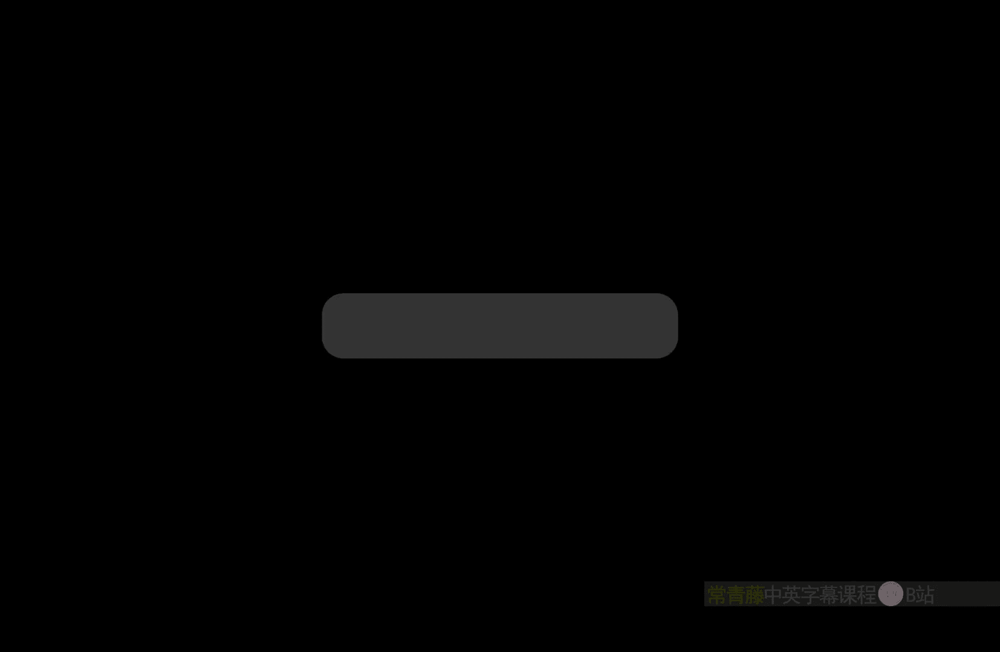
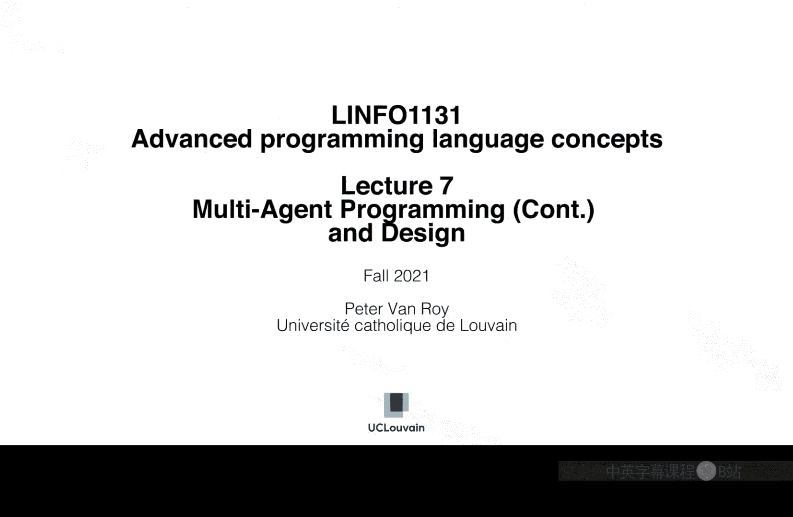
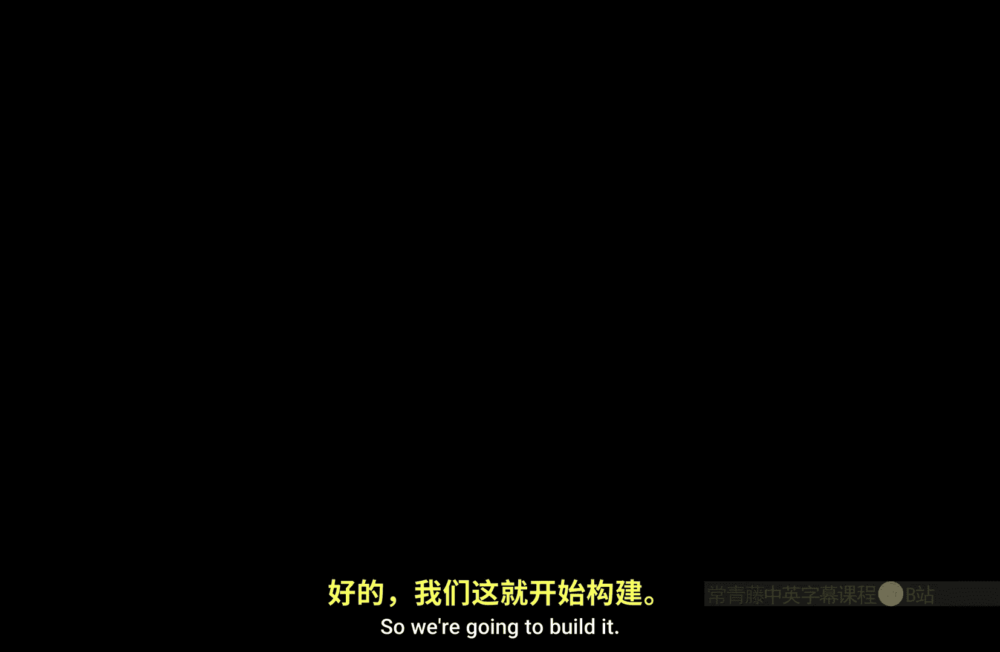
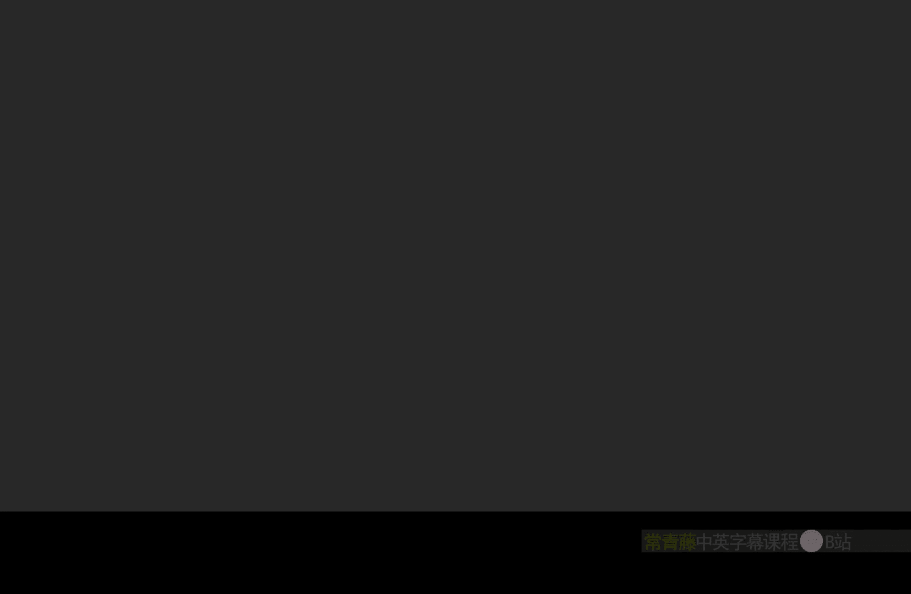

# 鲁汶理工学院【中英⚡高级编程语言概念｜LINFO1131, Advanced programming language concepts】 p22 P22 FO1131 Lecture 7 (2021) -BV1UDffBbEBZ_p22-

The board before that。Today we're going to do multiage programming。So last week。We started。

P you Josephus。The idea is to compare the tourministic data flow with message passing。

And then it was do。I'll show how to do a designing process， designing。Approach。

And then I'm going to the big example。A lift control system。So multi agent programs。

Are when you have court objects， or active objects， come to each other。

 and it's actually pretty complicated， as we see when we do in realistic systems。

So what I want to do first。Is compare。Multiageent with the termminististic data flow。And to do that。

 last week we introduced。The lady Josephphus problem， this was an historical anecdote。

So I explained the story。You can see it on the video。

Where the soldiers are standing in a circle and they count off every third soldier and the poor guy has to commit suicide。

Okay， so this is a problem in general， if you have n objects in a ring。

And if you remove every cave object。So we want to define a program。Juus and。

Which returns the position of the final survive， so we saw the protocol last time。

Last time I showed you a first implementation using active objects， sending messages in a ring。

So we have a room。Numbers。The end and they're connected， and there's a message。

Which I called the two message traveling across the ring。

And this circulates around and around until there only 100。

So last time I showed you the active object version。

Now I want to start by showing you the deterministic data flow version。And then we compared two。

So I'm going to show it to you first on the board because I want to do some design。

 and then I'll show you the code on the system。So each soldier。あで college。The victim。

Has an input stream and an output stream。So let me make sure。I can write it。

So there's an input stream here。And output stream。 So we're not sending the messages using send。

 the messages arrive on this input stream so the kill message will arrive。

As part of the stream and then the new message will be forwarded on the next stream。Okay。

In order to make all of the victims， then we will have a ring of these。Up to end。

And they will be connected using streams。Okay， so there's a stream。

 the output stream of one goes as an input stream of2， so we have a ring。Of stream objects。

Astream object here is just a list function， remember a deterministic data flow。

 it's just a list function that reads a list and creates an output list。

 it's very simple and it reads the list and the element of the list is the message。

And then it creates， it does something and may be it creates a new element and that will be the element on the output。

Okay， that and that's it。And they will keep running like that。

 so each of these guys runs in its own thread。And when we start up the system。

 we introduce the first killed message， okay， so in order to build this ring。

 we have to build a ring here。We have to build。Or ring， remember in the active object version。

 we also have to build an in to connect them all， so it's in fact like a pipeliner。

It's like a pipeline， the ring where the final one is connected to the first one。

So in order to build the ring， let me define a higher order function called pipe。

Which connects objects together， This will connect objects from one to n。

 and then the input here and the output here。Would be connected together。And that would make a ring。

 so that's how we built the ringer。So in order to build a pipe。This is a recursive function pipe。

So this is all declarative up and now we're completely in the declarative mindset。

 so Piprus is declarative function and we wanted to build a ring from one to end。But in fact。

 it's going to be done recursive， so pipe is going to call itself recursively。

 so we have to build a recursive version of pipe。Okay。

 so the way to do that is to have type go not from one to n。

 but from some number L to some number H okay， so we have L。L plus1 up to H。

AndThen we can make a recursive definition， so this part will be the recursive call。

And this will be the full pipe。So with this we can define the pipe， and then we have of course。

 the input dream。And we have a function F that we use to create these guys。

And the when you call pipe， it will return the output streak。

So we define this pipe function and once we have the pipe function， we can build the whole。对O。

So maybe I can show。Covid now。So I have no time to make a file which has all the code。

So the first part， so there's going to be some definition。 So I'm going to skip over that。

 Let me show you the code for。The deterministic data flow version。

So this font is a little bit too big or I don't know。 Maybe it's okay I guess you see。So we see here。

 this is like a utility function pipe。And it will create a pipeline。

So the idea is that it goes from L to H， so the victims are numbered1，2，3 up to n， so from low to H。

 so if L greater than H then we're done， then there's no pipe otherwise I create a victim so the function F will actually create the victim with an input stream and the name of the victim is L and it returns this the。

The output stream， and then we make the recursive called the pipe with L plus one。

 so this pipe will actually create the whole pipeline， okay so this is a utility that we need。

And now the actual protocol。So this is actually the full program。

 so here is the function Josephphus3 and K， here is the victim function。

 this is the one that actually reads an input stream and creates the output stream， so it will have。

The name of the victim， my name which is I， and then x has the inputs stream and it returns an output。

So this is just a list function。So it will read case excess of kill excess， remember the protocol。

 there's a kill message， okay？So let's see， how does it work exactly？

So S is the number of surviving nodes that are alive and x is the position each time you make a step count x。

 so if s is equal to one， then that means this one is the last survivor。And last is a noble variable。

Which is then bound to the last survivor and it returns nil when a stream function returns nil then。

The stream is emier。Okay， otherwise， if s is not equal to1， then I have two possibilities。

 x mod K is zero， that means poor guy has to commit suicide。So I do kill x plus one。S minus1。

And then Xr。 So what is this doing， This is the output streamer。

 So there's the kill message on the output stream。And then this function disappears。

 so there's no recursive call， so I'm just passing the input string to the output so the victim disappears。

But if x K is different from zero， you see there's actually a recursive call here。

Now that means the victim keeps surviving， now it will keep going with XR。

So this victim will keep going until xmar K is zero and then it disappears。Okay。And finally。

 if the xs， if the input stream is nil， then the output stream is nil and everything terminates。

 so this is very clean。Okay， when the victim dies， the poor victim dies。

 it disappears from the ring automatically because there's no repressive call。

And when the whole ring， eventually the whole ring will disappear。So when we find the last survivor。

 then the output is nil， this output goes to all the other ones that are there if there's any left and they will all disappear okay。

 so this function implements。The protocol。这这。Favius protocol and then we have here in the body the initialization。

 so here we call the piper for building the pipeline。

 it goes from one to n and here we have the function that creates the victim notice wherere actually it's an anonymous function it actually creates a thread where the victim call is inside the thread so this is actually a stream object。

Thread victim on SI。IS is the input stream， and this whole thing returns the output stream and I is the number of the victimma。

 so these two arguments are the same as the arguments here。And then there's a trick。We need to。

Connect the output of this pipe to the input， so this argument is the input and this argument is the output。

 so this one， the output is Zs。But if we make the input equal to the output。

 then there's no messages and the thing doesn't do anything， so we have to put the initial message。

 so the first input is killed1N followed by ZS， so this actually puts in an initial message。Okay。

 here and it connect so it connects the rings with an initial message。

 so this thing will actually run， okay， and will give me the Josephus。

So you see the code is very dense。It's very dense， it's only a few lines， so let me run this。

Okay here I have some examples。So here you can see I do Joseph with five， two。

Remember we did last time which shows me three that's good because that's the same as us that last time now the problem with actually with poor Flaviius。

 actually you know Luc Flaviius， he was in position 28 so 43 he was in the position 28 and of course you can do much bigger ones。

So if you have1 thousand0 soldiers and you count off every1 hundred0th one。

 the survivor will be number 876。So this is a very concurrent programmer。This Joseph Fi with 1。

100 will actually create a thousand threads in a ring， sending messages very fast。

And they will basically disappear？So all the ones where x1 k is zero， the victim will disappear。

 if it's x1 k is not zero， it will not disappear yet though。

 but it takes a long time because it has to go through 100 victims。

Before it actually makes one disappear， okay， so it's going through a huge number of stream。

Messageism to do this。So here we have a program with a thousand threads。A concurrent system of。

So this is doing pretty nicely Leah。So now let me go back to the active object version。

So here's the active object version。So this is the actual victim class。

So here every message is explicit。The E of these methods is actually a messenger， kill excess。

 and we have to do a send。So if it's alive and if S is different or one， if x mod step is equal to0。

 then alive is false， and then I send a successor message so this。Corresponds to。The kill bar Xr。

In the active object version。This one is actually killed。So in the active object version。

 it's going to be that listen。And here it's going to be。

Here we have a reive call because it's not dead。So there's no alive bit。

It bo bullolean in the deterministic data vote because the object disappears when it's dead。

 it just disappears。So here every single message， you have to send it explicitly， okay？

And then you have to。Iitialize things。So this corresponds to the pipe。

 This is all corresponding to the pipe protein。 First， I create n objects。

These are new active objects， so I have this new active primitive， I connect them in a ring。

 so AI is the successor of A。t I is A do I plus1， and then I have to also make sure that A。

 n is connected to A。1， and then I put the initial message in here。

So you see the two programs are doing the same protocol。But the code is very different， thoughh？

It's interesting， in fact。Let me run this one。Let me first define。The active objects。

Is this as the primitive？And this one。So this should give exactly the same result as before。

If we're doing things reasonably urgent。3， that's good。28。う。And8 76， this one is actually slower。

A lot slower than the deterministic data flow。And the reason why it's slower。Is because。

AThe dead objects are not removed， they stay in the ring。So this ring stays the same。

I have this alive bit here。And if the object is dead， I just forward the message。

 you see I get kill excess， the Aci is dead forward， so the dead objects are kind of like zombies。

 they get a message and they forward， that's all they do。But they're still in the ring。

So they take time。Because each one is in its thread， so this version is actually slower。

 less efficient than the deterministic data flow version because of that。Now， in fact。

 we can optimize this version， that's what I want to do now， we can actually update the ring。

We can remove the objects from the ring， and then this version will about have about the same speed as the terminist dtator flow。

Because the number of messages will be the same。See here the number of messages is actually a lot bigger。

Because dead objects will keep working until the end。

 so if I have1000 objects even if there's only five life living survivors and there's 100 soldiers then to remove each one of those five。

 I have to go through  a thousand forwardings， all these forwardings， okay。

 to count and then I'm counting to 100， so100 times I have to count。

I have to a thousand times and each time I go around one whole loop。I'm counting one， a live one。

 okay？So it's really very slow to keep the dead ones in the ring。

So we can optimize this by removing the deadline ones。

So notice the deterministic data flow already does that optimization it's very easy in the deterministic data flow to do that optimization。

 but here this protocol is not doing that optimization so I'm going to modify this code so that I change the ring okay so let me make a picture I think I have a little bit of room here to make a picture。

So the idea is the following， if I have， so the ring is， let me say the ring is like this， sir。

And this one dies。Okay， well what I want to do is I want to update the ring so that the successor pointer will point to the next object。

Okay， you see that done， so I will remove so this object stays。

 but this successor pointer from the previous object I wanted to remove to skip。The dead object。

You see， so I want to update the ring。But it's not that simple because in order to update this successor。

 this successor pointer， I'm here when the object dies， this is the object that's dying。

 I need to know the predecessor。In order to update this guy's pointer。

 this object needs to know its predecessor， that means I also need predecessor pointers。

In order to do this， I actually need predecessor pointers。

You see why you cannot do it if you don't have predecessor pointers because this node cannot access the previous one。

 So you need predecessor pointers， and then you have to also update the predecessor pointer。

 So when this object dies， this predecessor pointer also has to skip。That one。

 so basically that you need to have links going in two directions。ok。

And then this guy will send a message to its predecessor to update the successor。

 and it will send a message to its successor to update the predecessor。

 because modifying the ring is done through messages， of course。

The only way to modify the ring is to send messages， this is a multi agentent system。So basically。

 in order to remove this dead object from the ring， I need to extend the data structure。

 I need predecessor pointers， then I have to update both of those。Okay。So， let me show you。

The code for that， the optimized version， Okay， let me make a。The fountainland was smaller。之后哋。

Make this too。Now you can see the code。So the code is a little bit more complicated now。

So if you notice， now I have not just successor attribute， but also predecessor。

I have one extreme method， and I have said successor and said predecessor。And here， if x mod k is0。

 alive is false， and now I will update。The ring I will send。To the predecessor。

 I will update its successor， I will set successor， and to the successor。

 I will do a set predecessor。Okay， you see that。And then I will do a。

So I have these two extra messages now that I add。So that what I do is I have to send three messages now I send a message to the predecessor to update its successor pointer。

ok。And then I sent a message to the successor to update the predecessor pointer actually。These are。

This is a predecessor pointer。And this is a successful point here。So I have the set。

I send a set successor message to my predecessor， and I have to send a set。Predecessor message。

To my successor， okay you see how it works out， and then this object is removed and I have a new ring with one less object。

Okay。See how it workss up？Now， not， but we have still been a little problem now。Because。

We have three messages in the system， this is concurrent system，I do the send， poof。

 the message goes in there， this message， so I have now three messages concurrently。

 this send will not wait。It sends the message and then it continues immediately， so it's concurrent。

 so at this point here I have three messages alive。Traveling in the system。

And now is it still correct？WhatWhat if the kill message， what if I'm not。

 if I don't do correctly the updates？In fact， the kill message。It should only see。A correct ring。

 not a partially correct ringa， what if the precess or pointer is correctly updated but not the successor pointer。

 what if I have a partially fixed ring here I have two messages and in order to do the kill。

I have to do both of these messages。Before the k arrives there。

The kiln has to always see a correct ring， a ring with correct successor and predecessor pointers。

So actually， we have to prove that now。We have to do some reasoning here because this is not necessarily correct。

You see the problem， if you do first ascent successor， and then you the kill arrives。

 then I have a half a half fixed reina， one of the pointers is good and the other one is bad so that the dead node is half in the reina。

So that's kind of weird then don't know really what happens there。

So we have to make sure that the kill message will only when it arrives at an object。

 that object will be part of a correct ring。We have to prove that now。Okay。

It's not just adding messages and everything's fine。

 you have to think because this is a completely confirmedcurt system。In fact。

 what if I do the kill first and then these two after， then it'll be correct。

It turns out this is correct。But why is it correct？You see that it's not so simple。

 that it's not so obvious why this is correct。You can you understand that。

 that there's something you have to think a little bit here，h？And in fact。

We can prove this is correct because of a property of the active objects called the PIF message property。

That means if I send two messages。IAnd then I send another one。

 the first one I send will arrive first， the order of the messages will never be switched。

That's actually a strong property， and that works because we have streams which are extended step by step。

 which are like lists they are ordered。So our active objects have this fiO properties。Notice that。

The internet does not have data。Internet protocol does not have PIO。

 if I do two if I send two packets on the internet， they can arrive in the opposite order。

 there's no guarantee of the order， but here there is the guarantee。Because of the streams。

That means。If I。Send a successor message。And it es。So this one， successor will go to a single node。

 it will go to the predecessor and this one this one。

 whereas the kill message will go all the way around。

 it goes all the way around the ring before it comes back here the kill message will go all the way around and will eventually come back on the other side。

But that these two， this set successor and said preddecess we will immediately arrive。

Where they have to be， okay？So we can actually prove that these two messages will arrive before the kill message arrives at their nose。

Okay， the sense successor， because we did the send first。We do a7 double said successor to here。

And then we do a send of a kill later。But because of FIFO， this set successor will arrive first。

And that noted。And it means it fix， it will fix the successor pointer before the kill message arrives。

And the kill message is even slower because it has to go all the way around。

 so that's okay that will not break anything because it will just make it even slower so the sets accessor arrives first。

And the same for the set predecessor。So the set predecessor， which sent to the successor。

 will arrive before the kill message。You see that？So that is important if we didn't have that。

 this would not work。Okay， it would be broken， and if you put the kill。

 so the order here is very important。If we put the kill message here， for example。

 the send of the kill here， then it's incorrect this programmer。

The k message must encounter a correct dream with oneless。Fictim in there。 Okay。

 so because of PIO and because of this order。It works。You see that there's some reasoning here。

 if the SE was using IP， like on internet。This would not be correct， okay？

But if it's using TCP which has ordered by stream， then it's correct。

 so one of the things about TCP is that it adds ordering。

And it has to work for that if you can remember your networking course or you have to you have this window and you have these sequence numbers。

 so TCP has to work to get the order。So that's important to have an order， okay。

 so what I'm saying is that this is the fix。But it looks very simple。

 but in order to make sure it's correct， you have to think a little bit you see that？You see why。

Okay。So I can run this now。So this is supposed to work， okay？

The initialization is also a little bit longer， but it has to initialize both pointers。

 the successor and the predecessor。So I create the objects。

 I connect them into a ring with the successors and the predecessors。Do both。

 and then I send the kilo message。I have to。Conn。Both directions？And then it should work。

Wof seems to work。And this one is faster in now。You can tell it's faster if you look at。

See the previous one。Is this one。So， look at it now。Eventually the 876 arrives。

 but this one is faster？And if the arguments are and larger， the difference is even bigger。Okay。

So this is the。This is the active object version。I call this one the short circuit version because it removes these notess。

 so it makes that short circuit between these the two the succession of the preice circuit。

And it has to do some work for this。😔，So you can see that the active object protocol is kind of lower level than the deterministic data flow。

 you have to do some in French and Shi putalia and you have to do some，Truopy stuff。

To make sure it works in the right way。And you have to think a little bit。

You have to really worry about every single message and you can see the code is kind of long hereh。

There's lots of stuff here on the initialization， so it's actually I don't know exactly how much is the difference。

 but it's like。More than twice as much code。Okay。So that's one of the differences between the deterministic data flow。

 so here I'm going to go back to the deterministic data flow， so this one is very compact。

So we have this little pipe and we have this initialization。

 but the actual protocol is just this thing。It's very compact。

 so deter deterministic data flow has the advantage of being very compact when you can use it， okay。

But you cannot always use it， that's the problem， It only works if your program is deterministic。

 whereas active objects will always， even if it's non deterministic。

 so language like airline is always doing the active object version。It doesn't have this。正。

But this is very useful for when you have deterministic。Computations。

 so this protocol is deterministicus Josephus， because you're always determining it's always the same survivor。

 there's no choices， it's a deterministic protocol so that it's perfectly fine。

You can write it in termminist d dataator film。Okay。Okay， so let me make some to some slides。

 actually。你啲。Explain a little bit。So this was the protocol， okay？

So let me just give some summary of the comparison of active objects and deter deterministic inflow both implementing the same protocola。

 so in the active object each soldier is an active object。

Which is basically a passive object inside a threatna。

 which means that all the messagesengers serialized。

If you remember an active object has a thread okay and it serializes all the messages so that internally it's always sequential one after the other okay and here on the deterministic medical side。

 each soldier is a street object， so it's just a list function is a function that reads a list and returns a list in a so those are the two ways of soldiers here in the left we have a class。

In the class like in Java， whatever with slightly different syntax， but this is how you would do it。

 so in a language with active objects， you would do something like a class and you have a kill method and the method implements the Joseph' protocol。

But here on the other side， you don't have a class， you have a function。

A function that reads a stream and outputs a new stream， and it has a case statement。

So you notice that the methods。Here kind of correspond to the case statement here。

And both of them have to build a ring， so you have an initialization with successor and predecessory。

But here you just build a ring of stream engine connecting the streams together。Okay。

And then we did this short circuit protocol， so let me explain that。So in order to go fast。

 so the active object implementation， we can optimize it to remove the dead victims from the ring because otherwise you have to traverse them all the time。

The idea is you have to update the successor pointer of the predecessor and the predecessor pointer of the successor。

And it's a little bit subtle because you have to do the modifications before the kill message sees the new object。

h？So this crucially depends on the PIFO property of the sand of active objects。Okay。

 so I assume that you understand that， that you can explain that。

 why is it crucially dependent on the fiIFO？Okay。But then that's fun in the deterministic data flow implementation。

 it already does the short circuits， it's automatic。

 it's actually an interesting thing because the short circuit is done by the recursive call。

Either you do a recurive call， and this is when the victim stays alive。

 so you call it again because it's alive， or you don't do the reperive call because it's dead。

So you automatically remove it， you don't call it， okay？

So not doing their person call means the victim。No longer exists。Okay。So that gives you a comparison。

And in fact， if you look at the size of the code， this one always is going to have shorter code。

 more compact than this one。But the problem is you can't always do this one。That's the defect。

 otherwise I would say only do this。But you cannot do it if you really need nondeterminism like in a client server。

Okay， then you need to have the budgets。But you can see that if you do more of this。

 the code will be shorter and it will be automatically very efficient， so this is a very efficient。

Prayer di， it's automatically doing very nice optimizations。Okay。Okay so that gives a comparison。

 so that's important though we see these two different paradigms and it's important for you。

 even if they're very different in your head to see how they can compare them up。

 it's like oil and water， but they look very different， but in fact you can compare them okay。Okay。

 so let's go on now。Let's go on to more。😡，Bigger multiageent。

So what I want to do now is do a really big。Real multi agent design。

 much more complicated than Flavaviius Josephs。And that's actually not so easy。

 So first I want to explain to you。A methodology， an approach， so this is very concurrent。

And the messages are going anytime， any object can send a message at any time to any other object。

So this is a massively concurrent programmer， so whenever you have that you should be scared because that's very their hard。

 usually there hard， okay， concurrent programs are hard， so the only way to do it is to be very mess。

Myethodical very to use a very systematic way， otherwise， if you start hacking one of these guys。

It's over up， you never get something that really works， okay， you've been tested it， seems to work。

 and then two days later it doesn't work， nonet it's not good enough and in early days that's what happened。

In early days， what I'm saying is that in the 1980s or '90s。

 huge amount of bugs happened because of that。So there are famous bugs。

 what famous infamous bugs like radiation therapy machines。

 which I mentioned this is one of the most famous ones where if you type fast。

 you have a concurrency bug and the routine that reads the keyboard is running on the same processor as the one that controls the radiation okay it's the same processor so concurrency bug and the radiation dose is a thousand times higher okay so people dying from this okay so this is important though。

So I'm going to show you first a methodology and then we're going to show a big example of a real pretty realistic one with lots of agents。

 so in the real world you're going to see lots of things？So we're going to program with these agents。

 so theyre like active objects， a collection of agents， each one has internal state。

 and they send messages to each other。Now notice deter deterministic data flow is actually already doing that。

 but in a restrictive form。Remember you remember the digital logic simulations we did？

The full adders and the latches and so on and so on， that's already will tea agent。

But they're determin， so deterministic data flow is kind of like a simple form of multi agentent。

 but now we're going to do the full thing。So with port objects or active objects。

 we go beyond determin state flow and our programs can actually have non deterministic behavior and you need that in the real world。

 thoughh？You need non deterterminism because you may have timing constraints that depend on the real world。

Or other kinds of ordering， things that happen in the real world are not always deterministic。

 and the program has to accept whatever order the real world imposes， remember the client' server。

 whichever client messages arrive first you have to treat it。

So you need nonetterminism to interact with the real world so this is important。

 so what I want to show you now is the basic principle how you make such a program okay it has to behave correctly for all possible interleavings of the agents so all the agents are executed concurrently and they can send messages anytime they want it anytime they feel like it okay and still the hopefully it has to be correct and it can be nondeterministic so you can see it's not。

A simple problem。Okay， so first I want to explain a little methodology with some basic ideas and then after that I'll show you a big example。

 okay， so a concurrent component or of an agent， okay， it's a procedure with inputs and outputs。

When I call that component， I create an instance， which is the agent。

 so the concurrent component is like a class and an agent is like an object so you can have many agents that have the same behavior internally。

So we will use port objects in Flish receivers to use active objects， they're almost the same thing。

 an active object uses a class whereas a port object just has a case statement， okay。

So remember the digital logic example， we had this full adder。Procedure with five arguments。Okay。

 these are actually streams， these arguments， input streams and two output streams。

 and whatever you call full letter， you create a new。Agent， okay， a new instance， a new agent。

And when you create agents。There's different operations， so there's actually four basic operations。

 so you know some of them already， instantiation is when you create a new instance。

 that's reasonable， it's like a new instance of a class composition is when an agent is built with other agents inside okay linking is when agents are connected together and there's different ways of connecting them。

And then restriction is when an agent internally it has things that you don't see on the outside。

 so let me show you an example of this。So this is an old example， this is the full adder。

So this is the full letterer procedure。So this one is written in deterministic data flow。

 but it's still a multiagent program month， so we have and gates， or gates， exclusive four gates。

 each of these letters is actually a stream， each of the identifiers。

So whenever you call the procedure， you will create a new full adder with seven new gates。

 so whenever I call and G， I will create an and gate okay each one of these has a thread in it。

 so the full adder has seven threads。Okay and then there's linking， linking means for example。

 the output stream of this anga， which is C is going to be the inputs of the other one。

 it's agents that are connected to each other and there's something called restrictions。

 so the ABC D E are streams that are internal， you don't see them so you can build agents out of other agents kind of compositionally。

O。And then that's so the composition， the restriction， instantiation， okay。

 so these are all the concepts that you can see。So you see them already here。Okay。

And agents are connecting to each other。The agents are connecting and because it's concurrent。

We have to be very careful how the agents are connecting to each other， okay？

So we've seen already connections where youve can only send one value。

 that's sometimes important that acknowledgement。And that makes it very simple。

 We just have to wait for one value it's purely deterministic， So these are called one shot。

Links because you can only have one value。So these are the data flow variables and you use them for acknowledgements。

 typically， okay， if you want to read many things， you have streams， okay？

And this is one source that means there's only one sender。

So you have an agent sending messages to another one like a pipeline？So these are deterministic。

 you have one sender and it's deterministic， so this is important because we have this very nondeterministic system。

 so if a particle is deterministic， it's good to know that okay we won't want to make everything nondeterministic。

Because otherwise， we also have many sources， the many senders， this is like a client server。

 where we have many guys sending to the same agent。So in the language we have called the port。

 remember the port， so anybody can send a message to a port。

 so this is not deterministic so languages like airline are based on this。Okay。

 so these one source links are deterministic， but the many source links are the ones where many processes can send messages okay？

So we' going to this is the methodology。So。So after the break we're going to do the real thing but I want you first to see in your mind the kind of thing we're doing。

 so how does it work， what starts by informal specifications， so you write down what you want。

And we'll see a lift， we have elevators， lifts in hotel， you press buttons， so we have this。

 then we define different kinds of components。おす。Floors。嗯。

The controllers lift shafts and then you have message protocols。

 so it's not just randomly sending messages to these agents。 There's actually protocols。

 remember we saw message protocols like RMI and and。Callback and asynchronous。

 so between these agents， there's message protocols。And then each agent has a state diagram。

 so that's the internals， the brain of each agent， so this is actually the hardest piece， okay。

 the state diagram is the hardest one and we're going to spend a lot of time on this once you have this。

The rest is easy， writing the code is very easy once you have the state targets。

 so all of the work is basically hero。嗯。So you have to do it like this because otherwise you can't just say every object consents to anybody。

And once you have the actual code， you can test it。But that's not enough。

 you have to reason about the code。Like we reasoned about the short Circuit protocol。

 you have to think and do some reasoning to make sure that things are happening right。

 because it's very concur。So we're going to do state transition diagrams。

So let me just very quickly show you what it looks like。So here's an example of a transition diagram。

 so I go back now so you see what it looks like。So there's。

These states are the memories of the agents， so each agent has an internal memory and that's the state。

 so all of this is inside the brain of the agent okay and it might be in a certain state。

And then it receives a message。And then we have this notation with a slash。

It receives a message and it transitions to another state， but it maybe also sends a message， okay。

 so it's in a state， it receives a message。诶你诶。Maybe sends a message and it goes to us another states。

Okay。So every agent， you have to make sure that in every state it can receive all the possible messages。

 so this is what's called a finite state automaton， okay？So normally the number of states is finite。

 but could be infinite done， there might be a huge amount of information and one of the so we will have examples where it's infinite done。

 of course you can have huge data structures inside the data。Okay。

 so this is how we're going to define it。When we define， so this gives you the basic idea。

 but so far we have not done anything yet， okay， so now let me introduce the actual system we're going to design。

Which is a lift control system。An hotel。Okay。So this is a lift control。

 so this is in the middle old days when I traveled。Before COVID， I went to conferences。

 they usually leave these big hotels with huge number of elevators， 25 floors。

 they maybe have six elevator shafts。So and going up and down and all the time。

 people pressing buttons， so this is the kind of system we're going to design。

 a lift control system with lifts or elevators going up and down。

 they stop at floors and people pressing buttons to go to the floors and it's completely concurrent。

 people are pressing buttons arbitrarily and the thing has to work。Okay。

 so this is actually similar to the actual control systems in hotels and apartment building。

And it's a typical kind of big multiageent system that you see in real life。

So I'm going to start by doing some kind of informal specification。

 basically explaining what it has to do。And we identify what are the components and what are the message protocols。

 and then the real hard work is here。We have to design the state diagrams。

 so in the system we are designing there's actually three。Components that are different。

 The controller， which is controlling the lift up and down。The floor， which is where the lift stops。

 so the floor is also an agent and the lift itself。Which knows which floors it has to go to。

And anybody and buttons can be pressed arbitrarily。

 so you can press a button when you arrive when you walk up to a floor。

 you can also press buttons when you're inside a lift， okay？And arbitrarily， and it has to work。

And then I'll show you the code for this。And then there's two things we have to do， test it。

 of course， you always have to test that。A program that is not tested does not work， you know that。

I think you have enough already experience。But you also have to verify。

 which means you need to do some reasoning。You have to understand why。

At some conceptual a level why it's working， so we'll do that too， so it's not enough to test。

Because testing can miss。Weird cases， okay but with verification， if you reason。

 you can cover the whole thing， okay， so you need to do both of those。So let me show you first。

The system， basic system。So we have lift shafts， so there's three here。

 this is a hotel with three lifts， we have lifts， so each of the boxes is an agent。We have floors。

 so there's n floors here， so each floor is also an agent， we have users which are the humans。

We're not going to implement the inside of the human， but the human can send messages。Press buttons。

 so it's part of the system because messages can come from one of these guys。

Users and then we have the controllers which are controlling the motor which are basically the motors。

 so each lift shaft has a motor which is either in the basement or up on the roof。

 which controls how the lift moves okay so there's four different kinds of components era， the users。

 the floors， the controllers and the lifts。So we're going to dis build this system and show you the code for this。

And so we're only going to design controller floor and Ly， I'm not going to design the users， okay。

 the users are assumed to exist， but they can send messages。Okay。

So maybe let's just do one more slide before the break， so there's now there' message protocols。

So the product those are actually not so complicated those， they're not so complicated。

 you could do more complicated ones， so for example， a user can send a call message to a floor。

So floor F。When a user is in a lift， it can send a call F message to a list。

 which means I'm in the lift and I want to go to floor 10， I press the 10 button。

So floor can actually ask for a lift to come， so it sends a call F message to the lift。

 the lift sends an arrive。When it arrives and then this acknowledgement is when the lift is allowed to leave。

 so this is a one shot thing it's just an acknowledgement。

 so when I bind the act then the lift is allowed to leave again。

And the lift also talks to the controller。We're assuming the controller is doing step by step one floor at a time。

Okay， for simplicity， so the lift wants to go to a floor D and the controller moves to lift and tells me now I'm at floor S。

Okay， so the lift and the controller will be talking to each other。

 the floor and the lift would be talking to each other and the users can press buttons。

Whatever they want。So this is a summary of the message protocols in this system。Okay。

And then we're going to do the state diagram。But now I do a break and after the break。

 we will build the system that shape the code。

So we're going to build it and so you know the you see the protocols and you know environment how it works。

Users press buttons， floors， talk to Li。Lifts will go to floors。Okay， so。

AndBecause either the floor will call the lift， if I'm at a floor and I press the button。

 I want the lift， or I'm inside the lift， the user is in the lift and wants to go to a floor。

 so the lift knows what floor has to go to because the floor is either the floor calling the lift because there's a user pressing that or a user inside the lift has press the button。

So Florence will go to the lifts， but let me start with the simplest state diagram just to get you into the way of thinking。

So which is the controller， so the controller is basically it moves the mode up and down。

So it has two statess， it's either stopped。The lift is stopped or the lift its running。

 so the lift is moving， okay， up or down。Okay， and so we're going to model this， so in real life。

 of course it's going to turn on and off the motor。

 but here we model that it takes time by using a timer。So we have this timer agent。

Which I call TID here， which is the timer agent， you can send a start timer message。

And it gives you a time， 5，000 milliseconds and it gives you the identity of where it sends the reply back and then 5。

000 milliseconds later it sends a stop timer message okay so in our program we're going to do it's a simulation so it's not real hardware you can actually make it real hardware but to make a simulation we're going to use this timer because things take time。

So the controller will move the lift up or down， so we're assuming that moving one floor is going to take 5。

000 milliseconds， okay why is so slow， well because we're going to be simulated we're going to see the stimulation running。

So you can put whatever time you want there in the simulation。

 but we're going to show you the simulation， so the idea is that when the floor moves。

 when the lift moves， you send the time your message to the timer and the timer sends a stop timer reply back。

So here's the state diagram， so the controller is initially stopped。

And the state of the controller is this thing， it's a stopped of running。

It also knows the floor F so this is a constant F and it knows the lift it's attributed to so each controller is like a lift shaft its sorry knows what floor it's stopped at and it knows what lift it is controlling okay so this F might change sorry but the LID will never change okay so what happens the lift when it wants to move。

It says， I wanted to go to floor destination。Okay， so the lift sends a step message saying step destination。

 so if the lift is at floor5 and it wants to go to floor 10， it sends step 10 to the controller。

Now there's two possibilities， the controller is already at floor F， it knows the lift is at floor F。

 so if F is equal to best， then you do nothing。Then the controller does nothing and you go back to the same state。

So this is a state transitioner， so this slash here。

 the left is the message you receive and the right of the slash is the action that you do them。

So if you receive a step message and S is equal to F。

 then you do nothing and you'd stay in the same state。Okay， that's reasonable。Now。

 if you receive a step message an F is not equal to best here。Then you do something。

Now we're going to make a simplified controller， it only moves one floor at a time because maybe the lift has to stop at the next floor so it's not going to do many floors。

 it's going to go one floor at a time， very simple。

So we're going to send a start timer message to the timer。And we're going to have a new F， so this F。

And this F is not the same， there's a new F。So if F is less than s， then it's f plus1。

 that means I'm moving up。Otherwise， I'm moving down and it's S minus1。So new F here。

 whenever I say new something， it's the new state。Okay， so new F will either be f plus1。

 so the old F plus1 or the old F minus1。I either go up or down one floor。

 so then I go to the running state。And make a transition of， and I stay there。

Until they receive a stop timer message。So that's going to come five seconds later。

So when I get the stop timer message， I go back to the stop state。And then I know I'm at the floor。

 so this I send an@F message to the list。Okay， to LAD that's a send of a message。

 so this is kind of the notation of message to somebody is a message I sent， okay。

 and on the left side of the slash， I receive messages okay。

 but I can receive from anywhere but when I send a message I have to send to somebody。Okay。

So this is how the controller works when the lift wants to go the floor。

 it sends a step message to the controller。And the controller does something and then it sends an at message back to the lift saying you are now at F F。

So for example， the lift is at floor five and it wants to go to floor 10， so it sends that step 10。

And eventually it gets an act six。Okay， and then it sends step 10 again。

 and then it gets at seven and so on until eventually it gets an at 10。

 so the floor the controller will do floor by floor okay。

Because it's important because maybe you need to stop at a store。Okay。

 so this is the controllers state diagram。So you see how it works， for example。

 here these messages with Booles。It's kind of like a if statement，If F is equal to this， I do this。

 if F is different from this， I do that， and you see the timer here， a start timer to the timer。

 I receive stop timer。And then I send an add message back to the list， see how to works out。

So basically， this is doing the protocol， if you look back here。

It's doing the protocol between the lift and the controller， the lift does a step。

 controller does stuff， and it sends ad message back up。

So what we show here is the controller's state diagram。So this is a simple state diagram。

 it's basically doing two things， it's moving the lift， which we simulate with the timer。Here。

 because we're actually doing simulation here， and it's also checking which flo and at。

And moving in the right direction depending on the floor， so it has this comparison。Between F and S。

 okay between the flu I am now。And the destination， the ultimate destination， okay？

So this is the simple controller。来て言てあげる。Okay， is that reasonable？You understand the notation？

So this example， I give it so that you can understand the kind of notation。And explain how it's done。

But now let's go to the another one。And I'm going to design it with you。

 so I'm going to write on the board。And with a blank slide， so it gets white。

So now we're going to define the floor。That's okay， that's readable， I hope it's readable at that。

So now I'm going to design the floor with you so you can see how I think。Okay。

 we're going to build the floor state diagram incrementally piece by piece so you can see how。

You think when you build it， so how does the floor work？So the floor is in several different states。

 so this is a floor that I'm designing here。So the floor can be idle。

 so most of the day the floor is just sitting there and doing nothing so this is the floor object there。

 so it has a state。人民。Call it not called， that means I have not called a lift。

What the floor can do is it can call a liftum。Okay now let's say I walk up to the floor。

 so this is read tobu up， I walk up to the floor and I call the lift I pressed the button。

 so we're assuming there's only one button， not an up and down button you can do up and down buttons Okay you have two messages here instead of one up Yes switch switch to a slide but its less white because we。

 you want to slide this， less' white。Okay， maybe I do black。Maybe I do black thing， I don't know。

 this is an experiment for me because it's hard for me to the turn off。

Good thank you see that's the kind of feedback I want， okay good so we do like this。

 so the next best thing to turn it off is to display a black slide okay。😊，So I'm not called here。

Now I press call button and then I go to another state， so I call this one called。

And the idea is that。I have now called a lift。ok。I'm in the called state。

 so usually when you type press button， the light goes on， it's calling lift。

 but I have to do something， I have to actually call lift。

So the idea is I send a call F message to let's just say a random lift。Iデ。And of course。

 the floorra knows its floor numberra， which is a constant dip。

So it will send a call F message to some random lift。This is what happens when I do call， okay？Okay。

 that's good。And then what happens is eventually the lift arrives。

And then the floor goes into another state， which I call doors opened。

Because it has to opened the doors。Arrive。And then there's the app which is allowing me to the film。

And then there's more stuff， so eventually there's an arrive here， okay？And then the doors is open。

 and again we're doing a simulation， so we're assuming the doors are open for a certain time。

 so we're going to use the timer again here。So I'm going to do start timer。

Let's say five seconds again。嗯。For to。To the timer。So we're assuming we have these timers， okay。

 and then eventually there was going to be a stop timer message。Aread。Okay。

 and now the lift is allowed to leave。When the doors closed。

 so this is I'm modeling now the opening and the closing of the doors。So the lift is allowed to live。

 but that's the acknowledgegment， so I bind it to some constant。

Unit so the a is an acknowledgement to the lift that it's allowed to leave， so this is a one shot。

Thing so this is very easy。 It's just a one sh， and it's a allowed。So this is the basic。

Cycle of a floor， okay。So the lift leaves and I'm back again at not cold。

But I'm not done yet now you have something very interesting。

 so this is the basic normal cycle of a floor。But this state diagram is by far not complete。😡。

The problem is that every state can receive every message in the worst case， so when I'm here。

 I can also get a call message。Fine， I mean， the guy is pressing call is very patient。Okay。

 well then I'm already called and I get a call message， what do I do well I have to handle it。

 so I have to have another diagnostic state transition here if I get a call message here。

When it's already called what do I do， well I do nothing， so this is an easy case。あの十にね。Okay。So呃。

Fine。But more things can happen， okay， more things can happen， for example。

 the doors are open and I also can call the lift when the doors are open， stupid。

 but people can do it so I can also get a call message here。Okay。

 so I have to add these extra states， if I don't add them， the system is buggy。

Because these call messages， okay， they have to be treated， okay if they're not treated。

 they will stay in the system and they will be arriving at other times。Okay。

 but now it's still not done yet。As soon now， I'm in a hotel with many lived shafts。

So I have been in hotels where you have six list checks， that's not unusual， okay。

 and they can all arrive with the same floor。That means when I'm here when the doors are open。

Another lift could arrive at the same time。So I can have another arrived message。

Another arrive message， and let me just say a here to make it not AA， so another lift can arrive。

So in the real case， each lift has to have its own timer。Each lift when it arrives。

 the doors are open， it has its own timer， but let me make this small a simplification here because that just makes the code complicated。

Let me just say that when the lift are right， that all the doors close at the same time。

So let me just say that a is equal to a。 So these two aments I make them equal。

 That means when I do a is equal to unit， a will also be equal to unit。

 That means when a multiple lifts arrive。Then they will all close the doors at the same time。

 so that's kind of a weird simplification， but I just want to make the cook simpleNormally you would have to have a separate timer for each onea。

You can do that as an exercise。Okay， but you still have more stuff。

There's a big thing missing still in this。So what is。

 can you imagine is there's something still missing here， a big thing。In this diagram。

 it's still not complete， actually， something important can happen that is not in the diagram。

 Can you see what can you imagine。A lift can arrive at a floor。

 even if nobody at the floor presses the button， okay， it's because somebody inside the lift。

Press the button for that flora。 That means when the floor is at not called， a lift could arrive。

Okay， you can have this， I can have them arrive。It just randomly arrives at the floor and nobody called it's because somebody in the lift wants to go to that floor。

 okay， so it can also arrive here。So this is exactly the same as this kind of arrival。

 I have to start the timer now， okay？As before， the lift arrives normally to。

So I start the timer and then when the timer stops， the lift can leave。

 so there's two ways the lift can arrive， right it's because somebody in the lift。

Has pressed the button for F， or it's because somebody at the floor has called it， okay？

So am I done now？Is this a complete state diagram and nothing missing。

 so the trick is every state has to handle every message。Is that true here。

 so what are the possible messages here the messages are call and arrive？Okay， a floor can be called。

Or a lift can arrive at a floor， does each one of these states handle both call and arrive？

What you think。Is there anything missing now or is everything there？You tell me。

So that's the thing and every state has to handle every message， even if it does nothing like this。

Because if you do not treat that message， the message will stay in the system and it will be handled later by somebody who does accept the message。

But that's not what we want here， we want to handle all the messages right away， okay？You see that。

So here in my， I have called and I have arrived。Doorors open， I have call and I have arrived。

Called I have called and I have arrived， so it seems to be good。

I'm handling all possible messages in all possible stuff。是的。So that's reasonable。

 so this isn't implementing the floors protocol。Okay。Okay， so that's nice。

There's a more complicated protocol， which is the actual lift itself。

The lift is by far the most complicated， this is still very simple， okay。

So I leave the complicated one for last， which is the lift。So let me do the lift。

So once you have this diagram， it's very easy to write the code。

The hard part is writing this diagram， the writing the code is very easy， and in fact。

 there are tools that you draw the diagrams and they will generate automatically encodeda。

The problem is， the actual day。Okay， now let's do the actual lift。So。

The lift is harder and the reason why the lift is hard is because the lift can go to multiple floors。

What happens if I have a hotel with 25 floors and I press 5， 10， 15， 17。

 well then the lift has to go to four floors？So we assume now that this is a smart。

A prettyty smart lift that remembers all those floors because sometimes you have very stupid lifts it only remembers one floor。

 but if you have a hotel with 25 floors， that's really。

 really a pain because if somebody presses floor 25。And you're on the bottom， you're going out。

And you want to stop at floor five， sorry， no luck。

 you have to go all the way up to 25 with back down so that most of the real hotels。

They are smarter than that， okay， because people don't accept that。Okay。

 so the lift actually remembers a sequence。オ。Okay， so let me say。The state of the lift。So there's a。

Moving。Bit which is false here， there is a schedule。Which I assume initially is new。

 I'll explain what it means， and there is a position， so this is actually the floor， okay。

So the lift。The lift has a data structure called a schedule。

 schedule is actually the list of floors it has to go to。受けど。It's a list of floors。

And assume the lift is sitting there， it's not doing anything。

 and then I press a button to go to a floor， and then I will go to a floor。

Or I will start moving actually， yeah， I do call N。Okay。And n is not the same as where I am now。

 okay， then I have a new schedule。Which is equal to a list of one element。

And I send a step message to the controller。So this。

 remember this the guy is going to talk to the controller， right？It's also going to top to the floor。

So now I'm here。I'm still at the same position because I only change the position when the controller sends me an act messageenger。

 I have a schedule here。Here it's different from though。

And here the movement will be in equal to two。So as long as the schedule。

 the schedule is different from real， that means the list has work to do。

 so I will summarize that in this moving thing， you don't strictly need it because you can always look at the schedule lot。

 but it's nice to have a boolean that tells you。The lift this movement，嗯。Well。

 what if it's here and somebody does another call？嗯。😮，嗯。What if I have another call。

 so the lift already knows it has to go to the floor and it said pause。

 so maybe it's at floor five and has to go to floor 25。And in the lift， someone says。

 I want to go to floor seven。Okay， well， I have to define a new schedule。So which is what is it。

 it could be， there's many possibilities out， it could be。Append schedule。N or M， sorry。

So I put M at the end。This is kind of stupid。You see。

 you can have a smart scheduleer if I'm going through five。And I have to go to floor 25。

And someone says seven。Putting the seven at the end after the 25 is actually not so smart， though。

You actually should have a smart one， so you can actually have a function called。I you say。

There's different functions。You can define it， smart schedule。Which takes the position， the schedule。

And M and returns the new schedule in a smart way， so while the lift is going out of course it can stop them。

So but this is correct， app pending him at the end is correct， it's just kind of done。

 but it will work， okay？And then。So remember I' have sent a step message here。To the controller。

 which means I will get an app message eventually from the。From the controller within a new position。

Okay。And there's two possibilities either。The new position is where I want to be。

So I'm confused the limitation is similar to oation as Sch。1， the first element。Or it's going to be。

Sorry， different。From Sch1 or it's F。And here's end tos。Is equal to schedule that one。Okay。

 this is I go to do doing stuff。So it's actually a loop here， I send step to the controller。

 I get an at here， if it's not the same as schedule1， then I'm not done， I have to do another。

 I have to do another step actually。I can do this。StepSchedule。1。2 CID。Okay， and the new position。

Is equal to10 parts because I do I have changed position a little bit though。

So this is one possibility。So this is a loopa， this is kind of like a Y looppa， I do step here。

 I get the ads from the controller， but if I'm not where I want to be。

 I send another step to the controller。And I continue。

 so this thing loops until eventually comes out of the loop here。

Where n class is equal to the scheduler， and then I have to send message to the floor。Arrive。除。

Schedule that one。So this is actually sending an arrive to the floor， okay？You see that。

SoAnd here this is Glenn Po this one。Wait for doors。So the lift is now arrived here。

 the floor will open the doors。When should you close the doors， okay？So it actually closed the doors。

So there's different ways that can close the door。So the closed door。Theres the act。

Way back is a closed door， okay？But then there's two possibilities。

Maybe I'm completely done or maybe not， if schedule dot2 is different from no then I'm not done yet。

 I have other floors。But it was scheduled up too。Is。一过 to。So wait act and schedule up two。

Is equal to new。Okay。Then so I still havet denoinate Pi， so there's another loop era。

When I'm done well for the doors， I get the act。And if Sch dot2 is different from you。

 that means I have more floors to go to， so I have to go back。To do that。

 whereas if Sch a two is equal to know I'm done。But I have to set the new position here。

 new position。And the new schedule。So the new schedule is equal the schedule that too。

Position is any cross。So now I have a new schedule， which is scheduled that too。

 which is different from no。啊， okay。But I'm not done yet。

 I have to send a step message to the controller。Schedule got2， do1，2。水あで。

I have to do all that and that gets me going to the next floor。YouSee。

 so I wait until the doors closed， if schedule a two is not newil。

 the new position is my new position， but the new schedule is scheduled at two。

And I again ask the controller， but I go to the next one， which is scheduled up2 one。

And then go back here， and then again I will do the same loop here。

And eventually I will arrive at the floor， so I have actually two nested loops here。

I have a loop where I'm going step by step one floor。To get to the floor next floor I'm going to。

 and then I have to look at the schedule to see if there's even more floors。

 so I actually have two nested loops here so this，If I maybe do something colored。

 I can do a colored thing。So this at and this ad， this is a loop。Whereas。This weight。And this way。

It's another the。So this is like an inner loop。And this is like an outer loop， okay。

 so you can see these state diagrams。It's like a programming language。

You can do funny things that are like loops。And some of the tools let you write it like loop okay。

 and they will automatically compile it down into state diagrams，Here1 plus。です。

So the new position is Nfi。And the new schedule。There， so when I go here， it means I'm back。

 I'm done with everything。So you see there's a lot of stuff going on hereh？Okay， let me。

 let me go to。Go down。Okay， let me go beyond this black slide。And to a lit up slide。

 so this is the lift。This is a nice picture of the N diagram。So I do a call here。

The new schedule is end， each time I do another call， I will add end to the schedule。

So that can be happened completely concurrently that can happen at any time。

 even while the rest is running up。Now here I have done a step and here I get an act if I'm not at the right floor。

 do another step， so this is a loop and eventually I exit the loop here when the position is equal to sing by one。

And then I wait for the doors and then there's two possibilities。

 either Sch2 is different from n then I have more floors to do or scheduled do2 is equal new and then I'm done and I go back to here the lift is idle again。

 okay。So this is actually two nested loops。But they can be。

Interspersed with calls happening at any time。Okay。See how it worksh。

And now we still have some things to complete here， so if I'm here。

I might floor pause position and I do a call， but n is equal to pause， then I don't have to move。

 if I can just open the doors immediately and close the doors again okay。Okay。

 and now there's a subtle T。When I'm here。Actually， I do not treat the call message here。

So what does that mean when I'm here， I do not treat any messages。

 I only wait for the acknowledgement。So this you have to be very careful for this because it means you could have dead Laa if this thing never happens。

Then the system would block here。But this is， the floor is going to give me this。

 I know that I can show that by your reasoning because I only want to treat the color messages here。

Because otherwise it's too complicated， so if I type I press the call button and。

Here it will not be treated here， but the message does not go away。

 It will be treated when I'm back here。 and I guarantee because this weight will eventually be true。

 I guarantee that I will do it。 Okay， so you see you have to be a little bit subtle the reasoning okay。

Same here， here there's no， you cannot do a call message when the lift is waiting for the doors to close。

But that's not a problem because you know for sure that this weight is temporary so that you will eventually always go back to this state。

And then you can upload this data。And then you can handle the call message you can。Okay。

So notice you have to always update the scheduler。The problem with this is that what makes it complicated is this scheduleula。

The schedule， which is the list of floors that you have to stop at them。

So that's why the lift is a little bit more complicated than the other the others。

 it has this schedule thing， and this is actually， you can actually have smart algorithms for the schedule around。

This algorithm is actually known， it's used for disks。For rotating discs and the discada。

When a disc head is like an elevator， you have a circular disc in the blocks and it's going out to the edge and then back。

 that's like an elevator going up and down。So you don't want the disc head to go like this。

 you want to go all the way out and then all the way back， so a real elevator is the same。

If I type the many floors， I want to go all the way up to floor 25 and then all the way down and I do all the intermediate stops。

So the schedule function。Should be smart enough to insert the n in the right place， okay？

So this is how it works。And now we can actually write the code。That's actually the easy argument。

 so we have history。Diagrams， so the controller。Okay， the black slide， the floor and the lift。

 so we have these three state diagrams。And we can convert this into code。Very easily。

 so let me show you how that works。So let me show you by starting with controller。

Sos some here's controller。The way it's always the same， in fact， so the controller。

 this is a controller function， when I run this， I will create a new controller with controller ID。

 which is when I can send it to the identification。Notice there's a timer。

 so I have actually a timer object which I also defined it， which you can see in the code。

 which is very simple it reads， it gets start timer， it does a delay and it does extend subtimer。

So each controller has its own timer。And then the code is this code。Notice it has。Two nested case。

So it's always like that。The code is always two nested cases。Okay， you have the case of the state。

And the case of the messages。So the state can be running or stopped。

Here I'm using a syntactic sugar of os， or if I have a record state that's a record。

 I can actually put it in the argument， okay， so I get motor F and LID。

 so the motor can be either running or stopped。And in each of those two cases。

 I have an internal case。So this is exactly following the state dima。

 so motor and running stopped are the two states。Okay。And inside of each， I handle all the。

The messages， so in the writing I can only receive stop timer in the stopped case。

 I can receive a step。Message， okay， and then I have different possibilitiesh。According to the the。

St diagram。See， so this is exactly following the state diagram。

So let me go very quickly back to the state diagrams。I it here， for our points。

So that the code I show you is exactly this。This is you can translate this to two nested cases。

The case for the states， and then for each case you have a message， okay？

Okay and now we can look at the other one， so here's the floor， they're a little bit longer。

 sorry they start to。Put them all than one。Slide again， so this is the floor。

 each floor has its own timer。You have not called or called or doors open。And in each of these cases。

 you have the arrive in the call message， arrive in call， okay？

And it returns to state so this is just the translation of the state diagramagon just automatic and many there exist tools to do this but in this course I'm showing you the thing。

 the real thing。And then the final one is the lift， which is a little bit more complicated。

I've added some browsers here。So that we can see the thing running again in the simulation。

So you have call here， message， so here it's interesting。I。Fpped the two cases around。

You can actually， the two cases you can do them in any order you want， you can do first， the state。

 and then the message for each state， or you can do the messages and for each message you can do all the states。

It's just a convenience。So here I have the state on the messages so the call message。

 and then depending on what is going on， I do things。And then I have the at。

 so this is from the controller and I do things。So this is all following the state diagramma。

So all of this can be run。Then I have this function called this procedure called building。

 which makes say building with FN floors and LN lifts。So I create。

For each lift shaft that create one controller and one lift。And then for each floor， I crre them。

The floor okay， so this creates a whole build built， the whole building。Okay， so I can run this now。

After all this， you have to see the COVD running， right？

So let me create a building with  ten0 floors and two lifts， so send F that9 call。So it's moving up。

Okay。A nine open doors。Those doors and we're done。But you can do many things。You can have five。

O day and you wanted to the lift one， so that this for example。

So I have to go to five and also four and one。So it's doing it all concurrently。Floor 4， floor 5。

Okay， it's already fluent， so it goes to all those places。Stimulation。

 and you can run it talk with the code on the moon glm。So yeah。

 so when all the state diagrams are defined the write the code。So we have three components。

 floorlift and controller。Okay。now we have to do testing and verification。

So testing is you invent weird scenarios where people are pressing buttons in weird ways。

 but that's not good enough， you also have to reason。Okay， and if you find a problem。

 you have to go back to an earlier stage in the methodology。You have to fix the problem。

 maybe you fix the state diagram， maybe you change the message protocol， okay？

Or even maybe your informal specification is wrong， you have to change it。

So here's an example of some verifications， so you can actually prove properties of this code。

You can prove the lift will always eventually stop at a floor that is part of the lift schedule。

 So if you look at the state diagram， you can prove。バイ。Seququencing， the loops。

That no matter what messages arrive。That if a floor is in the lift schedule。

 that the lift will stop there it。Avoid that floor forever， so maybe I went to go to floor 25？

I can slow it down by pressing all the buttons。不道。This is what practical jokers they sometimes do in Hoella。

 they come in there， they see a little lady pressing 25 and they go and so the lift will go very slowly because it stops on every floor but it still goes up to floor 25 and you can prove that。

You can also prove that if you send a call F to a lift。

Then the lift will eventually arrive at floor F。So you can prove it combining using the first onena。

 if call F is sent to a lift， you can prove that the schedule will eventually will contain F and then you can prove it using the first property so using these you can prove。

That it actually will work correct in all the possible cases， okay？Okay， so let me now just illusion。

So this is a really nice example showing where you need all three pillars， so this you have seen。

 I'm sure I hope in some other courses， there's three pillars of software development， design。

 test and verify。So we have here a nice design methodology。

You build a state diagram and you make sure that every state handles all messages， okay。

 so this helps to ensure the sound system， then you test it。

includingncluding weird things called corner cases and then you verify you prove properties and there's actually software tools to do this。

 so there's a tool called the Marve checker which you may have seen in course by Charlotte Pisure no。

 have you seen that or you will see so you could actually prove。

Properties of the system with software tools which exhaustively examine the whole space。

 So these are called model checkers， Okay， so this can let you do verification。So with that。

 you could be sort of sure that the will work。あちと。Okay， so let me conclude， so we have added ports。

Non deterterministic many to one， we can write multi agent programs where we have many agents that are concurrent sending messages。

The behavior is defined by a state transition function。You can write it as a class， okay？

We have compared active objects and the termministic data flow with this Pavius Josephcius problem you can see how the two paradigms are very different but they can do similar things and I show you how to build these big systems so many real world systems are like this in fact sequential programs are kind of exceptional most real world systems will be a little bit multiageent okay。

That's it， so let me stop there， so I hope you like it。

 experiment I put the code on the middle so you should experiment with the。

With the lift control system that ground。Change the timer you can actually do many， many。

 many cases very fast， remove the browsers， make the timers very small。

 you've been actually do very much testing with this。这里。They see。

