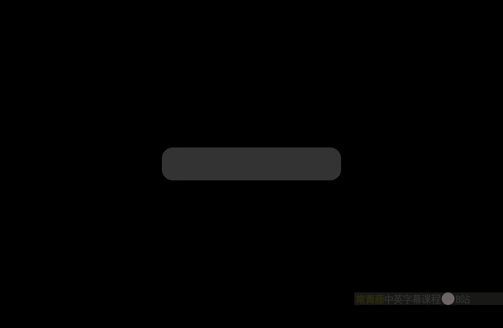
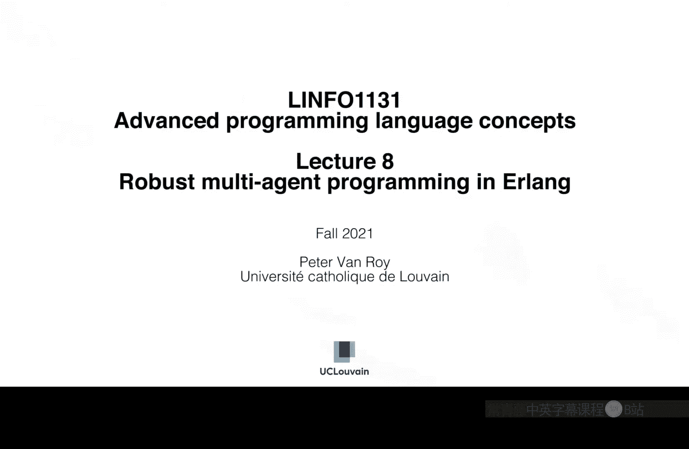

# 鲁汶理工学院【中英⚡高级编程语言概念｜LINFO1131, Advanced programming language concepts】 p23 P23 FO1131 Lecture 8 (2021) -BV1UDffBbEBZ_p23-

Okay， so welcome to the course。So this course will be about airline。

Airline which is a multiagent system developed by Erickson in Sweden since around 1990。

 it's old system， it's as Bob's old same age as Java okay but it's really good for multiag and concurrent programming so I'm going to tell you all about airline。

 so you're going to have two lab sessions。To practice airlines， so airline is an open source system。

 you can download it and so in the lab session you will do experiments so there'll be two labs on airline。

And two lectures on airline。So I'm going to start today by giving you a big overview of airline。

 I want to give you some of the。Properties of para。

So I'm going to show you what their leg is good for。

So it's very good for concurrency and for distributed systems where you have lots of message passing。

 I'm going to show you a real airline application so you can really see the kind of application it is good for。

 I'm going to refresh a little bit to the airline concepts。You will normally in the previous course。

 you have seen already kind of introduction to airline， but here I want to go a little bit deeper。

 I want to go into the programming patterns， So airline has a lot of tools。

For building systems that are robust and concurrent。And they there are called behaviors。

 so a behavior is like a generic pattern。I will show you that。I will show you a generic server。

 so if you want to build a server in early， all you have to do is do the functionality and the system has a tool that does everything else。

 the fault tolerance， the code updating and everything。I'll talk also about supervisors。

 so airline has a mechanism for making very robust systems where you have agents that are looking at other agents and if something goes wrong。

 they can fix it。This will be done then I'll do it today and tomorrow。

There are lots of documents on the Internet。About airline。 So here's some two good references。

 So there's a very nice website called Learn you some airline for a great good。

 This is very pedagogical。There's also a really nice book。

Written by two industrial guys from a company called Airline Solutions。

Designing for scalability with airline OTP。So but there's many other good books says are just two examples。

 you find many things on the Internet for airline，'s a system with lots and lots of。Documentation。

To start， I want to give you some numbers。I want to show you what airline is good for for concurrency and message fast。

 So here is a graph。That looks at process creation times。In airline。

 a process is what in Java would be called a threat。 in airline。

 it's called a process because they do not share data。

 so they are kind of like operating system processes。

 So here you have the number of processes in the system。So the number of concurrent entities。

 so in Java， this would be the number of threads in airline the number of processes。

 you see it's logarithmic， TED。100，000，10，000，100，000， these numbers come are old numbers。

 they come from 2002。People don't remesure them all the time， but these numbers。

 the relative numbers are still the same today because the computers have improved。

 so everything has improved so you will these numbers， the time for process creation will decrease。

 but the relationship will be the same。So here you see in red。The process creation time for airline。

 this process spawning， and function of the number of processes and the time is in microseconds per process and here in green you see the time for Java。

 the Java in 2002 and in blue you see for C sharpp。Okay， so if you create 100 processes。

Each process correction takes in 2002， it took several hundred microseconds。

 It' rather expensive because it has to build a big structure whereas an airline， the time up until。

2，500 is less than one microsecond after that it becomes higher because you have to manage the memory。

 okay， so but still it's less than 10 microseconds for process even if you have 10，000。

Processes so airline is really a system where you can create a large number。Of concurrent agents。

And you don't have to worry about it， basically， so that's one。

Table of numbers that me talk now about the message sending times。

You send messages between processes， okay， here again。

 the number of processes the horizontal axisus and the number of microseconds for sending a message。

So you see an airline is in red here。The time for sending a message from one person to whether is around1 microsecond。

 This was in 2002。 So this is between two concurrent processes。

 One send the one received the message。 You can see here in blues， the time for C sharp。

 this was around。I guess you could say it's around 30 or 40。Microcis and in Java。

 it starts like that， but then when the number of processes increasess。

 the overhead really grows much higher。So you can see that airline has optimized for process。

Creation and communication。 It's really optimized for that。 Okay， now。

 airline in those days was not native code。 It was running on a virtual machine kind of like Java。

 So Java was running on JBM， but it also has in time compilation。

 Air is running on a virtual machine called the Bea。So it's not optimized for a matrix。

For floating point， but it's optimized for processes and communication。So here's an application。

 a use case。 So this is a web server。So at airline there were several web servers written in an airline。

 and this is in a web server called。Yaws yet another web server， and this is also in 2002。

You can see here the number of processes， so this is the number of concurrent requests to the web server。

 so HTML requests， so you're loading the web server with a number of concurrent requests and this is it's intenses of00010。

020，000 up to 90，000 and here on the，Vertical axis is the throughputs of the system in kilobytes per second。

 so going from 100 kilobytes to 900 kilobytes。Okay， the total aggregate throughput。

 of course if have many processes then they will share the total throughput so the throughput per process is going to decrease。

Here， when you craz。And so let's see what happens。 So in red you have a line in green。

 you have apache observer server with a local disk and in blue you have Apache using NFS network file system。

So you can see that。Apache does quite well up until sorry the green one where you use the lo disc does quite well similar performance tailing up until。

4our，000 processes， and then it crashes。Because， well。

 what language is ap you written in it's not written in Ar？And if you use NFS。

 it's a little bit slower， but it cannot handle more than 4000 confirmedre processes。

 that means that you overload the web server。Cashs and birds。 It's not so nice。

 So let's say you have your company。 You have a product。 You may add。

 this is the day everybody wants to go to your website and your website crashes。

 You've seen that maybe happen。 So this is what happens。 Now， airline has a very nice。

 different property， that you can increase very much the concurrency and it will not crash。

 The performance will go down but it will go down in a nice way。

 So the system will support a large number of concurrent processes。

 but will not will not it will not crash。 So if you see the red the one， the airline one。

 So here it goes up to 80000。This is already twenty times more。

Then so I don't know what happens here。 Maybe the airline system。

 maybe there was a memory limitation and could not go farther。

 but it was already 20 times more concurrent requests than Apache。

 And you can see the performance becomes very variable。 So you can see that all these processes。

 of course， are going to interfere with each other。

 All these concurrent processes So the airline server will have to do some bookkeeping and management to keep all that together。

 So you can see that the throughput will decrease。 So it's extremely fluctuating here。

 The throughput will decrease when the number of processes increases。But it doesn't crash。Okay。

 that means if you are a user and you make a web request。It will work， it will be slower。

 but it will work Okay， so airline is really optimized for highly concurrent systems systems where you can have enormous。

Peaks of concurrent use and it will work。 So if you are building later on in your company an application that has that requirement。

 then airline is a good choice for implementing it。

Of course airline is not as popular as Java because it was not invented in Silicon Valley。

 it was invented in Sweden by Eson， but Erickson is a big company。

 probably some of you have Eson phones。So Eson is a big telecommunications company， so they for them。

 this is very important。Okay， let me show you one more example， this is an ATM switch。

So in ATM ATM is a kind of a router。It's not doing IP， it's doing ATM， asynchronous transfer mode。

 which is basically creating circuits， so this was for a guaranteed performance between end to end。

So not a best effort。So the AXB301 is a large high performance ATM switch for in big industrial networks。

 covering the whole countries。So this was one of the top of the line products from Dererickson。

 it's not something to use in your house， it's used something by good big companies， okay？

So the AHD 301 was written。In airline and with some low level code in C and Java。

 so you can see here the size of the beast， so at least 3。2 has 1 million lines of airline， 900。

000 lines of C plus plus 13，000 lines of Java， and it uses the airline OTP。

 which is the basic library， which itself has 240，000 lines of airline， half a million lines of C。15。

000 of， so you can see this is a big industrial system， took years to develop it， okay。Now。

 in this graph。We can see here the call throughput。So it makes calls。

 I want to do a call from one point to another and it will create a circuit。

 so between the source and the destination。And the offered load here' is the offered load。

 So the offered load is the number of attempts I try to make a call。

 So this is like for big telephone networks when you make a telephone call。

 it's actually creating a circuit between you and the person on the other side。

 So a connection with a guaranteed bandwidth。So you're trying to make a call。

 So this is the calls that are being tried and this is the actual call throughput。

 So you can see what happens when I do more and more calls here。 First。

 what happens is the call throughput increases linearly that means the calls are succeeding okay I'm succeeding。

 but some point I reach the limits of the system。 the capacity of the system100 percent。

 all the lines are fully busy。 and that means further calls will not be accepted。

 but still the cause overhead because when I try to make a call。

 the system has to run covered to try to make the connection， So the more I do offered load。

 the more the system has to work， even though the calls are not accepted so you can see what happens here。

So at some point， up to 150% offered load。It basically。Stays。At the maximum。

 but then if I keep increasing the offered load up to 1000%。

 so 10 times more calls than you can accept， okay， I do 10 times more。

The system will have a lot of overhead in handling those rejected calls。

 It has to try to make the call figure out and send messages， do all kinds of things， bookkeeping。

 So it has to do a lot of work for these rejected costs。And you can see what happens in the system。

 the performance， the number they threwput actually do down gradually。

 so this is actually very nice you can see the rejected calls are very high here。

And this is this little line is the extra work you have to handle all these rejected costs so you can see that overhead。

The throughput is going down， but it's going down in a nice。

Nice way and it's not crashing okay so this is a very good property you overload the system and it handles the overload very。

 very well okay， of course the performance will go down but each call that is made will still be made okay so for the calls that are made it's working fine。

So this is a very good behavior okay so this is an example of one big industrial system written in airline。

 so this is from an article。Fourfold increase in productivity and quality by one of the engineers。

 O Rigur from Erickson。Who basically wrote after they made the A X D3 of why they were an article。

 So this was， this is one of the systems that shows。

This advantage of a system that can support concurrency very well， okay。

 so that's an example also of the system within' in airline。And now I want to go into detail。

 I want to show you one actual application to give you an idea of the kind of software that is good for doing airline。

 and this is a sensor fusion framework called Para。So let me explain what it's all about。

So this application is written in the context of Internet of things。

So internet of things is a kind of buzzword， but what it means is that you have a lot of low power devices directly at the edge。

 so smartphones are part of that， but not only smartphones。

 now obviouslyous people with lots of extra devices around in their houses。

 things that are connected to the internet is increasing。Okay， so this is growing exponentially。

 so in this graph， it compares the number of Internet of things。

 devices with the number of human beings on earth。Okay， this is interesting because。For example。

 smartphones， usually every human has one smartphone maybe two， that's hard。 one。

 That means it saturates。 once you have 7 billion smartphones。 it doesn't grow anymore。

 but infinite of things does not have that limit。 in fact， it's growing exponentially。

 and you can see here in 2011 it was more than the number of humans。 So 6。5 billion。

 we're assuming that on the earth it will be 8 billion humans in 2025。

 So this is the exponential growth。 So this is measured So there's it's been measured also in the past。

 So there's a prediction that it will be 75 billion in 2025。

 So this is growing exponential okay and it's by far not saturating because it's easy to have hundreds of devices。

For one person， okay， because all the devices are around you in the environment。

And if you look at the growth， you can see this is growing。Right now， 13% per year。

 whereas data centers， data centers， which is the cloud is growing 5% per year。

 So people talk a lot about data centers and cloud computing and cloud is the big thing still kind of in the media。

 but in fact， the cloud is now maturing。 It's slowing down。 we are we have clouds now for 20 years。

 Okay， clouds were invented by Google and Amazon 20 years ago。

And now where it's kind of centerurating， it's slowing down 5%， still growing， but slower。

 whereas Internet things is going very fast，13% per year。 Okay， so the question is。

 how do you program all those devices。You have many devices and for example。

 in the room you can have many devices， they're already at the same time， so they're concurrent。

 they're distributed， distributed means that they are physically separate。

It's not just in one machine， but they're separate， communicating through a network。

And the environment is hostile， this is the real of the world， these are low power devices。

 the power can go down， the network can go down， the do can chew up the device and it can break。

 okay so the environment is hostile， you cannot assume that they keep working， they will crash。

So this is an environment where actually airline is a good choice， and let me show you how it works。

Okay， here。So I'm going to show you a software application called Hea， which does sensor fusion。Okay。

 since your fusion is an important operation for internet of things if I have sensors in a room。

 temperature， sonar， okay， CO2， whatever sensors。Each of the sensors is giving information。Here。

 for example， gyroscope thermometer， magnetometer giving direction， Huso compass， sonar。

 also you have some sent to a GPS for position。All of the sensors are giving information。

Now that's kind of very primitive they're all giving information on one environment。

 just may be in this room， okay， so sensoror fusion combines all the information from multiple sensors to give a single coherent view of a real world situation so if there's a person walking in the room。

 the sensors are detecting that person。Then， but they're separately given data。

 but you somehow have to combine all that data。 you see it's not so easy。 if I have two sons。

 if I have a CO2， if I have temperature， so if there's more people talking in a room。

 the temperature goes up， the CO2 goes up， you can actually compute the number of people in a room by measuring CO2 because they're all breathing and discussing okay。

 you can compute， if there's a meeting if the discussion was very intense。

 the CO2 will increase faster， okay， but you have to combine all that information。

So this is whatever does， it context all this information coming， streams of information。

 so thesearrow are streams。Their information coming in and combines them to give one coherent view of a system。

Okay， so you can see thats that's maybe not so simple， so I'll explain a little bit how error works。

But the hammer system is written in air and it's running on a set of bos called Gris bos。

So let me show you the hardware platform。That hair I was running on。

 So this is an Internet of things application。 It's running on small boards that are in your environment。

 So these boards are called。 So there's many kinds of boards。That you can buy for internet of things。

Rspberry pie is popular and there's also a thing called Arduiino and so on， so this is running un。

So the Gr board is a low cost board here that runs directly。Airline Direct。

 so Bri was designed to run airline on top of a real time low level kernel。

So that means it can run IoT out of the box。It has sockets， here you can see the sockets。

For sensors and actuators so here's some of the sensors you can get。

 So the navigation sensor here pi on nav， it has a sensor with multiple things， an accelerometer。

 three dimensionmenal gyroscope， magnetometer all 3D pressure sensor。

 temperature sensor all on that long little thing。 so it's all very miniaturized that。

 these are called mems sensors， microelectronic miniature sensors。

Miniature systems so these are actually like in British circles these are very small sensors。

 here's also here's a sonar that's a sonar which gives you the distance of the closest object。

 So there's many of these you can buy many of these sensors and build IoT applications okay。

So you just plug them in so the gr。Will immediately support them。

 It has airline drivers for many sensors so you buy this system， you can immediately start running。

 start writing Io。 You don't have to build the system。 So it's much easier， for example。

 than Raspberry Pi， which is just a general computer。

 This is actually a system made for Io Okay so this is the hardware platform we used for Ha。

So the actual hair architecture now， then we show you the hair architecture。

So here we have a network of gr boards。1 through N。In the application that was done。

 it was tested was up with five boards， you can also connect the left top。To it。

 and they all communicate your wfi。 So the H runss on Briboard networks using Wifi。

 and you can connect to external computer to Internet。Alsosome。

 so this one would also be running airline and connect to them。

So each of these boards runs the full H framework， so it's redundant。And it's a sensor fusion engine。

So the technical basis of this is a technique called the common filter。

 which I'll explain in the next slide， it also has broadcast。Interface。

And sensor interface for the p mod。 So the blue part here is the sensor fusion model。 Okay。

 it stores also data and it has a communication model。 So each one。

 each mod board does sensor fusion and it stores the data and also broadcast the board。

 So this sensor data coming here。 So this， for example， might be accelerometer or sonar。

 this is broadcast。 So all the words are receiving all the sensor data okay。

So that's the architecture of it。And each board is running the same software。Okay， so how does this。

 what's going on now， what is the properties of this system？

It's using a technique called a common filter， which you can see which maybe in some courses you can see how it works。

 so a common filter basically has a physical model of a system like a person and it measures it has a person moving in 3D。

 for example， and it shows，You can predict。The state。

So it has a person moving and the carbon filter will say the person moving with this velocity in this direction。

 so it's predicting the state。Okay， but， but it's not precise。 So it's like probabilistic。

 It's predicting like a cloud。The possible positions。So this is the one thing。

 So the prediction is the first part。 The second part is that you measure the actual position using the sensors。

 So the sonar， for example， will measure the distance or the accelerometer will measure the actual acceleration。

 but this data is also not so accurate。 So this also gives you kind of a possible probabilistic thing。

 And then the magic trick。Is you do the intersection of the prediction and the sensor。

Censor measurements， so the prediction gives you this big。The set of possibilities。

 the sensor gives you another set， you intersect them， and then you get a much smaller set。

And that is the next input。 So you see the common filter combines prediction with the sensor data。

 so that's kind of the intuition of it。 and then you can use it's doing matrix computations with probabilities and covariances。

 I'm not going to go the theory of this。So this is then doing that computation。Okay。

 so this is implemented on the risk board。And it's asynchronous and dynamic。

 so this is typically an airline property asynchronous means any sensor data can arrive at any time。

Sensor data is arriving， we don't know when， you know。

 it depends on when the sensor does its work and they're all separate。

 so sensor data and then it's broadcast can arrive at any time。

So this model allowed can take that data and use it， okay， also the bo。

Can join and leave these are boards with low costs with low power， but maybe the board crashes。

Maybe the battery runs out， happens all the time， okay， even happens on mobile phones。

 battery runs out。So these boards can join and leave at any time。

 so it's completely dynamic the system that doesn't make any problem。

 the boards can join and leave at any time， also the sensorenss。Maybe the sensor has a problem， okay。

 maybe rain falls on the sensor and it doesn't work anymore or something。

 So the sensor leaves the system。 It breaks。 that's not a problem。

 So sensor data can come if the sensor leaves， it doesn't work doesn't work。

 So this is extremely asynchronous and dynamic， So it's not at all fixed monolithhaa it's very loose。

 asynchronous and dynamic， and it's also fault tolerant。That means if a board crashes。

 it still works。So all the boards are doing the full common computation。

 so that's redundant if I have five boards， then I have five。Computations。And the condition is。

 as long as at least one board is actually running， the cri fusion will work okay？

But if more boards are running， it might be more accurate if there's more sensor data。

 maybe it's more accurate， but if there's less data then it's less accurate。

 but it's like the previous application when you have stress。

 the performance goes down gradually so this is implemented using the airline supervision mechanism。

 which I'll explain later。Okay， so this actually is a perfect fit for airline。

And what we implemented， so what was actually implemented is something that is very sophisticated。

 it's called an attitude and heading reference system， so it's basically modeling the movement。

Of a person or an object in real real time。So it has a gyroscope。

So the gyroscope is doing inertial navigation and inertial navigation means that you predict from the peri resistance。

 so the gyroscope will tell you the orientation 3D。And then you can say it goes here。

 but there's an error。Would accumulate so airplanes would do this inertial navigation。

 but after going certain time， you have like an error that accumulates and in order to fix the error。

 you need some kind of absolute number， some number that doesn't have error。

 and this is where the magnetmeter comes in。 This is the actual direction using a compass busel in space。

So basically， the idea is to remove the error。Using the absolute information coming from the magnet。

 and then you have a rotation matrix。That will。Update and here you have what called the quaernion based common filter。

 So this means that there's no。Problems of orientation。 So this is actually。

 this means actually that。There's no glitches， it's actually not so easy to do rotation correctly。

 so this is doing it correct， okay。So this is being done in real time。And in fact。

 the gr one board that it runs on is。We're actually pushing it to deliver， okay。

 it's maximum using it the update frequency is 3 plus 75 hertz so it's slicer。30。0。3 seconds。

 a little bit less for each iteration， for each prediction step。Okay， so that's not so fast。

But this is the current crisp one。 So there's a crisp two that will appear in a few months。

 which is 10 times faster。And also we are building an improved matrix library。

 which will be another 10 times faster， so normally this number will go up in the future。

 this is the current limit okay， so this is a very nice application and it works in airline。

And really， what was really nice about this application is that it's coming from a master thesis。

 okay？That was done here last year。And basically four months， full time work by two students。

And it was actually not completely。From scratch， because there was a previous master's student that did some preliminary work with sonar and this actually turned into a scientific publication。

In the ACM Splan International airline Workshop。So this thing is actually known now in the airline community and there's actually references here for the hardware。

 so the hardware is's a company building these called Strtinger in Brisba org and there's also software for her okay so this shows you what you can do if you have a good tool So an application likea if you want to do in Raspberry Pi would take years but using airline and RiISsp it takes four months。

 of course the students are smart students as a well that helps。Okay， so that gives you some idea of。

That kind of application that airline is good for， so this kind of application highly confirmedcurrent fault tolerance。

 is very easy in airline actually okay。Okay， let me say talk more now about airline。

So you'll have to have two lab sessionsession now to learn early。

So let me refresh you first on the airlineline concepts actually airline is very similar。

 it's very similar to the multiagent model of this course。

 of course it's different airline has its own way of doing things okay。

So but the core of airline is pure functional， so very similar to what we see。

 it has a transition function and it's a pure lexically scoped high order closure。

 okay the variables also are single assignment。So， this is。And this was not done by me。

 this is these industrial guys in Sweden did this it has pattern matching in the case and if also it has received statements for messages。

 so when you send them messages， you can get them out of the mailbox using receive。

It's a symbolic language， so actually indeed for people that have followed my course。

 this is very familiar， okay， it has integers， floats， atoms symbolic constants， it has lists。

 it has topples with slightly different syntax。So the lists have sort of similar syntax with comms。

 The couples have this with braces。 strings are lists of ASI codes。 It has an extra data type。

 binary vectors。 And this is for protocol computation。

 So airline is very good for building lowle protocols。

 So it can receive a big vector and take out chunks of that big vector very easy。

 It has notation for that。 So it's a language where you can build Internet protocols very easily okay。

So that is something you will see in the lab sessions。So， I'm not going to。

Say so much in this course on that you will see that in lab the next lab session。

 you also saw that a little bit in the previous course， 1104。

 but this is not very hard if you follow this course you will easily see A。

AndWhy is it kind of like this， well it's actually very funny， the original airline。

Implementation is hand historical of the original system。

 The first prototype of airline was written in the language called prolooc。

Which is a logic programming symbolic language。Why did they write it in prologue。

 That's kind of very weird because prologue is extremely high level。 It was very easy。

 They wanted to prototype it， so they kind of fixed the syntax based on prologue syntax。

 So that's why it kind of has a weird syntax。 Okay， there's another language now。

So air was developed then in those days。But there's another language now。Callededic here。

Which is both of them are running on the same virtual machine the beams。

Butelixir has a syntax related that's coming from Ruby。 So at some point。

 the airline community realized syntax is very weird。 We have to make a better syntax， Okay。

 so they made another language calledelixir。 but both of them are rank。

 the same concur things So they both run on the same virtual machine and they can talk to each other。

 but eixir has a more traditional syntax。 So it's based on Ruby。

 Okay so this is actually a big community now， so that the whole airline ecosystem is actually combining these two。

But for this course， we're going to use error， which is the original one， but if you're interested。

 you can also seeel。ok。So a little bit about typing。 So airline is a strongly typed language。

 So this is， it's actually， in that sense， very similar to us。 it's strongly typed。

That means the types are enforced by the language you cannot break the types in the language。

 so many languages are like this on Java scheme has called pro。

 so Java is like that because you cannot actually check out the implementation of the types。

 but languages like C C++ are not strongly typed because you can use CAs to muck around inside so airlineling is not like that。

 airlineirling is strongly typed and airlineling is dynamically typed so you don't declare types like in Java。

Variables can be bound to any kind of type。In a secondly type language。

 you have to declare the types。Okay， now it's actually very funny。

 people say that static typing is better for correctness。

Because you can actually catch errors at compile time。Okay， if I do。

 if I mix your types in the wrong ways， the compiler will see I'm not using it correctly and it catches errors。

So people sometimes say that static type languages are more robust than dynamically type language。

 this is very weird because airline is actually just the opposite。Well。Starttedチ thing。

Catches what I call surface errors， which means small errors because that you're not calling things in the right way。

 but if you have actually deep errors， errors of logic in your program。

 then static typing will not catch that。 It turns out that airline programs are extremely resilient。

Much more resilient than Java programs， okay， they will be much more fault torant and robust。

You saw in the previous graphs when， for example， the web server。

 the airline program is much more resilient， it can handle much more overload。And the reason is。

 airline is giving you the mechanism。 So without I explain that in this course， it gives mechanisms。

 which are called linking。 It gives mechanisms called behaviors and supervisors。

 and these handle deep， complicated errors。 So， in fact， even though airline is dynamically tired。

 it's much， much more robust than most other languages。 In fact， it's probably no other language。

 which is as robust。For building robust systems in airline， because it's really designed for that。

Okay， so that's an interesting comment， so it basically means that there's really not so much difference between dynamic and statically type people will be religiously attached to one of the others and say yeah。

 static type much better in fact。There's not so much difference and the proof is airline。

 which is dynamic type and is robust。 It's clearly robust。

 There are commercial products in airline that are extremely resilient like the AC 301。

 So there's no doubt about that okay。So airline programs。

Are very similar to programs in some sense than other languages， you organize them in module。

 so typically a module will be like in one file okay so here's an example。

 map module and it exports some functions。 it also imports from other modules okay so here's a simple module it imports from lists the map two map slash two means map with two arguments okay and it defines functions So basically error is in some sense a functional language here you have an area function that takes a topple where the first argument is a constant square is and the variable you see the variable start with uppercase。

This is like this is like us。 But in fact， the idea of variables with upper pace comes from prologue。

 Okay， the pro language was the one that did this kind of convention。

 So airline keeps this funny convention。 Okay， aixir does it differently， but an airline。

 the X is a variable。 It's an argument。So a square would side x， the area is x times x。

 and you can have multiple clauses and it actually chooses using pattern matching okay。

And areas of the list， you can actually do a higher order。Orre things so here for example。

 I can sum the areas of a list of things using a math function。

 so this is actually a lambda expression。This map here， this map fun eye area IN。

 this is like a lambda it's like an anonymous functioner so at also you would write it with this dollar notation but here in airline you can see with thisarrow notations you can pass anonymous functions so it's very similar to a functional language in the core okay so modules can import an export so you basically have a graph of modules and this is similar to packages in Java this is very standard okay。

Now we're going to slowly go to things that are less standard。So airline on top of functions。

 it has message passing。So airlineing is that two layer， you have these functions。

 but actually you have airlineing processes that do message passing。So an atic program。

 you have a process that's running。And you could create another process。

 so you have a function called Spwn。Fund is like the transition function。

 it defines the behavior of the process and PID is the name。

 so you can kind of compare this to port object or PID is the name is the name like the name of the ports。

And fun is kind of like the transition function， it's a function。

So these processes are very lightweight。They're like threads。 You can have thousands of them。

 I remember I showed you the graph 100000 or you can And in current systems。

 you could have hundreds of thousands or millions of these， and they are independent。

 They do not share。This is very important。They do not share data， that means if one process crashes。

Nothing else precious。So this is super important that do not share。

 you don't have pointers in airline， there's no， you cannot pass pointers when in process talk to each other。

 they will copy data always。So this is very important processes do not share， okay。

 and the process idea is a constant， it's like port object， it's the name of the port， you could say。

 so everything you saw in this course。Airline is some ways it's similar than this， Okay。

 so spawn is like creating like newport objects。Then you can send messages。

 this is using this exclamation point buying notation， you say send message to a process。

Using an exclamation of PD， send message。This is asynchronous。

 so it's very similar to send to a porter and the data is copied。So no sharing， there's no sharing。

 okay， so this is how you do ascend and then the way it's received， you have a received statement。

Which is kind of like a case， but it receives messages and that's inside of the。

The function you can have a receive， so let me show you the receive so you can do send。Okay。

 so each process when you do spawn， it has a mailbox， so this is an error figure。

 it contains all the messages received ordered this。ok。

So you can say this is kind of similar to a port object， you have a stream of messages。

 it's kind of similar， but it's not actually it's actually in some ways it's different I'll explain so if you want to extract messages from the mailbox。

 you use a receive statement。And it removes the first message that message。

 So you do pattern matching， so this you have seen it similar to the pattern matching was the case that we've seen。

 so many languages have some kind of pattern matching。 So error has patterns。

 it also has boolean conditions called guards and you picks it。But that there is a major difference。

 though， between。Receive and port objects in a port object。

 you always read the first message and then the second message and then the third one。

 but a receive statement will look at all the messages in the mailbox and will pick one。

 the first one that matches。 So if the first message does not match anything。

 it looks at the second message or the third one so it can pick the third message out of the mailbox。

 So it's really like a mailbox。 So if I have a bunch of letters in a mailbox， I can take any one out。

So that's a big difference with port objects。 Okay。

 so that actually is a special design decision from airline that the receive can pick messages out of order。

That's actually very useful。 So this is a more robust way doing things than port objects。 actually。

 Okay， so summarizing it。So you have send， which is like that。

PID send message and they could have received。The message patterns and actions。

 you can also do a timeout。So the receive can also have a type。

That it waits a certain time if it receives no messages， it does something time。

 So you can see this has kind of a more robust industrial， there's extra functionality。

 this is made for real message passing in real real world systems。Okay。

So I have to tell you about the semantics。Reive。 So this is different from port object。

 So a port object， you have a stream and you received the messages in the stream one after the other。

 pun and you cannot skip a message up。 You have to handle the first one setting， third， fourth。

Receive is not like that。Okay， so how does it work Well if the mail box is empty blocks。

If the mailbox is not empty， it looks at the first message in the box。And tries patterns。

To see believe is a matching pattern， if it finds one， it takes the message， okay。

If no pattern matches， it waits with the next message。 Okay， unmatched messages。

 they stay in the mailbox。Now the point also is messages can be removed out of order。

If I have two messages in the mailbox。And if the first message does not match。

 then it will try the second message， and if the second message matches， it takes it out。

But the first message stays。 So it's really like a mail box。 I'm waiting for mail。 Let's say I'm。

 I ordered a book， okay。And I go into my mailbox and I see a bunch of things， I see a package。

 but I see other things。 I take the book， I forget I let the rest stay in the box So Er works like that。

Or I'm waiting for a message from the tax authority。

 so I sent my tax form and I need to get a reply back。

But there's other mails in there there's maybe advertisements， whatever， I forget about those。

 I see the one that I want and I take it out so airline mailboxes work like that。ok。

That means I can have different parts of a process and make different kinds of messages。You see。

 maybe different kinds of messages are arriving and this part handles the compute messages and the other part handles。

 for example， the administration messages for a routing or something so you can actually modularize。

 so this is actually a very nice wayway of doing things， but it's more complicated and port objects。

The semantics of this is actually if you want to formalize it， it's not so simple。

 it's actually in the bookka， if you want to look at the actual formal semantics of this。

 you can find it in chapter of P time。Okay， so that's how we receive works。ふふ。Okay， and so far。

 so far we have， we have standard multi agents。From now on， the things I'm going to say now later。

 airline goes beyond。F， it has many new ideas compared to what we saw to help you do real。

 robust multi agentent programs， Okay， so let me make a small break now。

 And so the real new stuff of airline will come after the break。

Now we're going to see some of the more。Special concepts in airline。

 that's something we didn't see before for doing real。Big multi agent systems。

So one idea at airline is called process registering。When you make a process。

 when you spawn a process as PI process ID， okay but what if the process crashes and you replace it。

 you restartstar again， then you have another process with another process ID okay so the process IDs changes because of the crash。

To get around this， airline lets you register a process with a name， which is actually Adam。

 It's a constant。 So it's like a global name like。Web server or something with this。

 you can keep the interface。The same unchanged， even if underneath processes are crashing and replaced。

 restarted or whatever， the interface on top is the same。 so you don't see any difference。

You have this function called register that takes a process ID and gives it to name Adam。

You can also remove the registration。When a process crashes。

 you can actually register the new process to。The new process to the same name as before， okay。

And you can look， you can say， for example， from the name。

 you can find out which process is registered to it， okay。

 you can also take it find a list of all the registered processes。So this is an interface。

 a more high level interface on top of the regular processes。

 it's kind of a database of global visible processes。 So not all processes。 about hundreds of them。

 I'm only going to register like the the ones that I really want that people know they can send messages to Okay。

 so that's process registering。And now I want to talk for more support for fault tolerance。

Airline has a lot of support for applications that keep running if there are errors。

 and the basic idea is called process linking， okay。Linking is a primitive thing where you connect。

Two processes together。You connect them， so PD1 can call link PD2。It can be done at each side。

 but it's symmetrical， Okay， it's bidirectional。 Either one can make the link。

 but once you have the link， it's symmetrical bidirectal。

So the two processes have this special connection， the link。

So normally the link doesn't do anything when the process runs。

 normally the link is just sitting there。But when the process terminates？Then the link is important。

 So the link， when one of the process terminates。Then it sends a signal to all the linked processes。

 Okay， they will all get a signal。 Now， process could terminate for many reasons。

It can terminate normally， onage terminates， but it can also crash。And have runtime error。

Because of software error， maybe you divide by zero or whatever。

 or it can be because the process is running on a node on another machine， the machine crashes。

 there's many reasons why processes can crash。Softter crash， harder crash。系？

All of this is seen by link。So when the process term it's normally。

 then the other processes they receive this message called normal。

 that means everything is okay but when there's a runtime error。

 they receive a tuple so this is a tuple with two arguments the reason and then actually information about what's on the stack so you get some information okay。

And this is transitent。So if you have many processes。

 so I think I have a little bit of space for making a diagram here。

So if all these processes are linked together， let's say this is a process and this is a link。

If this one crashes a bath。Then there's an exit reason signal。

 and this creates a message in all the linked processes。Okay， and this is transitive。

 that means all of the linked processes will get the message。 they will all get it。

 so linking you create a set of processes。诶。Okay， so what happens？What happens when I get？

This message， okay， so let me make now another little diagram。

So let's say I have three processes that are linked together。OkayAnd this one crashes。So this is P1。

 P2。P3， okay， and P1 crashes。That by default， what happens？Is， while this one crashes by default。

 the message will cause the others to terminate。So we assume that they're actually all working together。

 okay， so the idea is that when P1 crashes。That P2 and P3 cannot continue， they're like collaborated。

 maybe they're implementing database or it's on telephone connection or something。 And if P1 crashes。

 then P2 and P3， they can't work anymore so by default。Is that both of these also will terminate。

 so by default as they will all terminate， the whole thing terminates。

So you can see airline lights crashes。If if one process crashes。

 it's not like P2 will try to continue。 airline has the opposite view， if P1 crashes。

 it forces the others to crash to see how that might seem kind of weird。

 maybe why not just let P2 try to fix things。 No， no， no。

 that's from airline point of view that's wrong。The best way is to cause everybody to crash。

So how is the problem fixed， Well， someone else will fix it。

 It's not the processes is actually working together that will fix it。 It's someone else。

So by default， they will all crash。ok。And now you can build on top of that。

 you can have another process P。With a special。Okay， it a special。A special flag called Trump Exs。

So P4 will not crash。P4 will get a message。ok。So the exit signal。 So P1。

 P2 P3 all crash when P1 crashes， but P4 does not。 It has a special bit， a flag called trap exit。

And P4 will get a message。Giving the reason。Before the crash， okay。

 it will get a message giving the reason。And that with that， we can build supervisors。

So the idea is that P4 is actually a special guy who is observing P1， P2， P3。 So P1。

 P2P3 actually doing the work， but P4 is not actually part of that。 P4 is not doing the work。

 The only reason for P4 is to observe the crashes。And when this。

 when there's a problem here and there's a crash， then we force all of these three to crash。

And then before we' get a message， because it has a trap exit。 So this is not the default。

 You have to set it specifically a trap exit。 So this with this。

 we implement the whole the whole supervision mechanism for airline。

 So airline has a thing called superor trees。Which allows you to build extremely robust application where you have some processes are actually observing the others。

 And when they see a crash， they do something to fix it。 Okay。

 so P4 will be a higher level in the supervised。 so this is implemented using linking and track exit。

 Okay， so you can see this is a simple mechanism， the simple mechanism。

Things are built on top of this， okay， so we'll see supervisor treess later。

But you have to imagine they're built on top of this basic LinkIn mechanism， okay？So process linking。

 Okay， so here's a little piece of code。I start， I create a process。

 so start will actually return to the process I I have here go。

So this is actually the process I create， this one， let's say it sets traps into true。

 and then it does a loop。So this loop will receive messages and it will maybe do other things in requisive call。

 but it has this pattern， exit， so exit is constant， process ID and the reason。

 so this is a supervisor process。Okay， this one。Willll get a message from all the linked processes。

 okay？So and then you can manage this stuff， so if a process throws an exception。

 all the new processes get the exit signal， okay。Then you can manage this。

 you can arrange to send exit signal without terminating or you can send an unstoppable exit。

 so there's some management operation， but the basic idea is that you have a process here which is observing the other one and receives this exit signal。

Okay。So that's linking， so LinkIn is bidirectional。There's also。An asymmetric version of it。

 this is called monitoring in airline。Which is kind of an unfortunate name because it has nothing to do with monitors。

In shared state and shared state con is the same called monitors。

 but airline monitoring has nothing to do with that。If， for example， if you have a client server。

And the server crashes。Well， the clients， we don't have any more purpose。

 So the whole cloud the client have to crash。 But if the client crashes。

 we do not want to kill the server because they have other clients。 So inside a big application。

 you can have many servers。 Okay， a server is like a pattern。

 you have many servers providing some functionality。 If the server crashes。

 then all the clients have to crash because they cannot continue。 But if a client crashes。

 we don't want to kill the server。 So it's asymmetric。 you see， So in some cases。

 the linking has to be asymmetric。 Some cases， one of them is more important。

 like the server than the others。 So an air like this is called monitors。 So it's like linking。

 but it's。It's only going in one direction， okay。So the example， example for that is a flying server。

Okay， so that that's the basic concept and airline have linking。

And then you have that monitored version。The asymmetric version。 and then you have the supervisor。

 which is using this trap exit flag and the whole thing is transitive。 So these are the basic ideas。

So you have a set of processes linked together， maybe it's asymmetric and some of them are special。

 they're not going to crash， but they will get a message。

 so these are useful for the supervisor Okay so that's how Erland builds patterns。

 but of course the programmer usually doesn't use all this。 The programmer will use patterns。

So we're going to see that later， okay？Another thing for airline is distributed systems。

Let's say I have a program running on more than one computer。

 so the two processes can be both running on this machine， but maybe I have one airline。

Pce of the application here and another one on another computer， another one over there。

 another one over there， so the system is distributed， okay？So it consists of many airline run times。

And these are called notes。So many instances of the early virtual machine， in fact。

 and they're all talking to each other。So this is actually transparent。When I do a send。

 when I do PID， I send a message。I actually don't know whether the process is on the same computer as me。

 the same node， or on another one。It's completely transparent。

 so airlines makes distributed programming very easy。

And you can see that this is very good together with the no sharing。When I send a message。

 the message is copied。 So this is very reasonable when I've distributed a system。

 it's very hard to have pointers across nodes pointers from one machine to another。

 like a language pointer， it's very hard because the pointer is pointing to a piece of memory。

 But if it's on another machine， then you cant just point to that。It's much harder。 But an airline。

 you don't have pointers。 It's no sharing。 So when， when I send a message to a process。

 it's always copied。 So this process could be on another machine， okay。

It's all transparent message passing between processes and different nodes。

 including links and monitors is transparent。 That means the code is the same。

 You don't see any difference。 So that means building a distributed system in Ireland is very easy。

And you could create。Processes on other node， so there's a version of the spawn where you can actually create a process on another note。

 okay？Okay， so and then there's some rules for using it， okay？When you have registered names。

 they are well book onto one node， when you send messages to a registered name you have to also specify the note it's on。

 okay， that's one thing。And the first time we use the name of the node。

 the system makes an attempt to connection。Okay， so this connection is done transparently and it's transitive。

 that means if I send a message to one node and then it sends a message to a third node。

 the system tries to make connections between all nodes。

So it tries to make what's called a fully connected mesh that means all the notes are connected to each other。

Now this is not really scalable for huge numbers because you have n squared。A portion of the in data。

But for distributed systems with like small number of nodes like running on a cluster local layer network。

 this is fine， but if you have very big airline systems， you have to do it more scalable way。

 but by default， it's trying to connect all the nodes together。

So that's another thing for airline that is allowing you to build distributed systems， okay？

But that's not all， there's more an airline。One of the things。

 very special things for airline is that you can make applications that never stop。

And when I say never， I mean， really never， even when you update the software。

 usually you're used to， when you update an application。

 you have to restart the application seems obvious， right， Well， for critical applications。

 that's not possible。 So there is， for example， I me give you an industrial example of this。

There is a database in the industrial database。This is a cloud that the called Maria， okay？Now。

 this one is written in airline。And it's written to never stop。It never stops。

 that means even when you update the software like fixing bugs or adding new features。

 it does not stop。And I can show you one application where it's being used。

So if you look at in Denmark， so the country of Denmark。You have a national medical database。オッケ。

So other countries have similar， but this one I know one， I know， so in Denmark。

 so it's had billion of it's a small country， but still millions of people smaller than Belg。

 but still still not that small。There is a national medical database。So patients have an account。

 doctors have accounts on this， pharmacies have accounts on this。

 and hospitals have accounts on this。So when I go to the doctor he makes a prescription it goess into this database。

 when I go to the pharmacy， the description is coming from the database。

 and I can also connect as a patient and see my prescriptions so the doctor can see if I have other prescriptions okay。

 so this database。It would be very bad if it would go down， okay？Before we crash。

And it might actually be life critical， maybe I need to see right away。

 I have to give a medication to a patient and I need to see right away like in a couple minutes if there's any problem。

This database is written using Riag， which is implemented at airline using。

The mechanisms I will show， it's using this dynamic code updating mechanism that allows applications to keep running。

 even when I'm updating the software。 So you see airline is very serious about making robust software It's not just crashing software。

 but it's also updatesates are have to be handled。 Updates are normal things。

 It's happening quite normally。 Okay， so airline has several mechanisms for this。ok。So here's one。ok。

Here's one the basic mechanism here， so in a real science system， we like to change the code。

 update without stopping there。Okay， so some systems are never supposed to be stopped。

 Here's another example， satellite patrol system developed by NASA 18000。

In a monolithic system like Java， it's very hard， y？等我前你。

How do you handle database migrations with then because again， they have two versions absolutely。

 so it's actually how do you handle all migration？In react。

 its the I can give you the just the basic kind of react。

 in react you have the database is replicated for fault tolerance。And the way， if you update。

 let's say you change the format。Of the database。 So that's usually not so so easy thing。

 So the way you do that is you change the format in just a subset of the nodes。

 and then you at some point in time， both versions exist at the same time and and the old version will slowly will be transformed into the new version。

 So during a certain time， the system will handle both versions。

So actually reactAC has a whole procedure for handling this， it's not so simple， okay。

 database migration， so the programmers， they have to follow some very strict rules for this to make it work。

 but the way it works is that the migration， the migration takes time。

And during this time the system has to keep running because that's the problem。

 it can be very long the migration， so you let the two versions exist simultaneously and node will。

One after the other， they will transform to the new version and once all the old versions are disappeared。

 then the system goes back into a state where you have only one version。So in fact。

 you're in airline， you only can have two versions。Of the code， not three， never three， two most。

 Otherwise it's too complicated。 So in database migration， if you want to do two migrations。

 you have to do first one and then the other one。 normally that's okay because you don't do them so often enough is migrations。

Okay， so in Airlink， each module can have two versions of the code。 So the database migration。

 if you change the format of a database， you're changing the code to the data changes。

 but the code is changing。 So the way that Air does it is each module is allowed the same module。

 the step is allowed to have two versions， okay。All new processes will be linked to the latest version if you create a new process。

 but a running process at the running process normally will continue with the old version until it terminates。

So that's how you implement the migration， okay？Okay。

 so I can show you a little bit then the processes。When they。

 they can actually choose also to use the overon Okay。

 but it's important to understand that you have maximum two version。

 So this that the virtual machine is doing some work for this because the same source code corresponds to two compiled versions。

So here is。Sort of how the codeVD looks。 So here I have a module M。I receive a message。

 I have a loop。 So the way that servers work is they have a recursive loops。 Okay。

 I get a message and then I do a loop to get more messages。

 So this is actually the server and each iteration it receives a message。 it does some work okay。诶诶。

Does a recursive call Okay， now， depending on how you write this recursive call。

 you can keep using the olds version。By doing loop。

 or you can use the new version by doing module colon loop so the programmer can choose to use the old or the new version。

是。Okay， so this is the mechanism。And the system then in the implementation supports two versions。

So this is what you handle， for example， upgrading of applications， database migration。

 so systems like react， they use this， this is the basic mechanism。

 Of course you have to use it in a good way they have to use it in a good way because you can do buggy with V。

 but if you do it in a good way， this lets you do migration without stopping。The application。

So this is very important for real critical applications， okay？that kind of answering。

 So I'm only giving you a introduction to this if you really want to see how it's really work do it。

 then you have to look at other documents。 but this gives you the idea。

 you can see that the airline system is very serious about making things robust done。

 It's doing it and it's very simple。 You see it's actually simple mechanism。

 airline does tries very hard to make the mechanism as simple as possible。Okay。

And I want to talk a little bit about that now。😔，I want to talk about how airline does programming patterns and some of the tools。

 So airline invented a kind of approach It's called airline philosophy， okay。

So the team that originally designed airline in the late 80s。

 so one of the main designers is Joe Arstr， okay， actually I know of Joe is a very interesting guy。

 unfortunately he died two years ago， okay but this was done in around 198 late 80s。

So you can actually see Joe Armstrongs， he did a PhD。 It's very funny。 he did this like around 1990。

 and he was not doing a PhD。 He was working in Ericson， they had a team of people。

 and they built this thing。And they didn't care。 They built this nice thing airline system。 Okay。

 and then in the years 2000， Joe， he said， maybe I want to get a Ph D。

 So he basically wrote down everything he did。 And that was his P。So the industry guy。

 he went to he said， I'd like toky， so everything he did that Eric said he didn't make it。

So they actually made some very interesting principles that are going against some of the folklore of building or west systems。

 okay。So I want to show you this philosophy because it's actually a very good philosophy。

 And the proof is that airline works。 Okay， it works。

 So if you want to build robust software in Java， you should use the same principles， son。

So the principles are， first of all， you cannot eliminate errors。You cannot write correct software。

 So the basic principle is that all software is buggy。OkayAnd you cannot fix it。

 you can reduce a little bit the number of bugs。 so people trying to make completely correct software that's wrong。

 you cannot。 That's the first principle。 All software is buggy and you can have both hardware and a software errors So handle so hardware crashes like you can have a cosmic ray going into your system。

 and this happens in real critical systems that causes a bit to flip and you have an error。

Or software errors， you cannot get rid of it， that's the first principle。ok。

The second principle is that you need units of failure， isolation。

 you need if one piece of the software has a mistake， you need it to be isolated from others。

 you need something that strong isolation or if one piece crashes the other does not。

 that's why the processes do not share in error okay。Third principle is that。If there's a bug。

You crash right away， okay？Either you run correctly or if there's a problem， you immediately crash。

 you don't try to keep going if there's an error fail fast， you stop quickly。

And then you should detect the failure。 So this is the linking。 Okay。

 and then there's no shared state。 So this is a consequence of strong isolationation。

 The components will send messages， but there's no sharing， okay。To get into this mindset。

 Air has some slogans。So the most famous a slogan isLet it crash。If you cannot do job crash。

Let it crash。 That means if something goes wrong。You force the program to crash。So the link came。

It forces everybody to crash， right， if one no goes wrong instead of trying to fix things。

Wwhichch is very complicated。 Just map all the problems to one simple state crashed。

 So if part of your system starts to go wrong， don't try to fix the inside there。

 make the whole thing crash， let it crash Okay and then some other process will fix things。Okay。

 you cannot fix things inside the same software that's doing the work someone else has to fix。

This is very reasonable if I have a problem like appendicitis， okay？I need to go to a surgeon。

 I'm not going to operate myself。 Okay， and the surgeon is going to operate on me。

 There's actually famous stories related to this。There was some Soviet research center in Antarctica。

And there was a doctor there， and he had appendicitis。AndThere was no other surgeon。 So the guy was。

 this is a famous thing， very bad as Baezza， he actually operated on himself。

Other people have there was a mirror and so he was operating on himself。To fix as a thing。

 it's pretty I do not recommend this。So it can be done and he to actually survive。

 but appendic scientists is not very hard， but still has to cut open and set his own appendix and remove it and everything up so usually that's very that's not the way to do so for software it's the same if a software piece of software is a problem then that piece of software should not try to fix it。

It should just crash。ok。啊。Trying to solve them in the process makes things complicated so you don't do that。

You have to have another piece of software， which is observing you， and that one fixes things。 Okay。

 so that is the airline philosophy。 and this works very well。

So whatever is a problem on piece of software， just crash and there's someone else who can fix it。

 so you can say do not program defensively。You know， there's this thing called defensive programming。

 where you add checks everywhere。Checks， checks， checks， checks， aren't the types good。

 Is the structure good。 Everything is good。 This makes the program complicated。 Okay。

 what do you do when a check fails，ooo， T not easy to know。 And anyway。

 you cannot check all errors and some errors will still happened。

So this is wrong in the airline country， do not do defensive program and do not put checks。

If there's a problem， just crash。If any time you see a problem， just terminate， just crash， okay？

So just that's actually very simple to do， and it means the code is much simpler if you do this。

This actually caused a code to be simple。 So this v proves that it's a good way of doing things。

 okay。Okay， so what I'm going to show you now and also next week。

 I'm going to show you how Er does this。You see you've already already one piece， the link piece。

If you have many processes linked together， one of them crashes， they all crash。

 This is let it crash on， and then you have another one which is linked with track exit。

And this one does not crash， but it can see them crash。Okay， and that is this second principle。

 the second this guy will observe the crash process and it does something。

 maybe it's the fix is easy， maybe the fix is just restart actually very often it's that will fix things because most of these errors are temporary trans。

But maybe it's more complicated。And no， do not problem defensively。 That means the code is simple。

Not complicated to code， okay？So this is really， this philosophy is really very good， and in fact。

 all systems should do this， some systems make this very hard。

This is very hard to do in Java because the program is monolithing。

 The one process is one block of code。 You cannot have a piece of it crash。 The whole thing crashes。

 So Java is not designed for this。But airline is designed for this。ok。So， airline。When you use it。

 there's a library called OTP， an Open Telecom platform， so when you install Ireland。

 you have a whole bunch of things that are predefined called OTP and you have a couple of concepts in there。

So a release。An application， so this is a single application inside the release of behavior。

 so this is like a concurrency pattern。And a worker。 This is a part of the behavior。

 So let me talk first about behavior。 So， for example， this could be a client server。

 clientient server is a typical kind of behavior。 And what happens when clients crash。

 What happens when servers crashes， crash。 What happens when you want to update the server。

 All of that is part of the behavior。 And all of that is handled by O TP。

 So you don't have to write any account for that。 So another behavior is supervisor。

Where you have a tree， a tree。 So the node in the root is observing the sub parts。 Okay。

 it monitors the other behaviors。 So it's part of behavior。

 So the supervisor is looking at the client server and if there's a problem if the client server。

 the supervisor will do something to fix it。 Maybe just restarts。

 or maybe it does update software and there's different things you can do。 But all of that is。

Built into the airline library。 So the programmer does not have to write code for that automatic。

All you have to do is write the code for the actual function you want to do。 Okay。

 all of the management of concurrency and fault tolerance is done automatically by airline。

 that's very nice。 Okay， that means writing these robust applications iss very easy in airline。

 You don't have to do so much work。So on top of behavior， you have application。

So an application can have multiple behaviors that it's doing something could be telecommunication。

 so Ha， for example is example of this， okay？On top of that， you have the actual release。

So that means you can have versions of an application。

And you can go from one version to the next version， So a release。Okay。

 this is including the upgrading。 So there's support for upgrading without stopping。 Okay。

 so there's a lot of the support for this structure。So you don't have to write the code。

 airline will help you， okay？So behaviors is an invention of air leg。The behavior。

 it's like a pattern， it's like a concurrency pattern。And it does all the hard work for you。

It abstracts concurrency of folk tolerance。So let's say I want to build a robust。

 concurrent phone torant server。That's not so easy。

 And I want to do automatic updating and everything。 Ireland has done it for you。 Okay。

 so if you look at programs， there's always hard pieces， difficult and easy pieces。Okay。

 the difficult modules are written by expert programmers。

 So the actual behavior is written by expert early programmers。 and it's completely good， okay。

So regular programmers， and that's us， even me， is is doing just the easy module。

 So concurrency and photo drones are very hard I think you agree that it's hard。

And whenever you try to build， and probably you have not so much experience with that already in applications。

people kind ofoo， it's hard。But it's important in real life。

So the behaviors will hide all the hard bits。はい？These behaviors。

 they are parts of the airline library that you can use， okay？

And then you can actually look at the system documentation， so for example， version 1。7， March 15。

 2020 it have all the behaviors， but let me tell you what are the standard behaviors in airline。

So basically， there are five。Standard behaviors， and for most applications。

 this does most what you want。You have the generic server。

 This allows building client server with registration， starting stopping with timeouts， state。

 synchronous， as synchronous， Eric it's all handled by behavior。

 So that's servers are very easy in airline。 Also event handlers。

 This is also an important thing like logging things happen。 You have to keep track of events。

Okay in time like loggers， so there's a behavior for that。And then the actual functionality。

 the code of the application， that's actually a generic finite station sheet。

Applications can be modeled as finite state machine。

 so they have state transition This is doing their work and the code of the application。

So this also is a painter， you can actually model the application and you can update it。

 you can start it， stop and migrate if whatever。Generic financing machine。

 and that application is a component that combines many things。

And can be started and stopped as a single unit， so it groups together main things and can be reused。

And final one is the supervisor。 This is the one for。Handling the fault tolerance。

 implementing the hierarchy where you have observers。

So these five behaviors are standard in airline OTP。

 and it means that actually writing these robust application in airlineling is very easy。

Because most of the hard work is done inside there。 Okay， so。

 so airline is actually a really nice system， and it's， it's。It's used a lot in many applications。

 but usually the companies don't say they use an airlinea。It's not worth it for the marketing。

 but it helps them build the robust thing， okay？So most of the complexity of each concept is hidden。

 so concurrency photo toleranceance， but also management like starting stopping and updating。

 it's very simple in the behavior。Okay。So let me just say a little bit more。 So next week。

 I'm going to show you the real the code for two behaviors， the server and the supervisors。

 So we're going to see real code， and I'll show you kind of how it works。 Of course， in this course。

 it's not， of course， on airline， you have two lab sessions on airline and you'll have two lectures this week and next week on airline。

 So you won't become total experts on airline。 but at least you have some good idea of what airline can do。

 And it's very important to know these concepts。 because they're useful everywhere， okay。

So let me just say one more thing。A few things and then we're done for today。

So airline has supervisor trees。For handling crashes。But supervisored tree is not enough。

 you need a second thing， which is called stable storage like a disc if you have a crash and you restart。

If there's no stable storage， you have no， you don't know how to restart， okay。

 so the supervisor is not enough， you need two pillars。

You need stable storage and supervisoring trees。 so airline provides。Three levels。

 simple and more sophisticated ones。So the ETS is just storing terms， early terms。

 you don't have to worry about translating whatever。

 anything you want to store in early you can store it。But it's only using on it's only in memory。

 so this one works when you have a process that crashes， but the virtual machine is still running。

 Okay， I have virtual machine with many processes。If some of these crash。

 I can restart these processes， but the virtual machine did not crash， then you can use ETS。

But if the virtual machine crashes， you need to restart the virtual machine。

 then you can use desk disk based ETS。 So the difference is of course。

 it's a little bit slower because it's using disk okay so this one you can use it for that sorry。

 now the disc also is using single sorry virtual machine。

 but it's it actually can help when the virtual machine itself is rebooting。

 It's not for multiple for single virtual machine。And then you have a more complicated one called mennesia。

So this is a full transactional database。Built on top of ETS and the ETS。

So this one describes distribution your application。 So this is very flexible。

 but it's slower So in many applications， it's enough to use ES， Okay， the simple versions。

 or we have a folder。 So this gives you the stable storage together with supervised trees。

 you can build extremely robust。ok。And then there's one mile more final thing I have to say and then we're done for today。

Testing。So。Of course， Aact does not remove the need for testing。

Any system that is not tested does not work。Okay， that's true also forling， Iirling is not magic。

 it doesn't sell that。You have to do testing， so airline provides。Testing framework。

So you can test if you have a very big， robust， concurrent fall color thing， you have to test it。

You have to do what's called fault it fault injection。 Okay。

 you have to force things to crash and see whether your system is running。 Okay。

 so you have unit testing。 So you know， you've already done unit testing， right。

 I guess So you have that unit testing， but more of than unit testing。

You have to allow you have to be able to test bigger parts of your system。

 So you have this thing called common tests okay this allows running tests in parallel so you have race conditions in preferences test four。

 you can test sweeps for dependencies， you can also default injection force things to terminate okay and finally。

 you have this really interesting tool called dialolzer。

So this is actually kind of a verification tool that works really well。

 even though it's dynamically typed and current。So this is actually a kind of thing nice too， okay。

Okay， so let me stop here for today。 So next time I want to see two things。

 I want to show you some of the patterns like generic server。

 but I'm also going to show you I'm going to give you a talk made by a game company I think it was demonware of something that makes games and they were using airline。

 okay in real， real game， So gaming is a very demanding area， okay， gaming is very hard。

 some of you might be gamers but implementing the game just very hard So I'm going to show you。

Some experience from real companies and using airline for games。

 and I'll also show you how to do some labs， okay， so that's where we end today。

