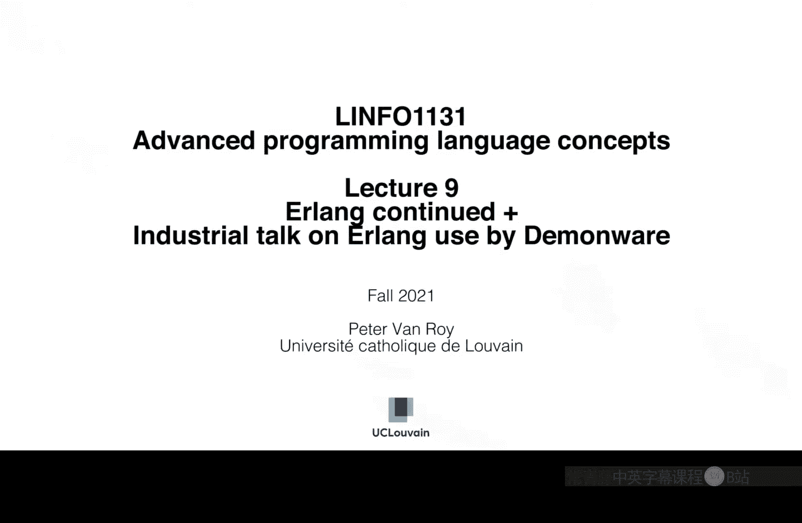

# 鲁汶理工学院【中英⚡高级编程语言概念｜LINFO1131, Advanced programming language concepts】 p24 P24 FO1131 Lecture 9 (2021) -BV1UDffBbEBZ_p24-

Welcome to the course。Everybody， I see you're very numerous。 It must be in deadline today。

 today I'm going to talk about。Airline really has an industrial strength of tool。

 so I'm going to talk to two parts。So the first part， we will look at the behaviors。

 servers and supervisors。And in the second part， I will give a talk。

Actually given by a company called Demonwaree。Who makes software for games？

And this will give you a lot of the practical ideas， okay？So， last time。

We saw the philosophy of Air's philosophy is if something goes wrong， let it crash。

Seems very counterintuitive， but actually works really well and do not program defensively。

 do not add checks if your system goes wrong， just let it crash。And to make your application。

 Airing has a platform， a set of libraries called OTP Open Telecom Pla。

 which is available for the airline site， and it has behaviors。Behaviors are。

Generic tools that let you build your application with a little only a little bit of work。

 there's servers， there's event tender F day machine is like the code for your application。

 an internal code， then there's the actual application， which is a group of things。

And then there's the supervisor， this is for handling the errors and the restart。

Today I want to talk about。Server and supervisor， and I show you how they are implemented。

 show you the code， really show you how it works。Okay， so behaviors hide complexity。

They make your application code really simple and even though it's simple it's concurrent and fault tolerant and very nice。

 so these generic behaviors are really powerful。O。So that's what we saw last time。

 but this time we go to the next level。I'm going to start by showing you a generic server and how it works。

And how it's useful。So we're going to build a behavior。

You can think of a behavior kind of like a design pattern， but a pattern for multi agents。

You saw maybe patterns in object oriented programming。

 patterns and object to programming are simple things。They only do a little bit。

 but behaviors are like really big， powerful， very powerful patterns that work in multi agent。

And the platform OTP has a set of these behaviors， and so usually you use these， okay。

 so all the tricky stuff。All the messy stuff is done in the behavior。

So you don't have to worry about it and it's tested and everything。

 so we now in university course I'm going to show you how to build a generic server behavior。Okay。

A server like for client server， so servers are used a lot。

So this behavior is actually used a lot in an airline program。

So we're going to go through some airlineland code and I will explain to you how it works。

Here is a very simple server in airline， okay， so you start it here， you spawn a process。

 which will be the server。It starts by doing an initialization with a certain set of arguments。

 so then you set up the server， okay， you edit it， so you have some initial state。

Servers have some internal states， maybe it's database， whatever state to have。

And then the actual server is a loop。Okay， loop， so this loop is basically just a recursive。呃。

 function。In air， the loops are done using recursion because airline internally is very functional。

 so you do loop， and then you have a receiver。You receive。A message from a client。

Let's say it could be many things handle some data message。

 then you have some local procedure called handle that does the work。

 it creates a new state and then you do loop on the new state so this thing will keep receiving messages so it's a lot like what we saw port object so this is like a server you can also say to stop message and then this will terminate the server so this is very simple server okay and the terminate function。

 maybe you have to do some cleaning up decate some database。

 whatever so you do that so this bit of code actually is a server in error。Okay。

But some of this code。Is generic？And some of this code is specific to your application。

 so the loop here is generic， all servers do it， so generic code is something that all servers do and specific code is something that this one does。

So this loop is actually generic， initialitization is generic， but the handle function is specific。

 every server will have different one， okay， so let's try to take this thing and make it generic。

So we're going to take this code and turn it into a generic part。And a specific part， okay？

So what does it mean so you have a generic part and a specific part。So what is generic。

 generic is what you need always for all servers， so spawning the server， store the data。

 sending messages， sending replies， stopping， making more stuff like fault tolerance。嗯。

Other kinds of management things。And the specific part is the actual meidization， what is the data。

 what are the client requests， the function that handles them？The actual contents。

 the cleaning up what you have to do。Okay， so you have two parts here。

So we're going to make now a generic server， so there's going to be a piece of code that does this and a piece of code that does the other one。

Okay， and the generic one is going to call。The specific one， like callback。

 you set up the server here in the generic one and you put it in the calls to the specific part。

 which are like callbacks。Okay。So it's like this， the code now has two modules。There's generic code。

 this is the behavior， this actually you don't write， the system gives you this。

 so this one you don't write it's normally， but I will show you how to write one so you can kind of see how it works here okay but the real Gen server of course。

 is doing a lot more stuff than on what I show you here。

but it's part of the system so you don't write it， you only have to write this one actually。

 the callback with a specific code， so these two there's a connection。Okay。

 there's a callback API so the behavior module expects。

Certain functions in the callback and the callback has to define them。

Okay so you have to agree from that， that's important though。

So this will give you lots of advantages， so the callback is always standardized so code reuse。

 you don't have to repeat the page here， it's only once， so if you have many servers in your system。

 all you need is callback modules， of course you have a lot less bug。And all the regular abilities。

 let's say you want to do tracing， you want to keep track of all the server calls。

 you want to do statistics， you want to measure the average time for a request or the time between your requests or logs that you want to do in audits。

 you want to keep track of what happened in the past。

All of that is automatic you don't have to do anything it's in the behavior module okay and you have support for supervisor so the fault tolerance so if the server crashes it will automatically be restarted whatever it'll be all very nice so all of this stuff you write no code for it so you see it's actually really nice and it's concurrent of course this whole thing is concurrent and distributed okay。

Okay， so you can see that there's really nice advantages。

Now I'm going to give you an example of this。I'm going to show you an example with a behavior module and combat module。

 and it'll be small okay， so each of these， the code will be on one slide。

So it's slightly simplified， but you can see it's still working nicely。To do that。

 I'm going to make an example。Of an application， so this is a very simple server， okay。

 so I have a little server here。And I have clientss。So the clients are like mobile phones。

 so that's the idea， and the mobile phones， they need frequencies。

 they need to allocate like channels。Channel 1， two， three。

 because you have a band and you have many channels。

And the two phones have to have different channels。

So the frequency allocator here is actually very simple， it just keeps a list of frequencies，1，2。

3 up to 20， for example， and when a phone needs a frequency。

 it calls the server allocate and the server sends your reply back okay and it tells you you can use channelnel 11 and this one will maybe use channelnel 12 and then when you're done。

You say decate， I don't want to use channel 11 anymore and the frequency of your news says， okay。

 channel 11 is available again。So this is actually a very simple data structure， okay？

So the scenario here is with phones， but this server is just keeping track of a list of a list of numbers。

 which are channels。Okay， so when a phone connects， it asks for a frequency from the allocator。

And then when it's done， it delos， and these are all airline。

 each of these are all airline processes talking to each other。

So we're only going to look at this thing。😔，I'm not going to show you a whole phone application。

 okay， but this thing would be something useful inside a phone system and actually the application comes from a real。

Phone system a simplified version。Of that。Okay。So it has a very simple API。Okay。

 if the client needs a frequency， it sends allocate message。

And the return is either okay with a number which is the channel frequency or error。

 so remember this brace notation is a top left。So this is okay is a constant。

 so this is saying this is like a record with OK and a number and this is a record saying error there is no frequency left all the channels are being used so if you have 10 channels and 10 phones ask then the 11th one will get this。

And then if you delocate the result is always okay， so this is actually not coda。

 this just tells you what is the interface okay when you call allocate。

 you can get this result or this result when you call the allocatecate， you get okay。

The other came always。You can also start。And stop the server。

And you have an initial set of frequencies， so for example， 10， 11， 12， 13， 14 15， so this is a list。

AndInernally， the server keeps track of the ones that are free still available or the ones that are already allocated。

 so it has two lists internally so it starts with this one， for example， maybe there's six channels。

 10 to 15。And the snow allocated it after it allocates one frequency。

 then the free list will be 11 to 15 and the allocate list will be 10。

 you can see it's just a simple tape structure， okay。So we see it's working so this is simple。

 it's just an example to fix the ideas。Okay。So that's the server that I want to do。

So here's an example execution of this， so this would be interactive you can run this in your airline system so I can frequency start。

 this starts the server， I can do allocate each time I call allocate I will allocate another one。

 so here I'm allocating six of them。And this sequence， it will return the last one if you went early。

 so these are all functions， so it returns okay， 15， that's the last one。

I'm assuming there's six available frequencies。If I try to allocate a seventh one。It returns error。

I can decate number 11， Cha 11， saying foam using 11 it doesn't need anymore。

 and then if I allocate again I get 11， you see how it works。So I allocate， decate。

When I don't need it， I use the， and when I need one， I use allocate。

And then at the end I stop the server， so you see how it works， right？It's clear up。Okay。

 so now let me write the specific module， this is the module that the program。Rights。It's one page。

 so it's simplified this is the full early code of the module， this is the frequency module。

 it has two interfaces。It has the external interface， this is the user。

And it has the callsback interface， this is the one called by an gen server。Okay。

 so this you write this， but the gen server module will actually call this internal interface and these external interface。

 this is what the clients use， notice each of these external calls is calling server。Server， server。

 server， So these red ones here are interface of the generic module。

 so you can see that external interface is basically just calling。

The generic module and the generic model will module we'll call this one。Okay。

 so these are code you always have to write， you have to write in it， terminate and handle。

And the brief ones are just doing the work， in actually doing the data structure manipulation key delete list operations。

其实咧。So you see it's pretty simple so you have external interface callback interface。

 so the external interface always looks like this kind of。

 so this is what the client will do allocate and when the client does this。

It helps the server with these arguments， okay， so that you have to write this because maybe you have to write exactly the things you need there。

And you have to write also this， the callback interface and the internal stuff。So usually these two。

 the violet parts are very simple， and the in code， the green code can be bigger。

So this is what you have to write if you want to server。So if you have a bank server。

Most of the code will be the brief code， and these two that phrases actually are very easy。Okay。

 so that's what you have to write， and now I show you what the internal the generic server。

So this one， so this is the generic server module this one is。Part of the system。

 So you don't have to write it。 It's there always。ok。It has an interface here， start。

Call stop and in it remember in the previous one we had here starts。 callll。

 there's also the inits which I don't mention here。So these are start call stop。

 I at the end the unit。And the breed is the internal part。Okay， so this is a simple server。

 it's not doing statistics， it's not doing blogging， it's not doing supervisors。

 it's not doing tracing， okay， the real gen server and OTP is doing a lot more than this。

But this one fits on one's slide， okay， and it's complete。So the server interfaces the violet stuff。

 the right ones are the callbacks。You see mod in I， mod handle， mod terminate。

So the comebacks are the module， so this is the frequency module。

 this is the one the programmer writes。So these are the callbacks going back。To the。ASp one， okay？

So the in， the generic in will call the module in it， and then it calls the loops。

 this is the server loop。Which is part of the generic thing， it asks it gets the request。

It handles it here。And it replies， okay。And also you can do a stop。

 and then it would call mud terminate。Okay， so you see this one is doing the whole loop。

 so in the previous slide。Notice there's no loop hereh， no loop。So the server loop is not here，h。

 here I'm just showm doing the computation， but no loop。The loop is part of the generic modula see。

And the real one， if you want to look at the real one in OTP， it's open source。

 you can actually look at the code of Gen server， it's a lot bigger than this， that's lots of stuff。

That you don't do work， so this is part of the system， okay？So when I started up， I could do in it。

 but then I can start the server， I can stop the server。I can call the server。

 so these are the three things I need when I'm using the server。

 so notice when I go back to the specific one， starts call。

 these are the things that are happening again so normally I do allocatecate and delocate and both of them will do server call one。

Okay。So you see， so this code is the specific， this is the generic， I make a picture now。

This is a picture showing the architecture with the interfaces。

 so this picture actually gives you good idea of how the whole thing is done。

 so I adhere the specific module， frequency， the generic module， part of the system。

 and I show the interfaces。So the client's external interface here。Start stop allocate to allocate。

 actually there's a little bit of code here， but it actually calls the server interface， okay。

 starttop call， this is the server interface， and then the server has a callback interface that and goes back here in it handle terminate。

Okay， so you have to write this and it has two interfaces。

 and it has an external interface and it has a combat interface。Okay。

And the server is part of the system， so it calls the callback interface and the specific module will call the server interface。

So you see how it works， there's two files， two modules。And three interfaces。Okay。

 so when you use this， all you need to do is。Write this code。Okay， you see how it works？

So that's how the generic basic idea of how the generic server works。

 so this thing is completely concurrent。And it will be robust， fault， tolerant and salna。

 so the real gen server does a lot of work for you to make your life easier。

So this thing actually with even just writing a small number of lines of code here， it does a lot。

So you see early really makes your life easier in these concurrent systems。ok。

So that's an example of generic server， is what do you think iss okay right。

 you understand how it works Now let me show you now two examples。

Of how the generic server simplifies your life two simple examples。

 and then I will show the supervisor， I will show a second generic one。

 which is really special for EarlI which is the supervisor。

 so the supervisor behavior is all behaviors are using supervisor so the generic module here will use the supervisor for a fault tolerance。

 all behaviors will be using it， so I will show you the supervisor but before that。

I will show you two small examples of how the Joverber makes your life easy。ok。

So let me show you a simple example with message passing。

 how the server helps you do message passing without race conditions， so I'll show you the example。

So if you do message passing。From one process to another。You can have problems。

 let's say you send a message from one。Process to another， and you want to reply。Back。

But somebody else can send a message back that looks exactly the same， so you kind of mix things。

 okay， I want to reply from this one， but the other one is sending a message that looks the same okay so the Gen server will solve that for you。

So I'll show you an example how it works， so this is an example how the you don't have to worry about this。

 so I'm showing it to you now， but the user doesn't have to worry about this it's solved by the Gen server okay so here's the example。

It's a race condition， okay， so here we have a server。

And the client sends a message request to the server and the server sends a reply， okay。

 that's reasonable， but what if somebody else？Is also calling the client and sends your reply。Well。

 the client cannot tell which of these is the actual reply， okay， this is a race condition。Okay。

 so here， for example， I send a request to the server， I get a reply， okay。But I cannot tell。

If somebody else sends a reply to me。Somebody else， I cannot make a difference between those two。

 so that's kind of a mixing when many people send messages to a client things get kind of mixed up so we want to separate that we want this request reply to be by itself and have no interference from anything else guaranteed。

Okay， so we want to be confident。That the reply is actually coming from the server and not from somebody else。

 So this code doesn't do that。 This is buggy。 In fact， it's not good。But the Gen server will do it。

 will solve it for you。And I'll show you how it works， okay？So the Gen server internally。

It translates it。It uses a unique reference so like a key okay in airline there's a function called make Ref when you call it。

 it returns like a unique value， a key， so this is actually very similar to the names in Os remember we saw the abstract data type and how you can make things secure with the unique ungeable constants。

 this is the same idea。So these unique and forge concepts are really useful for making your system secure。

 okay， with this， we can really be sure that the response is the reply。

So here's how it works when I do the call， okay， I create first a unique constant make Ref。

And then I send the message， but I add this little constant in the message so the data is actually I added to there okay so notice this tuple is now a nested tuple。

 there's more data， this is easy because of the dynamic typing of errornga。

 and then the receive will have the ref in there but the ref is already bound so the way the receive works is it does pattern matching。

It will pick。It will pick a reply。That matches this， but since ref is already bound here。

 so it will only pick the replies where you have this value in there。

 so it will only pick the good replies， okay？And if you do another one there will be no if I do another one where I put Ref on random constant。

 there will be no interferences， okay it will never pick this one， never。

 it will only pick one that has this special constant ref。

 remember the capital letter means it's a variable of so this is going to be the constant here。

 ref here。So the received statement remove is the first statement that matches。Okay。

 and notice if I have a client talking to many servers and getting replies from many servers。

 there's no interference， each server so the client will know which reply is coming from which server。

So that means the client can call many servers and there's no interference， you know exactly。

Where the reply is coming from and this is internal to the Gen server。

 that means a client can actually be talking to many gen servers， okay and there's no problem。

You just don't have to worry about it so the programmer doesn't even have to think about it， okay。

 but this is how it's solved internally， so the programmer will never even see this。

I'm showing it to you because I want to show you how it works。

But in an Ireland programmer writing a server will never even see this code， okay？

So that's an example of how the Gen server， a simple example。

 how the Gen server makes your life easy， many more examples I'll talk about supervisors a little bit later。

Okay， another example is synchronous and asynchronous calls。

Sometimes you want to call the server and get a reply and sometimes you want to call the server。

 but you don't need a reply， it's asynchronous， okay， so the gen server supports that， both of them。

Okay。So a synchronous call waits for a reply and the Gen server， this is the name of it is call。

 server or call。Okay。And then there's a reply coming back。

 so this is like the allocate function in our frequency thing because you send an allocate。

 but you want to know the frequency so you get a reply back。So if you use call。

 you will wait for a reply coming back。But sometimes you don't need to wait。

 so the gen server provides another one。In airline meets， it has a funny name， it's called Cas。Ca。

 well， it's like casting is like throwing up in English， but it does not expect to apply。

 so the gen server supports something called server cast。And for example， delocate。

In the frequency server does not need reply， you just delegatecate and you're fine okay。

 so it could be a cast。That means you don't wait for reply。And the callback。

 what you define it is actually no， you don't need to have reply， okay？

So the gen server supports both synchronous and asynchronous calls very easily。Okay。

So those are just two very simple examples it does much more，So you get some idea of Jen server now。

 well now let's go to another kind of generic library， now I want to talk about supervisors。

 so this is one of the big things of airline。Where you can build many processes talking to each other。

 and if something crashes， the supervisor observe it and can restart and make sure it works。Okay。

 so we saw already a little bit of this in the previous course。

 but now I'm going to show you the code how to write。How to make a supervisor。How it actually works。

Okay， let me first introduce the ideas。So if you look at practical concurrent systems。

There's many kinds of mistakes。But most of them， most faults and errors are transient。

 most of them are like timing or congestion or concurrent startup when things happen in the wrong order。

 things， network problems。So many of these can be solved by just retrying if something goes wrong。

 you just retry， many of the errors are transitient。

 of course sometimes it's not like that and you have to do more。But the supervisor handles both。

 but by default default， it will do retrying so it will favor。It starts by simple strategy。

And this is automatic if you use a supervisor and you're writing a system。

 it will automatically do this so you don't have to write any code for this。

So you have a set of processes。They are supervised by a supervisory process。

So that basically it observes them and the supervisors have authority， they can do things。

 that can stop and restart。Those processes， they can control them， okay？

And notice the supervisors will also be observed， you know， there's a famous saying。

 who guards the Guardiansh？The guardians are guarding you， but who are guarding the guardians。

 well in airline you have other guardians guardians so the supervisors is a tree。

And on the top level， there is one top supervisor that is not guarded by anybody。

 but it's extremely simple。 So this one， this one of course， is very。

 very simple and is no bugs just a few lines， just three stars。 So it's actually a tree， okay。

And these supervisor trees are implemented there there's no races， okay， when you start。

 when you build a supervisor tree， it's built in a very careful order。

 notice that when you actually create a tree， you have to start， you have to build things in order。

If you build a supervisor and there's nobody underneath， then what's going to happen。

 so you have to do it in a clear order， so the starting is very delicate。But the supervisor。

 genericre， behavior， will do it， okay？So that's basic idea。Okay， so now the principles of it。

So it's a tree， okay， of supervisors and the leaves are the actual pro processes running your code。

It's a set of supervisor notes as an hiarchy with the root。And internal nodes， so the root。

 of course， is very important。If you look at some real airline systems。

 remember the system I mentioned last week。The。The ATM switch。That was very， reliable。

And it had million lines of airline remember the one I mentioned last week。

 that one actually has a supervisor tree with just two levels， so it has the processes。

 it has supervisors， and then it has one top level supervisor and that's it usually you don't have to go more than that so it's a tree but it's not a very deep tree okay。

And then each supervisor node has a strategy。So it preserves the processes and as strategies。

 so airline will give you four。Basic strategies， one for one， one for all， rest for one。

 and simple one for one。OkaySo I'll give you explain a little bit what they mean in a minute。

 but basically one for one means if the process crashes， you just have to restart that process。

And one for all means， if the process crashes， you have to restart all of them。

 even the ones that are working， you have to force them all to restart， okay？

And then you have a restart frequency。The number of restarts is limited。

So I told you that usually the errors are transient， that means if you retry。

 very often it will work， but not always。So you keep restarting and it doesn't fix things。

Then the problem is not solved by a restart and you go to the next level， okay。

 so the number restarts per time interval is limited， you can only do a few times。

And if you go above that， the supervisor itself will terminate and you go to the next level， okay。

 so it's like moved up a level。So you want to prevent the case where the is process is always dying and the supervisor is always starting it。

 that's also bugga forever， if that happens there's a next devil supervisor that says a。

 something else is wrong here and what does it do well then it will do something。

Depends on the application maybe there's a disc that is faulty。

 and then the higher level supervisor will reallocate a new disk to the lower code。

 maybe notices that there's a faulty disk or something。Or maybe it has to tell the user。

 maybe there's no solution and it just has to inform the technician or the manager of the system engineer。

 so it depends on the application， but it will not repeat， so it goes to the next level， okay？

So here's an example of a supervisor hierarchy。So here the squares are supervisor processes。

 so they're all underlying processes， all the squares of the circles。

So the supervisor process is just observing the lower ones。

 notice it's using linking remember we saw linking last time。These are linked。

 it's called it's using linking to do that， so you can actually program this with what we saw last week。

 you don't have to invent anything new here right。It's using the linking here。

 so the squares are supervisors notice there's a couple of levels here。

 you have this one and then you have a higher level one。And here we have two strategies。

 all one for all and one for one。Okay。These lower ones are called workers。

 they're doing the actual work。So here， for example， you have one for one supervision。

 supervising two notes， if one of these crashes， it just will restart that one because these will be doing independent work。

Whereas the A， it could be superviseding many things， if one of them crashes。

 it will restart them all， it will force them all to restart， even the ones that are running。

 because they're working together。Sometimes you have many processes which are working together and if one of them has a bug。

 in fact， you have to restart everything because the others will not be able to continue， okay？

So that's how it works。So let me now explain a little bit more about the actual strategies。

Here's one for one and one for all， but I'll also explain what the other ones mean。

 so if we' one for one， if any child dies， it is restarted， so if P2 dies， it's restarted。

One for all， if any child dies， all the childreninated are terminated forcibly and they're all restarted。

 okay so those are two basic strategies。Here it's like。

 let's say they all have independent phone connections。

 so if there's one phone connection that has a problem， you don't break the others， okay。

 so you only restart that one。Whereas here you have an application working together。

 let's say it's managing a database and they're talking to each other to do transactions or whatever。

 then if one of them has a problem， you have to restart everything， okay。Here are four strategies。

 so one for one is the one you use if the children are independent， okay， one for all。

 if the children are collaborating， if one crash they all have to be restarted。

 even the correct ones。And then there's a couple of extra ones， rest for one。This is。

All the children that are started after the crash process， it means there's some order between them。

 okay， you start one and then another and another and。If one of them， so there's a dependency。

Between them， if a child has a problem， all the ones started later will have problems。

 so they all have to be started。Okay。So all the ones started after。

 but the ones started before are not。Are not involved， okay。

 it means there's a dependency between the children。

And then there's a version of one for one called simple one for one。This is where it's all dynamic。

 so in regular one for one you start it up， you start all the children okay but in simple one for one。

 you don't know how many children they're going to be so when it's running you will keep adding new children okay？

When you need to black phone connections， okay， so this simple one for it is used when all the children are dynamic。

Okay， so this is how it works。But now I want to show you some code hereh。

I want to show you the code of a simple supervisor so I'm going to show you some airline code again。

 but it's only one page， so I meant the examples so they' all fit on one page， okay？

This is a very simple supervisor， okay， it's very naive。It manages a bunch of children。

If a child terminates abnormally it's restarted， remember with linking you can make the difference between normal and abnormal restart so if it terminates abnormally。

 it's restarted， but if it terminates normally then it's fine。

 it's just removed from the supervision tree and nothing else is done so it's not restarted。

And if you stop the supervisor， then it will stop all the children so that you can actually control the whole application by stopping the supervisor。

 okay？So we're assuming that nothing abnormal happens when you start up。Okay。

So if the supervisor cannot start up normally， the whole startup is supported， so you don't start up。

 so we're assuming here for something very simple that when it starts up， nothing abnormal happens。

 okay。And we have a function called apply。Which starts each child， okay module function Rs， this。

 what you call this， it will start at one of the child children， okay。Basically。

 and when a supervisor terminates then。The supervisor itself can be linked to other parts because this whole thing is just one piece of an application。

 all processes linked to the supervisor will get an exit。Signal， okay。

 so remember the linking is done through signals up， So here's the code。Okay。

 so let me explain how to works so this is module my supervisor。

 these violet is the external interface， so there's a starts the supervisor， the in it。And the stop。

Okay。So， this one will start。So we'll register as a supervisor under name。

And it starts with my calling in it。And notice its traps， exit true， I remember what that means。

It means that when the child exits， crashes that the supervisor will not crash。

 but it just gets a message okay and then it starts the children。

 so have this green function which starts the children so this is actually a list comprehension and Arab so it will go through all the。

Child specifications， and it will do apply for all of them， okay？And then there's basically a loop。

So it's a little bit like server， there's a loop and the loop is receiving exit signals。

And it receive two kinds of signals， the normal exit and the non normalmal exit。

 okay the normal exit it will just delete the child from the child list notice the argument of loop is a child list so this is the normal children so if for exits normally it just removes it if it exits nonnorally here it will restart the child so here's the restart。

And。So the new。Child will have a new process idea so you have a new child list but the child is restarted and there's a third message stop and this will terminate so you have two pieces of green code here。

 so this one will restart the child。And this one will terminate。

So the restart is very simple actually first it takes。It looks at the process ID。

 it picks out the child from the child list， the one with that process ID。

 it creates a new child with the same arguments and FAA。But the new child has a new process idea。

So it will replace PID by new PID in the child list。

 that's what we have to do because when you restart。

 you create a new process and it has a new process idea。And finally， the green terminate one。

 we'll just do。Well just kill the child，huh？So we kill all the children。So basically that's it。

 so that's a very simple supervisor that will just restart children if they crash。

And otherwise let them stop normally， Okay， so this is， you can see kind of the idea。

 you're using these exit signals， it's all built on top of the linking。Okay。

 you see how it works there。Okay， so we want a。Generic supervisor， so the real supervisor does more。

 so again I'm going to split it into generic part and specific part。The generic part so you spot。

 you start to children， you monitor， you restart， you stop， and of course you can do statistics。

 you can determine when the crashes happen， what are the times。

 maybe they happen more in the evenings or in the mornings or whatever。And the specific part。

 which children， the specific handlers， how to start the dependencies and also the behaviors。

 maybe the children are Gen servers or whatever are。So to each of the children。

 it could be a bunch of processes that it's doing， that could be a gen server or something else。Okay。

Okay， so that's the supervisor。There's one other thing for supervisors。

 remember last time I told you that。Making robust application is two things。

 its supervisor and stable storage。Because when you restart。

 you have to restart in a consistent state， so where you find that consistent state。

 well it's sitting in the stable storage which survives the crashes up。

And Earl has three different levels of stable storage， so the ETS is the simplest one。

 it's very simple in memory data stable storage， okay。So when a process starts。

 the ETS table will stay。So the ETSs are stable storage and I was restarting with children consistently。

 so it's an in memory storage。But it's outside of the airline processes， so when a process crashes。

 the ETS is not affected okay。But still， you have to somehow connect it to the supervisor tree， okay？

嗯。An ETS table， you can link it to the process that creates a turn。

But usually it's not the worker process。In if you have a supervisor tree。

 this ETS table is actually linked to the supervisor because it's the supervisor that decides what happens to it so it's observed。

In the same way as a child， the processor so that you have child processes， but you also have ETS。

Tables， so these tables are also like managed by the processes。

That's just to give you an idea how the supervisor connects with the stable storage，Okay。

 so that's all I'm going to say about supervisor， you can say a lot more。

That's all I want to say now， let me now compare the errand approach with defensive programming approach。

はく？So in the airlineiring approach， the supervisors kind of errors。

 when there's an error in a child it immediately crashes。So the child does not handle its own errors。

 and last time I gave an example of that of the surgeon who was not operating on himself。

Unless you're in Antarctica， okay， so usually the surgeon does not operate on himself or her cell phone。

 usually there's another surgeon doing the work。And whenever there's an error。

 errors can be very complicated， you only do one thing， crash。

So simple and airlines they considered very simple。So this， how does it actually work？Okay。

 so there's been some studies of this。Also there's companies using this。

 so after the break I' show you how a company has experienced it， deepware。

 but first let me show you some studies， so these are academic studies done in universities so there's Harriet Wat University and it compared。

Motorola for the phones has this thing called data mobility and somehow it's actually written both in C+ plus and airline。

 there's two implementations， so the airline implementation has 85% less code size。

 so that means it's16 of the size it's 15%。And 27% of the C++ code is all error handling and defensive programming。

 but in errorlink that's only 1% of the code。Because of the supervisor。

 it means the application is very simple， okay？Erickson has also compared the approaches。

 so there's this switch called N110， it's written in。

 soplex is an imperative language like CC+ plus and airline and they show also a very large decrease because you don't do defensive。

Program okay， so the code is actually a lot smaller。

So you can ask the question if airlineirling is so great， why isn't everybody using it okay。

 but actually people are using it a lot and they just don't advertise that because it's kind of a trade secret。

 works for them， why should they tell other people but sometimes they do and after the break I show you a talk given by the technical person from a company called Deenware。

 which is does game software and it explains how they use AirirL okay？Okay。

 so let me make some conclusions now on this。Very basic conclusions， okay。

 so airline language and OTP， so it's message passing multi agent。

I explain a little bit how that works， okay， airline， it's not just message passing though。

 it has behaviors。So these are patterns for concurrent fault tolerance。

 the most important ones are of the server， the finite state machine for the actual application called event handlers for important things that happen in the system。

 then you have supervising trees that implement themtic crash philosophy and stable storage。

Then that you consistently respond， so you have three levels， ETS， D ETS， and Mennesia。

So the conclusion is that Air OTP lets you build highly resilient。

 concurrent and distributed systems。And there's many commercial systems using this。

 usually they don't advertise， but you can get a list of a long list of companies doing it。Okay。

 so I'm going to show you one。Of these companies。そう问。

Now I'm going to show you a talk which is basically coming from。A company called。Even where。

Let me go to the first。Okay， so there's now， this is a talk given by。

One of the engineers Malcolm Dausszi at Deware， which is an Irish company a few years ago。

 this was actually from 2011， but it's on very nice talk， so I'm going to present this。

And probably if you are gamers you have for example， used， maybe you play color duty black ups。

 if you do that， then youve actually run used airline in your class。

 okay so I'm going to give this talk but first I make a small break pull a fair goes。

So now I want to talk about games。Okay。嗯。I want to talk about games。

 I don't know if you guys are gamers。Some people are gamers and they are。

Passionate about games and big games are in enormous pieces of software they are made by huge teams over years。

 so it's like a big movie， so a big big game like Asssin's Creed or something is made by a team of programmers and graphic designers and game scenario designers and everything so it's like a large movie okay so it's a huge piece of software。

And here I'm going to talk about a company called Demenware。

Who uses airline for their doing first person shooters？

So this talk is a little bit different from the talks， from my lectures。

Because it's going to be a little bit technical so they are going to say what they do in airline and so we're going to talk about supervisors and ETS。

 but they also will talk about the gaming and the industry and the history of the company。

 so you get some actually some real stuff here。So I'm going to talk first about the history of De Ware。

And how they started out。And why they switched to airline。

 so they actually were writing software and they were having some problems。

And I will talk about their architecture。And how they used airline and what they have learned。

the mistakes they made， the good things they did。What they think is bad in airline and what they think is good in airline。

 so it's actually a very nice talk because this is the real industry experience。

And there's many companies using Ara， but most of them don't really talk about it so much。

But these guys actually presented it。So demonwaree， so what do they do？

They make software for multiplayer games。Different kinds of software， for example。

 client to client game state transport， if you have to transport game state between clients。

 that's actually complicated because you need encryption。

 you need net traversal network address to translator， so a NA。

Actually protects the IP addresses of a company from the IP addresses of the open internet。

And you can't go across the net very easily， okay， because of the IP address mapping。

There's techniques for that， so they're complicated， so they have software for that。

 also connection management and peer to peer topologies where all the clients are talking to neighbors。

 you have a large network of clients， okay。So the net allows to make connections across gateways。

And peer to peer， the clients are actually talking to each other directly without going to a server。

And ST topology is where there's a server， so you have two possibilities。

 one is where the clients are talking to each other， the other one which is called peer to peer。

 the other one is a star where the clients are talking to a server， so it's like a star。

So that's one thing that Deware does。Demon All somewhereware also does what's called lobby servers。

This is a bunch of functionality that exists in games， so it enables players to meet arrange games。

 so a lobby server is sitting next to the game server so it does matchmaking。

 it does the leaderboards， who's ahead， it does the statistics， the messaging， the audio video， web。

 science， friends， and the things against cheating， okay。So that's what demonware is doing。

They were founded in Dublin， Ireland in 2003， developed middleware for Game Studios。

 in 2005 they started hosting the lobby servers， so that means they connected to Big Game in 2007 they switched to Erling and I' explained how that works。

 and they were acquired so they were bought up by a bigger company called Action Activision Blizzard。

Usually small companies， if they are successful， some point will they get bought by big companies who need the functionality。

And in 2011， when this talk was given， they were one of the world's largest game service providers。

And even thoughre the world's largest they had of only around 60 employees。In Vancouver。

 in Canada and in Dublin， Iowa。So that's an history of demon Ware。

This is an example of some games that use。Demonware， software。

 so all bunch of all the color of duty ones， so maybe some of you have played Col of duty。

 I don't know， so raise your hand if you played Col of duty。

 wow lots so you've run early you've run their software okay so these guys are used by call of duty。

They're also used by other games， guitar， hero， transformers， whatever。

Bunch of other games and more games， okay， so they provide very important。

Services for many different games。Okay， demon aware。

 so see this is a real company doing stuff that's important， okay？

So what do they actually do so online the whole online infrastructure for Call duty B ops in 2011 was the best seven game probably anymore four of the top 10 games and they explained 2 million concurrent users 150 million registered users so concurrent means they're actually online at the same time okay that's a lot okay2 million are connected to this thing at the same time and it's cross platform running on many many things okay and those days it was PS3 whatever。

 but now it's probably advanced， but here in this talk they explain a lot of what they're doing early so that's whym。

Doing this， okay。Now， how did they get into early with they're building software。

 so their software originally looked like this？Not very stable。 And now it looks like this。 Okay。

 that's sort of picture， but they explain it。So how does it start？It was in 2003。

Students from Trinity College， Dublin， you see， university students started it。

 so you guys could start the company， they wanted to sell a client science network Middlework to Game studios。

So they started building something。😔，But in the beginning， it was hard， okay。

 a lot of polite interest means。People and companies said， yeah， looks interesting。 goodbye by。

 you know， a few customers。They wanted online servers， not middleware。

 so middleware is software you put in between the network and the application。

 but that's not what they wanted they wanted。Svers， so full things talking to others things。Okay。

 so the company started making a server， a lobby services platform。Okay。

 and in those days there was Xboxs live and they were kind of copying that and PlayStation needed something。

 so they started working on that， okay， log services platform。And in 2005， they built their first。

Server written in C++ and My SQL， so My SQL NY SQL is a database that with a large high function database。

 it was a homegroo， single thread it not to current。And whenever you have a service。

 you go into some processes， so across an operating system， but not。

And all the application logic was the C++ and used the MyCQl database。Okay。

 so this did not work very well， one operating system process。Mcro OSco Windows。

 per user is very bad， okay， you cannot have so many of these， so they had a maximum of80。

Concurt teachers， which is not much。And then this system would not go up anymore。

But their first game， luckily， there was not enough。

 it was a very small game so they didn't get this limits， also C+ bus crashes a lot。

If the code is immature。And the guy says the code wasn't sure and it crashed a lot， okay。

 so C++ it's hard to really make it。Reliable， you have to work very hard， okay？

So that was their first thing， so that they tried to do better。

So the next one where they would use Python in addition to C++。

They rewrote all the C+ trans business logic in Python， they may take a pool of voice prosstate。

 so they would not create them， they would all be existing and using them。

The core server was a C++ program that handles thousands of concurrent connections。

 and it did many things， encryption decption， dispatching， asynchronous messaging。

 some cheats like duplicate， login detection licenses。嗯。So okay， so this kind of worked。

But there were still problems， this is a very concurrent program and C++ is not a good language we're doing concurrency it's very hard and the code is very complicated and impossible to maintain。

The error handling was poor， they didn had the debugging was very hard。

 they didn't really have metrics， that means they want to have statistics of how the thing running。

 they didn't really have it and scalability， they couldn't actually make it grow bigger okay and also whenever they had to change the configuration to update the software。

 change even the configuration， how it works they had to disconnect all users， oh that's terrible。

 so they change something in the system and you're playing a game。

 they just disconnect you while they're doing that， they're it's a maintenance operation of this。

So that's very bad， you want the software to keep running even when they update。

So remember we saw that airline actually have support for that， okay， so this was 2005， 2006。In 2007。

There was a former developer。Look at this。And he rewrodes the Cs Passover Air。

And in a few weeks he just got a pre put that， so this was like a free electrona。

 so the team was not using airline， but one of the guys who used to be with the project。

 he knew about airline， he rewroaded airline。嗯。He got prototyped in a few weeks and after four months of development。

It actually started being used， it was solid enough to be used。

 and it went live for with real users in 2007。And they noticed it had a lot of good properties。

 it didn't crash。It was you could reconfigure without affecting the clients， amazing。

 you could change how the software has be figured and the clients could keep on playing。

While you didt， you had logging administration tools and far fewer lines of color， okay。

 so this was very nice， but now I want to go into a little bit of detail how come。

 how how does that happen okay？Okay， so let's set the stage， so we're in 2007。

Deware it's doing not so bad that many customers， Activvis， Yubisoft， Codemaster， et cetera。

 they were required by activationiv， they were supporting some big games here。But still。

 they did not have a monster blockbuster yet。 Okay， so they had。20。

000 concurrent users but that's not actually a monster blockbuster yet。

 and they were a small company， they had 11 developers， three operations， people and three managers。

 so that's kind of still a small company。Okay。And then。In 2007， a blockbuster arrives。

 so this was call of 34 modern Warfa， okay？It was the most popular game on the PS3。

 which was new in those days。And it gave those guys a lot of pain， okay。

 the people playing it were very happy。But the number of users was growing， growing。

 growing for five months。And whenever it gets bigger， they got a bottleneck， they found the problem。

 another problem and another problem when it's growing， lots of outages， late nights。

 so a lot of stress for the company， okay， so when you use the game you don't notice that。

 but for the company it was a crisis。So the small company。Had to grow up， okay？

And they managed to survive and grow and because of airline， they were able to grow it。

Without the switchterite， it could have been a disaster， it could have crashed and burned， but no。

 they managed to grow with the blockbuster， okay？And after that， they kept growing。

So now they go from 20，000 to  two and half million concurrent online users， 50。

000 requests per second， okay， which is a lot。1，850 servers spread across many data centers is big things。

 big， okay， 60， all of this， they only need 60 people。嗯。Also they became very smart。

 they grew incompetence。They added many features。Okay， stand on components， but now they have many。

 many things at， okay， so that gives you the stage of this thing。Now。

 let me explain how they're using airline。呃。Okay。So the airline is used as the core server。

So it manages hundreds of thousands of concurrent ECP connections it schedules tax for Python。

 it does metrics， so SNmpP is a network management protocol for getting。

Monitoror the behavior of the networks。It has a presence server。

 so this is using the Monetia server and does message patterns， of course。

It has other kind of functionalities， there are other service， transcripts and game data。

 testing bandwidth， the ranking， the leader boards， okay， so it's used for all the concurrency stuff。

And gluing sequential codes， they had all these little sequential pieces of code like written in Python。

 and the airline was on top， was connecting and gluing everything together。オッケー。So for example。

 intrinsic connections。You have two airline processes per connected users。

They're using a simple one for one supervisor， so remember we saw that it means you have dynamic children and you only after restart each child when it crashes。

Okay， the work， the actual。K communicationication is done in Python processes。

 but there's a supervision tree on top。ok。They have some optimizations， test queuees。

 they can update Python code without affecting the users so that airlinelink is actually managing。

Like you have a piece of Python making the communication and you can update to another piece of Python and the air allows you to do that without affecting the。

 okay？It also those periodic tasks。that's one thing they did。

They did what's called a presence server， so in games。

 a presence server is important because it means that you could not be logged in twice。

You cannot be duplicate license cases only one。So really a consistent snapshot of who is connected in the game so you have these big distributed games with many。

 many online players concurrent league and a player cannot be logged in twice， that's logical。

 but making sure that you have that is actually hard okay。

 because it's very big and distributed all over the world。

You also have in game messaging because the gamers can send messages。

This is using what's called fragmented menetia。Okay， so fragmented mennesia will actually。诶。

Implement the Monesia data in different parts。So this scales very well in robustt okay and it's running on clusters。

 one of the clusters is 6016 core dell RC10， so this is a cluster computer， it's not a home PC。

 this is a。Cluster where you have， this has a0 cores， okay， so it's speak。That's their biggest plus。

Okay。AirM has lags for network management， SNMP， and they use it for monitoring， the users requests。

 the timing， the number of logins log out， the reasons for disconnecting。

 so basically they're monitoring this whole big thing with millions of users。

And the most important function they call is ETS update counter。

 so ETS is an inmemory database and you can update。Values。

 updates so counters are very important you're count。

 so this is very important so they're keeping a lot of statistics so this is one of the functions they call at the the most often okay and then they generate these big metrics so you have this is just a snapshot you have these graphs of how the system is behaving。

オ。Okay， also， there's the notion of configuration。So each game has a configuration。

 so all of the different parts of the game， how they're connected together。

 how to spread over the world。And the configurations sometimes have to change。

 you have to set it up when the game is starting， evolving with time。And in airline。

 they have all the configuration codes on an airline。

 you can set options instantiation pair cross cluster upgrades， you can upgrade。

 roll back on failure， if a part of the system fails， you can roll it back。

 that means you can bring it back to a previous consistent state， okay？And language agnostic。

 that means the aagon code controls modules written in other languages，Okay。

 and then you have something called puppet integration。So this is。

 I'm not an expert in publicupp integration， but it's an approach for。

Operating software independent of where you run。Okay。

 so the configuration is trying to be simple and painless。

Now they have a console that means you can actually log into this system and see on your screen。

Graphs and things moving like a dashboard， what's going on？This is using YaAWS。

 so YaWS is the standard airline web server， yet another web server， YaAWS。

 which hass manuals to very well low concur， so it's used for the console live debugging。

 so if there's a problem you can see the problem on the running system with the real users， okay？

You can remotely do many kinds of management things， you can manage。

 see how popular certain features are message of the day， okay。

 so you can actually do a lot of the management。Of the system remotely while the system is running。

けれ。And they have a lot of game related super， the leader boards。Who is the best who's doing well。

 so these are all ranked in real time with 15 million users， so this is usually ETS。

Then you have this trees module here， so you have basically data structures。

And you have also in memory key value store， so key value store is like a hash table。

 it's mapping things。And this allows you to group users in categories and do other things like presence。

And you can do testing bandwidth， each client will get an estimate of the bandwidth。

 so you see there's a lot of things going on here。Okay， okay。

Now let's go into more of the technical stuff。About how they're using airline for this。😔，Okay。

 when you write Ireland code， this is what they learned。The core data types of airline IO lists。

Records。Not tuples， okay， binaries， bit strings， the refs， atoms use them。

 so all the coordinated types are very important。Think functionally。

So this is this industry guy saying it's okay， so it's maybe when I say it， you don't believe me。

 but when this guy is running a company where you have millions of concurrent users and it works。

 his software works， so probably something there。Think fortunately and concurrently。

You have to think concurtly。Tlor Perion functionally to structure high orders。

 new processes are really cheap。People who don't know airline it's hard to believe that a product and airline process is very。

 very cheap， but it's very cheap。オ。And simple things can go a long， long way。Okay。

 so those are basic things。Now OTP。So I mentioned behaviors，Gen servers is something。

Their experience is use it as much as you can religiously， Gened servers， supervisors。

Never do send and receive。Explicitly， always go through OTP， you see if you use OTP。

 then you have abstraction on top。You have behaviors on top， never send and receive。

 that's very low level， it's like go to， it's very low level， don't do it。Never run spa yourself。

 let it let OTP do the work， let it do behaviors。Do the work okay and whenever we have a component that's reused。

 turn it into an OTP application， so use these OTP applications and the modules should be small。

 no side effects。Try to keep the modules sequential。The modules are not concurrent。

 The concurrency is done in the behaviors， okay， and not。By the users in the modules， they write。

 okay？So the modules will be either your modules are sequential or OTP behaviors。

You can see the guy is reting behavior with the you。It's cominging from Ireland， okay？

And then there's the rule of kiss， keep it simple， stupid， okay， that's what kiss means。

Avoid intermounttinal dependencies。Depenencies are very bad。

 so a node which is like a machina with an airline virtual machine， might depend on another one。

 that's very bad， but you can do it easily in airline but don't do it。ok。Expect problems。

 high latency， internal network issues。The bad things will happen and make sure the airline can handle it。

Okay。Don't do inter process dependencies， the processes should not depend on each other。

 be very afraid of processes which rely on each other， use casts。

 remember I mentioned cast before the break。A cast is asynchronous。

 you send and you don't wait for the reply， so the call waits for the reply。

 but that actually makes a dependency， you see that when I call， I have to wait for a reply。

 so I'm dependent on that reply and if the reply does not come， I have a problem。😔。

So that's a dependency， so you should minimize calls and use casts instead。

 a cast is you send a message and you don't wait for the reply， so you have no dependency there。

 okay， dependencies are very bad okay？So that's lessons they got， they made。Okay。

 another lesson is the notion of a bottleneck。Process in a big airline program。

There's many processes， but some of them will be kind of overloaded。

 they're called bottle bank processes， it's because many messages are going to this one。Okay。

 so what you do if you have a bottleneck process， well， instead of having one， you have to make a po。

 so you make several of them。And so the messages have spread across。

Make sure that the work is not done there， but somewhere else， okay。

 also purging the message to maybe it's possible to get rid of some of these messages。

 so a bottleneck process should not do a lot of work， it's getting a lot of messages。

 it should pass the messages to other people。Okay and then there's some other process if it's doing actual work。

 computation， okay， make sure it's left alone， don't overload it with messages。

 okay and make sure it decides what it wants to do more。

 so this is very important that means the system is lazy。

 you see what it means is you don't give work to a process。

But you wait for the process to ask for more work that's also for humans if you're doing work and someone comes into your room and keeps giving you more work so you a huge pile is growing。

 it's very bad but much better is if you do work and when you finish then you ask for something else So it decides so this is very important so the basic structure of the system is a lazy demand driven。

 you see thath it decides when it wants to do more but consumer decides when it takes more okay。

So that's the idea， so message and work processes， this is how to manage them。And in airline。

 it's easy to do that，h？Another lesson is ETS， so I mentioned ETS。

 I mentioned stable storage and you're saying， yeah。Whatever。But ETS is very important， use it。Okay。

 it's extremely fast。It's linked。To the processes， to the supervisor。

 remember I mentioned this that means it's automatically cleaned up as part of the supervisor management。

You don't have to worry about cleaning it up。 It's automatic， okay。

 this will avoid single process bottlenecks because it's very， very fast。オッケ？Also it has limitations。

 ETS is very simple， if you want to do complicated things， don't implement it。

 don't reinvent mennesia， okay？If you need to do very complicated kinds of queries。

 use Malaysia not ETS。So the ETS is a very simple stable storage。Okay。Also。

 the complicated one is Mania， okay， ETS simple， manetia complicated， it's a very powerful database。

 it handles many things， it's distributed， it handles fragmentation， its atity。

 it can do transactions， and it can do arbitrary complicated airline terms。

 so this even where it really likes mannesia， okay， that's one thing。But it's complicated。

It's a very complicated application， Manutia， it's a part of OTP， but it's complicated， okay？

So don't use it except if you need it， okay so Manetia is like a traditional relational database management system。

 okay， it's powerful fully features， but so complex you'll swear and pull out your hair out at times okay I don't know if the guy is bald or not。

 but。Pulling your hair out is not a good idea okay， but so the other one is ES， so you have this。

Two extremes， extremely powerful but complicated and extremely simple and fast。😊。

But sometimes it lacks what you mean。 So you have to。Played with the two， okay， Menia and E two。Okay。

Testing。Testing super important， so you've done testing in your project and maybe you think testing is a pain。

But testing is important。Automated tests。ting full clusters and what they do is a fault injection。

 what they do is they will kill a random airline process of this big application， they will pick one。

 say kill it， and the thing has to keep working okay。

And this is a really good way of testing a take your program and kill a random process。

 and it has to survive， okay？It's nice， it's nice， approach show。

And airline has tools called dialzer and aircraftcro， so those are important。

And then heavy duty end to end load tests。So basically they run their system with2 million simulated users。

 the actual system and they run it heavy and it has to work with fake use or simulated users up this is also important okay。

 so you see testing is very serious here。Make it work， yeah？Okay， and then there's more things。

 miscellaneous things， keep your clusters apart。Process priorities。Notice processes have priority。

 some of them are high priority and low priority。But 10，000。Small guys can kill a big guy。

 okay if you have 10，000 low priority unimportant processes and they're running badly inefficiently。

 this will clobber one important vital one， so be careful about priorities that you don't overload the big guys because there's too many small guys okay。

Hot swaps， CO replacements。This is amazing， of course。

 but don't overdo it often more than it's worth， it is still hard kind of， don't do too much。

That things like。Kale switches， a Kale switches where you can actually shut down part of your system by pushing a button。

 okay， metrics， graphs， you have to see what's happening。So you have to have graphs like microscope。

 telescope in your system。Remote shelves really go into your system， okay？LetSee， where am I okay。

 good？So these are all gooded pieces of advice， right， what do you think？嗯。

But you think it's interesting。Okay， another lesson， this is psychology， be polite。

 it means even in demonware。They have 60 people， but there's only three or four who are doing airline。

 this huge amount of software， and many of the tools are written in Python C++ stilla and it's controlled by airline。

Your coworkers don't care about airline so the guy writing the Python code he doesn't care about airline。

 it the guy writing airline code he talks to the guy highly so Vi you're living in a multi language in fire okay so airline people they tend to be kind of religious airline is it you know。

 so the idea is don't be。To religious， okay， don't force the user to use any syntax or read airline or understand airline。

 you keep yourself neutral。It's still an niche language because even though it's control all the concurrency。

 the actual。Computation is often done in other languages。

 so it's doing the fault tolerance and the concurency。

But they still living with many other languages。Okay。

 and now of the things that are bad about airline we're missing。

Some things we'd love to see in Carolina。First of all。And Asia， they would like it to be better。

Network Alage juice node crashes doesn't handle them up good enough。

 maybe Cassandra is a cloud database， maybe they want connection。

 things like functionality like eventual consistency， this is a database functionality CA theorem。

If this is a database thing， it means that。You can't have your cake and eat tube。

 I won' to explain all that， but they want more functionality， okay。

 they want more automatic cleanup logic。Okay， they want to。

Keep the data separate from the process responsible for it， so you have to keep things separate。

 make the cleanup simple。Okay， OTP。So you have these low level functionality， receive， send， link。

 spa， this is like a machine language。Actually， real airline programmers will never use those。

I showed you those， okay， but really other programs for you behavior so you never have to call them it's like machine language。

 send the language。嗯。So you don't use them。They also want more flexible supervisor trees。

They want more specialized specialized ones， more restart， they want more， okay。

 you give them some the part of it， but they want more restart strategies， more dependencies， okay。

Okay， they want it， also they want some processes to respond quicker。

 so they need certain kinds of priorities。Okay。Okay， so here's an interesting point。

 airline is very specific， it's very good for hard concurrency， so large system million of users。

 but usually you don't actually do the business logic and computation in there。

 you don't do machine learning in airline okay。So you have to。Connect airline to other languages。

 so this should be easier， so this maybe is not easy enough， they say。Okay。

Then they have some comment on static typing， okay， so dialzer is actually a type。Analy it， it runs。

 it tells you there's errors in your program before running it， okay。Which works very well。

 but they want more static typing。They also want more dynamic features。

 okay so they want more of everything basically。佢。See what time am I now， okay。Okay。

 and now with the learning of airline， so this is the industrial experience， so in airline。

 hard things are possible。But easy things are maybe not so easy。

 so moving to earlyling is a big commitment for a company that's not using airline。So tutorials。

 coding styles， standard guide， documentation。Friend the syntax。

 so now there's actually something that's going this way， so you make me have。

Notice that there is a language called eixir now。Which is。A language that has a syntax like Ruy。

 so a more standard syntax， but it's using the same virtual machine underneath BeaM。

 and this has a very big community， so Airlock and Alexixir are now both living together。

As concurrency languages， so this kind of solves some of this and aixster is actually quite successful。

 okay？Okay， what do they love about airline？They love many things， effortless concurency。

 complete solution for hard concurrent problems， if you have a hard concurrent thing。Do it。

 open source， you can look everything is there， remote shelves， robust and reliable。

 you can have systems that stay up。For months on a time， without crashing。OkayThat's not bad， okay？

Blood ups。24 hour stats， okay， so they have it's maybe hard to。To read， okay。

Who said gamers are lazy for the last 24 hours， all the players in black Ops have killed 323 million opponent。

 more than the entire preparation of the USA they shot 28 million enemies in the head they used。

65 foot3 Homorrhage2s of Frank Bdedes， okay， they shot crossbow bulls with a total length of the Great wall of China。

 okay so gamers are not lazy looked at they kill 300 million opponents， not bad。In 24 hours。Okay。

So that kind of finishes， so in Deware， airline helps make tens of millions of gamers happy。

 if gamers are happy， then they are happy， okay？And so demonware like， airline。And this was in 2011。

 I don't know if this is still true， so this talk was given at an airline conference called Airline Factory。

 London。And so they were talking in front of an audience of airline people。

 and so they were looking for more airline。Okay。So that's it let me。Let me stop there。

 so that gives you an industrial viewpoint on airline so you can kind of see the good and the bad so if you're ever writing big things that are games。

 big concurrent things，These guys show you can do it， airline has their muscle。

But you don't probably want to write everything。Some things can not be done so well in Ireland，Okay。

 thank you。 so let me stop there。So if you think now you're going to run out and start using airline for your big system。

 notice these guys， they were a university？And they met a company， Trinity College was a university。

And they made a company， but they started by using C+ plus。

Took them years to figure out that was not a good idea。오케이 출발했다。

