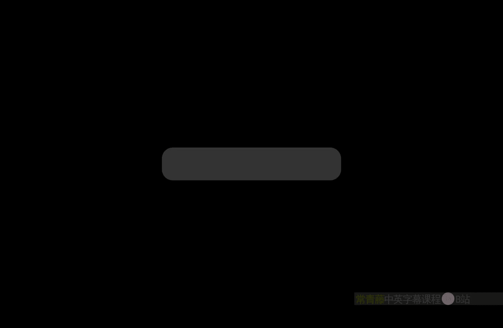
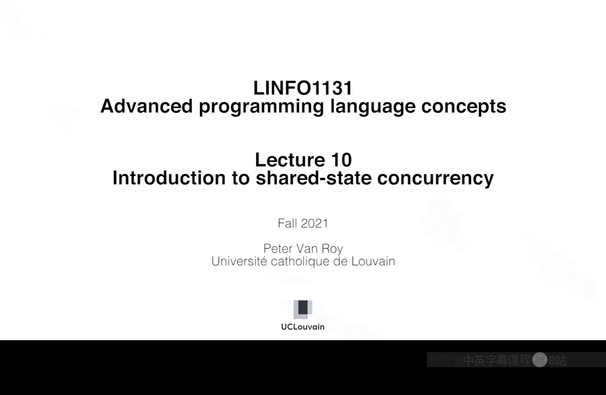
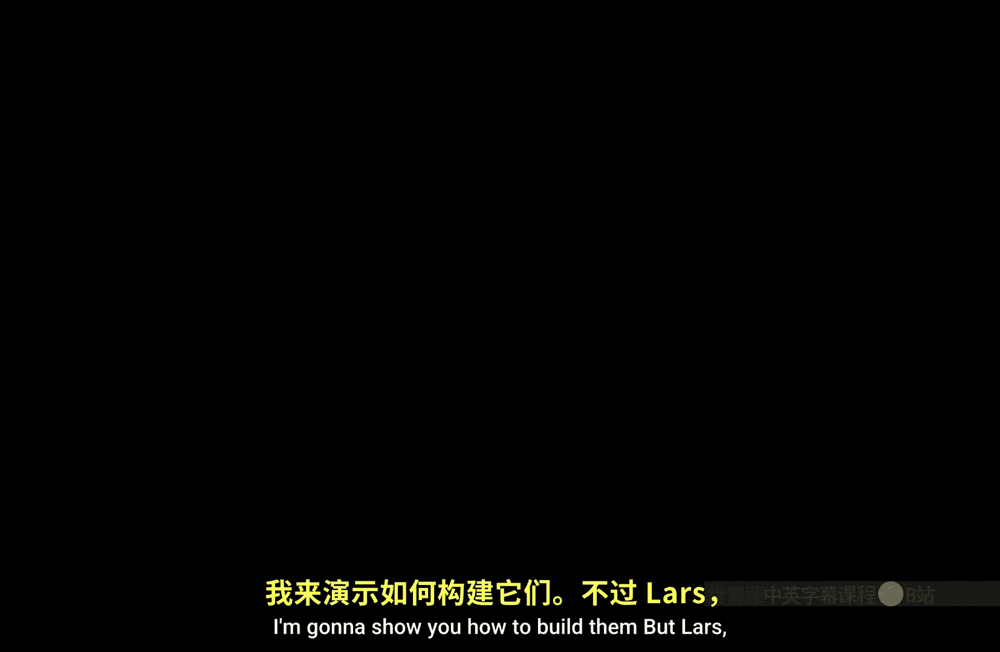

# 鲁汶理工学院【中英⚡高级编程语言概念｜LINFO1131, Advanced programming language concepts】 p25 P25 FO1131 Lecture 10 (2021) -BV1UDffBbEBZ_p25-

你。Today we're going to talk about another form ofcur programping。Called shared State Concurency。

This is the final one we see is， of course， it's the worst one。

You can tell us the worst because we have noise there。but it' still used a lot in the industry。

So I'm going to explain that。That have one。So let me your first introduction。

 we have seen three good ways doing concurrent programming in the beginning we saw the termministic data flow。

 this is the best。It's completely deterministic like functional programming and it's concurrent。

 we also saw this in a previous course。But you cannot always do that。

 sometimes you need nonterminism and so that you could do multiageent programming this one we saw a lot this in this course。

P objects， and we also saw a lot about an industrial language that uses this periodheical para。

This is a nice paradigm and then best one。The best one in my view。

 which is not supported by any language so far， is theministic day code most of the time but you add courts。

 our agents。In small amount， all you where needed。So this is the best one。By far。

But no language supports it yet， maybe someday， some day。Today we will see a For paradigm。

 which is in fact the worst of all of them。The hardest to program， but it's used a lot。

 this is called shared stake and currency， this is what happens when you have threats and s to。

Ss and threads together are somehow very hard。 It's much harder than。

Multi agent where you have parts and cells to get， okay？So we're going to see how to use this。

And in order to use this， you need to build abstractions。

And we're going to see three four of abstract blockss。Transactions and money。Okay。

The basic one is locks。Building big atomic actions and then build on top of that are transactions and monitors。

Transactions are very important， they're used to the database， they're very useful。

 so this isn't going to be a very important part。But monitors are， in my view， deprecated。

You should never use them if you can avoid them。And never， never。

 if you build it if you make new application， do not use them。

So why am I teaching it to youth because a huge amount of legacy code is using this？

Still today in Javavan it's called synchronized objects。

So why is it used well because when it was invented， people thought it was useful， okay？

And those days it was and so languages built this in， but it turns out this easier this is very hard。

But still I'm going to teach you all about money。オッケ？So logs and transactions are good。

 but monitors are not simple。Short summary。To introduce the paradigm。

 I want to refresh your memory on very quickly， because the whole thing is based on。对。Mutable state。

We saw this before I'm just going to refresh your memory quickly variables that you' can assign multiple times and we call it Excel because I don't want to use your variable。

 okay？The word variable has a huge number of meanings in mathematics。

 do you have variables in equations， but they're actually constants in the equation， they don't vary。

 except you can have different forms of the equation in computing a variable can be either an identifier or something in memory or a cell。

So。I don't like to use variable the word variable because it's confusing word。

 so I use the word cell okay we saw this already， a cell is a box with a name。

 the box has a name and a content， so this is like address in memory and memories。

 and memory part of memory， it has an address and then the content。

We have a pointer in a language with pointers like C。

 so the entity is like the address and the content is what's stored with。So this is the idea。

And we make semantics of this， so I'm going to refresh your memory very quickly on this。

It's a very simple thing， in fact， we add three operations， creation of a cell。

A new C C with initial content A， we can do an assignment。

Replacing the content and we can access the content。Okay， using this grid declarationpoation。

In many languages， the reduppression is implicit if you do something like x equal。

Y plus V in C or Java， these are actually going to do access automatically。

 and this is the assignment。But。Languages they like this because it looks like a mathematical equation。

 even though it's not。Because these are all cells， okay。

 and this is an assignment to hear your accessing the value， so on the right hand side of the equal。

 these will be implicit。But I don't like that because it's not it's confusing in fact you have to understand it。

 so here the access will always be explicit if you don't do this， use this a sign。

 you will not read the content， you will get the address， the name of the cell， which is a constant。

So it's not the pointer， you can see it a cell also kind of at the pointer。

 so we saw this already it's just a refresher and we saw operations we can do。

So here you have a cell x with content zero， I can write it like this hubbox。You can have areaing。

Alia St happenss， we have two names。To the cell so you can have actually two identifiers referring to the same cell and in a language at Java you could have two variables with the same pointer inside。

 So this is called a state because they are actually referring to the same thing。

 So if you've assign one of them like why。X is of course changing too， x also changes that。

 so that's something you can do with cells and that's how to use them。

Okay and then we made a semantics， so very simple refresher， you can formalize this very simply。

 you have two stores， Sigma  one， which is the regular variables。

 so if either your actual mathematical variables on single assignment at one value。

 then you have a cell store and a cell is a pair。In the semantic sun。

 So Sigma 1 is variables with their content x， which is here。

 its equal to some weird content called C or t is equal to1 or whatever。 C is an unbound variable。

 And here in Sigma2 we have pairs。So a cell is a pair。

 so the first part of the pair is the name of the cell and the second is the company you can see that it's not actually a variable it's more complicated than a variable a cell up because you can assign it in the semantics。

 this is more complicated than just a variable up because when you assign it you can change the second part and the first part always stays the same。

Okay， so the name of x， which is a cell is a constant and here I'm putting in a constant C。

 so these are unforgeable unique constants that determine the name of the cell and the semantics。

 you can consider it to be like the address。But here it's more abstract。

 I don't want to assume any kind of memoryor potential。

 so I'm just making need an abstract constant and here you have azeta， so you have two two cells。

And the content of x is T， the content of Y is W， and if you do an assignment。

You will change the second part of the pair and not the first one。

So semantically that's what's happening in a cell， so you can see a cell is a more complicated thing than a variable variable is just a name for a constant in factor。

You call it veritable， but it's actually a constant then。So that's why I mean。

 the word variable is used in mathematics because when you have an equation。

 you can instantiate the variable to many different possible values。

 but for each use of the equation， it's a constant time。So that's what it is semantically。

 So you can see it's a little bit more complicated than a regular variable。 Okay。

 but now now I want to do something new。Now we're doing concurrency today。

Concurrency is very important。And for a concurrency， we add a fourth operation。

I mentioned it before but now I will really emphasize this one because this is really very important operation called exchange。

 this is an operation with two arguments。Whereas read and write only have one argument。

You read or you write X and Y， the exchange has two。

 so exchange C X Y is the same as doing a read and a write。And they're done atomically。

 that means the scheduler can never stop in the middle， it's all or nothing。

 it's single indivisible action。That's really important for a concurrency。

The read and the right are the theomic， it turns out it's so important that even the processor architectures are going to support these instructions。

Okay， we will implement our abstractions using exchange。

When we do locks and transactions and monitors， we're going to use exchange to implement them， okay？

When we implement reenttro buck today for example。It's possible to do it without exchange， in fact。

 theoretically， all you need is atomic greed and atomic writing。But it's much。

 much more complicated if you want to see how complicated it is。

Go into Wikipedia and look for Deer's algorithm， Deer's algorithm is doing critical section with only read and write。

It's really complicated to say， a， terrible， but if you have it exchange， everything becomes simple。

And so it's so useful that even the processor hardware， the hardware architectures。

 all hardware architectures are supporting this kind of instruction。Of course。

 there's many variations， but you can see they have funny aims that test and swap。

So the test is actually a read and the swap is doing the right。

 you're switching between a register and memory， compare and swap for test and set。

 set is like a right and the test is a read that you're compare。They're all doing read and write。

All processor architectures， this one here， which is an intel， core I 7 is doing it。

 the arms are doing it， all of them are doing it， okay。Show you how important it is。

 it's supported in hardware because otherwise。Otherwise， things are much harder away。

So we're going to use exchange， so that's one thing。

 so that gives you a refresher on cells and remember that exchange。Okay。And now I want to talk about。

How do we do shared state concurrency， why is it hard and how do we do it and the way to do it is by building big atomic actions。

Exchange is a very small atomic action， but usually you want bigger ones。Okay。

So let me explain now step by step。Share state concurrency。

 so that's the paradigm we're looking at today， it's a programming paradigm in which you use threads and cells together in the same program it's widely used。

Okay。And JavaScript super+ all。Older languages， some of the newer ones I do with better。

 they are more multi agent and I would just like， oh。

 the current trend is to go toward more multi agentent languages。

But many of the very popular languages are still doing this paradigm， okay？

But it's in some senses a depred paradigm， as you will find out in the next 10 or 20 years， in fact。

 the use will be less and less， but it's still used a lot okay。

 so it's the most difficult paradigm that's funer， it's so popular and used to be almost the only one but it's the hardest one and you will see and I will explain why。

I want to explain you why it's hard。Why is using threads and cells in the program hard？

And we can explain that in a very technical， in a very precise way。Why is it hard， okay？

Here is an example to show you light up， I have two threads。And they are referencing cell C。

 so T1 h2 reference C， and they do read and write it， there might no exchange。

 but let's just look at read and write for this example。So the A 0A1 and B081。

 they beat either reader write operations on the side。So T1 is doing n operations here I have 10。

 but in general， N operations。P2 is also doing end operations， each thread does end operations。Now。

 of course， these threads are executing with the scheduler。

And the scheduler will choose how to interlea these threats。

That means the choice of these operations is kind of。Varying a lot。

 Maybe the first one is a0 if the scheduler chooses21 or maybe it's B0， then you do a0。

 maybe you do p0， B1， and then the scheduler chooses A1。 and then you do B2。

 then you do A2 and so on。 So the scheduler can actually choose。So there's a lot of variability。

 non determinism there because of the scheduler choices。My question now is。

 how many choices are there？In fact， if you have n operations on each that makes a total of two n operations and they're like slots if you look at the and I have a little bit space here。

 the scheduler will choose operations。And you have slots。If you have N operations。

 there's actually two n slots， and you can choose an operation from T1。

Or you can choose an operation from T2。Okay， so there's many ways of choosing。

I have8 operations from T1 on2N slots， so that's compvolators。

If you remember from comb works choosing n slots out of two n。

 so the order of the slots does not matter just which slots you have is。

The2 end choice choose ana and objects chosen to end。And you can compute this。

 this is2 n factorial divided by n factorial squared and once you choose the n slots for T1 with the other slots。

 there's no more choice okay there are two operation instances in all T1 picks n of them。

And Ti2 gets the rest， which is also n。You can compute what this is， I recommend as an exercise。

 here is a simple summary。Factorial， you can。And approximated using St formula。

 So n over e to the power n times the squared root of2 pi n。 That's very close to。And factorial。

 when n goes bigger， if you put that in here and you simplify。

 the whole thing is2 to the power to n divided by the squared root of pi n。Okay。

 notice this is exponential functioning M。As N grows， this number grows exponential。

So the number of interleavings。Is exponential in the number of operations。Now。

 the problem is all of those have to be correct。If one of those is bugging。Then your program is boot。

And eventually the scheduler， when you run it in real life。

 it will pick that one and then you're dead， okay， and it will probably pick it at the worst possible time when you're in an airplane and you're landing or something or you're in a hospital that something is operating on your heart and it's beaming radiation or something like that。

 you never know them。But all of them have to be correct and there's an exponential number。

 how do we do that， that's not easy， okay， that's a lot and you don't want to do them one by one。

 okay， you do not want to do them one by one。Okay， so summarizing the number of mature livings is an exponential function。

Of the number of operationsions， it's because you have cells and threads on。

Two threads with a shared cell。That automatically gives you this exponential function。

 if your program is correct， all interleavings must be corrected。Okay。even one。

 a small number of incorrected meetings will break to the system because of course this thing is going to run millions of times in any real program。

 maybe it's a database， maybe it's inside of a car。

 maybe you bought a Tesla and it's running this software。And then at some point the Tesla。

 it breaks very hard on the highway because I don't know， it seems that there's an obstacle。

This is an actual real bug that is annoying Teta owners， okay。

 I don't know if it's due to concurrency， but there might be concurrency bugs， they're hard to debug。

 okay， they're very hard to debug。You cannot rely on scheduler timing， of course， come on。

 that's magical thinking， okay， you really have little control because this depends also on the environment。

The whole thing is running an environment， other things are happening。

 and the scheduler is trying to make things work in there。It's very non deterministic yeah。

 so even if you do like a little delays， you're never guaranteed， okay？You can not。

 that's a real important rule， never tweak the scheduler timing for correctness。

 you can tweak it for performance。 the schedule time， but not for correctness， okay。

 because they'll always break attention and you can do testing and you can do verification。

 of course testing， you test， you know how to test。

The problem is testing is very hard if you have an exponential number of interleings。

 you cannot test all of them because the number of operations keeps growing with time。

 so it's really， really huge， you can only check a small fraction of them。

AndBut maybe you can do ver， maybe you have a course you've taken the course of Sha Pe。

 which where you do model checking， wow， model checking， very miraculous tool。

 but model checking also does not handle exponential exponentials very well because it looks at all the possible execution states。

 but you can only do that for small programs okay， you can find buzz。

 but you cannot prove correctness with model checking， okay except for small programs。

So these two were useful but。They don't cut it。For concurrent programs。

There's only one way to make a correct concurrent program is it has to be correct by design。

That means you have to think when you writing it and your design has to be great and then it's easy and then if there's a bug。

 it's not a bug in the design， it's a bug in the implementation of the design that you can fix。

But if the design is correct， then you can make it correct， this is the only way。

To do current programs correct by design， so that's what we're going to do today， okay？

We want to design correct confirmed programs this was always true for this was also true for multi agent and for the deterministic data flow of course。

So designing in programming use means to manage the interleaves。

You have exponential number of interleavings。 What's the simplest way。

 managing it is to reduce the number of interleavings to a very small number。

You can actually smart in smart ways， you can reduce the number of victory leavings。Okay。

 and here's three paradigms and how they do it。Deterministic data flow reports isn't the best way。

Because it uses church rosterer， so deterministic gift flow says all interleavings give the same result。

 if you don't use port if you don't use parts， they all give the same result， so we don't care。

 that's the best solution it works for all interleavings because the paradigm is designed， does that。

 okay。And if you add a course， that you do a client server。You only have a small number of cors。

So for those， you have to check the intuitive means， for example， if you have client server。

The clients can send their commands in any order， so you have to make sure that it works no matter what order the client send the results。

O。That is much easier than all checking all the program up。That's the easiest。

 the second one is message passing， so multi agent import objects， something like airline。

And this is also much easier because internally， each port object has one thread inside or each airline process there's one thread inside and this thread。

Will receive messages。From the outside and the messages are only handled in。Particular points。

 they're not randomly injected into the port object They're only handled with the port object。

Asks for the message。So the number of between leaves is very small。

 you have an internal state which is consistent， a message arrives。

When the port object wants it and it computes a new state。

 so all you have to do is make sure that when the message arrives， you correctly compute a new state。

 you have done。OkayThis is very it's successful okay this works very well for each port object you have one thread and it only receives messages at certain times。

 so you have a lot of stuff going on and then you have a message and then a lot of stuff and then another message okay this is successful so airline uses this and it works very well。

Today we're going to talk about this one， atomic actions on shared cells。 now we have a shared cell。

Between threads， many analyticstics， what are we going to do， we're going to group the operations。

So if you have operations， A0， A1， A2， A3， we're going to group them together so they're atomic。

We're going to have operations to build big atomic actions。And this will reduce number to es。

 this is how transactions work， this is how monitors work and it's all based on blockss which are the basic way of building big atomic action so the idea is to group operations together so you have big atomic actions and if they're big enough then it's a little bit like the。

Toward objects， then all of these atnomic actions are actually doing something useful。

And then the scheduler can only choose the order of these big chunks。Okay。

 so you just have to make sure that after one of these big chunks that everything that the data structure is consistent。

 okay so it's much easier， so this is how you do it。For。For a shared state concurrency， okay？

This is what we're going to talk about in the next couple of lectures。

So the main technique is building larger common actions。The basic concept is called the lock， a lock。

 Vi， a lock。And you'll see why it's called a luck。Basically。

 it locks a piece of code so that only one thread can go inside at a time。

 and that makes it a to okay。And on top of the lock， you build monitors and transactions。

A monitor in a transaction， they're just a lock with something else。

All these three are actually locks。The lock is the basic line。 It's building a big atomic action。

 but the monitor of the transaction， they add something more。

The monitor adds this thing called the weightstead so that threads can collaborate。

 this is for collaboration between different threads and the transaction adds the ability to abor。

So the transaction can correctly execute it， but it can also abort。

 which means that the state is returned to the initial value。

 this is really important if you can have failure。If your disk crashes or your network crashes or whatever。

 when you pay on a bank thing or using PayPal or whatever， the payment is always a transaction。

That means either you pay or you don't。There's nothing in between， okay， so this is very important。

 adding disability to important。はい。These are the three basic concepts。

 but all of them build on top of the lock， so we're going to first talk about locks。オケ？In fact。

 you can see it as kind of a hierarchy。It starts with something which I call a simple luck。

 this is the most basic thing。But it's a little bit too simple， as you see。

 the practical one is called reentrant law。So all of the locks you use in languages。

 like in synchronized objects that you will see in real languages。

 they're all going to be reentrant blockss， that's the one that's actually used。

But a simple lock is the simplest version of a lock， but it's a little bit too simple， as I tell you。

 so the real one that's used is reentry lock， okay and then you can。Add something。

It's something called the weightet， gate， a way of threads of waiting for other threads。

 so a way of collaborating between threads that keep you monitored or you can add the ability to abort。

That's called the lightweight transactions， and then if you make it with stable storage。

You have seen transactions in other courses no， have you seen transactions。

 who has seen transactions already， no？Have you see， no， oh great。

 well then that means this is the first time you will see transactions。

A full transaction is built on the disk of stable storage。

And it has something called asset properties， has four properties， ACID。

 D its called is for durability， it means persistence， it means even if your system crashes。this。

It still has the data， okay， and when you reboot， the disc will let you recover。

And the transaction takes advantage of that so a full transaction will work even if you have real crashes because it uses the disk and this is the deed。

 it's called durability or persistence persistence means it keeps the state even after the crash okay so this is the main one。

 there's variations which I will talk about but which you will。Can see。

 there's different kinds of transactions， hierarchical transactions。

 sequence where you have things called sagas， whatever， there's all kinds of variations。

 which I won't talk about。But this is the one that's really used in real databases， okay？

Monitorors and transactions are just locked with something else added it。Okay。

 so that's what we're going to talk about， this is the outline of the next three lectures in fact today I'm going to talk about this part and next week we'll talk about monitors and then we'll talk about transactions。

ケ。And then now I'll give you at the summary， how to prove。You have to reason。

 you have to do correct by design。We assume the program is only using atomic actions， loss。

 you have lots everywhere word， grouping things。In fact， the lux will be on abstraction boundaries。

 so if you have a cue or a stack or dictionary， some kind of abstraction。

Then the abstraction will have a lock， will be inside of the lock。That means。

When you do the abstraction， you're guaranteed that it's correct， even if it's concurrent。Okay。

 the correctness proof of the concurrent execution is very similar to the correctness of the abstractions themselves。

 if your cue is correct， putting a lock around it will make it work in a concurrent setting。

So this actually makes things fairly simple， okay？So the proof is actually two parts。

 one is that the atomic action is correct by itself。

 so this is actually proving that the abstraction is correct this you already know how to do， I hope。

Maybe you have something called an invariant that you know that is correct。

It's preserved by atomic action， and then the next step is the sequence of atomic actions。

So each one is preserving the invariant， that means everything's fine， but it has to make progress。

It has to not turn around in circles， but the atomic actionsctors have to actually make progress。

So this is actually called lives。Okay。Remember， we need the lift control system。

You can do it in a similar way also for multiage， you want to prove there's a schedule。

 remember the lift has a schedule which is a list of floors it has to go to。

And you want to prove that the lift will always eventually go to the lift that is first in the schedule and it will correctly update the schedule so remove the first one。

 and then it will always go to all of them。Okay。So this is progress。

So you have safety and money so this is a general thing， but this is not a course on proofs。

 okay or else I could give a whole lecture on this hopefully you've seen some proofs we do a little bit of reasoning in this course。

 but it's mostly about the concepts， the paradigms and how to use them okay。Okay。So that's good hurt。

Now。I'm going to talk about locks， which is the first。The first one。The first abstraction。

Logs are the easiest thing， and it's very intuitive。It's a language concept。

 you see it in the program language， only one thread will be running in a specific part of the program。

 so you have a part of the program and it's protected by a lock。

And you're guaranteed that inside there there will be only one thread at most or zero， but never two。

 that means from the viewpoint of the programmer it's atomic， the scheduler， when it's inside。

 all the scheduler can do is make the thread go to sleep and wake it up again。

 but it cannot choose between two threads， okay？So that makes it atomic， in fact， if you do that。

 that makes the execution atomic， okay？If another thread tries to go into that part of the program。

 there's a boundary。And the lock will stop that thread and make it force it to suspend to wait until the other thread leaves。

 so it's really enforced， you can try to get in， but you can't get in unless you're the only one。

 okay？So here's an example。That's something that people sometimes don't understand。

 so this is a code， this is let's say it's a bunch of lines of code。

 and here's a piece of code protected by a lot。R L。But actually， lock L protects。More than just this。

 it protects both of these pieces， they don't have to be together， they can be separate in the code。

This is something people sometimes understand， it does not have to be contiguous。

So the lock L will protect this， so if there's one thread here。

Then no other thread can enter even in the second part because both of them together。

 you will have maximum one threat。オケ。So this is called the critical section。

 the part that's protected。It's called a critical section， that's standard terminology。

 and it doesn't have to be continued。This is the building a big atomic action。

So that's sort of the idea。And the language provides an abstraction。Languages that have lock。

Will often give you an abstraction， okay， it will give you a way to create logs and use them。

Here's a simple abstraction， this is the one that's in Oz but every language has their own little variations。

 you have a function called nu lock which creates a new lock L。

 you can also test whether something is a lot， this is because Oz is dynamically type them。

 you can test whether L is a lock， you can store locks inside of date structures and to just like pieces of data。

They have to protect。You can do lock L then， and then this is a statement。

Guard the statements with the lock， and you can have multiple you can call this many times。

 you can do lock L statement1， lock L， statement two， lock L statement three。

 and all of them are protected by that one lock。Okay。

That means if there's a threat inside here and another threat tries to get in。

 it stops automatically。And waits until the first thread leaves of many。So that's very nice。

 that's a nice abstraction， okay？So a thread will wait or just be suspended。

 That means the scheduler will never choose it。 In fact。

 the lock talks has a talking to the scheduler the lock ensures that the scheduler will never choose it。

If it tries to enter a guarded statement， if there's another thread inside。Okay。

And then there's a funny thing， which I showed an example， if a thread is inside here。

And if in there， you will execute again lock L like recurively。

It's allowed to enter in because it's already in， in fact， if you're inside the log。

 you can go inside again。The log statement can be nested， this might seem weird。

 but it happens a lot。In real abstractions， it's very common that when you go inside a lock and this piece of cup。

 you can do a lot of things you can call and you might call Lo elegantigganian here。

And if the thread is in， it can go in again。It can enter again okay， this is called reentrancy。

 this is why the locks have to be reentrantrant。If the lock does not allow that。

Then it's a simple lot。And actually it's much less useful if you really want good locks。

 the good locks some of the reentring ones， and we'll show you how to do both kinds。Okay。

 so that's how the abstraction works。And I'm going to give you an example now of this。

I'll give you an example。Using a concurrenred queue， and we're going to implement it with locks。

This actually is the same cue we saw before in the advanced algorithms。

 but now I'm making it concurrent。But let me make a picture of how the queue works。

So if you didn't understand really well how it works。

 hopefully you'll understand it now with a picture okay。

 so Q has a sequence of elements with a back and the front， so here I have ABC in there。

And there's two operations， you can do inserts and you can do delete。Now let's make a concurrent cu。

 which means you can call it from multiple threats，And it will be correct。

You can have one thread insert and another thread delete。

 and if you have many threads inserting many threads deleting。

 automatically the queue will be doing it round， okay？So this is sometimes useful， for example。

 if I have print jobs going to different printers that you put them in the queue。

 each body will age each program that wants to print will put it in the queue and then each printer that needs to print something will take it out of the queue and it's concurrent so the queue will do that right。

Okay。So insert x adds x to the back and delete x removes an element from the front and binds into x。

 so x is an output， so the D here is added to the back。A BC B and the X will remove the front。

 so x will be A。Okay， so that's very simple， right？But we want to make it concurrent。Yeah， okay。

But I will first show you the implementation， the data。And this is the same as we saw before。

This is a using difference list， so the queue would be represented as a tuple here internally。

N Q NFB， n is the number of elements， three here。Okay， F is a difference list with the tail B。

 so Fb is representing a lista， A B， C B， and the B is the ends。So remember。

 difference list is representing a list as two things。

 and it allows removing from the front and adding to the end in constantine as the advantage。

 so both in certain the lead will be done in constant time。And this one is ephemerallum。

 that means there's only one version of the Q。Only one version， okay。

 that means you cannot do two inserts on the same queue and get different。TheDifferent cues， okay。

 you will have only one version at all times。But this is okay for concurrency。

 all of these concurrent threads will be updating the single version of the Q。

We're going to store this cue， this is going to be stored in a cell now。Remember。

 in the previous implementation we did many weeks ago， there was no cells。And when you insert a cu。

 you get a new cue okay， so that new cu can be used further for inserts and so on on not remember how it worked before。

 so something like。Q1 is equal to insert。A Q0。This is how we did it before。

 and this was like function， this is a purely functional thing， but now since we're using cells。Okay。

 we't have， we don't see explicitly this where we modify the Q itself。

 so we don't actually have an output， so it's not a function anymore。When you insert do。

 you will actually update the same queue。So it'll automatically be ephemeral in a sense。

 there's automatically only one version here。With yoursel。

 you basically it's most of the data structures are automatically thermal。

 it's very hard to make them persistent， you have to do a lot of work。

Whereas we showed you in the previous lecture with functional programming。

 we can make them persistent and much easier with， but with cells， they will automatically beem。

So you see how theor is right， so we have to implement the delete this thing， this tu theed cell。

And of course we do operations on the cells， so all these operations will be inside a lock， okay？

Do you see it done？So here is the code for this。ok。So this is function returning in new cube。So。

 this returns。A record which actually gives you the insert and delete operations， okay。

 insert and delete our procedures which have the X argument， but the cell is hidden inside。

 there's a cell here， the initial value is zero xx， that's an empty。

Q Xx is an empty difference list and 0 is a number of elements， and L is a log。

So you have a cell a like， okay？And now we define inserts and delete。And here's how you define them。

And if you look at the functional cognitive before， you can actually see。

Compare the code it's actually a good idea so here I do insert X。

 so all of the code is inside the block okay and the same for deleteletta and I will read the cell。

And I will update the cells so I do a read and an update。Okay。Now， this is two set operations。

And I don't want the schedulener to stop in the middle because this queuee would be inconsistent and then I would be if I do two inserts for example。

 and if there's no luck， then they will both start with the same queue and it will be buggy。

 okay so this has to be atomic。So the lock will make it atomic， okay so I will here read the Q。

 so I get Nf and x so I bind x and B2 to the tail and the new Q will be the difference is Fb2。

This will be the Q with the x added into it， and the number of elements is x plus n plus one， okay。

And the lead is heterosymmetric。So the delete has Excel。So I get the O value。

 so this one is actually bound to the content， so M will be the number of elements。

 x is bound to the first element， F2 is bound to the rest。This one would， if it's ABC。

 this would be A， this would be BCC。And then the result is n minus1， and F2 is just the restta B。

 so this is a Q with one less element okay。But these two again have to be a ton so these in certain the。

 you can call it for multiple threads and there's no problem whatsoever。

 okay so you see it's not so hard actually， you just use locks at the abstraction boundaries。

So that internally to the abstraction， you're free to do many operations on the cells。Okay。

So that actually is easy， that actually is， in many cases， this is very easy to do。But not always。

 sometimes， sometimes the。The threads have to collaborate。In the queue， the insert and delete。

 they never have to write that， so this is easy， you can see it。

 but there's examples where it's much harder and the typical example is a bounded buffer where if I put an element in the buffer if the buffer is full then I have to wait until somebody else takes an element out so an deterministic data flow this was done where the producer waits。

Until the consumer takes an element out and then the producer can go forward。

But we can do bounded buffer also in shared state。 and then we have two threads。

 one thread putting elements in and another thread taking elements out。

 but it's not so easy as this because the threads have to work together if the buffer is full。

 then the push the put thread has to wait until the get thread takes an element out whereas in this case the threads never wait。

 There's no waiting here it's always possible to do insert and delete here okay。

So many data structures are not so simple as the queue， many day structures are like bounding buffer。

 they fill up and then you have to wait until it goes empty again。

 so you have to collaborate between threads and that's actually where you need monitors。

So lotss will not be enough for doing a bound buffer， Okay， so I just mentioned that now。

 but we'll see that really next week done is just to prime you a little bit on that。

 So this is not solving all the problems Okay， it's nice， but it's not solving all the problems。

And now let me just give you one thing before we make a break， why we me。

 why does the lock have to be reentrant， now I can actually show you？

Why does the lock have to be reentered， that means if I'm in the lock。And if I go in again。

 I should be able to do it， so naively whenever I do a lock and there's a thread in there。

 I have to block even if it's the same thread that's already in I have to block。

 that's kind of simple to naive。So reitship means that if I'm into the lock and I do luck again。

 I have to allow them to go it again， so why do we need that？Here is a simple example。

Let's extend our Q abstraction， let me define a new operation in the queue called insert2。

And insert two will insert two elements in the queue。A B， p po， okay， but nothing in between。

 the two are next to each other in the queue。 It's like two people waiting in line and nobody cuts in between them。

 okay。So we do this， insert2 X， Y， insert x， insert y， but this will not work。Because the scheduler。

 of course， can put other things in between there between the two inserts。

 so how do we guarantee that no threat comes in between？We have to use a lock， okay。

 so the way to do it is by doing log L。And then we make sure that only one thread。

 but inside of the insert there's already a log。There's already rough in there and in there。

But for re block， it's not a problem you see that？When we call insert X。

 the thread is already inside。Okay。That means the lock is reentched， it has to be reentd， reents。

 I go in here。But then when I start executing inserts there's another lock coming there。

 but I'm already in， so I'm allowed to go in multiple times。

 okay since I'm already in okay so that's logical and that's how react threads work and then when I leave though when I leave the lock here。

 I'm still actually in okay because I'm still in this big one。

So that means that when I actually leave the log inside of the third。

 I'm actually not going out yet because I have to go out each time I go in。

 I have to go out the same number of times to be really out。So after I leave the insert。

 I'm still in， okay？And again in the second and third。

 thought then again and then here at this end I'm really going about。Okay， you see how it works。

 it's clear。Okay， so this is how reintro docs work。Okay。So let me now make a small break。

And after that， we're going to implement the laws， I'm going to show you how to build them so you will become true investors。

Before you have the remarks， I want to show you something interesting。 Okay， about the cues we did。

 this queue here， this queue with difference lists， actually， it's able to do something that。

That is very， very nice。The queue I show you is you are able to delete elements before they are inserted。

The delete never waits。 That means if the queue is empty。It's empty， there's nothing there。

 and then you delete。What happened？Well， if you do that。

 you will return an un variable and the number of elements in the Q will be minus1。

How does that work， how does that make sense， well， it means the next time you do an insert。

That will be the eggs。So that means that the next element inserted will be the one that you deleted。

That means there's no constraint really on the order of delete and insert。

That works because of S standard variables， you can see it's actually a very powerful concept。

 I have shown you many advantages of this already for determiningmin the data though。

 but here you can see another interesting use。Okay。

 you can actually delete elements from an empty queue， it's like you borrow the elements。

 and then later when you insert。That those will be， it's correct。

 they will be bound to the ones you delete， okay？How does this work？

I'm not going to show you how this magic works， if you want to see how it works。

 try running the on an empty queue。And see what happens to the F and B theoretical， it works。

And doing insert， so that means it's completely free if I do delete and insert。

 I can change the order and this result is the same okay。Now， sometimes you don't want data。

 if you want the queue to block when it's empty， you have to do that yourself。

That means you have to call a wait if I want to block。When I try to delete from n to Q。

 I have to wait explicitly， so the weight x will wait until x is bound until someone inserts。Okay。

But if you don't do that， the default behavior is that the insert and delete will always work and never block。

And it's correct。This is because of the way single assignment and differences lists work。 in fact。

 there's nothing special about。Qes with negative elements。

 It's just that the elements they will when you insert them， then they get bound to what you insert。

 So you have it's like you borrow from a bank。You can borrow money from a bank。So if I have。

 I can borrow money。And the bank has negative money， okay， and I have money then or something。

 this works， governments do this all the time， okay。

 negative money is not a problem but here you also have negative。Elements in cube。

So this is just I something I wanted to attract your attention that singular assignment is actually a very good and powerful concept。

We saw it in deterministic data flow and it should be general in many many systems it should be used everywhere。

But it's not yet it might in the future， okay there is a language called prologue logic program which does that。

 but prologue is kind of a niche language， it's not really mainstream。

 even though there are very good systems using prologer so if you want to really see the advantage of single assignments you should look at this prologue language okay but I'm not going to say more about that。

 just to tell you that this is a very nice thing and it should be everywhere。

 the termministic dataso should be everywhere， it's not yet。Maybe in 10 years， it will be， okay。Okay。

 I want to show you another thing。Which呃。Ces， so if you're a kind of alert。

 you will notice that in fact we can do the cues using exchange， okay。

 we don't really need locks in this particular cue。Because in exchange。

 X Y is the same as reading X and binding the new content to Y。

 so you can do the insert and the delete using exchange on。

Notice the n plus1 the minus1 has to be done after。Because when you do this arithmetic operation。

 the n has to be bound， so I cannot put n minus1 inside the argument here because I don't know the n yet。

 and that means it will block， so I first have to read。The the， the the， the end。

And then later I can do the M minus one， so the arithmetic。

 the f plus and the minus1 has to be the after if you don't do that， it won't work。

So this was a very simple。Example， but still， if you want to do insert two。You will need a lot。

 of course because insert dude does two things and exchange only does one update you can see exchange as kind of doing an update replacing old value by new value so its time you update。

But if you do more than one update， or if I'm updating anything in a database。

 you will typically update many things later when we see transactions。

 you will usually have many things top date like in a bank。

 when you transfer money from one account to another， you have to。

Decrease the amount in one account and increase in the other that's already two operations but you have to also keep track of this。

 you have to keep an audit， log a trail so that later on if there's some kind of a legal investigation you have to have another sell that remembers the sell operations that were're done so that's already a third operation and maybe it costs money to do that so you have to update a fourth account where you're paying what it costs to do the transfer you see already we have four updates for a simple transaction。

So there you absolutely need logs in this simple example where you only have one update。

You can do it as exchange， but as soon as you need more than one， exchange doesn't work。

 that exchange is a primitive it's a primitive， it's not enough for everything you need when you combine the exchanges you need still need blocks。

 okay。Okay， so that's all I'm going to say about the cues。Now I want to implement blocks， okay。

 I want to show you how to build the lock。We are going to implement blocks， and internally a lot。

 we will implement it using cells and exchange。So， the lock。Really。

 really depends on exchange to make things work。And I will do it in three steps。The first。

 the simplest one， I can do a very simple walk first， which is not to read entrance。

 the simplest one。And then the second step。I have to。Add something because of exceptions， okay。

 so exceptions have nothing to do with locks， but it's possible that inside of a block。

You raise an exception。And the exception will go to the exception handler。

 it's possible because we have exceptions in the language。And when you leave。

 so the exception handle， when you raise an exception， will leave the lock so you have to。

The law has to know that。The lock has to know when you're leaving even with exceptions。

 that means you have to do something there， so this I will show you how to do a simple lock that handles correctly the exceptions and then finally I show you how reenter blockss work okay。

So the main idea is the first one on， the first one， the simple act really shows you the idea。

 and the idea is called to and passing。This is a very powerful technique。It's used a lot everywhere。

 okay， in many， many systems。And so this is an example of that technique， okay。

 so token passing is a technique that's used in concurrent and distributed to Malo。

 and it's based on a concept called a token in French andjuto and there's only one token in the system。

Actually there's only one token for each lock， each lock has its own token， okay？And the thread。

That's in the lock。Possessses the token。And if a threat tries to get in without the token。

 it cannot get in。So the token is what gives you the right to get in， okay？So this is how it works。

And when its thread leaves the critical section， when it exits the lock。

 it gives the token to the next thread that's waiting， to get in。So that way。

 we can be sure there's always only one thread because there's only one template。Okay。

 so this is the idea of how it works。That that you have a bunch of threads trying to get in block。

But the only one that's in is the one that has a token。And when it leaves。

 it gives the token to the next one and so on， so this is how it works， okay。

This is the idea of how you guarantee that there's only one thread。

 so now let me show you the code for this， how this works。Okay， this is a simple lock。

 when I call function simpleim luck， it will return a simple luck， okay？And。

It basically returns a procedure。我。Okay， this is so it's using high border era because I want to protect any statement。

I want to lock this statement， okay， so the P argument is actually a zero argument procedure that represents any statement。

And in the real system， the lock L syntax is just syntactic sugar for this， okay？

So any language and has a lock， the statement is actually a higher order thing it's a zero argument procedure。

 so the actual lock is here and the statement is P。

And there's one cell and the cell represents the token， okay？So how does it work？Well。

 a thread that tries to get in。It will have。It will have a variable here it's called bold。

It would in fact。The thread that tries to get in the lock。

has a variable that says whether it has the token。So this variable old will be bound if the thread has the token and otherwise it will be unbound。

咁嘅系。So this one here， if the cell， if the thread tries to get in and it's the first one。

 so unit is a constant okay， it starts to focus the constant。

 so the first thread that tries to get in， old will be bound to unit。So that means I have the token。

 so the first thread can get in。But there's a new variable now which is unbound。

 so if the second thread tries to get in now and the first one is still inside。

 the second one will get an unbound variable， okay？And it will wait because I have here wait。Okay。

 and when the first thread now leaves， it will bind new now notice the new variable from the first thread is the same as the old variable from the second thread。

 so let me maybe make a picture to make it really clear。How's happening。Luckily。

 I have some space underneath to make picture。Okay。So here I have threat T1。

 and it has two variables， old and new。ok。And I have a thread T2th。So thank you。

Let me call this oneO1， blue 1，02， nu2， and maybe I had a thread T3。All three， loop3。Okay。

These three threads are trying to get in the lock。So we're assuming the T1。

First is the first thread that tries to get in， but notice that the old is actually the value of the cell token。

 so old one will be equal to unit， which is a constant， it could be anything， I could be one，2。

 three， I say unit here because it's just a constant I don't care what the value is。

So T1 and new one is actually the same as O2。Because the threat T1 will now update the cell。

And the content of the cell is not a new one， and now when the second thread tries to get in。

It gets the content of the cell， which is full two。hi is the same variable as new one， okay。

 so these will always be the same。And notice， old， this is unbound。So it does' a wait。Weights of。

Go to。Okay。So T2 cannot get in because it does not have the token。 Now when T1 goes out。これグです。

It will bind new， so new one。Is equal to new it。But that actually binds O2。

 so that lets the second thread go in， you see， so this is passing the token to the second thread。

Now， so the second thread will now go in。But as soon now there's a third thread that tries to get in。

 it will do a weight。Or goal three。And it will wait， but once the second thread leaves。

 it will do noon two。こいです。And this will cause the third rate to go in。

You see so the threads are connected like that， the new variable of each thread is always the same as the old of the next thread and it goes on for as many threads as they're trying to get in so use T4。

一そ。So passing the token， so this binding is passing the tokens， forwarding the token。

 and the weight is waiting for the token。And the previous thread will pass the token when it leaves。

 okay， and then the next one will go in。So notice if you do this， if you're inside of P。

 the only way to be in there is if you havet token。

And only one thread in half to token because any other thread that tries to get it will wait。

And they will wait in line， so if many， many threats tried to get in a million or1 thousand threads。

This will create a thousand suspended threads and there will be a whole。Q of threads here， in fact。

 waiting and they will all be connected。 Each thread has a link to the thread before。 Okay。

 T2 has a link to T1， T3 has a link to T2 and so onhu。That means anything。

Lines here to make sure that we can see。We're not， so this is all T1 stuff。

Left of the orange line between these two lines is T2 stuff and so on on。

 and the only connection between the thread and the next one is that the new of one thread is the same as the old of the next。

And that's because of the exchange，huh？The old is the value of the cell and the new is the updated value。

 and the next guy doing an exchange will get the old value， which is。

So the old will be the new from the previous one， you see。

 so it's because we're doing these exchanges and we have this sequence。

So you automatically have kind of a queue of weighting threads here。Okay。

So's important this is important to understand how this works so the weight is。Is like the gateway。

 your way for the token， and the new is when you leave is to forward the token to the next guy。

And if there's no next thread， that's okay， the cell will be unit。

 and then later on when a thread tries to get in， it will get in right away immediately。系。

So this is token passing。Notice this is using signal assignments。

 data flow so you can see it's very powerful， it's only a few lines of code if you want to do this using more complicated。

A language which has no single assignment it's more complicated than because you have to have a representation for the token here。

 the token is just whether the variable is bound or not and each time a cell tries to get in。

 it actually creates another new variable on。creates another one， and the old is bound to the。好的。

You see how that works， so this is important and P can be any statements because of a higher order run。

So you see you don't really， this can also work without a higher order。

 but the higher order makes it extremely generic。You can put in really any statement you want here and it will work。

Okay。It will work。So we're actually using higher order。Sells and exchange。

To define the x and date of those variables， and that lets us define the simple box like this。Okay。

 so you see how that works。Is it clear how it's working， this is important to understand it。

 so you should make like a diagram if。If。To really understand it then now we have to make this more practical。

 so this one this one will is not reentrant if inside of P。You have another call lock。

 so let me make a diagram here， so the P can be any statement here。The PD here is any statement。

And it can be anything inside there， there could be another block。With another statement。そうしてた two。

So inside your statement。You can have。Again， call to luck， of course。

 there's nothing preventing this thing from being recursive， okay。

 inside of pe and have another call to luck， so what would it do？

What will this one do so this guy is running and when it goes here， it sees， so T1 is running。

 let's say it's in here。And it will wait。It's kind of naive， it will wait until T1 goes out。

 so this one will actually wait。But it will wait forever。

So this will actually not work very well in the simple lock。

 you see when I'm in the lock and I try to go in again， I see， oh there's already somebody in。

 I have to wait， but it's actually me who's already in， you see， but it waits anyway。

 it doesn't recognize that it's the same guy who's in。

So the lock sees that somebody else is already in， the T2 is the same as T1， and so it waits。

 so the thing actually dead dos， that means the whole system blocks， so it's buggy down。

 so this does not work。In the case， if you try to use it in reenttrant fashion， it will not work。

 you you see that because each time you do a luck， you don't care who's in as long as somebody is in。

 you wait， but if it's you that's in， then you wait until you go out。

 but since your way there you will never go out is to go out， you have to go to the end。

That means no thing box forever， so this does not work in a reentrant fashion， okay， you see that？

If you try to use it in re entered fashion， the thing the system will simply blog forever。Okay。

 so we'll have to do something about that， but we'll do that in a two minutes。

It also has a problem with the exceptions。If inside of P， if you raise an exception。

Then you do not execute newA's units， you immediately go to the exception handler。Okay。

 you remove all execution from this stack until you go top to the exception handleer that was created in the try statement。

So it will not actually leave， so that's not good。You want to leave always。

 even if you raise an exception， so we have to fix that。

 but luckily the fix for exception is actually very easy， okay， here's the fix for exceptions。

We actually put a try finally。There's an exception Hadley， the try finally will always execute this。

Even in the normal execution or in the exception， okay。

 that means we need to execute this because we leave the law。That means if P raises an exception。

 you will also leave the law。Because otherwise if you' raise an exception， you stay inside forever。

 that's not good， okay， that's buggy， you have to remove it so your language has exceptions。

 so if the statement raises an exception， you still need to pass the topicken okay we can fix this by putting a try finally。

And then it works with exceptions。ok。That's nice， but it's still not reenttrrant。

 the reenttrantance is the one we really want to？So how do we make this thing reentrant？Well。

 we have to be very careful now when we go in。When you try to go in。

You have to check first whether you or you are already in and if you are。

 you don't do all this token stuff if you're already in out if T1 is already in。

 it does not have to do any kind of token passing whatsoever， so you actually have to add a check。

Here at the boundary， whether you're already in。And if you are， you just keep going。

 you forget about the token， so it's actually not that hard if you understand how it works。

 you just don't have to do any token stuff if you're already in the lock。

 so here's the code for the reentrant block。Okay。So we're changing the lung procedure here。

 we have to add a new thread， a new cell， sorry。Current thread this tells me which is the thread that's in the lock right now so we have to know who was in this because I have to see whether I'm the same as the guy that's already is okay so we need another cell that tells me who is in and we need a new concept。

We need identity the thread。Every thread has to have like a name like this is threadread， George。

 this is threadread， a Bob， this is threadread， Ronald， so the threads need names。

 okay so that's an extra concept you can only do re blocks if the threads you can actually give them like special little names and in Oz can there's a function called thread do this see argument and it returns the identity so the name of the thread。

But this can be a very easy thing in a language like Java internally。

 a thread can have a slot in the internal thread data structure which gives the name of the thread。

 so the thread means an identity name。So then the lock works like this。

So you still have the part where you're doing the token stuff。

But sometimes you don't need to do it if thread that this is equal to the current thread。

 that means if me， if I am the thread that's already in， current thread is the one that's already in。

Then I immediately peed， so I don't have to do any to and stuff if I'm already in the lock。

And I do that with a simple check。Otherwise， else I have to do it if I'm not。

 if some other thread is in， then Ill have to do all the usual token stuff， okay？

Notice I have to update the value of this current threadhu。So weight old will go in。

 but once I go in， I have to update the current thread， current thread is。Colon equals thread this。

And when I leave。Cd thread is unit， unit means there's no thread inside that。

So when I have to add some assignments to update the current thread value to know when I'm running P at that point current thread will be the identity of the thread that's in so if inside this P I run another lock recursively。

 then I will not do any token stuff and I will just immediately do。去 bar啊。

So this is actually a kind of a subtle concurrent programmer。 So we started from。

Token passing using weight and new， using exchange， then we add the try finally， random exceptions。

 and then we add this test。To avoid the lock stuff when we're already in。オ。

So this is a reentrant block， so this is a complete and correct definition of a reentrant block。

And all systems that have lus will do it like this。

 it might not be implemented exactly in the same way， but it has exactly the same behavior。

 so this is really how reentric logs work。ok。Now I want to give you some exercises on this。Okay。

So this is a concurrent program and it's really important。

To understand how this works and the order is very important here， So first you do exchange。

 then you do weight， then you do current， then you do P， then you assign current， then you do new。

 the order is super important here。 you change that order。 It's buggy， okay。

So I want you to do exercise。Two exercises， I want you to think。So here we have the。

The body of the token passing at， we have the weight， we bind current trade， we run P。

 we bind current threat to unit， and then we bind so here we update current trade sorry and we bind new to units to pass the token。

So weight old enters the critical section， so it's right at this point and new equalun leaves。

 so every cake inside this red part it's all critical section， okay。

And then we update the current thread before running P， that means inside the P。

 current thread has a correct value。Okay， and after P is done， then we have to do some cleanup。

 there's no more threads of term threads units。And we passed the to okay。

 so I want to ask you two questions now。What can go wrong？If I switch these two instructions。

Why show me a scenario of the scheduler that gives a bug。

That means I first buy current thread and then I do weight old。Okay， if I switch those two。

What can go wrong so that's one question and I'll give you some hints of and another question is what can go wrong if you switch these two？

ok。If I do a new equal unit and then I update current after that。

 each if I switch these two or these two。Each way， then it's button。The whole system is buggy， okay。

And let me give you some hints on that because that's actually。

Debugging the current program is very hard， have you followed already the program by the courserus by Sha Peur？

Do you have some idea that it's hard of debugging your current program？So here。

 what happens if I switch these two？That means I first do。Current thread。Is able to thread this？

And then I do wait old。I do it in this order， okay？So I'm switching this to。So what can go wrong now？

So you have to imagine what this means， okay， this means I'm assigning the curve thread。

Before I wait。 it means maybe there's already another thread inside the critical section。

And I have to wait， maybe I cannot go in， maybe there's already another thread in there。

 but if I had assign current thread to me， read this， that's me。

Then that other thread will no longer be able to do reentrency， you see that。

 because I'm interfering with the other thread。YouSee what's。

 the other thread has to go into a lock again。It thinks that it's me that's in there because of this and not that other thread itself。

So it will block， so the system will go into a deadlock if I do this。You see that。Okay。

 so I say that very quickly， if you don't understand it completely， look at the video again。

 and try to figure it out， think about it a little bit， it's very important to understand。This。

 the or rig。So let me give you now some hint on the other one， let's say I do new equal to unit。

And I do current thread。I update it， so that's a seller up to unit and do in this order。

So I've switched these to。So what does that mean， it means when I do new for unit。

 I'm leaving the critical section， okay， I've left。I've left already。

 so when I reach this point in between those two， I'm out。But the current thread is still。

It's still me， okay， it's still the value of me， okay？In there。

So this is a little bit more subtle the current thread is still me now what happens if another thread tries to get into critical section。

 a different thread now the scheduler， let's say has put me to sleep here。

 it's allowed people that so when debugging a concurrent program you have to imagine that the scheduler is a nasty guy and is's doing exactly the wrong things so the scheduler here is putting this thread to sleep in between these two instructions。

It's perfectly allowed to do that， okay if another thread now tries to get in。That other thread。

Will get in， okay， it will get in because it will have a different。

It will have a different thread ID than this one， so that seems to be okay， right？

If another threat now tries to get in while this one is sleeping and this one is out now after the new unit on Aton。

Another tries to get in and will get in。So that seems to be okay。But now what happens now。

 do you get some do you see now what can happen？What can happen now？So that other thread is it's in。

 everything seems to be happy， English is say it's hunky dori， that means everything's okay。

 the sun is shining and so on。But then the scheduler， the nasty guy。

 wakes up this thread and executes this。And so the other thread that's in。

Has now its current thread variable set to unit and not to itself。

That means if that other thread tries to do reentrancy， it will block forever。

So if the other thread tries to go in again。It will have a deadlinelock， okay？

So that's a little bit more subtle than the previous one。

So what you think you get some idea of how to do it。

 if you don't understand completely how to do these， then think about it。

 it's very important one of the things in this course that I ask you to understand。

Is I asking you to understand？How can current programs work and con current programs。

 the scheduler can do anything， okay？And sometimes it's and you cannot assume the scheduler is doing nice things all the time。

 you have to assume the scheduler is a bad guy and is doing exactly the thing that makes your program break。

Because it will happen。It will happen when you run your system millions of times。So both of these。

 if you switch these two or if you switch to， both of them cause bug， okay？So I'm going to ask you。

 so I've given you a lot of his， I've even kind of explained it， but you have to understand this。

I can give you a concurrent program， a simple one on the exam with a small bug， and I can ask you。

 why is it buggy， okay？And you have to imagine that the scheduler is doing exactly the thing that makes the bug show up。

Okay。And that it's not nice， schedulers are not supposed to be nice guys， okay？

Scheduler can do whatever it wants within the limit of fairness。

 but here I'm not breaking fairness at all。The scheduler can put this one to sleep for a little while。

 is not breaking the fence and then wake it up later and finally。Okay。

 so I'm not even breaking fairness or anything， the scheduler is allowed to do that though。Okay。

 okay， so now I want to show you more things， but today maybe I will。Stop for there for today。

I will now show you another concept。Which is actually a more sophisticated form of shared memory。

 of shared state andcur called tuple space。 So this one is actually pretty nice。

And it's kind of halfway in between shared state and message present。

 so it's interesting to see that。So that you can understand the connection between shared state and message passing。

 so this one I will show you next week couple spaces and then we'll go into monitors and then I'll show you monitors okay。

 so let me stop here for today so make sure you understand how the reentrant box works。Okay。

 that's it today， thank you。

