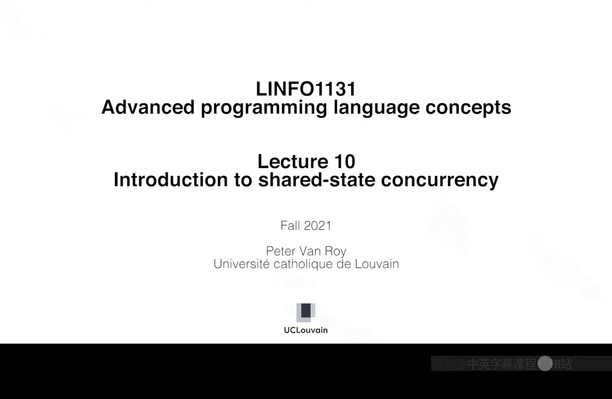

# 高级编程语言概念：10：共享状态并发




## 概述
在本节课中，我们将要学习并发编程的另一种形式——共享状态并发。这是我们将要探讨的最后一种并发范式，虽然它被认为是实现起来最复杂的一种，但在工业界仍被广泛使用。我们将了解其基本概念、面临的挑战以及如何通过构建抽象（如锁、事务和监视器）来管理其复杂性。

---

## 共享状态并发简介
上一节我们介绍了多种并发编程范式。本节中，我们来看看共享状态并发。

共享状态并发是一种编程范式，它在线程和可变状态（我们称之为“单元”）的同一程序中共存。这种范式被许多主流语言（如 Java、C++）广泛使用，尽管它被认为是实现正确并发程序最困难的方式。

其核心挑战在于，当多个线程共享一个可变单元时，由于调度器对操作执行顺序（交错执行）的不同选择，会产生指数级数量的可能执行路径。程序必须保证在所有可能的交错执行下都是正确的。

为了管理这种复杂性，我们需要构建“大原子操作”，将多个小操作组合成一个不可分割的整体执行单元。锁、事务和监视器都是构建此类原子操作的抽象工具。

---

## 核心概念：单元与交换操作
在深入共享状态并发之前，我们需要回顾其基础构建块：**单元** 和关键的 **交换** 操作。

*   **单元**：一个可以多次赋值的命名容器。它类似于传统语言中的“变量”，但为了清晰区分数学中的常量变量，我们称之为“单元”。一个单元包含一个名称和一个内容。
*   **操作**：
    1.  **创建**：`{NewCell C X}` 创建一个初始内容为 `X` 的新单元 `C`。
    2.  **赋值**：`{Assign C X}` 将单元 `C` 的内容替换为 `X`。
    3.  **访问**：`{Access C X}` 将单元 `C` 的当前内容绑定到 `X`。
    4.  **交换**：`{Exchange C X Y}` 这是一个**原子操作**。它读取单元 `C` 的当前内容并绑定到 `X`，同时将 `C` 的新内容设置为 `Y`。读和写作为一个不可分割的步骤完成。

**公式**：
交换操作可以形式化地理解为：`Exchange(C, Old, New) ≡ (Old := Access(C); Assign(C, New))`，且整个过程是原子的。

交换操作至关重要，以至于现代处理器架构都直接提供了类似（如“测试并设置”、“比较并交换”）的硬件指令支持，这大大简化了并发原语的实现。

---

## 为何共享状态并发困难？
上一节我们定义了基础操作。本节中我们来看看为何组合使用线程和单元会如此困难。

考虑一个简单场景：两个线程（T1 和 T2）共享一个单元 `C`，每个线程对该单元执行 N 次读写操作。调度器可以任意交错执行这两个线程的共 2N 个操作。

可能的交错执行序列数量是一个组合数问题：从 2N 个位置中选择 N 个位置给 T1 的操作（剩下的给 T2）。这个数量近似于 `2^(2N) / sqrt(πN)`。

**核心问题**：可能的交错执行序列数量是**操作数量的指数函数**。程序必须保证在所有这些指数级数量的执行路径下都表现正确，只要有一条路径存在错误，整个程序就是错误的。通过测试或模型检查来穷尽所有可能性是不现实的。

因此，编写正确的共享状态并发程序的唯一方法是**通过设计保证正确性**。我们需要管理这些交错执行。

---

## 管理复杂性：构建大原子操作
既然我们理解了问题的根源，那么如何管理这种复杂性呢？关键思路是减少需要担心的交错执行数量。

以下是不同范式管理交错执行的方式：
1.  **确定性数据流**：最佳方式。所有交错执行产生相同结果，因此我们无需关心顺序。
2.  **消息传递/多智能体**：每个智能体（如端口对象）内部只有一个线程，消息只在特定点被接收和处理，大大减少了内部状态的交错。
3.  **共享状态并发**：我们通过将多个小操作分组为**大的原子操作**来减少交错。调度器现在只能在原子操作的边界进行调度，而不是在单个读写操作之间。

锁、事务和监视器都是构建这种大原子操作的机制。它们都基于一个更基础的概念：**锁**。

---

## 基础抽象：锁
锁是构建大原子操作最基本的概念。它保护一段代码区域（称为**临界区**），确保同一时间最多只有一个线程可以执行该区域内的代码。


### 锁的抽象接口
在支持锁的语言中，通常提供如下抽象：
*   `{NewLock L}`：创建一个新锁 `L`。
*   `{IsLock L}`：检查 `L` 是否为锁。
*   `lock L then <statement> end`：用锁 `L` 保护 `<statement>`。如果锁已被其他线程持有，当前线程将被阻塞（挂起），直到锁被释放。

一个锁可以保护程序中多个不连续的代码段。所有被同一锁保护的代码段共同构成一个逻辑上的大原子操作。

### 可重入锁
一个重要的概念是**可重入锁**。如果一个线程已经持有了某个锁，当它再次尝试获取同一个锁时，会被允许立即进入，而不会被阻塞。这对于实现递归调用或复杂抽象内部的锁操作至关重要。不可重入的锁（简单锁）在这种情况下会导致死锁。

### 示例：并发队列
让我们看一个使用锁实现并发队列的例子。队列内部使用差异列表和单元来存储状态。

**代码**：
```oz
fun {NewQueue}
   C = {NewCell q(0 X X)} % q(数量, 头部差异列表F, 尾部B)
   L = {NewLock}
   proc {Insert X}
      {lock L then
          Old
       in
          {Exchange C Old q(N F B)}
          B = X|B2 % 将X附加到尾部
          {Assign C q(N+1 F B2)}
       end}
   end
   proc {Delete X}
      {lock L then
          Old
       in
          {Exchange C Old q(N F B)}
          X|F2 = F % 从头部取出X
          {Assign C q(N-1 F2 B)}
       end}
   end
in
   queue(insert:Insert delete:Delete)
end
```
在这个实现中，`Insert` 和 `Delete` 操作各自被锁 `L` 保护，使得每个操作内部的读单元和更新单元步骤成为原子操作。多个线程可以安全地调用这些操作。

---

## 锁的实现
了解了锁的用法后，本节我们深入其内部，看看如何利用交换操作来实现锁。

### 简单锁（不可重入）的实现
简单锁的核心思想是**令牌传递**。锁维护一个代表“令牌”的单元。持有令牌的线程才被允许进入临界区。

**代码**：
```oz
fun {SimpleNewLock}
   Token = {NewCell unit}
   proc {Lock P}
      Old New
   in
      {Exchange Token Old New} % 尝试获取令牌
      {Wait Old}              % 等待令牌可用（Old被绑定）
      try {P} finally New=unit end % 执行操作，最后释放令牌
   end
in
   Lock
end
```
**工作原理**：
1.  第一个线程执行 `Exchange` 时，`Old` 被绑定为初始值 `unit`，因此 `{Wait Old}` 立即通过，该线程进入临界区。`New` 是一个新的未绑定变量。
2.  第二个线程执行 `Exchange` 时，它得到的 `Old` 正是第一个线程的 `New`（此时未绑定），因此 `{Wait Old}` 会阻塞。
3.  当第一个线程执行完毕，执行 `New=unit`，这恰好绑定了第二个线程正在等待的 `Old` 变量，从而唤醒第二个线程。
4.  如此传递，形成了一个隐式的等待队列。

### 处理异常
上述简单锁在受保护代码 `P` 抛出异常时，可能无法执行 `New=unit`，导致令牌无法传递。修复方法是在 `try...finally` 块中执行 `P`，确保无论是否发生异常，最后都会释放令牌。

### 可重入锁的实现
为了实现可重入，锁需要记录当前持有它的线程标识。当线程尝试获取锁时，先检查当前持有者是否是自己。

**代码**：
```oz
fun {NewReentrantLock}
   Token = {NewCell unit}
   CurrentThread = {NewCell unit} % 记录当前持有线程
   proc {Lock P}
      if {Access CurrentThread} == {Thread.this} then
         {P} % 如果已经是持有者，直接执行
      else
         Old New
      in
         {Exchange Token Old New}
         {Wait Old}
         {Assign CurrentThread {Thread.this}} % 设置持有者
         try {P} finally
            {Assign CurrentThread unit} % 清除持有者
            New=unit % 传递令牌
         end
      end
   end
in
   Lock
end
```
**关键点**：检查当前线程和设置/清除 `CurrentThread` 单元的顺序至关重要，错误的顺序会导致竞态条件和死锁。这凸显了并发编程中精确顺序的敏感性。

---

## 总结
本节课中我们一起学习了共享状态并发这一复杂但广泛使用的范式。

我们首先理解了其核心挑战：线程与可变单元的组合导致了执行路径的指数级爆炸。为了管理这一复杂性，我们引入了**大原子操作**的概念。

接着，我们学习了最基础的原子操作抽象——**锁**。锁通过确保临界区代码的互斥执行来创建原子性。我们探讨了锁的接口、可重入性的重要性，并看了一个使用锁实现并发队列的实例。

最后，我们深入探讨了锁的**实现原理**，从基于令牌传递的简单锁开始，逐步增加了异常处理机制，最终实现了完整的可重入锁。这个过程展示了如何利用原子性的**交换**操作和单次赋值变量来构建更高级的并发控制抽象。


锁是构建更复杂抽象（如监视器和事务）的基础。在接下来的课程中，我们将以此为基础，继续探索共享状态并发的其他强大工具。