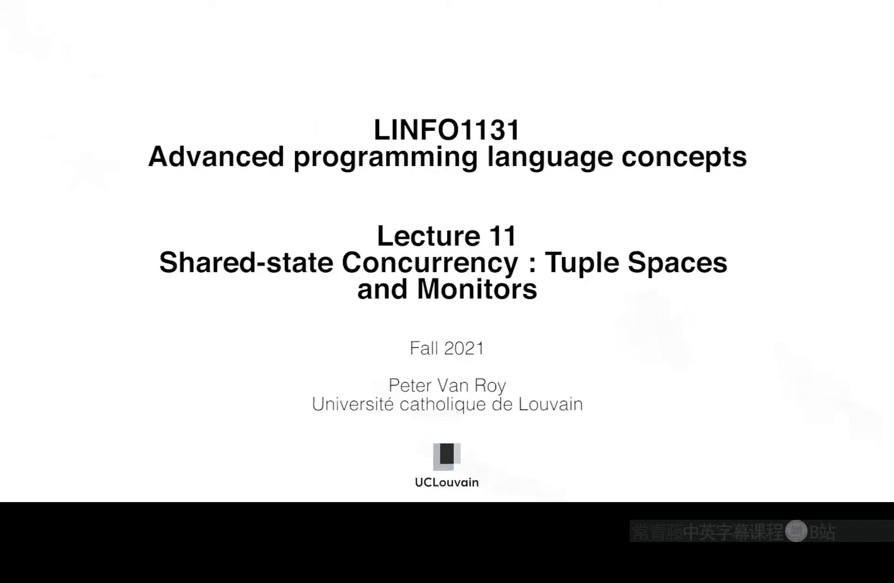
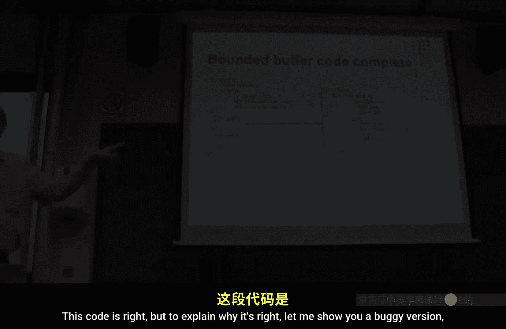

# 鲁汶理工学院【中英⚡高级编程语言概念｜LINFO1131, Advanced programming language concepts】 p26 P27 FO1131 Lecture 11 (2021) -BV1UDffBbEBZ_p26-

Today I want to continue。Talking about shared state。And I'm going to show you two things。One。

 a very nice idea called couple spaces。And two， another concept called monitors。Synchronized objects。

Tuple spaces is a very interesting idea because it's in between。Shared state and message passing。

 So what does that mean that's interesting because it lets you get a better idea of what shared state and message passing are。

Let me first define it。It's a multi set of tuples， I can make a picture。So a couple of space here。

Is multi set of truples。And you can put trules in。Multiet and you can remove tules。Write and read it。

And it's a multiet， so the same couple you can put in multiple times， they're like tokens。

 they're like physical things， you put them in， you take them out and you count how many there are。

There are three operations right， so the TS is a tuple space。

 right T will add a tuple to the tuple space。The read。

We'll wait until the tuple space has one tuple with label L notice62 arguments here。

 because the tuple can be a very complicated data structure。

You can do some kind of pattern matching that the read will wait for a certain kind with tumple。

 but here it's very simple， the read will wait until there's a tumple with label L， so L is an atom。

And when there's a coupleple with label L， it's removed and bound to T。Okay， and this will wait。

So this is a concurrent operation， you a concurrent operations， the read is going to wait。

 so if there's no toples in there， it'll just wait and if somebody else。

 so another thread does it right。Then the read will continue。

 So you notice a tu of space lets you coordinate between threads， okay。

And there's a variation of read， which is the non blocking read。This one is。

 if you don't want to wait， it returns immediately。And it has a third argument， B。

 which is a boolean， and it tells you that B is false if the tuple space has no tuple with labeled L。

 otherwise it binds B equal to true。 so this is similar to the read except it does not wait。

So this one is actually not used so much， you can use it sometimes if you want to do some kind of a manager check whether something is there or without changing anything。

 okay， but the actual computations are done with write and read。

The Tuple space idea was invented in 1985。By a computer scientist， David Galerer， he called Linda。

Maybe it was his girlfriend I don't know he called it Linda and it uses pattern matching That means when you did a read。

 it was like a case with patterns okay so that's you can do that too if you want here the read will only wait for。

呃Chle was label now。So that's very easy right in fact there's really only these three operations and the two are the most important。

 so it's a very easy thing a tuple space。Sometimes the word the expression coordination model。

 if you read something and they talk about coordination model， they need tuple space， okay。

 and a language that uses tuple spaces is called a coordination language。Why。

 because I guess because it lets you coordinate between threads。

 one thread puts a tuple in and the other thread。Removes the tuple， okay？

So this concept is actually used a lot today if you have what's called published subscribe systems。

In a published subscribe system， it's like newspaper items。

 you can publish items and then people can subscribe and read items so the items are kind of like tus and the publishing is like a write and the subscribing you get notified when there's a message like a read okay so these are actually coordination model so it' to used a lot today so this concept is actually used a lot's a nice concept。

Now I want to compare this， so I'm going to write this Ill show you some code for this。

 but I want to compare this to shared state and message passage。

It's a funny concept because it's actually in between。Sha， how can it be in between Sha state。

 you have multiple threads accessing a cell， okay and in message passing。

 you have a thread sending a message and then a port object which is another thread will read the message of messages going so how can this be halfway in between？

Well， I can explain to you the tuple space， first of all， it' shared between threads。

Threads can do read and write， so it's much more than just one cell it's a much bigger thing。

 but it's also shared between threads， so it's a kind of shared state。A tuple space。

 but it's also kind of like message passing because the templeples are sent and received a right is like a send。

And a reath is like to receive。And there's a very interesting difference with message passing when I send a message to a port object。

I know which one is going to receive it， I send it to that one。But here in a tough space。

The sender does not know the receiver。So you could have。As sender the right。

 And you can have many threads reading。And with the sender sense。

 and one of these strands will take the tuple out， but the sender does not know which one。

So it's like message passing where the sender does not know the receiver。

Okay because in regular message passing， you send， you know the receiver， okay， but here the sender。

 you put it in， it's like sending， but somebody will receive but you don't know which threads。

 the sender does not know。And sometimes， that's good。An example of that is that if you have printers。

Let's say I have five printers， it's a big company。

 and the printers are reading from the Tple space and the file that want to print is put in the tuple space。

And one of the printers is going to read it and print。But I don't care which one， okay？

It doesn't matter which printer actually prints it as long as there's a printer that prints it unhappy'm happy。

 okay so that means you don't always need to know the receiver。

So there's cases where it's okay to be anonymous， the receiver can be not known。

So this is like message passing with anonymous receiver， but it's also shared。Between threads。

 the threads can be senders and new receivers， so there's actually many senders and receivers。Also。

 the receiver does not know the sender of them， but that's that regular message passage。

In regular message passing， the receiver and the sender do not know each other。And in this one。

 sorry， in regular message passing， the sender knows the receiver。

 but the receiver does not know who sents could be anybodys sending， okay？

And here it's anonymous in both directions。You might think what about a case where the sender and the receiver both know each other the sender knows the receiver and the receiver knows the sender。

 that's actually deterministic data flow。That's why it's deterministic， okay。

 so all possibilities are useful in fact。Let me just make them the table。Of that。I have S her。

The receiver。So the sender knows the receiver。And the receiver knows ased。

This is the termminist dictator flow。They both know each other。

 this is like a pipeline in a pipeline you have a connection and it's deterministic so the receiver knows exactly where the data is coming from。

 this why it's seristic， this is our very first paradigm。Now if the sender knows the receiver。

And the receiver does not know。路算で。This is regular message passing than what we saw with the port objects。

And if neither of them know， then it's couple spaces。

So you can see actually it's a very nice way of categorizing things， the tu spaces are very natural。

 okay， and here all three of these paradigms are useful。

It turns out that this one is the one that people know most of the time。

 what airline is doing is the message passing， but the other two are kind of less used。

 tuple spaces has found a use now and publish the subscribescribe。

It's actually found to use since the Internet。But used to be not used。

 and the terminalist d data flow has also found a use now in。Big data analytics。Re take the tools。

In the cloud。These are almost always using Demin as Dictator flow and a published subscribe will always be using total spaces。

 so all three of these are actually useful and you'll see all three of them， okay。

Let me show you now some code for this， I hope you can read my writing there。The Q。

 remember the queue we did。We did it with locks last time， we also did it with exchange。

 the concurrent queue， I'm going to show you a third one now with tuple spaces。

You can easily implement concurrent queues using tu spaces。And you do not need luck。Don't be luck。

The tuple space， it's very easy to for the queue。 So the way you implement a queue with the tuple space is the queue is actually stored inside the data structures stored inside the tuple space。

And when you want to do an insert， you remove it。You do a computation and you put the new state back in the couple space。

 you read and you write， so you have to do one read， you remove it， you do the insertpt。

 and then you write put it back in the tu space。But you don't need to look for that。

Because when you read it， you actually remove the tuple， so nobody else。

 if someone tries to do a delete， they will just wait， okay？

So reading a temple is like entering a critical section。When you read the tuple。

 you remove it from the tuple space， so it's not there anymore。And the first thread can do it。

 but once the first thread does it， the second thread can not do anything because there's no more couple。

 okay？So we've seen that three implementations last time you saw the queue was the lock。

Show how you do insert， so you actually have to create the log， you insert， you in enter the log。

 you read and you write。But notice when you read a cell， it does not remove the value from the cell。

 it's not like a tu space， so the cell value is still in the cell， you're just looking at it。

Whereas when you read from a tu of space， you actually remove it， okay？

You can do also a queue as an exchange that works because an exchange is read and write and the queue only has to do one update。

So that works because you have only one update。You don't can't always do with exchange when you do transactions。

 but we will see next time。Then you do many operations and you cannot use exchange anymore。

 you still need lock again， but with the queue you only do one update so you can just use an exchange。

And finally， the temple space， you will do a read and a write， but you do not need luck。オケ。

So let me show you the code for this。So here's the new queue， I create a tu of space。

And I have to insert and delete。And the first thing I do。Here is I write。An empty queue。Okay。

 so the Q's save data structure as before to tople with three elements， the number。

 and then a difference list giving you the content， So0 and then X X。 so that's an m Q。

 then I return the Q which has insert and delete。Here are the insert and delete code。Okay。

 so the read here。Will read the tuple with label Qd and this is and it will bind the tuple to this。

 So n will be the first F and x bar B2 will be the rest of the difference list。

 and then it writes a new tuple with n plus1。Okay， notice here I have actually bound the tail。

To x bar B2。 so I've actually added x to the difference list。

 so F and the new tail B2 is the new difference list， so that's the right。That will insert。

 and the delete is kind of the opposite。 but it's also a read a writer。 you read with label Q N。

 And then I'm actually， this is the head of the Qa， the first part of the difference list。

 So x is going to be bound to the first element。 and F2 is the rest。

 So F2 B is actually the rest of the Q。 and x will be the output。 Okay。

 and then I you will write with n minus-1。And was the rest。

So that's the implementation using tu space， okay？And maybe I can very quickly run this code。Okay。

 so here I have the actual implementation of the tuple space， but let me go to the。Code here。

 so here is actually some examples。And then you can implement the queue， okay。So let me compile this。

In order to compile this， the tuple space， when I implement it。

 it actually has a queue already also inside it to implement it okay。

 so it has actually it needs that so the tuple space here。It uses Q and dictionary to implement it。

and it also needs locks， but we use the systems locks or that， but I need this queue。Okay。

That's good。And then I implement it， so it's implemented as a class。Here。 that's good。 It's accepted。

And I'll just show you some examples， maybe that's very simple， like create a new thoughtful space。

So I learned this。Okay。Now I can write a tuple， here's a tuple with fo1。

And here I can read the templeple。With label food。Okay， and you can see it hereing。

And here for example， I can read a tuple。With。Laow bar。And I will show it here。Use price。Let me。

First， let's put another two tuples called with labeled car， car5 and car6。But then if I read。

 let me not use this syntax， let me use right like this。Okay。So this will read a tu of labeled bar。

And then browse it。If I feed this line here， it will actually execute mine in its own thread。

So here it will display nothing because there's no tuple bar here， but if I add this tuple bar。

 it will display， notice there's already with tuples。With carbs。

 so I'm putting stuff in and taking stuff out if I now add the tuled barn to。

 then this one which is waitinging and its own thread will display will remove the tuple right away。

Okay。I should remove it right away。Did I maybe not execute it？Yeah， I didn't execute it。

 so I can execute it again。And here if I write this line。Then。This name。

Then this one will execute and it displays part。 Okay。

 let me just show do that Okay if you want to run the。The Q code， you can implement it。

And try it out， okay？So that's how couple spaces work， you put things in， you take things down。

Let me now just say a few words on how tuple spaces are implemented。

This is actually interesting because it's using several data structures。

 this is the internal implementation of a couple space notice it's using three things a lot。

A dictionary and a concurrent cube， so to implement couple spaces， you need a log， okay？

And it has a dictionary because of the patternss， the fact that。

We can wait for a tuple with a certain lappo and it also needs a concurrent cube because what if you put more than one tupo with the same lappo？

Somehow you have to organize them and they are put in a queue。

 so if you put five tuples with label bar， they will put in a cube in a special queue with all the tuples of the same label。

 okay？So here we have a dictionary， the dictionary is like a hash table， so it's an index structure。

 you have a key。Which is an atom here， and then you have some value， the values are going to be Qs。

 okay？So if I put in a top of was labeled bar， then the key will be bar and I will add a Q。

Of tuples that have labeled bar。And if I put in a new label food that does not exist anymore yet。

The dictionary will add that， so it's a dynamic has table， you can add new keys。

And you can also remove keys， Okay， so if the queue is empty here。

 then you do not need this key and it can be removed so you can do kind of garbage collection for that。

So the dictionary handles the pattern part of the tuple space。

 and the Q handles the part when you have multiple tuples with the same label， okay。

So the tuple operations， it will insert elements in this these cus at the position of the label in the dictionary。

 okay？If the queue is empty， then you can actually garbage collect and remove this entry and save some memorymo you don't need to store empty cues because the dictionary is dynamic。

 you can add new entries and remove entries and when you remove entries， the dictionary is smaller。

So most languages have this kind of a dictionary built in in Oz。

 there's actually a dictionary module， so this is a standard data structure okay。

 so most languages like Java and so on have this kind of a dynamic cache table built in。Okay。Okay。

 so that's all I'm going to say about tuple spaces。

If you want to know more type coordination language you'll find a lot more on the internet。

So I'm going to conclude now from this is from last week's lecture。

 this is the introduction of shared State that we started。

 remember the number of winter leavings is exponential so the whole point is making big atomic actions。

That's the whole idea。And doing that in that locks monitors transactions so far。

 we only talked about locks。 tuple spaces are another way of building building a ton of actions because a right of a tuple space is actually doing a lot of worth okay and a tuple space is a funny thing because it's also kind of like the lock when you remove the the tuple。

 it's like token passing。 remember the token passing for the locks。

 tupleles are like tokens when you remove them， then you have it and nobody else can have it。

 There's only one there's only one tuple with a certain label。

 it's like token so the tuple passing can also do be like the lock see so it's actually a very interesting combination of message passing and shared date。

And I showed that there's also three kinds of message passing。

 depending on whether the sender knows the receiver and the receiver knows the sender， okay。

 so that makes three possibilities， deterministic data flow， message passing a tuple space。

 if you want to think about the fourth one， you can think about the fourth one。

But I'm not going to talk about that here。So that's all I going to say about tu spaces。

And now we will go to。Monitorors。Monitorors， which are the devil's concurency concept。

 the one they don't like， okay？But today I'm going to talk about monitors。Monitorors。

They're also called synchronized objects。A monitor is a lot。With something more added。

 just like a transaction， so lock with something extra added。Because locks are not good enough。

 in fact， they work for cues。A lot it was enough for a Q because you never have to wait。

 you could always exert elements， say the Q it can grow as much as it once。

 and the Q I showed you there's no limit。But in real data structures， it's not always like that。

And the example is a bounded buffer， so again we come to the abounded buffer and I'm going to show you a shared state way of doing bounded buffer。

But you cannot implement a bounded buffer with just a lot。So how would you do it。

 you put elements in Yeah， fine， if we have a lock and all the operations are inside the lock now。

 you put elements in， Well what happens if the buffer is full。And I try to put an element in。

I cannot， I have to wait。But locks don't that you do that， okay， you go in， you go out。

 there's nothing that lets you wait in a log， okay， yeah。

 in a lock just make sure there's only one thread inside。Each inside。The critical section。

 that's all it does。But the actual data structure does not wait， okay？

Or what happens if so the buffer is full， the lock cannot do it。

 What happens if the buffer is empty and you do a get。You do get， you try to get an element。

 but the puff is empty， you have to wait until another thread doesn't put， okay， you have to wait。

 so that means the locks are not good enough and if I have one thread doing puts another thread doing gets。

Then the threaddo puts has to wait if the buffer is full and the threaddo gets has to wait if the buffer is empty。

And you could not do that with just locks， it cannot work because locks do not have this waitinging operation。

So this shows you that locks are not good enough for real concurrent data structures。

Monitorors were invented to solve this problem， and they're very old。

 so they were invented by a computer scientist called Parabri Kin in 72 and。Tony Hor。

 who was another famous computer scientist， he actually was one of the people doing inventing also the message passing in 1974。

 so they're very old things almost 50 years old and they are widely used today， okay。

 still used a lot。But I don't like them and I don't want you to use them。

 but I want to explain how they were。So you see why dos are kind enough。See how you extend the logs。

The monitor adds two operations and a data structure called a weight set。Wch is the lock。

 so you have a lot plus stas。The weight set is actually a set of suspended threads。

The monitor lets you suspend threads when they try to use the monitor they might suspend， okay？

And wait to notify are how the threads talk to each other。Notice the way and notify operations。

 you only do them when you're inside the lock， never outside other part of the lock。

 and you should only do them inside the lock？The intuition is following the weight when a threat calls weight。

 it is suspended and is put in the weight set。So it forces the threat to wait。Okay。

 and it's put in the weightet and then you leave the lock。The lock is released。

 so the lock is available for another thread， okay so the thread is in the weightet and it's waiting and it could wait forever。

 okay？And a notify operation， a threat can call notify。

 it will wake up the thread in the way extent it will resume it， let it start next Tuesday again。

This open up thread will do what all threads try， it will try to get the lock again。

At the place where it was suspended， so it wakes up exactly at the place when you already did the weight。

And it tries to continue， so basically it's like the weight operation continues。Okay。

 so that's thetuition。But now let me be more precise。I'm going to give a more precise semantics。

 this is exactly the Java semantics， it's a simple semantics and it's popular and it works pretty well。

So I'd love to give you this is some Java semantic， so this is how it works in Java。

 some languages have little bit variations， but mostly it's like this okay。So in Java。

 a monitor is an object。Each other object ored and you extend it with a locked and a weight set。

 so this is called a synchronized objects， and there are three operations。Wait。

 notify and a third one called notify all okay， of course you have to execute them inside the lock。

 inside the critical section， never outside， otherwise it's button okay。And here is the semantics。

 the weight does this。It suspends the current threat， so stop sex unit。

 and that's a message to the scheduler， don't choose this one。

 It places the thread in the weight set and it releases the lock。

That's very simple the thread just stops。And so the weight set is storing the thread and the log is released。

 so some other thread can get the lock， okay？The notify operation is the following。

If the wait set is not empty， then it does something， if the weight set is empty。

 the notified does nothing okay， but if the wait set is not empty。I will remove an arbitrary thread。

 I just picked one。And I resume it， that means it starts executing again at the point it was suspended。

 okay， at the point it did call to late。And that thread will do what any thread does tries to when it's inside a lock。

 the way it makes it release the lock。But when users resume it。

 it because it's inside the critical section of the waiter， it tries to get the locked again。

It tries to get to lock again， notice it cannot of course。

 immediately because the thread that's doing the notify is still in there， okay。

 so the T that is resumed tries to get to lock again。But， of course。

 it will not immediately be able to do it until the notifying thread leaves。 Okay。

 so usually the notify is done at the end。The critical section and the notified thread will then go away。

And then， the。The woken up thread will succeed in getting the law okay if it's the only one。

 maybe there's more threads trying to get the lock okay so it will get the lock whenever it gets the locked。

 maybe there's another thread also trying to get the lock and that of course it depends on how the lock chooses the thread but if it's the only one it will get the lock as soon as the notifying thread leaves the critical section okay。

That is the way to notify。Originally， it turns out notify is actually not so nice。

 so real systems they will add。Another operation called Not F All。

Okay so notify will resume an arbitrary thread in the way it set。

But what if you have multiple threads， what if I have a bound buffer and I do many， many。

 many puts and they're all waiting？Okay， and then I do a get。

How does the noteify know which one to resume？ok。So the notified picks an arbitrary of threat。

But sometimes this is a problem， as we will see， So in real monitors applications almost never use notify。

 It's weird we define this notify operation， and I'm telling you not to use it okay。

 but you use another one called notify all notify all actually wakes up。

 all the threads in the websiteset， maybe there's 100 threads trying to do put。

 they all wake up and they all try to get the lock。 okay that's a mess。

 but it works okay all threads are resumed。 all threads try to get the log。

 The websiteet is completely empty。After you do notify all。Okay。In real monitor applications。

 it's almost always notfi all， so wait and notfiable okay， so this all seems very theoretical。

 but I'm going to show you code now that does this okay and you will see how it works。O。

So one of those many， many threads that we woke up will get the lock and well execute inside the critical section。

 the monitor， if somehow it's the wrong one。Then it will wait again。If it's the right one。

 it will do whatever it has to do， maybe you're implementing a tuple space and you're putting in many tuples of many labels and you only want certain label or something if it's the wrong label that goes back to sleep。

 okay？Notice if you have many threads。W up， this gives a situation called contention。

So contention happens when you have many threads trying to do the same thing。

Which is trying to get to luck。It's perfectly fine， it's not above。

 it's just something that gives overhead。If maybe there's 100 threads woken up， okay。

 and only one of them is the one you really need， well the 99 other threads will all be woken up and will all go back to sleep again。

 that's kind of overhead that， but that's hows that's how monitors work。

And the one thread that does the right thing， it will actually do the right thing， okay？

This so intention is a problem sometimes with monitors if they're highly loaded。Okay。

 so all of that is the theory， now I'm going to show you the code of an application and I'm going to return to our good friends about the buffer。

 remember we already saw one in lazy deterministic data flow。

But here we're going to do about the buffer in shared state。 So in lazy determinants the data flow。

 only one。Thread puts and only one thread removes。 It's a pipeline。 but here anybody can add， put。

 many threads can put， and many threads can read。And get it， okay？

So it's a more general non deterministic version。すく見て。

I'm going to then now explain again what is buffer。

So let's say here I have bounded buffer of size 10， so I have an array of 10 elements。

And I have two operations。Ps operation and it gets operation。

Put operation will put something like here today is G in the bond buffer and the get will remove the。

The one that was put long yesterday ago。So here the get will bind x to A and the put will click G。

And so the maximum size is 10 here。Okay， so the put and the get operation。

 we're going to define it using rocks and monitors。The specification is here with three operations。

So buffer is going to be a class。I create a new buffer B of size n， so new buffer in it depends。

And then there's two messages I can send two methods， put X。

Put down X in the buffer if the buffer is full weight until there's room。

 So the thread doing the put will wait。 if the buffer is full and get。

 remove an element from the buffer and bind it to X。 If the buffer is empty。

 then the thread doing the get will wait until there's at least one element okay so you notice that the two thread。

 any thread can do put any thread can do get。 But if it's full or empty。

 there's gonna be weights going on。 Okay。You see that though。

So this is a typical kind of thing where you need a monitor to implement this。Okay。

To implement the amount of buffer。I'm going to organize the array as a ring。

And the reason is that when you reach the edge of the array and you keep putting in remove elements。

 you actually are moving around to the other side， so the easiest way to implement a bound buffer is to organize the array as a ring。

 so here we have the array is 01，2，3 up to n minus1。And we have two pointers in this ring。

 a first pointer and a last pointer。When I do a gi。I use first， so we'll get we'll get A。

 and then it will increment。That the。The first point is the point to B。 So I remove A， B， C， Okay。

 and the last is for adding elements。 If I add an element， I put it here。

And then I can promote the last。So you see the whole thing is going to be going around and around in a sense I remove elements。

 this one is going to be moving this， I add elements。

 it's going to be moved so the two pointers are going to be going around and around and once they go past9 minus one it starts with zero here。

Okay。If an index is outside interval zero and minus1。

 it's replaced by index module x so you're always on the written， okay。

 notice you can have two operations that block it。If the buffer is empty。

 then first and last will be the same。Okay， so the number of elements is actually last minus first。

 last minus first。If the number of elements is zero。

 then last and first are' going to be pointing to the same elements， and if you try to get。

 you have to block。Also， if last goes all the way around and is pointing here just next to first。

 then the number of elements will be actually be。What will be end。

 then you have to block also and when you try to， if the last is here and you try to add an element。

 then you also have to block so there's two ways that you have to block。Okay。

 so that's how the budget buffer。I， okay， you see the idea。

 so this is a very standard dimension stretch， okay。So here is the code of the bundleundd buffer。

But I'm not using the monitors yet， okay？So I defined a class。With buffrachi， which is an array。

 the first the last the size and and index， okay and I。

I have the in it I'm going to use an O operation called New array。

 I'm not going to explain so much so this creates an array that you can access using dots that you can do array dot something to access the array okay so it's kind of standard I'm not going to explain very much it starts by first and last being equal to zero okay。

N is the number of elements in the buffer， and I is actually the size。

 it's how many elements are in there， okay？So here's how it works， so the put。Will。

Puts the element at the last。Psition， notice you have to use the read symbol always for accessing。

So the array aboveuff dot last column equals x， okay？And then I increment last。

 last is last plus1 modular n， and also I increment the size。

 I will be the size because sometimes it's nice to know the size we'll see。So that's how it works。

 but notice you have to do a weight， okay？There's no。There's no pointer here。

 but here you cannot always do this you have to wait until I is less than n。So that's the do。

 do dot code。And I'm not telling you。How it works here。

 that that code is going to be done by the monitor， Okay， so all of this has to be done inside。

The the。The lock notice I'm doing multiple assignments here this is an assignment。

 this is an assignment， this is an assignment， there's three assignments。

 so these are all cells actually these attributes， so all of these have to be inside the lock。

So so far， I'm not sure you do up。And the get is doing just the opposite。

 so it waits until I is greater than zero， so there's at least one element。And x。

 which is the output， will be equal to buff dot first。I increment first， my end course。

 and I didcrement time。Okay， so that's how it works。But now we have to add the monitor， okay。

 all of these are in the lock and somehow we have to do the weight。

 so I'm going to show you how to use weight and notify them to do this。Okay。So you see the code。

 right， this is standard kind of code and it's easy to translate in Java if you wants to translate this in Java。

And I'm going to use a monitor abstraction， I'm going to use the full code。

 monitors are not a default abstraction in Oz， I actually have to define them separately。

And so I will define them like this。To add the monitor。I will define a function called New Monit。

The new monitor M is actually a record。The four fields， it has locked weight， notify all fields。

Lock is a。Procedure， they're all procedures， well by M weight Mify M notify all M are all procedures。

And then these are the way to use them。 The log is like we saw before。

You introduce any statement to your， but it's higher order。

So the statement is turned into a zero argument to procedure， and this is a reentry block。

 like we saw last time。And wait， notify not follow are just called like this， wait。

 notify their zero argument procedures， okay， so that's pretty straightforward， okay。

 standard kind of thing and most nuggs are going to be do it kind of standard way， okay。So with this。

 we can turn the bounduning buffer， which I showed here into a。Complete piece of correct code。ok。

So here is the code for it。 I'm just going to add the red pieces。And。

And then we'll make a break and I'll explain how it works， so here I have I'm creating a monitor M。

 I have another attribute， a monitor， so synchronized objects to Java where they automatically have that。

Here， so this is the code。Is not inside a lock。Lock， it's M dot lock procedure。

 and all of this is inside the lock。And the red part is actually the way it is。

If I is greater than or equal to n， then I wait。And after I wake up， I have to try again。

 so I actually call put again， okay， and since it's a reenttrant there's not a problem。

If I is less than n then I take the L， then I actually execute the code。

 and at the very end I do notify all。So this is very stunning。

 I'm always doing wait in the beginning and notify all the the end。

So that's the typical way to use a monitor。But this code is actually more subtle。

 it's kind of subtle because it's been current。So what I will do now is I make a break so that you can already start meditating on this。

 and then I explain how it really works after the break。So this code is right。

But to explain why it's right， let me show you。A buggy version， which is this one。

And I want to ask you know why it's buggy。Here I have put。Okay。I again have a lock。

If the buffer is full， our I is greater than equal to n， then wait。Okay， and then when it's not full。

 then the weight continues。It it adds the element and then it does notify all。This。Seems reasonable。

 right？But this one is buggy。So I want you to。See if you can figure out why this one is bookie。

It looks reasonable， right， if the buffer is full， so this is a good comparison， then I call weight。

And someone else that doesn't get。O。The get will remove an element and do notify all。O。

And the get will work because since the buffer is not empty， the get can remove an element。

 the get code， will do notify all， and then the put that did a weight will resume and it will start executing and since there's a slot available。

 it will add an element。And it will seem to work， right， So if this put is done。

When the buffer is full， and then I do a get after that。The get will remove elements。

 the get will do notify all， the put will wake up。And it will succeed because there's a slot available。

 right？So that's correct， that's one scenario。But there are other scenario those with this code。

That actually make it go wrong， so this is actually a buggy program that will be totally incorrect。

 okay？具体。So what you think， maybe I give a hint。I give you a hint。 Let's say I do two puts。Okay。

 and then get。でそのこと。What happens then if I do a put now and the buffer is full。

 so I do the buffer is full， I do a put。It's full and e， finally。And then I do another put。Oh。

 the bathroom is still full and I wait， so now I have two threads in the weight set that are trying to do puts。

Okay。Wheres the book， right？And now I do。Again。And to get those notify all。

 both of the waiting threads are woken up。They both try to get the law。

 but only one can actually get the law。Okay。That one。Does the put。Right， and then what happens？全国な。

You have to think concurrently。 So this is something I've been telling you in the course。

 You have to imagine。That what happens in weird cases， okay， if you really want to think， confirm。

So I do twoputs。They're both waiting， okay， you get that。And then I do a get。

And the get will do a notify all， so both of the waitinging puts are woken up。

They will both try to get the lock。But of course， only one will get the lock。

The other one will wait at the entrance of the lock。

And the one that gets the lock does this and does notify all， but the websiteside is now empty dear。

 so the notify all does nothing。What happens after that？What happens after that。

 the two are both woken up， the two tried to be put， one of them gets the lock and goes here。

 what happens to the second one？有。But will continue some ways。the second one。아렇게 안고。

So the get will wake up both threads and they both try to get the lock。One of them gets the lock。

 okay the other one is still waiting at the entrance of the lock。

 the one that gets the lock will do put successfully because there's a slot and then leave what happens to the second one。

So the second thread trying to do put。Will， as soon as the first one which successfully doesn't put leaves。

 the second one was weigh will then successfully enter the lock and what happens then。W。

 he tries to put an element in a buffer that's already full well， that means he's going to overwrite。

 it's going to be wrong， of course you can't put an element。 what happens then Well。

 then increment last， even though the buffer is already full actually that means the last will actually be equal to first。

So it's like the buffers empty， but I will be incremented， so it's totally weird。

 it's completely buggy， okay， so this doesn't work。When you wake up both threads。

They are both waiting for the luck。But only but when you do a get， only one slot has been created。

 so only one is actually allowed to do the other one should go back to sleep again so how do you do that so this is wrong？

So it seems it seems weirder way to notify our tricky things， Okay。

 so how do you get this to work correctly， There's actually a very simple way。

It means before you do this。You have to check again whether there's a slot。

So you have two threads to can put when one of them when the get happens。

Then before they actually put in， they have to check again the condition。 If for hood the stick。

 see the bi head plant。 So the first one that's woken up will see that there is a slot。

 but the second one will see there's nothing and go back to sleep okay， So in fact。

 you have to test again after you wake up。 So this should not be an if。

It should actually be a wild loop because after you wake up from the weight， before you do the code。

 you have to test again because maybe there's no slot。

 maybe the second put some other put went ahead and in the scenario and so the slot disappeared so it's not because you wake out that you're guaranteed to have a slot done。

Okay， so that's bugggy。So the right way to do it， so in our you have to do it like this。

So here you have the weight and when you wake up in this weight。

 you're not allowed to do this right away， you have to test again the way you do an hours you have to actually do a recursive call to put so you actually try again to do a put。

So you completely try again to do a put， okay？You try again， and in the scenario。

 let's say you have two threads to input， okay？And the G wakes both of them up。

Both of these three threads will try to do a put again。Will completely execute this code again。

And the first one will see that there is a slot and will' do it。And the second one。It's not time yet。

The second one will see that the buffer is full and we'll go back to sleep again。Okay。

 so the way to make it work is after you wake up from the weight。

You have to check again whether there is a slot and you have to do the check inside the lock okay。

 in this code here， sorry， this bug code。In this buggy code， when you wake both of them up。

 both of them are outside the lock。One of them goes in and doesn't put。

 the other one is still outside， so they have to go in again once you get in the only way to guarantee that there's a slot。

Check it when you're inside， okay？So the way to check that is here。

You have to again check so the check is this if this conditioner。

 so after you wake up from the weight so you have two threads w out here。

 both of them have to check and if there's only one get then only one of them will actually be able to do the puts。

 the other one will go back to sleep again okay。Of course you can magnify the scenario。

 let's say I have 100 threads。100 trying to do a put。On a full buffer， they all go to sleep。Okay。

 fine， then I do one get。Notify all of the threads wake up。And they all try to get the lock。

 the first one will successfully do the put， and then when it leaves the critical section。

 the others will also get in there so theyll all be able to do the put so the thing is totally broken。

 okay。Okay， in this code， though， this is the correct code， what happens？

Let's say I have 100 threads trying to do a put。On a full buffer， they will all go to sleep。

 they will all be in the wake set， hundred0 sleeping threads。And then I do one get。Okay。

 what happens？All of the sleeping threads are woken up，100 threads are woken up here。

And they will all try to do put again。And the first one。

 the lucky one whose's first will actually see the slots， eyes less than N will do the put。

 and then the second one will see that it's full and go to sleep again。

And all the 99 threads that come after the first one。

 they will all see the buffer full and they go to sleep again。 You see it's kind of overhead now。

 if I have 100 threads trying to put and I do one get。Then it will wake up 100 threads。

 one thread will do the puts。Successfully， and the other 99 will go back to sleep again。

That's a lot of work。Of course this is very rare， it depends on the situation where you have 100 weighting postss。

 usually you don't have that。Okay。So the rule is that before doing the operation。

 you have to do a check again， because maybe somebody else already took the slot， okay。

 like in the example of the two。So this is the pattern。

There's actually a general pattern for monitors。IfWhen you use monitors， unless you are very smart。

 you must always use this pattern， okay， if you want it to be correct。This is the bounded buffer。

 this is using a while loop， okay， in Oz there's no while loops， so you use recursion。

 so recursion is the same as a wild loop pump。So this would be how you would do a Javava。

 for example， with a while loop， you have a lock while not full。

 So expression would be if there's a slot available while the book the。There's no slot available。

 I wait。But when the wave thread wakes up。It's still inside the wood。

It wakes up and the first thing it does is it goes back to the while loop and checks the condition again inside the lock。

 so we'll only execute the statement when there's a slot available and the other threads that wake up will automatically do away to and go back to sleep。

Okay。So the weight has to be inside a wild loop。To be correct。And the notify all is just done。Okay。

 so when you use monitors， you always have to use this program pattern。It's a very simple pattern。

And if you want to do anything different， there are thick books on concurrent programming in Java。

 there's a famous book by Doug Leah calledConcurrent programminging in Java。

 it's like 300 pages it shows you lots of things。Some of them are very subtle。But。

The basic idea is always the same when you wake up from a weight。

 you have to check the condition again， so it has to be a while。Okay。In Oz here。

 it's slightly different because Oz does not have wire loops， it's supposed to be mostly functional。

 it's weird， it could have them， but doesn't， okay， maybe I should add wire loops。

 so in Oz you have to do it like this。You have to do recursive call， if not the expression。

 that recursive call self。Again， to this one。So this is exactly the same as a while loop because this one will test the condition again。

 so remember we saw that recursive tail recursive function is the same as while loop。

So these two are actually exactly the same。But it's a little bit shorter if you have vi when you write them。

Okay。So if somebody forces you to write code as monitors， which I don't recommend。

 but maybe you forced someone points a gun into your head and say， you must use monitors。

 then use it do it like this， okay？So that's how it works。

I'm going to show you now some code for this before。

 the next thing I'm going to show you now is how monitors are implemented。

And this is a little bit more complicated than reentrant blocks。

 so essentially we're going to build on top of the reentrant blocks， but before doing that。

 let me show you just an example of this code。Of making it work。那说什么还。This one is the monitor。

So this is the monitor implementation， she'll monitor uses a queue internally。

 I'm not going to explain it right away this is the monitor。Implementation okay。

So let me first compile it。This is a Q， the weightet is actually implemented as a Q。

This is the monitor。Procedure， notice internally use cells。So implement at this。Okayy， this is good。

And now I'm going to show you an example。The bounded buffer， example。

So I'm not going to show you the buggy one， so the buggy one is here。

 so this code I I would put on the mood up， so here's the correct version of the bonded buffer。

Here's the put。So lock， and so this is all inside the lock， wait until the buffer is not full。

 so if the buffer is full， I is equal to end and I wait。And after when the thread wakes up。

 I try again， I do it for itself otherwise if the buffer is not full。

 then I can put the elements immediately and at the end I can notify all okay and I'll show you the code for get also because I didn't show you the get before but it's completely symmetrical okay。

 I have lot procedure and now if the buffer is empty， so I is the size， then I wait。

And then when it's woken up， I have to do recursive because the condition might look become false again because maybe multiple thread are trying to do deaths。

And if its I is different from zero， then I can do the gets immediately。

 and then I do notify off Okay， so that's the bounded buffer， a correct version。

And if you want to write it even Java， it's very similar， it's just a different syntax。Okay。

So here's some code that uses the buffer， so BB is about the buffer of size three。

I can put a in the buffer。I can get an element and browse it。

 and now I can put elements in the buffer and do things， okay so for example。

 I create the buffer here。Size three。I put a in the buffer。I display。So， let me show you the。

I feel on show。So here you see the A coming out。 If I now try to do another get。

 nothing will be displayed。 So let me do another get now So nothing So that there's a thread now waiting on the second kind of get。

If I now do another put A。Then the thread doing the get will show the A， you can see here the A。

I can put， so now the buffer is empty if I try to put three elements。Okay。

 let me execute this in one thread， I put three elements， ABC。

And then I try to put D the fourth element。I browse this so they can see what's happening and end forth when it successfully puts into the fourth element。

 so it will succeed in putting in ABC， but the fourth element will blockka。

So here you can see try forth， so its up to here， but this one is blocking up。

And if I want to put in the fourth element， I have to do a get， okay？So here I will get， for example。

And I remove A。And then the fourth element is in， so now the buffer has BCC so you can experiment with see how the bonded buffer works。

Okay， I'm going to show how the boundder buffer is implemented。

 this is extending through reentrant blocks。Monitorors are extension of reinsurance blocks。

There are two changes we have to make。Of course we have to add the weight set。

 we need something that's the weight set。So we're going to use a queue to implement the weight set。

Q the way said it could be a center， but a queue is nice because that means it ensures a kind of fairs if I have multiple threads。

In the queue， then they all move， when I remove threads， I'm removing them one by one。

It ensures fairness it's not possible for a thread to stay forever in the cube。

 so a stack it would be wrong。If we instead of a queue would use a stack。

 then maybe the guy in the bottom of the stack is never going to be chosen。

 I put elements in the queue， I remove， and if I never remove everything。

 the guy in the bottom is starving。Okay， so a queue is better than a stack。

 this is why when you go into a store， people are waiting in line in a queue。

 they're not in a stack when you wait in line in a queue。

 you are guaranteed to progress and make it to the front。Okay， if you weigh in a stack。Then the guy。

 the first person， if I have a stack of people， then if more people come into to the store。

 they get served first， the guy at the bottom of the stack will wait the whole day will never get served。

 okay， so stack is not fair。You don't need if you want to do a weighting， you don't use stack。

 so we're going to use a queue， okay？That's the first thing， the second thing。

 we are going to slightly modify the reenterrant block。It's not a big modification。

 I call it get release lock， so the entering and the leaving are actually separate in the regular reentrant block we actually have together you enter。

 you do the body and you leave， they were together。

 but now we actually have to do them separately because we need to do them in different places。

Entering exiting the critical section are separate operations called get the lock and release the lock。

 but otherwise it's the same as a regular reenttrant block。

And the queue also has a few extra operations。We have a delete all operation。

Because for implementing notify all， notify all it will take all of the threads out of the weight set。

So we have to somehow take all of the elements out of the queue， so we're going to add to delete all。

Operation， okay。So here's the get release lock。Okay。So now we have two operations。

 is get is to get in the critical section and release is to get out。Okay。Get is the hardest one。

It does like this。Okay first of all it's reentrant so again we check the identity okay。

 if the identity is different， then we actually have to do something again we do an exchange we have token passing and wait okay now we have to be careful because the release maybe is done later on。

And the release has to bind this new。One， to give the token to the next thread， okay？

So we don't actually know when the release is going to be done。

 so the release has to find this variable， So what we do is we put this variable in a cell called token2。

And then the release actually combined nus， so this passes the token enough。

So we need this token2 because the release and the get might mean different pieces running in different pieces of code。

 so this is slightly different instead of we can't just use new here okay because we don't know new。

 news is created locally inside here we don't know the new here， so we can't use new。

 we have to do something else， we can do it using token2 okay。

And you can't make new global variables because you can run and get it and release multiple times each time you do a get。

 you get a new new variable， you get always new new variables， okay。

 so you have to put them in a cell， okay？So basically that's it。

 otherwise it's the same code as reent blockss， but we've split it then into a get and release。

 okay and it returns here the two things。Notice the get is actually a boolean function。

 and this is kind of interesting， which tells me if it actually actually had to do some work。

So if the identity is different and it actually has to wait for the token it returns true。

 but if I'm already in it returns false and this is important because if I'm already in。

 I don't have to do release later， I only have to do release， if I did this okay if I'm already in。

 then。Going out， I don't have to do anything。So to make the distinction。

 this get lock is going to be a boolean function returning true or false depending on whether it actually did work for getting in or not Okay。

 so that's the get to release lock you see it's a little bit more complicated than the。Oh。

Regular reentment。AndNow we have the Q， this is basically the same queue as before。

 okay it has a cell internally， it has a log internally and has its own log internally， okay， fine。

 it doesn't， you can also use declarative Q， but here I'm going to show you one word。

 has its own log eternally fine， okay。And it has a cell internally。So if certain delete are the same。

 I add a new function called size， I had a new function called delete all。

 and a new function called deletete non blocking delete， okay。The delete all。Well。

 it creates a luck here first。It gets the difference list S。And it binds E to nil。

 and then S will be a list。Of all the threads that are waiting， okay。

 so it returns all the waiting threads as a list， okay？TheThe non blocking here。

 this one will return one element in a list if there's an element or it or otherwise return hill。

So you see how this works， and now I can show you the code for the actual monitor， okay。

This is the new monitor function。Re'returning the record with the four procedures。

And now we can see how each of these is implemented so the lock M。This is a regular log。

 it's like a regular log。And the way we do it is it's actually very similar。

 if you look at the code of get to release， you'll see it's the same code as before。

 but we can implement using get release if get。Then so if it's true that when we actually did work to get the token。

 we do tryP finally and we do release at the end to release the token to the next one， otherwise。

 if L get returns false， that means we're already in the law。

And then we can just execute P because it's reaction okay so you see the get and release are used in a regular way just like a regular entrance box so if you look at the code。

 this is actually the same code as the regular reent box before。

But now you have these extra functions， I wait， notify and notify all。First of all。

The weight has to suspend a thread and put it in a delete， put it in the weight sense。

 so how do you put a thread in the weight sense？It's not really data structure or thread。

 so the way we do that is we use a data flow variable， a single assignment data flow variable。

To suspend the thread， we do weight x， so the weight operation will suspend until x is bound。

If we do a weight x inside the thread， that will suspend the thread。

 and we will put x this unbound variableable inside the Q and later on when we do notify。

 we just have to bind the X。And then it will cause this waiting thread to suspend again。

So here's how it works。The wait after I explain this。 So I put， I create a new one variable， X。

 I put it in the Q。 Q is a Q。 Oh This is a new Q that I created insert third x。

 And then I' release the log， semantics。Of the weight notice this is using the get release I know I'm in the log here。

 the weight is executed inside， so I know I'm inside and so I release here the log， okay。

And so I'm totally out of the lock， then I do weight eggs here on pile side of the lock？

But when the thread resumes， I have to try to get deed again， so I will do again。Okay。

But here I know I'm completely out。So I know the get will always return true okay。

 so I do because I'm totally out， it will get to token so it will always return true so I do if get then skip end so the if is just to ignore that true because I know I'm always out。

So you see how the weight is working， it's exactly the setic son， it puts it in the queue。

 it releases the lock to spare the suspended， and when the thread continues it tries to get the lock again at the same place in the code where the weight is called。

 okay？And if you look at the notify。Notified is removing one element from the queue。

 so this is the delete non block I've implemented， so there's two possibilities。

 either the queue is empty or it's not empty。If it's not empty， then I will have an element here x。

 and I will bind x2 unit， which is a constant。So this causes the weight thread to continue， okay。

 this causes the weight to continue again。 So this is what wakes up the threat， okay。

And the know I all is very similar， except I use delete all L as a list of un variables for x and L I do x as unit。

 this wakes up all of the threads， okay。All of them are Wilson up。

They since they're all waiting here and they will all wake up。So you see how it works。

It's not so complicated， right， but it's a subtle program。

 and I can prove it was subtle because the first edition of the book，The code was bugged。

There was a bug in here， okay， terrible。And so but the current printing has fixed the bug。

 so you can see that even we made a mistake when we made the first column， but as far as I can tell。

 this is correct okay， if you can but find a bug in here， I will pay you a beer， no problem。

So I think there's no more bookss in here， okay？Okay， so that's the implementation of monitors。

So you can see how what you see how it works， so notice it has both the lock and the cube side here and the queue has its own lock itself。

 okay？The tube has its own documents and finally， but the implementation that I show you here。

Is actually slightly different the one I will put in the。무릎。So the one I put in the moodle。

This actually， you see it's a slightly different one， it's the declarative one。Okay。

 you see it's the completely declarative one that doesn't need a locked or a cell and if you look at the actual monitor load。

It's slightly different。Not much， just rid goods。Let me show it to you。So for example。

 the weight it's here。Notice it's slightly different。Because the Q is a declarative data structure。

 so when I do an insert， it returns the new value of the Q。

 so Q is actually a cell here containing the state of the Q。

 so I do insert Q X and this is the new Q okay then I've release the log， I weight x。

 and then I do get log and then escape so this is the way you see the only difference is that this is a declarative Q。

 the insert is no declarative operation and so Q here is a cell。

So youve see this just a little variation。The queue is going take up， okay， so that's how it works。

See that。So I really encourage you to try out this code。To tray right。

To see really understand how it works， Okay， so let me go now conclude on monitors。

Monitorors are extending logs， okay， you can suspend in your soup threads depending on conditions。

You have a wait set and you have wait to notify operations who are adding removing a set and thread in the weightet and you have notified all。

 okay？The reason why you have notified all and not notified is because you use。

 if you have only one weight set for a monitor， the threats might be waiting on different things。

If you have puts， they're waiting for a get， if you have gets， they're waiting on put。

 one of them is waiting for the buffer to be empty。

 another one is not full and in bake monitors it can be waiting on multiple things and if you only wake up one thread you might wake up the wrong。

A thread that's waiting on the wrong thing， okay， so you have to do another fight all。

But some languages have variation where they have multiple weight sets in the monitor。

 more complicated， and each weight set is waiting on one condition。So that's kind of complicated。

 so Java does not do that and most languages don't， but sometimes they do that okay。

 so monitors are actually very hard to program。Wait to notify are difficult。

So the way to do that is to use a programming pattern， the pattern is guaranteed to be correct。

So I showed you the pattern。And again， I say it's widely used the legacy that I don't recommend you writing a good code。

 okay？So that's where we end today， the next week we're going to talk about transactions。

Transactions is another way of extending locks。And they extend it with the ability to abort。

That means you can return and the state is not changed， it's still atomica。

 so monitors also are atomica， so when you leave the law in a transaction。

 either you did something or you did nothing so you have commit or abort and this is very important for databases。

All the large databases are using transactions， so whenever you do something on internet。

 you are doing dozens or hundreds of transactions without knowing it today。

 if you buy something on Amazon， you are doing dozens of transactions in simple operations。

So that we'll see next to week。Okay， so let me stop here， I think that's all。

 I don't want to say anymore today or a little bit early， but I think that's fine now。

 I've actually showed you a complicated thing so I expect you to understand how this pattern works。

And if I give you a buggy version of founded buffer。

 you should be able to explain exactly why it's buggy， okay， I'm warning you up。

 this could be exact question you enough。Okay。

