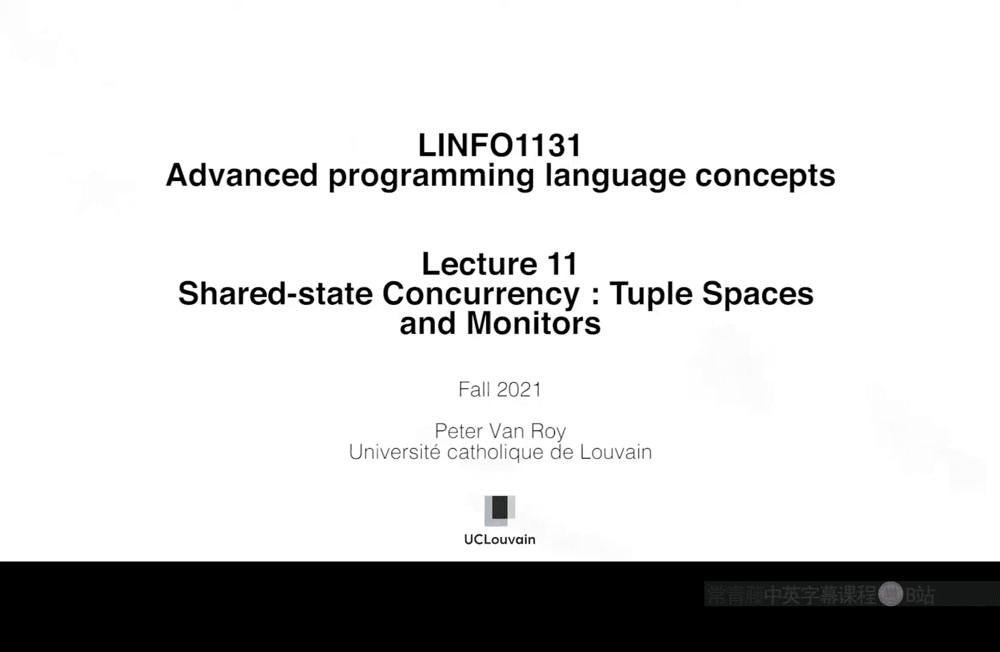
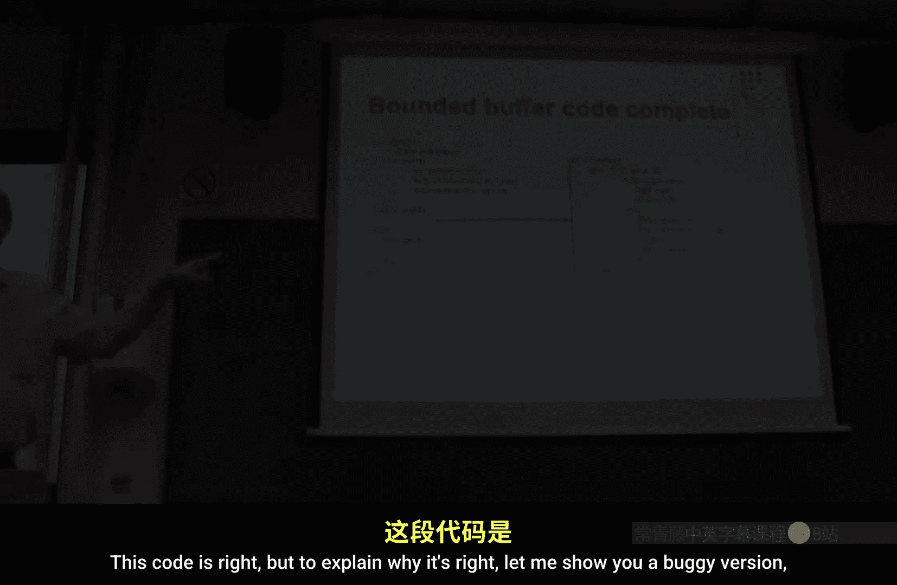

# 高级编程语言概念：11：共享状态（续）与监视器




## 概述
在本节课中，我们将继续探讨共享状态并发模型。我们将学习两个核心概念：元组空间和监视器。元组空间是一个介于共享状态和消息传递之间的有趣模型，而监视器则是对锁的一种扩展，用于解决更复杂的同步问题。

---

## 元组空间：介于共享状态与消息传递之间

上一节我们介绍了共享状态的基本概念，本节中我们来看看一种独特的协调模型：元组空间。

元组空间是一个**元组的多重集合**。你可以将元组放入其中，也可以从中移除元组。它是一个多重集合，因此相同的元组可以多次放入，类似于物理令牌。

元组空间支持三种基本操作：
*   **`write(T)`**：将元组 `T` 添加到元组空间。
*   **`read(L T)`**：等待直到元组空间中存在一个标签为 `L` 的元组，然后将其移除并绑定到变量 `T`。这是一个会阻塞的并发操作。
*   **`readNB(L T B)`**：非阻塞读取。如果存在标签为 `L` 的元组，则将其绑定到 `T` 并将布尔值 `B` 设为 `true`；否则将 `B` 设为 `false`。

元组空间的概念由 David Gelernter 在1985年提出，他称之为“Linda”。它使用模式匹配来读取特定类型的元组。

### 与共享状态和消息传递的比较
元组空间是一个有趣的概念，因为它介于共享状态和消息传递之间。
*   在**共享状态**中，多个线程访问同一个存储单元。
*   在**消息传递**中，一个线程向一个端口对象（另一个线程）发送消息。
*   在**元组空间**中，它像共享状态一样被多个线程共享（`read`/`write`），但也像消息传递，因为元组被发送（`write`）和接收（`read`）。

一个关键区别在于：在常规消息传递中，发送者知道接收者（即目标端口）。而在元组空间中，发送者（执行 `write` 的线程）不知道是哪个线程会接收（执行 `read`）这个元组。接收者对于发送者是匿名的。

我们可以根据发送者和接收者是否彼此知晓来对并发范式进行分类：

| 发送者知晓接收者？ | 接收者知晓发送者？ | 并发范式 |
| :--- | :--- | :--- |
| 是 | 是 | **确定性数据流** (如管道) |
| 是 | 否 | **常规消息传递** (如端口对象) |
| 否 | 否 | **元组空间** |

这三种范式都有其用途。元组空间在现代“发布-订阅”系统中被广泛使用。

### 使用元组空间实现并发队列
我们可以使用元组空间轻松实现一个并发队列，而无需使用锁。

以下是实现思路：
1.  队列的状态（例如，元素计数和内容）被存储为一个元组，放在元组空间中。
2.  `insert` 操作：从元组空间中 `read` 出代表当前队列的元组（这会将其移除，防止其他线程同时操作），计算新的队列状态，然后 `write` 回元组空间。
3.  `delete` 操作：过程类似，`read` 出元组，取出头部元素，计算新状态，再 `write` 回去。

因为 `read` 操作会移除元组，所以它就像进入了临界区，自然实现了互斥，无需额外的锁。

### 元组空间的实现
元组空间内部通常使用以下数据结构实现：
*   **一个字典（哈希表）**：键是元组标签（如 `foo`, `bar`），值是对应的**队列**。
*   **多个队列**：每个标签对应一个队列，用于存储所有具有该标签的元组。
*   **一个锁**：用于保护字典和队列的内部操作。

当执行 `write(L, ...)` 时，系统会根据标签 `L` 找到对应的队列，并将元组插入队尾。当执行 `read(L, ...)` 时，系统会找到标签 `L` 对应的队列，并从队头移除一个元组返回；如果队列为空，则调用线程被阻塞并放入等待集。

---



## 监视器：扩展的锁

上一节我们介绍了元组空间，本节我们来看看另一个扩展锁的概念：监视器。

锁对于实现像无界队列这样的数据结构是足够的。但是，对于**有界缓冲区**这类结构，锁就不够了。因为有界缓冲区的 `put` 操作在缓冲区满时需要等待，`get` 操作在缓冲区空时也需要等待。而基本的锁只提供互斥，不具备让线程在条件不满足时等待的能力。

监视器（也称为同步对象）就是为了解决这个问题而发明的。一个监视器包含：
1.  **一个锁**：用于保证互斥。
2.  **一个等待集**：用于存放因条件不满足而等待的线程。
3.  **`wait` 和 `notify` 操作**：用于线程间协调。

### 监视器的语义（以Java为例）
*   **`wait()`**：
    1.  挂起当前线程，停止执行。
    2.  将该线程放入监视器的等待集中。
    3.  **释放锁**，以便其他线程可以进入监视器。
*   **`notify()`**：
    1.  如果等待集非空，则从中**任意移除一个线程**。
    2.  恢复该线程的执行。被恢复的线程会尝试重新获取锁（它会在当初调用 `wait()` 的地方继续执行）。
*   **`notifyAll()`**：
    1.  移除并恢复等待集中的**所有线程**。所有被恢复的线程都会尝试重新获取锁。

在实际编程中，`notify()` 很少使用，因为可能唤醒“错误”的线程（例如，需要唤醒一个 `put` 线程却唤醒了一个 `get` 线程）。因此，**`notifyAll()` 是更常用的选择**。

### 使用监视器实现有界缓冲区
有界缓冲区是一个固定大小的队列，`put` 和 `get` 操作可能会阻塞。

以下是使用监视器的正确实现模式：

```oz
class Buffer
  attr ... % 属性：数组、头指针、尾指针、当前大小等
  meth init(N) ... end
  meth put(X)
    M.lock(proc {$}
              if @I >= @N then {M.wait} {self put(X)} % 条件不满足，等待并重试
              else
                 % 执行实际的put操作
                 @Buff.@Last = X
                 @Last := (@Last + 1) mod @N
                 @I := @I + 1
                 {M.notifyAll} % 操作完成后通知所有等待线程
              end
           end)
  end
  meth get(X)
    M.lock(proc {$}
              if @I == 0 then {M.wait} {self get(X)} % 条件不满足，等待并重试
              else
                 % 执行实际的get操作
                 X = @Buff.@First
                 @First := (@First + 1) mod @N
                 @I := @I - 1
                 {M.notifyAll} % 操作完成后通知所有等待线程
              end
           end)
  end
end
```

**关键模式**：在调用 `wait()` 后，当线程被唤醒时，**必须重新检查条件**（这里通过递归调用 `{self put(X)}` 或 `{self get(X)}` 实现）。这是因为可能有多个线程被同时唤醒（例如，多个 `put` 线程在缓冲区满时等待，一个 `get` 操作后调用了 `notifyAll`），但只有一个线程能成功执行操作（缓冲区只空出一个位置）。其他线程在重新检查条件时会发现条件仍不满足，从而再次调用 `wait()`。

一个常见的错误是使用 `if` 而不是 `while`（或等价的递归）来检查条件，这会导致多个被唤醒的线程在没有重新检查条件的情况下都去执行操作，从而破坏数据结构的不变性。

### 监视器的实现
监视器可以在可重入锁的基础上实现。主要扩展是增加了等待集（通常用一个队列实现）以及 `wait`、`notify`、`notifyAll` 操作。

*   **`wait` 的实现**：
    1.  创建一个新的**单次赋值变量** `X`。
    2.  将这个未绑定的变量 `X` 放入等待集队列。
    3.  释放监视器的锁。
    4.  对变量 `X` 执行 `wait` 操作（线程在此挂起）。
    5.  当 `X` 被绑定时（由 `notify` 触发），线程恢复，并立即尝试重新获取锁。
*   **`notify` 的实现**：
    1.  从等待集队列中取出一个未绑定的变量 `X`。
    2.  将 `X` 绑定为一个值（例如 `unit`）。这会唤醒正在等待该变量的线程。
*   **`notifyAll` 的实现**：
    1.  取出等待集队列中的所有未绑定变量。
    2.  将所有变量绑定。这会唤醒所有等待的线程。

---

## 总结
本节课中我们一起学习了两个重要的高级并发概念：
1.  **元组空间**：一种协调模型，作为共享状态和消息传递的桥梁。它通过一个共享的元组多重集合来协调线程，发送者和接收者彼此匿名。我们了解了其操作、与其它范式的比较，以及如何使用它实现无锁的并发队列。
2.  **监视器**：对锁的扩展，引入了条件等待机制。它包含锁、等待集以及 `wait`/`notify` 操作。我们重点学习了使用监视器实现有界缓冲区的**正确编程模式**，即必须在循环中重新检查条件。虽然监视器被广泛使用，但其编程模型容易出错。


下一节课，我们将学习另一种扩展锁的机制：**事务**，它通过引入“提交/中止”语义来解决更复杂的并发问题。