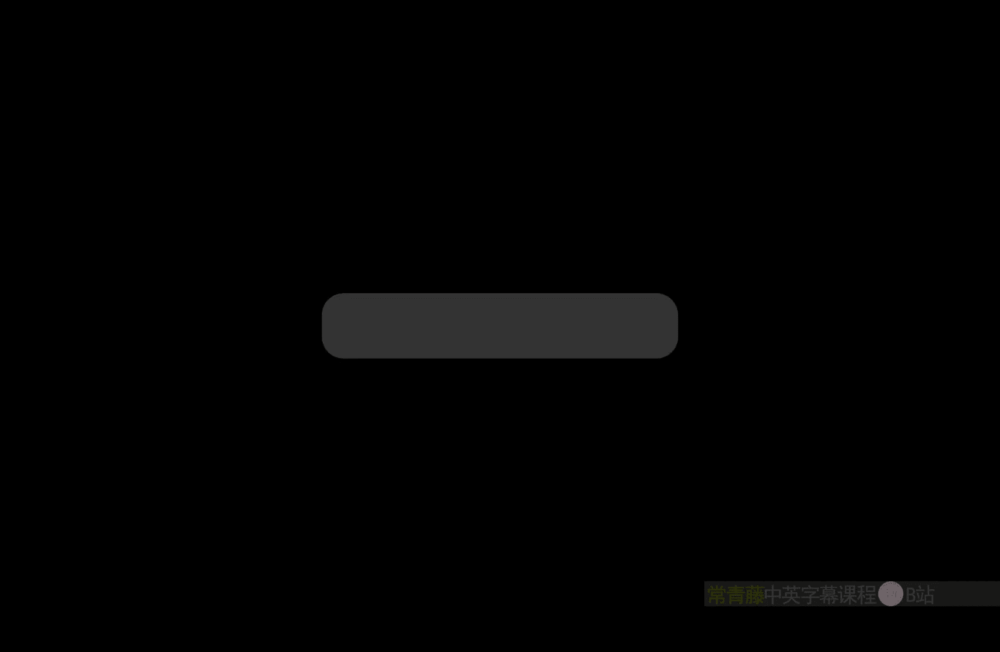

# 鲁汶理工学院【中英⚡高级编程语言概念｜LINFO1131, Advanced programming language concepts】 p27 P26 FO1131 Lecture 12 (2021) -BV1UDffBbEBZ_p27-

This is a transaction is one of the major concepts。That makes the。Internet is commerce work。嗯每个。

So this is section 8。5 in the book transactions。

Is for managing large databases to keep track of a lot of information。In companies， for example。

Or banks， you have your bank account， everyone has their bank account where you buy books from Amazon。

 all the stock information， accounting information， everything is stored there。So it's crucial， okay？

And。For a big company， there are many people doing things。

It used to be the 19th century that all of this was done by hand in large books called Legers。

 and you had lots of accountants in a big room writing in these books， okay。

 that has all now been changed and it's all happening in science databases。

So these databases have three properties and the transactions are going to be designed for all three。

First of all， they have to be resilient。That means the information must never disappear or be corrupted because the information is critical for the companies using it or for someone keeping track of anything。

 it's critical information so it must never be corrupted or disappear。

Transactions are going to support that second high performance。

 you may have millions of customers or thousands and they all want to do things and the slower it goes。

 the worse it is， so the performance has to be high and also finally scalable that means you should be able to increase the number of users。

 companies that grow they need to keep these two properties。

Resilience and performance for high scale， so we have these three properties for databases。

And the point of transactions is to get all three， okay？To explain it。

 here's an example just to motivate， this is a database。It's an array of cells。

 you can update all of it， there's a thousand， but usually there's millions or billions of them。

And there's a lock。Here。オッケー。If Im a client and I want to do something。

 maybe it's bank account and I want to transfer money from C1 C2， what I do is I ask for the lock。

And once I have the block。I update C1 and C2， and then I release a lock。Okay。So that works。

But it's not very good， performance is very low because you have one luck protecting the whole array。

So only one client can modify at the same time， okay， so that's low。And it's a bottleneck gun。

 if you have millions of people doing updates thousands per second， that lock。

 everyone's going to be waiting for that lock gun。So this works。

 but and you can see the motivation you have a lot because you have concurrent updates。

 you have more than one update and so on， you see it。And the way to solve it。

 what we're going to do is we're come to have a smarter implementation where you have one lock per cell。

 okay？And next to all the data， you have lots of locks。Okay。

That's pretty smart because now I can do things here and I can do things here。

 and I only have to lock the cells that I'm actually using， okay？So that can be much faster。

And it's still going to be protecting the sense。But now things get more complicated。

What if I have conflicting updates？Here's an example。

 each cell is storing the amount of a bank account of 100 euros here。

 100 euros here Now let's say C1 is transferring money to C2 and C3 is also transferring money to C2 okay C2 is very happy getting money from those two guys。

And in order to do this transfer。This is a transaction and that transaction is an update of the database。

 the update will。Modify C1 and C2， so it reduces the amount in C1 and it increases the amount in C2 and so that is supposed to be like one atomic action。

So that the total amount does not change now in the database。

Now the second update will want if IC2 and C3， it transfers money， and so it locks both。

 it transfers money and then it unlocks。But what if those two are overlapping？

What if T1 is reading C1 and then if the scheduler puts it to sleep？T2 now does everything， okay。

 it goes from T3 to C2， and then the scheduler wakes up T1 again and it writes T2。

 well the money that comes in from T2 has disappeared。Okay。

 and so this money poof has vanished and the database is incorrect。

So you can see that this potentially can be a lot smarter， but you have to be very。

 very clever in how you。Let those transactions work together if they have anything in common like C2。

 we have to be very careful okay。So this is the idea and the rest of the lecture today is explaining how to make it work。

 okay？And you'll see how we can make actually very nice things。O。

So let me summarize now what we want to do， we want to do an update， okay。

 and it modifies multiple things like moving one money from one account to another。

 so again it's a large atomic action， so it's all atomic。Okay。And each update。

Is doing all or none okay it must not see the intermediate states of the other ones because they're incorrect。

 the database is only correct after the update is completely donena。

 it removes money from C1 and at that point the database is inconsistent and it's only when the money goes back into C2 that it's consistent again。

So the intermediate states have to be visible。Now there's a second thing， this is new now。

 the system can crash at any time， again we want to be resilient， this thing is a real world。

Sstem running on a computer， the system could crash at any time and we want the data to stay。

Good good。The database is stored on disk permanently， so it's there even if the power goes down。

 but we want to make sure the disk never has corrupt data。

So how do we do that because we're going to do multiple changes on the disc， okay。

 and the disc can crash at any time？The power can go down anytime。

So this does not seem to be so easier。The trick is the following。

That when you make the updates of a transaction， you store them on one place of the disk。

You don't update the rest yet。And when the whole update is complete。And it's all on the disk。

 but in a special place then you write one word to the disk to switch the content from the old to the new place。

 okay so you need one hardware property of the disk you have to have a writing of one word on the disk must be atomic。

OkaySo if the disc crashes either the word is written or it's not partially written。

 okay so that's the hardware property that we need， that's pretty easy to satisfy of。

 the hardware has to be written made to satisfy that and then using this idea of using a special place on the disk。

You can make the whole update be atomic。So if there's a crash anytime。During these updates。

 during the update， then when you reboot the disc。You will restore the O value。

 the new place of the disc has corrupted data， you ignore it。

So this is how you can have commit or abor。Okay。So that's the one thing。The resilience property。

Now the system has to be fast， of course， you could have many transactions executing。Many updates。

 that means you don't always keep them on disk。You do them in RA in fast memory。

 and only sometimes you write to disk。That means if you have it in the Ram and the system crashes。

 po it disappears， of course， so you're paying a little bit of price here。

What happens when it crashes， but since crashes are rare， they happen not often。

 that's not a problem， okay， we want to make it as fast as possible in the case when it does not crash because that's by far the most come。

Okay， so that's the idea。Those are the basic techniques and I'm going to now explain how to do it。

 okay。There is an acronym。Transactions very often people say they have acid property because this is an acronym that actually combines four important properties of transactions。

啊 a c i d 。And so you'll see that a lot when you read about transactions to asset asset that it up。

 so I explained just what they mean， but I've already explained it it's just that I want to say the acronym。

 so AA is for atomic。And you know what that means it's either all or none。

 none of it no intermediate state is visible at this crash will be an abort。

 so you see no changes and there's no corruption that's atomic C is consistency。

 consistency means the database has an invariant。Like in a bank。

 the total amount of money is always the same， okay， the bank is not printing money。

 it's not like the federal， the national bank or something， it's just transferring money around。

 but the total amount of money has to always be the same。 so that's an invariance。

And whenever you do a transaction， it has to， of course。

 respect that and not create or make money disappear okay and that's called consistency notice this one is actually the responsibility of the program work。

So atomic is the actual implementation， but consistency， the transaction has to be written correctly。

 but then the implementation has to make sure that it doesn't change what the programmer has written at。

So that's consistency， I is isolation， okay？So isolation is a little bit related to atomic。

 so atomic is all or none， but isolation is talking about two transactions。

 so they never interfere with each other each one might be atomic but they might still kind of interfere so isolation means that if you have two concurrent transactions。

 it's always as if they're executing sequentially if I have T1 and T2 and they're overlapping then the actual behavior it's as if T1 is before T2 or T2 is before T1 so that's the semantics but the implementation of course is going to do them in parallel for performance。

 but the update in the database would be as if one of them happened before the other。

As if they expert in order， this is also called serializability， they can be serialized。

Do them as if they're in some sequential order， so isolation and Si's beauty is actually the same。

Property， with different name， okay。Although only for the acronym。

 it's easy to pick isolation because then you have asset doesn't work for serializability together。

And then the final one is durability。This is the fact that。The information is permanent。

It's on a stable storage and it survives even if the power goes down and system crashes。

 this one is also called persistence， so these are synonyms。Again。

 people take durability because of the acadenyma， but very often。It's called persistence， okay？

So you can see the properties here so we have to maintain all of these properties。

 so I explained how durability is maintained and there's a lot of clever tricks to make the disc。

Go well， but I'm not going to say some more， I told you the basic idea。

 so the rest of the lecture is going to be mostly about these properties， AI okay。

So that's asset properties， and in fact， you don't always need durability。

There is a thing called software transactional memory。

You can actually use transactions in your programs。To handle software bug。This is like a lock。

 a lock。That kind ofors， so it's like a kind of a lockdown， an aorable atomic action。

So this is called a lightweight transaction， and this does not have the disk， the durability at。

It can replace locks when there's a chance of abort。And aors can happen， all software can have bugs。

 so if you really want to build reliable software， this can be useful。

 even if there's nothing on the disk。Okay。So this is a transaction without。Durability。

 it's exactly like a lock except it has a second output aort。

 so the normal output of the lock is chromatum when you do all the changes。

 but aort is when you have no changes okay？Okay， so all of that is now introduction。

 and now I want to explain how we actually implement。The transactions， and there's many， many ways。

 huge books have been written on it， there's huge amount of stuff。

So I'll give you first kind of an introduction to it。

 the whole area of building systems to do transactions has a name， it's called concurrency control。

Okay， it's not called。Transaction implementation or something no。

 it's called concurrency control why because it's kind of historical it used to be like in the 1960s when IBM was still the big boss's computing and companies started building databases。

 the companies started doing transactions， then transactions was like the only concurrent thing people were doing so this was concurrency okay so this thing is called concurrency control。

So the techniques to build transactional systems is called concurrency control。

 and this is a huge area， okay， so today you get an introduction to this。

And today I'm going to show you one algorithm。For implementing transactions。

 so this is the lightweight transactions， so I won't say more about persistence or durability I gave you the basic idea where we have a switch one word right on the disk but I won't say more about that because that's kind of a separate。

Sa us explain to you how to do lightweight。Transactions and the algorithm we're going to do today。

 you can summarize it with the following phrase， optimistic concurency control with strict two phase locking and deadlock avoidance。

Each of these red parts。Is a property and there can be many different properties okay。

 so optimistic you can also have pessimistic strict to phase loging。

 you can also have nonstricts to phase loging Delock avoidance。

 You can also have deadlock detection and not avoidance So this is one out of many possible algorithms。

 Okay is this algorithm is implemented in two pages of code。

And it's actually implemented using active objects， it's implemented using multi agentent style。

And this is the most complicated algorithm。In the book， okay？And I'll show you。

 I'll give you an example of what you can see at this algorithm。Because it's doing a lot of things。

So this idea of transactions， it seems very simple， but actually to make it really work。

 the algorithm has to do a lot of things， okay？So let me now explain the different axes。

 the different variations。Okay first of all， the system can be optimistic or pessim and I'll explain what that means optimistic means it means how often are they actually giving locks so when a transaction needs a lock on a cell。

 it asks the transaction manager okay and the transaction manager can respond different ways it can say yes。

 here's the law or it can say no， and then the transaction has to a board or it can say wait and the transaction has to wait and if sometimes it can be optimistic that means it's giving locks even if it might increase the chance of a board later on。

Or can be pessimistic where it's very， very trying to avoid the boards So we'll see some examples of this So this is depending on cost of failure。

 there's also the lock management， this is the serializability remember the example where T1 and T2 they were overlapping and the number the amount in the bank was wrong。

Well that was not serializable， so the lock management avoids stats， okay。

 so it's giving the locks and it's sometimes asking the transactions to wait so that you always be made serializable so I'll explain that。

And the final one is a really interesting one called dead dock management。

Deedlock is a situation that can happen in a database， but also in the real world。

This is when you have circular dependencies when I need two things and somebody else needs two things。

 like I need a fork and a knife to eat。The other person also needs a fork and a knife。

 but there's only one fork and knife， I take the fork， the other person takes the knife。

And I want the knife now and the other person wants to fork。

 so we're obviously we're sitting there waiting for the other one。

 so this is a circular dependency and the system blocks forever okay。So we'll talk about that too。

And then I'll talk about the consistency and the execution properties， and there's two properties。

For this， safety， so safety has to lose in variance like the amount of money in the bank is always constant。

 okay and liveness means the system makes progress， that means transactions sometimes commit。

 they're not always abor it if they always abort， then there's no progress on。

And you need both of these properties。And then I'll talk about some of the building blocks。

 so this is built using blocks and then a new thing called the timestamps， okay。

So the locks are important for safety。And the timestamps which are like incremented。

 they will give transactions priorities so some transactions will execute before others so that if there's two transactions kind of interfering。

 one of them is given priority okay so that the system can go forward so that's important for life okay so this gives you like a summary roadmap of what we're going to see all of these concepts I'm going to explain them now so whole all of this kind of gives you covers you the whole area of concurrency control。

Okay， okay， so what I want to do now is before。Before I talk about actual transaction manager。

 I want to talk about safety and liveness。So you may already know what these properties are。

 have you seen these properties in their previous course？No， anyone seen them？If you've seen them。

 raise your hand。Nobody， okay， so that means it's very good that I talk to them because they're very fortunateulent and not just for transactions。

 for everything， but here's a good time to explain them because they're especially important for transactions。

Okay， so we want to build a system， software system that does things。

And it has to do things in the right way， okay？And there's two kinds of properties。

Called safety and lifeness properties。And I'll give you intuition。

 but I also give you formal definition， okay？So safety property means bad things never happen。

And the liveness property C says that good things will eventually happen。

 so the safety is like the invariant and the liveness is the progress example is like when you're driving a car。

Safety means you don't have an accident， okay， you don't crash the car thats safety property liveness means you actually get to the destination I want to go to the seaside to the beach。

 I actually arrive there that's a liveness property okay。So you want both of them up。And always。

 you need to have both， okay？Okay， so let me make it a little bit more formal now。A property， P。

Is a function of an execution。So you have a whole execution of the system starting going on forever。

 maybe potentially forever a long time， so a database normally never stops goes on forever years and years。

And the execution we saw already in a previous course is a sequence of execution states。

 so ST is the stack and sigma is the memory， the stack is on so this is the instructions that you're executing and this is the data。

 so each arrow is one instruction， a step。So this is modeling and execution。

 and we saw actually a formal model of this abstract machine that can actually explain that okay。

I'm not going to go over the form model again， but I just want you to remember that this is how you model an execution。

 it's an infinite sequence of execution states where each state is instructions plus memory instructions。

 so this ST is like an。A set of stacks， multiple threads maybe。

 so each thread is one stack and sigma is the memory。

 which is both single assignment and cell memory both so this is the execution state。

So that's the execution and the property is a function of that that gives true false。诶？

That's the thing we're going to talk about。Now， I want to explain before we give the definition that it turns out that any property at all。

 any property P。That you can define you can always express it as a combination of safety and liveness that's a very profound mathematical theorem that you can show okay any property。

 so a boolean function of an execution is a safety and a aliveness property。

 so a safety property is something that bad things never happen and a aliveness is that there's progress。

Okay， we'll make a formal definition of these two and then you'll see exactly what it means。

 but this is actually really interesting， it means when you define your system。

You just have to worry about safety and lives， you don't have to worry about anything else。

You can actually look up this proof， this is a famous result from 1985。

It's very mathematical uses topology so this is a formal mathematical property。

 so I won't explain the proof here because this is not the course on mathematics。

 but if you're interested it's actually quite interesting quite。

Interesting paper and you could easily find it okay by Albert and Schneider。

So we're going to use that。So now I want to define formally what is the safety？

And what is livezness properties？Okay in order to define formally。

 we are going to talk about executions， so here's execution。

 and we're going to introduce two notions， one is the prefix。And the other one is an extension。

So a prefix of execution is the beginning is the first K execution states， for some K。

 so you chop it off at some point， so that's the beginning of the execution that's called the prefix。

 okay。A finite beginning， so the K is always some number。

And an extension is you take the prefix and then you keep going。

 you start executing from the end of the prefix that you keep going。

 so maybe it's not the same as the original execution。

 you can go in different directions here up but you start in the same way as the original one。

 then you go and you start keep executing。So that's the second concept。

 so to define safety and liveness， we are going to use prefix and extension。オケ。

So here's the definition of safety。I give you an informal version and then I give you the formal。

Version， so I have P of E property and an execution， it's safety。

 if every execution violating P goes bad， that means there's an event such that every executing。

 starting like E and behaving that E up to some bad event， some bad thing。

Violet pe regardless it what does after so basically the system breaks。

 I like to have the example where I have an egg， a raw egg， enough crude and I'm carrying it。

And I dropped it。Splash well that's not nice well the egg is broken， okay。

 and whatever I do after that， the egg stays broken。So I've broken the system。

 so violating safety means the system actually like breaks， something happens， a bad event。

 and there's no way to fix it， so everything you do after will always。

 the system will always be broken when execution goes bad， it stays bad it cannot fix it。Okay。

 so that's the way to define safety。And this is the formal definition。

Given an execution such that P of E is equal to false， so it violates safety。

 so any execution that violates safety， there exists a prefix。

 such that every extension of that prefix。Its also false。Okay。

 so F was an extension of this prefix and PFO will always be false。

 That means there is a prefix the beginning and the system is broken and no matter what you do。

 every extension gives false， no matter what you do after it stays broken。啊，对对？Do not repair the egg。

 I want I crash my car， well it's crashed。So it's broken。So you cannot fix a broken system。

 so that's a safety property if a property is such that you cannot fix it。

 then it's a safety property， okay？So here's an example in computer system。

So I have messages going between multi agents， remember multi agents。And here's the safety property。

 a message sent。Is delivered at most once， so if I have two agents and send a message。

 so it arrives at most once， maybe it disappears because of failure， but it arrives once。

 but not more than once， okay？You can break that，huh？

The way to rack it is to make the message arrive more than once， okay， if it arrives more than once。

Then there's no way to fix it because it's already you can't unarive a message。

 it's arriving for the months， it's broken， okay？So if the message is delivered more than once。

You take the part of the execution where it's delivered。More than once。

 you stop there no matter what you do after that。Any extension。You can't unver the message。

 so it will always stay broken， so every extension will also be broken of course。

So this property is you can break it。So a property that you can break like that is a safety property。

Okay， so this is like the bank account money once the amount of money in the bank is wrong。

Then it's wrong， okay， the bank is broken the money is not good anymore。Okay， on the other side。

 you have liveness。So it's kind of the opposite。Of safety， So again， I have a PFE。

A property of execution， assume now that P of V is true。

 the liveness for the whole execution is true。Then there for every prefix。

 there this extension set the P and Pf is true that means。Asume now I do something。

And the livelines is not true yet I can always do something to make it true， okay。

 as long as there is life， there is hope that actually captures it pretty well as long as the execution continues。

 even if it's false now， I can always may make it true there's always something I can do to make it true。

 so any property that's like that。It's aliveness， so I'm driving my car， okay。

 and I want to go to the beach not now but in summer。And。And I make a mistake。I end up。

I end up in the Allops okay somewhere in the mountains so I'm very wrong。

 but there's still hope because I can still change direction and go to the beach Okay there's always a way to go back to the beach so you can always find a way to fix it so any property that like that it's like that that even when it's not true。

 you can always do something to fix it that's a lattice。Okay。So here's slide this。

Toge into the message example。Dive nurse says the message is delivered at least once。So once or more。

 okay， so if I have a prefix。Of any execution， if the message alreadyah arrived in there。

Then I'm fine， any extension will satisfy Pete， maybe the message arrives more than once it's good。

But if the prefix does not have the message， I can always。Make it true by。Adding the delivery， okay。

 there's always a way to make it true。That's license， you can always do something that makes it true。

 maybe you have to do something it's not going to be automatically true。

 but you can always do something to make it true， okay？And to summarize this。

This is the way I like to see is like this， this is a visual way， your mileage may vary。

 some people don't like this kind of way， but for me this is a good way。

 so you can see the difference between the two so the top picture is safety in the bottom is liveness so here I've been execution okay。

ok。So if assume the safety is false here， then there exists to precincts such that all extensions are false。

 so no matter what you do the system is broken and stays broken。Lvenesss is kind of the opposite。

 so assume an institution where lives is true。Then for all threefis， no matter which one。

 even if it's false here， you could always find a way to make true there exists， at least one。

Way to make it true， so that's lie misrop。Okay。So you can see they kind of dual property sum if you look at it like that。

嗯。Okay， and to finish on that， let me give just some。Intuitions。

How do you know when something is safety and？L or live。

Safety can only be really satisfied when you look at the whole execution。

 you're never really completely safe， you're driving a car。

 you can always have an accident so during the execution。

You never really know that you're completely safe， you can only know that after the execution is done。

So infinite time， when I say infinite time， we mean at end the execution。

 okay and it violates a finite time when you have the accident。Okay， and。

If you have properties where you have the word endeavor。At most cannot， it's kind of safety。

 these are safety words， partial correctness is a safety thing， okay？

And lives is very opposite to that。So you can satisfy the finite time So the good thing it has to happens in finite time okay I want to satisfy your life there's only the only way to know that the system is completely dead。

 okay， not live is to go to the end of the execution and then if you see that the good thing never happened。

 then it's not life okay but while it's executing with's always hope you can always make life okay and hear's some liveous words。

 eventually must do this， at least okay， termination， liveness property。

 your algorithm terminance okay。So that's basically telling you safety and liveness。

 it's very important for transactions。But it's important for all systems that you build。

So it's good to know what it is， okay， here's some questions。For making you think。

I will not give the answers to these questions today， but I will give them next week， okay？Okay。

 we define safety。As a predicate。Of an execution。Why not define it as a predicate？

So we define safety like this， a property of the whole execution P ofE。

We could do something different， okay， why not define it for execution states？啊。

So if you crash the car， well， the state is the car is crashed。

 so maybe it's simpler instead of having E， which is this big thing。Full execution。

 why not make it just true for individual states so the system is safe if it's true for every single state？

You see thiss actually a different way from defining safety here， EI is a single execution state。

 so here I'm saying that all states are safe， whereas here I'm saying the whole execution is safe。

Okay， but these Ps are different different， this is one property of a state。

 this is property of any execution。There's actually very different ways very different way of defining safety。

And the question is。I actually fund it like this，But you could define it like this。

 so this is kind of to make you think about the fundamentals。

 why not define execution safety for states？Why。嗯。And a long time ago， like in the 1980s or 90s。

 people did it， so it's not so completely obvious why this is actually not as good。

 doing it like this is actually not as good as doing it like that， why not？Okay。

I want you to think about that， you could maybe find the answer。By searching Googling EBITDAbit。

But I'm not going to say today， and will say it next week。Okay。Here's another question。

I told you that every property can be safety and liveness。

 so there are safety properties and liveness property。What about the property。

 every message should be delivered exactly？Once time， not at least not at most， but exactly once。

So what about this one， is it safe to your lightness， so what happens with this property？

If you think a this is actually an easy question， if you think a little bit。Remember。

 I showed you that at least once。嗯，这す。Not at least， but at most once is safety property。

 what about the exactly ones， what's that？What do you think。Anybody have an idea on that one now？

It's both， what do you mean？嗯。How can it be both？Because the executive runs。

Is at most once and at least once at the same time， and you said it earlier。

It's at most once and at least once， so what I actually I actually made I'm writing at this to confuse you of what I said that every property can be a conjunction is safety and lifeness。

 so you're right， so this is actually a conjunction。This is a safety and a licensed property。

 I never said that every property is either safety or live in。

I said that every property can be written as a conjunction。Of a safety and a life。

 so this one can be written as conjunction， so that's the answer for this。Pestionina。

So you have to understand that though。If you don't understand it completely。

 you think about it and look at the definitions。But this first part is a little bit harder。

 you have to think but a little bit more。Really， why is defining safety as a property of executions。

 why that's not really good enough， okay， if you do that， then your safety is not really good enough。

 why not okay？So here I'm not going to say more than this one。

 this one I want you to think a little bit。Okay。Good。

 so that's all I'm going to say about safety and liveness and we're going to use it for the transactions Now I come back to transactions。

 okay。Now I want to talk about concurrency control。

 so now we're going to implement transactions with safety and office， okay？

And in order to implement it。We're going to define a transaction system， an architecture， okay。

 so how do you write the code for this？Okay， here I have transactions， T1 to TN。

 and I have a transaction manager Tl。Each transaction is a piece of code running in one thread。

And the transaction manager also is a piece of Coke， and they're like active objects if you want to。

Each of these is an active object。And the concurency control is implemented inside TM。

And how does it work， well the transaction wants to do updates of cells。

 but before it updates the cell， it has to lock。The cell， so when it goes， whenever it needs a lock。

 it asks the transaction manager it says， please give me the lock for cell 25， okay？

And the transaction manager will reply。It will say， yes， you have the lock or it will say， no。

 I am not giving you the lock or it will wait。It will not reply immediately。

 it will let the transaction wait， okay， so those are the three possible answers。Okay。

 and then when the transaction is done and it does not need the lock anymore， so I don't know。

 I don't need the lock for Excel 25 anymore， it says， please， you can have the lock back。

 It tells the transaction manager that it doesn't need the lock anymore。So that's how it works。

 so thiss not that complicated enough， you can see what happens in some cases if the transaction manager says no。

That's actually pretty bad。 means transaction has to abort poor guy has to abort， That's it。

 He's done he boards。Delay， that's more usual， maybe doesn't give it right away， okay。

 waits a little bit。Because maybe some other transaction is using it and you have to wait it up until the other one freeze it。

 or for some other reason， maybe for serializability， you have to wait a little bit， okay？

Or you can give it right away。Okay， so you see how it works。

 so there's always messages going between each of these transactions and transaction manager and you can create new ones whenever you want。

A new transaction is like a new active object， and when a transaction is done， proofof it disappears？

So this thing is always running like that。So it's not so complicated。With this note， we could。

We can go back to our concurrency control ideas。And the three main things here。

 optimism versus pessimism， the serializability， lock management and the deadlus。

 the lock is a special thing which which can happen and which we will have to handle okay and all of this is is satisfying safety and liveness and it's using locks and timests。

 so locks we know already， okay but you don't need only locks， you need also this new thing。

Timeイざります。オッケー。Okay， finally， let's go now to optimismism versus pessimism。

This is a really neat kind of concept。A transaction asks for a lot。Okay， the transaction manager。

 it can give the lock。Or not， or ask let the transaction weighs。

Now it depends on the cost of failure if aborting is very bad。

And we don't ever want transactions to a board， then the transaction manager will not be so fast in giving locks because if you give too many locks。

 at some point you might have to cause a transaction to a board because one transaction will need the lock that's held by another one and they're both waiting and the only way is to cause one to a board。

 okay。So呃。So that's if you're optimistic and you give locks too much。

Then you might have to force transactions to a board， so if you don't want awards。

 then you have to be pessimistic， that means you are very prudent。

And you don't give luck so much okay or at the other end。

 if more transactions means more profits and if failure is no big deal， we don't care if they haveor。

 but the more transactions are running， the more profit you make。

 of course it'll be optimistic okay So here's two examples of this one of them is and you have already experienced both in your life。

 one is airline booking， okay this is an example of optimistic。Scheduling a passenger booking a seat。

 you have a seat in the air in the flight is a transaction okay and you get a seat， you haven't。

 okay it's committed that。But that's not really the way it's done。

Airlines will almost always they overbook flights， Okay。

 they will sell more tickets than seats on the plane Okay， the plane plane。

And they will send more and maybe 20% more or something a lot， why is that？

Because sometimes people cancel。And if people cancel。

 that's an empty seat and airplanes are very expensive to fly， okay。

 the airline wants to have a high number of filled seats when the plane is flying。

 it has to have as many seats filled as possible so people might cancel。

And then even if there's a cancellation fee or something still the airlines， they don't like that。

 it's like a lost or that， okay， so they will overbook。

But the problem is maybe you arrive at the airport and there's no seat， okay。

 I don't know if you ever got that situation before I have had that situation several times。

Of course， the passenger is not happy。I want to go to New York， sorry， there's no more seats。

 but I haven't bought ticket， yeah I have no seats。So the airline that happens。

 so you have to abort that transaction， Okay， so it's not really committed until you're sitting in the plane。

 Okay， before you go in the plane， it's not actually committed， even though you think it's committed。

 you have the ticket， you don't have the seats see so so that the。

The giving to lock is like you let all these transactions run。But they don't actually commit， okay。

 until the plane starts flooding， okay？Usually the airline tries to make people happy。

So if you don't have a seat， they'll say， well， they will book you on the next flight。

 but they will say， here's a voucher for 300 euros for the next flight。

 so they give you some kind of a compensation to make you happy， okay？But sometimes it's nasty。

 there's no more flights so they put you in a hotel or whatever so they do something。

 but for the airline， it's much better to do that than to have less seats on the flight than it's very mad empty seats for the airline okay so that's an example of optimistic schedule and you see because the price of failure is actually very low and they really want as many seats filled as possible that's the problem。

Okay， so that's optimistic， here's an example of pessimistic， this is railroads， tracks， okay？

So a train is going on a piece of track。So basically it has reserved that track。

 it says that track is for me at this time and that reservation is a transaction， okay。

 I need those tracks to run and I get it， I'm committed， okay， I can run at  1035。

 I will run on that track。Now， you're not going to let that tract be reserved by more than one。

Transaction if two trains go on the same track at the same time， it's not good。

There's an accident and people die and stuff， so the cost of failure here is very high。

 so you never want these transactions to a boardt， so aborted here means that the train cannot actually run on the track。

And even the abort can be because of an accident it's not just the signal and saying no you can go。

 it's actually an accident happens so it's like a forced abort so this is very bad it's in the newspapers。

 people die and stuff that means you have very pessimistic scheduling。

And when you drive go on a train， sometimes the train stops in the middle of nowhere。

 you have probably noticed that and you sit there， why does it stop well because there's a red light？

Why is there a red light Well， because maybe another train is coming on a track farther on and they're very。

 very， very prudent， but maybe the other train is late or whatever。

 maybe there's no other train but still they will let you stop because the cost of failure is so high。

か。So this is an example of pessimistic， so you don't actually give the locks very often on a segment。

You only give it when you're really， really sure， okay？So two transactions， one of them。

Will lock and。Get it， but the other one asks for the lock on that segment will not get it until the first train has actually passed on the segment that gone away until it's sure there's no accident possible。

 okay？So that's how that one works， so you see the difference。

 so all transaction managers are kind of there's a flavor that can either be more or less optimistic or pessimistic。

You kind of see the idea and you see that transactions are a very general thing， it happens in many。

 many cases in the real world， but it's not just databases。Okay， like also Amazon selling books，Okay。

 Amazon selling you a book。And you buy the book and you pay， that's a transaction。

And you think you're going to get the book when you do that， but will you get the book？

Because sometimes it's possible before the book has actually been sent。

 you can actually cancel your order， there's a short period。

So who knows maybe Amazon will sell the book to two people and one person will not get the book and get a refund。

 actually it has happened to me several times that I order something from Amazon and I don't get it。

 but I get a refund。If you ever had that happen， well。

 for me that smells like Amazon is overselling their stuff， okay？

All of a sudden there's number books because maybe someone else has already bought it。

 so they're being little bit too optimistic there。Because the price of failure is not so high。

 it's just an unhappy customer， but y I get my refund so I don't lose any money。

 I just don't type a book， okay。So the price of failure is not so high， people don't die。

 okay I'm they're not going to come and stick a knife in me。

 it's not like the train where people die here， the airline booking is kind of annoying but people don't die。

 but the railway track， you have to be very careful of。Okay。

 so that's optimistic and pessimistic that gives you an idea， let me now make small break。

 and after that we talk we'll go to the real heart of it。

 which is lock management that that's the real stuff。

Each transaction is aligned， okay the time is going to the right。And whenever it gets a lock。

 it actually makes like。Boxes， blocks， whenever it gets a lock I put a block there and when it releases the lock it goes back down so the higher gets the more locks it has so here for example T2 will get L1 and it's executing here it will get L2 then it releases L2 at some point releases L1 it goes back so the height is like the number of blocks it has okay this is very common diagram and it actually gives you good。

Good image of what's going on。😔，Here's a case when I'm naive。

 this is a naive solution of block management， it means whenever I ask for a lock。

If nobody else has it， the transaction manager will give it to me right away。

If no other transactions is hold get transferred， yes， it's yours， okay。

 and that's actually naive and that's actually not good。

And the reason why it's not good is it's not serializable， and here's an example。T1 is running code。

And it wants to transfer money from C1 to C2 and T2 is running code and it wants to calculate the total money I have in my accounts。

 so I have two accounts okay I have savings accounts， C1 and checking accounts。

 C2 and you can transfer money between rather than two you know when you've already done that okay so that's what T1 is doing T2 is calculating the total money。

I have in both accounts。So the way this naive solution works， T1。It wants to get the money from C1。

 so it asks for the lock， if it loads the money in a local variable， and then it releases the lock。

And then later on， it asks for the lock on C2。It updates C2 and then it releases the lock。

 but in the middle， there's no lock because it has no locks。

Okay so this is the really naive one where the transaction manager is giving the lock right away here T2 is coded a little bit differently。

 it gets first the lock on L1， so here there's nobody， so it gets it， gets lock and L2。

 it does the calculation， displays the amount， whatever。

 and then it releases the lock as one after the other。So this is wrong， this is buggy。

And the reason is actually it's not serializable， T1 of T2 is not serializable。

 you cannot say T1 is before T2 or after T2。Because T1 will change the value of C1 here。

 but it does not change C2， so it actually things to like inconsistence。

 so T2 will get an inconsistence。C1 here and a consistency C2。So in this case， there's missing money。

Because the money is released from。From T1， from L C1， but not in Puency2 yet。

And the reason is it's not serializable， the two transactions are interfering with one another， okay？

So how do you solve this， well the lock management has to be a little bit smarter。

 it's not allowed to release the lock before getting the next lock in fact。

 okay and the usual way to do this is to the transaction gets all the locks before it computes and then it releases them。

Okay this is called two phase locking， so here's another way of doing it。

 and this way is actually serializable。If I change the lock management。The way it doesn't follow。

 I get L1。And then the transaction asks for L2， it gets both lots。But then it runs。Okay。

And then it releases L2， releases L1， and T2 is the same。

 so it actually has both locks at the same time。嗯。If I do it like this， then it will be serializable。

Okay， so I remind you， serializable means it's as if they were executed sequentially。

 so in this case T1 is actually going to be before T2。

 but maybe the scheduler is different and maybe T2 is before T1。

 but there's never interference because if T1 has L1， T2 cannot get L1 during this time， okay。

P2 has to wait， so the first one that gets L1 will get it。The other one will wait。

 so depending on which one gets L1 first， that's how we decide the order， okay？This technique。

 where you get all the locks first and then you release them when you're done。

 this is called two phase locking。This is a very important technique and almost all transaction managers use some kind of two phase line。

 Why is it called two phase because？Because it has two phases。

 there's a phase when it's asking for locks， this is called growing phase。

 the number of locks is growing， and there's a shrinking phase。When it's releasing the lock。Okay。

So while it's asking for locks， it's not allowed to release， okay， and when it starts releasing。

 it's not allowed to ask anymore， so it cannot go like this， and has to go up。

 have all and then go down。Okay， if you do that， maybe you have the lock too long。

 maybe I don't need L1 the whole time。So you're kind of being a little bit conservative。

 but the result is it' serializable。Okay， so two phase locking， almost all transaction managers。

 the lock management will be done like that， okay， so when I ask for a lock。

Okay I'm not allowed to release the lock when I start releasing locks。

 I'm not allowed to ask anymore， so in my transaction manager I'm asking for locks。

 okay I'm getting them。And I can start releasing lock， if I ask for a lock again。

 after I've released， then the transaction manager will say， sorry， bud and it aborts me， okay。

 so that's illegal after I'm starting to release I'm not allowed to ask anymore。Okay， y。

If one thread lock ask for lock number one and then lock number two and the other thread ask for lock number two and then lock number one。

 one could get the lock number one， the other lock number two， and they are both blocked。

Then they are both deadlock that's right that's another problem I' explain in a few minutes yes so if T2 asks for T L2 first and T1 asks for L1 and they're running incur and each one has one of the locks。

 then they ask for the other one but it can't get it because the other one's waiting。

 then that's a deadlock so this two phase locking does not solve deadlock。

Deedlock is a separate problem， actually a very weird and strange problem is that you have to solve separately。

 so this one will only guarantee serializing。It will not。Guarantee that you have no deadlocks。

 you can still have deadlock with this， okay but I will explain deadlock in a few minutes and then you will get all the answers。

 so this only ensures serializability okay。So two phase locking， growing and shrinking。

 if the lock manager does that， then it's guaranteed and you can prove the theorem。

 I will not prove it， but actually you can find it easily on internet that it's serializable。

That one of them will always be before and if you have many transactions and they're all doing two phase locking。

 then the whole system will be serializable。It's very intuitive also。

 I get all the locks and then I do the work and I release them。

 so actually at the middle here I have everybody， I have all the locks I need， okay？

And at that point I can do computations， and then I start releasing。

 it's like I'm getting the locks in a group， I'm getting a group of locks here。

So twoth phase locking makes it serializable。But life is not so simple， of course。

 one of the reasons is Dlock， as someone mentioned， but there's another reason。Why two phase locking。

 usually real systems， they don't exactly do this， they do little modification。Okay。

And this is so widely used that I have to explain it。

Now I assume I have twoth blocking and so everything is serializable， so there's no bug， okay。

 no bug here。But let me show you a particular scenario with three transactions。Three transactions。

 they're dependent， that means their cellselves in common， they modify shared data， okay。

 so T1 starts。It's doing its work， it's releasing， and here it releases L1 and once it releases L1。

Okay but it's not finished yet， it still has another lock here， a final one。

 but it keeps for log time， but it releases L1， and then at that point T2 can get L1 final and it does its stuff。

 it gets more locks da da da and once it releases here L2。It can get L2。

 as soon as this one is released， this one can get it， okay。So this is completely correct。

But look at this scenario。Somehow， for some reason， keeps this log for a long time。

 and then it aborts。啊。Well。That means。T 2 and T 3， you have to abort 2。Okay。

 because T2 is reading the value of the cell that was modified by T1。

And T3 is reading the value of the cell that was modified by T2，Now notice this is still correct。

 there's no bug here， no bugga。This is completely correct。

But the problem is that if one transaction boards， the system has to force。

The some other ones to abort two。It's kind of complicated， okay， that's the problem。

In order to implement this， you have to keep track of all the dependencies， so T2 depends on T1。

 T3 depends on T2。As T1 aors， T2 and T3 have to abort， and it's always changing these dependencies？

So when T1 aorts， the value of C1， the cell1 is restored， and all the values， C1。

 C2 also is restored， so T2 33 must aor as well。So this is completely correct， there's no bug here。

 this is serializable， this is very nice except that implementing it is kind of complicated because the transactions are dependent。

So the guys implementing the transaction managers， they don't like this because it makes implementation complicated and it's kind of rare。

 it doesn't happen that often， but still you have to write a lot of code to handle this。

So what they did is they changed a little bit the two phase locking， so this never happens。Okay。

And this is called strict two face lock。And the way to fix it is to release all the locks at the same time。

 not one after the other， but at the same time， so I'm releasing them all at the same time。

 and at that point the cascading abort， which is what this problem is called this is called cascading aboard because you can have like a cascade of aborts when I work what transaction many can abort。

So to get rid of that。I release all the lus at the same time。

 so that's okay that's still a toothpaste lockingh， it's still serizable。

But then if I release them all at the same time that when the next transaction starts。

 there's no lock that kind of lives on here and that could mess things up if I abort later。

 nobody lives on here， so you cannot have cascading aort。Okay。So to avoid the cascading of， we do。

 and this is called strict two phase locking， all locks are released at once。

 so almost all real commercial databases are doing this okay。

 they are doing strict two phase locking。And it's slightly slower。than regular， because in fact。

 instead of reducing removing releasing when I don't need it。

 I have to keep all the locks until the very end until I don't need anything。

 so maybe I could release already L3 here and I could release L2 here earlier。

But I will keep them longer and the reason is to avoid cascading board。

 I will keep them all until I release the last lock， you see。

 so in fact I'm actually keeping the locks longer than I really have to。It's not bug， it's fine。

 I'm allowed to do that， it will slightly its lower performance。

 but it makes the implementation much simpler because there's never a dependency now when this transaction affords。

 I never have to abort anybody else， okay。So that's what most real systems are doing。

 straight to face lock。Okay。But。So it seems we're almost done now， okay， we have it。

But as one smart guy mentioned before， there's still a problem。Hanging over us but we'll see that。

 so let me now make a simple transaction system using strip to face blocking。

It will do optimistic con control with strict to face locking。Sounds good， okay？Okay。

 here's the algorithm， I call it naive algorithm， which's very simple。

When a transaction requests a lock of an unlocked cell， it gets it。啊。If the cell is already locked。

 transaction weighs。And when the tra commits or abhorts， it releases all the locks stripped。

To face lock， so it's getting locks。But it's never going to release and then get after。

 it'll never go down up when it releases off fine。This is completely serializable， okay？

And it's optimistic because when I request a lock， I immediately get it。

The system doesn't care about whether that might cause a problem later on， I get it， okay。

 I immediately to get it now this is a little bit too optimistic as we will see。嗯。

It assumes that getting locked will not lead to problems later on。But in fact。

 there is a problem that can still happen。This is the deadlinelock problem。Deadlock is。

 it's like an epi phenomenon， it's hard to predict how do we know that it will let me explain what it is and you'll see how the deadlock occurs。

 okay？And this is exactly the example that was mentioned before。So consider transactions T1 and T2。

 each one uses two cells。And T1 starts by using C1 and then2， T2 starts by using C2 C1。

Now the scheduler can schedule them， their concurrent， so T1 will get T1's log。

And T2 will get C2s locked， so they both have。One log each。Okay。

 and then T2 will try to get T1 will try to get C2， but it can't because T2 hasn't， so it waits。

Until T2 releases C2 and T2 aways， so until T1 releases C1。

 so they're each waiting for the other one and they wait forever。And the system is blocked。

 these two transactions are stopped。Okay， this is called deadlock。

And this is a natural consequence of having resources and having entities that need resources。

 there is no easy way to get around this。This is a fundamental problem， okay？

So how do we solve this a we have to do something of course and if we don't do anything。

 these two transactions will sit forever， they will use up resources and eventually the whole system will be full of deadlocked transactions and all the locks will be sitting there taken by these deadlock transactions and the whole system basically。

Stops doing anything， okay， so this is a major problem， you have to fix it down。

But what is it exactly。Let's first try to understand really what is that law。Okay。

Deedlock is a very general thing， actually， it can happen in any kind of system。

 also in the real world when you have two kinds of things， active entities and resources。

When you have active entities like people or cars or airplanes or whatever or transactions。

 and you have resources。A resource is like a cell is something I need and when I haven' it nobody else can have it。

 so a resource here is something that when one of the entities has it。

 no other entity can have it and that an entity needs more than one to do his work。Okay。

So here we have T1， so C1 is locked by T1 and T1 is waiting for C2。

 but C2 is locked by T2 and T2 is waiting for C1， so we can make a graph here。

This is a good way of looking at that log， this is called the weight for graph。

 this is a formal structure， it has two kinds of nodes， transactions and cells。

 and it has two kinds of edges， aarrow on， weights for edges from transaction to cells and locked by edges from cell to transaction。

Okay。え。Here we have a cycle。Okay， a circle。Close circle。And any cycle in this graph is a deadlock。

So we can redefine a deadlock as a cycle in the weight for graph。And anytime you have a cycle there。

Then you will wait forever。Okay。So you have to do something when you have cycles。

 here we have a cycle with two transactions， but you can have cycles with more， three， four， more。

 I can have T1 waiting for T2， waiting for T3 waiting for T1， I can have any number more than one。

Two， three， four。And cycle will be waiting forever， so that's a deadlock， it's a fundamental thing。

 deadlock， you cannot get around it when you have active entities and resources。Okay。In fact。

 it happens also in the real world。嗯。Cars at an intersection。

The active entity is a car and the resource is a square entry intersection， so let me make a picture。

So here we have an intersection， okay？Okay， we have a car going like this。

I don't have a car going like this。And here we have a car it wants to go like this。

Here we have a car going like this， and here we have a car going like this if we have four cars。

This alls of dead locker。The car is an active entity and each car needs a square。In the intersection。

 this car needs this piece so the resources are a part of the road that the car has to drive on。

 so this car they we call them one，2，3，4， car one needs this piece， two needs this piece。

 three needs this piece and four needs this piece， but four cannot take this piece because there's already a car standing there。

 and so you have this circuit dependency again。So this is an example of a deadlinelock。

And I don't know if you've ever seen that in big cities it happens， okay。

 this is why it's in the traffic laws， normally you're not allowed to go onto an intersection if there's no way out。

 let's say you have light CR。You have lights， okay， on the intersection。Okay。

 but let's say there's many cars here。All over the place， okay， so the powers are here。

And there's power going here。So I go on intersection section， but I cannot leave。

And then this guy cannot go on， so the easy way to get a deadlock is to go on the intersection even though you cannot leave。

So that's actually not allowed in the traffic code。When you go on an intersection。

 you can only go on allowed if you know you can actually leave if there's room to leave otherwise you're not allowed to go on because this will pray deadlock once you have deadlock。

 it's very nasty okay sorry this goes like this。Assume there's many cars waiting here。

 there's cars weigh here。're not in the United Kingdom。

 so there's cars waiting here but there's cars waiting here， so this is correct for us。

 assume there's many cars waiting so the car cannot back up。This is very nasty okay。

 how do you solve this well the cars have to do weird things now it has to do illegal things。

 the car has to try to make room somehow okay， so this is actually a pain so the cars have to get out of the way so this one can go around。

So this is a deadlock situation， cars them in intersection of them。So it's not only on transaction。

Any system with active entitiess that need resources can help their dogs，And in fact。

 this is very nasty。In a big transaction system， you can have deadlocks。

And they say exist for a long time and nobody notices。So let's say you have a big bank。

 hundreds of transactions per second of running。Assume that four transactions are in a deadlock。

 fine， they're sitting there waiting， all the others are running， so the system。

 it looks like it's running， okay， doesn't look like there's a problem。

But part of the system is dead， actually。So you have to solve this。😔，This is a major problem。

And so let me explain how you start you have to do something， and there's two ways。

 two main ways to solve it， and it forward curing diseases either you prevent the occurrence。

Or you sure it， so prevent it means you never give a lock and a transaction if this might cause dead luck。

It's like being pessimistic， that's prevention， the cure is if you detect to cycle。

And when you see a sidefield， you force one of the transactions to board。嗯。

So this is called deadlock avoidance or deadlock detection are the two main ways。

 and you have to do one or the other， you have to do something。But once we solve this， we're done。

 we have our system， but this is a big problem， okay。So remember our naive manager。

 which is strict two phase lockging， let's solve and modify it to do deadlock avoidance， okay？

That's used transaction to do this will add priorities。 we have to break the symmetry somehow。

 we will say earlier transaction had higher priority。And then we will。

 oh there should be only two else there when a transaction tries to get a lock and where lock is already taken。

 so I'm trying to get a lock。You compare the priorities， but somebody else hasn' it。😡。

And so now we can actually。Manaage the deadlock，If I'm trying to get a lock and the other transactions。

 which has the lock， is lower priority than me。That I force it to release its lock and actually I restart it。

 so I'm not actually aborting it， I cause it to release all its locks and to restart again like it's starting from the beginning。

 okay and the higher priority transaction gets the lock。

 so I'm always favoring the high priority one。オッケ。And if I'm high priority。

If I'm a low priority and I'm asking for a lock。But there's already high priority that has the luck。

 then the low priority just waits， okay so I'm always favoring the high priority and the lower priority sometimes get restarted。

So you see I'm paying a price sometimes I do more work。

 restart means that I resend all the states of the cells and I start running the transaction again from the beginning。

And I really saw the logs。This works。In this system， no deadlus will occur。

Because we can prove that the highest priority transaction will never stop。Okay。

 the first transaction that we started in the system has highest priority， nobody can stop it， okay？

If some other transaction has a lock。It will be restarted， the height will always get developed。

 okay， so the highest priority will never be blocked。

And eventually the highest priority will terminate。

And then the next one will be the new transaction with highest priority and so on not。

 that means every transaction will eventually have the highest priority and it will not be blocked。

So this is a proof。By induction and you can make it for that in this system， no deadlocks will occur。

So you need to add this notion of priorities，huh？To favor some transaction。

 it' because the circle is like a symmetrical thing， you have to make it。

 so it's not completely symmetrical， some transaction is favored。With this。

 we can actually a correct algorithm。So this algorithm， when I'm showing you now on this slide。

 this is actually completely correct algorithm which will never have deadlockgs。

And how how does it work when I make a new transaction。

 it always has a lower priority than all the ones， so the transaction priority is always going down when a transaction tries to be at a lock。

If the cell is unlocked， you immediately get the lock fine，' in that sense， it's optimistic。

If the cell is locked by a transaction with higher priority than me， then I wait。

transactionranaction tells me Kuwait if the cell is marked by transaction with lower priority。Oh。

 the transaction manager will restart the law， well basically it will send it a message saying you must restart。

 that means it abors， it forces it to abort。A release odd its blocks and it starts again with the same priority so the low priority will not change the priorities so the high priority transaction will then get the law which has just been released and continued so nobody blocks the high priority okay？

Of course， this is has overhead done， that means all the work that the low priority cash action did before we started is wasted done。

That's the price， there's no free lunch for dead do， there's always some price you have to pay。

And when a transaction commits， it releases all its locks。

And maybe there's other transactions waiting on the law that they get activated again。

And when a transaction thes， okay， it restores its states and then releases its logs。

 okay so this is a full correct transaction manager， see how it's working。

 so the interesting thing here is this priority thing and the restartta。

See how this is working for the deadlinemark， we can actually make a state diagram。

Each transaction is always in one of these states， so the transaction starts。

And then it starts running its code， it's running。Okay， and it sometimes needs to ask for a lock。

 if it gets the lock， then I have this， I ask and I get the lock and I'm still running。ok。

And assume I'm running and maybe I'm done， okay， I commit a report。

 but assume I'm asking for a lock that's already taken。Then I go I wait。

Okay I wait until the lock is available， and then I get the lock and I go running again。

 but if there's a high priority transaction higher than me who needs one of my locks。

 then I have to restart。OkaySo restart is like a start in the next generation。

 so there's again a copy of the state diagramma， so restart is like going back to start okay I release on my locks。

 I restore all the states and I start again okay。So this is in fact， one incarnation。

So when the algorithm has to restart， it starts afresh， so it's the next incarnation。

 transaction might go through several incarnations until they commit or abort， okay。

So a restart is the start state of the next incarnation， eventually it will come out to our more。

And we can prove that using。Using the induction argument from the priorities。

So these priorities are like they are the timestamps，So this is needed for lightness。You see。

 deadlock actually is a problem with liveness。哦。I'm not sure what happened， but light just went out。

Okay。Everyone find here， I don't know why the light went out。Okay。

SomeThere's a ghost also listening in， and they agree or disagree。Okay， so this works。

This is a working algorithm。Let me now show you an optimization of this algorithm。

The problem is this algorithm actually is kind of。If you want to implement it。

 it's kind of nasty because it will terminate a running transaction at an arbitrary part during their execution。

 if you look at it。High priority needs one of my logs。

 okay but maybe I'm running here also I am high priority needs one of my locks。

 so I have this transition here， if some high priority transaction beats one of my logs and I'm running。

 then I will be a boardted po。Whatever I'm doing I'm aborted。

 so this is kind of nasty because I'm aborted at arbitrary times during my execution。Okay。

 maybe that's okay， but let's try to make it a little bit better because it may be if you do it wrong。

 the data structures are not。Updated correctly， whatever。

 it's better if we can terminate the transaction at a well defined point。

That means the transaction itself will somehow say， now I turn someone wants my lock。Okay。

 I will terminate now at a nice place， okay， so let me make a small change。Okay。

 instead of restarting a low priority transaction， we just mark it， we make the mark。

 and the transaction knows it's marked。And if it tries to get locked locked later on， if it's marked。

 it will not get the locked， but it movie restart restart。Okay。So this is how。It works。

 so I'm just adding one extra state here。So if a high priority needs one of my locks。

Then I keep running， I just keep running， but I'm in a special state called what I call probation。

 it's like a criminal who they let run in the street and the guy can live normally as long as he does not commit any other crime Sira here asking for the law is like a crime。

So the transaction is running normally。And if it finishes， it just finishes。

 so that's nice actually it's a little bit more efficient， but if it asks for a long。Ooh。

 theys restarting， so if this transaction dares ask for another lock， then I'm restarting it， okay？

And this way， the transaction will always terminate in a nice place。

 not at some arbitrary part of the code。Okay， see how that ss working there。

So that's an improved algorithm。And so this one is actually a practical algorithm。

And it's also explained in the book。So a transaction in probation state is not allowed to get any more locks。

If it tries to get a lock。It restarts okay that's the difference between probation and running because otherwise it's just normally running this is actually efficient too。

 because if the transaction is running in the previous case I always aor it。

 even though it's almost done。But here， if it's done， it actually finishes normally。

 so this will actually be a little bit more efficient than the previous one。

 you will have less restarts， okay。Okay， so that's the final algorithm。

So this one is doing optimistic concurrency control with strict to face locking and deadlock avoidance。

 okay， as I promised you， and it's a nice algorithm。Of course。

 there's main possible algorithms in real systems， there's lots of other ways of doing it。

And since in this course， you get to see everything。

I will also show you how this is actually implemented。And I will put the code on the Mole。

WeWe define an abstraction， so these are ACI transactions， we're not worried about the disk。

New trends will create a new transaction manager called。Trends， Im sorry。

 a new transaction manager and trans is for doing a transaction and new sellers for creating a。

And aorable cell， okay， new cells。So new cell T， it's a new cell in the transaction。

 and when I want to do a transaction， I run trans。And I put the code of the transaction in here。

 so this is high ordera。And T is an argument， and this lets me do access， assign。

 exchange operations on the cells in here， okay？And I also have an operation called T abort。

 which lets me abort， so inside here I can do any operations I want on these cells whenever I need the cell I have to do new cell T and I can abort also if I need。

 okay。Let me show you now， let me run this。Run it。So in this course。

The idea is that there's no magic， the full cones available when you run this code。

So here is the actual code for the transaction manager， look over it quickly。

 I'm using active objects so that you find the active object。I'm using a priority queue。

 so this is an interesting data structure， it's because the transactions have priorities。

And when the transaction is weighed on the locks， well。

 the high priority ones will be put before these others， so otherwise it's like the queue。Okay。

 and this is the actual transaction manager。So it's defined as an object because the whole thing is an object。

 is an active object。So you can see some of the methods here， unlock all trends。Okay。

InThe operation trends， you can see it has an internal data structure for transaction here I'm doing exchange okay notice when I do an exchange I will actually save state。

 the previous state okay and I do an actual exchange to and access assigned are actually implemented using exchange so when the system is only one that's really implemented and also I'm board okay。

Okay， and so here's getlog。New trends， safe state， commit to vote。So this is new trims。Okay。

I will create a new transaction manager TM。Trends will when I do a transaction。

 it creates a new transaction， the transaction manager， R will either be abort。

 abort with an exception or commit with the result。And also， I have new self。

Which led to be created to who sell， okay？So the cell is actually a cell with a priority cu。

 so these are transactions waiting on the cell， the cell has actually a name， a constant name。

 because I have to know I have to keep track in the dictionary of all the states。

 so you see there's a lot of bookkeepings going on there。To make this work。Okay。

 so here it's all compiled， accepted。Let me now do an example of this execution。

Here's some example code。いや， no this is goodさ。So I start by creating a new transaction manager called New Trans。

Now I'm going to make a database。So it'll be a tuple with100 elements。

 let me just make a database with100 elements， make tuple and for I going to  a000 I create a new cell T。

 which is a transactional cell， so this is a tuple with  a0 transactional cells。

And now I can do transactions， so here's a funny transaction which actually mixes values around okay notice the transactions that the value of the cell is initialized。

 so I have 1000 cells number from one to 1000 and each cell has a contents of one2 three up to 1000 okay so cell number 120 will have the content 120 so the numbers in the database are already from  one to 1000 okay and here I have a transaction which does things。

So I create three random numbers。Okay， which are random numbers from12000 here using the function RA。

I get the content of the cells using Tx。I can't use the add symbolella， I have to use this T axis。

Because it's transactional。So A B and C are the content of these three cells， i j and K。

And cell I I will make it a plus b minus C cell J I will make it a minus b plus C and cell k will be minus a plus b plus C notice the total sum is the same A plus a minus a will be A B minus b plus b is B minus e plus c plus bc。

 so this will not change the overall sum and then to make things kind of more fun。

 I will add an abort if any of these Ij K are the same if I is equal to J or IK or JK then I immediately abort。

I forced the abor him。Means that the IJ came will always be different， okay？

So basically I'm mixing around the values here。😔，So you see how that's just a transaction doing some weird mix。

Here's another transaction called sum。I create a new transaction cell S。

And here's a transaction which will actually， first it assigns zero to the cell S。

And then it goes from one to 1000 and it takes the content of S and adds the content of D on I。

So basically， it's summing the values of all 1，000 transactions。It's a sum transaction。

 And because it's atomic while it's suming， nobody else is going to interfere。 Okay。

 so this browse sum， it should display the sum of numbers from one to。1000， which is 500，500， okay？

And now I will do some transactions， but let me first。Create this first let me do this one。

I would create now database。Okay。嗯。Yeah， this is there was a multipos sorry。

 this one prints the database。third。I will define this mix。And ran。え？

Now I'll define the sum transaction。And now I will do this。I will browse some。

 I will do the sum transaction， so this should display。And it does 500，500。

And now I will do a very interesting mix here。I will do 1 thousand concurrent mixed transactions。

I'm creating a thousand threads and each thread I do mix and I don't know what the scheduler is going to do。

 the scheduler is going to do whatever it does and it's going to make these thousand transactions okay。

 so I run that。嗯。Well， it didn't。And now this one， it should still display the same number， okay。

 but okay， so maybe you're not convinced， well let me actually display the content。Of this database。

So from the first 10 elements， I will display browse DI。Okay。

 so you can see that the values are kind of mixed up。So here are the 1 values。

 you can see they're kind of mixed， it's not one， two， three after 10 anymore。

 they have these weird values after all the mixes？But still， the total sum would be。500。

500 because the invariant is maintained。Okay， so I show you the execution put the code。

So nothing is hidden， I show you everything， okay， and I actually explain the I could explain a little bit the implementation。

 so it's basically active objects。Each transaction runs in one thread， has one active object。

 the transmission manager is also an active object， okay， and there's the following messages。

Get luck。Okay， safe state。Commit and abort， so these are the messages and there can be replies back。

 okay， sync is the return， either it's okay or it's harm。Or it waits， of course， save state。

 the transaction will save the state， okay？So the transaction manager does three things。

It manages the lot。Giving or refusing， refusing will cause the restart。Managing the states。

 saving restoring and the commit a and new， so that's what the transaction manager does。

So it's kind of this kind of interface，So these are the transactions， this is transaction manager。

 so they the transaction will send a getlock message to the manager， it gets back， okay or halt。

Maybe this takes some time it might wait for this， my delay， save state is for saving the state。

 and then you can commit our board， and that's it okay。So this is the complete thing， nothing hidden。

 I'm not waving my hands and you can even see what the internal data structure is。

 each transaction has an internal record with a timest， that's the priority， with the safe states。

 the state state is a dictionary。containing all the original states of the cells。

 that's why the cells need names because there are keys in the dictionary， okay， you have the body。

 which is the code， you have the state of the transaction which is running or waiting on or probation。

So that's the state， okay？And here is the cell， each cell internally also has a record。

 so each cell has a name you need it because you have this dictionary of the states， each cell has a。

An owner， this is a transaction that is currently locking the cell， you have a two。

A priority queue of transactions waiting for the lock， and then you have the South current state。

 so you see a lot of data for just one step up。And the priority queue is a queue whose entries are ordered by priorities。

 so it's exactly like the queue， except when you add it to the Q within queue here。

 you give an integer priority P。And when you remove by the DQ。

 you will remove first the entry with the smallest value of P。

 so you can put in the entries in any order you want。

 but they will all filter so the smallest value of P comes out first。诶。

You can also force it to remove an entry priority P if it exists， and you can tell what its empty。

So the highest priority wing transaction will get the lock when it's released。

Because you have this priority queue， and that's it。😔，Then now you know everything。

 and if you read the code， you'll see exactly how it works。

Okay so if you have any doubt that what I'm telling you bogus things， just look at the code。

 it's all there， okay， I'm not hiding anything， everything is open， huh？

So now I just make a small conclusion。Transactions are in large atomic actions。

 with asset properties used for large databases， they have safety and liveness。

 but they also need resilience， performance and scalability and transparency control is the techniques for building them。

And we showed you here a full algorithm that does optimistic incur control with trigger two phase locking and deadlock avoidance。

Impress people with lots of buzzword， okay， this is actually the most complicated algorithm in the book。

It's a two page algorithm and it was a real pain writing that algorithm。

 I can tell you testing it done。But as far as the hood works。Okay， so that's all。

 thank you very much。嗯。

