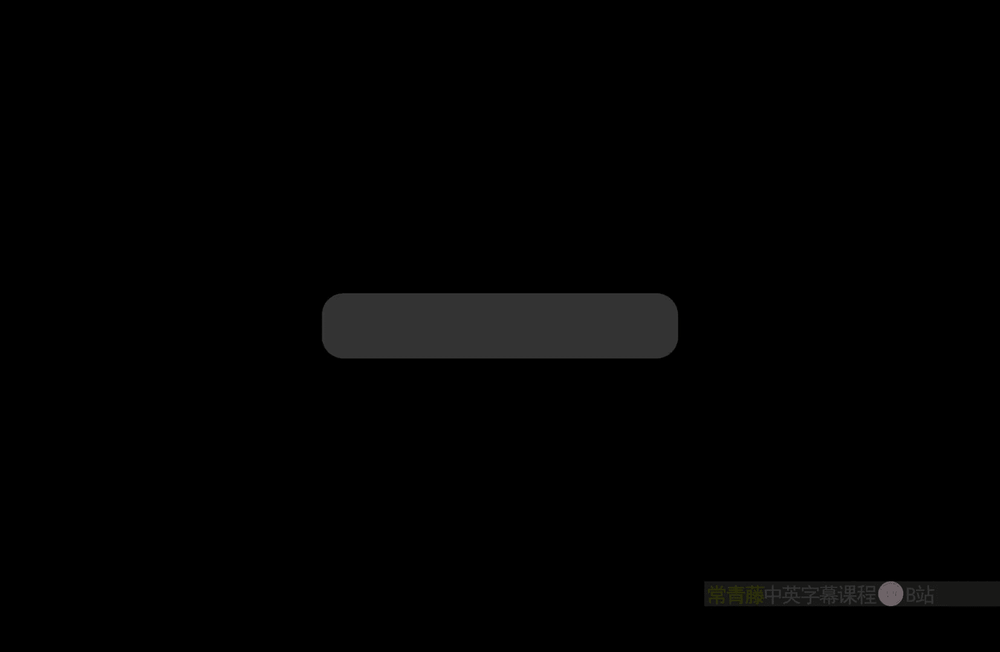
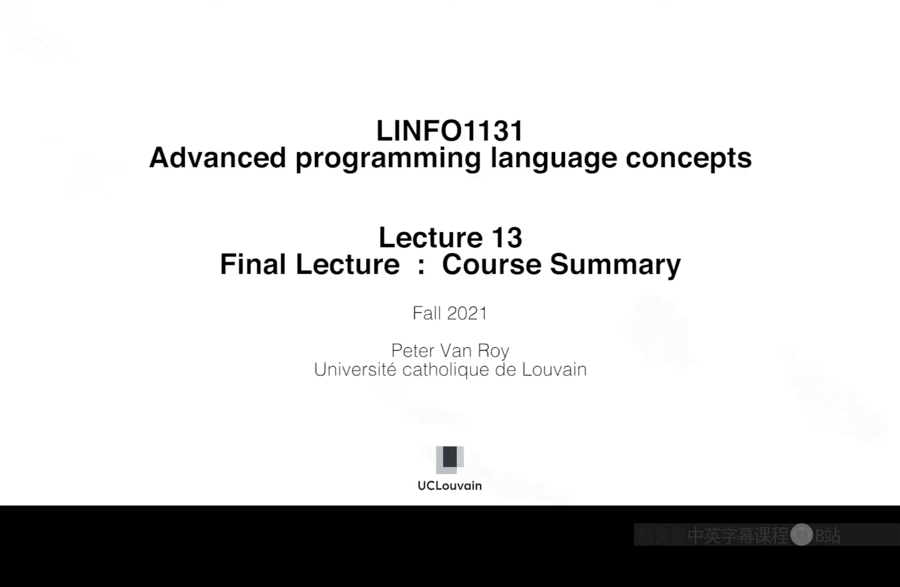
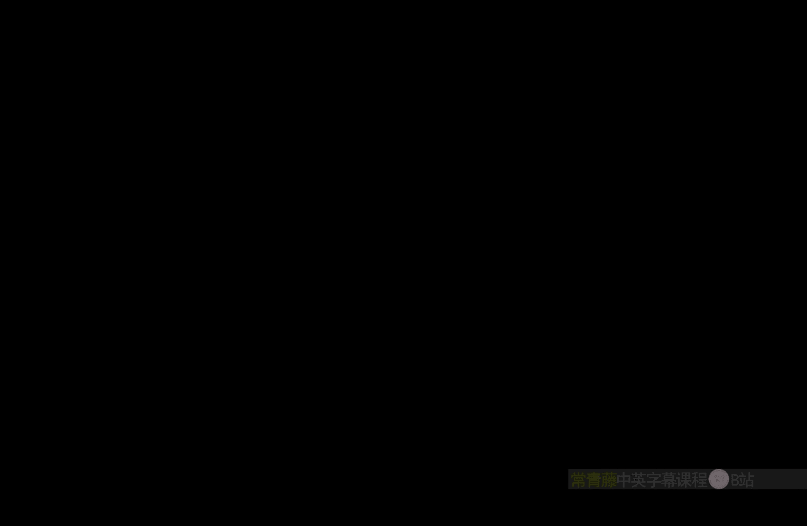

# 鲁汶理工学院【中英⚡高级编程语言概念｜LINFO1131, Advanced programming language concepts】 p28 P28 FO1131 Lecture 13 (2021) -BV1UDffBbEBZ_p28-

Today is the last course。And I will go over all of the things we saw during the whole semester。

 especially the hard parts and the important parts。

 so you can see today if you listen carefully today。

 you will have almost already studied for the exam okay so this is I'm going to show you many examples。

 code examples of things that were important but also subtle and maybe hard to understand。

I'm going to start by talking about all the paradigms we saw。

 then the advanced algorithm design for declarative paradigms， data abstractions。

 multiage programming， and shared state concurrence。So， let me start by。

Presenting the paradigms you saw in this course。We saw declarative paradigms。

They are sequential functional programming。Sequential functional programming with data flow variables。

今らやてててコンポそして。Deterministic data flow。And lazy deterministic data。These are all declarative paradigms。

 They go from the classic one。 This is the one you see in most languages to the most expressive one。

 La deterministic。 And we saw non declarative。Parads。The best one。

 which is the termministic data flow with reportss。Then multi agent programming。

And shared state cookcur。So these are all the paradigms we saw in this course。

 and we saw many things that you can do with them。So what I want to show you now is some of the special properties of the declarative paradigms。

It's clear that you should write most of your program like this， okay？

Even if the languages do not help you to do that， thats what you should do。And in fact。

 you can do a lot， and after showing you the paradigms。

 I will show you the advanced declarative algorithms and I will maybe show you some things that were hard to understand during the course。

Okay。So the first thing I want to say is that sequential fraction functional programming。

 the first paradigm， this is the one that you will see in many programming languages scheme。

And El are the most popular ones， but there are other ones that closure your and salana。One we saw。

 especially in this course is we added data flow variables。

And I want to show you why this is fairly important。不し。

This is still declarative because you can only assign these variables to one panel。

Let me show you why this is important One reason is that。This functions are Taylor cursive。Okay。

 if you look at append。The append function， let me write it here。

And then I'll show you why that it's tailored recursive。X， S and Y S are releases。

Access to new medicine。What S otherwise。X bar X R。Then we have X bar append。X， R， Y S。Okay。

This is the way you write it。With a case statement， two cases， and in many programming languages。

 that schema I would write it in a similar way。But if you have data flow variables。

 this is actually tail rehearsive， this I explained already， but it's very， very important。

 so I explained it again。If you look at this recursive call here。

You can actually write it in a special way。Assume now that the whole thing is it。A procedure。

 I'm going to write it now in kernel language， X。Y is ZS。

So the result will become visible in the head of the procedure， then we can write it like this。ZS。

 which is the result， is equal to x bar Z R， and then we have me recursive column。Append X， R， YSVR。

So you can see that the creation of the result is done before the recursive call。

This is possible because ZR is an unbound data flow variable。Okay。

That makes it possible and this is done automatically， so all the functions will be tailed recurive。

 why is that so important？Tale cursive means that it's basically equivalent。To a wider loop。

That means the stack size is constant。So that means that it's a an efficient loop。

 that's already interesting if you want to do a function like a pen efficiently in a classic functional language that does not update data a flow variables。

 then it's harder to write。It's more difficult because this definition would not lead to of person。

So it's equivalent to a wider loop and stack size is constant， that's already interesting。

 but why is that even more important than it seems because it allows determinant data flow。

 it allows agents。Declarative agents， concurrent agents。The lists become streams。嗯。😮，This becomes。

Streams。Which means they don't end， they are constructed incrementalcrement。

 they are communication channels， so an agent will have an input stream and an output stream。嗯。

And this agent is a list function executing in its own thread like append。Using data flow variables。

 and this will have a constant stack size， which means that you can write concurrent declarative programs。

So the date of flow variables is what makes deterministic data of flow possible。Okay。

That's one thing I want to show。Many languages nowadays， you see these more and more。Okay。

 this is something that programming languages don't always understand。

 but nowadays you see these more and more， this is sometimes called。Futures or promises， okay。

These fundbound variables。And this was actually invented a long time ago。

 but somehow for hisic reasons it got forgotten。But nowadays。

 more and more in large distributed cloud databases and so on， you see this coming back。

 so you're going to see this， even if you don't see it today you'll see it coming back。Okay。

 that's one thing I'm on to show。That's the first thing， let me show you a second thing now。Again。

 because of data flow variables。The second thing is。Constant。Time。Append。放式。

If I normally do an append of two lists。And if this list has a length of n。

This will take some constant times and time。Because you have to traverse the whole list and because it's declarative。

 that's not nice and that kind of breaks， that breaks the whole interest of using declarative paradigms。

 if you can't even do something so simple efficiently， then why use declarative paradigms？

But this is actually solved if you have data flow variables。With data of variables。

 you can represent the list。You represent the list。As two variables。

 which is called the list difference list。So the list， for example。

 ABC would be represented as two variables， S and E， where S is equal to A， B。See。

And putting E at the end。Okay， so you represent it as a。

A partial list where the end is an un variable。And now if I want to do an appent。If I have。

 for example。SX and EX， this is one list。And I have SY and EY。The second one。

I can append them very easily。All I have to do is bind the end of the first one to the beginning of the second one。

 so E X。That's why will app。Okay， will depend them a constant time。Of course。

 you can only do this once。There's only one version， we say that this is an ephemeral。Operation。

 you can only do it once， but that's okay in almost all cases it's okay and even in a stateful language。

 if you want to do this constant time， you can only do it on one version。

 if you want a second version， you will have to actually create a copy with the first list in any paradigm。

So this is a constant time ephemeral append operation。

 and this is made possible because of data flow variables。Even if you don't have concurrency。

 if you have sequential。Sequential functional programming plus dataflow， even in sequential language。

 this allows you to make a very efficient declarative programs， okay？That justifies the。

Data flow variables shows why they are important， and the point is of course。

 that difference lists are still declarativehu？They still have all the good properties of the declarative Paradise。

 which I will to explain in a few minutes。They have all those good properties don't go away because you have only one。

 you can only assign to one value， okay？Let me know。We have now deterministic data flow。

 so you basically add threats。Here with this paradigm， you could actually。Create concurrent programs。

 agent programs。But streams have been put。Pippelines and other kinds of programs。That we wrote。

We've actually had examples like digital logic simulation。Which is using exactly this paradigm。

 digital logic， the way it runs。It's all clocked， that means all ports are getting evaluated at the same incident in the clock and then they compute the next incident and so on。

 so all processors are written in this way， which basically is using this paradigm。Of course。

 it's deterministic， it's a completely deterministic。Pre none。

But very much concurrency can be done like this。Okay， so that's the deterministic data flow。

Whi is very important and again it's a paradigm that is used more and more and now 20 years ago was not used too much。

 but today it's used a left and if you do Cloud and the Linux tool。

 you will almost always be using this one。Okay。Let me now say a few words about the lazy version。

Okay， so the lazy version of this ats demand driven。It adds an operation which is adding to the date。

For example， let me explain how the dayflow works in the usual。And the usual deterministic data flow。

 semantics。If I do C equal a plus B。In addition， operation， okay， in deterministic data flow。

 what the way it actually compiles。This I will do weight A， B。

I would do then a primitive ad operation。Which will do A plus B and put it。Some other plays like X。

 then we'll bind。An operation binds C2 thanks。Okay， this。

 you can see this as the semantics of the data flow。

The weight operation was to suspend the thread until a is of value to this variable is bound and B also。

 and once A and B are bound to numbers， I can do a primitive a， so this is the instruction。

In the machine， and once I've done the ad， I do a bind operation and this one basically tells。

Tells all the weight it sees to continue。So the buying operation will eventually tell the weights that they can continue。

So semantically the data flow is all implemented like this。

 of course the compiler can very often remove these so they don't give overheadcut。

But this is the cements now the lazy adds one operation to this。Which is called what needed。

Weight needed X， you basically suspend the current thread until another thread does weight X。You see。

 this isn't quite different from weight， you see the weight will suspend until a is bound to a value。

But weight needed x will not do that， it will suspend until another thread is doing weight X。

So we say that x is。Needed by the younger credit， okay？See how that works， I explained the。

 but this I know from experience that people they don't always understand really the difference between weight and weight needed。

 so weight needed is a special kind of operation and it's actually very easy to implement because these unbound variables each unbound variable will have a cu of suspended threads attached to it okay so the weight needed x will just have to wait until there is at least one thread inside that cu。

If I do Y x， then the thread will be added to the Q of x。

And what needed was suspended until there's at least one strand in that queue。

And laziness is implemented by adding weight needed to weight and bind。

This you can see it as the semantics of lacziness， okay， so that's one thing I want to explain。

Now let me explain another。Sa for what you can do with laziness， there's many things。

 of course you can do with laziness， let me just explain one thing here。Which is the bound of buffer。

Okay， assume I have a producer and a consumer and there's a stream。

Communicated between the producer and the consumer。Okay， and the consumer needs the values from P。

So this is actually。If you do it like this， there's sometimes a resource problem here because P will just keep producing forever and if C is very slow。

 then those all the elements computed by P will stick around and overflow the memory。

 okay that's one thing， but sometimes P is very slow。And when peaces very slow， he has to wait。

So you see there's some kind of a flow problem here。

That it can give memory problems or speed problems， okay？

It can maybe sometimes cause overflow memory or it can cause speed problems。

 it can cause system to slow down， maybe P produces some elements very fast。

 but then it's very slow after that，So this is actually a problem。

And the bounded buffer was invented as a kind of intermediate note。To solve these problems。

So you put the gods of buffer in the middle of this。Okay。And then you change this to make it lazy。

To make it demand driven。You can make the first one lazy also if you want to。

 if you make the first one lazy。Then you will have no memory problems remember if there's two possibilities if you make this eager。

 then nobody is stopping key and sometimes overflow memory。

 but if you make it lazy there will be no memory problems， but then you have speed problems。

Because people do nothing unless C asks for something， so if C is not asking if C is computingd。

 then people do nothing while C is working， so you have a cor。

 in fact you have a single control moving back and forth。P andC will never execute at the same time。

 okay？C asks for an element from P， P computes it， but while P is computing C is weigh， okay？

So the lazy solution。Will have no memory problem， but it will cause coing so you have a speed problem。

 it will slow down the system。Whereas the eager solution has no speed problem。

Nobody is stopping P or C from running， but nobody is stopping the memory from overflowing， okay。

 and if you want to buy both， if you want to have both low memory utilization and high speed。

 then you need a bounded buffer。So the bounded buffer has a size。

As a fixed size and the bounded buffer basically always tries to fill itself up。

 so compared to the producer， the bounded buffer looks like a consumer and it will ask for elements。

 okay until it's full。So there's a certain number of elements， so you have a fixed memory size。

And the consumer， if it needs an element， it will immediately get it from the amounted buffer。

So you can see that the abundanted buffer will keep some elements around。

And if the consumer asks for elements， they will get it immediately。And if the buffer is full。

 and the consumer asks for one element。Then the bonded buffer will ask for another element from P because it's not full anymore。

 okay， so you can see this in most cases will solve。This problem here。

It solves the big problem because P can get ahead of C， P can produce more elements than C。

 and it solves the memory problem because there's a limit to how far P can get ahead okay so you can see it's a combination of eager and lazy actually。

And in many cases， it solves a problem because。Usually there's fluctuations in speed between P and C。

 so the ballot buffer will not always be completely flow， for example。

 and not always be completely empty， it's always kind of fluctuating。This is a concurrent。

Dlarative program。You cannot write this kind of program in a pure。

 lazy language that's not concurrent because the producer is independent of the consumer。

Concurrent means that there's independence， that means the producer can get ahead of the consumer。

 there is a slack if you want between producer and consumer， the producer can keep running。

 even if the consumer asks for nothing。So this is concurrent and it's also declarative。

It's completely deterministic and functional basically because it's using just the weight needed and the data flow variables in the basic。

Smatics， okay。So when laser determinemin spect throw， you can implement declarative bound buffers。

 which are actually very interesting， already kind of sophisticated concurrent patterns。Okay。

Very good， Okay， so that's what I want to say。First thing about thelarative。

Now let me say something about algorithms， advanced declarative algorithms。

Sometimes people criticize declarative programming because they say。

 you cannot write efficient algorithms in it because of the single assignments。

That's actually not true， and let me show you now some examples of that。

Itdvance declarative algorithms。Okay。So what I want to show you now。

 is things we saw already in the course。But maybe we're a little bit complicated。

 so the first thing I want to explain is the difference between an ephemeral。Versus。Persistence。

Data structure。Actually， femoral versus persistence。嗯。When you say like this。

Efeal means you could only have one version。At any time。

 that means if I have a queue and I do an insert operation。From Q1， getting me Q2。

As soon as the assert returns2， then Q1， it's not valid anymore， I cannot use it anymore， okay。

 there's only one version， so Q2 invalid invalids。退过了没？I could only have one version。

 and most algorithms that you use will be ephemeral， many times you only need one version， okay？

But sometimes you need more of anversion。In a persistent algorithm， you can have multiple。

Versions of the data structure。For example， if I do Q1 and Ily third。And I get Q2。

 then Q1 is still okay， I can also do another insert。And here I do A B， this gives me Q3。

 now I have two versions， okay and I can do this and I can even have more versions sometimes you can even have a merge operation。

Which combines two versions back into one version， that's also possible。

You can have multiple versions。This is sometimes useful and there's actually many cases when you want this。

For example， collaborative work。Applications。Two people are editing the same text。

 maybe they're offline， so you have two versions of the text。

And the two versions are going to exist at the same time， and then when they go online。

 then you have to merge the versions， okay， or you have things like。GitHub。

When you do software repositories， you can create branches， you can create multiple versions。

 and you can also merge them back， okay？So this is typically the kinds of things you can do there's any other。

 also in databases， yeah。You have sometimes need for multiple versions。A data。

 a connect collection of data that represents a software item on an airplane， for example。

 okay very complicated， now I want to make a new airplane which is modifying that。

But as some other team wants to make another kind of airplane that also modifies that。

 I could make a copy， but if the airplane data structure is huge。

Then maybe I don't want to do that and many databases actually support kind of versioning operations。

So the versions are sometimes useful， and so it's sometimes interesting to have algorithms。

That want con， okay。Now， let me show you now some of the things we did there。Okay。

We have let me explain also the difference between。Aortize。Versus worst case。Time complexity。

This is an important axis too for algorithms。Okay。So an amortized algorithm will。On average。

 have a complexity， so what does that really mean so that may explain so let's say you have an amd。

 let's say I have an algorithm。Okay， I have。And operations of the algorithm。Okay。

 and these end operations are sometimes constant and sometimes taking one。So for example。

If I have operations that are constant time， 01。Operations。

And then I have operations that take end time。Then these operations are expensive， okay？

For some number n， but in some cases， it's okay if I have N operations。And the number。

Of ON operations。Is。Let is sometimes is a constant。Then the total time will still be order N。

So that means because the total time is n， you can actually， on average for an operation。

 it would be。Constant time then so let me make a more formal definition of this。Okay， if I have。

It's end operations， let's see what's the simplest way。て。Ex this。六ケです。A sequence。OfF operations。

Has time。To time of。FN。Some function of n there。We say。That one operation。Has an amortized time。

Of O FN。Divided by n。Okay， so we basically spread out the FN over the N operations。

If you have an acute data structure and the operations usually are constant。

 but sometimes there's an ordered end operation， but there's not so many of them。

 then it could still be amortized constant time。それて。So that's the definition of amortize， worst case。

 of course， is something you know， worst case has complexity is when every operation takes a certain time。

Now let me show you what the different declarative paradigms can do。Okay。

 let me know we have an example of a cube。DaData structure， Q abstraction。With is。

And delete operations。And we showed how to implement that in certain kinds of constant time。Okay。

 so there's actually some kinds of。Constant time。Let me show you a diagram。

 and then I'll explain why it's like。If I have a standard sequential functional programming paradigm。

 which is the first one here， then I can make an amortized。Ephemeral。Algorithm constantant time。

 okay， it's not worst case constant time because sometimes you have to do operations that are order N。

And now if you add data flow variables。嗯。It's this sequentialquestial， but data flow。

 then you can make it。Worst case。Constant eemal。With now February。So， the the。

Going from sequential to sequential plus data flow。Turns the amortized into worst case。Okay。

On the other side， you can add lazy execution。And what lazy execution lets you do is turn the ephemeral into persistence。

So you can have an advertised persistence。Person。And if you're clever in many cases。

 you can also make worst case。Persistence。Okay， so basically。Going from。Sequential to。Sequential。

 so this is lazy。Planial functional programming。The laziness gives you persistence and the data flow variables gives you worst case。

 eem， so the data flow that you go from amortized to worst case and the laziness that you go from ephemeral to persistence。

Okay， so that's a summary of what we saw， but let me explain how it works now。

 because I think that people。maybe it hard it a little bit subtle to understand。How it works。

 so let me explain that。Okay。So let me start by the。The standard one。He amortized the federal rule。

The way it works is that the view is represented by。And tu pool。With two lists。

 the front of the queue and the back have the reverse of the Q， and when you insert。

You add an element here。And when you delete， you remove it from the front。ok。

So the insert is constant time。When R is always non empty。

 you can always do in certain constant time， the delete is constant time if F is non empty。

So if I start by nil mill。And I do it third。Then I get， for example， nll， a bar bill？

But if I want to do a delete now。This one is。Its nils， so it doesn't work， so have an operation。

ThatLets me move from the reverse list to the front list， okay？So occasionally。

 what I do is I can actually move。Fromeng， from。R2 F。嗯。So if F is nu。So， Q nil R。Is transformed to Q。

Reverse R。No okay， the elements I add in the river。

 I have to put them at the end because the ones that are in frontier are actually back of the Q。

 so I do this。And this is done inside。The delete operation， okay？If this is nil， I do like that now。

 of course， this takes time。And if the R has a length of n。

 this takes a time which is proportional to n， okay？

And that means that the delete operation sometimes is expensive， it can take order N。

If I do n inserts and one delete， then the delete will be doing order n， okay？So basically。

 if you look at it like this， if I do， let me make a diagram if I do a sequence of inserts。

And then I do a delete。All these are going to be constant time。But there might be end operations。

And here I have a delete， which is going to be。And order and time。Proportal to end。

 so you can see the total time。It' still order Ed and it's amortized the constant time， okay right。

 you get it dough， so that's the easy case。Now let me show you the other cases。Okay。

The worst case of femoal also is easy。The2是个。ちょとし。This one is also easy because we basically use a difference list。

So because we're using the data flow variables。So the queue is represented as a front and a back。

 but the front。Is equal to some elements that are in the tube。And then there's the back。

 and then you also have the number of elements because otherwise it's not possible to know。

Whether the queue is empty or not in a declarative way， so these two are a difference list。

And the insert and the delete are both constant time。To insert， you basically have to add to the R。啊。

So basically you have to bind R so the F stays the same， so let's say I sort C， so the F becomes A。

 B， C， R prime。And here I have our prime， other length is three。So for the insert。

 basically I'm changing the R into our prime。And I'm winding R， okay， and for the delete。

 I remove this one。So now I have VR。R and now I have only one element，So you see for the insert。

 I'm updating the second variable and for the delete I'm updating the first one and notice that this is ephemeral。

 you cannot use it more than once， because if you use it more than once。

 they will interfere with each other。So that's very fine， right？

So that's efficient this is actually most of the time this is good。

 so if you're only doing ephemeral， different space is basically solving the problem。

It makes it very efficient， but you see the data flow variables are solve with this efficiency superho。

But let me now talk about persistent。Okay。嗯。Now， let me now go to amortized。Pent， constant time。

Let me first show why the first one， this one is not。Is not amortized persistent。それた。Okay。

 let me show this first， and this was actually a question of the midterm if you remember。Okay。

 show me why it's not amortized persistent Well you have to come up with a sequence of operations。

That where you have multiple versions and you can show it's not amortized。

 so let's do a sequence of inserts again。Okay， I have a sequence of inserts now and inserts。

These are all constant time，h。But so far I have only one version。

Persistent means I can have multiple versions， well let's make some versions now。

 let's say I do a delete here。啊。I do one delete。And doing other deletes and do a bunch of deletes。

Okay， I do order N deletes here。Now， each of these deletes will have to do reverse。

 Each of these deletes will be。O N time， constant proportional to n。 So this is actually n squared。1。

So if you look at the whole thing。I have n plus n2 n operations， and the time is n squared， well。

 if I divide it， then the average time is n over two， it's not constant done。Right。

 so you get it done。Okay， so it's not so the solution we have before is not。Admortized， persistent。

 so how do we solve that， we can actually solve it by laziness， okay？By using laziness。Advertized。

 persistent， and what's the property of laziness that we use？Well， we can create a computation。

 but we only do the computation layer when we need it， Okay， so basically we create。The computation。

It does the reverse。Okay。But we don't actually do it until we really need to do it， okay？

So the delete operation， when you do this， sometimes you don't need to do this reverse， okay。

 but you only only。Spend the time。What you actually need okay？Okay， so if you remember。

 let me refresh your mind on how the the。The amortized persistent Qe is implemented。诶。So in this one。

 you have a tupo againdon。You are the length of FF。Lnks of R R。オッ。

Here now we have a couple of four elements， we have F and R， but also these length。

 why do we have it like that， because sometimes these are not actual lists， okay。

 these can be lazy computations that when you execute them make a list。So there may be。

They may be lazy suspensions， this F andR。It could be。And so that's why you want to know the length。

 also you don't want to compute the length， even if there lists。

 you don't want to actually compute the length， so you keep track of the length basically。

So when you're doing it， it's a sequence of inserts。The way it works is that occasionally， so again。

 the inserts will add to the R and occasionally you will make a computation。

 so you will in some places put in。The computation moving。R to F。You put it in there。Occasionally。

 so you're putting it in at some point in time。If you notice the way it works in the code。

That you keep track of L， length and F and R， and so what each time you do an insert， you have。

 for example， length。F is some value， and then R if makes0 each time you do an insert。

 this increases。And when the length of R， it's big enough， then you move。

And the reason why you do that， when they basically are almost equal。

 that means you've actually paid for the reverse， okay？If you do this。

 then you will only do reverse when you actually have already these elements。

 so you've actually already paid， you actually already have n things here。

 so you're allowed to do any more things， okay。So this is what's called bankers solution to an amortized algorithm。

Which means if you want to buy a house。Okay you put money in the bank and when you have enough money in the bank。

 you buy the house， so here if I want to do a reverse that's expensive each time I do I have an element here I have money in the bank and when I have n element I'm allowed to do an n reverse okay so that's one thing。

So I'm not going to say more， but you should look at it more in detail。ok。

But now I have multiple versions。Okay， now I have multiple versions here。So what's going to happen？

So let's say I have an eye here。I have multiple versions。Again， I have a bunch of these here。ok。

And these are。Each de， but you have many versions now。Okay。

SoBut these they will only create- so these lazy computations exist。

But that these will only do a part of the computation that they need the output， okay。

 so first of all， so this is lazy。So the move here is basically it's doing an append。And a person。

If I have FR。It goes aend。Reverse。R to。That something like I that done。

It's doing something like this， I think that's the right。For relentless a pending。Its。No， sorry。

 the front， it's at the back。这块。So you're doing。Append F and the reverse of R comes at the end， Okay。

 so this is the operation you're doing， this appendice lazy。And the reverse is lazy。

 but it's monoistic。Remember it's monolithic， that means if you need it。

 you have to do the whole thing。So this is a lazy， but this whole thing is a lazy computation here and when I need an element D。

 I do one part of this， I'm only to doing a small part of this。

 okay and then I actually bind the result。To the F。

And so all the other these will see the same thing， you see if one belief does something。

 all the others will see the same thing。And now if I keep doing inserts after。

So you can see the lazy append will execute and the value is bound to a variable that's in common。

 so everyone will see it。But assume now we have a bunch of eyes here。

And eventually you exhaust this and you do reverse。

But you will have enough eyes to pay for the reverse。O。

The length of F and R are going to be the same， so when F is empty。

 then you will have to do reverse after sorry I'm doing deletes here， sorry I'm doing deletes。

These are the leads， I'm removing elements， and I start by removing elements from F。

And when F is empty， then I do the reverse R， it's a lazy computation， I only do when I need it。

 so when I do the reverse， I've already gone through n elements here。

 which means I'm paid for the reverse okay。So this is bank paying， so the reverse。Is paid for。Okay。

 it's paid for because you have done N。You have removed the end because of the way these combinations are done。

 the F and the r are the same size， okay？So this works。

 and so the reason why it works is that the computation is done only when you need it after when it's created。

 so it's created here so this computation is actually shared among all the version。

 so it's not like in the previous case where each delete had to do a reverse， okay。

 here when the delete does a reverse。It's shared because it's created during the inserts， okay？

So because this is a shared data flow variable， when the first delete does it， it's thing。

 the others will see the result too， so the result is shared among all the versions okay and you will only do the reverse。

When you have done enough thes， so it's paid for。So the reason why the laziness makes it persistent is because of this you share the results among all the versions。

オッケー。So laziness lets you make things persistent。Okay。And then there's a final thing。

Where you can actually be a little clever， more clever， the reverse is monolithic。

 you can actually make it worst case。Persistent in this case， if this depends now。

 this is not always possible。This is possible because you can take the append and reverse。

And turn it into a。A。Which is not monolithic so the reverse is monolithic。

Which means that if even if you make it lazy， you have to do the whole thing。

 you can't do it piece by piece， whereas the append is incremental。

That means if you only need a small part of the result。

 you're only going to do a small part of computation and if you do。

 you can actually combine these two so that each step of the append does a small piece of reverse so the a will become incremental。

And this actually spreads out the cost of the reverse over all of the the leaks， in fact。

 instead of doing it once， you've spread it out。And so it becomes worst case persistence。Okay。

 so incremental lazy， I kind of see it as。Putting butter on a piece of bread if I have bread。

 and I put a lump of butter on one side， that's the computation。 but the la is。

 I can spread the butter。 so it's very smooth over the whole thing， okay。Is that clear。

 maybe it wasn't so clear during the lecture， so is that better now do you understand better wise and laziness？

You can always look the video， of course。What laziness has to do persistence。Okay， because。

Because of two things， one is that。When you create the computation， you don't do it yet。

 you only do it later when you actually need it， and when you do that。

 then maybe you've already paid for， but also if you create multiple versions。

 you create computation， you create multiple versions。

Then the result is shared among all those versions， so you only have to do it once。Okay。

 so the la lets you do that。so that's why the laziness lets you do persistence。Okay。So summarizing。

You can see that using these techniques of lazy。And data flow。

You can build very efficient declarative algorithms。

 so there's basically no reason to do non declarative。

Except that your language maybe doesn't support thelarative。

 but otherwise there's no reason you can do it all declaratively and keep the advantages of the declarative care。

 okay？Okay， let me make a break now。And after the break， we'll move to more non declarative things。

Of course， now we go to the。Beyond the， okay？I'll talk about market narrative。

 but first I want to explain a few things。First， why do we do declarative。

 why is declarative important， there are many reasons why declarative an advantage is important。

It's why functional programming in general， why is declaredative。嗯。Advantageous。

Simple things like testing。Testing is much easier。On a declarative program。

 because a declarative program is basically your program is like functions。

 you can test all the parts can be tested separately。Okay， for。For correctness。

Because each part is a function。And this is not true if you have stateful parts of memory， okay？

So not true。If the parts。Have memory which are non declared to them。If they have memory。

 then they interact in one part like an object in Java。

 it has an internal set of attributes and they can get weird values。

So it's the parts and memory and the whole。The whole history， so the whole sequence of operations。

Is important。ok。Because past operations can change the internal state of an object。

Whereas in a declarative function the function does not change。

 so it doesn't matter what you do in the past， the only thing that's important is the argument。

 okay so testing is much easier in a declarative programming and really。

 really much more efficient okay？Another advantage is it's deterministic。

This is something we saw before， which is called the Church rosterser Theorem。Okay。

 I'm not going to say exactly what it is， but basically all declar programs。

Are essentially doing computations in a very simple language called lambda calculus。

So declarative programming is basically programming in lambda calculus， all of these。

 and this is just syntactic sugar for lambmbda calculus， and in lambda calculus。

 the result is always the same。independent of which order。

 that's why all these these concurrent paradigms are still deterministic。

 even though you have multiple threats， that's really very important Okay。

 this is something that I call currency for dummies， okay。不体什么？That's not an insult。

 that's a complement， that is as long as you can， you should use declarative programming even in concurrent system because of this very important result。

 so declarative programming is really a paradigm， it's not just an arbitrary thing。

 it's based on a very strong formal mathematical foundation， okay this。All this。

 it's based on the strong mathematical foundation， the lambda calculus and you prove properties and the very strong property that you have is churchrus。

 so it's not randomly we like because we're mattersoists that we like to do the programming or something it's because it has this really strong property。

It's fundamentally a strong。Paradise， okay。With this very strong property。

 and that's why it's important。But。The strength is also the weakness， as usual。Very off like this。

Even Superman can stand kryptonite， okay， so there's also a kind of kryptonite for the programming。

So the limit of for declarative programming， so one example that I showed you that you cannot write the declarative is the client's server。

 it's one out of many examples and I want to show it again because it's kind of subtle thing。

And I want you to really understand， so I have a bunch of clients。A million clients that say。Okay。

 all tucking through the server。Ma alerts over the internet。

 you're ordering things on Amazon or something。So each client sends a query。And it gets a response。

Okay。Quary。And response。So this is a very common kind of application and the clients are independent。

That's very important， the clients don't know each other。Independence。Okay。

So there's a requirement for this。The whole problem comes from this requirement。

That the performance of a client。So the the。Round trip。Time for。Afied。Only depends。

The network properties。嗯。And the computation that the client does at the server。

That's very reasonable each client does a round trip and it only depends on the speed of the network and on the computation done in the server。

 and there's no interaction between nuclear independence。

 This is a very reasonable requirement for You want this。 I don't want to。

Be blocked because somebody else is doing something I want。To be have this property， okay？

Of course its a little bit， it's not completely perfect because if the server is handling many clients。

 it will do more computation， so maybe slows down a little bit but the server can be paralyzed。

So that you don't really notice that if you have many clients。

 so this is a very reasonable requirement。Now， this program， the way with this requirement。

 you cannot implement it in a declarative。Fage， it's not a question of performance。

 it's not a question of being clever in the programming， whatever， it's fundamental， okay。

 it cannot be done declaratively because of the definition of declarative programming。

 There is a contradiction， you cannot do it。ok。So do you see that。

 do you understand why it's like that？Somebody， do you understand？Who understands why it's like that。

 some people， you don't。Oh I'm very happy then to go over it again， why is it？Not declarative。 Well。

 let's say I have two clients， Okay， let's just say I have two and they're both doing query。

And the poets are traveling。To the server。The server does not know which client query will arrive first。

 Okay， so this application has inherent。No determinism。And why is it adhere？

Because it's coming from the clients。Coming from。Clients and the requirement， okay。

 I cannot remove this nondeminism。Because each client wants reasonable time。

 that means when this query arrives， I have to handle it， I cannot wait for the other one。

 when the query one arrives， I have to handle it on one query two arrives。

 I have to handle it because because of the requirement， okay。

But I don't know which one will arrive first。😔，It's non deterministic， so non determinism。

 you remember， is a choice。That's outside of the control of the program。

 so I'm the person writing this application， I don't know which of these two will arrive first。

 it's not my decision， okay， the choice is coming from outside。

Nondeterminism is when there's a choice that's imposed， I don't have full control。

 someone else has control here it's who has control well。

 I mean it's the clients but it's also the network it's the real world has control here over my application。

So no matter which query arrives first， I have to handle it， that means if query1。Arise。

I must handle that immediately。If query2 arrives， I must handle it immediately。Right away。

But I cannot write such a program in the declarative paradigm。

 how can I write the program so let's say you have a server here。Whi has。

 let's say I can have multiple streams for each client， but let's say I have two clients。Two streams。

Okay case， now have S1。Maybe Id combine them in a pair， for example。嗯。Well， maybe I can。

Assume that if the query one arrives before square two。O。And I haveる。

But now assume that query2 arrives。Before query1。And then handle it。Okay， here I hand query1。

 here in query2。Will not work。Because the case statement is deterministic。

 all instructions in declarative programs are deterministic， they never make a choice。

They do one thing， okay， the case will test the first pattern。And if it's。Acceptable， it will do it。

 and only if the first pattern can never be done will it try the second pattern。

the case is not trying all patterns at the same time because that would be non deterministic。

 the case is deterministic， why is it like that， because it's declarative， okay。

 it has to be like that， otherwise it's not declarative。

 that means I will never try the second pattern here， never。

Because the first stream until the first stream closes until this S1 becomes ned。

 until the first client goes home and turns off his machine。

 that's the only time I will handle the second one， okay？Because otherwise， I will never try。

 you see that。It's fundamental， it's not， of course you can implement a case that has more than one。

 but that would not be declared if we see， I mean， a case that handles more than one。

 actually it exists in an operating system and in fact。

 if you want to listen on data coming on more than one socket in the Muix you have this thing called select statement。

Which maybe you've seen select lets you wait on multiple connections。

 so it's like a parallel non deterterministic version of a case， but that's not the clton， okay？

Of course you can do it， but it's not dec cllift， you lose all the advantages of declarative programming if you do that。

So you cannot do that， you force yourself to do that to not do that because it's not declaredlarative。

 okay。So this cannot eed。You see that you see why why it's like that is and it's from the operating system。

 So if Ellan not using select or yeah so select is an operating system。

 but all operating systems have nondeterministic operations。

 of course and I'll explain in a minute the real world always can force you to be nondeterministic。

 So you have to handle it the beam on giant from airline works way better than of course yeah。

 select is not very efficient yeah so select is an operation。 So that was the point。

 select as an operation existing in un。 but if you want efficient nondeterminism you should not use un。

 you should use airline in airline， all the processor non deterministic and they're extremely fine brain。

 So airline， of course， is much more efficient。 I mentioned select because because people know Uni and they maybe know and so on。

 but。Of course， if you want efficiency， you don't use that you use A。But which we saw， of course。

 okay， so you cannot do it。ok。And the point is the real world， okay。

 it's because of the real world forcing you to be nonministic and declarative is deterministic， okay？

So sometimes you have to be non deterministic。And that's the main advantage of theative programming。

It's deterministic， okay。对。But the real world。Well sometimes force nuativema。

Can be non deterministic， okay？ok k ，我就。Okay， so that's one thing that we saw and how you solve that。

 you have to make the paradigm nondelarative， so it is no longer doing lambmbda calculus。

 it is no longer obeying church rosterer， it's no longer deterministic。It's not anymore like that。

 so you give up the advantages。I to play the programming。So the non declarative paradigms， they add。

Non declarative operations。 So the non declarative paradigms there's basically two。

 there's basically two ways。That are popular。Okay， in fact， there's many。

 many ways to make nondelarative， but there's two main。Main extensions。Of thelar of programming。

Of thelarative programming paradigms。That are used in practice， Why these two。

 because they worked well， because of programmers， you can use them as programmers。

 I mean there's many reasons you can of course do many， maybe。

 there's dozens of ways to make non decclarative。One of them is called mutable state。

And the other one is called communicationication Chanel。So the mutable state。

 everybody knows it's variables that you can assign more than once and we tell themselves。

And the communication channel。嗯。Is where you can send and receive on it， we call them ports。

The main difference is that when you do an assignment， an assignment， you forget the previous values。

 okay？Forget the previous values。Whereas in a communication channel， all values。Are remaining there。

 so the main difference between the two is that in the mutable state， when you assign a variable。

 you forget the previous value goes away okay but in the communication channel when I new was send。

 the previous value does not go away， it's still on the channel I extend the channel。

But that's like a philosophical difference， but both of these are non deterministic， okay？

So which ones do you use what we saw in the course two main ways？

One is multi agentent programming which is based on。Cs， everyone that shapes a concurrency。

 which is based on cells， and both of these are used in practice。Both of these are used a lot。

So this is this one is maybe used a little bit more， but this one can be used， for example。

 in the job。系咯。嗯。But theres many， this is actually used much more than just an airlineline。

Pel scientific computation， you have something called MPI message passing interface。

 which is also doing this， so both are actually used a lot。

So these two solutions are both industry kind of standard uses。ok。We saw also a formal。For rule。

A form of argument。Showing the need for extensions。Were extending。Declarative programming。

Because this is actually a fundamental thing， and we show a formal argument。

Any declarative computation。Is a lambda reduction。So in theory。

 we saw the Lambda calculus in a previous course， but all the programming is basically in the form of lambmbda calculus and you start from an expression and you reduce it。

Until you achieve a result， you can see this as kind of a function application。

This whole thing is basically doing some kind of a function application。

 you have an initial expression， a big lambda expression， if you remember。

 the encoding can be very big。And then you reduce， according to very simple rules of lambda rule evaluation。

And until you achieve some kind of a normal form， final result。So this is the under reduction。Now。

 you can immediately see if you look at this in the right way， that there is some issue here。

This cannot interact with the real world。This formal operation。

This is actually implemented on a machinech now， this is a running programmer。

This formal operation of Lada is a running program running on a computer。

 and each of these reduction steps takes some time。So this whole thing takes time， okay？

During this time。I'm doing only these reductions， so I cannot interact with the external world here。

Because that's not part of the lambmbda definition， I have an initial expression going to final one。

 okay， that's it。So that's why this landda reduction actually is。

It's impossible to interact with the real world it cannot， and it because of how it's defined。

 it's extremely straightforward and simple， okay？Okay， there's ways to get around this。

The people of course try to find tricks to get around this。

 you can divide your programming into small landos， et cetera， you can have streams。

 streams is where things are coming in。In a certain way。

 as if they were part of the initial expression and they're coming out in a certain way。

 so there's ways to get around it， but it stays， the fundamental issue stays。

 you cannot do any kind of general interaction you can only interact if you pretend that was already there in Iwaana。

 see that if if you want to interact if you want to bring something in here， a。

 the only way to do that is to pretend that the A was already in the E， otherwise you cannot。

Make a formal。will I fit here。So but very often you don't know the A here in the initial time。

 if this is a client talking to a server then and the server started yesterday。

 well nobody knows what the client yesterday what the client is going to say today。

 okay so this requires travelingmpling backward in time doesn't work okay so this trick doesn't work in most cases。

You cannot just interact， things cannot just go in and out。オッケ。So we saw this in the course。

 and I defined。Different kinds of interaction。 So you can actually extend。This。

But then it's notlarative， it's not declarative。In different ways， you can extend by。

It in interactions which are like Muable state， which is reading and writing in a register。

 you can extend with interaction which is like sending and receiving on a communication channel。

 also reading a hardware plug。It's also an interaction that's not deter deterministic guy if I read the time on a clock。

The nanoseconds， atomic clock or something。Then the exact time depends on the exact moment when I'm reading that and so that moment nobody can predict it okay。

 question one needs to introduce Muoit for like Askell does。

yeah okay so there's different ways of doing this So yeah。

 so the question is different programming languages。

 they have different ways of extending this so the hasskell language。

 which is a functional language has a very clean definition of declarative and interaction with nondelarative things and it's encapsulated in a structure called the MonA okay so in Hakell this is made very clean okay this interaction but I'm not to talk about Haskell or okay but when in an language like Java。

 you just add these interactions everywhere and you don't care that it contaminates your whole program where it's in Hakell you make very clean。

A separation of the part that is pure and the part that is interacting with the real world， okay。

 but that's a philosophical choice in Java you are。

Supposed to be in the real world and you're always updating things so everything is potentially mutable okay。

 whereas in hospital you're supposed to be completelylarative and the real world is just。

Something an annoyance， it's something that you have to handle， but you don't like it。

 that's kind of on the side， whereas in Java you accept the real world and your whole program is actually part。

Of the real world。 Okay so it's that philosophical。Derence， okay。

 so different languages solve it in different ways。Okay， so that's something we saw。

So it's important to understand the real boundary between thelarative and non declarative because it's a real fundamental thing in programming it。

And many programming languages， they make different decision with this boundary， okay？

So we sell three pair dis now。The best one is this one。Basically。

 most of your program will be deterministic data flow or lazy deterministic data flow。

 and sometimes you need ports you try to minimize。The ports， but guess the ports is not declarative。

 so most of your program is declarative， so in the client server。

 you can do that so here's the client server again。In this whole appliance server。

 you actually only need one port。Here。Okay， so each client will do a sentence。

Of the message to the port。嗯ん。And the port has a stream。

And the messages will appear out of the screen。And so the server will only have to read this stream and all the messages will appear。

 and the port the actual is making a choice here which of these two will appear first。

So there will be some order here which one arrives first， how do you know Well。

 it depends on the speed of the network and which client is clicking on their web browser and so on。

 but one of them is going to be first and so the port will expose this nondeminism of。

So this exposes the known determinism of the real world here。

One of these two will be before the other， maybe sometime later it the M2 and1 if you execute another day。

 one of them is going to be before the other， so a choice there's a choice between these two and this choice is now visible in the language。

 so we say the part exposes。The nonterranism of the climate choices。

 okay so it becomes visible in the language。So the port does not declare to month because it exposes known determinants。

But all the rest who declare Emma， the client can be pure programmed through thelar of this one too。

The server also could be pure。Maybe not completely because maybe there's a database。

With transactions here。Behind it。 and again， this will need， this will need some。Extensions。

So in a real world， client server， the server is not going to be completely pure。

 there's going to be a piece of the database that's not pure because it's going to use a stable storage with transactions and failures。

う。Failures like computers crashing。Are of course， not touristic。

Nobody knows when it's going to fail that， it's totally unpredictable that's cleaning un a tourististic question a fog joint pool is an abstraction above port。

A fork join。Cool yes， you can fork join is where you have two threads。

 a thread creates another thread forks， you have two things。

 and then the joint brings them together again Yeah。

 you could implement that using ports It's not so I mean you have two threads basically。

And then they kind of synchronize together。Yeah， so the question is that there are other abstractions than ports。

 you can do for join， but for join can be deterministic， for joint is not a non deterministic thing。

Somebody mentioned Fort Jo as implementing on top of ports。

 you don't actually need ports to implement this， this is actually deterministic。

This actually declared to okay。And and if you have a pool of threads in between。

If I have a pool of threads， okay， if I have a pool of threads and I pick one to do the task。

 then it's non deterministic because you're choosing。A thread， okay。

 but the basic for joint where I create two tasks， and then I combine them。

 that's not that's still declaredlarative。 It's not knowledgeistic。 You have to be careful。

 so you have to develop。A kind of feeling for non determinism， okay？

So now I'm telling you kind of intuitive things，So this is the last lecture of the course。

 I'm assuming that you kind of understand we've been through this before。

 so I can be a little bit more philosophical now to give you more deeper understanding。

So non determinism is an important thing。And people who don't do computer programming。

 they don't understand that。Even smart people like physicists who think they're extremely smart。

 don all the physicists on YouTube。嗯。They don't understand really the notion of non determinism as it's。

Visible as what it means is that there is a choice that is done by someone who is external to the program or to the part that we're looking at。

So this is a very important idea。This is one of the things I want you to keep in this course。

Nondeminants is very important， of course I can ask on it on the exam work。

But it's also a very important thing， you have to develop kind of a nose for what is not deterministic。

For example， a consensus algorithm in a distributed system。

It's clearly not deterministic because we don't know who's going to win the consensus。

Whereas typical something like a broadcast algorithm is deterministic。

 but as everyone is receiving the thing the same thing， okay。

 so you have to it's interesting once some things are deterministic， some things are not okay。

So let me go on now。So we have these other paradigms。Let me say a few words now about other things。

 let me say a few words about data abstractions。Okay。

So data abstraction is orthogonal to the declarative， non declarative。Divide。

Data abstraction is a way of organizing your program as a。As a set of。Separate pieces， partitions。

 so it's organizing a program。As a basically independent。Independent parts。

With their own specifications， so here's a data abstraction， you have an interface。

You have an inside and an outside and it does something。

The interface obeys some kind of rules that you have to obey， if you don't obey the rules。

 then the abstraction can punish you or the program crashes or it just doesn't work or it says this is illegal。

 so though you have to obey the rules of the interface and these boundary is unbreakable。

 you cannot traverse it。If the language is well designed。You have an unbreakable boundary here。

You cannot look inside。You can only go inside through the interface。And if it's well designed。

 the language will enforce it。Of course， sometimes languages that you cheat okay。

 and they don't believe， they don't really believe abstractions， for example。

 a language X C plus plus。It completely cheats， okay， we're in a language like Java。It's okay。

 JavaScript also completely cheats， okay？Whereas a language at Java， you can build packages。

 classes which are completely。Oaque， and invisibleible from the outside。

 you can only do the interface， so this is very important if I have a program a big program with many abstractions。

Like an operating system， millions of lines of code don't。And it's built by hundreds of people。

 this is the only way to make a system with large numbers of people， okay？Okay。

 so that's the abstraction idea。But the programming language has to support it， okay？

So you need language support for this？Some languages have very bad support。I'm looking at C++ hello。

 C++ some languages have better support like Java and many modern languages now C++ has bad support because it was never designed to be data abstraction。

 it was designed for writing extremely low levell code like an assembly language which has no abstraction bound for example。

 C++ was designed as a readable assembly language so it doesn't really support abstraction whereas Java was designed as a bid for making large business applications so it does support okay。

We have three concepts in the language。That support this。The main one is lexical scoping。

This took a long time。To get accepted until the 19， Well， a long time。

 Now it's been a while in the 19。S0s， this was not known。 It started becoming known in the 1970s。

 so you need lexoco and also called static。Scoping the second one is higher order programming。

So high order programming is that these two are already covered by Laococus， actually。

 the Laocatus already covers them。Which is interesting the lambda allows you already to build abstractions in the lambda calculus。

But it's not enough， there's actually a third concept， which is more like a。

How do you say a form of encryption， basically the notion of a key。AndAnd a locked box。

The notion that you can actually。Lock， you can actually close something inside and lock it。

 so the key is and basically an unfortunate constant。

And the lock box is actually a structure that you cannot look inside unless you have the key， okay？

So in us， we have concept， the key is called the name。And the locked box is called a chunk。

So this is a strange name， but it's actually a record that only has the dot operation。

It does not have a， that means if you don't know the name of the field。

 you cannot look inside so you can lock the box。This concept is a separate concept。

And if you don't have it， you miss some things， okay？So there's two kinds of data abstracts。

They are objects。And abstract A types。They are again fundamentally different if you look at the mathematics of it。

 they are fundamentally different ways of organizing data and we saw this one objects where we have only one kind of entity。

And ADBTs， we have two kinds of entities。So this is again， that fundamental。Distinction。

Just in the same way that Lambda capitalism is fundamental for relarative programming。

 the object abstract data type distinction is fundamental。

 and you will see it in all programming languages， okay？And。That's one thing and then there's。

 of course， the declarative， so no state。And the non declarative。With beautifulable state。

You can of course， define abstractions that are declarative or non declarative。

So that makes two times two， so there's actually four ways to do the abstractions in all。

So you can do the data abstractions here， no problem，But if you're here。

 you can do more kinds of data abstractions， okay， the ones that have an internal state inside them。

 they are maybe easier when you interact with the real world。Once。Okay。

One data abstraction that's very interesting that I want to mention specifically here。

Really interesting one。Which is now becoming very。Importantant。I call the functional object。

So this is an object like object to only one kind， but written declaratively。Okay。

 an object that's declarative。Okay， let me see。It time。

I to make sure that I say what It want to stay here。Okay， so let me explain this。

So it's basically an object， so you have one thing。You have one kind of entity。

 but it's also purely declarative。And this one is very interesting because you do not need the keys for this。

 this one you can do purely with lexicaloscopicing。En higher order。

This is actually a very interesting one， so I encourage you to understand how it works。

Let me make a simple example， a stack object。都是哎。た感じ。X bar S energy。

And there's very simple one of pop。诶。Pace。As of。Sorry， grab our team then。关。That subject key。はい。ある。

The public。え？对。So I push operation。嗯好。诶。Then I have the new stack operation。Creative that。近のよう。オけ麗。

This is a very interesting piece of code， it's very simple in number lines， but it's actually very。

 very special and smart。When I called NewSt。I call I would create a stack， so what is the stack。

 a stack is a stack object。Initially， nil is the initial stack， so that's an empty stack。

So if I cross that object with no。I will actually have a record。a push operation。And a pop operation。

So this is the result of an empty stack， but this push and top are this push and pump。

 and they see S。And S has a value nu。That means the value of the stack is hidden inside， okay。

 the stack is known hidden，Which is an empty stack up， it's hidden inside because of high order。

 you see that。When I call Ste object New。I returned stacked with two functions， push and comp， okay？

And push and popped are both inside the lexical scope of F。S， which is new here。

Which is the value of the stack push， if I want to do push。

 then I will call stack object with x bar S。 So this is x bar nil。 Okay， if I call push。

 I will return a new stack object。So if I call pushushna。With a。This will return。Anew stack object。

ok。Which is again， a record like this，对。pushし。好。here's the push。And here's the problem。This function。

 this push function is not the same as this one up， because this one now knows the stack a bar mill。

You see， when I call push， I return another stack object。Okay， when I call pop。

I return another step object。So it's completely functional， the stacked objects are like functions。

I call the push and I return a new step object or the new step object。

And the value of the stack is hidden inside， using higher order。And it works because of lexocoing。

 so the lexcocoing means that the S is only visible here。And higher order。

 I create these new functions。So this thing is exactly behaving like an object with two methods。

But it's purely functional。Okay， so this is actually a very nice example because understanding this。

 you read。you get it， okay， if you understand how this works， then you really understands。

What this means， okay， this data abstraction being both an object and functional。 Okay。

 so this is important。 this is an important example。

And the interesting thing is it's extremely simple。

 It's a very simple piece of higher order and you don't need anything special for this only lextical scing and higher order functions。

 Okay， so this can be done in all theative languages。

 you can do object or programming in has in a pure way if you want that no problem。That's nice。

 I think， objects has nothing to do with municipalable state？Okay， now we're almost done， okay。

 I still have a few things to say， but let me say just one more thing now。

Let me talk a little bit about multi agent and then we've done。Shared state。

 I will leave that for the slides，s教是。Then we just stay one more thing and then we'll be done。

For the year。Let me say something about multi agent programming。

 which is agents basically ports with threads inside， sending messages。

 let me just say something about airline。Which is a language based on multi agent。

 so airline has processes。Which is basically very similar to what we call the port objects。嗯。オッケー。

So airline， you can divide airline into two kinds of concepts。

The concepts that are related to single processes。And the concepts that are related to multiple。

Processing。Working together。So single process， of course， you have sent。And receive。You send them。

 and you have a。An operation called Ning。This connects two processes together， it's prim。

 when one of them fails， the other one is notified。And the multiple processes。

 this is really the contribution of airline。These are called behaviors that lets you combine many prose together。

We got genetic server， generic friendly states， generic machine。Generic event handler and then。

The one that's really characterizing airline is the supervisor behavior All of these behaviors are generic okay which means that you can theyre like high order abilities。

 you can add the functionality and they all are connected so the supervisor men can manage all of these okay this is a very important contribution of airline so airline invented this idea here。

And this lets you make extremely reliable software。

This is the main contribution of airline if you want software to be extremely reliable。

In a concurrent real world environment， then airlineirlon is the best system for you， okay。

 and the reason is because Airir has this。对す。It has this notion of behaviors and supervisor behavior。

 which allows you to manage the failures of all of the other behaviors okay and they're generic。

 so that means writing an application that is very easy。

 you just have to instantiate the behaviors okay so it's actually very。

 very straightforward and very easy。Okay。I think that's saying there's many others a few other things I could talk about transactions and toothpa locking。

 Denlock， which is important。Safety and liveness。But maybe I' run out of time now。

 but I said I have actually presented the most。Important things。And the lessons of this course。

 which I hope you think about， okay？Let me say things about the exam now。

So the exam will be combining theory and practice。I can ask you to write code。

And I can also ask you to give formal definitions， so the formal explication explanation。

W a declarative program cannot interact with the real world using the lambda capitalists。

 I can ask you that to explain that to me and I can ask you to explain how do you extend that to add beautiful states。

 something we saw your course。I can also ask you to explain how a。A lazy。

 persistent data structure works and how the laziness gives persistence， okay， I can ask that。

 I can also ask you to write maybe some lazy programs， maybe some functional objects。

 this kind of stuff。So it's really a combination of theory and practice， I can ask you to write code。

Not many pages， there will be small programs， but important one and the formal definitions，Okay。

 I think that's good enough， I think you have seen many things now。

 so this is going to be the end of the course。And so I wish you all good luck for the bloggers。

Of course。

