# 鲁汶理工学院【中英⚡高级编程语言概念｜LINFO1131, Advanced programming language concepts】 p29 P29 FO1131 Lecture 1 (2022) -BV1UDffBbEBZ_p29-

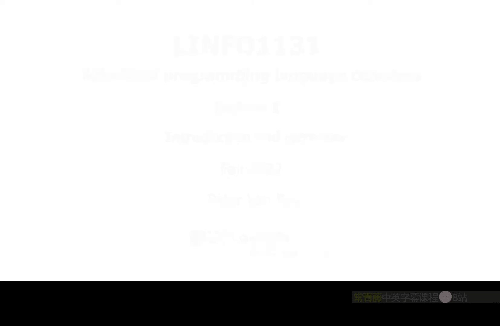

A full 1131。Should then main concert。啊。😮，French friendly。But if you're English speaker。

 it'll be fine。This course is a successor course to。The second year course， Le 04。

 and we're going to do。Things that are much more advanced， and you will see that。First。

 before I continue， I want just to make a few seconds。Of。

Respect for the people of Ukraine who are fighting for their freedom and for our freedom。しと先。

So I will first explain how the course is organized， what we're going to do。

How you can get maximum points and everything， sure that's interesting。

And then I will give today a refresher of the previous course。Very fast。

All the things we saw that are important。The previous course will compress them into today's。Course。

So I assume that you you know that part very well， that you have perfect memory of this previous course。

As I'm hope to go。For。Of course this organized as follows。

 there's a weekly lecture today is the first one。And I strongly recommend you attend because usually I give you lots of intuition and examples。

There's also a weekly lab。Not the first week。I will send messages just for that。

 it depends on how many people are enrolled， probably we will have two。

Lab sessions at different times。Okay， and we will mark your attendance。

And if you attend all the labs， you will get a one point bonus on the final。想啊。

Which means that it is technically possible for you to get 21 points out of 20。

Of course we will round it down to 20 if you do that。

So that is something to encourage you to come to the lab sessions。

And there's another advantage coming to the labsicians is that the simple fact of being there and trying to solve exercises will automatically improve your points on the exam。

 so it's a double benefit。Coming to the lab sessions from Car， and there's a Moodle。But the course。

And everything will go on the grid， so if you're not yet enrolled on the wle。

 please enroll your stuff。Very fast。And for the grading is going be a midterm， this one is optional。

 you don't have to do it， it'll be around week seven， the smart week。

 but we can change a little depending on whether you have other kinds of。Deadlines。

 just to make sure there's no conflict。And this will correspond to five points。On the exam。

There's also a project， this will be a practical project where you implement things， something。

 this one is mandatory， you must do it， well if you don't do it。

 you will not get the five points so the project is also worth five points。On the final grade。

This one has to be done in groups of two students。In case you can't find a second student。

 you can do it alone。But never in groups of three， always one or two。

And the final exam will be on 15 points， five point corresponds to the midterm。

 so basically I will take the maximum。Okay， so if you do very well in the midterm。

 then you can consider yourself。To be dispensed for part of the exam。

And the rest of the exam is on1 points okay， so if you do very well on the midterm and the project。

 and if you attend the labs， you can already succeed the north without。I to the final exam。

Okay so this is I liked this approach， students like this approach。

Because it destres the exam encourages you to work during the year。

 so my goal for this course is that you learn the stuff and I don't care how you learn it as long as you learn it。

 so this seems to be a good approach to encourage people to。Learn the stuff in the course。Okay。

 so that's how we organize it， so anything that changes， any kind of things， announcements。

 it's all in the moodle。And we will I still have to organize the lab sessions， the times exactly。

Because it depends on how many people are enrolls， so I didn't really know exactly how many people。

 so now we will know that this week， so probably so the first lab sessions will start next week。Okay。

 and I will send message on move for that。Okay， we will use two software systems。

 so the Moart system and with the Oz language， this you know。

 we'll also do some perhaps some lab sessions on the airline。Language and system， early OTP。

 version 25， and so this one is available from B。org， so you will see that later in the course。

This is a very good language for building large， robusts。Software systems。

 it's one of the best languages for that。 I mean it's an industrial languages language。

 many companies use this language。Especially game companies。So if any of you have played call of Du。

 I don't know if you know this game， call of Duty。Then you have also already run early。So this is。

 I think， a very good language to learn。Okay， so let me talk about。The content now。

 so I'll first give you kind of an overview of what we see in this course。

So it's kind of a futuristic advanced course。I want to prepare you for what's going to happen in the next 10 years in programming。

So even if today。Not all the ideas are being used， they will be used for sure。

 I know for sure because I have a very good crystal ball and so this is the what I'm going to teach so there are three main themes in this course。

The first theme is concurrent programming。Concurrent programming is supposed to be very hard。

 you saw already a little bit of it。In the previous course， 1104 on deterministic data flow。

 which is very nice form of concurrency， so we'll continue that we'll see many forms of concurrent programming。

In this course， it's actually the official negative of this course is about thecurren program。

So this is kind of the main theme that runs throughout。Of course。And I want to make it easy。

 it's considered very hard， the heart that the most general form of concurrency is very hard。

 if you've taken course from Charlotte Baur you can see that it's actually quite hard。

 but I want to help you make it easy， so I'm going to kind of cheat by showing you paradigms where concurrency is very easy。

And not just deterministic data flow， but other。Paras。So that's the first theme。

The second thing this is a very futuristic thing， which is declarative programming。

 this is the easiest。By far the wage program。And。People are understanding this more and more and more and more tools like a cloud are using these techniques。

 so I want to show you really the power， so it's going to be like half of the course we're really going to see the power of this approach。

That's the second the and the third theme is non declarative， so you can't always use thelarative。

 unfortunately。So you can not always avoid。哪几对。But still you've been making easier。

So you can see that kind of the theme is how to make programming。Easy as easy as possible， okay。

 using the right concepts and the right abstractions。And in a more kind of diagram。

There's actually two main parts。In the course， declarative。

 that's the red box and the black box non declaredlar。And declarative we will see four paradigms。

 so there's sequential functional deterinistic data flow， but also lazy evaluation。

And lazy determinist dictator flow， and these are very powerful paradigms。

 it lets you write algorithms。In a very powerful way that are completely declared to。

 and I explain exactly this gives you many advantages。

It's very easy to write to show the testing is very easy， maintaining is very easy。

So you want to do it all the time， actually。差惯。But you can't do it all the time。

There are limitations which we will explain。And the limitations have to do with nondeterminism。

 which I already mentioned in the previous course， so we're really going to see how to attack nondeterminism in this course。

And there's different forms of current programming based using nonterminism message passing and shared states。

 and this is really where we're going to see multi agent and airline so airline is kind of the best system for buildings large。

Falult tolerancerant concurrent programs。 See， the problem is not just concurrency， it's failure。

 it's that。Things can crash。Especially in a big system， things can crash。😔。

So this makes it think especially hard， okay？But if you do it the right way， you can make it easy。

So we're going to。See Irling， which actually pioneered this and very large systems that crash and have to keep running forever are written in Erling。

So there are some many examples of this， one example I know is in Denmark。

 sort the country of Denmark， the National Health database。OfDeadmark， so all of the。TheCitizens。

 the doctors， the hospitals， the pharmacies are all connected to this database。

 and this database has to be always running， never impresseded with them。People can get sick anytime。

 okay？This database is written in airline， and is running airline and never crashes。

So that's a very strong property， and we're going to see some of that。And thisす。

So this will help you a lot that's also very important for gaming。

It's less important for survival in the games， but in gaming， whenever the game is not running。

 you have a large multiplayer game， then people are unhappy and the company is not making money and so on。

 so they want to keep the game always running， okay？

And that's why also a lot of infrastructure for games。Behind the scenes is written in a as well。

So that it's always running and never crashed。Okay。So this also we're going to see in this course。

 how to write software that never crashes and you can update it。

You can debug it and it never goes down， that's pretty strong property。ok。

So that gives you kind of the themes of this course。

 you see where' actually we're going to go much farther than what we saw in the previous course。

 we're going to kind of push it to the limit。And here's sort of an approximate schedule。

Probably we will sort of be respecting this， it depends on how fast we go since this is kind of a new course。

 so the speed is not completely。Fixed yet so the first week S1 is today is the refresher and then we will have two。

 three， four and five on advanced Declarative programming， and then we will have 6，8，9， 10， 11，12。

 1314。Throughpon。Nondeative programming， probably the midterm will be week seven。

 but this could be sometime。Different， it's around the middle。Okay， so next week， for example。

 we're going to talk about lazy evaluation， which is a。An advanced form of theative programming。

Where programs only run when you need the results。This is a very interesting way of programming。

And then we'll see how to build algorithms。Veryre declarative and very efficient。

 advanced declarative algorithms。Finally， we see the limits into week five。You can't do everything。

 and there's actually a strong barrier， things you can do， things you can not do。

We're going to see that， so you're going to understand that very well。In this course。唔几。Okay。

 very good， so that's the schedule these slides are very renewed so I will put them on the little after the course。

 okay you will find them。没都。And today I want to give a refresher。Of the previous course。

So I'm going to go very fast and give you the concepts we saw in the previous course。

These main concepts are needed for 1131。And normally I taught them in the previous course。

 but if you forgot completely the previous course， then you just have to pay good attention today and maybe things can come back okay and you can look it up so if something is not clear。

 you have to look it up in the previous course。So starting with the next week lecture。

 I assume that everything I say today is perfectly understood， okay。

 this is something normally you saw today's real refresh。

It's important to give refresher because I know that people forget things。AndIt's good to。

One of the first things we saw in the previous course was functional programming。

We saw that functional programming is the foundation of everything。Okay， and especially higher order。

 which I would explain where functions are first class。Da的。

It's all data abstractions and all languages are built using that and in the previous course we saw the lambda calculus。

 remember that， well we're not going to see the lambda calculus anymore in this course because this is more of a practical and not so much theory course。

But the latterly happiness is a foundation。Of world programming and functional programming is the best。

Paraigm for testing， maintenance。roving that your program is correct。

And that's important for complicated programs。And it's more and more being used in all different forms。

 so the main example is all the cloud analyticsnalytic tools。

Wwhichch started from Google and started from MattRduce and if you go into the course on cloud computing。

 you will learn that so I will not see cloud tools here。

But I recommend you take the course on cloud computing and you will see them with these tools and you will see that they are very functional。

 okay， and they are getting more and more functional。And so in this course。

 we're going to push this as far as we can， this functional idea。

We're going to push it for good currency and we're going to push it for algorithms and efficiency。

 okay， because it's so good we want to use it as much as we can。

So that's what we saw previous course， remember this， remember invariance。Invariance。

It's basically loops， remember， how whenever you do a loop。And recursion。

 remember tail recursion is a while loop， so loops are very important。

 of course because you always want to do computations repetitively on the whole bunch of data。

And I will give you a simple example。😊，Just to refresh it。So here's an invariant。

 n factorial is equal to i factorial times a。So do you remember how this works？

You want to calculate n factorial。So n is constant， it's like the input。But I and A are varied。

 they're not constant， they can be different。So this invariant is a formula that is always true。

 and I and A will be having different fat。And you start by I will be equal to n and a will be equal to1。

I remember that if you do that， then the formula is trivially correct。

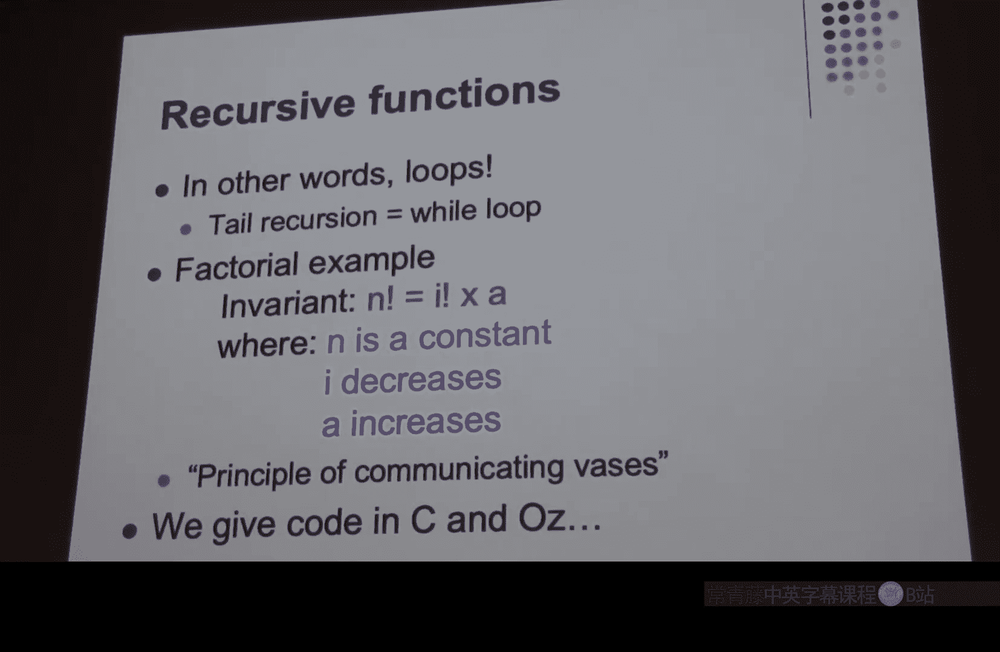

I have1 factorctor。People and factorial。

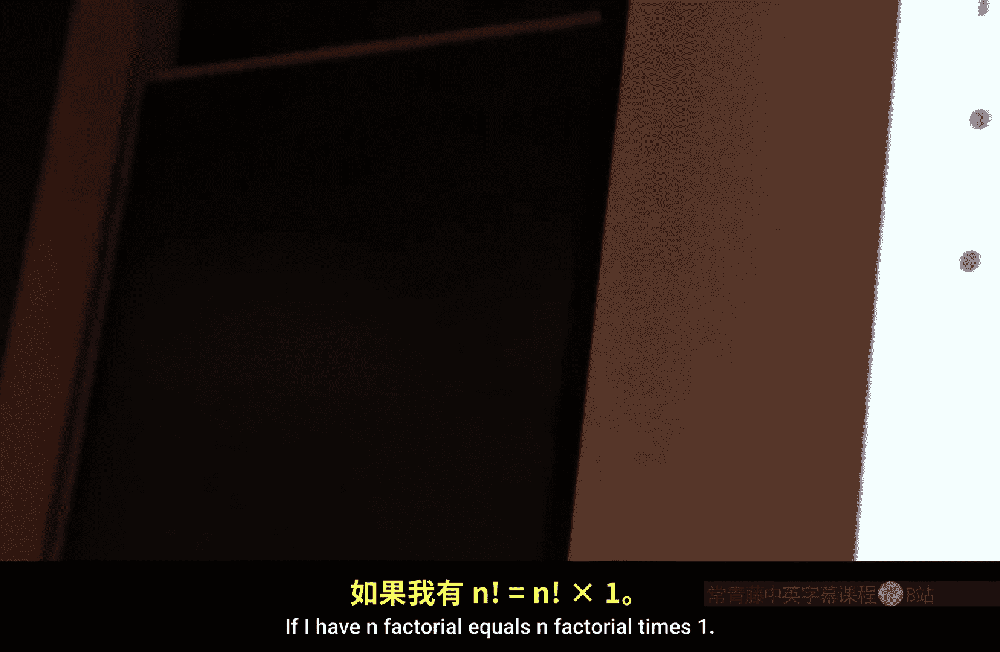

And one。Remember how it works and？

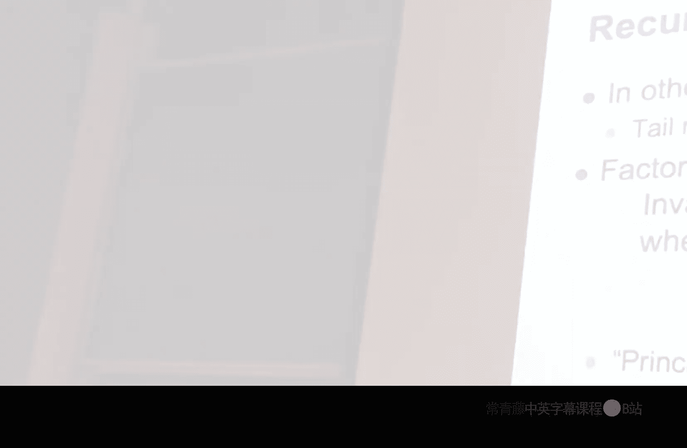

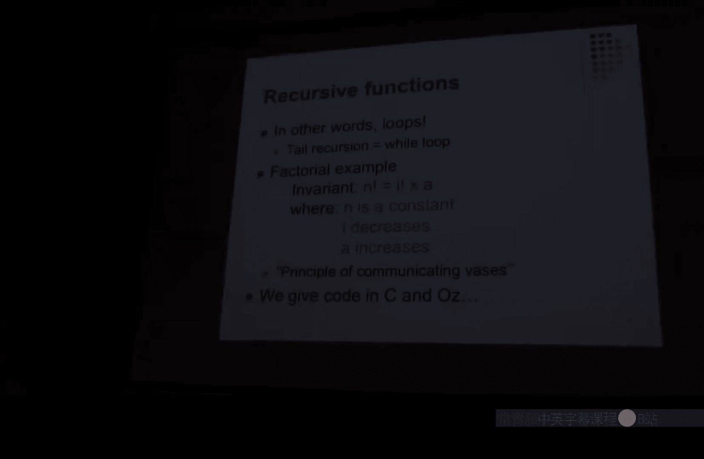

Okay， so let me continue so and whenever you do a loop。Thefis are the thing that you have to do。

And you can see how it works，h。Remember how it works。

 I actually called this principle of communicating basis， I have two bottles with the pipe。

 one one goes down， the other one goes up， so the input argument I will decrease and this forces the other one to increase。

And that way you can compute the result。So whenever I goes down by one， a will go up。

In order to keep the injury true， so the motor is that the invariant is always true。

This is something that we will use when we do complicated loops so you have to。

Make sure you understand this。诶。So here's just code for this function in C and in R。

 so C is very similar to Java。

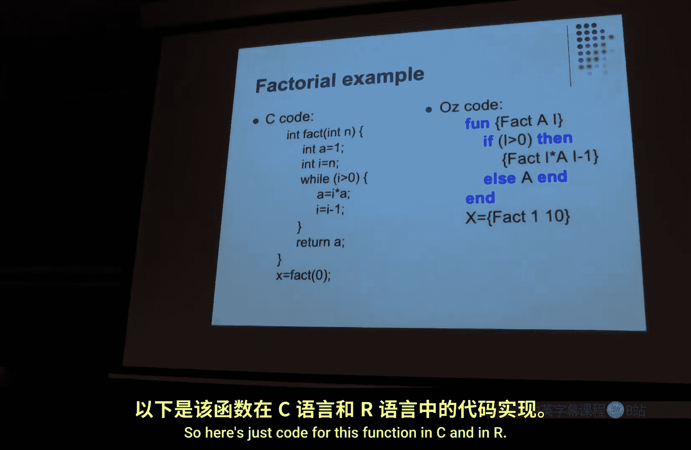

So in fact， in end。Your A and I。And then you have a wire loop and wire loop is increasing A and decreasing I here。

 and the invariance stays true at the beginning of each loop iteration。你。sorryrry， this must。

On factor 10。Here is the O code， which is a recursive function。A and I are the arguments。

 so here they are loop variables， here they are arguments。

 and whenever I do a recursive call it will be I times a and I minus1 until I becomes zero okay。

And so these two programs are computing the same thing and with the same deficiency。Okay， see that。

 see how it works。Okay。So that's something we saw in the previous course。Okay， another thing we saw。

Was higher order programming， this is something also very important。

 it the foundation of many things。So here is an example， so a function is just a value。

It's like a number or anything of value stored in memory。And you can pass it as input。

To another function or it as output。诶。And this， we use this for building data abstract。

And here's a simple example we saw， the function add n N。Returns another function。

 which is an anonymous function， remember the syntax with the dollar。

 it means it's an anonymous function， it's just a value。And this function has one argument。

 x and returns x plus n。And if I say the add five is equal to add n of five。

 then add five is a function。Of one argument that will add five to its argument and add 10 is a function。

Of one argument that was at 10。 and remember we saw the concept of the order。I will放。The order。

Every higher order function has an order。Remember that， so what's the order of add。

 you still remember that？Anybody you tell me。What's the order of add N？Oh very complicated。

What's the order。Two， yes， very good。 The order of add in is two because the output is a function of order one。

 so the order。A function has order one， if all the inputs and the outputs are not functions。

 then it's first order。AndOtherwise， it has order n plus one。

 if there's at least one function of order n in the inputs or the outcome。

So the output here is a function。That does x plus n。

 so that function is first order because x and x plus n are numbers。

So at N returns the first order function， so it's second order， okay， so remember we saw that done。

And how does this work？What is the magic that makes this work， so add5 and a 10 are different。

 these are two different functions。How does it work， it works because of closures。

And closures are also called leli of closures， I also call them procedure values because in the per language。

We have procedures in French， they called F2。It's closed fe because it packages an environment。

And so what started memory is two things， so A1 would be the value of add5 and A2 is the variable which has the value of at 10。

So for example， A2 has the procedure code， so this is symbolica， but in a real implementation。

 this would actually be a pointer to the code。Of the function， and then it has an environment。

Which maps this identifier and to some variable。So each procedure。Has its own little environment。

And it's a closure because it's like a package， it's closing over the environment at the definition。

 so this is called a closure。And all programming languages use this。

 this is one of the main inventions。Of programming languages， closures。

 with this higher order programming really works very well， and you could build abstractions with it。

Okay， so you have to remember this concept of closures。Fament。ok。So that's how the a end works。

Here's another higher order example， this time the function is an argument。And not a result。ok。

The function map will take a list L。And I'll talk about lists later。

 but here I'm already using a list and it will。Apply the function F to every argument of the list。

And this function is tail recursive。So remember I talked about invariance and loops。

 a tail recursion means that the recursive call is the last call。So how does that work？

This is something special that works。Because of。Because we have single assignment variables in our model。

This function is tailored person， the last call in the body is MA。

Here you can see it's building a lista， FH is a value， the bar is a list pair， a con cell。

 and map is a recursive car。So it looks like the list is being built after the map。

 but this is not true， this is actually tail recursal， this is very important。

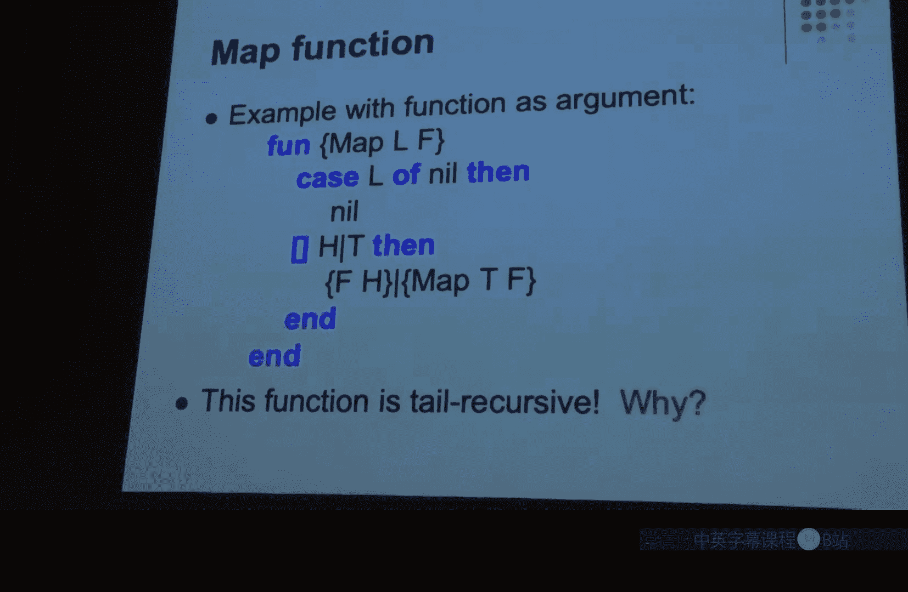

So I will explain how that works to refresh。So here is。The final call of the map。

 So how does this run？

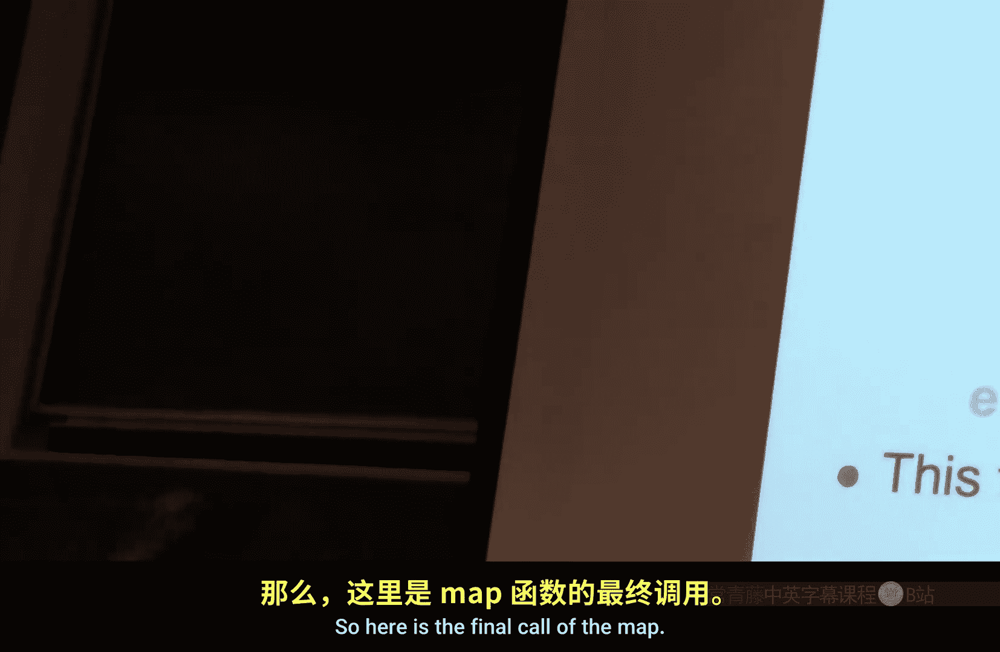

This runs， I will translate to the kernel language， which is the basic。

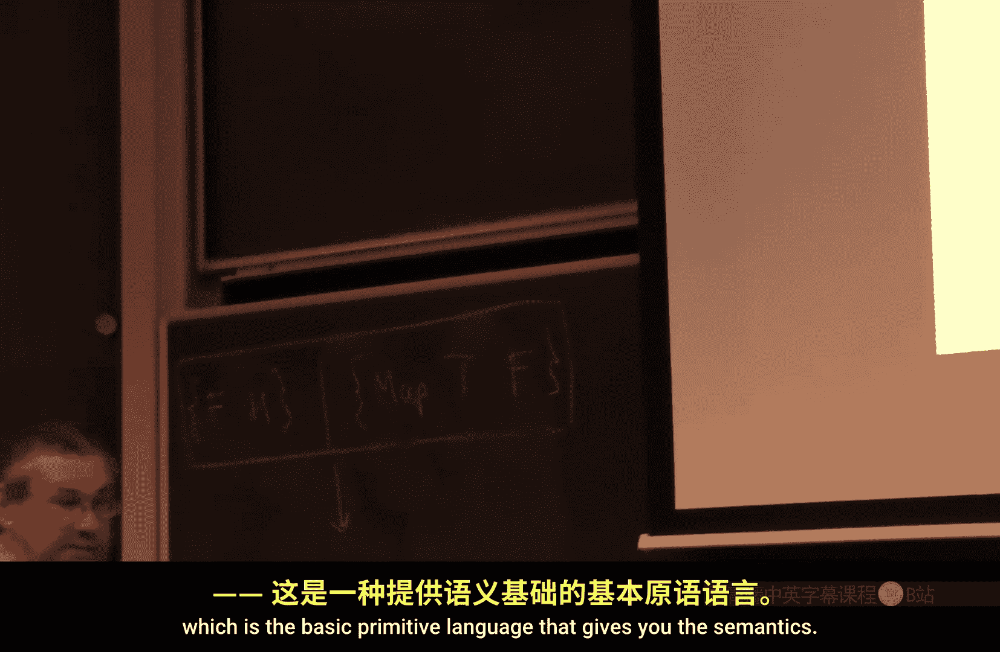

Primitive language that gives you the cementtic。

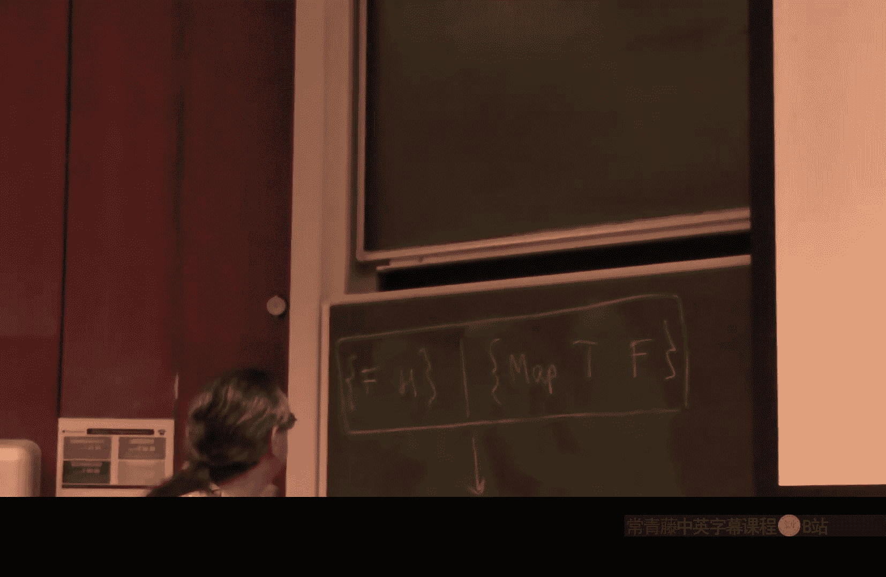

So the way this runs is that map。Is actually a procedure。With one extra argument。

 which is the output， so I will not write everything， but I will show you。How this。

Call is translated。So the way this is translated is that the map called。Is actually。

And the way it works is that I have。R， which is the result， is going to be。这么的。

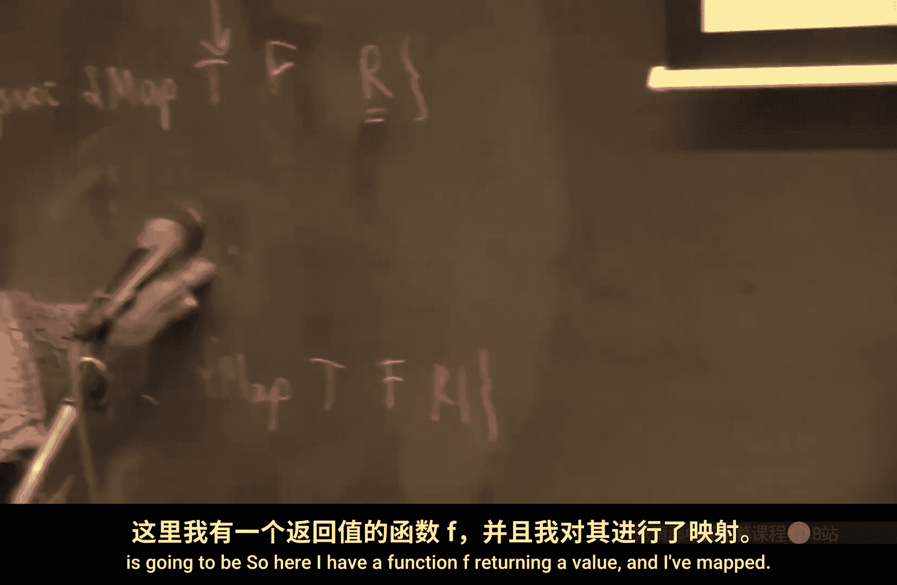

So here I have a function F returning turning a value knife map， so this function returns some value。

Which let me call it。2。So， I have。F。SoH2。H。Here， and then I build the result。

 R is equal to so r is the result here。Is equal to H2。宝仔。The next piece。Okay。

 so R1 is another unbound variable。So I'm building the result， R is the result there。

 I'm adding H2 to the result and R1 is an unb variable。It's being pass to the recursive call。

And so this means that the recursive calls can be put at the end。

It has to be put at the end tail repressive， this is crucially important。

It's important for concurrency， as we will see later。

 it means that we can build concurrent agents that are functional。

 and this is extremely important for pushing declarative programming as far as we can。Okay。

 so this map function is tailor personive。Because of unbound variables。

 because we can build the result with an unbound variable like the whole here R one。

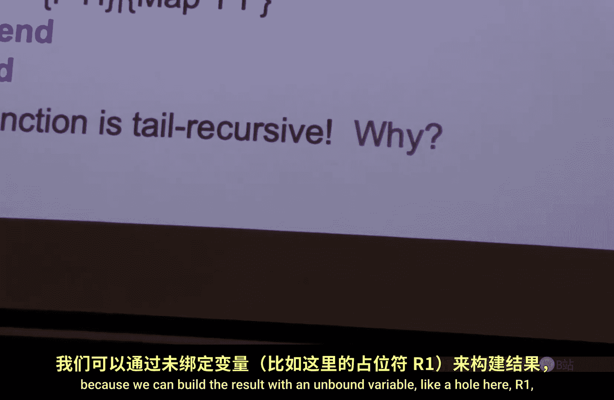

And pass it to map， and it is this recursive call to map that will fill in or bind our one。

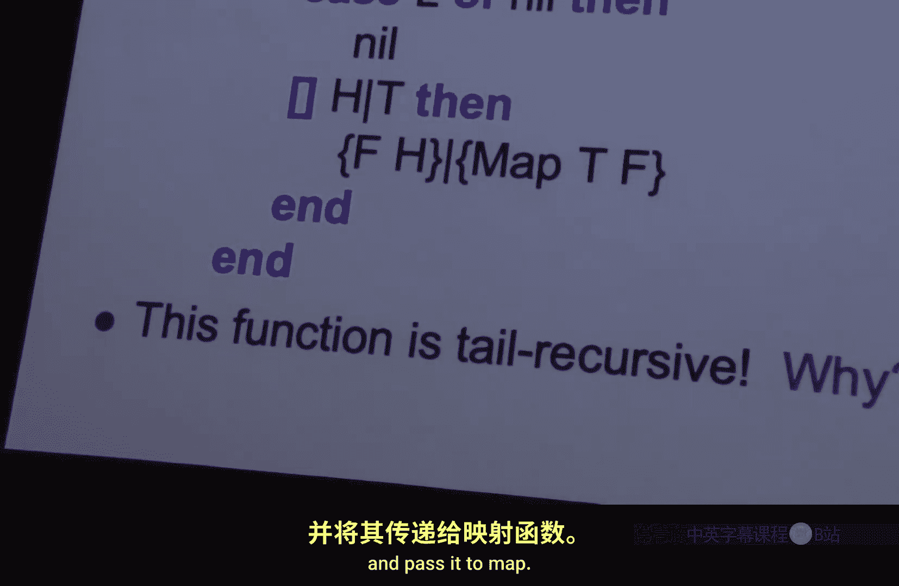

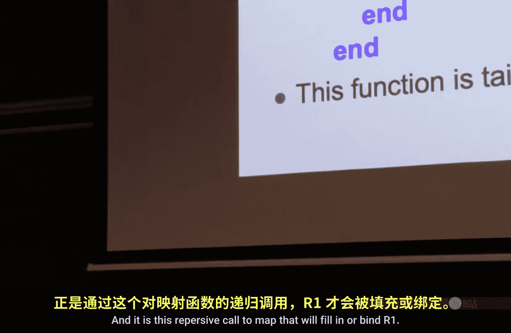

So the fact of having unbound variables。Means that list functions are tail recursive。

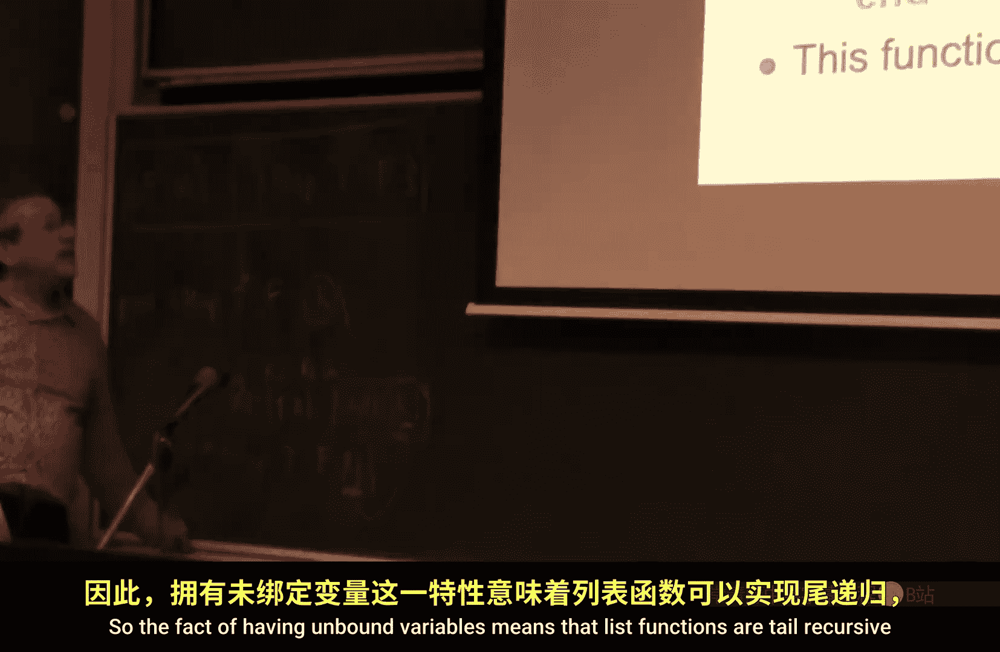

And this will allow us to make concurrent。Functions， deterterministic tape。

so this is the first victim。OfThat。Okay。More abilities of higher order。

 I'm not going to say more today， we saw many abilities of higher order。Gensity， instantiation。

 so generosity is where the function is an input， instantiation is where the function is an output。

Function composition， we compose functions， abstracting an accumulator， this is the fold operation。

 which I'll show a few minutes， also encapsulation， we can hide things inside。

 we can also do delayed execution。You could take any statements。

And turn it into a zero argument procedure， and that's a value， and then pass it somewhere else。

 and it will be executed somewhere else。So this is like a delayed in execution。

 it means you can build。嗯嗯。Contracts like while or if or repeat statements， any kind of a statement。

 you can build it using higher order。So you can see higher order。Is really a foundational。

 very important thing and this was invented in the 1960s and it changed everything for programming languages。

 okay， all the languages that were before that。We're actually broken。This unfortunate， for example。

 which were invented before this。We're broken and had to be fixed。

Whereas all the languages that were invented after that were good， were not broken。

So this was like a major invention for a program。So this is what we saw。

So you have to remember that we're going to use it all the time in this course。

Another thing we saw in the previous course was symbolic program programming not just with。Numbers。

 but with abstract kind of structures。And we saw things like trees， remember the tree algorithms。

 we saw records。And we sell lists。So here is a grammar definition of a list。

So the list L is either nil， the constant nil， or so the vertical bar needs four in grammar notation。

 an element E followed by a vertical bar， so the vertical bar with quotes is a vertical bar in the definition that in the thing we define it。

So notice the two uses of the vertical bar。Different。

So a list is a recursive data structure because it's defined in terms of itself。

And any recursive list function like MA will follow the recursive。Gra。Okay。

 so lists are u bit with this。All languages somehow use this， some of them it's hidden， some of them。

 it's very explicit。Like in languages like S or Earl or Ha， they will be using lists explicitly。

And in ours you can have many syntaxes， so there's what we call syntactic sugar for thiss since they're so ubiquitous。

Okay， and then one important concept that's used is called pattern matching。

This is used in all symbolic languages and it really makes the programs easy to understand because we kind of use pictures。

In the left here we have a list one， two， three， nil， I show it in a tree。Notation。

It kind of like a directedive graph。This corresponds to the syntax， and on the right。

 I show up pattern。Which has the same syntax and has identifiers， H& T。

 and pattern matching will make those two correspond to each other。And in Oz， it's called the case。

 but different languages will have different names。If you write programs in Sca， for example。

 you will also have a matching。So it matches the actual list with the pattern and H will be bound to1。

 and T will be bound to the list two， three， now。And patterns can either match or they don't match。

 they fail。Okay。So pattern matching is something we're going to use a lot。Okay。

And let me show you another higher order operation on lists。This is a very important operation。

Ca fold， it's just a function that we call fold， but somehow this function。

 this particular one is very important， so I refresh your memory on this and there's many reasons why it's important。

 it abstracts an accumulator so in the invariant remember the I and the A。

 the A is called an accumulator because you build，The results accumulate the results。

And the fold operation hides the accumulator inside。So you don't see it when you call a fold。

When I have a list L， which is a0， A1 up to a and minus1， I have a function that take F， F。

 which is a binary operation， like suming。Making the sun， okay。

I can define the function where I start with some beginning value u。

 and then I do UFA plus a0 and then's plus A1， and I do plus A minus1。

 so I'm summing all the elements。So the fold kind of collapses all the elements of the list into a single result。

So it has three arguments， to list L， the binary function F and the beginning value， which is u。

 okay？S is the kind of folded。不是不说。Coold is also calledR。

 so another name for this function is reduce。If you see in the cloud then。

There's a function called map reduce。 The reduce is just a fold。

So fold is a very important high order function， Another reason why it's important is that is it's the heart of a concurrent agent。

Actually， the fold can model the state transition of a running concurrent agent。So you see。

 this is kind of an essential high order function。喂。So here's one way you can define it。

 I call it fold L because it's doing it left associative， there's another version called fold R。

 which is right associative。This is the left associative one， LF U， and whenever it recurs down。

 it replaces u by F of U and H， which is the element， okay？

And it reses down all the elements of the list。And so reduces everything to a single result。

 so you as an accumulator here right？来其诶。And we can use fold L to do many things。

 including the sound elements of a list， it's just one line of color。So is fold？

A tail recursive function， what do you think？Is it Taylor recur， yes or no？You tell me。

 is folk tell person？know this。It's very easy， you just have to look at the code。Yes。Yes。

 it is because the last call is forward， the F call is done before。

So a fold is not building a list stuff， it's not like math where you're building a list here。

Collapsing I compressing all the results， all the elements that listen to one number。Or one thing。

So the folder list is definitely Taylor recursive and you can use Fold as the heart of a concurrent agent so that the list in that case is a stream of messages being sent to the agent。

listist functions are， you can actually turn them into concurrent agents。

So there's actually a strong connection between functional programming and concurrent data flow programming。

The list functions， which are just functions， you can use them as concurrent agents。

 and fold is like the most general one because you can use it for any agent which has an internal state。

So the U is like the internal state and the H is a message that you send to the agent and it transforms and F is the internal implementation of the agent。

 the state transition， so you can see that whenever the message H arrives。

It transforms the internal state， U into a new internal state， F of UH。

So you can use fold to build up in current agent， okay？

So you can see fold is actually one of the key higher order function。The key function。Okay。

 so let's go on now so I'm still refreshing you here， this is all old stuff up。

 so let's talk a little bit about data abstraction in this course we're going to go farther we saw already some basic principles of data abstraction in the previous course。

So a data abstraction is taking a piece of the program and making a box around， encapsulating it。

 and it could only be accessed。True。The boundary， which is the interface。

And this interface will obey some rules。You could only call it in a certain way。

 you try to call it in a different way， you get in error。And so this protects the inside of the box。

啊。So it protects the inside， so it has three advantages， one is that since the inside is protected。

You know that you're guaranteed you're going to use it in the right way so it will work correctly。

 you can't really break it by calling it in weird ways， okay？So it's a guarantee that it will work。

 also reduction of complexity when I call the abstraction， I don't have to know the implementation。

 I don't have to even see that code。I just have to know the interface， which is very small。

 this is a key concept。Not just in programming， but in the whole of society when I drive a car。

 I only be using the interface of the car and I don't know how the motor works。

 okay actually I little bit know because when I talk to the mechanicck。

 it's good to know a little bit but I don't have to know all the details of how the car works or how a computer works or how a television works or mobile phone okay so it makes my life easier。

 it reduces complexity and the consequence of this is I can build very large programs much larger than a single human。

And it's all because of data abstraction， okay， I could build millions of lines of code to 1000 million lines。

Engineers can work for 20 years building libraries。And。No single person understands that。ok。

Each person understands their own peace。But the other people will see only the interfaces。

This is a key concept， if you didn't have this， you could not organize society， in fact。

 if you're a philosopher or a sociologist。You also understand this because human organizations also use this idea。

But in a programming language， this is essential。That this data abstraction。

 and notice it's built on top of higher order。Which is using closures。

 so you can see closures are like the foundation for this whole construction。

This you can see was a very important invention？Before pleasures。

 people were kind of clueless after that we could start building large。Systems， really。

 things really accelerated。Okay。So there's two concepts defining data abstract structure。

 so the lexical scoping or an identifier can only be seen in a part of the program which is called the scope。

 remember the scope。When identifier， it's the part of the program where the identifier refers to the same definition。

It's a question I'd love to ask on exam when people don't always get it， okay？

So scope is very important， but and then higher order this higher order that you build these interfaces because it has the closure inside。

The functions， Okay， hidden。And so that's how you build them。

 and there's somehow it's very interesting， there's actually two kinds。Data attraction。

Objects and abstract data， they're fundamentally different things。Different。

And both of them have a meaning， so this you can see if you do a mathematical definition。

But you can see the intuition， so an object， everything is inside the object。

And an abstractstruct intake， you have two things。诶。The values and the operations。

So an automobile is an object。But a vending machine。

The tanks that where you can get a kind of coca Cola of the coin is an abstract data type。

Because you have the coins and you have the cans which are the values and the operation which is the machine。

 these are separate things， whereas an automobile， there's only one thing。

 which is the automobile okay？So there's two kinds of abstract data abstractions。

And we saw how it's done。The previous course， this is the stack。

 so this is recalling stuff we saw in previous course。So if do you remember how this works。

 so we have a new stacked operation， we have push and pump and。And the way it works is that you。

Take the value of the stack and you encapsulate it inside a kind of a。Hit a box。

 a safe deposit box with a key， okay。So rap and unwrap are like doing cryptography。

You're hiding the data and they have a shared key， so inside of wrap on and wrap。

There's a shared key， so we didn't see all the details of how it works。

 but we will see that we will investigate this more in this。Okay。

 because this is very important concepts and it's using some kind of a cryptography。

And if you see how the push function works。W is like a hidden stack。It's a value。

 but you cannot look inside an unwrapped W returns to the route the stack。

And then you build the new stack， which is X bar S。

 and then you call RAP to package it up again to lock it up inside the。The box。

 that means outside of this code， nobody can see it's hidden。ok。And wrap and unwrapar in Portland。

 of course， and they're hidden from the rest of the program。Because of static lexical scoping。

So this is how you would do an abstract data type。This is kind of like the setic stuff it。

 but the same stack you can define it as an object。It's very different now。Very different。

 the same stack。But now you don't have stack values and push and pop， now everything is together。

The object itself。Knows the stack value and the operations。

And the way we do it here is by using a cell， which is a variable we can update。

So the object is like a one argument procedure。And the argument is the message to the object。

And if it's a push X message we call push， it's top X we call P and so on。

So there's a case statement there that will choose the method。

 so those three procedures are the methods。And the case statement chooses the method。

 and that's called procedure dispatching。This is all object oriented terminology， okay？

And the cell is hidden with static scope， so the same stackt as before is now an object。

And not enough checked very tight。Okay， so there are two different ways doing things。

So this is what we saw before， but it's important to really understand and objects are very important。

 so usually languages they give special syntax this code here is like the definition。

Of an object you could actually see this as the semantic。Definition。

 because we have seen the semantics of all this。Remember the semantics we saw in the previous course。

 well in this course we won't see so much semantics anymore。This is not so theoretical course。

 but we did see the semantics of these procedures。So this is you can consider this code to give the semantics of an object。

This is completely defined mathematically。And usually languages they don't do like that。

 they define their own syntax， so Oz has its own weird syntax for objects， this is an example。

 but many languages have their syntax， Java is an object going to language which has its own syntax。

For classes in so ona。Oz has its own weird syntax also。For objects。And it's internally。

 it's doing like this， but the programmer will use this syn， okay？

So the syntax is actually nice to have a syntax because it guarantees that you cannot do things in the wrong way。

 it guarantees that the object is defined in the right way。

 it's also more readable because the object concepts you see the methods direct。Okay。

 so that is the kind of state abstraction we saw in the previous course。

 and this course will go farther。And that。We will study more how you use data abstractions and also how you combine them with other kinds of。

解ずてです。Okay， so this we saw in the previous course。Now I want to talk about。Concurency。

But I will first make a small break， so we will make a small break and then I will refresh your memory on my current program。

我这。After the break， I want to talk about。W be flow。They develop concurrency。

This is also something we saw in the previous course。And we saw a very simple form of concurrency。

Called the termministic data flow。But in this course， we're going to see many。

 many forms of concurrency， and this is only the first one， the simplest one。

In an concurrent program， you have multiple activities that are executing simultaneously and they're independent of each other。

 so it's like more than one program is running at the same time， but inside。

And in order to implement that， we add a new language operation called thread head。To create a new。

So this concurrent activity is called a threat。And we saw that， in fact， in a computer system。

 there's different levels。Concurrenret activity， the thread is the most basic one。

 but maybe I just think of。Refreer， so you have threads。

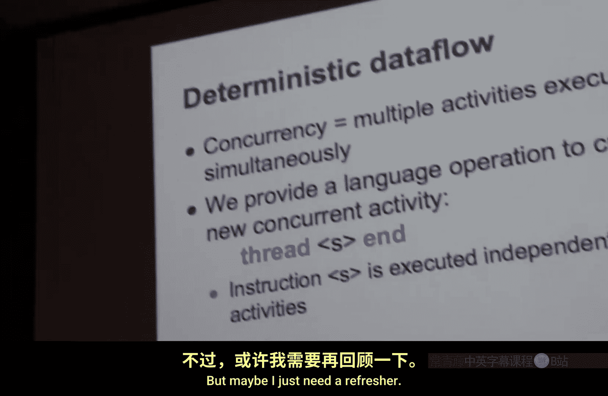

Threats are sharing the memory。

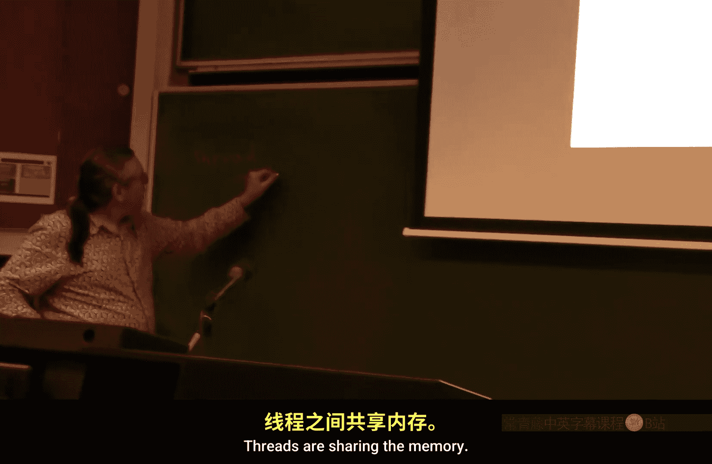

But you have a higher level ofcur， which is called that process。

Each process has independent memory space。So this is what's happening on a single computer。

And the next higher level is a compute node。Computer。Where you have separate hardware。

The thread is the most basic form of concurrency because all the threads are sharing the memory。

Whereas in a。Operating systems of the computer。You will give each process an independent member space and of course they're still running on the same computer and the next level is where youve got actually separate target。

You can use similar techniques for all of these。Okay， if you look at these。This is this。

 if you have independent。This is called a distributed system。

Because the memory is independent and the only way to communicate is by sending messages because the memory is independent。

So if I have two computers on the internet， they will be sending messages to each other。

There's another course that does this called。2345。Which studiesies distributed systems。

So we're not going to study that here。But this is actually very interesting because these processes are completely independent。

 they can even fail independently or crash。A compute node can crash even if the other nodes are still running。

 okay， so this makes things even harder， whereas in a thread。

 a threads normally they will be inside what process。

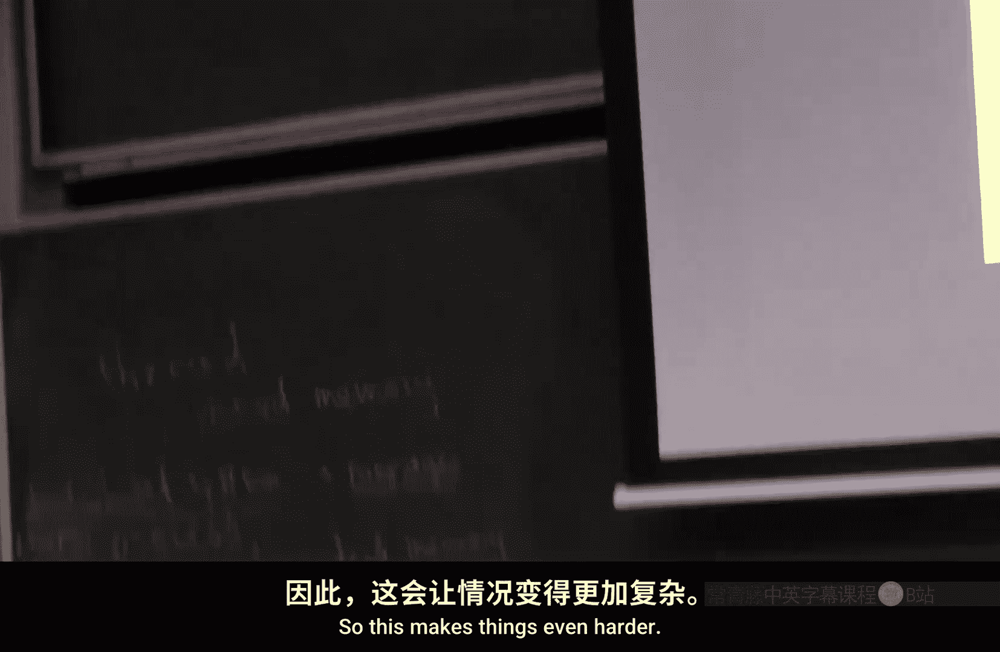

And they will share data， so it's not possible for one thread to crash and the others keep running。

 they will all keep runningm okay。So this is what we saw in the last course， the thread。Concurrency。

And we saw it inside of functional programming。So we have functions and unbound theory。

And the way that two threads talk to each other is because they share a variable。

Both threads know the same variable and they will either bind or read the variable。One thread binds。

 one third reads， so here's a simple program， the first grade will do x equal one。

And the second thread would be。Y is equal to x plus 10， and then it displays Y。Thats why。

So this program always displays a letter。Now it can execute in many different ways， okay。

 this is specific concurrency that means we don't know when these threats are going to run。Okay。

 we don't know maybe the second thread will run first and it will fall asleep after a certain piece and then the first one will run。

And past， you have a piece of program called a Schr。Because the threats are independent。

They're not connected to each other， they're separate。Programs， okay。

 so you really have to understand that threats are independent。But still。

 this program will always display 11。Even if the threads are running in a different quarter。

That's very important。This program， even though the threads are running a different order。

It will always display the same result。This is a very important property of deterministic data flow。

So here I make a diagram。I call them activities now this is actually the thread。

 so there on top you have the thread doing y is equal x plus 10 and then later on so the time goes to left to right。

 it does browse and the bottom you have the second activity so the two independent activities。

So let's say the first one is running first。It does y is equal x plus 10。

 but x is still unbound at that point。So what's going to happen， what does the plus do。

 this is where we have data flow behavior so data flow is a very important concept。

 it was actually invented in the 1960s， okay， many things were invented in the 60s。It's the ability。

 the availability of data is driving the program， so if I do y is equal x plus 10 and x is still unbound。

 then I cannot do the addition， so this is not an error， the program will just wait。

It will just wait。Why is it to stand will just wait and it will wait forever。

 there's no time out or anything like that， it will just wait and it can wait for a very long time or forever。

系。And then when activity B， it's not 20， it's 1， bys x equal to1。At point2。Then the first one。

 the addition it's doing one plus 10， it can continue then， okay。

So there's a communication between the two activities。And it's the availability of the data。

That is what drives the execution seal To when the X becomes available。The activity A will continue。

And if activity B runs first。It does x equal1 before a， that's fine， and a will just not wait at all。

 it will just do y plus1 plus 10。So A does not have to wait in that case。So in both executions。

 where you first do the addition， if you first do the addition， it will just wait。

 and then you do x equal1， but if you first do x equal1， then the addition does not have to wait。

So you see the two execution are different， but the result is the same， y is equal to11。

That's very important， that's because it's functional， x is a single assignment variable。

 when it's up bound， it's always bound to the same value。So this is how the execution works notice。

 so I will fix the slide then before I put it。But it's not that's okay。I put this pipe in the。

 in the middle。So， this。Lets you do concurrent program Now this is an easy case， x is just a number。

But what if you want to send more value？What if we want to send many values from one thread to the other。

 well then what we share is not a number， but is a list。If the two threads share a list。

 then one thread is creating the list and the other one is reading it， then you can send many values。

This is very important and we give it a name， we call this a stream。

So stream is a list which ends with an unbound variable at the end， and if you extend the stream。

 it's like sending values on a communication chat。

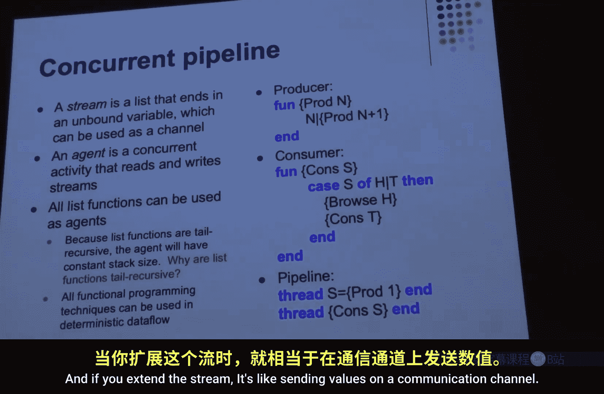

So if I have a stream， let me call the S。Which is like a list， one，2， three。

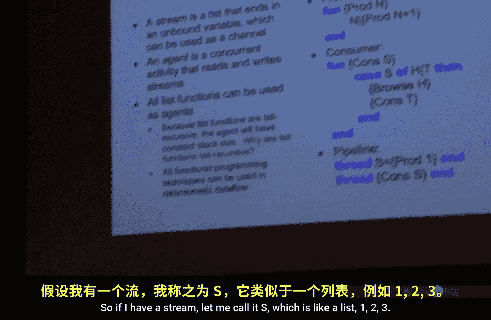

But here there will be an unbounded variable， that's two。And if I read it one， two， three。

 then if I try to read S2， I will wait like the addition wait。Then， if I find S 2。like this。

Then the execution， the reader， will continue。So you can see we can have actually producer and consumer。

Make diagram producer。And consumer。With a stream in the middle。2，3。

So the producer is creating the list。Here's a simple producer。

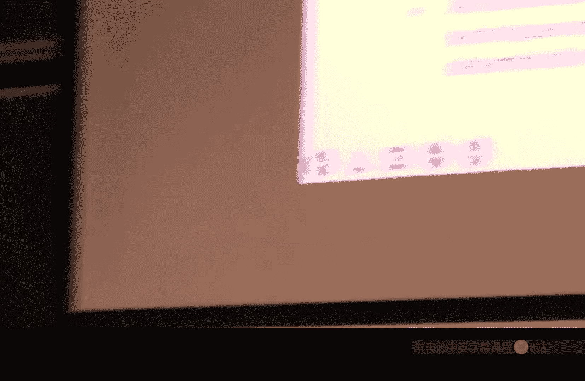

Which is doing。N bar broad n plus one。 So this is like an infinite loop up。By the pride of one。

It's creating a list that goes forever one， two， three， Luc keep going forever， second from the loop。

 so this is like a producer that is producing numbers forever。

And the consumer here S is reading S and uses case statements。

See how it works here so the case statement has to read the list， but if the S is still unbound。

 it's just going to wait like the addition weights the data of flow。See， so this is data flow， again。

 it's data flow。And so the consumer will wait until the producer is producing。

 so the two threads are synchronizing to each other。Through the data flow， you see how it works out。

 this is really important， and this is the foundation for everything we're going to see in this course。

And if I take these two functions， fraud and comp producer and consumer。

 and I put them in two threads。And S is a shared variable。But this is a stream， so it's a list。

 but I'm building it thoughh。And adding elements。So it's never finished actually。

 that you keep building it， in that case， communication channel。Between two agents。So an agent。

Is a concurrent activity that reads and writes streams。

 so the producer and the consumer are agents here， the producer is creating one' stream and the consumer is reading a stream。

 but they can read and write more。And we saw examples of that。

And all list functions can be used as agents。Because they are tail recursive。

They have constant step size， that means even though you have a loop here consists tail recursive。

 but even functions like math are tailor recursive， okay？

And that means that the step size is constant， it's really a while loop。

And that means if you put it inside a thread， the thread is not going to grow the size。

 it's going to stay constant size， so it's a really nice concurrent activity。Sicient。

So it's really important that the list functions are to recuring， okay you see that up？

That's really an important thing。And why are they tell perceivedive because of Ontario？

So all of that is pushing declarative programming farther and farther。

 we make it concurrent now and it's still functional， but next we will make it lazy， okay。

 and then we will do advanced algorithm design we will push even farther the declarative techniquess。

 but this is the first technique， which is what we saw last week。that， of course， okay。

So you understand that the termminist de datata flow and using a stream that's you。

Sent many values and the data flow is how the two activities are synchronizing between each other。

Okay， so we saw many examples of that or you got many streams coming in and so on。Okay， so。

Now there's the joker in the deck。Which is called non determinism。And we saw a little bit of that。

Last呃。Of， non determinism is kind of like that。A demon， okay， it's something we have to control。

 it's an evil thing if you want to， so we need to control it。

 so I want to refresh your memory on non determinism。

And so I explained a little bit the semantics of concurency。So technically。

 what is actually going on to we have a concurrent program， so here we have two threads。ok。

We have two threads， T1 and T2， and each thread is like a sequential program。It's executing sequence。

So here we have， I will write it kind of symbolically， E0 is like an execution state。

 it has its stairs executed， and then it does one instruction goes to E1， okay？

So we saw what it means in the previous course， the execution state is the instructions。

Plus the memory okay together is the execution state。

 so T1 is like a sequential program and T2 is another sequential program。

 so the two threads semantically are two sequential programs that are just running。ok。Separately。

Now that's setic theory of it。But in fact， they're running on one processor。ok。

And a processor is a sequentialial beast， it executes one instruction sequence。

 so we're assuming here a single core machine， now we have computers multico。

 so they're actually parallel machines。诶。Mapping a program onto multiple core is a whole different ballga。

 so I will not， that's a separate issue， okay， the basic idea is you have a single instruction sequence in the hardware。

And you can have many threads， I can have hundreds or thousands of threads。

 and they're all running on one processor。So you have to do that。

 you have to run all those threads on one processor， so how does that work？

It works because of a technique called interleaving。

All of the threads will execute on the one project， but they will be interleaved。

 it means that sometimes one thread will execute and then another one and so on。Okay。

And so if you have the processor here， here is the processor。And it's running。

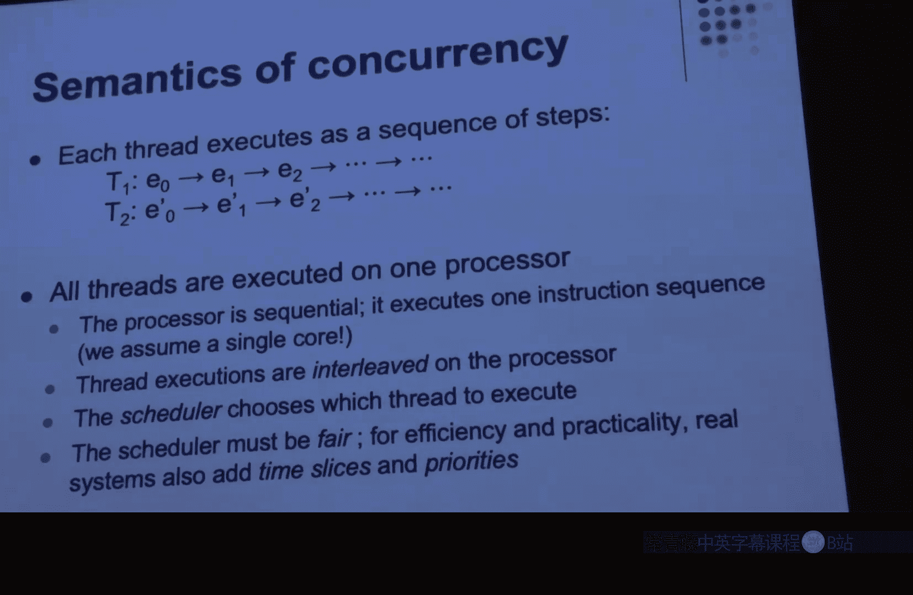

NowIt's doing instruction， sometimes it will do an instruction from T1。

 sometimes it will do an instruction from T2， then it will do again T1， maybe another T1。

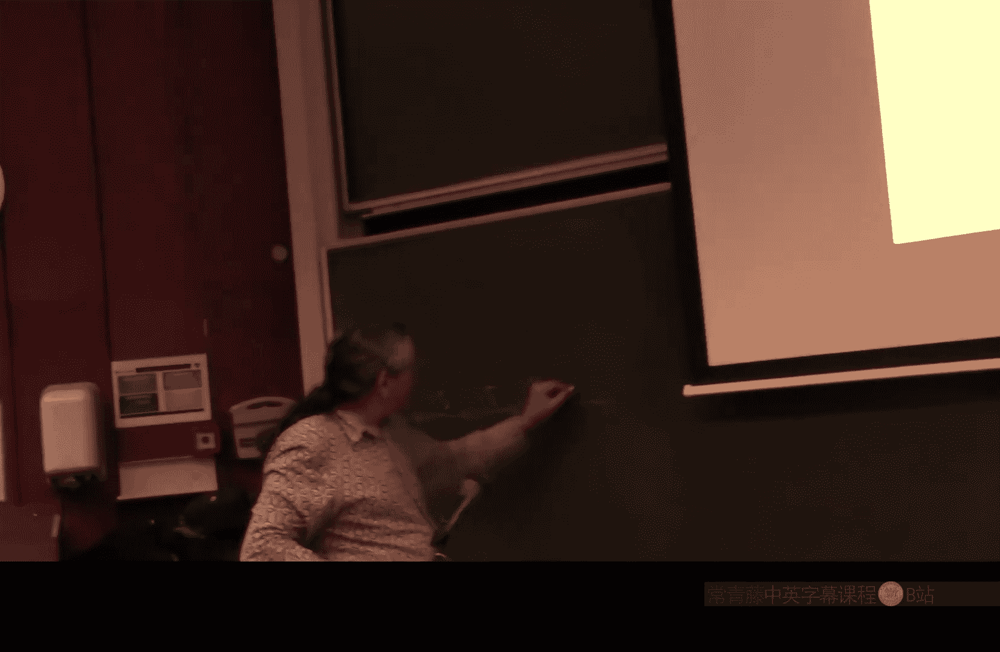

So。So it's interleaving the threads。Okay， these threads are running on the same processor。But still。

 the programmer does not see that。

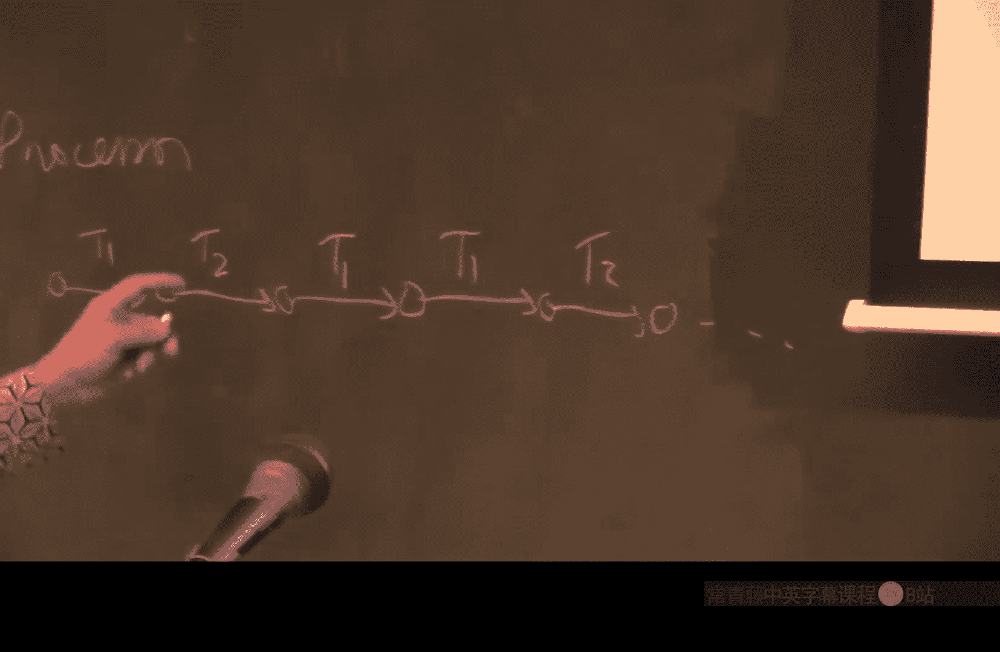

The programmer thinks that the two threads are independent。

That means that you have to do this kind of in the right way。

Just's kind of some techniques you have to。Okay， so there's a part of the system called the Schr。

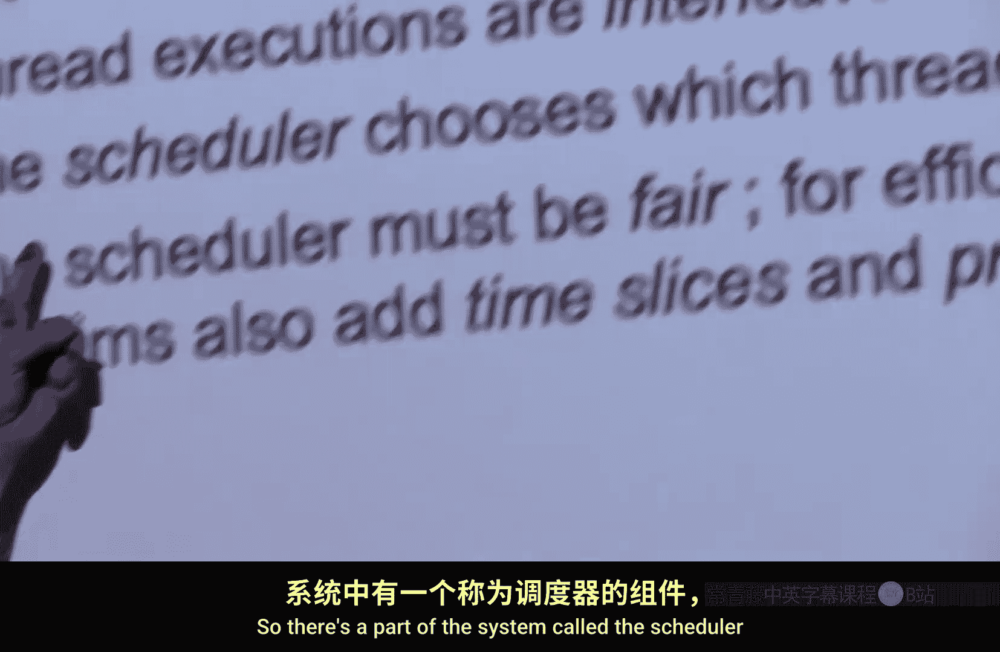

Which。Is deciding at every step， which thread to execute。Okay。

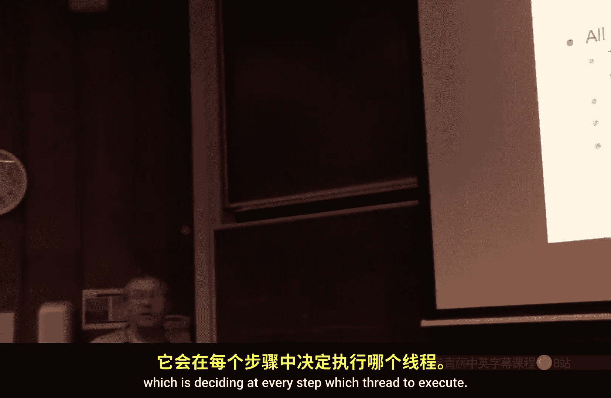

T1， now T2， so the scheduler is very important， okay。

 it has to satisfy certain properties because the threads are independent。

So the first property that the scheduler has to satisfy， it has to be fair fairness。

This is fundamental it means that。Scheduls cannot be。Scheduls。Can呃。Cannot forget the threat， okay？

Every thread has to run。Every thread has to run， so that means the scheduler has to remember to execute all the threads。

That means every thread has to get some percentage of the processor。

So we say the scheduler has to be fair。Okay。That's the main property the schedules。Now， real systems。

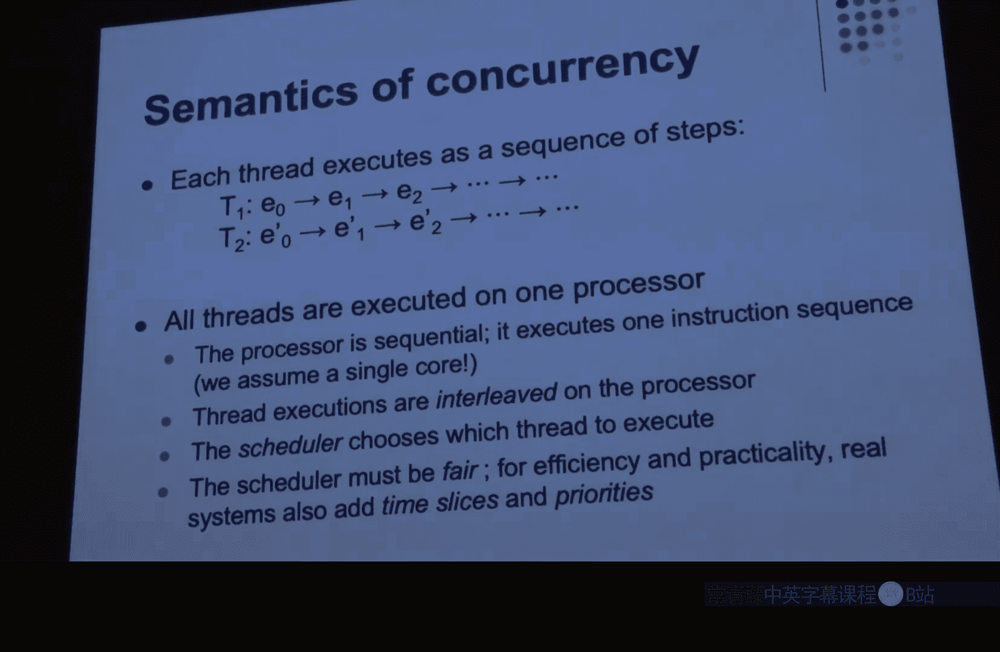

It's not good enough to be fair。Because this is a very fast， this is a very short time。

 maybe this is only 0。3 nanoseconds between two and two。

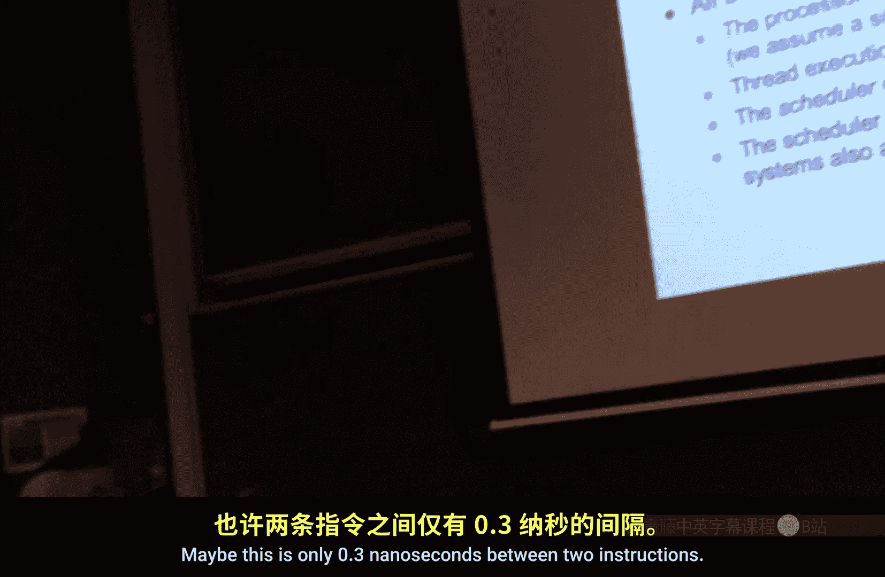

So you can't actually run the scheduler every instruction that would make your system very slow as the scheduler is programmed。

The decides。That means that a real system will use a concept called time slice。

 that means it will say T1 can run for a long time。Like 10 millisecond， which is a long time？

And then you have a hardware interrupt， so you have a hardware clock。

That interrupts that 10 millisecond and it brings the control back to the scheduler。

 and then the scheduler will decide what is the new threat that's executing。Okay。

So what that means is that the scheduler only has to run once every 10 millisecond。

So the overhead for the spular is very small。But it also means that threats。

That are not very fine grains， that means we have really large number of threats。

 really thousands of threads。Sometimes the threat has to wait a long time。Before it can run。

 so that's something you have to be aware of。When you when you。Make concurrent program。

With the standard kind of。Computers。Pent the time slice。

 the second concept is priorities because some threats are more important than others。ok。

Some trends are more important， for example， if a packet comes in from the network。

That packet has to be stored in memory very fast because the network connection is very fast and new packets are coming in all the time。

So when a packet comes in， the system interrupts its execution and it executes another thread。

 and this thread is given a high priority that means it gets a larger percentage of the。The compute。

 okay。And for other reasons you can have low priorities， for example， a system like Oz or Java。

 it does garbage collection， it's automatic memory management。

 but that takes time also it's program that's running。And you don't want to interrupt the system。

 so this kind of an action has a low priority， you will run it when there's nothing else to run。

Then you will do the garbage collection。So the scheduler， it's not just fairness。

 it also adds time slices。Pies。So all of the computer systems will do something like that。

So that's something you have to be aware of。😔，But the scheduler is a powerful entity， okay？

The sr has a lot of power because it decides how your program is running。

And this is how we get into non determinism， okay？So nondeminism。A program is non deterministic。

When it's executing an operation， that it's chosen external outsides。OfThe program。

That means it's not the program that decides。What to execute， somebody else decides。

It's not that application developer。In the concurrent system， it's the scheduler。Who is deciding。

What to write， so that makes the program non deterministic。

That means if you run the same program more than once。You could run different operations。

Different order。Okay。The result might still be the same， though。People sometimes don't understand。

No theism， okay， it does not mean that the result is always。is different。

 maybe the result is the same， but the program is still not toistic because there's somebody choosing new operations。

 okay？So any concurrent program。By definition is not term。If it has at least two threads。

 there only one thread its not， the hassh have at least two。です。Because threats are independent。

Independent means that the programmer does not control how the threads are running between them。

 okay， which one is faster？They're independent， and that means that when you map them onto the processor。

 it cannot be the programmer that doesn' it， otherwise they would not be independent you see their currency is connected to independence。

So the scheduler makes its choice outside of the control of the program。Okay。

See that so non determinism is really an important thing。

 No deterterminism is the thing we have to control in a program。

So it's inherent to any concurrent program。But in fact， it's stronger than that。

Not the real meaning of nondeminism is when your program interacts with the real world。

Let's say I run a program， it does computation by itself， it's reading a file and it writes a file。

 it's a very nice little program。But it's not interacting with the real world。

 it's not interacting with human beings， it's not controlling an automobile or an airplane or anything。

But the real world is a very unpredictable place， okay when I press a key that happens anytime the programmer does not know when I'm pressing that key。

 okay， it can happen at any time when I can press any key。

So an interaction with the real world is very unpredictable， and when I do that interaction。

 a programmer has to execute something。So you see， it's not deterministic。

So the real source of nontuminism is interaction with the real world。

This is something we're looking to see very strong in this course。Okay。

And concurrency is just a consequence， why do you want your program to be concurrent because you want it to interact with the real world and if I make many threads。

 one thread will handle the display or the keyboard and one thread will handle a user and one thread will handle another user。

So usually when you make threads， it's because you're interacting with the real world。Okay。

Inact with the real world， the program must be concurrent。If it's a sequential program。

It's very hard to interact with the real world because it already knows what instructions it's executing。

 what happens when the new instructions， the key is pressed， well the program does nothing。

Maybe it does pull in， maybe it will check eventually to see whether it is a key press。

 so that gives you kind of delay， okay， doesn't work very well。

So to interact with the world program has to be。Okay。

 so we saw some of this last year in the 1104 course。AndBut it was not really fair。呃。

It's kindd of subtle concept。 So in this course， we're going to。Push strongly on this。

We're going to see how far can you avoid nondeminism and how far do you need to accept it。

 this is really the thing that determines how programs run so many。I you say computing programmers。

Of the old style， people who are since 30 years in the industry。This is not so well understood， okay？

This is something that is connected to thelarative programming。

I declare the program is not non determin。So it cannot to direct throughout real the world。Okay。

 but you want to interact with the real world。So how do you manage that。

 how do you interact with the real world and you stay declared？

So that's something we're going to see really in this course。

 and then kind of you will be prepared for the future。With this knowledge。

 you will be really prepared to make large programs that interact with the real world。Okay。

 so we saw an example， let me give a refresher remember on this very simple example we saw that shows exactly。

 it's a typical example， there's other examples， we see that this one is a typical example that shows where nondetism is coming from。

So this is a client server， it's very common， we have many clients， web browsers talking to Amazon。

 for example， it's a very common thing。And。This is a program that is inherently。

And the reason is the specification of it。When a client makes a requests？

The server must respond in a timely fashion， that means not waiting too long。

 that depends only on the network travel time and the computation time of the Earth。

That's very logical if I send a message to Amazon， the message takes time to go there。

And then it does a computation has like database and comes back， so the time should be only that。

It should not depend on， oh， they're clients， okay？So why is so this is。Because of this。

 it's non deterministic。😡，This specification。But it's just that。Forces the program to be known。

So why is that？Well， let's say you have two clients。

Each client is independent because of the specification， it makes a message。

 it doesn't care about the other one。That means a client one sends a message to the server。

When that message arrives， the serverber has to treat it， okay， or when client here send a message。

 the serverber has to treat that message。Okay。That means。

The server has to treat whichever message arrives first。That's a consequence of this specification。

You can't say client one has priority， so I first handle message client one and I will handle message from client two。

 only when client1 says a message doesn't work。Fly 2。

Will have to be handled even if Plan1 does nothing。And of the other set says two。

So what message is going to arrive first at the survey？It'll be either plan one or plan two。

 but we don't know which one it's not determined by the program， it's determined external。

So that point where the swim receives messages。らく。It's a point of nondeterminism。Okay。

So this seems very simple， but it's a massive。It has enormous consequence。

 it means you could not write this program in a declarative way。Because it's fundamentally nonistic。

Okay。But you can write most of it， most of it can be deterministic。

 that the server might be a million lines of code， huge business。

 that can be completely deterministic， these only one point。Which is right there， which is not。

It means that most of the program。It is purely declarative， except for one point where it's not。

This is a very important thing to realize important insight。

 it means that most of your code can be declarative， even if your program interacts。

With the real world， okay？So the point is a non deterministic program is much harder to debug develop than a deterministic program because it's so many possibilities。

It must work correctly for all possible nonnuistic choices。

 usually this huge number of them Ts presses can come with millions of possible time instances。

There are many， many choices and they can happen at any time， how do you test that？

You know how do you test the non deterministic program， it's very hard。

And huge almost all of the headaches that people at Google get is for this， and I know for a fact。

 okay， because I know many people and I know， for example。

 student a former student of mine who's working on a big concurrent program and I read him on Twitter and he said。

 oh， I spent 10 hours trying to find a nondeterminism bug。Because of a simple thing like this。

The guy wasted his whole weekend because of one simple bite， because of non。

So I'm going to try to keep you make it so you don't have so many headaches later on， okay。

 it's very important， almost all the debugging of industry code is this is remove is problems because of nonminism。

This is not so widely he know that， but it's true， I know this because I know a huge number of people industry。

 so I've been doing this for many years， okay， lots of bread here。

and I know what makes these people cry in their sleep， it's not determinism， okay？So what can we do。

 this is what we're going to do in this course。In this course， I want to。

Teach you how to tame nondeminism， okay， see so it's very important and you will 10 years later or 20 years later。

 you will come back and thank me， I hope。that so how to live with nondeminism。This is a main theme。是。

So there's two possibilities。Deterministic data maker program。Functional thelar。

This first solves the problem complete。Okay， because。

Even though the scheduler is doing non domestic choices。

 the results of the program are always the same for deterministic data。

 the paradigm is protecting you， okay？The non determinum is hidden because of the strong properties to functional programming。

 so functional programming is like a warrior。Like Warham or whatever。

 it's a space marine protecting you from non determinant， okay？

Functional programming is protecting you， so that's the preferred way。But you can't always do that。

So you want to do it most of the time， so for nondeative programs。We have to。

Solve the problem so the real solution is the right abstractions and the way to do it is to minimize the nondeminism。

Try to bring in declarative abstractions as much as possible， okay？

So we're going to that's what we're going to see in this program。

 so you've seen this probe this course is kind of like a cru seade a little bit， you see many things。

 but there's this theme of this course， so you get it done。Okay， very good， good。

 so now you know what's going to happen。In the course。So concurrency， declarative， non declarative。

ok。And so today I explained kind of the real fundamental goal。

 so you really know what's going on whenever I teach you something it's， you know the reasoner。

And I refreshed your memory on the previous course today。

 so I hope you get it now what we' saw of that previous course。

 and the next week we will talk about a totally new different paradigm called lazy evaluation。

Very powerful。New declarative paradigm that we have not seen before。

 we did not see it in the previous course。But it's still declarative。It's still functional。

 so it's still a warrior， it's still deterministic， okay， so we're giving you more power。

 we're increasing the power of this narrative。O。Okay， so I think that's good。

So I think I will end there， I think I said what I wanted to say today。

 and so you see now what this course is really about us。And I will try to make slides。

 so this course is a new course last year it was given for the first time。

For some of the lectures I did not have slides， I will try to make slides for all of the lectures this year。

But they may be in the last minute， okay， these slides I will put them on the Mole。

 they're not at the moodle yet when I will put them on the move today。

 so this year you will have more youll have slides so I think that will help。Okay， let me stop there。

 so I'm a little bit in advance， but that's not a problem。So you get it now。

 I hope what it's all about。

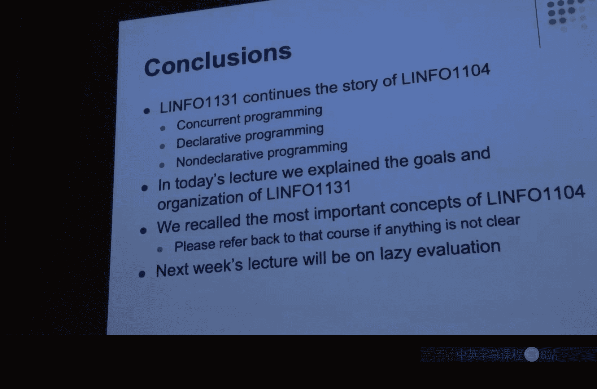

多铁知。