# 鲁汶理工学院【中英⚡高级编程语言概念｜LINFO1131, Advanced programming language concepts】 p30 P30 FO1131 Lecture 2 (2022) -BV1UDffBbEBZ_p30-

Welcome to the course。Today we're going to talk about。Lazy evaluation。

 let me tell you showing you how to。R your programs in a lazy way。Ny， thank to the program。

There's the minimum。To work。不确谢。First， before we start。

A few seconds of respect for the Ukrainians who were fighting for our3。Okay。

Today we're going to talk about lazy evaluation， I'm also going to show you some running code。

 the first of announcement。So last sessions。There are 3D lab sessions。They start next week。

 Monday and Tuesday。

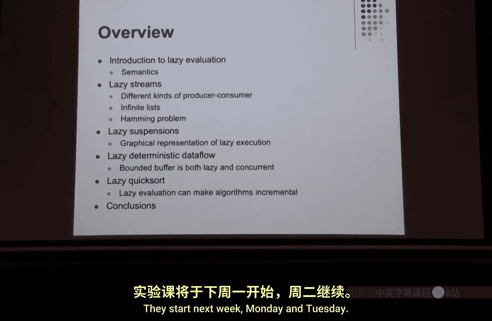

You only have to go to one lab session for a week。

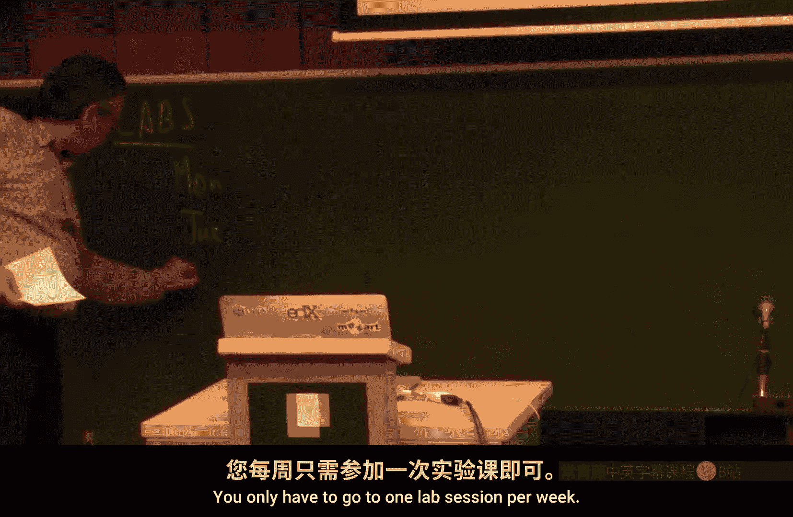

Okay， the monthly La session is。8 30。1030。In auditium Me Ke。14。The Tuesday won this from 14 to 16。

In methods 12。And a second Tuesday one。我是进。接明。It you get to be  zero，4。Okay。

I announced that there will be a bonus point。We will take the present。

 so if you attend one love session per week。For the whole semester。

You will get one extra point on the exam。And if you miss a few， it's not a problem。

 it will be pro repta。So if you。80% you will get 0。8。

This is to encourage you to attend the lab sessions。

 that means it is technically possible to get 21 pointss on this course。

 because that bonus point is an extra。Right。诶。And there have been people whove got more than 20 through work。

 previously， so it is possible。We only have to 1 one out of entries。

It's because we'll be doing the same exercises。Ement acquisition。

So Das Poque is the teaching assistant， you will also send bill explaining this。

So the presence will be taken at the lap sessions for the voters appointed。

And we expect you to try to do exercises if you just go there to look at videos we will ask you to leave。

So you have to do exercises。Okay， so today we're going to talk about a whole loop paradigmine。

A functional programming。Called lazy evaluation， and I'll show you lots of programs。

And it's really a weird and different way of thinking， but it's very powerful。

 and there are languages that are based on this。The most famous language based on lazy evaluation is called tasicle。

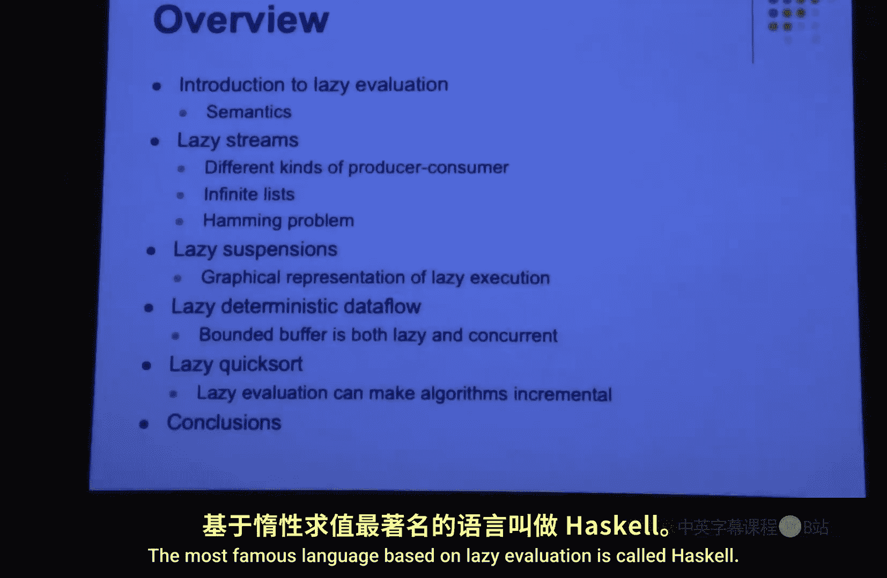

This language has a large community of people programming into。There are even cryptocurrencies。

Built in high school。Does that make a lot of money for now？嗯。So this is actually a very big thing。

And if you learn lazy evaluation， it will help you a lot from high school。

 but also for many kinds of programming。The lazy evaluation is very powerful。

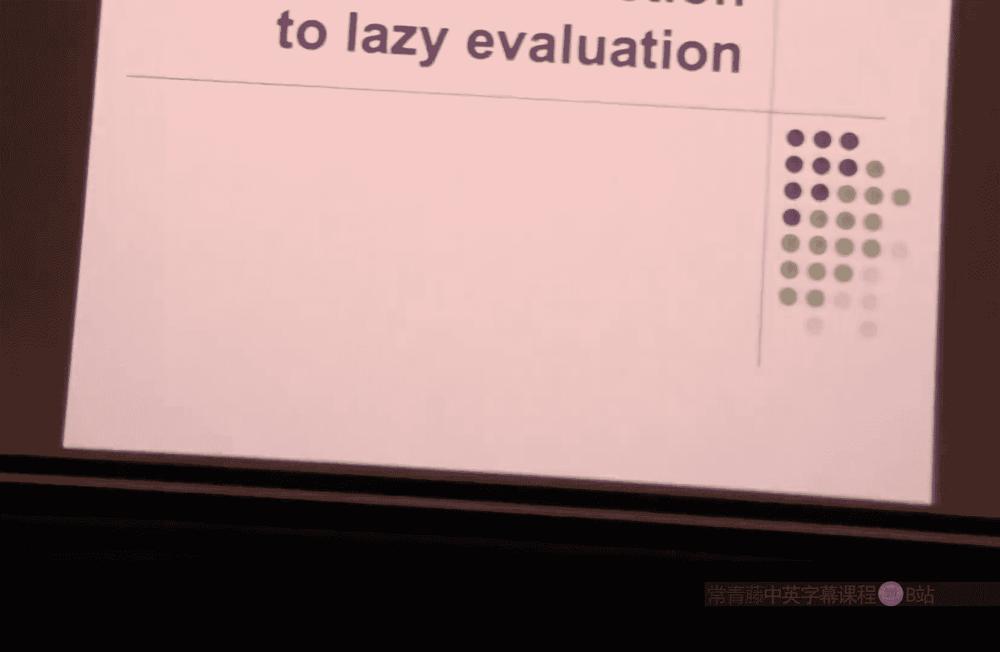

Let me first give you introduction。They not give you the semantics。

 that lazy evaluation is a very natural extension to the deterministic data file， it's very actually。

 very simple extension。😊，One new operation， the ad， and it's very powerful。Okay。

 let me first give a simple introduction。So a lazy program looks just like a functional program functions okay。

 but it executes in a different way， when you call a function， it is not evaluated， not right away。

For example， if I call define the function lazy addd。

 and the way to do it in Oz is to annotate fun by typing lazy after that。By the lazy a of X Y。

 and all it does is x plus y， it's just an addition。If I then do lazy add 1020。

 S equal lazy add 1020， you expect。The result to be 10 plus 20， right？And it is 10 plus 20。

 but not right away。When I call this function， nothing is done。Well， actually something is done。

Internal to the system， it sets up something called a lazy suspension。

 but the computation is not done。

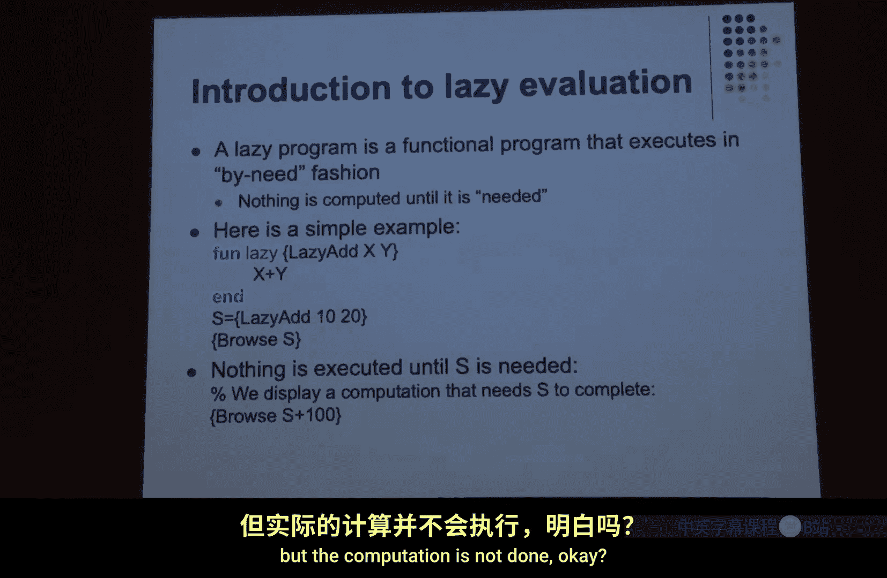

诶。I to show you how this works。区别。三。I'm running Mo are at 1。4。0。

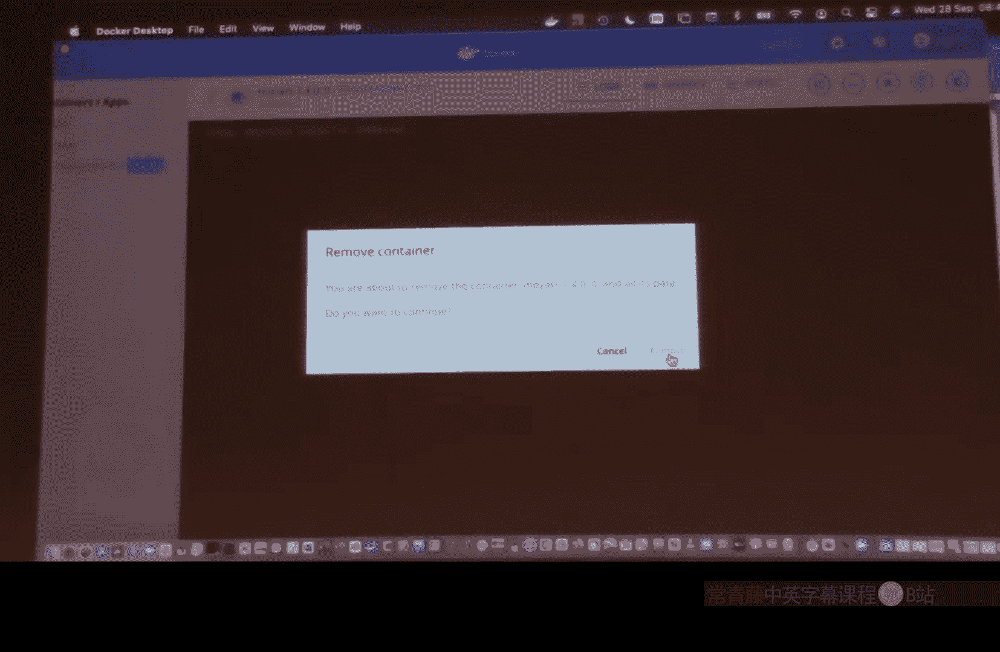

是。う。你时。This is Mozart 140。It works very well here。I have to explain that there are two versions。OfRo。

 there's Mozart2， which is the one that I expect you to write。

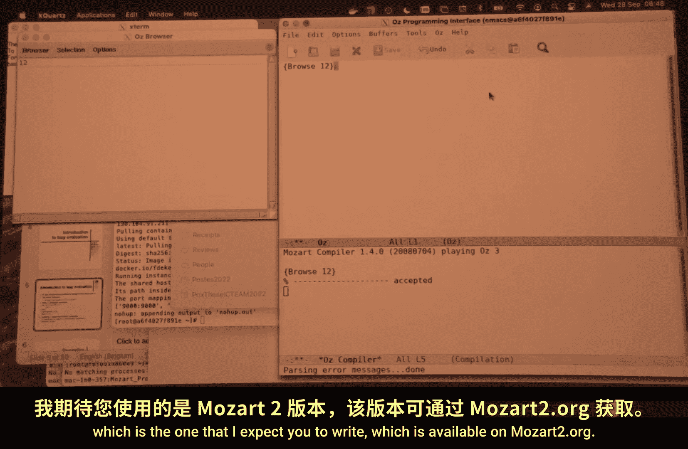

你就是个多把。Those are two are。org。But there was also a Mozart 140。But I'm running into doctor。

And the reason is that Mozar two is 64 bit system。And most our4 zero is an older system its 32 bits。

So it will not run on the 64 bit so run it inside。Virtual image here。But Mozart I。

 this is an old Macs， big sur。

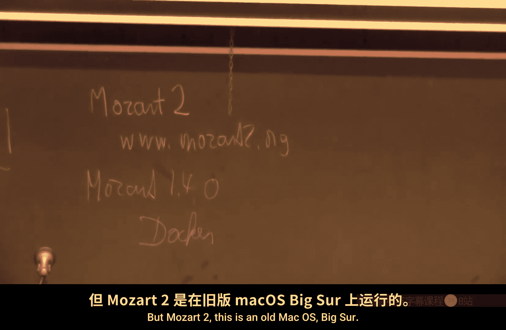

And it has a but and Mozar2 does not run very well on big server， so that's working。Just explain。

But here now I will show you。这样说。I define a basic function。What对。就定系。It plus why。谁。While is。And now。

 I will。Cause this。Okay。Run this。Look what it， it displays S。れです。It displays。

 it doesn't do the addition。So what's going on will actually will do the addition。

But only if we need it。For a computation。The browse is a special operation。

 browse does not need its value to display， okay。But I can do something else。If do grows。S plus 100。

Now I'm doing an addition plus。Plus。Needs its two arguments。😡。

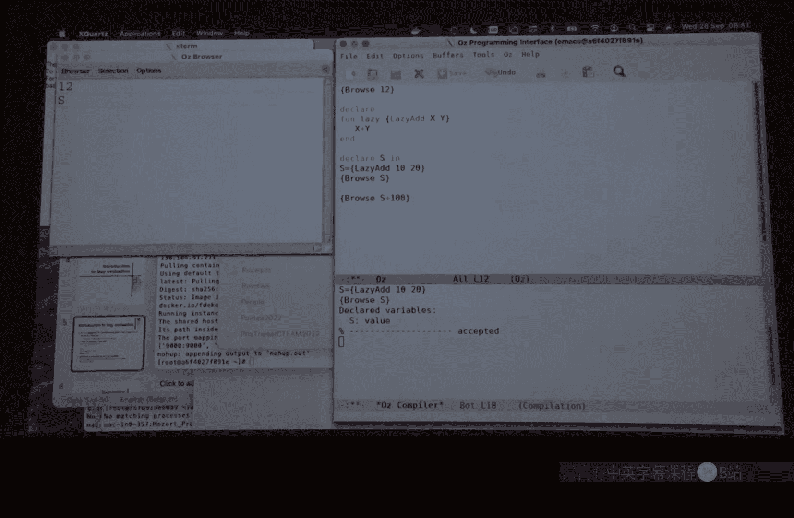

To do the addition and to browse so that the plus needs S and this is what will trigger the computation。

 this is lazy evaluation。So if I execute this browse S plus10s， then the lazy ad will run。ok。

So let me run this。You can see now it displays 130s， but the first S also of course。

 is updated that it's 30。And it's because of the addition。Needing the result。

So this is the idea of lazy computation。We only do the computation if somebody else needs it。

 so when I call a function， it's not executed。Until somebody else。Ne okay。

 so that's the intuition I have to explain exactly what it means。

 what does it mean needing the result and how do we use this for programming？

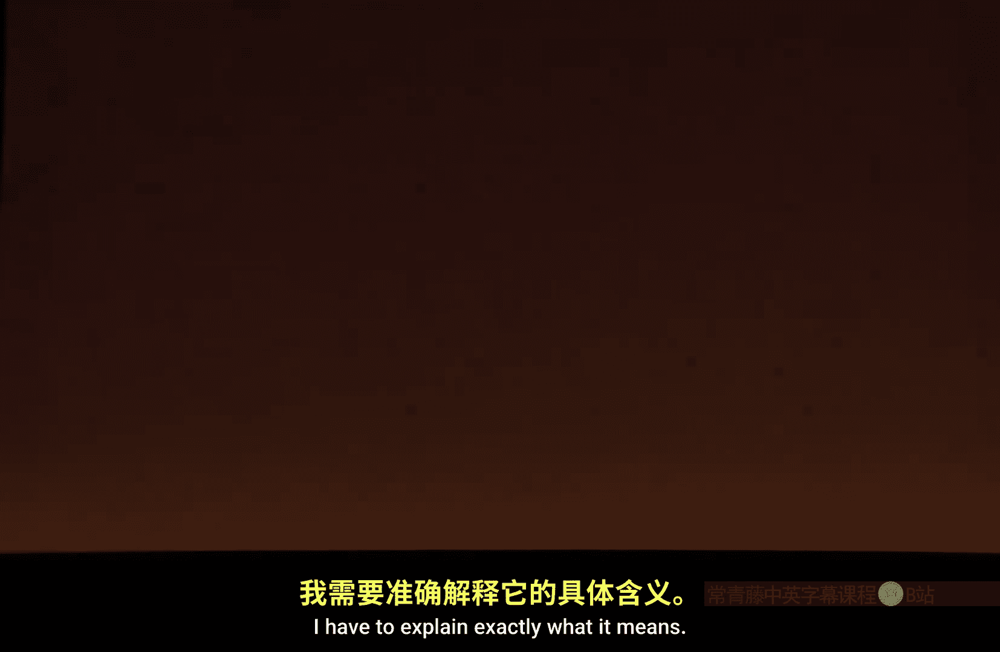

Okay， so that's what I'm going to explain to you today。And to do that。

 I will explain first the setics。So you understand exactly what's going on。

 this is actually very simple。So here's the lazy pad。How does the lazy ad work？

The way always we do this is。We have to look at the basic underlying simple language inside okay。

 this is the kernel language for uss， of course all languages have this。

 even if you don't see it okay， but in os we see this the lazy added function，Turns into a procedure。

 remember that with one extra argument， which is the alpha。Laia X， Y R。And it creates a thread。

And in that thread， it does weight needed on R on result。And then it does the computation。

 R equal x plus y。You see that it creates a thread and inside that thread。

 it does a new operation called waste needed。So what is this weight neededage operation？

This is one new operation we add now， okay， remember how we define programming paradigms。

 you start with a simple language and we add。Concepts， okay？This is what we did in the course before。

And we're going to do that here too。Wight needed is just one simple operation that's added to determinist dictativeism。

 so what is the weight needed do weightight needed is a very interesting operation。

Weight needed R will suspend and it will wait to block the current thread until another thread needs R。

until another thread， for example， has to do R plus 100。And the plus needs its two arguments。

 and that will cause the weight needed to continue。

So the weight needed weights until somebody else needs the resultol。

So that's a very interesting kind of operation。诶。You've never seen this kind of operation。

 you have to。Think those to understand really what's going on， okay？There's to be more precise。

 what is need， I say it waits until somebody needs， what is need？Mean。

 we made a very precise definition of need。A thread needs R if it weights if R has to have a valid。

The R has to be bound to a value， then this is an operation called weight。Wai its will。Will。

W until r has a value。Okay。This is a data flow operation。So if a threat does weight R。

 that means it needs R。OkayAnd that means the weight needed will continue。

 so weight needed waits until some other thread does wait。See how the interesting kind of。

Connection between those two operations。Okay， let me now try to make it more complete。

To really explain how this works。Let's now go back。And look at how the data flow works。

 how the deterministic data of flow works。So let's say I do S equal S plus 100 here。Okay， x plus y。

 so x plus y。So that's a data flow， it waits until x and Y are values and it doest addition。

How does it work， well actually it's in the low level system， it's translated like this。

So S they build exponential to y it waits on x and waits on y。There it does a primitive ad。

 this is the ad of the machine， the ad instruction。And this gives x plus y into V and then it binds。

V S to V。So there's the weight and the bind， so this is the regular data flow。And if somebody else。

Does it weight。Then it will wait until there's a bind。So weight and bond are next。

So if I do S equal x plus y。

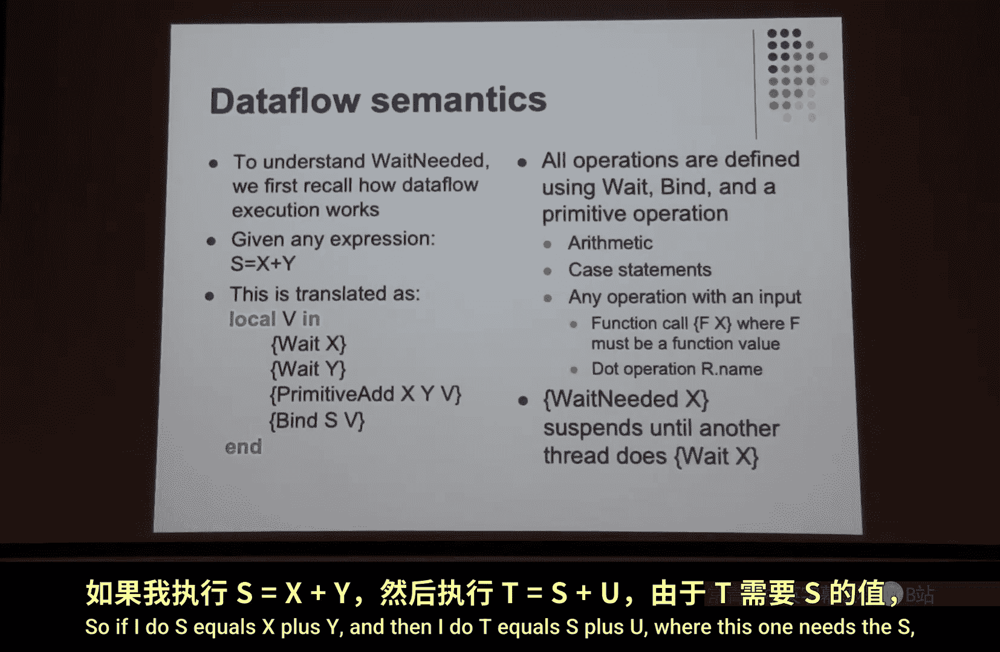

And then I do T equals S plus。

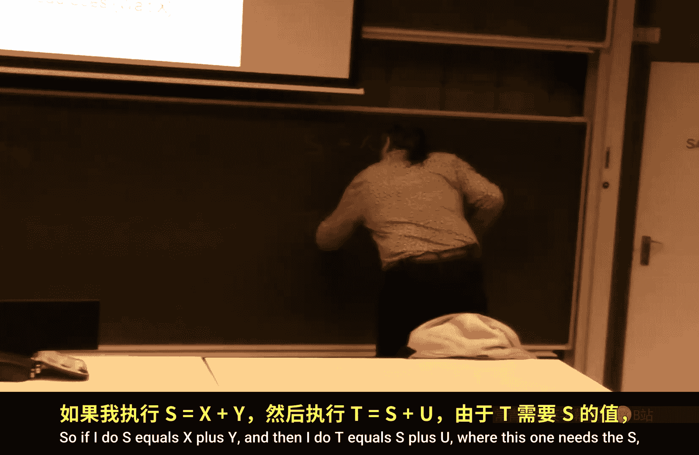

U， where this one needs to S。

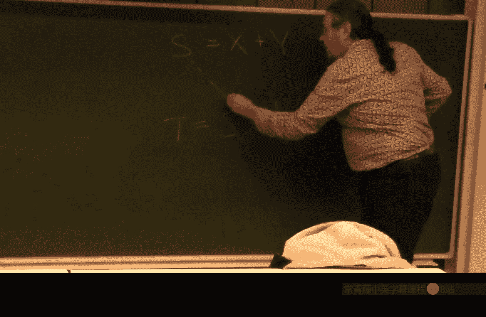

This one will do a bind。Of S。But this one will do a weight， it will wait for S。So wait S。

We'll wait until somebody else， another thread doesn't buy。This is the regular。

Deterministic dataSo this is how it really works。Okay， underneath。

You have these two operations wait and bind。Okay， and wait。

And our weight will wait until S is bound to some kind of value。And many operations have to wait。

Arithmetic， of course， has the weight。Case statements have to wait。If I do case。

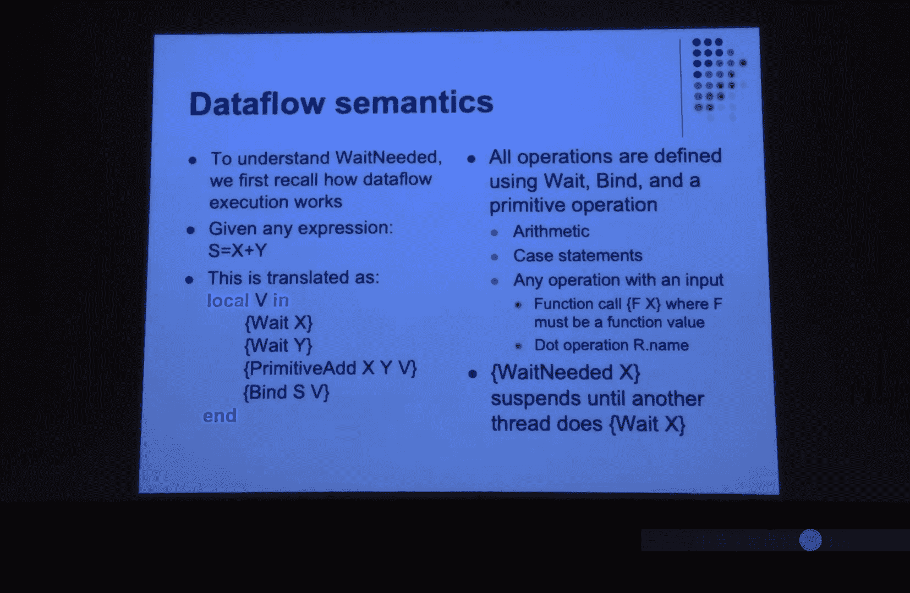

L of H bar T。

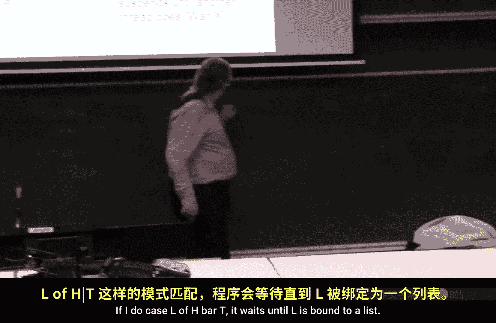

It waits until L is bound to a list， so the case also has to do a weight。Because it needs help。Okay。

And other operations， too。

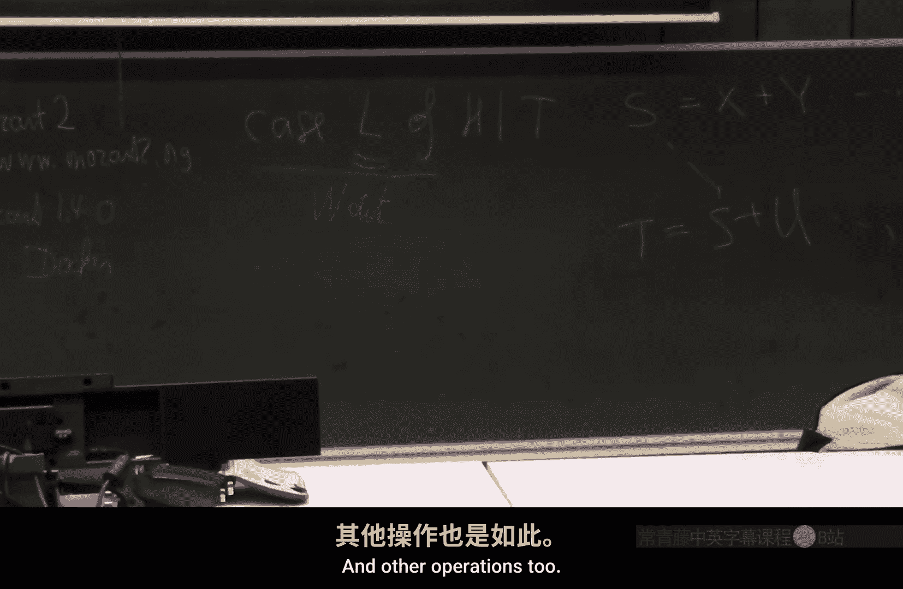

If I do a function call F of x。Remember， functions are values， it has to wait until F。Is bound。

Because the edge is unval variable this you could call。So it waits until F is bound。

Or the dot operation， fars a record。R dot name， it has to wait for R， okay。

 so you see any operation that needs。

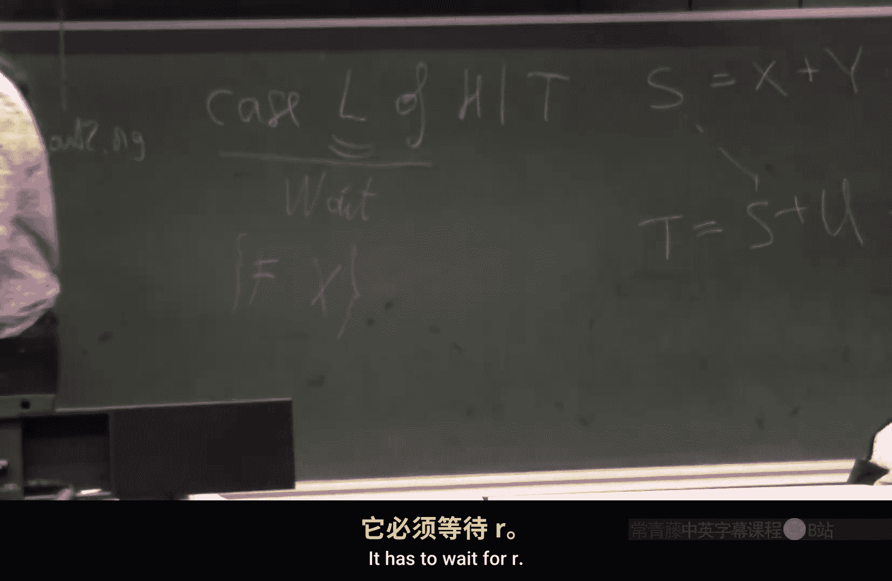

It has an input。Will need在。So the weight needed operation is added to that。It's a third operation。

 you have weight。Find， that's the regular。Data go and to make it lazy。

 we add a third one called weight neededed。And weight needed will suspend the current thread until another thread does weight X。

Okay， see how I needed works， so semanically all the examples we will see today will be explained like this。

 I will show you some really neat code today doing really neat stuff。And it looks like magic。

But all the magic is here。There's no other magic， okay。

 the new spell I'm teaching you is just what he is。

 that's the only new thing we need to do everything I show you today。Okay。

Okay here's a simple example， you can actually use weight needed directly。If I do weight need an x。

 x equals 100。Sure， I can do that as both， that will if I do B X， it displays an variable。

But if I want the x to be bound to 100， I have to need x， so I do x plus zero， okay。

 that will need x。

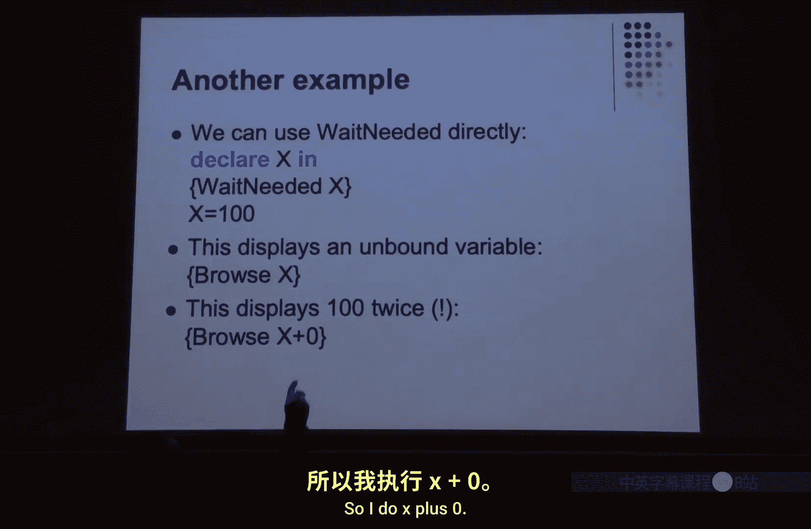

See how interesting it is that？

I'm not sure how this。啊。How do I get to， I have not ever used this in a。

So， the new fact of。

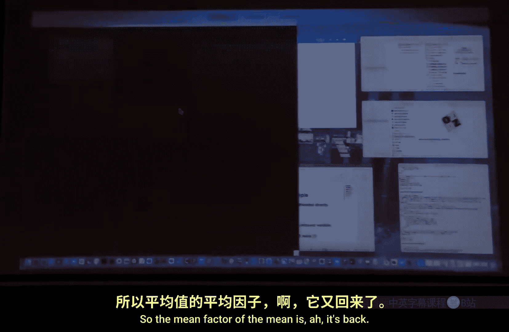

Reading back。Okay， so Docker and X11 is very strange system。So let me do something here， declare。别们。

喂，你你。X， x equal 100。So this will bind x to 100。But not right away。Let do browse that。

They need displays X。Okay。Because the weight needed， nobody needs x。

 so the weight needed will suspend。If I want to force the X to me bound。

 I have to meet that so I can meet x with plus。Zero magic leaf， it works。See how that works？

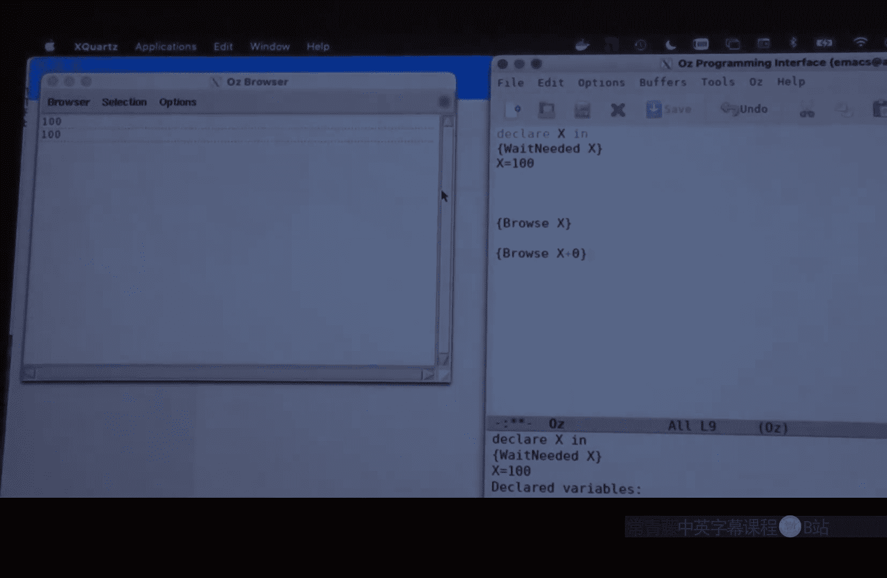

that's the basic idea of what it needed。So， in general。What you do。F lazy。So in Oz。

 you define functions using fun。If you do fun lazy， it will create a lazy。

So it does a different translation， so don't worry I will put these slides on the Mole today。

 so these slides are very new I made them yesterday， okay。So because last year there were no slides。

 this is a new course。So there is a video on YouTube of last year's course。Where I explained this。

 but with no slides。Okay， I just write things on the board， so now I have slides。

 notice that there functions Fx1 to xn。It is defined as a procedure R added extra hydrogen。

 it creates a thread， it does weight in R， and it does R equal the expression。

So every lazy function is defined like that。Okay。That is the general translation scheme。

For any lazy function， just to show you。So when I define lazy functions， I'm just doing this， okay。

 actually。The assistant was doing this。Okay。Okay， so that's all very good。

Now I want to show you some programs。I want to show you some programs to show you what you can do with lazy evaluation。

Because I just show you the principle， but what can you do with this？Let me show you now really to。

The different kinds of things， a simple producer， consumer。Okay。Producer， it produces a stream。

And the consumer will read the street， remember this is what we saw。Already before already， yeah。

 there's nothing new here。Here's a producer。L to H， so it creates a list from L to H。

 but I add delay 1000， so it's creating it slowly so it creates a stream。If you run it in a thread。

 it would be like incrementally。Growing， okay。And the consumer will read that。And it accumulates。

 it would add out the results。And it will create an output stream where it has added all the results that it sees okay？

And I will show you three ways to run this code。As a producer consumer， we run it sequentially。

We'll run it as data flow as what we did before， and we'll run it lazily。

And you'll see how the same program will。Run in three different ways。All three ways are correct。オッケ。

All are declarative， so they all are functional programs。

 they all are technically doing lambmbda calculus underneath， okay。

 they all obey the church rosterer theorem， what this means is that a functional program。

 a lambmbda expression will always give the same result。

 no matter which order the reductions are done。Okay。All reduction orders give the same result。

 this property is sometimes called confluence， this is the main very strong property of functional programming why it's not nondeterministic。

 it's because of this very powerful theorem。All three ways that I'm going to show you now。

We'll give the same result。And in fact， we are just taking advantage of church Ruser。

 the three ways are just executing the reductions in different orders， in fact。

They are doing the same work， but they are doing in different orders。

 but they will give the same result。ok。So let me give you first the three ways。

 but then I will actually execute them to show you how it works。Okay。So the first way。So first。

 let's look here， we have a producer which creates a list from L to H。One， two， three， up to  ten0。

 for example， and a consumer which reads it， and if it there's a mill， it stops。谁？

And gives you the cumulative sums。O。Let's not do sequential execution。Proud 1，10。And consumer。

ItStart with S1， and we browsed both of them。Okay。

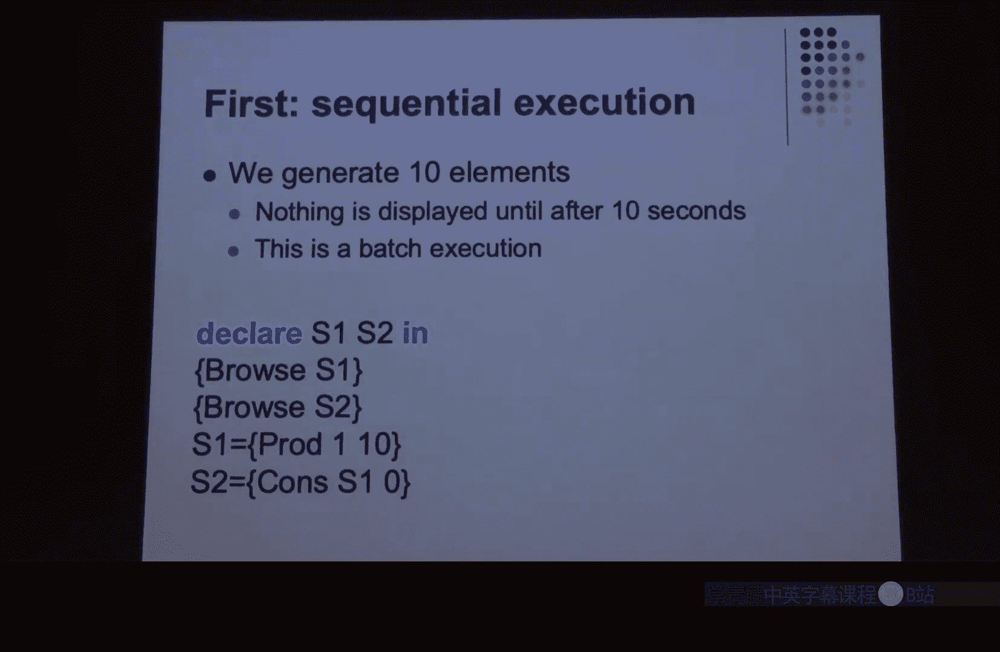

Okay， let me run this。And you see how it grows， It's important really to understand the difference between the three ways。

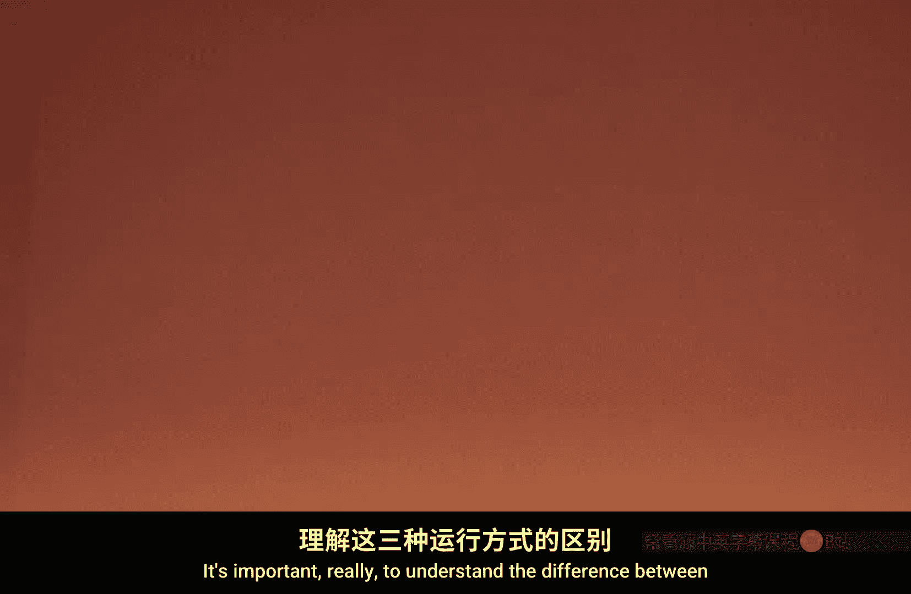

I here。可。It is just a little bit faster， I don' but I don't mention。Yes。嗯。好。やばれちょっと最初。Not3。

Here we have the producer and the consumer。是不是就这一个。诶。Now that be。说你。さ2。1。啲所去。人。通。

It quote the consumer。呃。This one。说第二个。I will run this， notice the producer has a delay of 1。

000 milliseconds。That means when I run this。I will have to wait。Okay， so we should run this。

It's one is two。Okay，S 2 is still nothing。诶。Ping， you seeing the result as two only appears at the end。

 po， the whole thing。So it's actually a sequential execution。

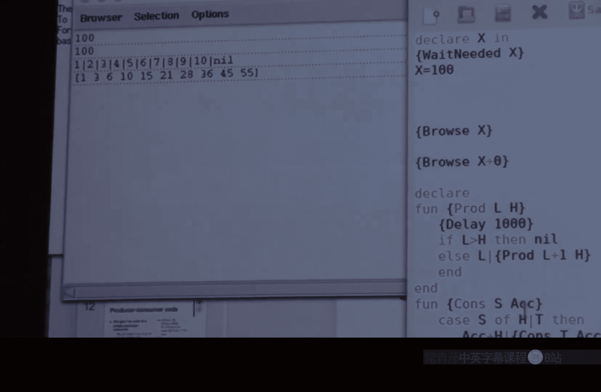

So the result。This is you can also call it batch， so we only see S2 when this whole thing is finished。

And the reason is because it's a sequential efficacy sequential。So that's the sequential。

The second one， that not we execute them in their own threads。This turns them into。Concurrent agents。

Functional agents， now we're running deterministic data flow。诶。

It's not exactly the same as the sequential one， there's a difference。There's the difference。

 So what is the difference？皆さの。The doctor has this bigger MT。O能。

So let me put this now in its own thread。诶。Roose。Notice that both of them now are growing at the same time。

The output S2 is appearing incrementally。She's that up。

And we only have to wait one second to see the first result。Okay， so that's a deterministic game。

It becomes incremental， so what is the difference with sequential version。

 the deterministic data flow version is incremental because these two are agents that are running concurrently。

Whereas in the previous case。They're running sequentially， these two are running。

Now let's run it lazily。And it's even different。Another difference。

But we'll have to slightly redefine the code， we have we turned them into fund lazy。

 but the functions stay exactly the same。It's only that they're annotated laser。Okay。

So what happens now？But nobody needs。So what happens is。啊。The way it works is like this。

Nobody needs a tooth。Because the browse does not need， that means the cons。

 the consumer is not right。So it has a case that means nobody needs S1 either。

 that means S both the producer and the consumer are not running。You see。

 the control goes back from the output to the input since nobody needs S2。Consumer is not run。

 so nobody needs S1 either。So the producer is not th。

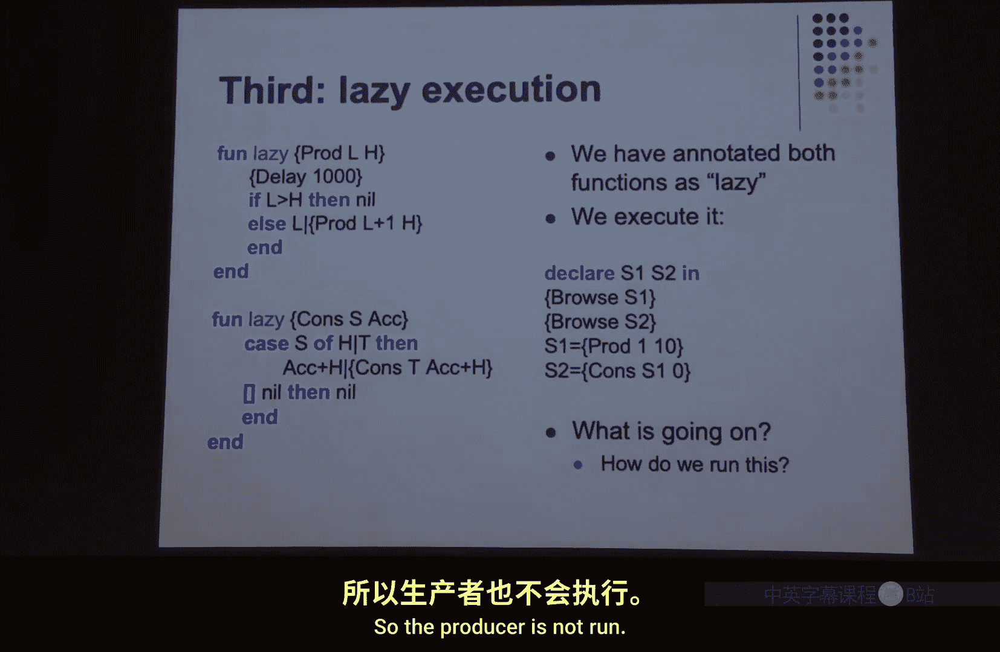

So nothing is run， okay？I have to show you that。

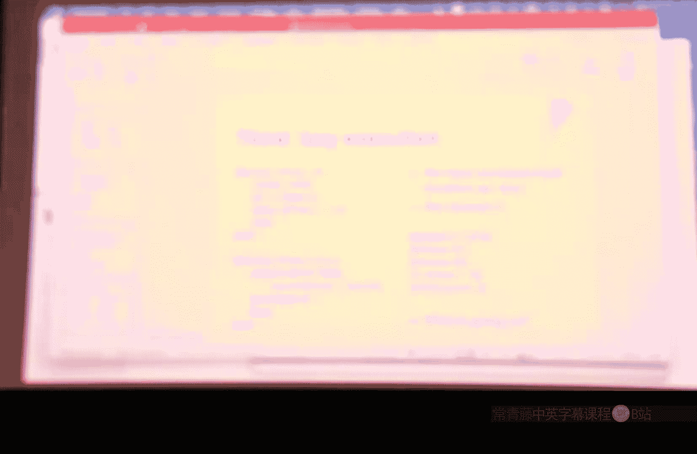

This time， I have to undertake lazy。 I will have to read I as lazy。ね？

They don't have to rise their own threats。Because you could use lazy without concurrency，人没说是嗯。なです。

なぜ？Nothing， it just sits there that's one of his two。I remember the two previous examples。

The result was done， it was working， the first example there was batch。

So we saw nothing until 10 seconds because it's sequential。The second count will only complete。

When the first one finishes， okay， whereas the data flow one， the middle example。

 both of the producer consumer are agents running in their own thread。

 so as the producer is creating the stream， the consumer will be consuming it incrementally。

 they're both running。Concurrently。But the lazy water is even different。

I read this and nothing is done because nobody needs anything。So how do I get this thing to compute？

Well， I have to need the results the only way to force the lazy program is somebody has to need the results。

Okay。So how do I need the result here， Well， for example， I can do browses。S2 dot1。

The dot operation needs its resolve。头企。It needs to know what is the list S2 or at least the first element。

This will display the first element so if I do this。A piece of computation will be done。

See what happens now I did a little bit of computation。Just a little bit。But still。

 it stops after that because these are recursive functions when I do a recursive call here。

Cud and cons are lazy， so the recursive call will again wait until somebody needs， okay。

 so the laziness is for all the elements of the list。So if I want to see the second element。

Two up one， that's the second， then it will be computer。1，2，1，3。

Now we do a little bit more computation。You see， the program is very lazy， okay。

 it will only do what really has to be done no more。Now let me try it go a little bit farther。Thank2。

Here I will ask for some more of us， remember there is still a delay of 1000。

So this will allow some more elements to be computed。Up to number 36， which is。The eighth element。

 so there's seven twos here。And then the duck one that gives me the eighth element。Wch is 36。

But the rest is not done yet。So you see how the lazywood works。

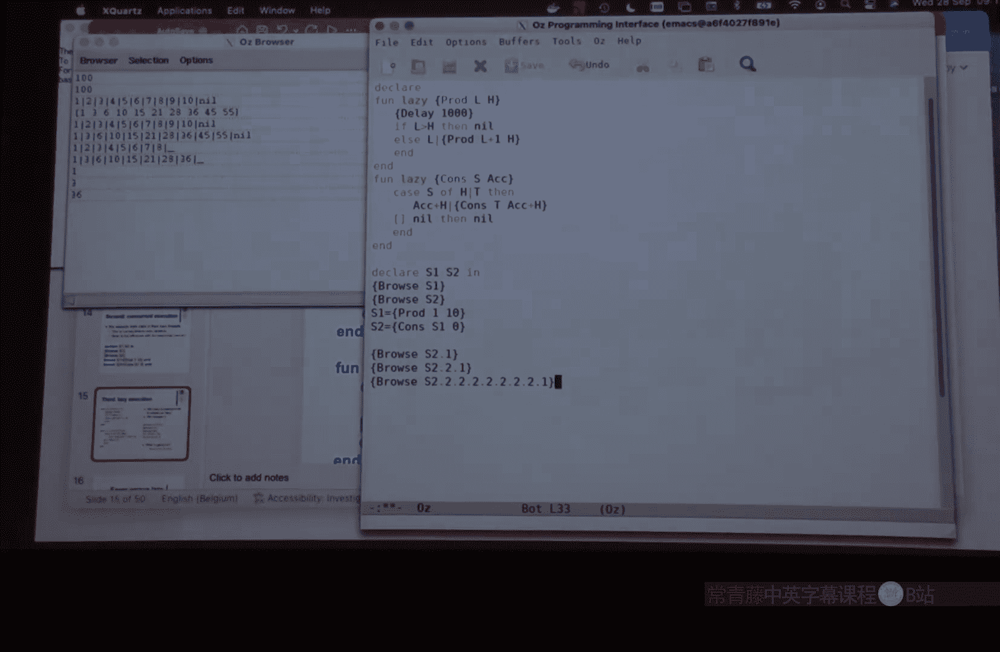

It's we go from batch。To incremental。Too lazy。Three different ways of running the same program。

 see it。

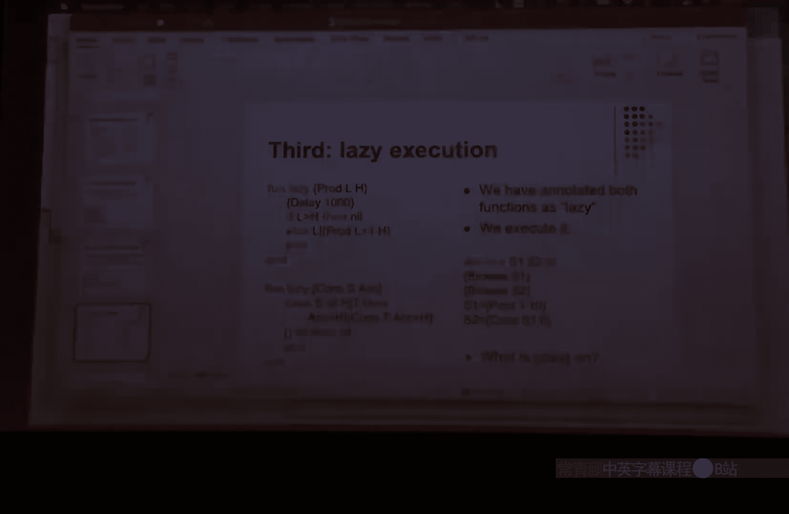

诶。Let me know。So that's one thing I'll show you now the producer consumer's question。

好的诶确时其他诶 c我哋公司就种嘅诶。lazy aulator lazy。他意思的个啊。So the question is the elements of this can also be lazy。

 yes， so this edition here is not lazy。But I can also make it lazy。

 I can replace the plus by a lazy ad。And then I will create the list。

But there's until I really need the element。There will be unbound variables for the elements。そペジの。

If you want to make all the A functional lazy， the band that functional super lazy。

The third first to creative functionality raise fun。I don't offer fair， may I go fair。

 so you can make any operation lazy by putting it in ala， of course。Even addition。

 it's even very simple operation， you can make them lazy。Okay。

 they're too lazy on' a let ground funding。ですよ。そ。少所一。W it the feeling mental op lazy， exactly。

Say acceptable all the program must folks， so the question is to make a lazy function。

 all you have to do is put the lazy annotation， yes。

 so lazy is exactly the same as regular functions program。Regular functions， everything you know。

Still true。It's just that if you add lazy， it will delay the execution until the result is needed。

So all the techniques of functional programming are still true， still valid。So it's just that。

A new thing on top。continue。人家的事。So just here that folks onpis it it。

 the function will not be executed right away。Only when it's needed。

 that's the difference when it's executed。The more who will exate the essential species。诶。

And the result is the same。Because of。属于。ko so I still have not really shown you very powerful things。

 this is already simple things， but I will show you more powerful techniques。So lazy。

 it's interesting， it's like higher order， it's a simple idea， but it has very powerful。テニックす。Okay。

So you can have eager and lazy strings。ok。So I showed it to you。

The first example was an eager stream， the deterministic data flow。

So the producer is creating elements but in the lazy stream。It's not like that。It's the consumer。

That asks for elements。So sometimes people call it push and pull。

 so this is also a programming technique you can use you can do push where you give values。Regular。

Deterministic data flow， which is eager。 So all what we saw before。I will call it eager。

Of for example dear， tooth small we is so they can have done active。When you rep the producer。

 it runs。系。But lazy is not like that。When you run the producer， it does nothing。

It's the consumer who is the boss。Okay， so one way to see this。So here's a simple。

 I can make a simple di， I have a producer could。

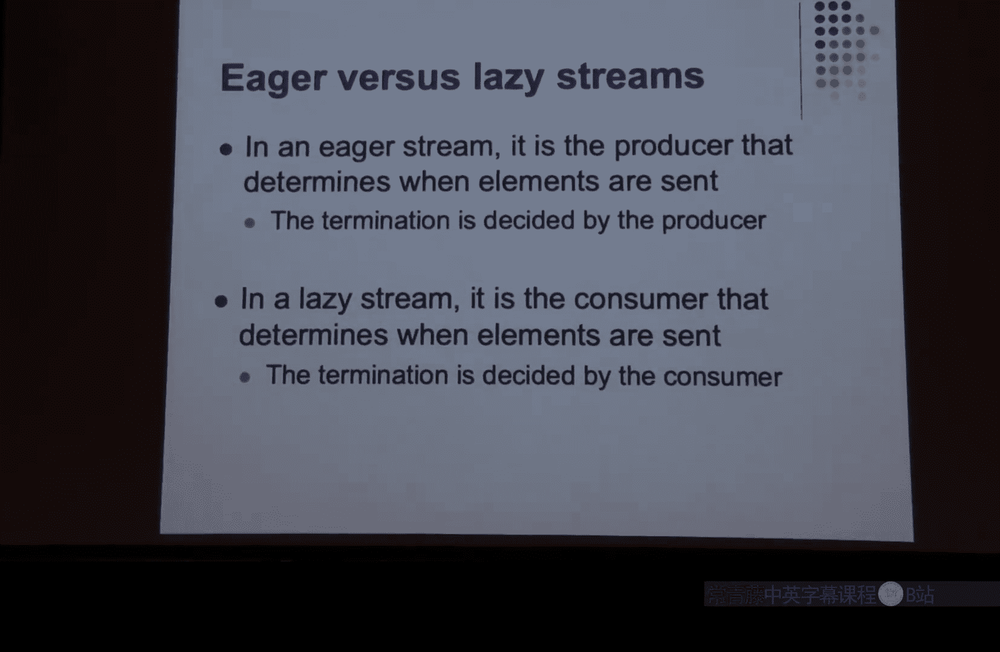

诶 maybe位啲。

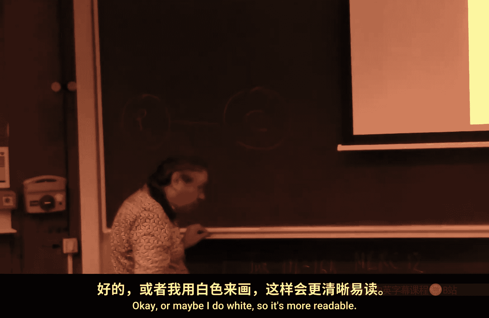

More readable。Produucecer a consumer， and there's a trade here。It's an easier computation。

The producer is the boss， the producer decides how many yellows。But in the lazy computation。

The consumer is the boss， the consumer decides how many does。If the consumer wants an element。

 he asks for it。If he wants nothing， nothing is done。And if you want to terminate the computation。

 this guy decides when to stop。But in the eager it's the producer of the south， you see it's very。

Cmetry。

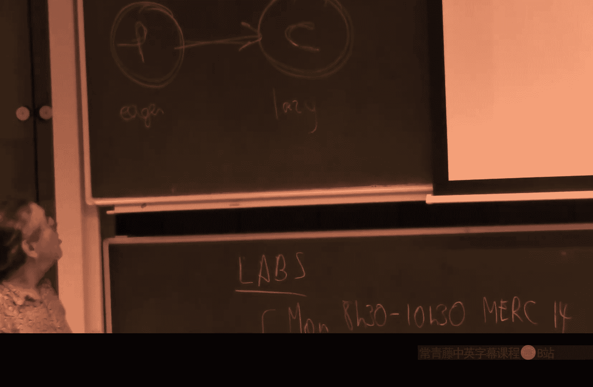

Everything you saw before， it's the producer deciding， it seems very normal， right。

 producer deciding。All the programs you write before in Java everything， it's all like this question。

嗯。おみをすべてスと。我讲啊好四手我都出噶。CF browses asN to the Fox campaign community among asN。

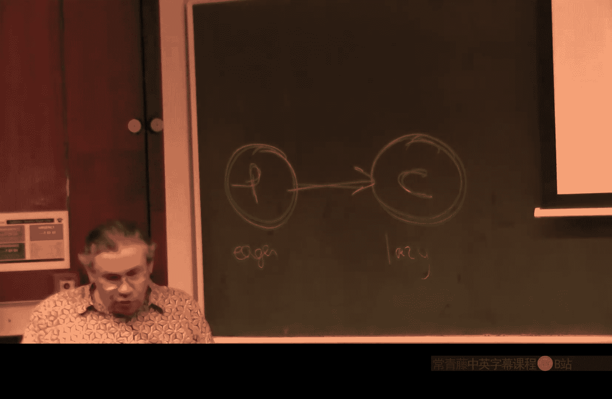

他的意思是过。정시ろ 주パルで에서 왜ラで。

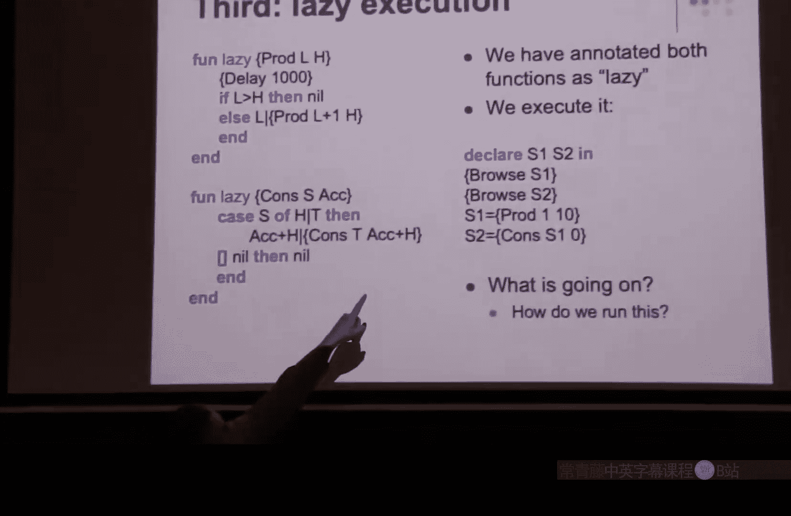

C to tattoo as。Do know cap do。个辩的。On啲飞。It I just appreciate S on， so if you do browser S1。1。

 that will force the computation of the first element of S1， but not S2。Nothing will be done for S2。

Because nobody needs a student。特そな不 that has。Okay so you should try it。

 so I recommend you try experiment with this if you don't understand， try it out， it's very easy。

 I will't put all the code stuff。On the Google， It's not very active。So you can copy paste。

 but you could write and try this， so if you force the computation of S1， it will not force S2。

Because nobody needs this to。But if you do s1。1， you need the first element of S1。

But only the first element see if the Sn earth to not the print it boom the Sn。

 but it does seem at more。C2 go to do minimum equal equal as n。 D。0。C to bus up toの。

So if you want something， you have to really say， I want this， otherwise it will not computers。

It's interesting， the lazy， it's a really different way of computing。

 and this is something you have not seen before normally。

 unless you run in high school or something all regular programming language that you use normally will be doing this way eager。

If you call a function in Java， it will run that function。Seems very normal。

But lazy is just the opposite。Okay， and it's just as interesting and it's just as important as eager。

It's just that you don't have aja， why not？The Java designers are lazy， I don't know。

Because this is a very powerful technique。So lazy is just as interesting as eager。

 it's like a symmetric version。Right。Okay， let me show you more examples this now。

Let me show you how to compute with infiniteitists。No termination。So laziness。

 because you only compute what you need， it means I can compute a list with no termination of an infinite loop。

In lazy programs， you can use infinite loops， no problem。You can compute with infinite loops。

You can build infinite lists。This works fine。There is no infinite loop in the execution。

Because you only generate what you need， okay， so here's a simple function。

 fun lazy ins n n bar ins n plus1， so this generates an infinite list of integers。Starting with N。

So ins one will cause it to generate one， two， three， forever。

But that's not a problem in a lazy program， it's not an error。

 it's a perfectly good way of programming。Okay。Columin inks one。

We'll just display it unbound variable。Okay。

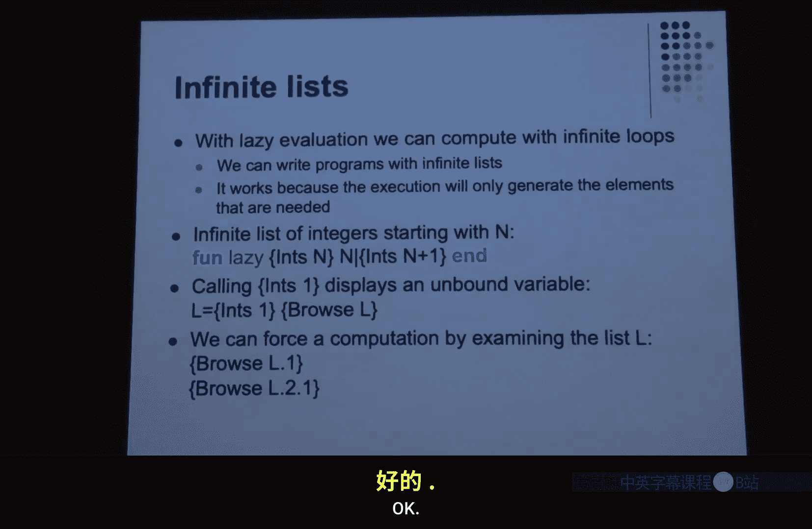

do it， I have to show you that。The nice thing about。Where is the。G have to start to Dr。

So I guess the doctor is not as great as people say it is。Okay， I'll have to start at end。

Here it is again。Okay， so I will do。So I'm lazy。人呢。And follow the eat。And close what。s this。

You don't want to write this normally if you write a program like this without lazy。

 it's going to blow up the system， okay， you will the process will just blow up and eventually crack。

When a lazy， it's perfectly normal。I is equal to is。我。よ。Here it is， no problem， help。

So nothing happened。If I want to see elements， I have to need them。

 so let's say I want to see the third element that's L。2。2。1。The third element is three。

 and now it computes one through three。And then it stops again。

It only computes exactly what you need and nothing more。诶。Okay。

 I have to explain to you exactly how it works。So normally we already understand this because it's just using the way needed。

 but let me explain explicitly how this works to help you understand。

Let's translate it into kernel language。So int and becomes ins and R。

Red end weighted in R R equals n bar its m plus1。Okay， that's how it's changing。That's it。

But it's a recursive call here， notice this is recursive。

 that means this recursive events is also lazyhu。So if you do browse of R do1。

The do operation needs R。The weight needed will terminate， will continue。And are we be bound to？

And one bar， its of two。对。And what happens is。One element so one element is computed。

 but there's a recursive code here。But this recursive call is also bing。

 so it will immediately suspend again on another way these。

So you see when you have a recursive function， you actually have a whole series of lazy。

Lazy function calls。So if you do browse of Rt1， you will only get one element。

And the recursive call was suspend again。Okay。So recursive functions。

 it works very well with laziness。Okay。Okay， let me show you one other thing before the break。Okay。

 let's say I won。And elements and I want 10 elements。

We can define a function that will force you to get Nls。This function in the eager。In eager。

 this function is meaningless， okay， it doesn't have any use， but in a lazy program。

 this is a function that would force the evaluation of n elements of a list。And how does it work。

 it's very easy， so this is a function touch。Touch， so the idea is that you're touching the elements。

 okay，都翻咁啊。We touched them。If n equals zero， then skin， you don't want to。

Otherwise you do touch of El dot2。So you do recursive call， but because you do L dot2。You need help。

Eda2 needs at least one。it needs one vertical one。So you will force the creation of one element。

And then you do recurive co and minus one。Okay。To do n minus one more of it。

So all it does is traverse the list。It doesn't do anything， just goes down the list。

 but this forces the evaluation， see how lazy is fun yeah。It's a funny way， so if I want 10 elements。

 I have to do touch L 10 if I need 10 elements。Okay， we'll touch L20， okay？谁？very good。

 so here now I still have this inch let me define。Okay。Touch the end。If n is equal to zero。でですけ。

Those。Touch Elda 2 and minus1。It's a very simple thing。But it forces evaluations of NL， okay。

 let's see how it works。Okay， let's do touch。No，10。So L is what I displayed here。

 I want to try the elements。だってね。There you go， I have 10 elements。OkayAnd they're there， here。

 or maybe I want more elements。这区的。出。Now I get。20 elements。Okay。So with touch。

You can if I need a piece of the result， I can always use touch to get what I want otherwise I get nothing up。

So touch tells me I need something。

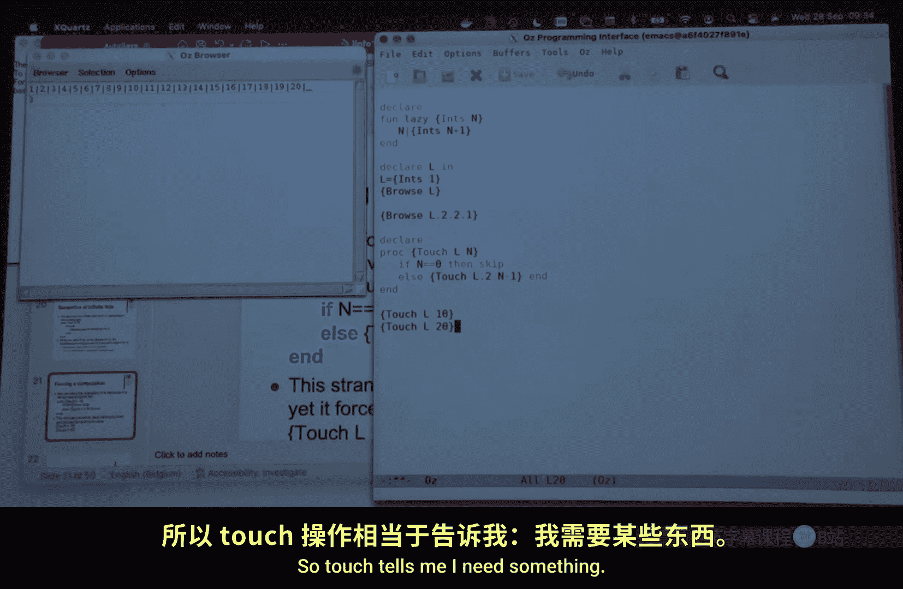

对啊。So that's。Useful functions， a useful procedure when you are working with lazy lists。Okay。Okay。

 let me make a break now， but after the break I will show you more powerful。

 I will show you some really interesting lazy programs， the first one we'll be having。

 but let me first do a break of a post。

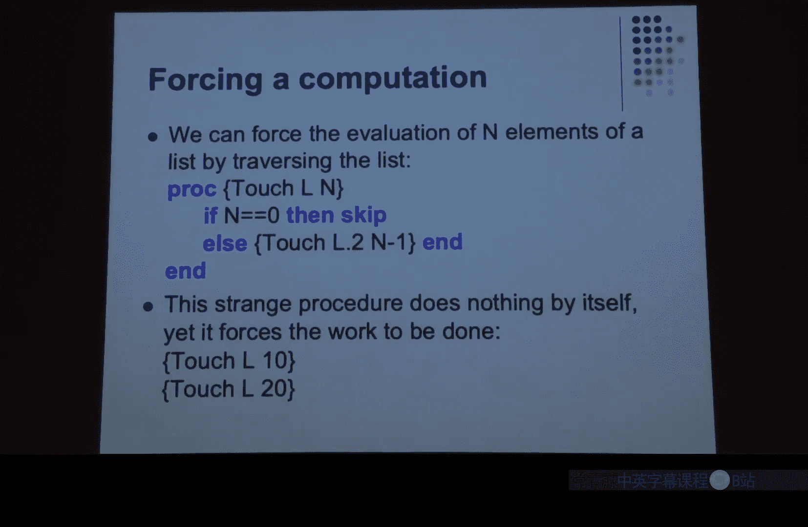

Now after the break， I want to show you some。Interesting lazy programs to show you the power。

W of lazy evaluation and really why it's a real interesting way to do things。

And the first example I want to show you is something called the having problem。

 so this is a famous little problem。In programming incremental things。But first。

 let me talk to you about the guy who gave his name to it， Richard Hamming。

 so this guy was an engineer who worked and a mathematician who worked at Bell Labs。

 so this was a famous place where they invented many things。

I think they even invented the transistor there。And having invented many things。

 and if you take courses， engineering courses， you will probably see his name appear。

He invented something called Heaven Cos。With coding。

 he inventeded something called the hemming window for the signal processing。

 also the hangingm distance and many other interesting things， those are just a few of them。

He wrote a really interesting book。Which is called the art of Doing Science and Engineing。

 Learning to Learn。And in that book， he kind of puts all his ideas from his own lighting and it's really。

 really interesting so if you really want to understand。

How somebody like him and how he thinks and really how you can be creative and do neat things and learn many things。

 this is a really good thing， so I recommend this book actually。But all that is just introduction。

Today I'm going to talk about something called the having problems。

 called the heaven problem because having presented it any presented solution。

And this was a long time ago， this was like in the 1950s， and in the 50s。

 this was considered a very hard problem， okay？It's in number sequences。It's a dynamic problem。

And the thing is， you don't know in advance。How much you need？

So you're computing something and it's incremental and you keep going。

 but you don't know how much you need in advance， you have to keep going until somewhere， okay。

But you don't know how much， so you cannot allocate a static array， for example， for this。

 because maybe you overflow the array and it's wasted， okay？

So this kind of problem where it's incremental and you do not know in advance how much you need to do。

Typical lazy problem where you could use lazy evaluation。

 this is really a perfect product for lazy evaluation。

I will show you a really simple solution for this problem， which is very efficient。

And uses lazy evaluation。So let's explain the problem。

So you have numbers of the form2 to the A times3 to the B times 5 to the C， so A， B。

 and C are integers that are at least zero okay？And actually the general problem is where you have any number of primes。

 okay， but we'll do with three of them， you to generalize it if you want。

 because I want to show you the full color。The problem is I want to compute the sequence of these numbers in increasing order。

Without any missing any， so it starts one， two， three， and then four。And then five。And then six。

Seven is not in there， no seven， eight。来。10 is in there， three times five， 11， no， no 11。

12 is in there， 13 is not， you see so you have to keep generating the numbers。

All of the numbers like that， but the problem is when you know A， B， and C。

 you don't really know how big the numbers are， so you have this bunch of numbers but you want to present them in increasing order。

Up to a certain point。But you do not know in advance。How many numbers must be computed？

You have to keep going for a while， you don't know how far， so your program has to work。

For any number of。Sequence and you just have to keep going and then you stop somewhere。

The program should let us compute those numbers incrementally until we're happy， October satisfied。

 until 1。And it should be efficient。So for example， allocating an array。A fixed size。

It's not going to work， okay， because if you need less。

 it's waste and if you need more then the array is not big enough。

 so that's a very bad way of doing it。It's completely dynamic。

This is a typical problem where lazy evaluation is the perfect way of writing this kind of program。

Okay， so here's the idea， first we need to make kind of an idea， how do you generate it？等能。And six。

So here's an idea。So let's say I have my sequence， which is H， which is like a streamer， one， two。

 three， and then x is the next element， but I don't know it。So how do we figure out the next element？

Well， it must be。Either two times a previous element or three times a previous element or five times some previous element。

 not because we're incrementing the A， B and C here。If you remove one。

 if you do a minus1 or B minus1 or c minus1， you have a previous number which is smaller。

 so the next number x well it has to be either twice the element of times the previous number or three times the previous number or five times the previous number。

So it's one of those three cases。So in order to determine x， we can look at those three cases。

And so once we do， we derive three sequences。2 H，3 H and 5 H，2H is twice the elements， two，4，6。

Three is where we multip them by three and five by five。

So we have these three sequences and we look at them， notice two and three are already taken。

So the first numbers that are not used。Are the ones in red， four is not used， six is not used。

 and five is not used。That means x， it has to be either four， six or five。See that。

 it's the first one that would be a multiple of two， three， or five of a previous element。

So because it's the first one， it has to be the minimum， right？So x is the minimum oops。Of4，6 five。

 so it's four。And then after that you keep going， so the floor is used up， then you have six。

 six and five， so the next number is five okay。Then you have six， six， and 10， so the next number is。

Six and so on， and then and each time you use a number， you go one farther。In the sequences。

And so you can keep going with X， so once you determine x， you can determine the one just after x？

Or maybe I can show it。Here to show you more precisely how it works。

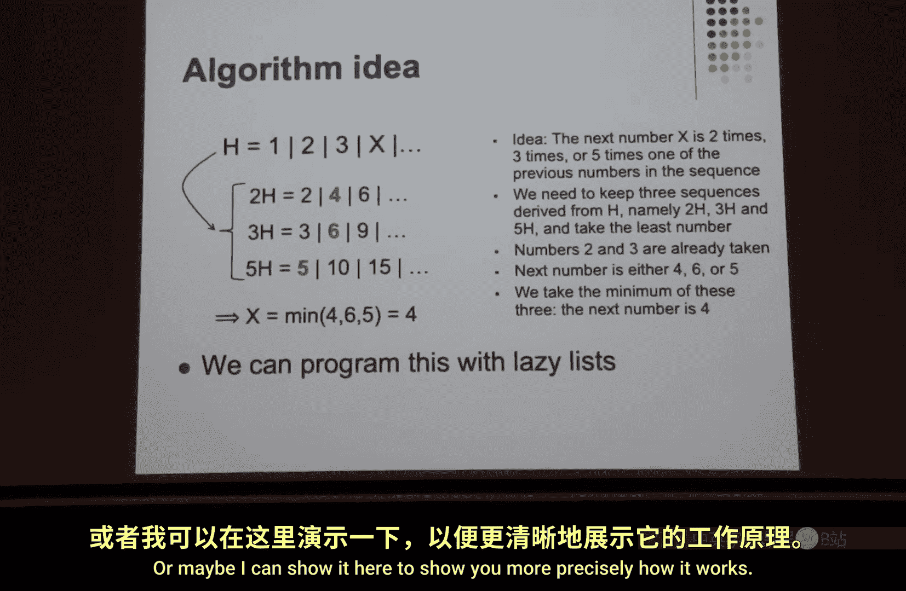

So， H is one。We know it has to start with one， Okay， so we have2 H，3， H。5 page。So。Two h is2。

3 h is3 and five h is5。The smallest of these is two， so the next one has to be two。Now we have。

Remove the two， but now we have one， two， so this one turns into two， four， this is three，6。

And this is 5，10。Now we have four， three， five are the smallest。So the next one has to be three。

So we remove the three here， and now we have two， four， six。369 and 5。15。Okay。

So the next one after that is the smallest 465， so it has to be four， okay。

And then so we get rid of the four， so let me continue a little bit so this will then count eight。

12 and 20。So the next one after this would be the most of sit5， six， six， so it has to be five。

Then we have 6，6，10， so it has to be six。And the two sixes go away， then we have eight， nine， 10。

 so it has to be eight。And so on， let me see how it worksh， so the three。

 you're going farther down and each time you take the smallest one。So this is niceSA。

Now we can program this with lazy lists， it's very easy to program this。With laser vests， okay。

 so let me show you how it's done。We need two operations。We need to multiply the list by some。

H goes to2H， we also need to merge order list。So emerging two order lists is you take the smallest element。

 and that's the new one and you keep going， okay？So the result is also an order in list。😔。

We need then two operations。L2 is times L1 n each element of L2 is n times element of L1。

We also need merch L102， so we assume L1 and L2 are in increasing order like here。

And then we merged them。I'm assuming now merge of two we could write a merge of three， of course，h。

But we can zoo merge of two and then merge another merge， that's a little easier， merge of three。

 the code is a little bit more complicated。But if you want。

 you could write a merge with three arguments。But since I want a simple merge。

 I've just used merge two。So the result here contains the elements of L1N to a increasing order。

 so this immediately gives us a program。And times and me will be lazy function。Okay。This is it。

 this is the whole program now， the most complicated is the merger， so here for example， times。

S of H bar T， n times H and times of Tn。So it just multiplied my and notices there's no no， okay，h。

 goes on forever。You don't care， it's lazy。N how look here how mech works now， S1 is2。

 so S1 bar is 2， so we have I put a bar because I need to take elements from both。

 so we have H1 bar T1 and H2 bar T2， if H1 is less than H2， then the output has to be H1。

And we merged with。T1 an Institute， okay， since we advance in。S1， but not a message。

And if H1 is bigger than H2， then the smallest is H2。

And we merge we in advance with H2 but not with S1， and in the other case， they're equal。

And there we have to advance in both because we don't want any duplicates if we have two times the same number。

 we have to skip both of them， of course。So this is the merge， a little bit more complicated。

The actual main program is this， how simple it is， H is equal to one， followed by。

 basically we have to merge the three。You just have to merge these two。😔，So we have merge of。

Times H2 and the second argument is emerge at times H3。Time age five， that's it。

Let would make it a little bit simpler if you had three arguments merged。

 of course but then this one would be more complicated enough。

 so there's no reason to do the three arguments， but you can do it。And then you browse A。Now。

 when you run this， of course。Nothing will be displayed。So let me show how this runs。诶。律是责任。

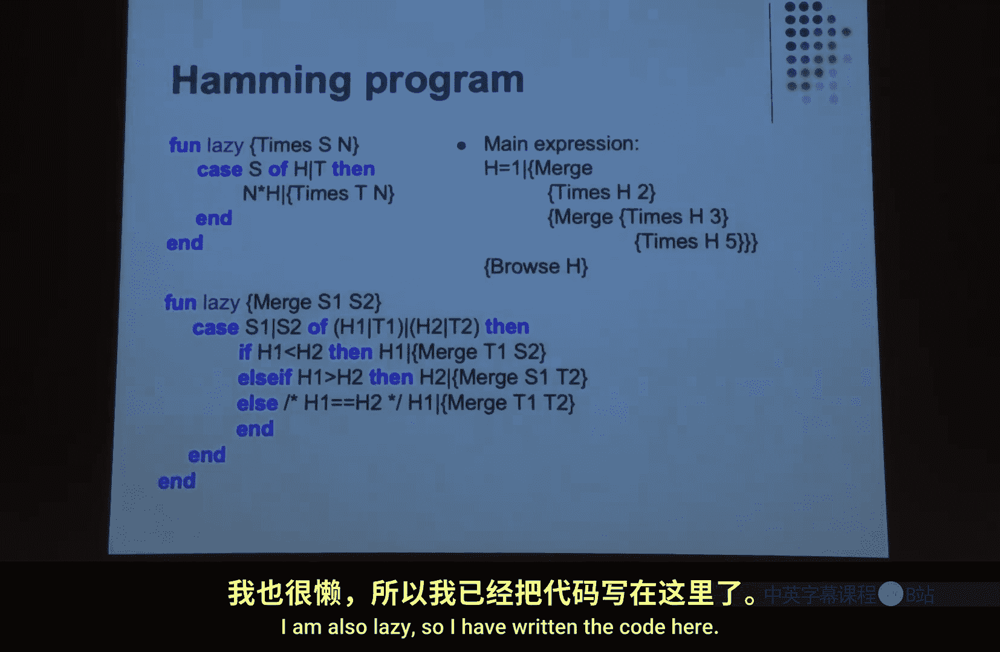

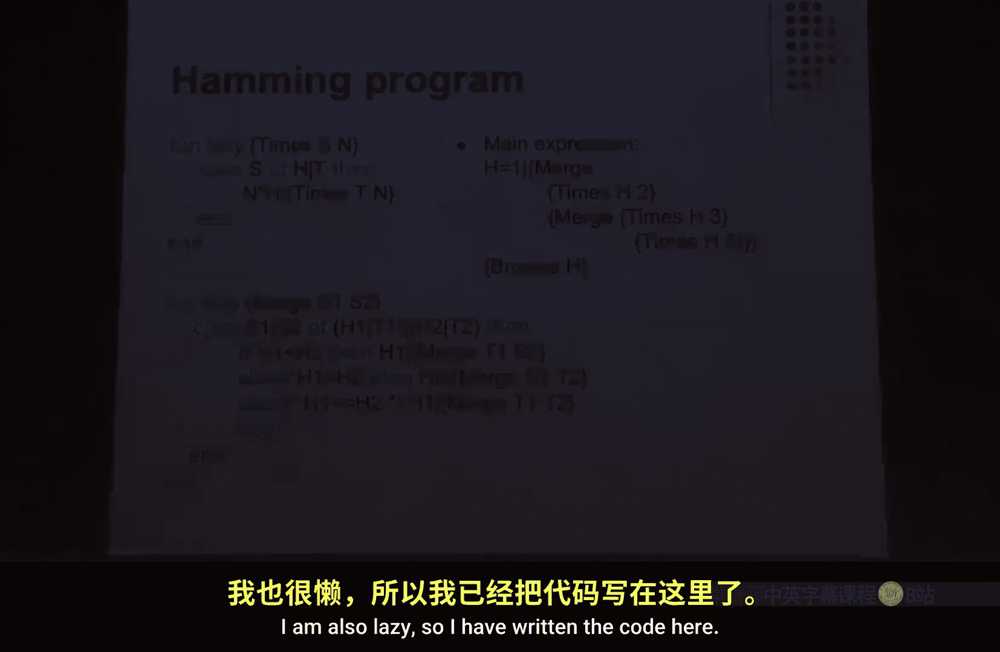

I have system the system。I am so lazy， so I have。そ。Here。没。So that's the times and the merge， okay？

Then the actual program is this。See here I can I just do it in one liner merge of times H2。

 mergerch times H3 times。Cl in front。です。Here it is， so far I have only one element cut。人是明。这。This。

If I want to see some elements， I can use touch of course。Of course， I did not define touch。

 let me define touch。So here we have the first 10 elements， one， two， three， four， five， six， eight。

 nine， and 12。But maybe I want more of it。H。They get 100 elements。Well here we have 100 kilometerss。

It goes up to 1，536 notice they get space out morera， you have 1，000， 1024， 1080。

 so in the beginning you have everybody at  one，2， three， four， five6。

 but they get more and more spread out。for a few weeks， I want to use more than that。

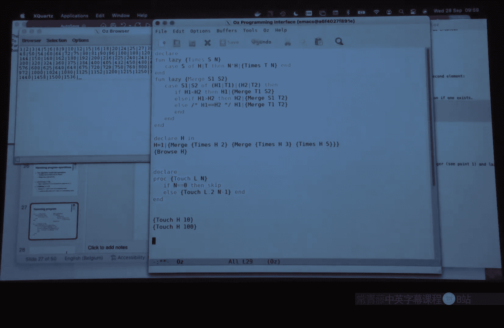

So here's more re。So up to 200 elements， I get up to 16，0 200。对。So this is very nice right。

 it's very efficient， it's using memory which is strictly proportional to the number of elements we' computing and the amount of computation we're doing is proportional to the number of elements。

 no more。So this is a completely efficient program。It's also very simple， if you want to write this。

 I would challenge you to do the same program in Java， okay， please be my guess。

Right solved the having problem with my Javava。I don't think the program will be so simple， okay？嗯。

Might a good exercise to try that， I challenge you。Do that。Okay。And to make it all as nice。

 so this is completely dynamic， yeah。

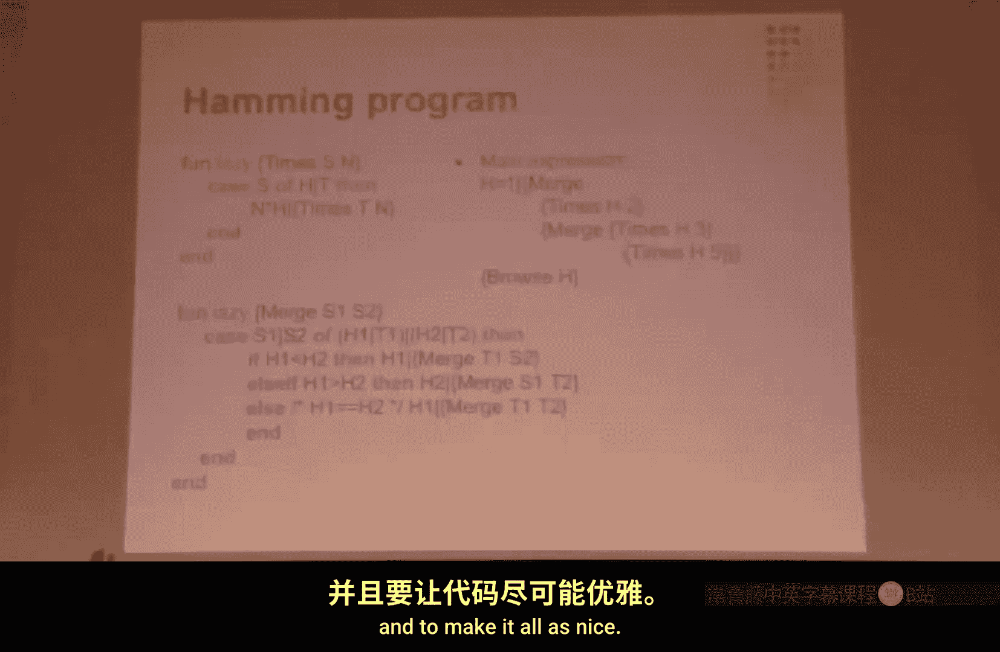

Efficient。It uses minimum memory。And minimum time。Complexity is the best in time and space。

Now bad for a declarative prayers asthma。In the 1950s， this was state of the art， okay？

This solution was something which was a major discovery， so Heing， he had to invent this。

 but he did not have a lazy programming language in front of him。

 he had a very very he had forran at thissp basically。系。This is not lazy。

So it's harder to do that if you don't have a so basically the way to do this is you have to invent lazy evaluation Okay so it's not so nice Okay。

 so let me go on now。Let me show you something which can help understand。Also， the execution。

Because if you just write this code。lookss very simple。

 but actually a lot of things are going on here， okay。

 each of these lazy functions is creating thread， through the way needed and it's going back and forth and so there's a lot of stuff going on here。

So sometimes it's nice to see that。And in order to see that， folks can talk about lazy suspensions。

待って。It's just a graphical way of showing the kind of what happened。Okay。

 so we have defined la evaluation using threads and weighted it。This is good， correct。

 but it does not really show the execution。Let's now show the execution in a graphical way。

And I will introduce the concept of a lazy suspension well a lazy suspension is just a thread waiting on what needed。

 okay， it's just what we know already it's a thread that weighs on what。

If you execute L2 is times L13 when you run that。You will not execute the function。

 you will create a lazy suspension。And we write it like this， there's a variable here， this variable。

 there's a thread waiting on this variable， we're doing with the arrow。

And what's inside this thread is this function called。Technically， it's the body of this function。

So we write it like this， L2， there's an arrow and a little box。

 and inside we write what it's waiting on。So there's a lazy suspension waiting on L2。Okay。

So that's a way of like making a picture。And if you run the having program。

If you execute the program。You will create。Five lazy subscriptions and then you stop。

So in memory it looks like this。H equals1 bar and then you have a variable， so M1。

 it's an identifier， but corresponds to variable in memory and there's a thread waiting on this variable and inside that thread there's the merge call。

And in this merge column， we have two arguments， two more variables。

T2 and M2 T2 has a thread waiting on it。With this column M2 has a thread waiting on it， with this。

 so each of these variables， so the M1， T2， M2， they're all variables in memory and each one of them has a thread of lazy suspension waiting on it。

 so in memory it looks kind of like this。When you write you run H equal that。

You will create five threads。And they will all suspend， and that's it， it sits there。

 it just sits there like that。And now if you want to execute this。You have to bind。

 you have to need something。So let's say I want to know the second element of H， I will do M1 dot1。

I M one。N1。1， so it's the same as H。2。1。Corresponds to M1。1。So if I do that， if I do M1。1。

This will activate this lazy suspension。Berge T2 M2。Because there's a weight needed， of course。

 on M1？Then will then continue， this will be right。So the body of merge T2 M2 will be executed。

The definition this body of that one will be executed， so that gives you this。

 so let's say I do browse n1 does one。Aivate merge T2 in the two。Okay。

It executes the body of the merch。But what is the body demer to play， let me go very fast here。

 so the merge body is a case statement this is the merge is the body， so we go forward again。

 so the body of the merge is executed， it's this case statement。Of T2 M2。And here we have the case。

 H1 T1。H2 prime， T2 prime， Ive put a little prime here because I don't want to confuse this T2 with this T2。

 it's different。So the case statement， this is run， the body is executing？

But there's like a chaining happening because T2。It is pattern matched with H1 bar T1。

 this will activate the suspension attached to。2。And M2。Its pattern。

H2 prime T2 prime this will need M2 so people will activate the suspension on M2 so that's the right one the one weighting on T2 is times H2 the one waitinging on M2 is mergech T3 T5 So you see there's like a chaining going on。

If you want the first element of M1 and1。1， this will activate the suspension。

But it will continue activating more suspension。So there's a whole chain of suspensions being activated up。

So these two will be activated。Times H2 and merge T3T5 are also activated。

 that means the bodies of those two were also executed and so on。

times H2 and merge t3T5 are activated， so the body of times H2 is executed。So you can go on。

 but this will eventually result in T2 equal2 bar T2 prime and a new lazy suspension。

And if you the merge 235。This will result in M2 equals3 bar at2 prime and a nu suspension。

Now you have。Now who can actually run the case statement because。Because T2 and M2 are bound now。

So T2 and M2， after these two suspensions run。T2 and M2 will be bound。

 so finally we can run the case statement。So the case statement will actually activate those two suspensions。

But in the meantime， the case statement is still waiting。

And when those two suspensions bind their results， the case statements can continue。

So you see there's actually some interesting kind of synchronization going on here。

The case statement activates two suspensions and when they're done。

 it comes back and the case statement continues。Okay。I'm not inventing anything new here。

 this is all simply a consequence of how we translation of what needed。

So there's whenever you have a chain of。F of ba functions， when you need one。

 it will activate the next one。Usually then that and so on， so you have a whole chain。

 so just doing one thing here， just doing one thing。Will cause a whole bunch of work to be done。

You see that though， in fact， all of these five。Will be activated and they are all run because I'm doing M1 do one。

So one simple operation and one do one will cause all them to be activated。Okay。

 so you see that it looks very simple。But if you actually look at the execution， it's actually quite。

Complex， sophisticated。So finally。After MTT2 and N2 are bound。

 the case statement can finally run and returns to bar of this。And so the result will be2 M1。1。

 but this recursive call will create a new lazy suspension。So basically what happens is when I do M1。

1， all five lazy suspensions are activated， they disappear， they're no longer suspended， they run。

And they will create five new lazy suspensions。Other let that go a little bit farther now。

So whenever I ask for a new element， I activate five suspensions and I create five new suspensions。

It's a lot of work， but it's all implicit。It's all hidden。Behind the lazy annotation。Okay。

Just to explain。This is nothing new。Show you the consequence of the definition we made， okay？Okay。

 let me now show you one more。Example today。Which is called an aval lazy program。

A very sophisticated program。But first， I want to mention a little bit。

I want to take a step back the paradigms we solve。So what did we see so far。

 what we saw sequential functional programming episode was the first？Example。

 you saw the termministic data flow。The agents， the streams， and then we saw an lazy evaluation。

 remember what does is。Program with a producer consumer and you have infinite lists。

But there's actually a fourth paradigm。Where you combine lazy and concurrency。Because lazy by itself。

It's not actually concurrent， I mean we define it using threads。

 but it's not actually do it concurrend because each function is evaluating and then suspending。

 so it's just it's actually like a coerining it's not really，Concurrent streams， okay？

We can actually use threads together with lazy function。Threads and amazing functions。

 and this is a new， this is a ink。Even more powerful one。And so I want to show you how that works。

 okay？It is the most powerful。Dlarative paradigm that we're going to see in this course。

 it has three special powers。It has confluence。And high order， of course， it has concurrency。

Independent activities， agents， and it has lazy by knees。And those are three powerful things。

With all this power together， we can do things that we could not do otherwise。ok。

So notice that there's almost no language that gives you this。So Asal actually， which is doing lazy。

 it does not actually do this because it's not doing deter deterministic data though。

 it's only doing lazy hascalal。So this is the most powerful and it's more and more being used。

 you will see this one。In the future。So I'm touching on it now。

And you will see it more and more being used in the future， okay？

But I want to give you one example of this。It's actually a very simple concept， how value。

You can write it in a correct way if you do lazy determinus behavior。Okay。

 so amount of buffer is actually something you see in many courses， I mean。

 if you want to do TCP network protocols， you will have buffers。

 if you have processes talking to each other， uns， they will be buffering。Bs are used everywhere。

Computer programs， okay？And so I'm first humble to explain why buffers are useful。

And then I'll show you out the programs。So here's a simple producer consumer。

And it can be many things， it can be two processes。On the computer。

 they are talking to each other in Unis or whatever， Mac OS。We know so。

 or it can be two computers on a network。Sending packets to each other using TCP。

Any kind of cruise consumer， so this is very common。Many， many places you see this， okay。

 that's very general。But。This simple pipeline here is two things， it has problems。

 it can have problems。So here let me explain how it works。啊。The producer and the consumer。

They're not executing at the same speed， usually。And they have fluctuations。

So the producer executes elements too quickly。The consumer could not use them。

So the producer asked to wait。Until the consumer can use them， so that slows down the producer。Okay。

 if it's too quick， if the consumer cannot use the elements， the producer has to slow them down。

 but at the opposite， if the consumer needs elements， I it right away， but the producer is slow。

 then the consumer has to slow down。So the two are kind of。Slowed each other down。

 you see that is kind of mismatched。Because the speeds of those two are fluctuating。

And it happens in many， many things， it happens in video streams， process communication。

 networking everywhere you have this happening okay？So what's the solution。

 So the problem here is that the producer has to slow down because the consumer。

Had not used an elephant right away， or the consumer has to slow down because the producer is not giving it an elephant。

So each of the sites will be slowing down whenever there's a fluctuation。So how do we solve this？😔。

So the solution to this problem is compound with buffer， okay， so this is independent of paradigmise。

 this is very general。Whenever you have produce a consumer that have different speeds and different fluctuation。

 if you want to smooth it over， improve the performance。

All you have to do is stick in a bounded buffer in the middle， okay， so we stick a bound buffer。

 it will solve most of these。え？So if the producer is making elements too fast and the consumer can not use them。

It's okay to put them in the buffer so so the producer can keep going。

 even though the consumer could not take them。And in the opposite direction。

 let's say the consumer needs elements。But the producer is not making any。

 but maybe they already are elephants in the buffer。Just take them from the buffer， okay。

 the buffer will store them。So the buffer is kind of smoothing things over。

 it lets the producer produce elements too fast。And that's the consumer。Consume elements。

 even if the producer is not producing them。So it smooths out the fluctuations。

Pro a consumer and it will improve performance， so Bo of buffer is used very often。

 it's like matching the two sides。是啊。See， the boundary of buffer is actually matching。and it's very。

 very common concept， so you will see it in many， many， many courses， not just with me。なで。

But want to show you that I want to program the boundaryed buffer。And in fact， you do not need。

To program it using state or。You can program it completely declaratively。

 and that's something many people don't know。The funding buffer can be done。

Completely declarative way， which makes it very much a better piece of code， okay？O。

So what we're going to do。So the boundit buffer here， you can write it in Java。

 maybe you've already done a bounded buffer using linked lists or whatever。

 and using pointer updates， it's not declared。But it doesn't have to be like that。

 you can actually write the bound buffer。In a completely declarative way。Okay。Using lazy name。

The way we do it， assume we have a producer and a consumer and they're both lazy。

 so the producer consumer are both lazy this is fine。

And the code is the same as if there were no bound， okay。

 we just stick it between lazy producer and lazy consumer。And in fact。

From the viewpoint of the producer， the bounded buffer looks like a consumer and from the viewpoint of the consumer。

 the bounded buffer looks like a producer， so the consumer， they don't see any difference。

The producer still thinks sending things to the consumer and the consumer still thinks he's taking things from the purpose。

So the bounded buffer can consume elements。From the producer。

 even when the consumer does not ask for them， so the producer can send elements to the bounded buffer。

Even though the consumer is not asking and cannot use them。

But that doesn't have to slow down the producer， they can just put it in the room and buffer up。

And the other way since， the consumer can take elements even if the bomb approve is not making them。

 because they're already sitting in the v。So this will improve the performance。

 smooth out the system。This piece of code。Usually it's written。タル。Nom with states。

Variable you can update， but you don't have to。This could be written completely declaratively。

I will define it for you now。Okay， but first let me show you the。The use， the scenario。

So we have a producer here， producer agent， and a consumer agent， and SSS tree in between。

And they're both lazy， we in put the laundry buffer in between them。So S1 comes from the producer。

 it goes to the v buffer。The bump and buffer outputs S2， which goes to the consumer。

 so instead of S here。Going from producer to consumer。

 we have S1 going to the Bo buffer and S2 going to the consumer。

And now I can write the code for this procedure found in buffer。

So here we have President Bffer called。With two streams， input output， and a size。

 so the bounded buffer it's bounded， so it has that fixed size。

A maximum number of elements that can be stored， this is very reasonable。

Because the bounded buffer will be sitting in a piece of hardware usually。

 and there's fixed memory in there。So you can't just make it grow arbitrarily big。

 you have to fix the size but choose some maximum。So the maximum size here is TD。诶。

So now let me show you how to write this code。Now we're going to define it step by step。

And hopefully this will help you understand how it's working。because the code is actually。はいです。Some。

 but if you do step by step， should be easy。So we're going to define this procedure bounded buffer。

 as one as the inputs tree， as two as the outputs treatment and n is the size。

And we're going to do in four steps。😔，Okay。So I'm going to make four steps， so here's the procedure。

 and in red， I will put in the code and I panic。O。So the first step is easier。

All the elements coming in at S1， they have to go out。

 the buffer buffer does not change any elements， it does not reorder elements。

 all the elements coming in have to go out。It's logical， it's just they go out at a different time。

 but they go out。So we will define a lazy loop。Which reads S1。And when it finds an element on S1。

 it passes it to the output。It's very simple， see， case is one over H1 T1。诶。

And the output is H1 bar loop Q1， so all the elements coming in on S1 go L。

 so the loop is like do nothing it's no off。But it's a lazy function and we're going to build something on that lazy function。

So that's the first thing for the bounded bufferuff。But we need to do more now。Okay。

And the next step is when it starts suddenly。When I start up the system。

The bounded buffer will immediately ask for ten elements from the producer。

The bounded buffer is empty when it starts up。So it would immediately ask fored elements。

 which means eagerly。From the producer so that it can fill up。So it's spreading this。

So I'm using a built in function， list drop， which basically removes the first element from S1。

 so it's traversing S1。And the end is where it ends up。And this is not lazy。So immediately， S1。

 it will need lead n elements when it starts up because the buffer has n elements。

 we immediately want to start filling it up when it starts。Okay。

And so the red and of course you have to player。That's good， right， that's reasonable。

 and then if there' those elements once they're there， the loop can read them of course。

The S1 will be found。依据。OkayThe second step is while it's running。

Whenever the consumer asks for an element。That removes one element from the buffer。

 which means the buffer has to ask the producer for one more element in order to stay full。Okay。

So whenever the consumer takes an element， that's an iteration of mood。啊，不。Here。

That's an it duration of Luke， this is right whenever the consumer needs analysis。Well。

 it has to ask the producer for another element， but that's easy enough。

 we add an extra argument to Luke， which puts in this end and we run it with end dot2。

 which asks for the next element。From the producer。ok。

That means whenever the consumer takes an element。Apri will automatically ask the producer for another one。

 maybe the producer could not give it up， but we don't care。

 we have to ask for it so the buffer tries to stay full。

Whenever the consumer takes an element it asks for one more。

And then there's the final step because there's a problem with these two steps。

These are sequential blocking。The final step is we have to put those two things in their own threads。

Because otherwise they will block， and two will block until。Until the producer makes an element。

 but we don't want that to block everything up。So we create the thread。

 remember the thread is the unit of weight gain。We let some other thread wait。

So it's very easy just put these two operations in their own threads。And we're done， that's it。

 This is the whole code。This is the final code。So you see。

 it's basically a loop which does nothing with a mechanism for filling up。

A mechanism for filling it and a mechanism for staying full。And that is the bound buff。Okay。Okay。

 let me end there and then next time I show it running， okay？And then next time we get the P。

 there is the stones， as they say， fresh。Next time I will show you。

How lazy evaluation can invented the algorithm。😊，I will。

Take the Quicksort algorithm and turn it into basic Quicksort。The lazy brick sort is like imagine。

 amazing。It's automatically created by the。So Da can sometimes be very， very smart。

So that we will say that。

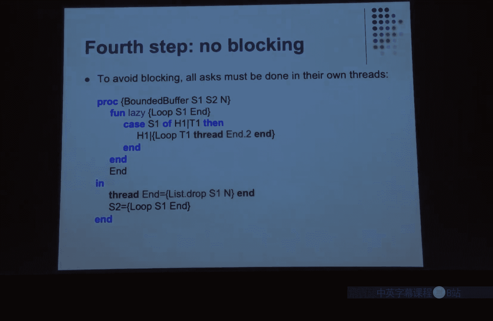