# 鲁汶理工学院【中英⚡高级编程语言概念｜LINFO1131, Advanced programming language concepts】 p31 P31 FO1131 Lecture 3 (2022) -BV1UDffBbEBZ_p31-

Yes。

To be like that that will make them much easier to debu again to maintain and so it's really important。

 so it's important to tell exactly what it is so I've moved to try to be a real precise。

Definitions so you know exactly。What is the comparativeative programming？Okay。

But the first part of the course， we are laziness。Before that。

 I want just a few seconds of silence for the Ukrainians who are fighting for us and for them。

These slides are improved slides from last week were complete， so if you took the old version。

 I suggest you take the new version。

And I've added a whole bunch of stuff today， I want to the first two minutes refresh your memory on laziness。

Okay， when I have a lazy pad。When I execute this， it creates a lazy suspension。

What is a lazy suspension， it's just a thread with a weight needed in there。

Notice the R is the result。😡，It waits until the result is needed， but what does that mean。

 it means another thread uses the value of the result。

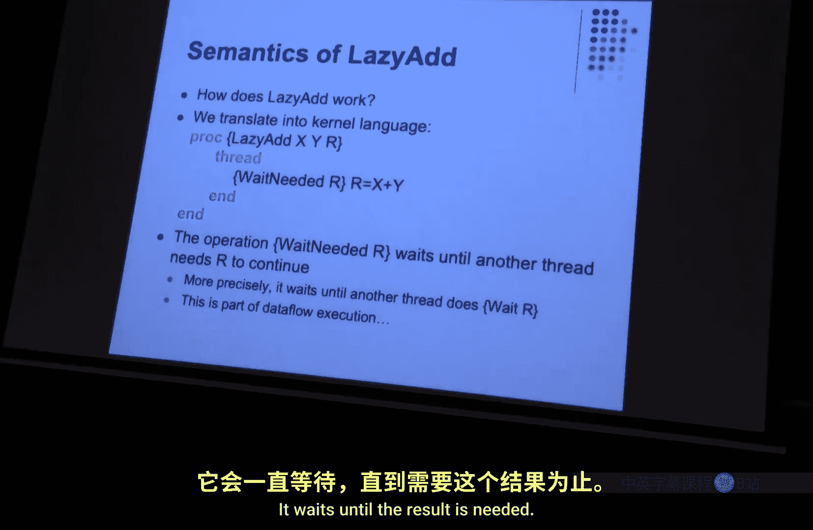

If I do an addition that needs the result， then the weight needed will continue。

 so weight needed is a really special kind of data flow operation。

And it's implemented in the system so you can try it out and use it。

 but the lazy functions will use it inlicit。Okay， so that's how it works。

This is what we saw last week， I'm not going to go over too much， let me go over just one thing。

Remember the having problem where we had to find a list。Of numbers。These numbers have lots of gapffs。

2 to a3 to B5 to the C。And we want to have them in sequence。With all of the ones in sequence。

 so how do we do that？That's really easy to program when you use lazy evaluation。

 we take three strings， two times H， three times H， five times H， and we merge them together。

 and this is an infinite loop。Po potentialial K in laziness。

 infinite loops are very usual and very good in lazing programs。

But I want to show you just I want you to really understand what's going on。

Now if you saw the definition of lazy add seems to be very simple。

 but usually when you have a lazy program， you have lots of lazy functions。Connected to each other。

 one of them is using the result of the other one so there's a long chain and I want you to understand a little how that works。

 just to refresh your memory so here's the merch。This takes two streams， as1 and S two。

Which are both ordered and merges them together， so the result is an ordered stream of all the elements of dreams。

 okay， this is un lazyzy。本身。This one will only execute if I meet the result of the tree。

And notice inside this function， there's a case。This case statement needs S1 and S2。

 so you can see there's kind of a chaining if I need the result of the merge。

Then there will be a chain effect and it will also need S1 and S2， and it will go back like that？

Okay， so let me show you a little bit how that works。Here is what happens when you execute。

The heming program， you create five lazy suspensions waiting and threads waiting on what needed。

 the mergech T2 M2。Is waiting to create M1， okay， and mergech T3。

 T5 is waiting to create M2 and so on。Now I want to show you a little bit more how that executes。

Because we're going to use that， and I want to show you in a few minutes。A really interesting trick。

 a really magic thing， but to understand that magic thing， you have to get this。

 you have to understand what's going on here。Okay。Now let's say I want the second value of H。

 I know the first one which is y so in order to get the second value I need to do M1。1。

That dot operation needs and one， okay， the dot is a record selection。

And M1 will be a list of two arguments， but it's still unbalanced here。So when I do dot M1 dot1。

 it needs M1 and a weight needed enough M1 will。Continue so the merge T2 and2 will activate。

 that means it will start executing the body。ok。Now。Just to show you more detail。

 so I do browse M1 dot1 that shows the second element this will activate now this dot operation。

C is an unbound variable， so the dot operation will just wait， okay， it just sits there and waits。

 but while it's waiting。Another thread activates the mergech N2， T2N2。

 and that will execute the body of the mergech。Remember， a me will merge to streams。

 so the body has a case。gear， it's with T2 and M2， so I need the first element of T2 and I need the first element of M2。

key2 and M2 also have lazy suspensions attached to them。

So I make them in red and green to make it easy to understand。When I do case T2 of H1 bar T2 prime。

 this will cause T2 to be needed。And therefore， times H2， which is。Has a weight needed。

 which is attached to that， we'll activate， we'll start running。And M2。

Needs so here the case M22 M2 bar will need M2， and this will activate the one that's waiting on M2。

 so the red and the green。Suspensions were both activated。 So you see it there's a chainer。

 I start with M1 do1。This activates the merge here。When I execute the body of that one。

The case will activate two more。Nisy suspension， so the case statement needs the first elements of T2 and M2。

 this will activate the red one and the green one and what does the case do well the case will just wait。

The case just sits there in its own thread and waits until T2 and N2 are bound。

 which just sits there， and in the meantime， times H2 and merge T3， T5 are running their own threads。

So you see there's a lot of threads waiting， this one is waiting。And then this runs。

And then this case waits and then these two run， so at some point you have lots of threads waiting like in a chain。

 okay？Okay， so explain a little more。So the red one and the green one are both running。

 so the body of times H2 is executed。This will bind T2 the result to2 bar T2 prime。

That means T2 now has a value， so the case statement is very happy。

 the case statement here in the previous slide， the T2 now has a value。

 so the case statement is very happy， of course there's still the M2。

It also does a recursive call this times T2 prime， which creates a new lazy suspension。

 so you see what happens when you activate a lazy suspension， it creates a piece of the value。

 but it also creates another lazy suspension。For layers， okay？And the green one also is activated。

 merge T35， I execute the body of that， that's also a merge。

 it has its own case statement and that will cause these two more times to be activated and that goes on I'm not going to show all the details but eventually M2 is bound to 3 bar M2 prime and a new lazy suspension is created on M2 prime so again it binds。

It creates a new laser suspension and now the case statement is happy because both T2 and M2 have values。

 two and three， in this case， which was waiting all the time。

Now sees those two values and can continue。So you see it's a very simple kind of synchronization。

 the case needs something， this causes the lazy suspension to wake up， it does stuff。

 eventually it binds it and the case that was waiting。Will continue， okay。

And it keeps going and so on。In that case， it executes and it actually doesn't emerge and it returns two bar M1 prime。

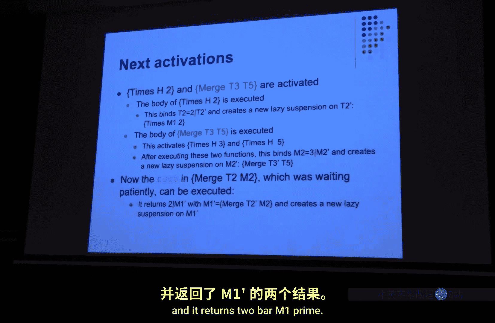

And it creates， again， a luinacy suspension。So the dot M1 dot1。

Will be bound to this so M2 bar M1 prime so that2 will be displayed and a new laser dis is created on M1 prime so what happens what happens when you execute M1。

1， a lot of things happen， okay？

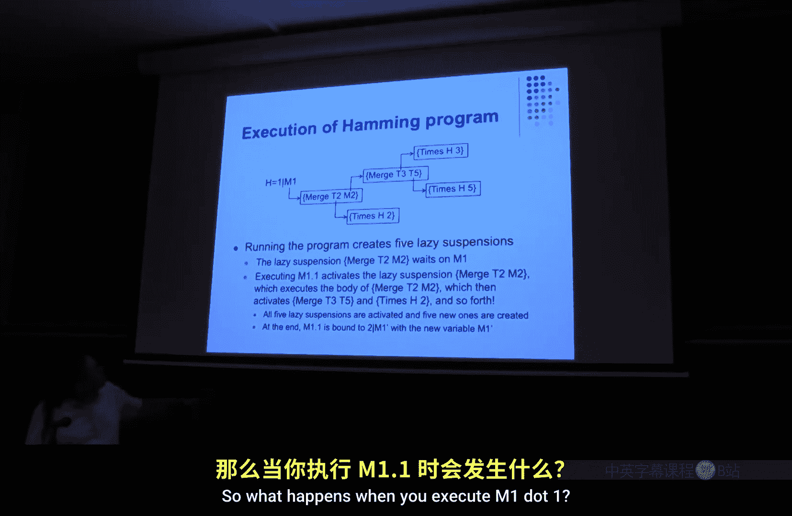

All these lazy suspensions， five of them are all activated。 they all run， they all bind variables。

 and this causes the result， but they all create a new one。 So there's new five new lazy suspensions。

 So five threads wake up， they run。

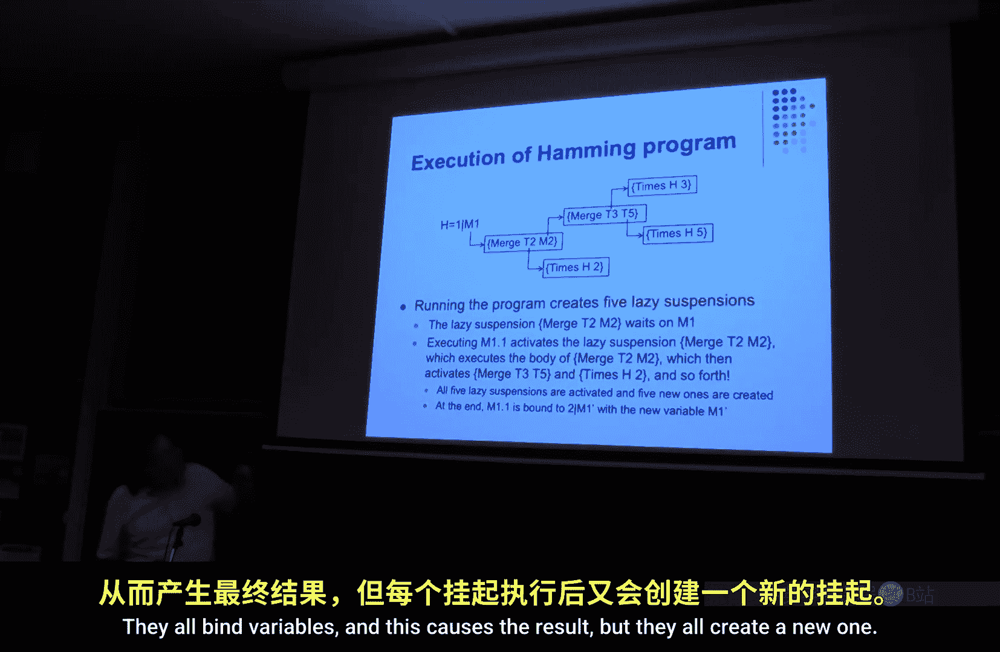

And then they create new threats that are sleeping again， do laser suspensions， so the simple M1 do1。

Does a lot of things， okay， you have to understand that。It seems very simple， but there's a lot of。

Connections between the different methods。So that's something you have to keep in mind。

 and there's a chain effect。If I activate the latest suspension， it executes the body。

 but that body might need more things。So those more things will also be activated and so on。

 and that can go very， very long as we will see when I show you the lazy quick sort。

This is just warm up， okay， to the example I want to show a little bit later。Okay。

 so you see how it works and all that。Is one single new operation weight needed。

 so I'm not doing a real complicated new language， I only add one new operation and you can see this can cause a lot of different kinds of mechanism to write。

 okay。So you see a very nice， complicated， orchestrated computation can be done with only very simple。

Thing added， this important when you build applications later。

You should do the same thing if you want to make a big application。

 try to add only one let table or just a few things to do everything okay it's by far the best way okay。

I made also a picture here， if you follow the arrows so this is a new slide， M1。

1 on the top left it's activated， I see merge T2M2， this causes the body to execute T2 M2 RNAase。

 so they both activate here the T2 bind T2 here and this binds M2 and this merge T3， T5 again。

 causes the body to execute。

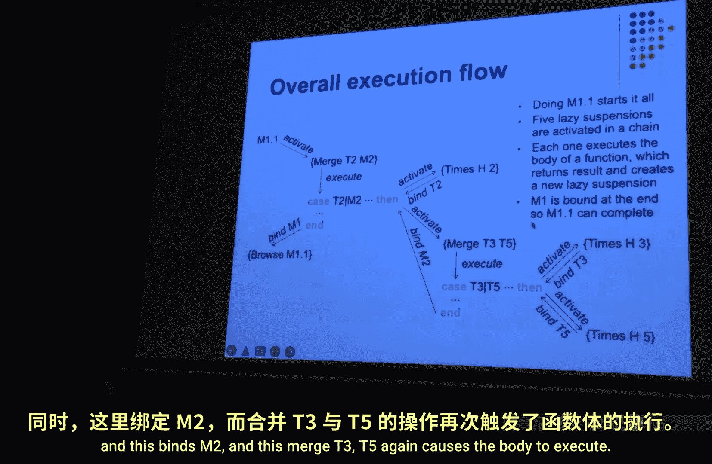

So T3 causes this one to execute and bind T3 to5 does that， all of that is done when I do M1 do1。

And the M11 is not doing very much。Waits， so I try to do the dot operation。

I noticed that M1 is unbound variable。And they wait。

That's all the dot is doing it's not doing it or it's just waiting。

But there's on the other side of the system， a weight needed that notices that and it does all the work。

And so the M1， the dot， which is waiting。It just waits eventually， magically， and one gets bound。

And it can run， so the doth is actually not doing anything here， okay？

Everything is done behind the scenes。From the viewpoint of the dot。

 I just try to do a dot operation and I wait。And eventually magically the value appears。

 that's all the dot operation is being here， okay？All the work is done。

And another part of the system。Okay， so that's kind of neat。

 isnt so this is the mechanism of lazy evaluation。Now， so this is the stuff we saw last week。

We saw also the bounded buffer， but I didn't get a chance to finish it。

 I want to show you the execution of this thing this beast。

Because this is also a nice example of where lazy and concurrency are coming together。Okay。

 so the bound buffer is a magic component that you can stick inside any pipeline。

 so here I have a pipeline， I can just stick the bond buffer in there and I don't have to change the code of the producer and the consumer。

And the performance has improved， so that's nice， it's very modular。I have a system。

 it's doing badly， I stick in a new thing。D chain thing of the code and it does better。

 that's good though， so the boundary buffer is a nice thing and it's used a lot。

And it can be written in lazy deterministic data flow， so it's a completely declarative。

Abounded buffer， that's not something that many people understand。Okay。

 what I'm telling you in this course is kind of。The leading edge of declarative programming up。

 this bounded buffer is completely declarative， if you ask people to do that。

 they would probably tell you it's impossible， but it's not。啊。So we will write the pounded buffer。

And I did it in four steps I will just move very briefly。

 but then I want to show you the execution how it works。So instead's a procedure。

 the three arguments， input stream S1， output stream S2， and n which is the size， how many elements。

 it's a bounded buffer， of course we have to be careful it doesn't grow forever。

 so it has maximum size and that's n。And we do it in four steps， so the first step。

All the input elements are just going to the output。We have lazy。

 so maybe the input elements come in earlier or later or whatever。

 but the bounded buffer is not creating any new elements， h？

It's just passing the input to the output， so the basic loop is just a no opera， which this loop。

 which is just passing inputs as1 to the output。As two， it was lupus one， so that's the basic thing。

 but of course we use laziness。To make this thing work。Worked in a special way。Okay。

 the bounded buffer。It looks like a。Consumer from the viewpoint of the producer of。

So the producer thinks it's just sending a list。So the first thing to bound in buffero when it up is it asks for N elementss。

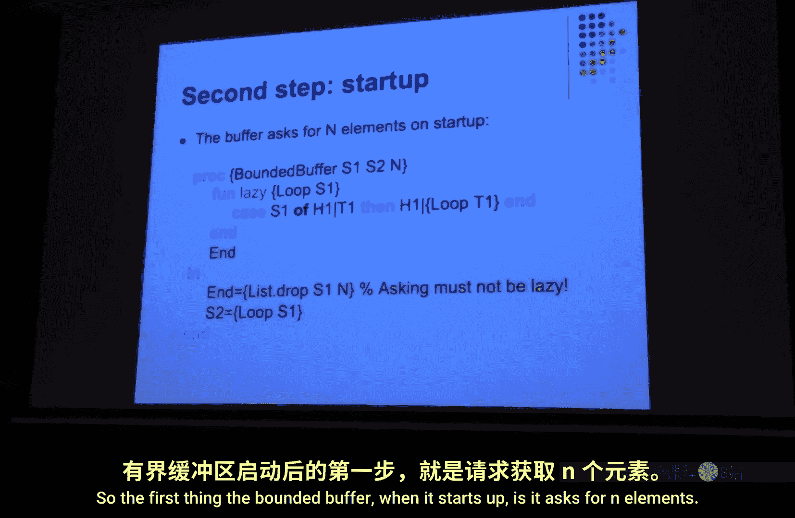

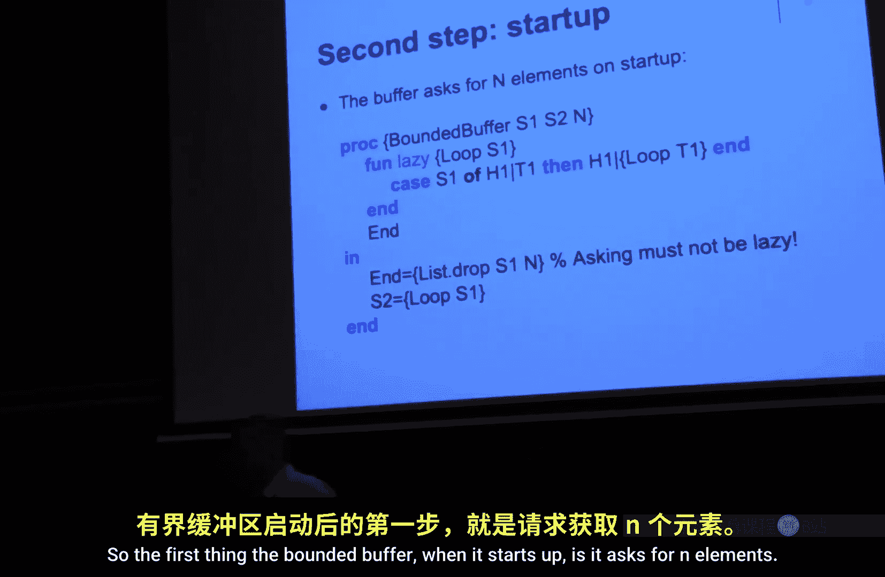

Okay， that's reasonable because the producer， the Baard bufferer tries to stay always full， okay。

 it tries to stay full and when it's full， then it stops asking and it becomes。

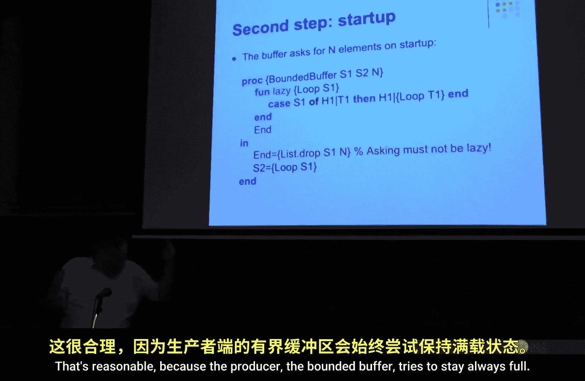

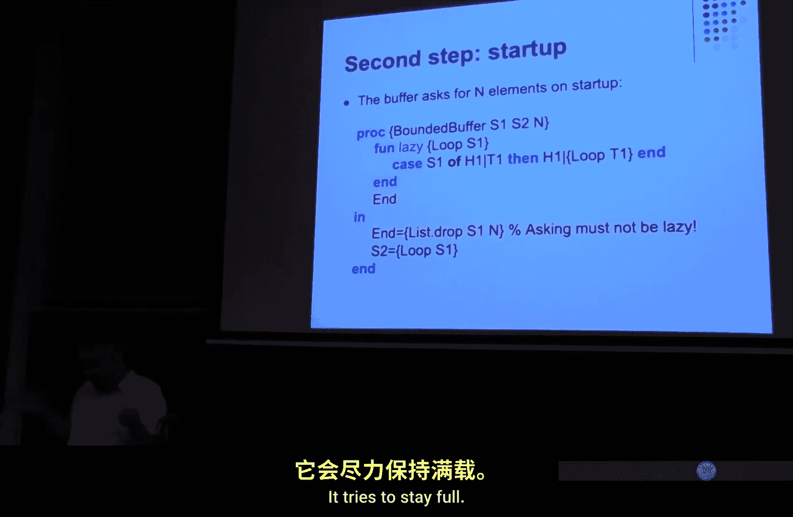

呃。It's going from eager to lazy， yeah？So it's asking eager elements。

 but once it's full it stops and it becomes lazy again。

 so here it asks so list up drop is just a list function that traverses a list and removes the first n elements okay？

So that's the startup。And then it has to stay full。

 the boundary bufferuff results trying to stay full。When the consumer takes an element out。

 then there's one less element in there， so it asks the producer for another element， Jenna。

 it's always trying to stay full the value buffer。And how do we do that。

 will we add an extra argument to the loop？

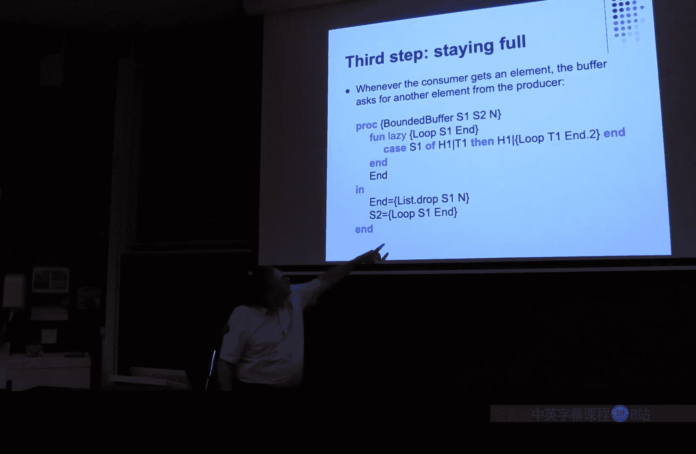

Whenever the consumer asks an element， then this lazy function will execute， the body will run。

 so this will be activated。

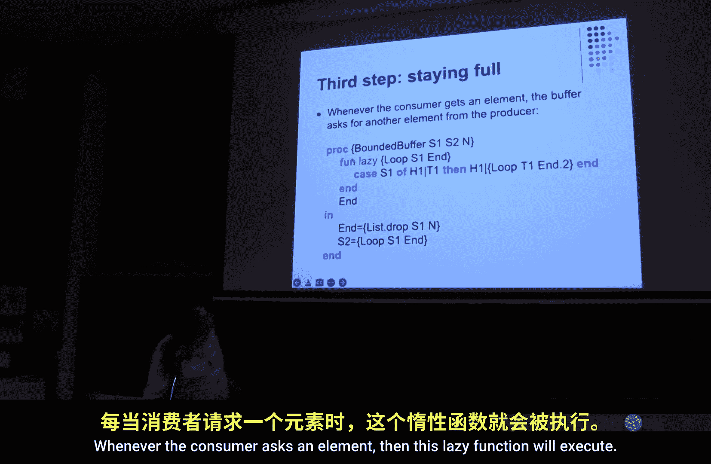

Whenever this body runs。That means the consumer has asked。For another。So， that。

This right is triggered by the consumer。Okay。And what we do here is end this the。

Is actually n elements farther down in the list， So we call it with n dot2。

 which goes one step farther， and that's a message to the producer， okay this。

The dot operation needs end， and so the producer， which is lazy。

 activates again and tries to make this element， okay。

So this makes sure that the buffer always stays full。Okay and then there's a final step。

Because end dot2 is a blocking operation and the same for list dot dropper， the end will wait。

 N do2 will wait until the producer makes the element。We don't want to wait。That's separate。

 the producers we don't want the whole buffer to wait for that。So how do we solve that。

 it's very magic in thecle programming， you can add threads whenever you want it。

Adding a thread will never add make a button。In a declarative concurrent model。

Threads are easy things， most people will are scared of threats。

 threads in Java are very scary things because you introduce many bookss。But。

Threads in declarative programming are not scary， they are your friends。

 you can add them whatever you need them， and you don't have to worry you will never add a hug by adding a thread so if I don't want this end do2 to block。

It's very easy to fix that I just stick it in its own thread and that thread will wait but the bounded buffer will not wait and so this drop also has to be put in its own thread。

So these two operations， so the startup。Heres the startup thing here and the staying full thing。

have to be put in their own threads， otherwise the buffer is going to be waiting until the producer generates the elements。

 but we don't want the buffer to wait， so we just put them in their own threads。

And this will not add any bugs， it will just make the buffer go forward。

 it will allow it to go forward， that's it。ok。So you see Dec programming is actually very easy。啊。

Concurrency is very easy， so this is a full bounded buffer now。That's it， that's the whole code。

 okay， and it's completely right now I want to show the execution of this before going on to the next example。

So the execution， I would have a producer， Prod and consumer Con。

And I stick the bounded buffer in the middle there， okay？But I want to show you the code for that。

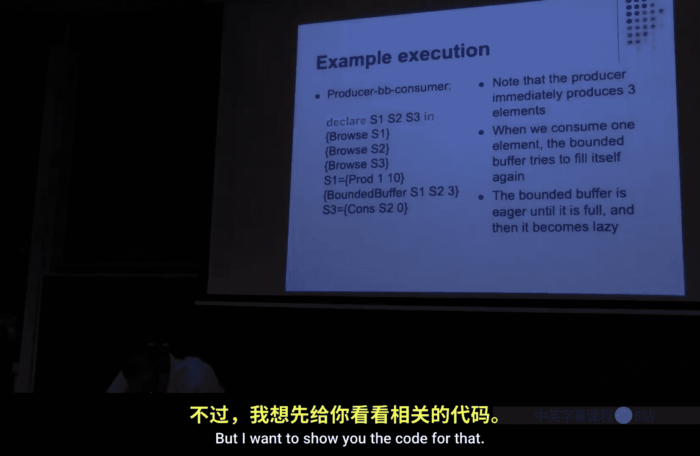

诶。I think I will have to restart。Good guy。

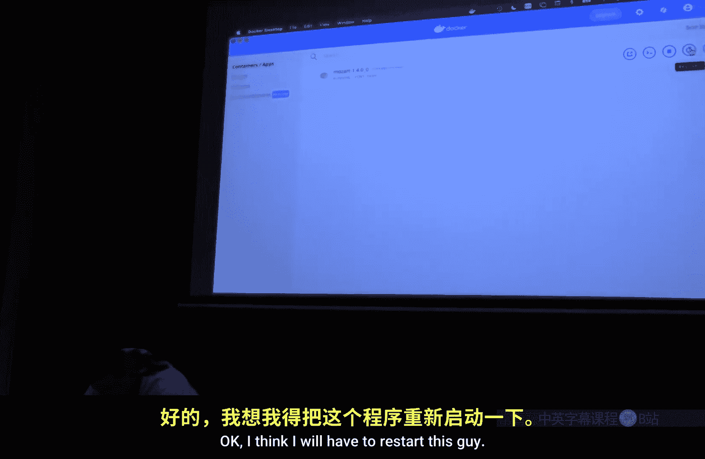

it eventually restarts。Oh， there it is。Docker images take a long time to start。You know why。

 because they're very big。And this one is like one point。

Five gigytes because they're like complete computers。So it takes a little bit to start。

 so here it is，Look at the pound buffer。First， let me do a。A producer consumer here。Yeah。

This is a simple producer， consumer， lazy producer consumer， okay？Let me just run that now。そ系。嗯。です。

Notice this is lazy， so you see nothing herehuh？If I want this thing to run。

 I have to ask very politely， I have to need something。So I want the second element， for example。

 I do S2 down 2 dot 1。It will now do it， notice there's a delay of 1000 there。

 so it takes a little while， but you see it produces the elements？

And now let me show you the bounded buffer on this。On this thing。So here is a boundary buffer。

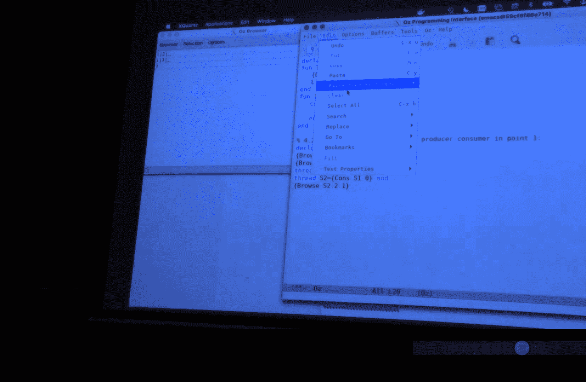

Please。And now I want to well， let me compile it first。你傻。The scrolling is not。

Now I will take this one and I'll stick the boundary buffer in there。No we here。

And the're done buffer goes in the middle。S1， S two， let me make a small one of size3。

Make things to see。This then becomes as two。This is a。Just me get rid of this for now。诶。

Notice I have three things now， S1， which is the input of the bounded buffer coming from the producer。

 S2， which is the output of the bounduned buffer， and S3， which is the output of the consumer。

And the only reason I have S3 is still that I can ask。

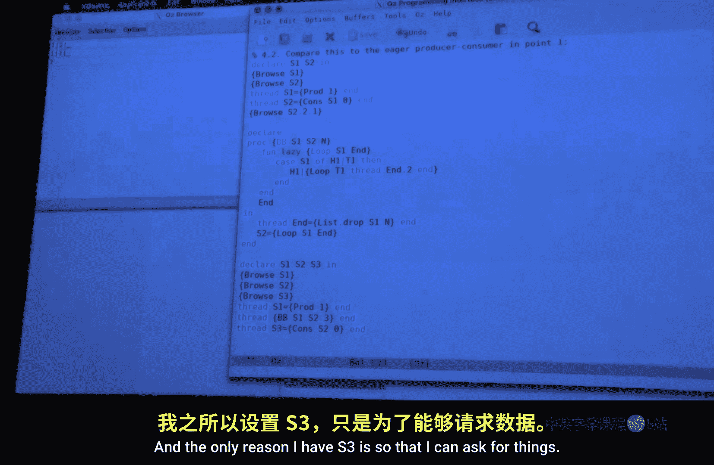

F things。So it looks like this。This one。Theres to。3。So the bound buffer is in there。

 so that's how it looks。Okay， I did compile it I here。 let me try it now。

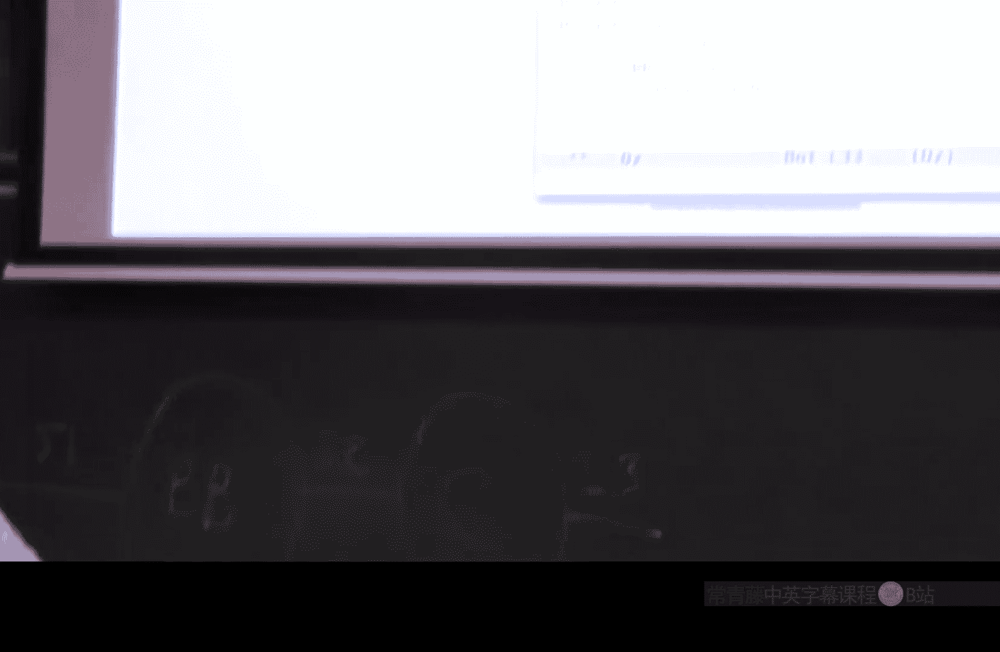

So is my code right， I think should be okay。So now I'm running it。

 but I'm not asking for anything yet。Notice I did not ask。

 but already the producer has made three elements， it gotten three elements。

That's the bound buffer in action。The ballot buffer has already asked the producer to fill up， okay？

我们你。As it for one more about move。So this would be S3。The one。

 So I'm not asking for the first element from the consumer。

 but I know the first element that it's equal to one。

So the consumer will give this in an element instantly because it's already in the bound of buffer。

 it doesn't have to wait for one sentence。Okay， so when I do that command。

 the one will appear instantly， I don't have to wait for a second。But then another thing will happen。

The Boer buffer now has only two elements， so it's going to ask the producer to fill up again。Okay。

So you see the one appears right away， and one second later there's a four。

So you see what happens with the consumer and immediately take out of its out。

The boundaryed buffer until it's empty， and can't do that forever。W element is easy， takes it out。

And the Bd buffer always tries to stay full。Okay。So I do browse。S 3。2。

1 now if I now ask for the second element， this element I will see it immediately because the two is already there。

And then the bottom of the buffer will ask for another element。呃。No， it's three， sorry。

 it's three because it's the output of the consumer app。But it will。

 because the output of the consumer is the sum of the two previous elements， okay。

 so it shows the three， but notice that the input is going to five now。

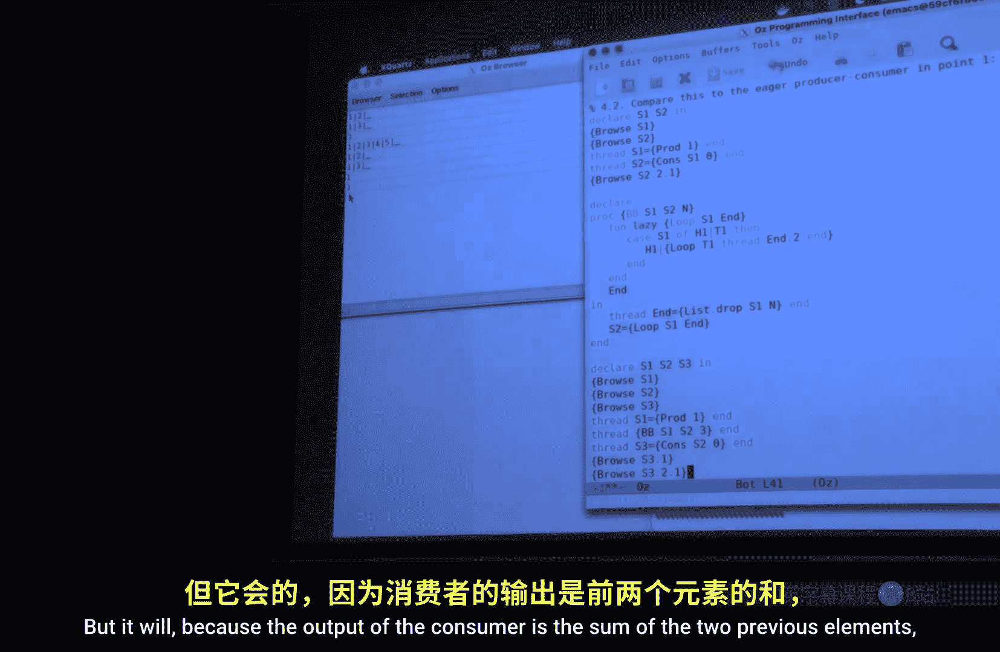

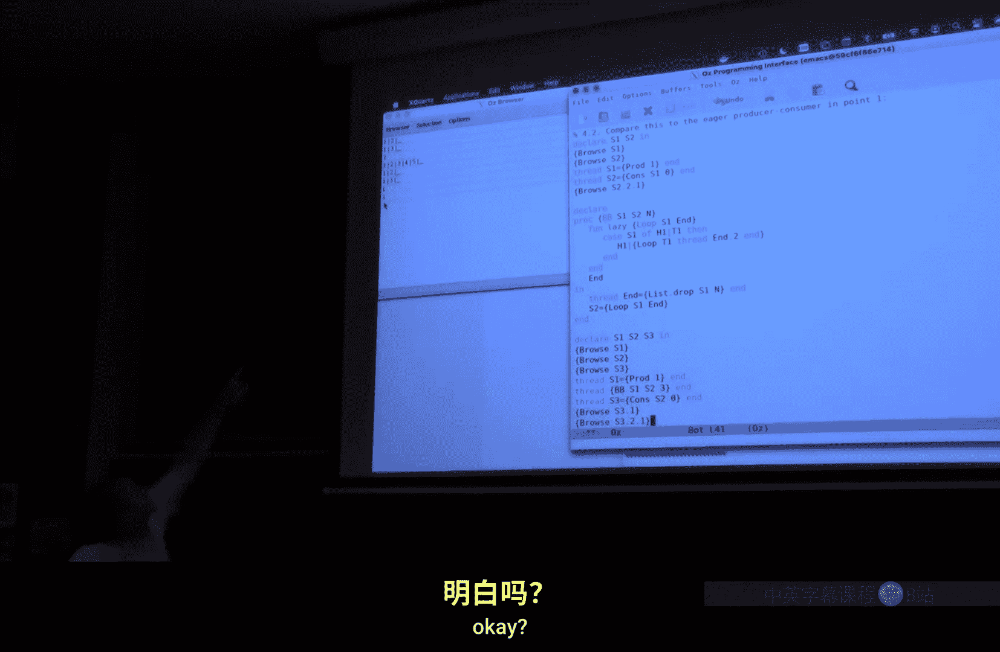

So the buffer always tries to stay full， okay， you' see how it works。

So that's the magic of a bounded buffer， and that's completely done。Using lazy deterministic di。

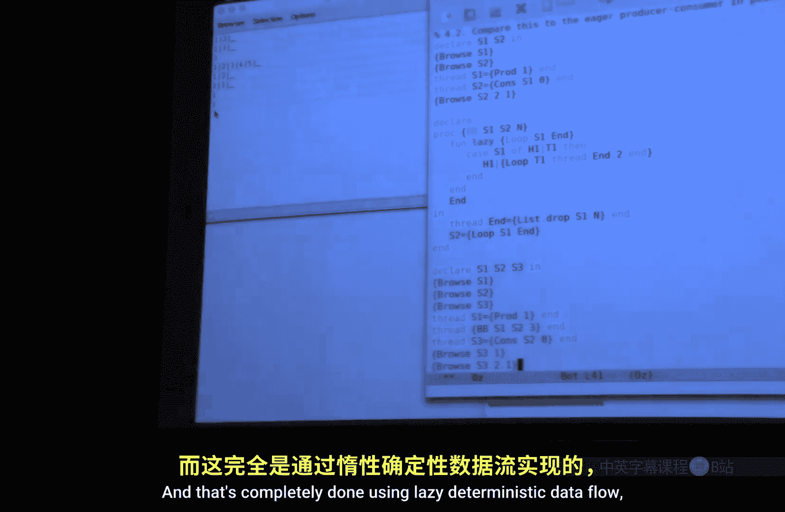

Combination of laziness and concurrency， the concurrency here is easier。

 I'm only using it to avoid waiting。Because the buffer actually， the producer can get ahead。

Ahead of the consumer， there's kind of a slack between the producer and the consumer up。

 they're not really synchronized， the producer can get a little bit ahead because of the v buffer。

 and so that means because they're not synchronized。

 they have to be kind of little independent okay so that's one way of seeing why you need concurria。

 if you want two things to be kind of independent and not synchronized。

You need some kind of concurrency， so that's the bound of buffer。Okay。あの？

So I'm not sure if the code is on the Mo， but it will be on the Mo today and you should try running it and playing around with this。

 okay， so this is something you have to understand。Because this is。

This is probably the most powerful form of。Thelarative confirmed things。

This is the most that we will see it's the most powerful form I know of。

 maybe in the future people will invent more powerful ones。But it's very strong。

 you can write a mounted buffer completely declaredlarative。And you have to think declar ofly are。

And it's a totally different way of5 them。Concurrent programming in Java。Because in this model。

 threads are good guys， they are cheap。They will not in bugs and Java threads are expensive。

If you don't work， if you don't think carefully， they will introduce lots of bugs because of the。

Shared state。So the threads and Java are considered nasty bugs， but in declarative。Concurency。

 threads are your friends。Okay， so that's。1，3。Now I want to show you a really neat example。

 which is lazy K sort。

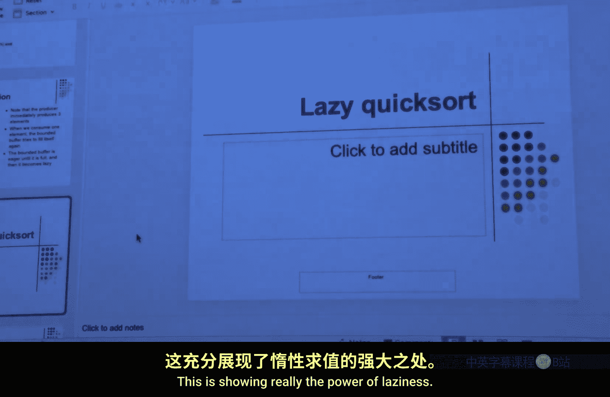

Showing really the power。Of laziness， laziness can。Do really smart things sometimes。

But it makes things increment。Okay， so let me explain a little bit。

 so I'm going to show you a sort algorithm， sorry I should probably。S there' a slide。

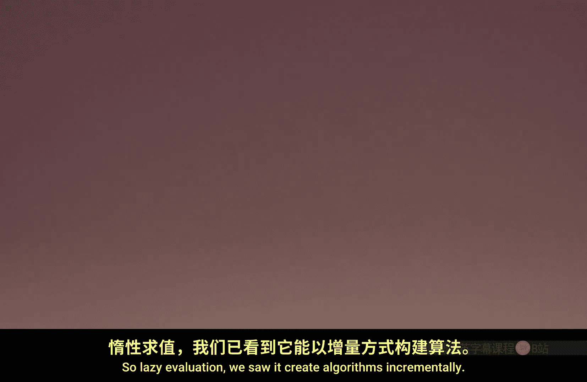

なで。So lazy evaluation， we saw a create algorithm algorithms incrementally。

So it's only creating things when we needed piece by piece。

OkayNow I'm going to show you what happens when we use lasers on Quickword。

So Quicksort is a sorting algorithm， famous sorting algorithm that you probably saw。

 so do you know who knows Quickword， no Quicksort？Some people know quickSo， okay？

So we're going to use Quick sort and turn it into something lazy and then we see what happens and actually it's kind of a magic thing。

So the standard quick sort， if I want to sort n elements。That's a time complexity of n long N。

Which is very typical for a sorting algorithm to sort an element，You take a list of animals。

 you sort them。Sorted list and log it Okay， that's reasonable What happens when you make it lazy？

Now in laziness， things becoming incremental。Now it doesn't always work， but in the case of Quipsorm。

 it works。And the laziness， it means that the sorted list。Is。Genrated bit by bit。

 start from the first element。And it turns out the time complexity changes。

It's instead of order n log n， it's n plus k log k。So what does that mean。

 so n is the size of the list？But K is how many elements we're asking。

Maybe we only need the smallest element and N is equal to one。Okay。In that case。

 the timeolepsy we order in。Maybe they'll only need the two smallest elements。The first two。

Then it will be just a little bit more than n， okay？But maybe we need K elementss。

The number of the small- maybe we need five smallest elements。So then it will be n plus the。

So in general， it's 10 plus k love K。So you see when k is equal to n。It goes back to N logz。

But when k is small。It's much better than n log n， okay， in fact， it's really。

 really good at balance。If I only need the first three smallest elements。

 it's basically linear time algorithm here？And plus some constants。

So it's a really good algorithm for finding the K smallest elements out of n。

So we have made Quicksorganin to this really nice generalization， and it's even better than that。

 you don't need to know K in advance。If you want to write this in Java or something。

 maybe I want to compute the first smallest five elements， we a small vector of five elements。

 I traverse and I update that small vector and at the end I have the smallest five， okay， fine。

But what if I need the sixth one， the sixth smallest。

 I have to do it all over again because I don't have anything there。Well， this is not so dumb。

 this one is much smarter。If I ask for five elements， I get to five， if I ask for the sixth one。

 it only does a little bit more work。To get the sixth one because of the laziness。

 so you don't need to know pain in advance， that's a really strong property。

You can run it and figure out how many you need。At runtime， when you see the elements。

 you don't have to pre allocatelocate data or whatever， okay？Okay， so that's what the algorithm does。

I dare you to invent an algorithm from scratch。That。

Computes the case smallest elementss out of n without knowing K in advance， go ahead， write it。

 try writing the code， I think you will see it's not so easy， but laziness does it for you， okay。

Okay， so let me now show you how it works， first I will refresh your memory on Quicksort。

QuickSo is a very straightforward kind of divided conquer algorithm， here I have the list L。

I picked some random elements out of L， any element。This one is called the pivot， let's say X。

And then I traverse L once。And I create two lists， L1 and L2。

 L1 has all the elements of L that are less than x。

And L2 has all the elements of L that are greater than are equal to， so I'm partitioning。

The two sublists。And on that average， L1 and the2 will be about half。The size。

 not exactly because it depends on these values， but if we have some kind of un ordereddered list。

 it'll be typically half and half around that。And then I do recursive call to Quicksortt。

 L1 gives me S1， which is asorted list。And L2， which gives me another sort of this S2。

Now notice all the elements in S1 are less。Then all the elements this 2。啊。

That means in order to get the complete sorted list， I just have to concatenate。

I just have to do it plan。And that's it。 That's quick solution， okay。So that's a very nice。

Recursive divided conquer algorithm and there's other variations of that， merge sort is another。

 it's a variation of this， okay， so this is quick sort。I'd see and how does it work？Okay。

 so here's an example。AQu sorts。So if you do something like， let me write it down here， seven， three。

 two。I kind of chose it so it looks nice。

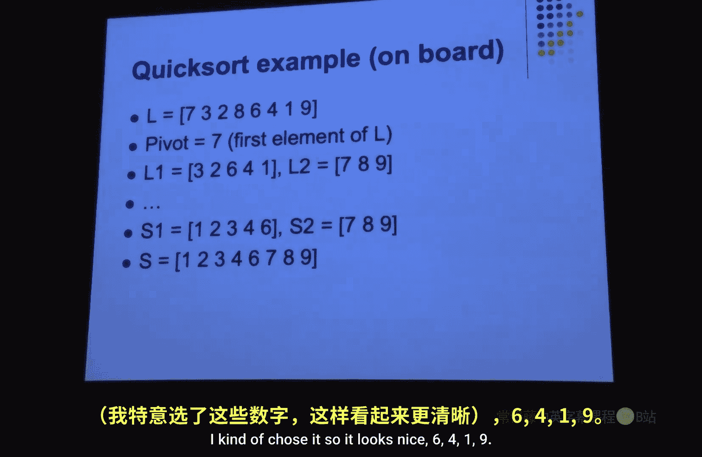

That's my original list。

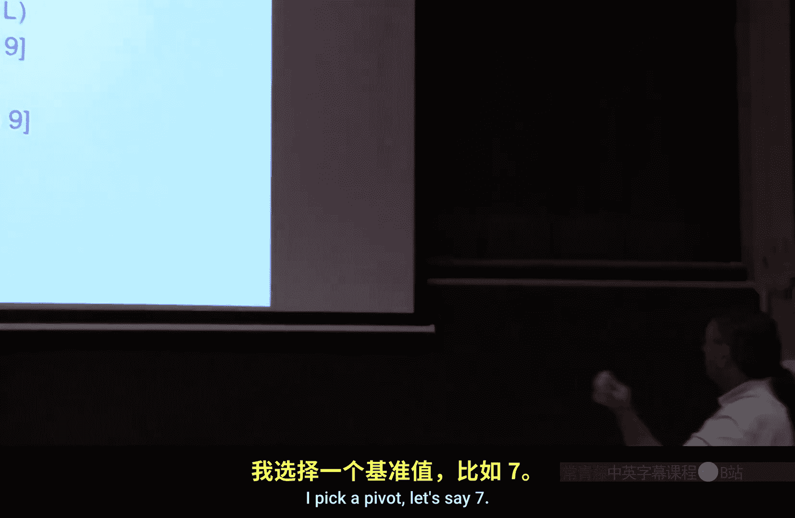

Pt， let's say seven。So the elements less than seven that makes three。To。6，4，1， okay。

The one's greater than to equal， that's 7，89。Here I would do supposed be the same。

 so if I think three as the pivot， then the elements less than three will be two，1。

The one is greater than equal will be 3，6，4。And I go on， but let me just sort this。

 this gives me one， two， this gives me three， four， six。If I append them， it gives you one， two。

 three， four， six。And then if I have 1 these two， it gives me one， two， three， four， six。设备。

So you see how it works？Re straightforward。他也对在抗衡。Now let me write the code for this。

So here's a partition procedure， it takes a list L， it takes a pivot X， and it returns two outputs。

 L1 and a2， so it's just a case traversing L。

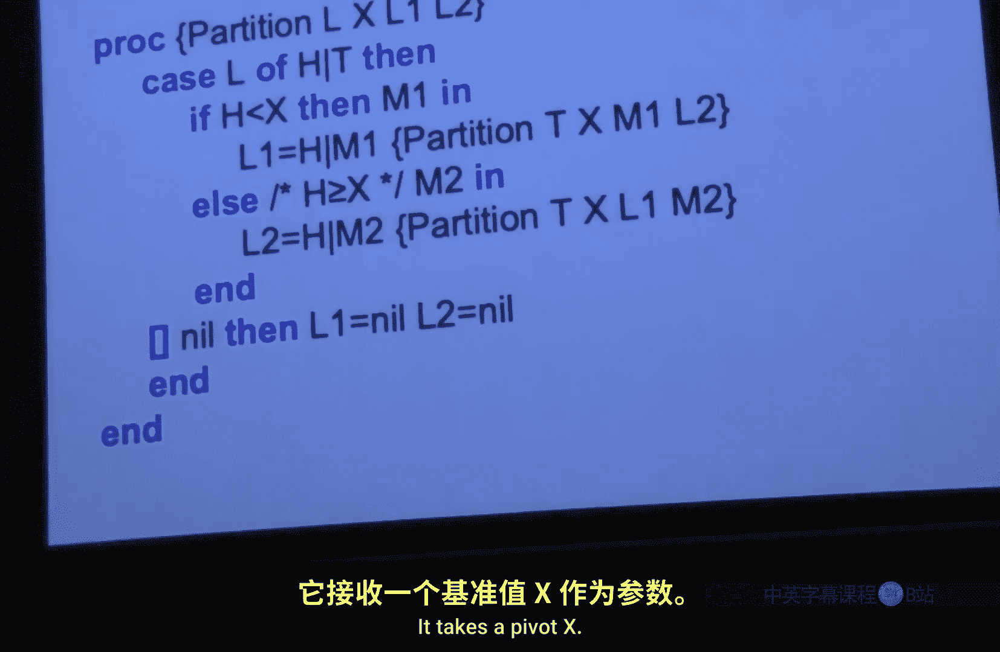

And then it compares。The element H with the pivot and either it builds L1 or it builds L2。

 So you see how it's done L equals H bar M1。So M1 is unbound。And then it calls re personity。

 so this is a tale of re personity。Function the procedure。

 you see that we can do that because of the single assignment。And here's app penant and quick sort。

So the append is very straightforward， quick sort， see how it works。

 so I will just take the first element of L as the pivot。

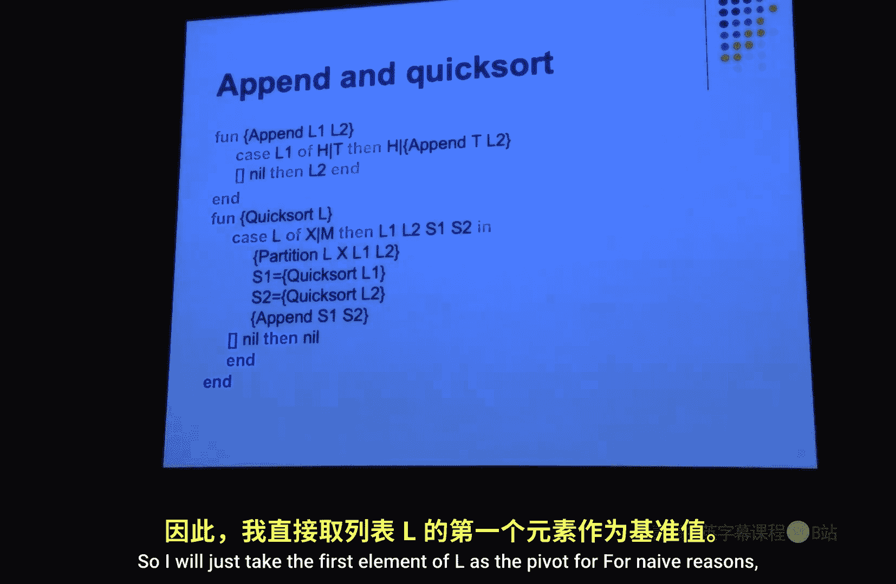

For naive reasons， it could be， it's better to take some random element。

 but I'll just take the first one for simplicity。Okay， and then I partition into L102。

 I do the two recursive calls。And then， I pen。え。RightThis is correct。What you say。

So you can run this。Now， now。Maybe I don't read it just to save the time， this algorithm is buggy。ok。

This is buggy。And I'm showing it to you because it's a typical kind of bug that you do。

 you can get when you make recursive。When you make recursive functions of procedures。

So this one will not run。Looks nice， but。隔壁。In fact， it will go into infinite loop。Why will it go in？

Have you remembered， you have experience， remember your experience in debugging recursive functions？

Well， you probably have already this kind of books having happening， right？

So what could be the bug here does anyone have an idea what's bugging here？

When you write a recursive algorithm？What you really， really， really have to be careful。

Something you have to really be careful about。So what is it。And this one is doing it wrong。Any idea？

So that's buggy， if you run that。嗯。Maybe it sometimes works， maybe it doesn't who knows。

But it will eventually go into it for loop。Why is not it's actually very simple。

 but once I tell you you should remember it always。When you write。Recurive function。

Just what you saying， what is the book。 lookss very nice， right？ I'm following the。The rule here。

And it looks， I showed it to you， it looks very nice。So what is wrong？😔，What is wrong here？Any ideas？

So I give you a hint， maybe？Whenever I do a recursive call。What do I have to be sure of？

That there were a personive call？That it will terminate， what do I have to be sure of？

There has to be。I have two recursive calls here， QuickSot L1， QuickSot L2。

So Quickor L we'll call Quickor L1 and Quickso L2。How could that go wrong？

What does L1 have to be with respect to L？What to be more precise？

What is the connection between the size of L1 and the size of L？Yes， so in this case。

 if the split isn't exactly at the middle at time。Then maybe L1 will be bigger than N2 on the other way around that's okay。

 L1 can be bigger than L2。But so L1 enough2 they will probably not be exactly the same size。

But the problem is not L1 and L2， the problem is L1 and L。The argument。So you're on the right track。

But you have to a little bit farther， you're getting there。

You have to ask the same question between L1 and L。What has to be true？Betweent L1 and L。

For this state deterinate。What must be true？Oh。🤧L1。There is a property。

 what must be true to make it more precise， what must be true between the size of L1。

 the length and the length of L that's pretty trivial now I am expecting answers up。

I almost give you to give it away now。Come on， you guys sir。Will you write recursion？

You have recursive case and you have base case， and remember。

 eventually it goes to the base here the base case， right， no， it's fine。Okay， Miller precise。

 what happens if L has exactly one element？What happens if elements is a list of one element？

What happens to this code？What is the length of L1？What is 115th L1？There's only two possibilities。

huh？Come on you guys， already were way too early in the morning， I can understand that。

 I forgive you， yes。あで上。That睇 the Elスか全部。主ど书。see the title and0 in the tide and do it。Okay。

 so L1 can have a size zero， yes。But if L1 has size  zero， I say in English because of the video。

 then L2 must have a size1。Right see LR that tie go and D what what tie R， the CasK L。

J Ja functional， the Tian， Nael we perceive， and the Tian。We got to it down and for。find the。

The pen is the least prevented who pen in partco and large。Oh， okay， so you guys are， I'm just sorry。

 but you're sleeping， okay？When I have a recursive call， I just give you the answer。

 when I call a function with the argument of size one， and the recursive call also has size one。

What is that， that's an infinite loop。Because that one has size one and when it does。

 it's own recursive called it will also be size1， so it's going to go forever doing calls of size1。

 it never gets smaller。是咧。As soon as Luke， this program will go into。How do you avoid that？

The only a simple way to wood it， all the recursive calls must have the size of the list strictly smaller than the argument。

That means L1 and L must L2 must be strictly shorter than L， okay？

You must guarantee that and that property is not holding here？😡，Okay， so this is buggy。Okay。

 you guys， you have to wake up up。Whateverever you write you're recursive。Function。

 you have to worry about the。Worry about data， so this is buggy because the recursive call when the list has size1。

 one of them will also have size one。That makes you have an look。ok。Right。Sava， okay。

 super and don you can check that， I'm not going to check it， here's the fix。

The fix is to make sure that L1 is always smaller than L and L2 is smaller than L and how do I fix that。

 actually there's an easy fix if I take the pivot。

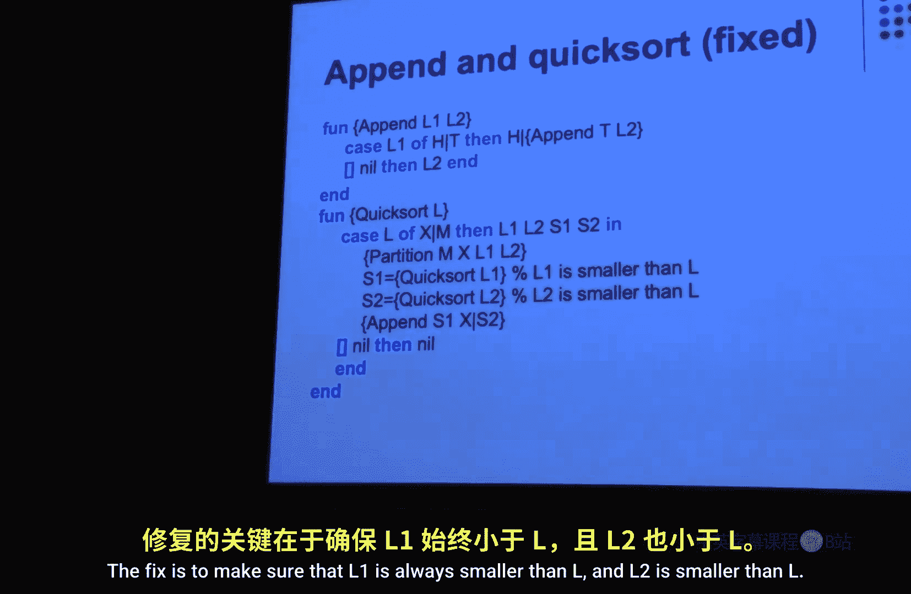

I can remove the pivot M M will be strictly smaller than L。That means L1 and L2。

Which will be strictly smaller than hell because I'm taking out this one element， okay？

And I put it back in the append。So I do L S1， followed by X， followed by X。

So the X goes in the middle of because it's the pivot though。Everything less is on one side。

 everything greater than people is on the other side。So I just put it back here。

So with this small change。I am guaranteed that the size of L1 and L2 are smaller than L。

And therefore。There's no infinite group。で？Okay， let me run this thing。

I have to write you rather quick story at least once。So here's a quick story。This is a lazy version。

 but I'm going to make it not lazy。有。P。Start。是。Of this是。All these tool hands。I it this。我还是就说。Well。

 I don't like these control plants， why is it show？あす。我得。What。Is this going to work。T that。

 I'm not sure。And the don't seem to bother。嗯。I will make a normal append first。诶。

This is not La liftta。诶。Okay so here see the answer， two， two， three， three， four， five five。

So this is the quick source。喂。瑞师诶。You see that it works， I' tested in one example。

 so your short works， right？O。Now we make it please。

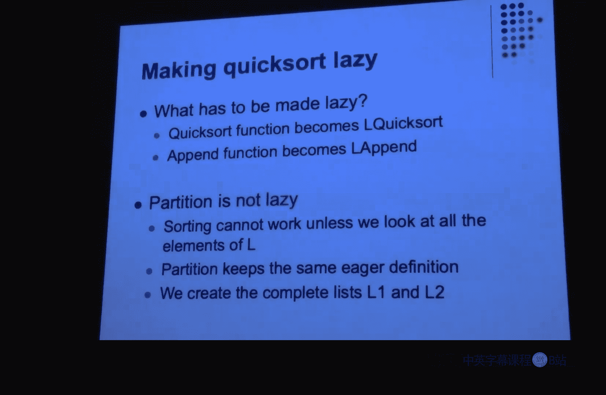

But I will make it lazy after the break， so I will make smoke now。

 and then I will show you the magic of lazy person。

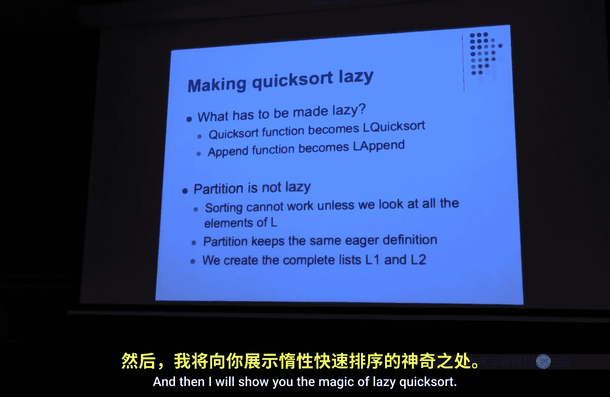

も白い。听清没有。

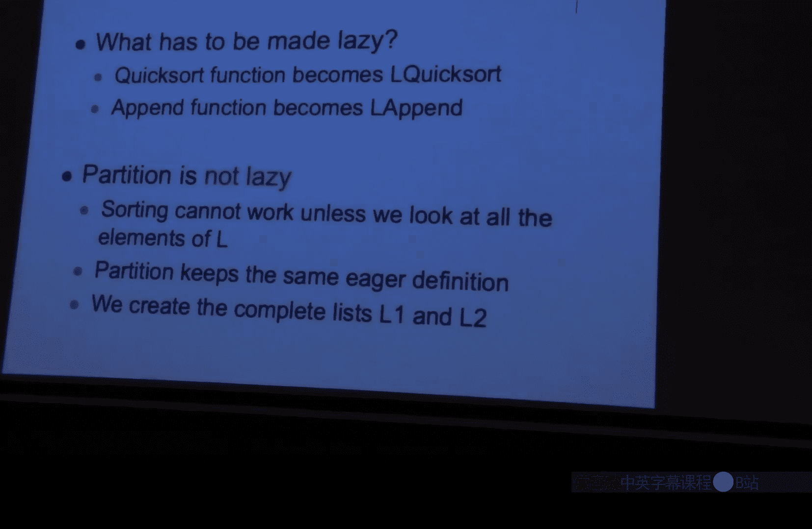

Let me show you now lazy quickrick sort。First of all， we have three routines， we have QuickSo。

 a pen and partition。

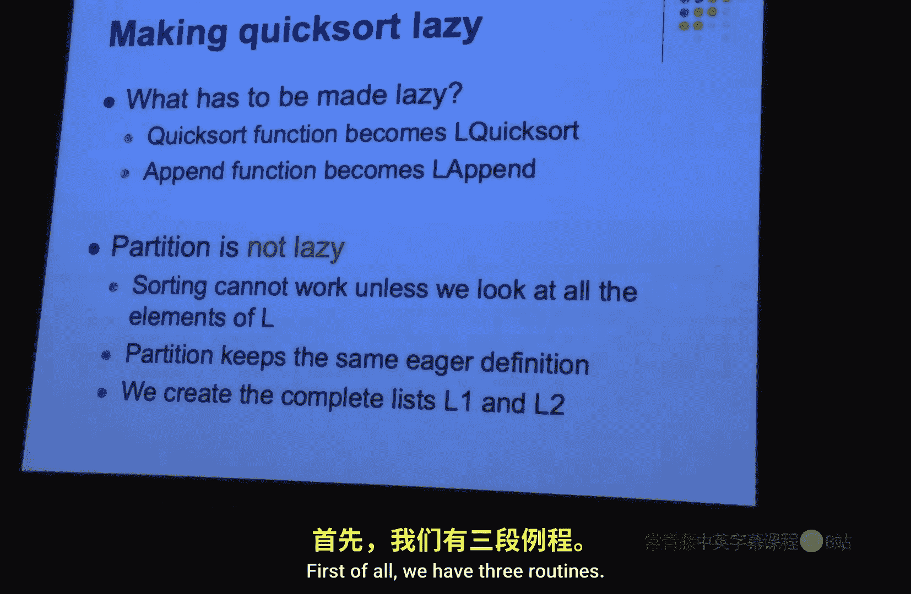

So we have to make them lazy。Quickword and append it very easy。

 you just make them lazy with annotating lazy and you get L quickword， El pen。

But you have to be careful， actually。Partition does should not be lazy。

Because you know you have to look at all the elements， you cannot find the smallest element。

R of L was not looking at all of them。Okay。And so also the partition has two results。

 so it's not clear which one you actually need both of them。

So actually making partition lazy is not a good idea， it's easier to keep partition eager， okay？

So that means we do the following。We take a pendant Quick sort and we just add laser。

 so it's very easy to change the source code。

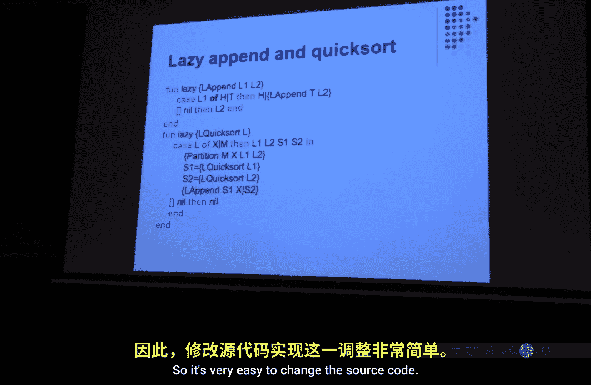

And otherwise it's all the same， we change the name up so that there's no confusion。

L app and hell exhor。But partition stay the same。ok。So let me run that。え？3 is another paint。Okay。

すごすご。Nothing good。I will have to， again， put it。是。とし。So here is partition。你系。

that me from child all that。这事之后。is the per。え？あ。SS is no， quick sort。な。Therow is。嗰啲。Okay。

 so I'm running lazy Quicksource。You see what happens here。そそ。这有意件。Okay。

See that there's a pest there。If I want some elements， I have to ask them。As do2 to do1。

 that will ask for the second element， but actually will create the first two。

So one two the two smallest elements。你咪。Ls are one and two。

 so I've asked for the two smallest elements out of nine elements。if I go for S do。2221。

 and now have the four smallest elements。Out of nine。See， I have not executed everything。

I've only executed a piece a part of this。How much did I execute， we'll see， we'll think about it。

 we'll look at it。So you see how it works， I can now ask for as many elements I want。ok。

So you can run this。What is the time complexity of this？Before I do that。

 I want to show you a little bit more detail how this thing is actually running。

 so I made a very detailed slide here。Which shows you all of what's going on。

And I would like you to follow this， so I made it in colors to make it easier。

 so the blue is the body ofqui sort and the green is the body of Elpen。

And I'm running quick sort of two， three，4， one， and I do S dot one。I want the first help。

So S is needed， okay， and this s dot1 is weight。S is needed。

 that means this lazy quickword will activate， and I execute the body here。So what does it do。

 it creates three lazy suspensions， you see that on S1， on S2 and on S。And that's it。

 I execute the body， but S is still needed and the S dot1 is still waiting。That means the third one。

 this one S equal L pen， will activate。Because it's what it's doing S， so I will execute the green。

 which is the body of the app。Now this one needs S1， which is the first argument。

Now S1 has a suspension here。So that is activated this blue code is this call up here that is activated。

And it runs， and at the end， I get S1 equal this thing。But I still don't know the value of S1。

 S1 is still needed， once a variable is needed， it stays needed forever， okay。

 so that means the Lloant will activate immediately。So this crazy lazy suspension。

 it's created and it's immediately activated because the weight needed is just going to go on okay so again。

 I will execute the body here of a case of S1 prime is the first argument here。

This one needs S1 prime。Now notice S1 prime is equal to L quick sort of n。

 so that's an easy suspension that will wake up。But that's easy because now the argument is nil。

 the result is nil， and now we start doing bindings， that's when prime will now be bound to nil。ok。

But that is also the result of S1 here S1 will be。This case statement will execute S1 prime is nil。

 so S1 is equal to1 S2 prime。That's this green thing is executing it because S1 prime is new。

And now I know S1 and S1 is needed here， H barT。It will be one followed by this eloant。

 S will be equal to one followed by this eloant。And now I bind S。And so the dot， S dot1。

It's been waiting since the beginning， it's only waiting， okay， so this do has been waiting nicely。

 very patiently， and all of a sudden it sees as is bound and so it displays one and that's it。ok。

So you see this looks complicated， it's actually not that complicated， okay？

Okay you have to be able to follow that here on the right。

 so on the left I'm actually showing the code， but on the right I'm only showing the lazy suspensions。

ok。So here， for example， S has a lazy suspension with a little arrow， S is needed。

 so these three lazy suspensions are created， S is still needed， so this third one is activated。

It needs S1， so this causes this to activate these three to execute the body L sorts and so on。

 so here on the right， I'm showing the same thing as on the left。

But only the lazy suspensions that are created and activated， I'm not showing the code。

It's a little bit simple， but to see really all what's going on。

 of course you have to look at the code okay。So you see how it works，I need something。 I wait。

Somebody else is activated， it works， and maybe it changes more things get activated and so on。

 eventually one of the bodies will bind result。And the guy that's waiting will see the eventually。

 okay？Now， what is the complexity of this beast？We can compute it。

 I don't want to be too far on about of this， what is the time complexity of lazy grippshor now？

So here's a simple， let me do just a simple example， three， four， one。I partition。

 I get two lists here on the left and on the right， but if I'm only looking at the first element。

These will create more quick sort calls。But this one will not。

The second quick phone call will not be activated， so I'm actually only executing things on the left。

Okay， so here I have to traverse the whole list n here I traverse n over two， but if you keep going。

 it'll always be the left one if I make it more。Complete picture， I have a partition。

 I have a list here。I part it。Which createates two lists， but since I only activate the leftmost。

Fll quick sort， I will partition this one。Again， I will only activate the leftmost one。

 it's because I'm looking for the first element。And so完。Until I have one element。

 so it's AI commerceverse n and over2 and number4 and so on until I go down to1。

 so the total amount of work done here is n plus n over2 plus n number4， etc ceter。

If you make this sun， you'll see it's just2 n。It's proportional to N。So the part calls。

Before making the smallest elements is n， and that's it， if I want the K smallest elements。

I don't just want wine， but I want a bunch of them。Then it's like I'm running a small quick sort。

 maybe in this piece I'm running full。Click source here。

So this part is running completely because I want all K elements here。

But this is only a size K thing， it's like a mini quick sort when I get down to the small list。

Of K elements， and I need all then that thing will be executed completely。

That means this and this takes n log n， this is a full quickixor， but only on K elements。

Fu quick sort， MIi quickrick sort as due to the partition list has at least k elements。

 so it'll be a little bit more than k maybe， but we can just say it's around k。

 so the extra time complexity is k log K。So if you make the sum of those two， it's n plus k9。Okay。

That gives me the time to fix。Of the whole beast。That's pretty smart， that's pretty good actually。

 for calculating， it actually creates a smaller quick sort。And then it executes it completely。

That's actually a pretty smart way of solving the smallest K out of N element。这个。Okay。

 so that's quick sort， so this is an example of the magic of laziness laziness has really made a smart incremental algorithm。

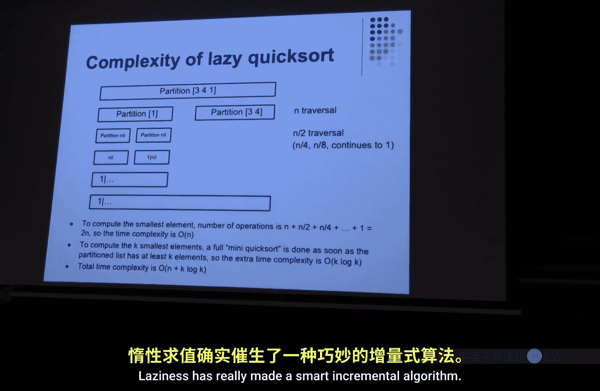

Okay。Sient， sufficient in time in space has a good complexity。😊。

What more can you ask and it's easy to write？It's the same source code as the full one， okay？

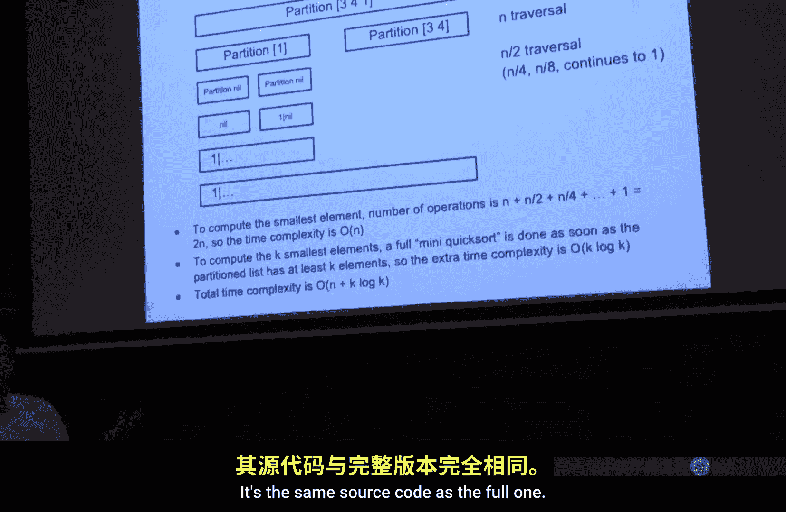

So laziness can not always make things incremental。

 but if you know that you can kind of write your code so that it's incrementalable so that it can be made incremental。

 you have to kind of write it in an incremental way。

 and then the laziness will do all the dirty work for you， okay？And this is not just a toy。

 this is a real practical approach， which we will see more of next week when we go to advanced declarative algorithms。

Okay。Okay， so that's all I'm going to say about laziness。Let me know。Step back。

And trying to talk a little bit more about dec program。So this is a main theme of the cor，In fact。

 programming is divided into two parts， declarative and non。You always want to do theative normally。

 except when you interact with the real world。That introduces nondeterminism。

 that forces you to be a little bit non。So that is generally how programming should be done。

Now the question there is what exactly is declared at this program？

And I want to answer that question now， so we're going to be very precise and a little bit formal。

Okay， so we have seen five。Deccled of paradigms。S functional programming with values。

 this is like in a language like scheme， sequential functional with single assignment。

 this is nice because list functions are toopressive。

We've seen deterministic data flow so concurrency， we've seen lazy evaluation， unlaziness。

 and we combine them to have lazy deterministic data flow， so those are all declared paradigm。

What does that mean？ok。What does that mean that they declaredative， well。

 I want to answer that question， want to tell you， really we want to go into that。

And we start from functional programming。Functional programming， which is the core。

And we saw a little bit of that in the previous course， we saw the lambda calcu。

But I don't go too much into the La calculus now， but I will refresh your memory on one thing。

Which is the church Ruser here。This is the main theoretical result。For lambda calculus。

 this is the reason why functional programming is the core， okay， why is this theem true actually。

 that's a really good question。And there's lots of answers to that。

 but I won't go into that so it says the following if I start from some expression E on the top left。

 I do reduction steps， so this is lambmbda clus so the lambda cthelus is a formal model of functional programming we saw it in the previous course and we actually did exercise in it and so on and this is what theoreisticians mathematicians study when they study programming。

 they start from the lambmbda cculus okay so there's many variations of lambda calculus but I don't want to go into all that。

 I just want to show you one main thing。So all functional programs can be encoded as Lada expression。

And these expressions are reduced step by step。Okay， so each little arrow here is a single step。

And if you want to know more， you can go， look at them。Vures of the previous course。

 but if you have started with some program， EA， some expression。

 and you reduce it da da da da until you get EB， okay？So this takes zero or more steps。

But you can also choose different reductions。In fact， there in a big expression。

 you can reduce it in many ways， okay you can say I want to start here or here。

 so if you reduce it in another way and at this one I'm going to write down going down here to E2 prime E3 prime handing up to EC。

So now I have these two different expressions， E B and D。The theorem says there exists a term ED。

 such as EB can reduce down to ED， but EC can also reduce down to ED。

That means the two reductions come back together or again。

What it means basically is that the reduction order doesn't matter。

 that eventually you will always get the same result。And this is a major property。

 we say it's called confluence， for lambda calculus is confluent。

 and this is the reason why declarative programs are so nice and why there's no nondetuminism。

 okay it's also called the church rostersser。Okay， that's another way。So this is lambda calculus。

Now the question is， how does this go to？All these other neat paradigms that we did。

 deterministic data flow and so on。So what happens there？

So we see that pure functional lamb programs are nice， confluent。

It's very nice property and it's very strong and the whole edifice is built on it。

But we did more than that。We added current currencyency。We added streams。

Streams are interesting because they keep growing。That means the program never actually terminates。

 we give it some elements， it does something， we give it some more elements， it keeps going。

 it's never actually really terminating。好ello。So what does that mean really。

 in terms of declarativeness， we also have single assigned variables， so variables can be unbound。

Well， the lambmbda capitalist doesn't have that， the lambmbda happinessist has only values。

Doesn't have unbound variables。So what happens with these funny unbound variables？

So how does the confluence， the church rostersser thing change when we have all this extra stuff？

So that's what I want to end。And I want to explain three things， first of all。

 concurrency is easy to handle。So the first one here， concurrency is easy。

Because concurrency is already part of。The church Ruer， if I have a big expression。

 EA and this expression contains multiple agents。And I execute all of them kind of currently。

 that's okay， it means I'm choosing the reductions according to some scheduler。ok。

But church Russer says it doesn't matter they will all get the same result。

 so the concurrency already doesn't make any problems。So the problems is the two other things。

 the streams and the single assignment variables。Okay。

So let me look at these two and I introduce two concepts。

 one is partial termination where the program never really completely stops。

 it only stops temporarily but it can start going again and then stop temporarily again， okay。

When I have a stream， I can。Give stream elements and I do a computation。

 but then I can make the stream grow and it does a little bit more。So that gives me。

A little bit a more general notion than just stopping of， it's partial。And finally。

 what happens if there's unbound variables， well that actually the store turns into something。

That comes from logicdging， the store represents a logical formula。

And this gives us equivalent storage， so this I will explain also。Okay。

 so let me start by partial termination， that's the easiest thing to explain。

So let's say on the top left， we have a concurrent agent。Like we saw， times H2。

It has an input stream。S off， put's a dream。And maybe it's a multippliering by two。

 so if the input stream is one underscore， the output will be two underscore fine。

If I extend the input stream 1，2， the output will be 24。And I can keep extending it。

 so how is this functional？Because the program never terminates。It never really terminates。

 it's actually there's no end， the stream can keep growing forever， so there's really no termination。

But actually， if we look at it in the right way， we can say there is kind of termination。

So assume that we give some S1。And we don't change it。Andd one， two， and we stay one， two。

And we let the program rise。With a fixed S1。They will permaninate。And S2 will reach a final value。

Which is two，4。This is partial termination because it's not completely terminated。

 but it's temporarily terminated， so one， two has given two four。Okay。

 there's also a theoretical in some theory papers， it's called a resting point。

You can see the program kind of rests point2 is given and you stop。

The program runs and then it stops。But it's only temporary， it's only resting。It's not actually done。

 it's just resting， okay， if you keep binding S1， it will start up again。

But each time the S1 is fixed， it will eventually stop。So that's partial termination。

 so we only have to worry about partial termination whose dreams。About functions。

 you don't have to worry about the full termination， okay， so that's one thing。

So that's one way to handle it。But not the more importantly。Is the。

Is what happens when there's unbound variables in memory？And they stay there。Well， actually。

 the stores are not containing values anymore， they're containing logical formulas。

 so this is actually first order logic。So I don't know if any of you have seen， of course。

 some first order logic， any of you have seen first order logic。Who have seen first order of logic？

Nobody。None of it， you have not seen the course on calcability no。Okay。

 that shows a little bit I used thinking of course on first order logic， unfortunately。

 unless you're doing mathematics you won't see so much first order life。But it's not a problem。

 I'm not assuming first order logic， I will explain exactly what you need to know。

So this will actually give you a little piece of logic what I'm going to explain now is a little piece of first order logic。

 first order logic is a very big。Part of mathematics， and you can formalize mathematics。

 you can write systems using logic， okay， so logic is a very big thing。

But I'm only going to show you a small piece of it， which we need。For showing equipment stores。Okay。

 let me start with an example。Okay， I claim that a functional programming with single assignment variables is still functional。

But instead of the results being equal。They're actually， the stores are not equal。

 but they're equivalent。So let's see how to make it yourself。

 so here' a program here's a little program with three threads。And it does x1 equals F zine W。

 F is just a record of two arguments。Y equals flu Zw and Z andW are just compound bound variables。

 and then it does x equal y。So I have three threats。Now， depending how you execute this。

 we can get different findings in the store。If we start by executing T1 and T2。

 then we will bind x equals this food thing， so this is the store sigma。

And it's a set of binding variable equals something。X equal this food thing and y equal also fool。

And then x equal y will verify that x equal and it's done。

 so t1 and T2 x equal first sigma looks like that。But we're not guaranteed the scheduler might think differently。

 the scheduler might say， let's do T1 and T3 first。And T2 after， so if we do T1。

 we get this x equals fosyw， if we do T3， it's x equal y。

 so this is binding y since x is already about y equal x。And then the final one。

T2 will just verify that it's the same， so this gives me another story， same a prime。

So we have two stores， sigma， Sigma prior。They which are different， they're not the same。

But somehow they represent the same thing。You can kind of see that both X and Y are going to be records。

 F ZW， but the bindings are actually different。But it doesn't really matter that they're different because the values that these stores your presenter are the same actually。

 so how can we make that kind of precise you can see the intuition up sigma and sigma parameter are different。

 they look they're actually different。But in some sense， they're the same。

They kind of represent the same thing， so that's very vague， so we want to be kind of very precise。

How do we make that precise， how can we express that stigma and stigma prim are the same？Okay。

 so here's one approach， and this is going towards budget。So assume we have now these two stores。

 sigma and Sigma prime。The bindings of X and y are different。😡。

And sigma think look crap other they're different。But the possible values of x and y are the same。

 both x and y will be records。With a label2 and with two arguments that can be any value， Z andW。

Okay both in both of those， so how do we make that precise？Well， one way is fault。A store。

 so any store sigma。Somehow corresponds to a relationship of connection between the facts。

The store Sigma is telling us so this sigma。It's telling us that x is a record with labeled F and argument C and W。

 and that y is a record with labeled F and argument C andW， that's what it's telling us。

But if I give any possible values of X， Y， Z， and W。

Either they could be in a store cinema or they are not， so if they are of this form。

Then there they could be in a stigma， but if they're different， if x is not a record。

That it cannot be in the source thing。So somehow the store is telling us that for some X，Y，ZW。

 it's true that can be as it could be in there， or for other words， it's not true， so it's false。

So the store sigma is kind of a thing that can be true or false。If I take any X， Y。

ZW and put it in there。If then either this could be true。

 if the x is a record and y is a record and so on， or if it's not a record， then it's false。

 so the store sigma is kind of dividing the world into two parts。

 the ones the values that are true and the values into false。Okay。

Which means that it's a logical formula， so a logical formula is an expression that can be true or false。

So we write it a little bit different way， so instead of writing it like a set。

 let me write it like this。Where I have these two equalities and I put this symbol here。

 which means and， so I write it like a logical expression。So this is kind of inspiring budget。

So this thing。For any values of X，Y， ZW， this can be true or false。Right。If I pick them right。

 it's true， if I pick them wrong， it's false。So it represents a set of values and all the ones through which it's true。

You see that every store is kind of a logical format， okay， so that's one thing。Now。

We are picking values， X， Y，ZWR。The operation of picking values， let me give it in name。

And he call that an interpretation。When I take a store。All the symbols in Sigma。

 I will assign values to them。X is this， Y is this， Z is this， W is this， okay？

And also the record symbol， the fo？I will assign a function to that。Function of two arguments。ok。

And an interpretation。Can be either true or false。So if I do x equal Fx1 x， then it's true。

If the value were turned by the functions equal to the value I've assigned to x。

So if I pick values that make it true， it's true， if I pick different values， it's false， okay？

And if I take a store， which is a combination of those， it's true if all the bindings are true。

Otherwise， it's false。So you see if I interpret the store。

 I'm actually giving values to the variables and with those values， the store could be true or false。

It's kind of representing a logical formula， see that our stores can represent some kind of logical formula。

Okay， and now one more thing。I talk about a model， so that an interpretation is any of values。

 I assign any values。But a model is only all when the when is's true。

 so a model is kind of a good interpretation， one that's kind of doing the right thing so that the score is true。

So the store kind of the marble is kind of the thing that the store is representing， okay？

Ass an interpretation where I've picked all the values so that it's true。Okay。And that's it。

 that's all I need to do now I'm done actually。Now we can define the two stores are equivalent。

So each store represents a logical formula that can be true false。Two stores are equivalent。

When no matter how we assign it， so for any interpretation， they're either both true or both false。

 which means they're kind of the same。We cannot find values such that one story is true and the other one is false。

 that means they would be different。that's the thing， so no matter how we pick his values。

Both of them will be either true or they will both be false， so they're actually the same。且。

And if you look at the previous example here。And on the top here， you can see that's right，h。

If I pay any values for X， Y， ZW。Sigma will be true or false， depending on whether x is actually。

 I've picked a record， okay， for x and so on。But sigma and sigma prime will both be true at the same time。

They the same values or they don false？I cannot make them look different。

They're actually representing the same information asza。And I make a notation for that。

 so that's itta， that's the idea and I introduced a nice notation， so this will come in from budget。

Which is this。Bar with the two stripes there。This is an notation coming from logic that me。没见。

Goodture here。So it's like this location。

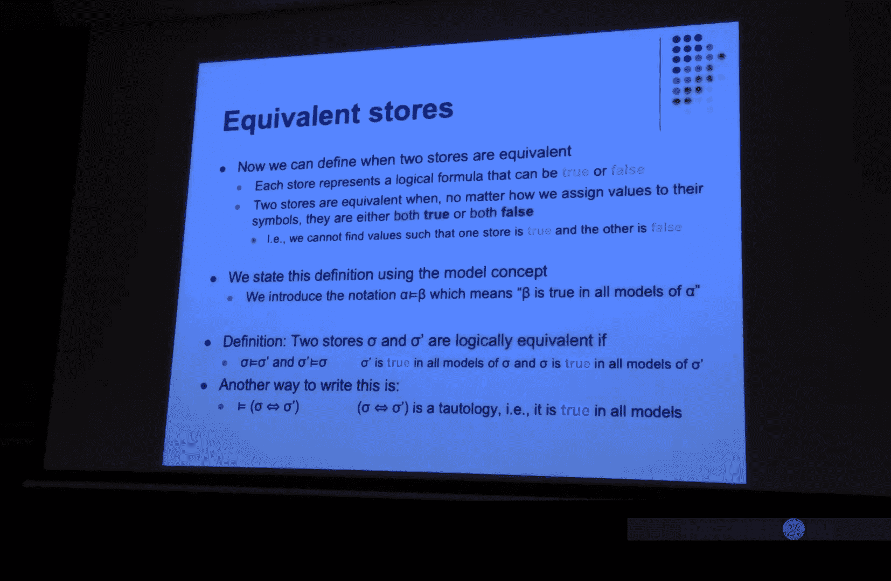

So alpha is a logical formula， beta is logical formula。

 so what this means is that beta is true in all the models of alpha that means I take an interpretation that makes alpha true。

 beta is also true there that's what I'm saying so that's what this means。诶。Beta is true normal。

So two stores are logically equivalent if sigma prime is true in all the models Sigma and sigma is true in all the models of Sigma prime。

 so if one of them is true， the other one is true， one of them is false。

 the other one would be falsesome。

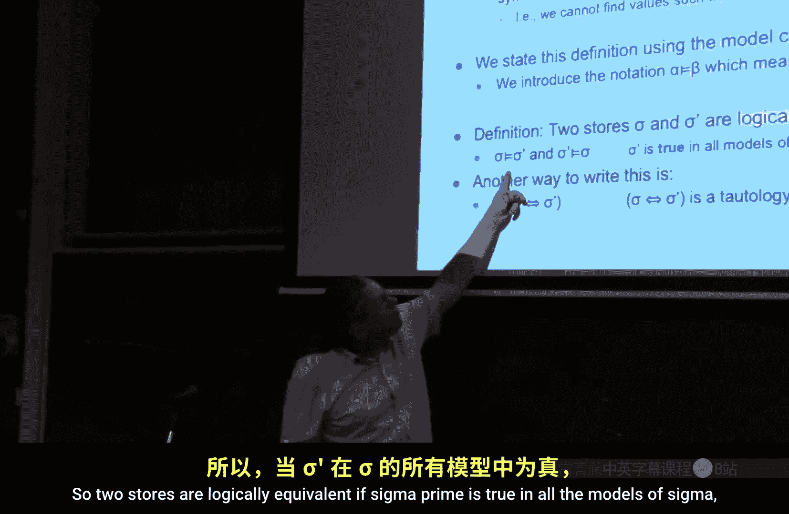

So they're equivalent， they're both true at the same time。Or if they're not。

 then they're both false at the same time。You can also write it slightly differently here using this equivalence operator。

So this little double headed arrow， it means that either both sides are true or they're both false。

And if I write this with no model， no formula here， it's talking about all models， all possible。

Interpretations， all possible assignments， values。This is true。That means if sigma is false。

 then sigma prime is false。If sigma is true， that sigma prime is true they equivalent。

 it's also called this is called a tauttology， okay。

 this is a tauttology that means it's true in our mind， that's coming of from logic so I'm actually。

Introducing a little bit logic here，Okay。So two stores are。Equivalent。

 if no matter how you would assign the values to the variables。If one of them is true。

 the other one is also true， and if one of them false， the other one is also false， that's it。ok。

So that is that way we can see whether the stores are the same。Okay。

 so these two stores up on the top here。They're the same， they're saying the same thing， actually。

 they have the same information， according to this definition。ok。So what I've done now。

In the last 10 minutes， is I have essentially given you an introduction to first order logic。

Now this is not a course。In logic。But first orderologic is actually to a very important thing。

Most of mathematics can be built on top of first storyologic。

 so I'm not going to explain all the first story logic。 I only showed you。A piece of it。

I showed you a logical formula， this is an expression。It expresses relationship between values。

And then I show you a model。This is。A set of values that makes these formulas either true or false。

 so the model is like the semantics of the logic formula， the logic formula is just an expression of。

Some kind of a grammar thing of syntax。But the model tells me whether it's true or false。

That expression， so it's kind of doing the setics。So the two stores are equivalent if they have the same models actually。

And that's it， I'm not going to tell you more。About logic。

that's all like you need to know about logic for this course。

You need to know the notion of a electrical logical formula and the notion of a model。

 the way I explain it。Okay。Okay， if you want to understand first order logic more。

 actually that's a good thing， first order logic is a really interesting thing and many， many。

 many things are based on logic。And you all' getting bits and pieces of it in their courses。

 there used to be a full course on logic。Wwhich was given by me， okay。

 but unfortunately when the curriculum was reorganized， the course disappeared and logic。

 a small piece of logic is given in the course of calculability， calculability from E the view。

But that's only a little bit of logic， so there used to be a full course on logic which was really nice。

 but unfortunately it doesn't exist anymore。So I give you just a little piece of logic here。Now。

 actually。There are programming languages completely based on logic。

And this most famous one is called prologue。Programming and logic。Progue。

 it's interesting because this year 2022 is the 50th anniversary。Of prologue。

 so there's like a celebration of prologue， there's still many prologue implementations。Okay。

 you can download them that are free and they work very nicely。Prolooc is 50 years old now。

 it's pretty amazing and still being used， okay， people still using prologue。

Language based on first order life。So that's an old thing， actually。

 there's also constraint programming， which is based on first audio logic。

And this is interesting because we have in our department。Experts。On that。

 especially E the V and Pierre shows， they are world experts on constraint programming。

And there are programming systems based on this， so if you're interested in seeing the power。

 it's very powerful actually， you should take。The course is on constrained programming。

And a final thing。Everybody uses logic because database query language， SQL SQL， the SQL。

 which is used everywhere， is also actually logic。It is also first order lunch。

It is a logic language， so Java with SQL is actually a combination of objectorient and logic。Okay。

 so logic is used a lot here。So I have just given you a small piece of logic。

Just enough so that we can define the clarityative program。So this， what I'm showing you here。

 it's actually。Useful to really try to understand it because if you ever learn logic later。

 you will continue this， okay this has given you kind of the beginning of first or logic。Okay。

We need it here for defining equivalence between stores， but in fact。

 it's much more useful than that。So now we know enough to define thelarative programming。

 and now the definition is actually very simple。It's in the record。

 we can say precisely what it means。So if I give you a program。

 the program is declarative if for all possible inputs。That all executions。

For those inputs will either not terminate， so they all go into loops， for all of them。

 all the executions reach partial termination。And they give logical equivalent stores。

That means if I run the program and all executions means。All choices of the schedule are out。

current programr， so no matter what the scheduler does。They will all give。The same results。

 but the same means logically government， doesn't mean exactly the same binding， it means logically。

 it's the same。什么。And they always have partial determination。

So when I say there is no observable non determinism。What I mean is that it's doing this。Okay。

 so this is an important definition for declarative programming。

And all five paradigms we saw are all the according to this。Okay。

Okay so that's what I wanted to reach， so you see it's important， logicalence is an important thing。

Okay， now there's just a few small things。Failure confinement。So okay， so declarativeness。

 as you gather by now， I consider it very powerful and important。

So we want to write applications asative as possible。So that's a major theme of course， of course。

But there's another thing， what if there's a bug？That causes the program to become non declarative。

How do we fix an application because of a buggy， because it's buggy becomes？

It becomes non deterministic， it becomes nondelarative。ok。

It give you some kind of non declarative behavior。So there's actually two ways of getting nondclarative behavior。

 there's a good way and a bad way， the good way is that the program interact the real world and we see that later。

That kind of non interminism is unavoidable， but now let's see what happens if you have a bug and the bug makes it non declarativeative the idea is to kind of。

Fix it so the bug does not propagate。😡，Okay。Okay， so there's an important fact。Okay。

 so it is a truth universally acknowledged that a program of a certain size must have bugs。

All these programs have fun。If you have read Jane A。

 then I apologize because this phrase is coming from。A novel by Jane Austen， do you know Jane Austen。

 any of you？Pride and prejudice。For brilliant pleasure， no， you don't know it。It's a great book。Well。

 this sentence is actually inspired by Jane Hossey。But it's true， so here's a program。X is one。

 y is2 x is y， notice it doesn't work， it's in incentive okay， so this is。

 let's say you have a huge program， but at the end of the day it's doing this。So that's a problem。

This will always raise an exception。And depending on the scheduler， there are three possible stores。

That are different。It's either  one， two or one，1 or two，2 which one do we get。

 we don't know depends on the scheduler， this is an observable nonurism。

 that's non declarative and it's because of the problem。So we can do failure conance， conance， final。

 we hide it。So that the program becomes declared player to begin it， we kind of put a box around it。

So here's the way to do it， so I have my program three things here。I put a try catch。

 I catch the exceptions。And if there's any error as1 or S two or S3。

Then I say that xy is equal to one it's like a default， so I'm hiding the nondeterminism。

But if there's no error， then I pack up x1 and y1， okay， so I'm actually if there's an error。

 I hide it。I make the program deterministic again， that's something you sometimes have to do。

 that's the real world。ok企。And this is called failure confinement。Okay。

 let me just make one more thing and then we're done for today。So here is a chart。因为。

All possible declarative paradigms。And we've seen that， so functional programming with values。

 functional programming with data flow variables， deterministic data flow is here。Lazy。

 the deterministic data flow is here。Lazy evaluation is here。

 here we have lazy evaluation with single assignment variables。These are six。

 these are six pheromons。Some of them have languages attached。

So this one there's a language called scheme。This one。

 it's prologue deterministic subsettive prologue， this one it's has。These three。

 there's really not so many languages or none， do it today。But it will be done in the future。

So this is kind of the future oriented。ok。You will in the future see many more declarative。

Paraigms empirical。Okay。Okay， let me summarize what we saw today。First， we saw Ma evaluation。Okay。

 and I showed infinite lists， I showed Da Quicksor having what you can do。

 a second I explained what is declared programming using confluence。

 partial termination and logical birth， so I actually give you an introduction。First order budget。

And next week， next week， we're going to show advanced algorithm design。

 I'm going to show you how to make really efficient。Smart， declaredative algorithms。

Basically using laziness， laziness as a very powerful。

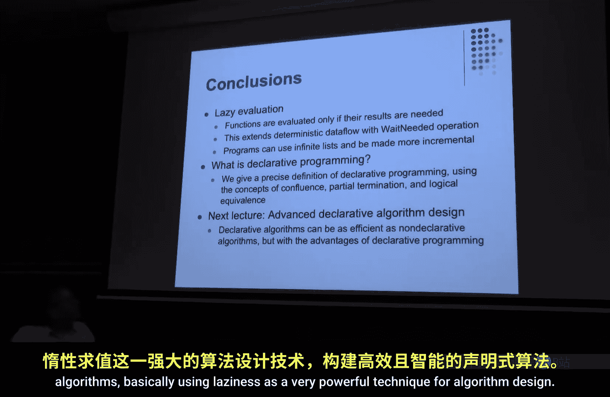

For algorithms， so I will go。