# 鲁汶理工学院【中英⚡高级编程语言概念｜LINFO1131, Advanced programming language concepts】 p32 P32 FO1131 Lecture 4 (2022) -BV1UDffBbEBZ_p32-

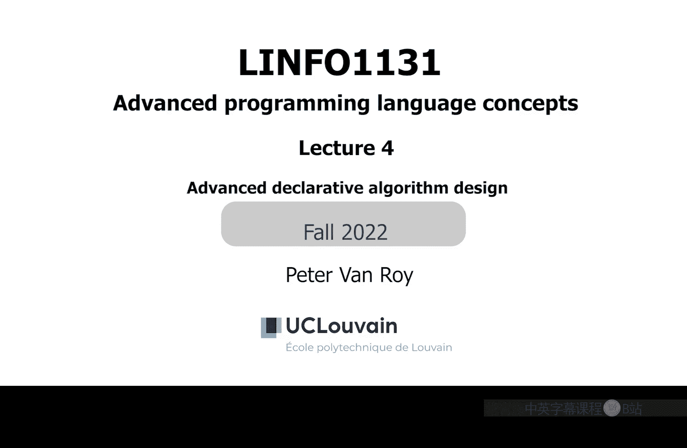

I'm very happy to see so many people here， so early in the morning。Today， we're going to。

I understand some real cleverer and smart techniques on building declarative algorithms。

This continues what we did on laziness。It what we did on single assignment。

 so this continues and it's kind of very smart。AndClever use of。

Lazy evaluation and of single assignment。I'm going to be showing nuts of code。

 so the motivation is we want to write efficient algorithms that are still declarative。

 you know the main the of the course or one of the main themes。

Is that you really want to write your programs decly。It gives you so many advantages。

And it's more and more。Going on， and I'm sure in 20 years it'll be even more。

And that's what I'm going to talk about today。We're going to use some concepts。

I'm going to talk about algorithms。😔，So first of all， singing assignment of lazy， we saw it。

 but I'm going to talk about amortize and worst case。Performance for algorithms。

 I'm also going to talk about something new， advertised you maybe have heard。

But I'll talk about something you probably haven't heard。

 which is an ephemeral and a persistent algorithm。And a very interesting and very powerful idea。

And we're going to give a bunch of algorithms today。

And then I' show you one concept called a difference list， this lets you do append。

Of two lists in constant time operation。And it's declarative。And then I'll show you a bunch of。

Da structure is actually a cu， but with different techniques。

So we're going to always use the same cu with the same interface。

 but they will get smarter and smarter as the course goes on， okay。

 I'll start with a naive cu if you're really naive to do like that， but then you make it smarter。

I make it advertise that comes to time。The worstors case comes in time。

And then I will make it persist。Okay。And I'll explain explain you what it means。

 And that makes the algorithm actually very， very powerful。 So you'll see that。And in the course。

Okay， so just a little motivationvation， so we want to write code declaratively because that gives you huge advantage for testing for concurrency。

For distribution， it really makes life easy， so we want to stay there as much as we can。

And today I want to talk about algorithms， not just programs。

 but specific algorithms doing some specific task。Like a daily abstraction。

And that algorithms manipulate their structures and sometimes they need mutable states。

 you write them in Java， you will be doing updates variables。And the question is。

 do you really need that？Okay。Can you make the algorithms efficient in just purelylarative and sometimes you can。

And sometimes you can't， but many times you can， okay？oftenten be efficient。

 and today I'm going to show you some clever techniques on how to do that。Okay。

Some of these techniques come from a very good book。

On how to build declarative algorithms called purely functional data structuress by Chris Lokasaki。

 so here's the book。And this book has many more examples than I'm going to show you。

And it really shows you how to make。Declarative algorithms efficient。Okay， so this is a good book。

 maybe I can pass it around， if you want， you can look at it， this book uses different notation。

It has many examples you just take a look。It uses another language called standard MO。

Which is a functional language。With explicit lazy evaluation。

So that's not so hard to translate into us， okay， so we're going to use。

Some of the examples I'm going to show you are' taken from this book。Okay。

 before I show you lots of code， I want to present the concept。

 so we're going to have algorithms today， so we're going to talk about algorithm concepts。

And there's the following， there's three kinds， first of all， language。

 workingre to use declared the paradigms， powerful ones。

 and the concepts we use are going to be the single assignment variables。

 some which I call data flow variables， also lazy evaluation， so that we saw that already。

This is what we saw。But there's new concepts for today。First of all， in complexity。

 so you see already， I'm sure how it courses complexity of algorithms。

 time complexity here we're going to focus on upper bound。And two kinds amortized。

And worst case complexity。Avertise is kind of something you can sometimes get。

 it's easier than Moore's case， but it's not as good。

 so I'll explain that and the final one is emeeral versus persistent。

Now this is something you almost surely I don't think you've seen it so far in your life。

We've always worked on ephemeral。Data structure so I'll explain what it means and why what is this new thing。

 persistence and why is it nice， okay？So first， advertised。Admortize complexity。

Means if you do lots of operations， maybe most of them are cheap。But one of them is expensive。

Well that's not so nice， so the worst case is very bad。But still on average， it's good， okay？

And so if you have N operations combined， they have a complexity of F to n。

ButThen each single operation you divide by n。 So there's like an average。Per operation。

 which is FN divided by N。Individual operations。该 be。Mostly cheap。Sometimess expensive。

So if I have a queue， for example， so I start here and I do an insert。And then I'll do more re。

 so I'll make the diagram。And each time I do an operation and serve。

I I will get a new queue and maybe the time of most of these is one， okay？

But then there's one operation year， which has time with N。Well， if I have any operations。

That have time1 and one operation of time n， then the user on average will still see constant time。

 because the n here is like spread over all the n sequence。

And that's usually good enough very often for human beings， you're doing stuff。

 most of them it's fast， sometimes there's a slow thing in there。But that's sometimes okay。

If it's on average， very， very fast。Okay， so this is the idea of amortized complexity。Okay。

And then there's the other idea which we saw you saw of the four which is worst case。

 this is the standard big O， so the worst case means you're looking at the single operation here the worst case complexity is n。

The worst case is end。But the advertised is one， okay？Now what you really want。

 the worst case to be won， okay， you don't want to end here， but maybe you can't get rid of it。

So this one actually has a very bad worst case。But much better， amortized。咧。

So advertise is something that's。Like a compromise， okay， sometimes it's good enough。

 and I'm going to show you some amortized algorithms today you see how it works。

The other notion is ephemeral and persistent。So ephemeral。

 a word ephemeral means something that is very short lived， it's very transient。

 it only exists for a short time。A fly will only live for one day， it's a very ephemeral creature。

 okay？And for a data structure， an ephemeral data structure。

It means youll have only one version at a time。So what does that mean if I have Q Q1 and I do Q2 equal insert Q1 of a。

 I create a new Q Q2， okay， that's reasonable。But Q1 is not valid anymore。I destroyed Q1 to make Q2。

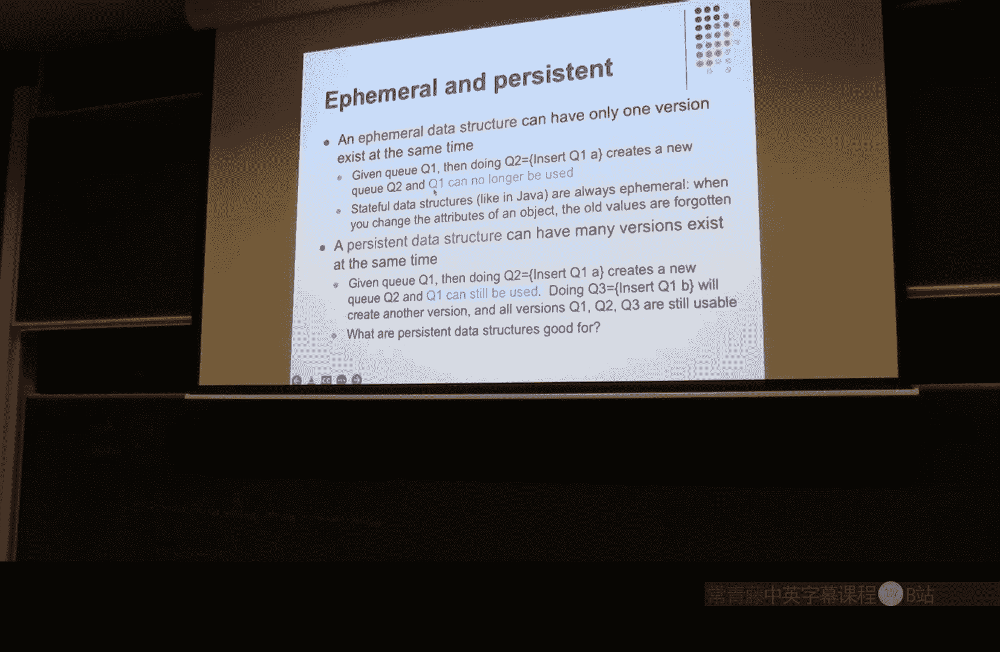

So the two is ephemeral， there's only one version at a time， okay。

 when you build data structures stateful with variables that you can update。

 they're always ephemeral。When you change the attributes of an object， the old attributes。

 the old values are gone， of course， they've forgotten。So the old dead value。

 the old version is gone， that seems to be very obvioush it's gone。

 so you only have one version at a time。So an ephemeral has only one version at a time today。

 so I can make the picture again， so here for example， it has two one。I do an operation。

 I get another QQ2， but once that creates Q2， Q1 does not exist anymore。Q3， Q3， once separate Q3。

 there's no Q2 and so on that。So there's only one version at a time。

But there's actually another kind of data stretch。And this one is called persistence。And this one。

 you can have many versions at the same time。So if you're giving it Q21。

 you do Q2 in search just like before， you have a new Q Q2， but Q1 is still there， it's still usable。

So Q1 does not go away。And if you do Q3， you can do Q3 is it circuit Q1， and that one will work too。

 okay？So you can have many， many versions， so the way it works is if I have 21。And I do an insert。

I have Q2， but the Q1 is still existing， so if I do another insert from Q1， it works。

And now I have two versions。And I can keep going and I can create many versions each time I would create many versions。

Of course， you might say， well， this is going to use up lots of memory， right？

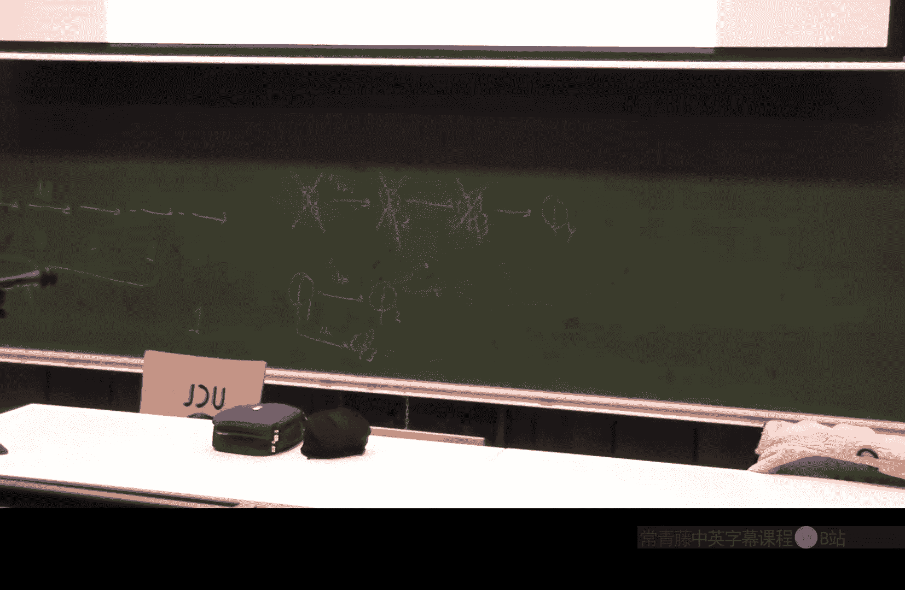

Well， actually， if these data， the old ones are not accessed。

Then the garbage collector will remove any of the data， so this actually works fine， okay。

So why is that useful， this is the persistent？And this one is federal。

So why is persistent data structures， why is that useful thing to have many versions。

 actually it's really， really useful， okay？And you already are using it actually。

It's used typically for collaborative work， let's say if you have two people editing the text。

And they make their own versions， local versions。That's an example of a persistent thing structure。

 a single version becomes true versions。And also a repository like Gitthub， software repository。

 they allow having many versions。Of software。So this is actually a very common thing you can also have databases。

With multiple versions， if you need multiple ways of using the data。

 then you can have different versions and they can exist at the same time。

 you might have a recent version or a older version and they both exist。

So thats actually very useful and if you can do it cheaply， it's actually very nice to have。

It's also useful if you want to do like an undo， very cheap。

 you can always go back to the old version， okay， it's very easy。

 it's just sitting there and you can even use it at the same time as a new one， okay。

In systems that have beautiful state unlike like Java。

You can get kind of mutable versions by doing copy。You make a copy， okay， of some data structure。

 but there it's the programmer that has to handle it， it's very clumsy， the copy is a new thing。

And you have to be careful about the original and the copy with Penilla。

So in the code I'm going to show you today， it's all automatic。

 you use the data structure and the old versions， they still exist and you can use them。There's no。

 you don't have to do it， the programmer doesn't have to do anything special。Okay，And a final point。

 if you have multiple versions。It's often a good idea to have a way of combining versions。

 maybe we want to combine。

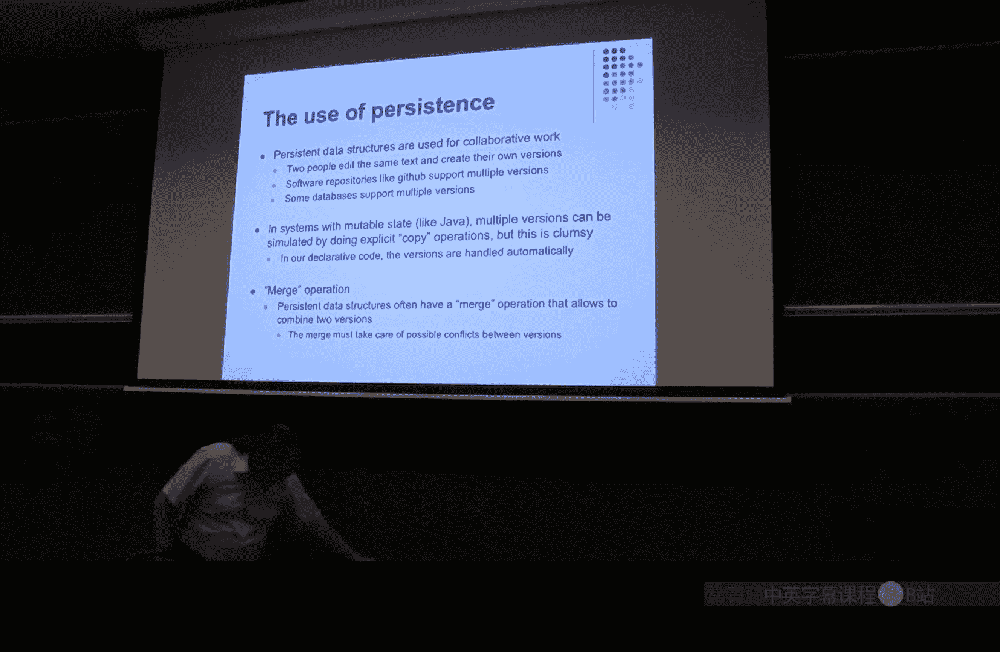

Q2 and Q3， maybe two people work on a text。

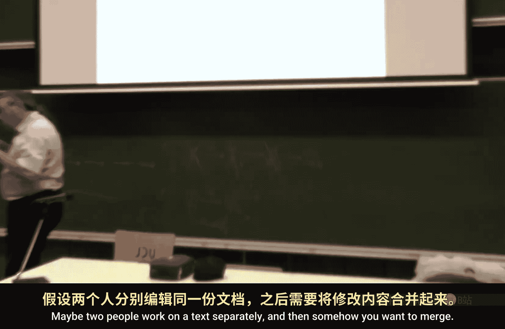

Separately， and then somehow you want to merge， they do local work， and you merge。

 and so merge is actually a useful kind of operation。For persistent data structure。

So I'm not going to talk about mergech today， but it's easy to add the merge for what if you need a data stretch。

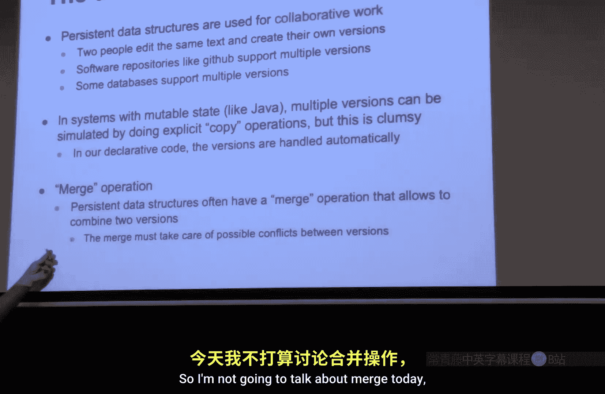

That can do that。The me， sometimes it's tricky because you might have conflict。If you have in GitHub。

 it has a special way of handling that， so any place where there's a potential conflict it will tell you。

 okay？But often other data structures， you can just do merge， if you have sets， for example。

 you can just do the union。So that's what we're going to talk about， ephemeral， persistent。

And worstors case advertise， and I'm going to show you lots of code for that。Okay。

 so let me give like summary of what we're going to see today or today and next week。

I'm going to show you five ways to do the acute。And it'll always be the same cu with the same interface。

 but the algorithm will have different implementation， different complexity， okay？

And they're going to use different paradigms， so these different algorithms。

 some of them will have different paradigms。And I'm going to show you five here。

 the blue one here is the naive tube。It's really the worst of all， okay。The insert is constant。

 but the delete is order n。Delete this slow， but you'll see in I show the color。

But it's written in functional program， sequential functional programming。

I can make it a little bit smarter， I can make an unortized constant time。

Where the insert and delete are both constant but amortized。

That means maybe the delete is still expensive， but it's rare， okay？So it's kind of better。

Ivertized most of the time。But what I really want is worst case。

Constant time and in order to do that， I need to use single assigned variables if I do that。

 I can show you a worst case。Constant time。Insert and delete are constant。

But both of these are ephemeral， okay？That means once you do something with the version。

 the old one doesn't exist anymore， okay it's not visibleable。And if you want persistent。

 then you can use lazy evaluation， this is another very interesting use of lazy evaluation。

 it makes it possible to get persistent algorithms。So that's pretty amazing， okay。

 so this is another of the powers of laziness that with laziness you can build persistent algorithms。

And I'm going to show you an amortized。Comes to time persistent Q， and then a worst case one。

 This one is actually， you have to be very。Careful on how you organize the lazy stuff。

So laziness will give you persistence。Which is very nice actually。

 so here's kind of a graph of what where we're going。The things， so we have this two here。

It can either be ephemeral or persistent， ephemeral one， we have the amortized in the worst case。

 constantine and persistent also amortized worst case， okay？

And so I'm going to show you the code for all of those and explain it。

 the advertise ephemerral is the easiest。And if I add single assignment variables。

 like the data flow variables， I can get a worse case of fe， which is good。

And if I want to make it persistent， I will be using lazy evaluation。

So this is a good diagram to keep in your head。嗯。So you can see how the more powerful paradigms that you do better smarter algorithms。

 okay， so that's how we're kind of going to organize things。Okay。So in order to。Warm up a bit。

I'm going to show you。呃。A data structure， which is actually a list called a difference list。

 So this is actually very similar to the。呃。Worst case femoal Qe， it's kind of the same idea。

 but this is a really powerful。Declarative infrastructure infrastructure。

 so I want to show it to you this lets you make list of pen。Constant timing。

 which is very nice if you can do it。So a difference list is。A representation of a list。

I'm representing a list。As a pair of two blists。诶。Let me I'm going to show you examples of this。😔。

So what does that let you do， so if I could list some list L？

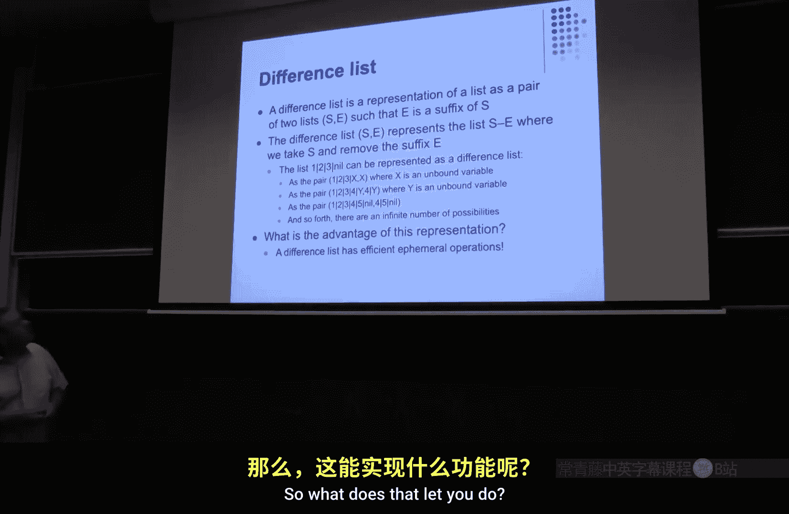

I represented as two lists as an E。So this is a representation。

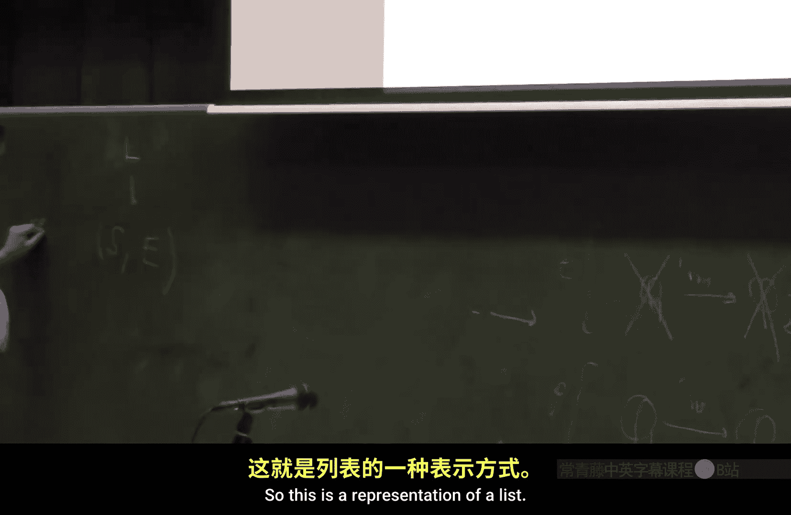

かでした。It's still just a list， but I'm representing it in a funny way as two lists。Okay。

 and E is the suffix of。よとです。So for example， the fill L is one， two。3 little。Then SE could be one。

 two， three。For little。Followed by for mill。Okay， two lists。

And the list that I represent is the difference of those two， this one， two， three， four。

 minus this one， so this one has to be the suffix it has to be at the end of the other one。

 so E is a suffix of L。So the difference is S represents the list S minus E。

You take S to remove this suff teeth。Okay， so that seems fairly straightforward， right？

Now it gets really nice when you start。Using unbound ver。What if I do this？Where x is an un variable。

This one。It will be bound to a list， but I don't know which one， so I just put it onbound theory。

So one， two， three， x， and x， well this is also the same thing。This is also the list  one， two。

 three。seeSo this is a flexible flexibility you get when you use unbound variables。So the list 1。

 two， three nil， there's many ways to represent it1，2，3 x is comma x，1， two， three，4， y， comma4 y。

Or one， two， three， four， five new。How about four or five new， there's many ways。To representpresent。

So you say okay， so that's kind of funny， right， I represent the list one， two。

 three new in different ways okay。does it get me， what can I do when I have that？When you have that。

You will see you can really do interesting things。

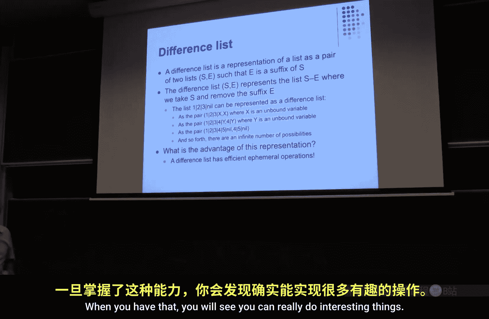

First of all， you can add elements to the back and the front。In constant time。

You can start manipulating this there。

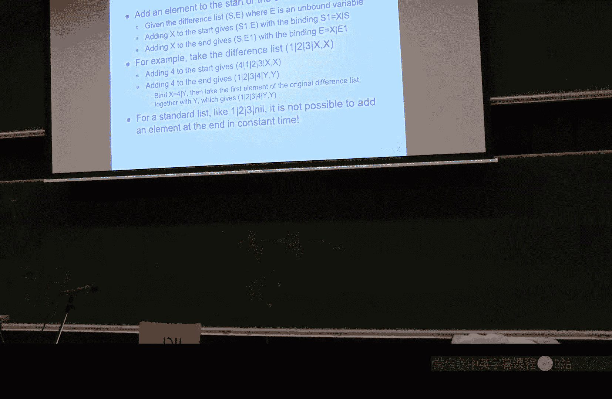

So given that difference list S， and assume that p is an unboundmed variable， okay。

 it's like kind of like this， 12，3 x， x。ok。Now， how do I add。

 let's say I want to add a number to the beginning of this。

I want to add four to the beginning of this， that easier， I just add four to this one。So I get four。

 one， two， three。

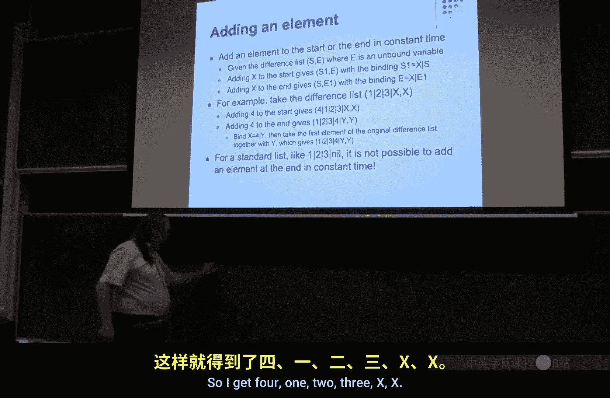

Thanks。です。So if I add four to the beginning， I can do it by just adding four to the first one。

But how can I add for to the end， so what I want is something like one， two， three， four。

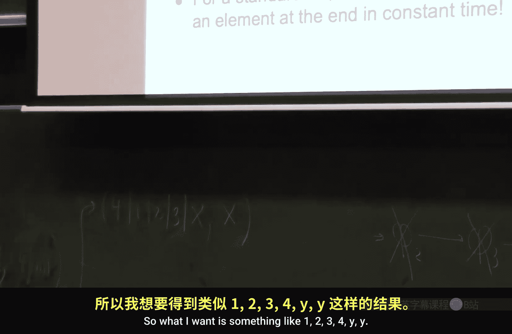

Y comma y okay， so if I want to add four to the end。Well， I will find else。If I。

 if I want to add four。To the end。Here I'm having it to the beginning again。To the start。

If I want to add afford to eggs， Id buy。4。はい。And then I use the first argument， which is one， two。

Three， four， why。And I replace the x by one here I use y。And now I have four at the end。One， two。

 three， four， why， come one。So this is the list 1，2，34。オケ。This has constant of time。Operation。

It's only one binding。I can add an element to the end in one mind and it's still declarative。

That's kind of neat。And if you have a regular list like one， two， three new， you can't do that。

What if I want to add four at the end here？Well this is at the value， you cannot modify it。

 you have to traverse the whole list and make a new list with four at the end。

 so it's order n if the list has a length of10。Adding an element to the end。Take order and usually。

But for the difference list， it's constant time。 see that's nice up and it's still declarativeative because we're using the。

あ very不。So adding an element can be either done at the front or the end in constant time。Note。

 you can only do it once，Once said bind X。It's done， I cannot find it twice。I can only do it once。

So the limit here is that I can add an element to the end it comes to time， but only once。

And that's it， I have one shot thing， okay？But the advantage is it's still thelar this。ok。

And you could do even more than that。You can actually do a pen。Pending two lists in Constantine I。

So how does that work？So if you have two different lists。So here's S1， E1， S1， another one， S2 E2。

 assume that E here is an unbound variable。You can assume that， so we're like here， we're not there。

 but we're here。If I have those two， the way to append them is to bind E1 to S2。

And then I take S1 and E2。Okay， so if I have。For example， A B。

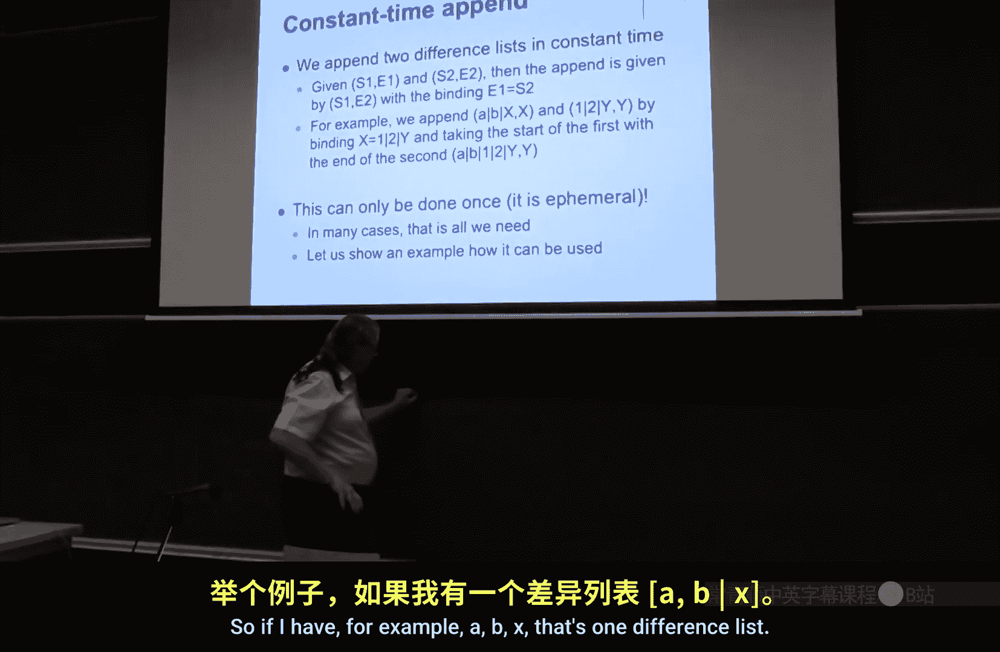

X， that's one。Different list， this represents the list AB。And I' had another one， which is one。

 two why。

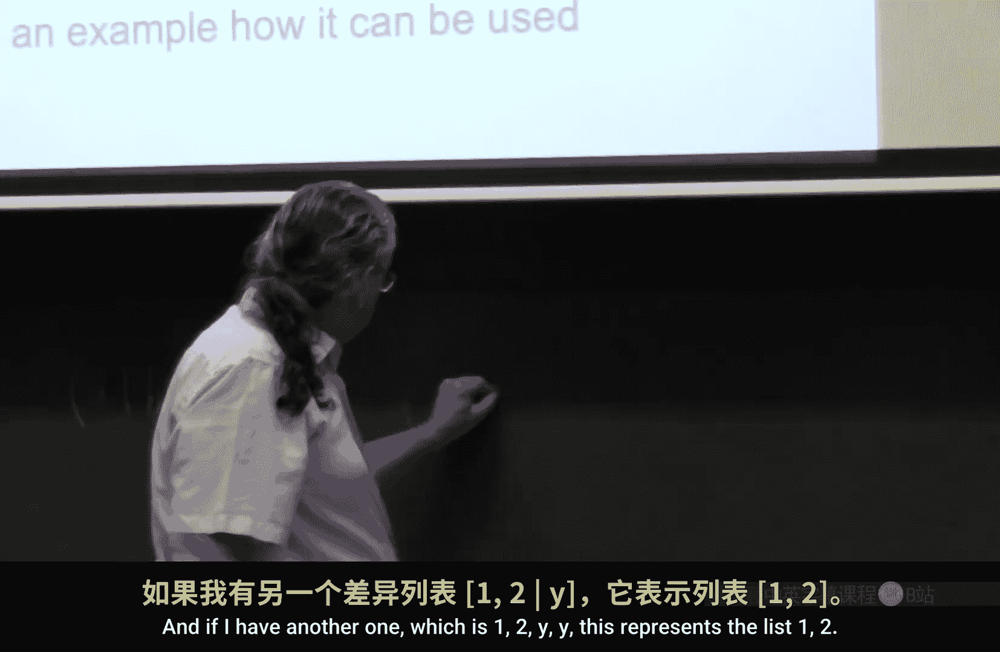

Why this represents the list one， two if I want a pen go。I will bind the X。2，1，2，1。

And then I will take the two。Exterior guys， the first one here and the last one here。

So if I find x to 12 y， then I will get A， B。

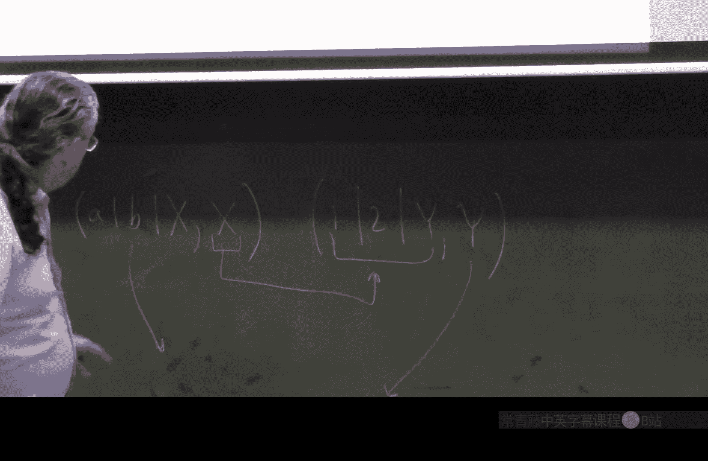

One， two， one。And here I'm using one。You see， I've actually appended because the x is also here。

I've actually appended one， two。A B1，2。And the result is a new difference list。

So you see I'm actually doing in a pen and again this is constant time。So a constant time apps。

In the declare tooth。Language， so this is a neat， a very nice representation of， a difference list。

Of course， it's again， a limitation。You could only do it once。It's ephemeral。

that means once you find the x here。

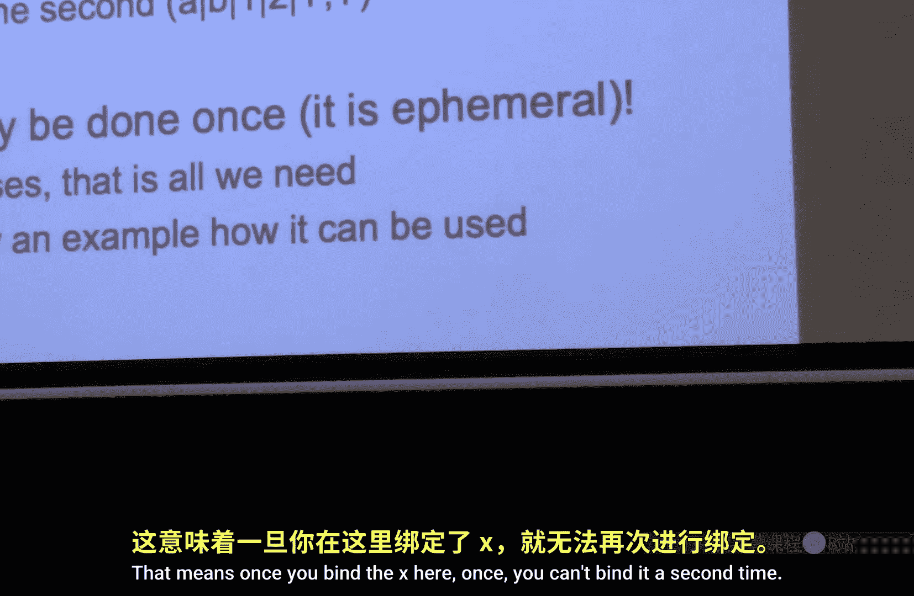

Once we can't bond it it the second time， okay， it's over。

But that's usually good enough when you build a big list。

 let's say I' building a approval list by bringing lots of small lists together， that's very common。

 then it's okay， so in most cases it's fun。This is actually handling most of use of a pen， okay？

So remember， I used a pen in the quickword before？Actually。

 you could write Quicksort to use difference lists and it does not need a pen， okay？

I used the pen because I wanted to show a simple algorithm。

 I didn't want to bring in new complex things。But every time you use a pen to build the list。

You can ask yourself， aha。Can I use a difference list here？Okay， and usually it's possible。

And in bookstore， you could rewrite it to use different lists， okay？Okay。

 I'm going to give you an example of that。I'm going to show you a program that does some computation on a list。

But then we're going to use it difference lists， okay？

So here's a function that maybe you have seen before called flatten。Flaten takes a list。

 but the list can have lists and so on lists with lists with lists， okay？

And all the lists are removed， all the elements are brought together into one vlet。

So something like flatten with list  one， two， three， four， five， it gives you flatten， gives one。

 two， three， four five。So Flton， if you have like a list of lists。

 it flattens in so you only have one。List， and this uses a pen。

 so here's a pen I just wanted to show it to you， okay。This is a pen， here you have a case。If X， X。

 Xr， if x is a list， so x， Xr and then is this x？F is a list， then I will call flatten on x。And on X。

 you see then if x is a list， I do a recursive call a flatten， but that gives me a list。

 so I here I have two lists。And so I attended them， okay？Like that。And if x is not a list。

 I just add it as an element， x bar flat。And if xs is n it's， so this is the flattened definition。

Works fine， except it's kind of。Too expensive， I'm doing all these append operations。

 the more I have nested lists， the more I'm going to be doing append operations， okay？

When I flatten an X， I have some list here。And the time of the append is going to be proportional to the length of it。

So the total time complexity of this is。You have to worry about the length of all the。Sublists， okay？

Whereas you can rewrite this using difference lists。And then you don't need a pen。

 so differences kind of makes the pen disappear。So that's something。

So let me show you now the difference list version， and then I'm run some code。诶。

We replace the list by a difference list， so flattened here is a function that returns the list。

 okay？But to make it really clear， I'm going to turn it into a procedure。And the two arguments。

 S and E。I'm going to make them arguments， so you see them right here， okay， S and E。

 so this is the outputer， excess is the input， and S is a difference list， which is the output。Okay。

And now I rewrite the three cases。So if excess is nil， then I have an empty list。Well。

 an empty difference list is just when s is equal to E。

 a difference that's empty is a list that looks like this， SS， for example， the difference is empty。

Which means an empty differences is just S equal E。

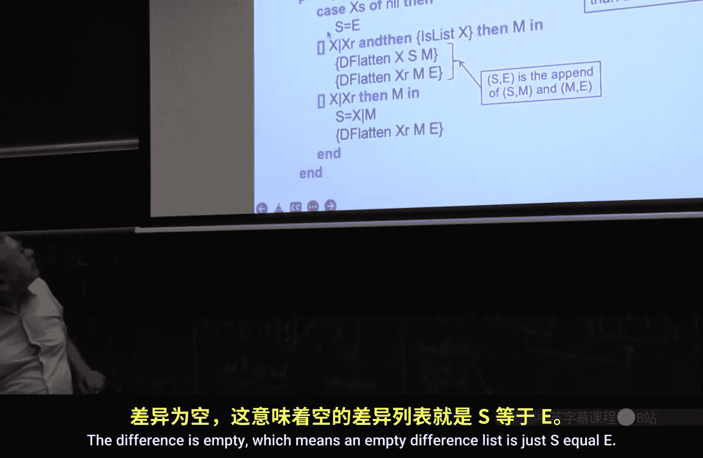

Now let me do it now the final one here， x X R。I want to add the element X。

And so I'm adding an element to the front。Of a difference this， so I'm doing like here， so S， S。

 which is the front， I do equal x bar M。M for middle or something on。

 and then I do the recursive call ME。So the x is added to the front and then the rest is done here。

Okay。But the interesting one is the one in the middle here， okay？What if x and xr are both lists？

Is list X is true。Then I have to do two recursive calls。D flat of x and the flat of X R。

 and I have to。Pend those two different lists together。Well。

 what that means is that the second argument of the first one has to be bound to the first argument of the second one。

 these two have to be bound together。So I can write that here in the code。By just doing。

 this is a difference this S。And this one starts with M， so I have the same M here。

The end of the first one has to be the beginning of this。SM， and then I have ME。

 and so the final result is S， okay， S is the app。OfSM and ME。ok。So， that's it。So this version of Fl。

Is actually。Not doing any app at all。And otherwise， it's doing exactly the same as the previous one。

So I have to show you some running code。I can not。Show you this kind of stuff that writing code。

 okay？其实你。Does those are in here？そね。说。し。Okay， so this is my doctor version those I've one done four。

Which is。可给你就是。So。一起续。す。It worked this morning。I me just give it a few seconds。什么。个人的。

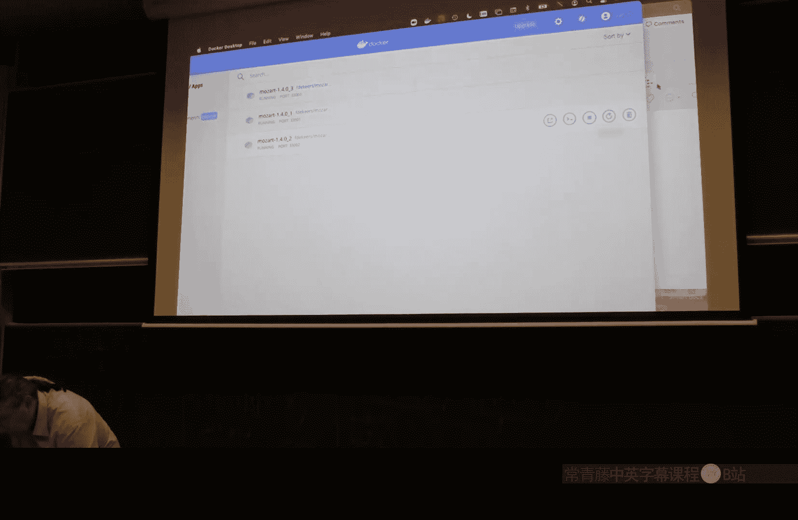

it out so I'm sorry about that。See this is big Sur， which this is an old Macs surrounding Big Sur。

 and there's a bug in Big Sur。

Says it's actually version 11。7， but the system operation tells you it's 11。

6 so that's about I didn't update that。And that means the Mozaric when once starts。

 the usual mozaric。Because it checks the version， okay？Okay， so sorry about that。😔。

But I will show you things on the board， okay， so I will put code on the Moodle so you can actually run the code here。

Okay， so let me go on， sorry about the Mozart， I'll try to fix it。So this is difference list set。

 which is a very。Cleverever representation of lists。That lets you do constant time dependenceance。

In the。Dlares it。But only once。You can do it with holding。Okay okay， now let' thes。

 now let's go to the Qs and the different Q algorithms we're going to show today。

So let me make some room on the board。So Q， Id let me remind you what is a Q。

 Q is a very simple abstraction， okay， it's a sequence of elements where you can insert and delete。

And the insert is happening on one side and the delete， the elements come out on the other side。

 that's it， so here I insert one， two， three， four up to eight。And when I delete elements。

 it's the one that comes out first， okay， one， two， three， four， eight。

 so you can also call this a first in first out。Sequs。One goes in first and it also comes out first。

 so that's a cu， and we're going to be showing you the presentations of that。So here's a naive too。

Very simple， na if one。呃。It's actually not a true abstraction since I'm not protecting the representation。

 but I want to show you the simplest possible。2。And the question is what is the complexity。

 so in order to do it I need a healthy function called but blast。

 which basically takes the last element out of the this。

And it returns the list without the last element， so if I do but last。

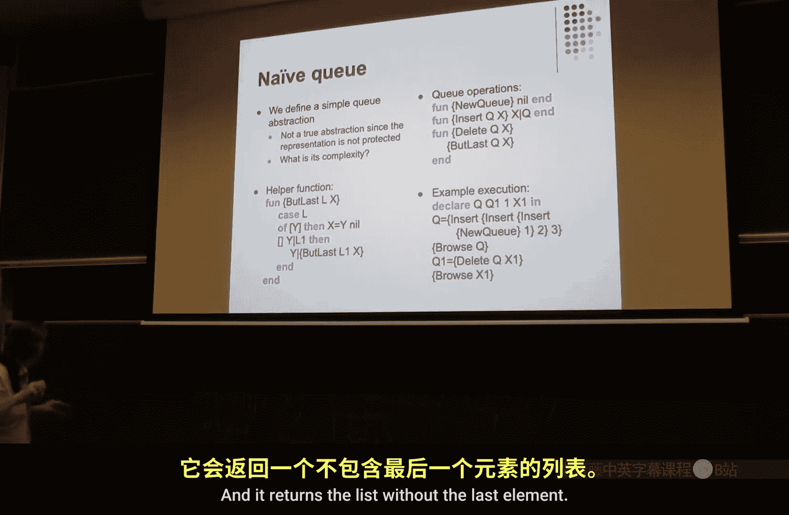

1，2，3。Thanks。That will return。

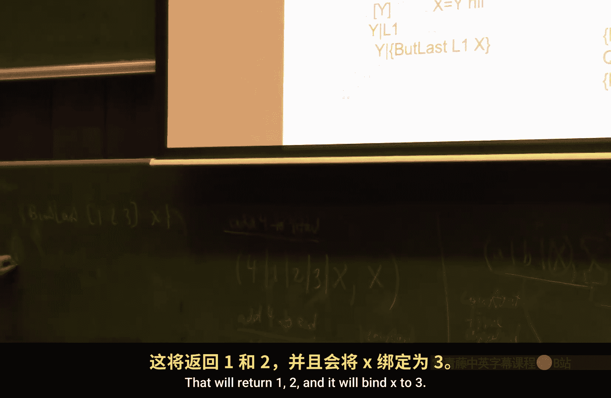

One， two， and it will bind x2， three。Okay， so for this movie， the X is book to be the last hell。

That's a helper function that I'm going to use。And now my queue is very simple， so here's my queue。

 the new Q， I'm going to implement three operations， new Q insert and deletes。🤧。

New Q returns an empty queue， so that's noil， it's just a list。

Insert will insert x into a Q so that returns to Q x bar Q， I just added x to the front。

 and delete will remove an element from the cube， but it has to remove the last element。

 I'm inserting in the front and I have to remove it at the end。So the is implemented using but last。

Okay。So this implementation here。Is correct if I insert for example， one， two， three。

 then I delete here， I will remove get one out okay and so onna so I can use this to do a queue right it's really it's nice。

Okay， but what is the complexity of this guy？Okay， what is it， what do you think？

The insert of the buildings。So the complexity of this， well the insert is constant time。

But the delete is doing this but last function， so it depends on the size of the Q so the Q has n elements。

 it's going to be n okay so if I do n insert。Or let's say I do three insert search here or n。

 and let's say n n。

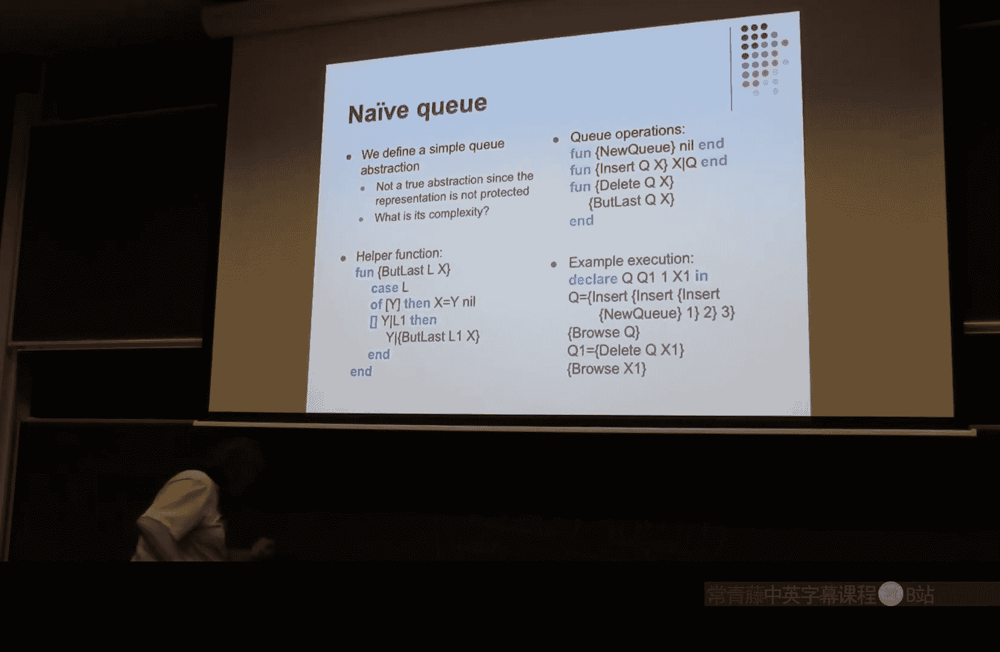

And now I do delete。And I keep doing deletes， each one of these will be order n。

 this will be n and minus one when do another one。

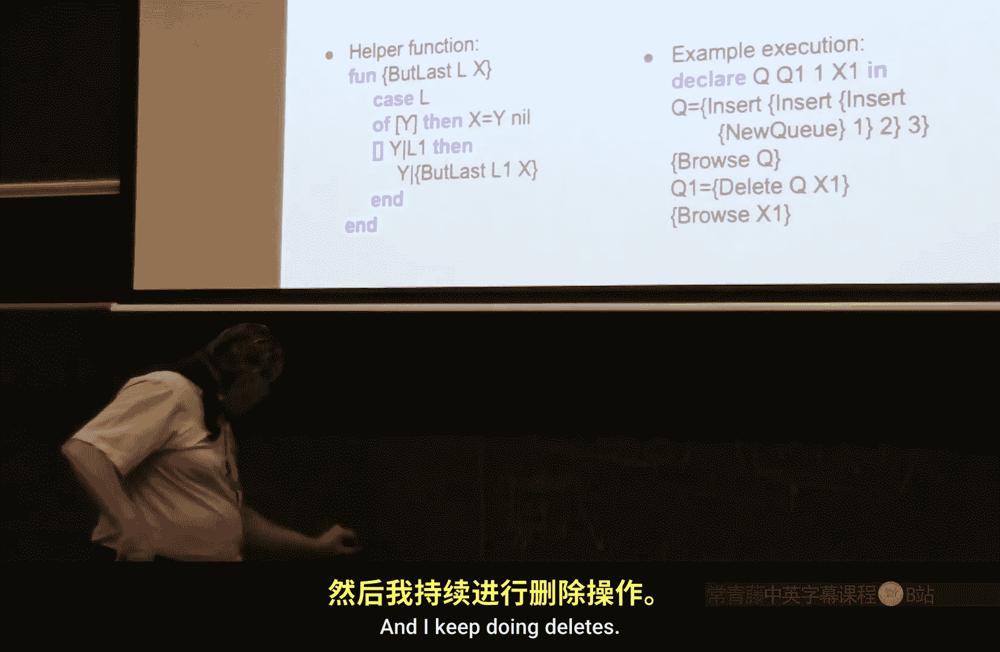

N minus2。So if I do a bunch of deletes here， there will be order。ok。So this is not so nice。

That what I really wants， so this is not even amortized， very good。

 so what would be the amortized complexity here， it still end。

I have because all these deletes together is proportional to n squared。

So if Ive n deletes here and n inserts2 n operations n squared divided by 2 n。

 it's still proportional to n， okay？So even the ammartized complex is bad here。

So this is kind of very slow。

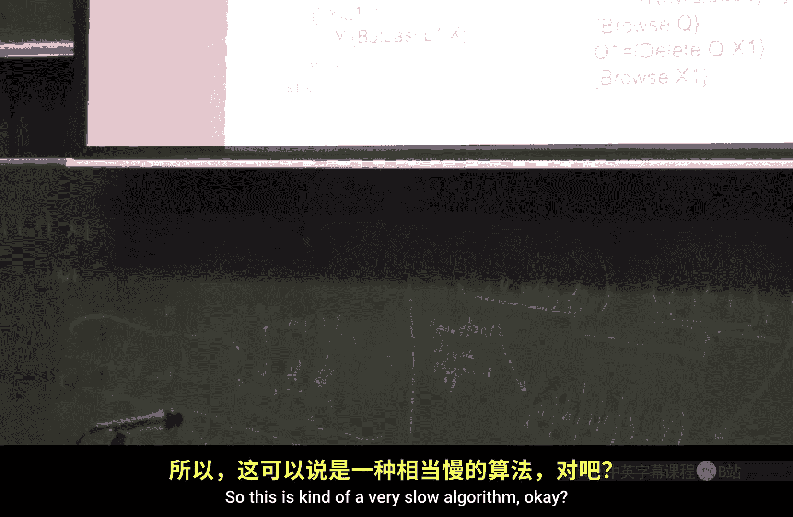

。Okay， so this is very slow， but we want to do better。So I'm going to show you better algorithms。

And the first one I'm going to show you is how to make this guy。

Aortized constant time notice that this guy is amortized order n， okay。

 but I want to make it so it becomes amortized one。And still functional， it'll be purely functional。

Okay， so now I'm going to show you the first。Clever algorithm， which is amortized constantine。

 ephemeral cube。ok。And the way to do it is you represent the you not as a list。

When you represent it as two list。Okay。So since my poor Mozart is not running on big sir。

I'm going to show you the examples on the board， okay？So we represent the queue as two lists。

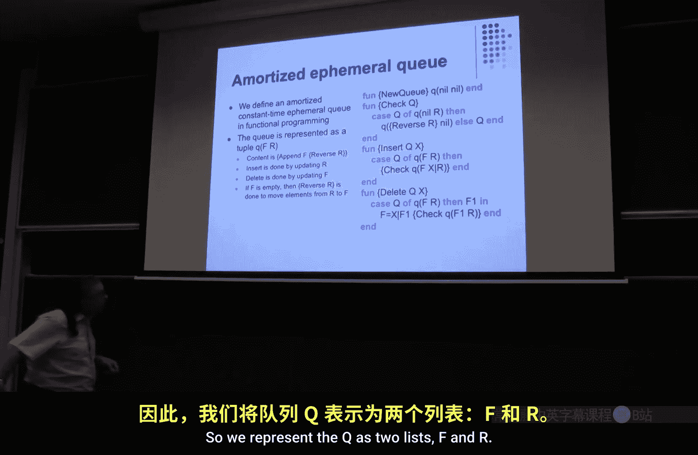

That's at all。

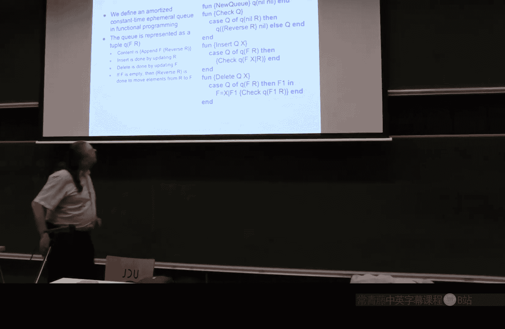

The idea is actually very simple。F is the front。

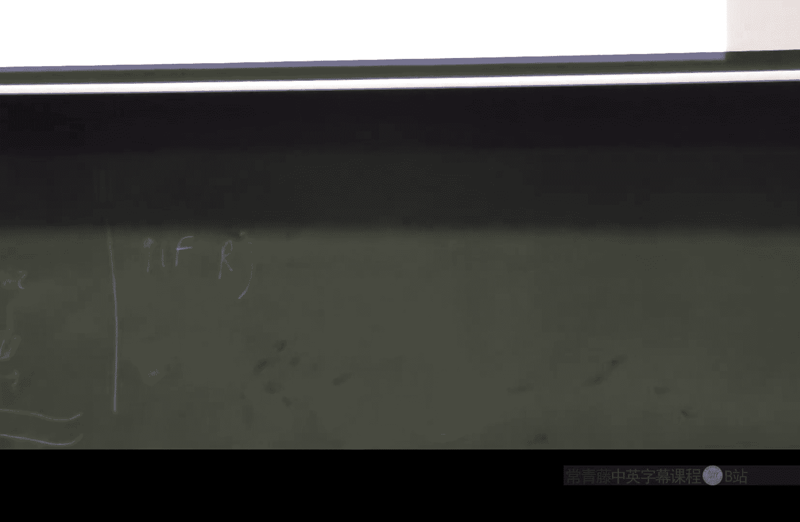

AndR is the back， so if we have a Q here with some elements here。嗯。The front of the queue， okay。

 and so the front， the inserts are coming here。 and the deletes are coming up here。And here we have。

Vorsse are。So when we insert。We put it on par。😡，You see how we're doing that here。

 so when I'm inserting， I'm adding it to R Fq EXR。And when I'm deleting， I'm removing it from F。

So the inserts will come here。Putting it on R and the deletes come here will come out of F。

So for example， if I have。I start with an FTQ。Here I do insert。え？To the Q， then I will do F。A6 a6。

And now if I do another， it served。I the you。没有。B， this is B A U。Okay。

So I'm adding notice I'm like adding it in the reverse order，And now I want to do delete。

So what happens？Well， I want to re deletelete the elements， well the delete is coming here。

 so I need a special operation that moves。That the back of the cube to the front。

 so I need to move BA inil to here to do a delete。Okay， so let me right here。So if I have Q no。

B AL like before。I want to do delete well the way it is is first I moved this。

 I have a special operation and it's called check here。We'll change this to A B new。没有。

So basically it moves this one， but it reverses it。这啲。And now I can do a delete。Now I do AB new new。

And I delete x and x will be equal to a。You see how it works if I do another insert now。

Then it will be E new。See了。But it also， again， I can move there to that by putting it。In the front。

 okay？So but I only do it but this one is empty。So was it when I doing delete lead again？

I would get cute mill。是了。And now I can do check。to bring the st in the front。

So you see how it's working， the inserts are always going to the end。

 and the deletes are always coming to the front。And sometimes I have to move the back to the front。

So the back to the front using the check operation。So the way it works。

 so let me show you how the code here。So I do an insert。FR becomes Fx bar R。But I wont check。

And check will'll do the following。If the F is n， that means if this is empty。

 if I've exhausted the deletes， I can't do any more deletes。Then I move the Rs over。

 I change this to reverse our mill。So the check is not done all the time。

 I mean it doesn't all the time have to do the reverse， it only does it when this guy is empty okay？

So it doesn't have to do it so much。But when it doesn' it， it's expensive when you do the check。

 you have to reverse here which is。Proportal to the length of R。

And the delete here notice that what the delete works is you basically remove X from the F。嗯。

And then it has F1。So basically， the check will guarantee that the R is always empty。

That it's the f sorry， if the F is empty， that you move the R to there so that when you do a delete。

 you will not have a problem。Okay。So now what is the complexity of this guy， okay？

So if I do an insert。I do an insert， I do an insert。Three and inserts。

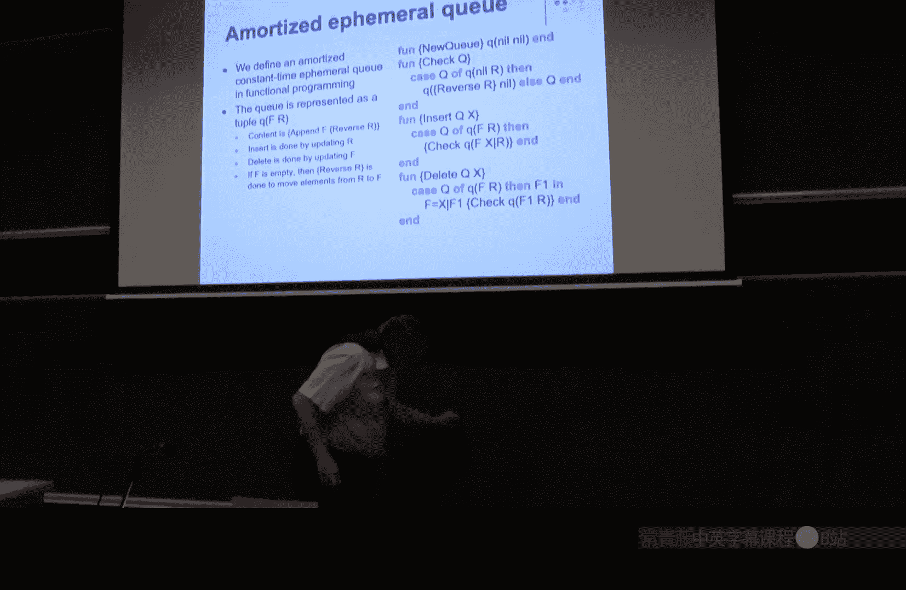

Those are all constant time。

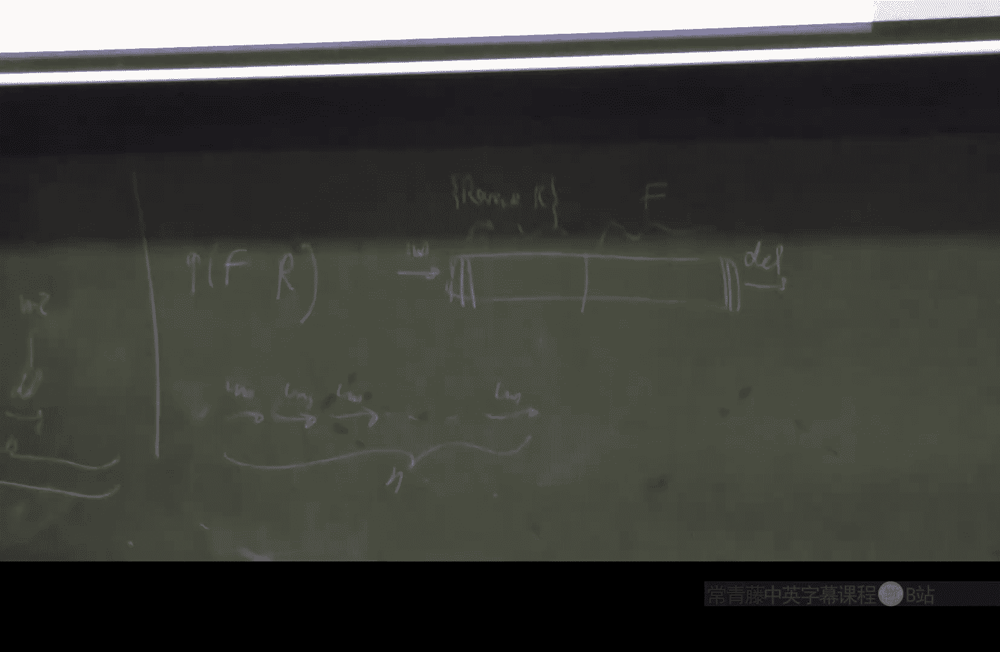

And now I do it delete。This delete is going to do。Is going to do the reverse。ok。

So this one will be end， all the concerns are one that' say， okay。And。

But then the next delete will be only one because Ive reversed the whole thing。ok。

So the whole complexity。Is n for these two n operations， so the anortized。His order was？

You you see that in the naive world， each delete。It had to run but less。Wwhich is a paint。

 they're all slow， but here it's only one check that has to be done， only one re。

 and then all the others can be fast。You see that that works。

 so this guy is amortized to Thomasten time and it works because of the two。

The two lists have been on。We have two lists。That makes it a lot smarter， okay？

That lets you do smarter things， whereas in the original naive one。

 you have only one list which is too simple。

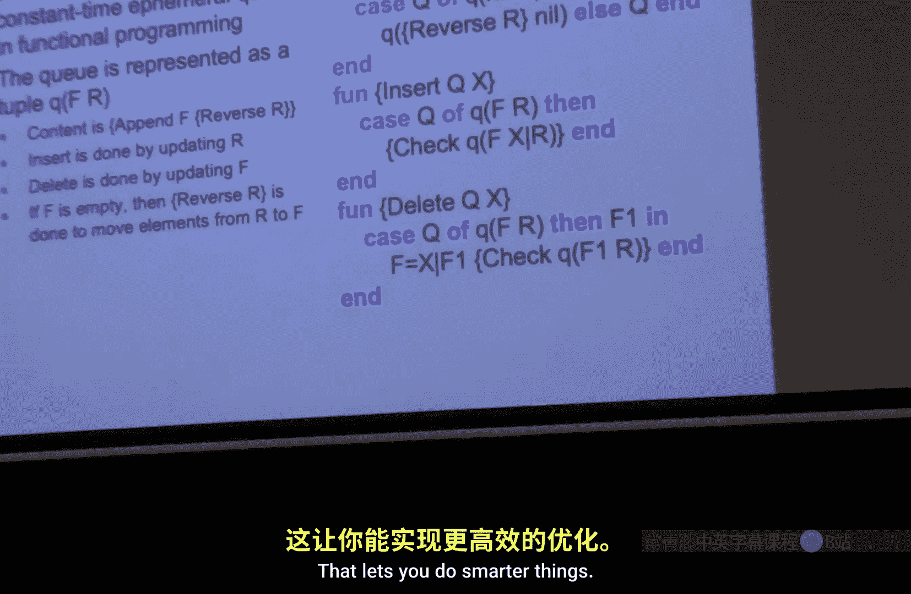

It's not enough， you have to have a richer。😔，Representation， okay， so this is neat， right。

 this is a nice trick out。This guy gives you amortized constant time。

 and it's just a functional program。Okay。So you can run this。And it's exactly running it like before。

 the interface is exactly the same。给。Now。A question for you。This guy。Is amortized。

 constantine defemerral， okay？Because if I use it in an ephemeral way。

 that means there's only one version。Then it will be。Adortized constant time， but the old cues。

Old ones。Are still there， of course， they don't go away。So I can use this as a persistent。

I could actually use this code。In a persistent way。

 that means I can create multiple versions and it will be correct。 let me show you。

What happens when we do that？

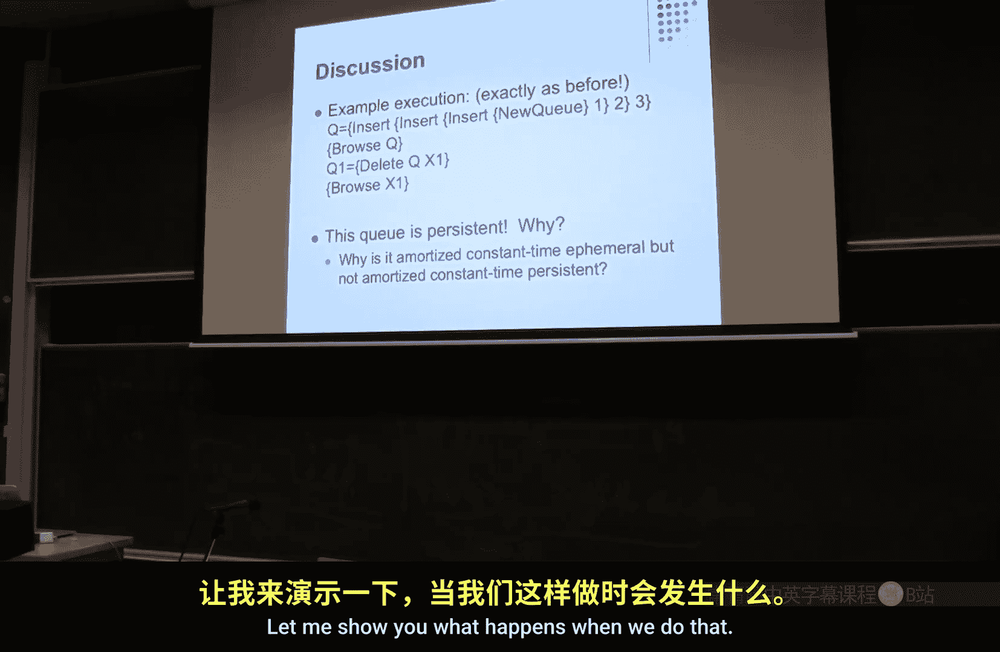

So this one， I can use it。I can use it。Pist。So for example， I start with Q1 I' doing it third。

I get Q2， but I can use Q1 again and do another insert and get  Q3， now I have two versions。

And I can keep going like that。I need to make more versions。And it works， it's correct。

But it's not advertised constant time anymore。Okay。It's no longer our tax comes to time。

The amortized constant time only works when you use one version， actually。

 if you use more than one version， this guy will be no longer amortized constant in time。Why not？

So you have to， you can show that， why not？What happens if you try to do that？

What happens if you try to use this one？🤧In a persistent way。

 which means you create multiple versions and it works， it's correct。Because these old cues。

 to just data structures， they're still there， so it actually works。But it's not advertised。

 constant to time anymore。😔，'s correctrr， so this is not a solution to amortize constant time persistence。

 it's not a solution to that。Because it's not。😔，And it's not constant time anymore。Why not？ Well。

 let's say here's an example。So here I my here， I do an insert， I do insert。I do N inserts。

so those are all constant time。Which is what I'm doing here and now I do deletes and the deletes。

 only the first one is going to be expensive， you only do the worst ones。Now。

What happens if I use it persistently？Let's say I do an delete here and I do another delete starting from this one。

Well， this deletes would be order n， and， and N。So I get all the deletes are again expensive。

 so this is I'm using it persistently。And the problem is that all of these deletes are going to be slow。

And therefore， it doesn't work when you use it persistently， okay。I mean， it works。

 but it's not atex constanttine， it's just as bad as the first one is。Okay， it's just a bed。

So this algorithm is only amorized constant time。分母。Okay。Okay， so that's nice。

 this is a nice trickco。

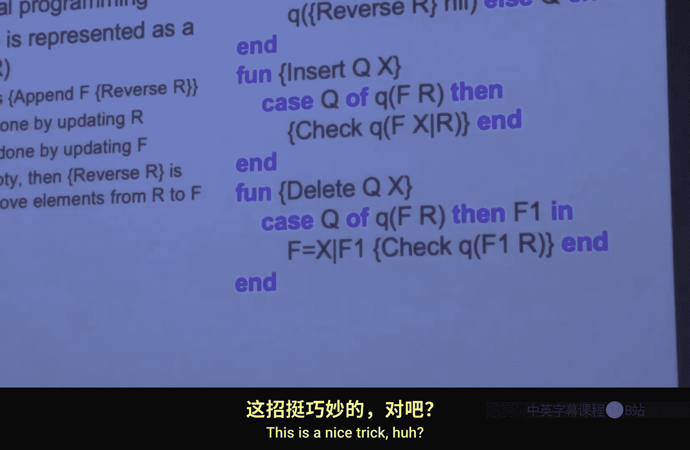

But maybe I can do better。What I really want is a worst case， constant time to federal。

I don't want to pay he at all。How do I do that， okay。

 well we'll make a break after the break I show you how to make it。

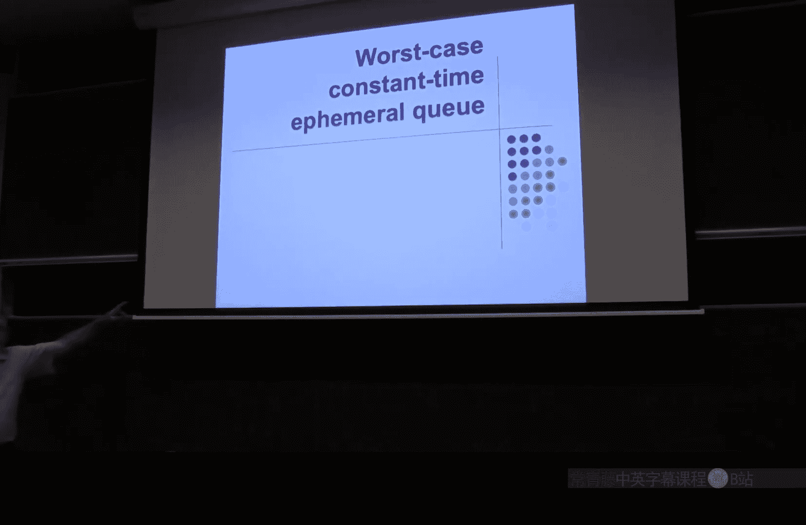

The worst case comes to time？我てこで。

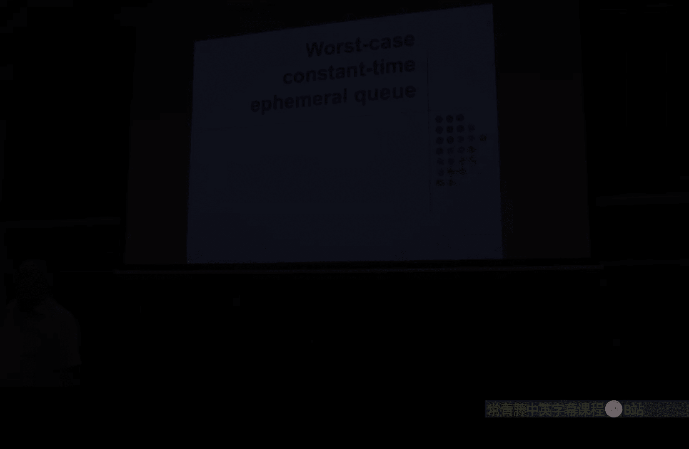

Now， actually now I got smoke up working， the problem was that doctor needs some internet。

ive internet so it probably has to do something。It， so I'm going to show you now a worst case。

Constant time ephemeral cus。And actually， we kind of know how to do that。

The previous example here was amortized， and this was running in pure functional programming。

No unbound variables here。And that's the best you can do， actually。In pure functional of programming。

 so none you can't do better than that。In order to do better。

 you need a more powerful declarative paradigm。And if you add single assignment on bound variables。

 then you can do it。In fact， we're going to use the difference list technique now that we saw before。

To implement the Q， we'll call to represent the Q。Again， as two arguments， just like before。

 but now instead of front and back， this is going to be a difference list。Cons， the content。

 so in this one， both insert and delete are always going to be constant time， both of them。

So here's the code， so the new queue is just an empty difference。Two variables that there's the same。

 I have Q。Let me make an example of 2 xx。So that's an empty difference list， that's an empty cube。

And insert and delete， are're going to add an element to the front。

And add a remove an element from the back， actually。

So it's going to be or actually it's the opposite the insert is adding in the back and the is going to be removing from the front okay so here I have SE when I insert I'm going to bind E。

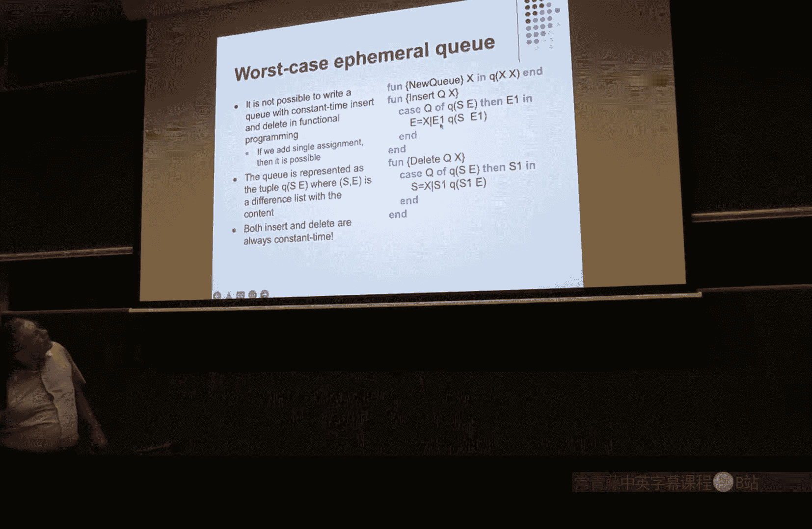

To X E1。So if I do an， insert now。Insert a。Then the queue is going to be represented by a new difference list。

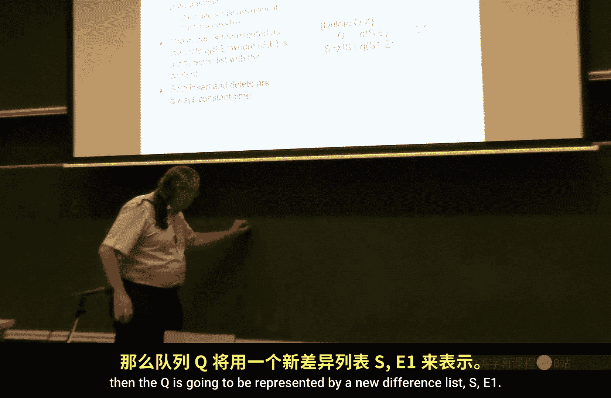

S E1， okay？So I'm going to bind E， so e is x here， I'm going to bind x to a。X1， let's say oh。

And I'm going to have E1， this is going to be X。X1。But x is actually AX x1， iss this。

So this gives me Ax1， x1。诶。If I do another insert。Certain be。Again， I'm going to bind the second one。

 the end， the end I'm going to ab it here。So the element followed by a new X so I'm going to bind。

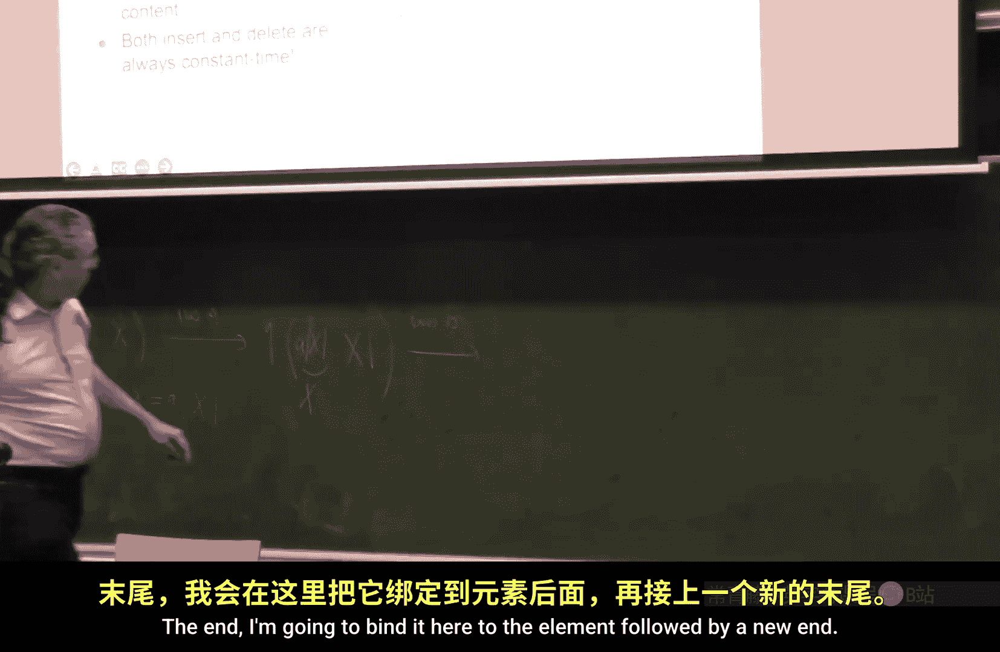

X1。ToB X2。So it's Ax1。It's true。But Ax1 is actually A， B， x2。Because of this。So this is ABX。

 so you see I'm actually creating new difference lists each time I do insert。And if I do a delete。

 I will remove the first element。

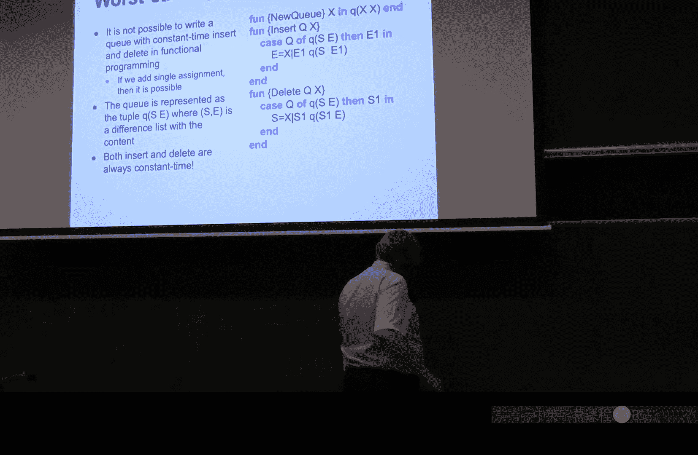

Now let me call this one delete Y， it's going to take S here。

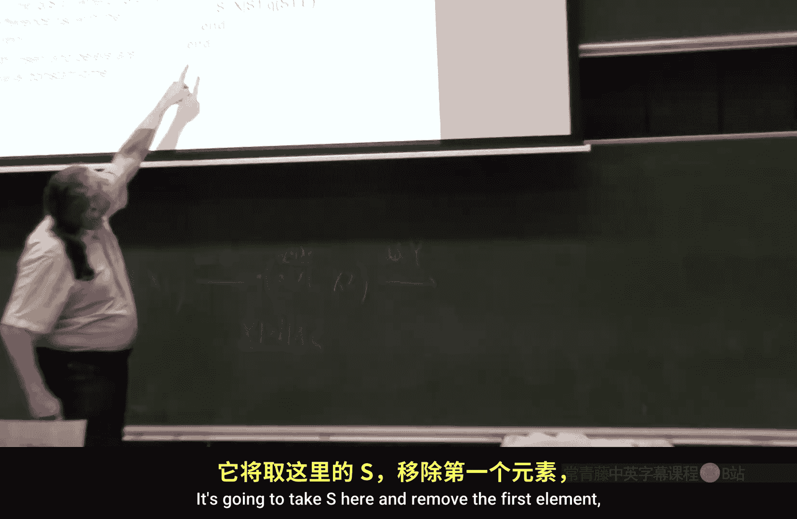

And remove the first element and S1 will be the new difference list。 Okay。

 so here what it's going to do is this is it going to bind S。 So this is S。It's go to A， B。2。2。

Why and the new。诶。So y is going to be equal to a。And as1， it could be equal to this。Okay。

 and that gives me。Q of S1， so S1 is Bx2。And x2 is not changing。So y is equal to a。

So I've removed the first element A， and the new difference is Bx2。Ps2。So that's kind neat right？

That's kind of interesting， I mean， you're just building difference lists。

And managing the different bits by adding elements and removing elements by doing binding。

And every of these operations is constant time。And it's okay because it's ephemeral。Okay。

 this will not work。Here this will really not work persistently because you're binding the things X X here。

 I'm binding X， you can only do that at once so this guy will not even work if you try to use it persistently。

 but ephemeral， it works fine， and it worst case constant time， all his operations。A constant time。

 And it's purely declarative。 That's pretty nice。 That's exactly like the same efficiency。

 If you write it in Java， for example， you update variables， okay， you get also the same。Okay。Okay。

 let me show you now one small extension， this difference， the problem。

 there is actually a small problem here， what if I want to know is an empty？I have to somehow。

Compare， is it empty？Well， that's not you can't really do that with unbound variable。

We can't really check。It's empty。Because how do you check that if you try to test the variable。

 it's just going to what block and wait， okay？So if you want to know how many elements are in the queue。

 you have to add and another argument。对。The difference list will not tell you how many elements there are because of the unbound variables。

 you can't really count it because you have to。You can't check whether the variable is unbound。

 that's not declarative。Now I can't test that， so I can't really take how many elements there。

 so if I want to do that， I have to add an extra argument to the Q， okay？

So the previous definition does not let us know when the queue is empty。

 maybe we want to test when it's empty。To know the number of elements。

 we have to add the size a number to the representation， so we will represent it as a triple then。

And， which is a number of elements， and S， which is a difference list like before。

And then it's very easy to test if it's empty， you just do Q do1 is it equal to zero。

 it n equal to zero， so this one will always be a number integer。So then our Q looks like this。

 the new Q will be0 xx。Insert。Well do like before， except the n will become n plus one。

 and the delete to the n will become n minus1。This one， I want to show you the execution of this。喂。

Normally， the mo items going to work now。Does of the Internet connection。休。There no。That's a more。

For。Oh another one else has started， sorry， it's just slow， okay。

Because docker images are huge space， I'm not really used to that。

 they're very slow to start because there's several game lightss。

So here is I'll show you the other one。The one with the。这。Drous lists。So here's the code。

So you can see the code， it's the same with the triple and S， and I'm doing n plus1 and minus1。

 and I'm doing the difference this operation， okay。So now if I do something like this。You玩。Q no Q in。

 and I do Q is equal to。Insert。Pre a new tube。And I do A， and then I browse。

I want to see what it looks like internally。You see here the way it looks like it's1 a bar underscore underscore。

 so those two underscores are actually the same variable。

 the browse doesn't know that but they're actually the same variable by doing another insert。QB。This。

And you can see it's two and then A bar， B bar underscore and underscore， okay？Notice a funny thing。

特表咩叫。Notice a funny thing when I create the second one。Q2， the first one is changed。

 notice that because I bind。A variable inside the second insert。The first Q1 there。

Is now a different， different list because I've bound the argument。See， A B bar， B bar。

 it's still the list A， but I bound this second argument。

 so's my different system is kind of used up， I cannot bind it together。The second one。

 so that's why it's eemerla and the second one now has。I'm non variable here and here。

 so I can still go farther if I want to。23。It third。23。That was two three。

It now I's heard the third element， so third the bottom one says Q3 ABC bar underscore underscore。

But the two previous ones I'm binding， so they're not I've used it upper， I cannot bind anymore。

But here in the third one， I still can use this difference in this stuff。

 I can only use the most recent ones， the previous ones Ive bound。The second argument。

 so it's used up， the differences can only be used once okay。Okay， so you see how it works？

And the one two three gives me the size。Okay， now I'm going to show you a little bit of magic。And。

And this is actually， we're actually going to do a little bit of logic programming。

 So this is kind of a。A shout out to logic programming。え？I just want to show to you。

To show you that there's even more paradigms that I won't go into logic programming really in this course。

But this example is actually doing logic programming。Do you know that with cu that I just showed you？

I can do the delete before the insert， which is kind of magic。

Usually you insert an element in a queue and then you delete it。

You can't delete before you insert them， but with this one you can do that。

It lets you delete before the insert and it actually works。ok。So I delete here， for example。

 I'm deleting， I create a queue here， Q1， I delete it's out， I I delete an element， X。

 I display that element， well it's unbound。But it's like a slot， and if I then do an insert。

Then it will fill that deleted element， so the deleted element is like it's like I've borrowed。

I delete an element。But I don't know what it is yet， but then when I do an inserter。

 I know what the deleted element was， it's food， okay。

The delete kind of crs a slot that's filled in by the insert。

 so the deletes and the inserts are kind of。Communicative， every delete corresponds to an insert。

But if the delete can be done before or after， it doesn't really matter。That's very funny you。

So let me show you that and then I'll explain how to works。I'm keep explain to you the magic of that。

Okay。So then we create another empty cube。Okay a few here。So this is empty。you。

Zero and the two variables are actually the same， and now I will do delete。あ十？Q2 is equal to delete。

But I'm even x， I still don't know what the result is， because I'll declare x in。す。You one。Thanks。

So what is going on here？😔，I can delete and there's nothing in the queue， it's empty。

 and I will delete and develop it。But the delete is actually finding variable。

 so it's just going to work。Look what it says， the Q now has minus one element。

But there's no element here。But the element is stick at the hand， it's like a reserve sloth。

 in a sense， okay， and if now I insert an element。系 I do诶。Sir， his clue。Fo。

 then it will fill the slot。喂。Let me first browse x here， so x is the element I've deleted us。

X is the element of that I've deleted。But if I insert food。And X will be equal to food。

And now the Q again has zero elements， So if I browse the Q3。It has zero elementss， so this cube。

Is actually more powerful than the other one here I can actually have negative numbers of elements。

 that's weird。Usually you put elements in a queue and you would take them out。

 but here if I take them out， I'm actually preserving slots and when I put the elements in。

 they will use the slots that I reserve in this sense。So what's really going on here。

 let me explain a little bit more on this。Because this is actually leading to。

A new program in paradigm。Called Logic program。So the question， how can this work。

 how can you do a delete before an insert？Okay， let me explain first。

 and then I show you more concrete。The reason why this queue has a special power。

 it's because of logical equience， when we defined declarative programming。

 we said two stores are equivalent if the two logical formulas are actually saying the same thing sensea。

And this is why the cuid has a negative number of elements， but that's the real reason。

But I will show you in a second what's really happening with the binding。😔。

The Q definition guarantees that the least elements are equal to insert。

 it's because the binding can be done in any order。Bding is symmetric。

You don't have to bind elements before unbound variables， if you do it in the opposite direction。

 it works。The operation is actually more general than just finding a variable。

 it's called unification， this operation， and it's actually making two things equal。

We can delete an number variable and insert the value layer， in fact。

 we're doing more than just functional programming。We're doing logic programming here。

 so the prologue language， which is logic programming， will let you do things like this。Okay。

 so that's all words， but let me show you really what happens in terms of the bindness。

So let's start with the empty cube here。SS， I make one of the red， the left one I'll just color red。

 and they let the other one green。To show you the two different vis。So， so。Let's say I delete apps。

ok。So when I delete X， I'm actually。WeRe'removing an element from the front。俾过证明。

So I made these plans yesterday， so let me make it nicer。Okay， this is more。Delete wire here。This is。

Just in times like creation。So， I deleted。While the delete operation will find the beginning of the difference list。

 it does s equal y is1， and the insert operation will add s。X to the n， so it does S equal x bar e1。

 So if the Q is empty， I'm actually doing two binding of S。ok。Two bindings of。

S equal y1 S equals x e1。 So what happens， I'm doing two findings of S here。

But for logic programming， that's okay。Each binding is a logic formula that goes into the store。

So S equal y is1 is this and this is logic formula in the store。

 and the other one is also logic formula the store。Just has both logic formulas。This is's pure logic。

It has that， so what does this mean？Well， we can simplify this if s is equal to y is1 and s is equal to x e1。

 then y has to be equal to x。And S1 has to be equal to E1。That means the deleted element。

 y is the same as the inserted element。It can be done in both directions。

This is actually logic program。It works because the store is actually representing a formula in logic。

And whenever I do a binding， I'm adding information into the store， logic information。

 and the store is actually representing that information logically。

It's logic programming okay so I don't want this course to be here。

 I'm not going to show you really logic programming in this course。

 but this example is giving you a little bit，To show you a little bit of the power of logic programming。

We're actually manipulating logic formulas， okay？So I'm actually making a kind of shut out to prologue。

 which is a logic programming language in this example the cube is actually doing logic programming。

Both insert and delete are done with the finding。But because of logical equivalence。

The binding are imposing logical equality， so first order go lot。

This is logic programming and logic programming is another declarative program there then。

 where instead of doing functions you manipulate logic formulas， okay？

It's more general than functional programming actually。

Data structures can have unbound variables in them， and binding is bidirectional。So this is， in fact。

A new declarative paradigm and a very powerful one。

This is this one was first really worked really in the prologue language。Prola is an acronym。

 it means programming and logic。So we're not going to see prolo in this course。

 but I think that my colleague Kimnets sees prolo in his paradigmise course。

 also constraint programming is actually a generalized version of prolo so constraint programming is a kind of logic programming and we have the very good luck to have experts in constraint programming in the department。

 E the V and Pire shows they actually there are courses on constraint programming。

 so if you want to go really see this is only show you a small piece。Of the power。

It's an extremely powerful declarative paradigm， it's actually more powerful than standard functional programming。

But it's not part of dis course。Maybe it should be once someday。

 but it deserves a whole course by itself。So this is just a kind of shout out， this amortized。

Constantine ephemeral Q is actually just。An example of what you can do was logicg programming。

Because the bindings are symmetric， the insert and the delete can't be done in any order and it still works。

And you can see how it works by following what's going on in the store。

 it's because it's a logic formula， okay， so that's all that was just a simple a quick。

A quick shout out to logic programming。Okay， but I'm not going to present more on that programming in this course。

 but if you're curious。It's really interesting。Product is a language now that is 50 years old in fact。

This year is the 50th anniversary of productgue because it was invented in 1972。

So there's kind of a celebration going on now in the pro community because of the 150th anniversary。

But prologue is an old language， but constraint programming is a very recent。

Research topic iss generalized very powerful kinds of logic inference。

So I really recommend the course of change programming for you and also the course on programming paradigms if you want to learn prolo。

Okay， so let's go on now。Now we've done as far as we can with ephemerals。

 now I want to make things persistent， okay， now again。

 I'm going to show the power of lazy evaluation。ok。So persistence is the thing。

Pistence is a strong property。It means whenever you create and do an operation。

 the old version is still existing and you can still use it and it's still efficient， okay？

Many versions can exist simultaneously。So this is actually hard to do。In any area， this is hard。

 okay， all stateful programming with variables that you can update Java and Python。

 it's all ephemeral。Whenever you。Ass a variable of the old value proof is gone， okay。

 all algorithms using mutable state are ephemeral。So all the algorithms you saw in your algorithms。

 of course， are ephemeral。They're not persistent。can't really have multiple versions。

 the only way is to make explicit copies like you make a copy of the data structure。

 then you have to manage those copies and it gets complicated。

But today I'm going to show you how to do persistence by using lazy evaluation， in fact。

 by using lazy evaluation we can make efficient， persistent algorithms。

It's another amazing property of laziness。Okay， so let me show you one example。

 the first example will be an amortized constant time persistent queue。

And then we'll go into the biggie， which is。Worst case， constanttantine， persistent Q。

 which is it works， but it's a little bit more complicated。

 the advertiseortized blind is a little bit easier。

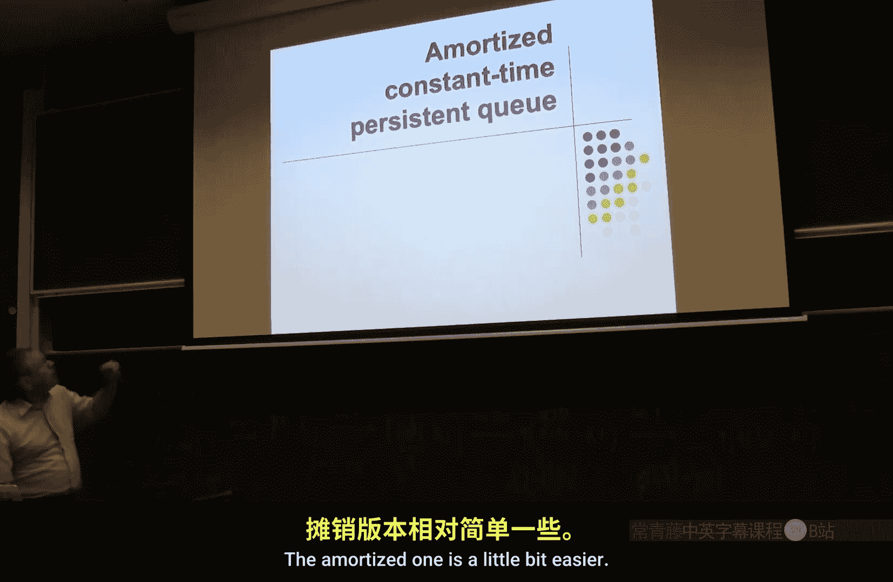

Let let me show you。But first we need to help her function a lazy append。

So this is the same as for Quicks sort， okay， we need a lazy append function。

 so this is just the append made lazy。And what it does is if you ask for elements。

Each time you ask for an element， the case statement will ask for elements from its first argument。

So whenever I ask for an element， here I do L pent， for example， if I do L dot1。

 I'm asking for the first element that will activate the lazy suspension and the case statement will ask for the first element of XS。

So this is a lazyend， so this is our helper who're going to need this。Okay， so what's the idea？Again。

 we're going to implement our queue。And we're going to choose another representation。

 yet another one， okay？Remember we had already several representations。

Now we're going to choose yet another one。To remember we had several representations。

 we had the list。We had。The front and the back lists， front and verse。We had difference lists。

And now I're going to have another representation。That be designed carefully。

We're going to have a couple of four elements。And actually， it's inspired by F and Rre have。

呃The length。诶。诶。So then is R R。knowWe need to know the lengths。

 so we're to add two elements which tell us the length of F andR。Okay， just introduce。

Natural numbers and the idea again is to move elements from R to f。

So it's very similar to the amortized one and functional。

But this move will now be done with the lazy suspension。

It's not going to be done by calling a function immediately， it's going to be done la。Okay。

 so that's the idea and now how do we make this whole beast amortized constant time。

 that's the trick。That's the thirdty。How do we make it。Advertise。Constant time。Well。

 it has to do reverse， okay， so basically it has to reverse R。And append F to it。

 it has to do reverse。Okay。It has to do reverse。But reverse cannot be made incremental。

There's a problem with reverse， which I explain in a few minutes。

 reverse is kind of a nasty function。We can't really make it incremental because if I reverse a list。

If I do reverse， so the idea is very simple， if I do one to do reverse one through three。

Then the result will be three， two， one。But if I work the first element of this。

The first element is three。But three is at the end of the list too。

That means in order to get the three， I have to go all the way to the end。

 basically I have to do all the work， I can't make it incremental。

There's no money to make the reverse。Increment。So， how do we。Make our thing amortized。

 so the trick is we still want them amortized， so we have this expensive operation reverse。ok。

And the way to make it amord is to make sure we don't do the reverse very often。

We want to do it as little as possible and it's the right place so that on average we have constant time。

So what we will do is we will do the lazy suspension。We will create it in events。We will not do it。

Like before。Where we do reverse when we need to make the elements， we will do it in advance。Okay。

And we will。To make it amortized， we will use a technique called the banker's method。

When you do an expensive operation， you have to pay money。The time it's like money you're paying。

And the banker's method to make an enterprise test algorithm is to save money in the bank。

And we have enough money in the bank that you can buy in the house。

 okay so each time I do a cheap operation， I'm saving one euro。And when I have n euros in the bank。

 I can do the reverse which takes n euros so basically I'm doing something where I have I'm saving money in the bank。

And。And here I can do my end， my order and expensive operation。So that's kind of a general technique。

 it's called the banker's method。Because that's how you save money in the bank， okay？

We do N cheap operations， and then we can do the expensive operation。So we kind of will do like that。

And it's a little bit tricky。So let me show you the code and then I'll show you how it works。

So here's the code。It's actually quite similar to the code of the。Regular amortized functional one。

So let me go through it。So here I've inserted delete。And if you look at F and R。

 so start by looking at F and R， F and R。Again， I do F and I put X。Bar are in the end。

And the length of R increases by one that's reasonable， I'm just doing that。

And the delete will remove the element from F。And it will decrease the length of F by one， okay。

 so this is it's just like before， actually。The difference is in the check。Okay。

 so we have this check now。It looks at the tuple and it will create a lazy suspension here it is。

Okay。Notice that I'm doing a pen of F and reverse R。So it's basically doing a pen。F。And reverse bar。

I's what it's doing。And that is moving， that's the new F。And the new art will be mill， okay？

So but I'm doing it lazily， so I have a lazy append of F with reverse R， I put it in a lazy。

I make it lazy。But the reverse is not lazy yet。It means that。

Doing the reverse will be lazy once I do it， I do the whole thing。

 but I can delay doing the reverse okay so lazy the reverse is in a lazy suspension。

 so this red one is moving in。And the length of f will be L andF then f plus R。

 and the length of r would be0， the new r would be zero。

 so I'm moving all the elements from apart to f。But I'm doing it laly。

And the whole trick of this approach。Is this condition here？When do I do this？

When do I create the lazy suspension？Well， I do it。When the length of F is less than the length of R。

That's a weird condition， so the trick is we want to understand。Okay。Okay。

 so I'll show you a kind of example to show you how it works。So the trick is。

 so this lazy suspension is going to do the work okay。

 so when you see that it works the trick is when do you do it， you have to do it in a smart time。

You have to do it。So that it's amortized。And so that it makes it persistent。

Which means that if you have multiple versions， that you only pay once。For the。For the operation。

 okay？So let me show you first the idea， and then I'll show you how this one is doing， okay。

The trick is to make sure。That the algorithm that it creates when it creates the latest suspension。

ok。Sosylvia heard asserting elements。ok几。If we insert elements， the R gets bigger。😡。

And eventually the R gets bigger than F。And then this condition is true。

 and we create an lazy suspension， okay？And that makes the new R empty so it empties out the R and the f gets bigger。

 and if we keep insert elements， the R gets bigger again until it gets bigger than F and then again we move elements over。

So whenever we insert a bunch of elements， when when we insert enough of them， we will move over。

So that's kind of vague， but I'll have to show you with an example， okay？

But let me first show you the idea。The idea by comparing two algorithms。

So here I will show you the ephemeral one。And here I will show you the persistent one。

So the assembled amount we saw already， let's say we do inserts， one， one， one， one， one。

 we do inserts， okay， and now we do delete。The deletes n。Okay， and we do excerpts again， will be one。

Okay。So you see if we do n inserts。This delete will do n。

But that's okay if there's only one version right， because the total here will be you have n operations with 2 n times。

 so it's still amortized。But you can't use this in a persistent way。

 if you try to use it in a persistent way， it goes like this。But if I starting from this version。

I do another delete。I'm allowed to do that， it would also be end。If I do end deletes。

 they're all end so that if I try to use it persistent， it won't work， see that。Does是突。

Because every single delete ti is going to take n， as long as I'm only doing one version。

 then it's okay。Because I'm spreading this and over all these。

 but if I do many versions starting here， the same place。Then each one of them will take n。

 that's a pain。Well， laziness is going to save us now。

Laaziness will save us because how does this work in a laziness？At the screen。So get的就 delete里。

But the lazy suspension is created here。😡，Let's say before。Before I do the delete。So this。

 when I do delete here， it's going to activate the lazy suspension。

And this one will do a computation combined variable here。ok。So this will take1。

will this laser suspension credit in advance will be activated here。

 but what happens if I do a second belief？Well， the lazy suspension is already executed so that elite will just use the result。

So the other deletes will be constant time。So I don't have this problem where I will do the delete every single time here I'm only doing this execution once。

 and the reason is that I create the lac suspension in events and the result of this lac suspension is seen by all of these guys。

So the second guy doesn't have to do it， it's already done， and so on。So， laziness lets you put the。

Computation early。So that when you do it， all the people afterwards will see it， okay。

 so that's how it works。ok。Okay， now。We're almost done today， so I'm not going to。This condition。

 this nice condition here， L F less than than R， I'm not going to explain it today。

 I will explain it next week， I think it's good to do in two steps so that you can understand it。

 but I will say one more thing today。Okay， you see the idea of。

 so it's important to understand this diagram。It's important to understand why the ephemeral algorithm works。

 advertise ephemeral， but not persistent。And it's important to understand why laziness。

We'll let it work persistently。And then the only trick is to figure out exactly where to put this lazy suspension so that it works。

So that if you don't want to do it too early or too late， you have to pay for this。

Thanks to make an amortax， okay？But you see the idea， the lazy suspension is sitting there early on。

And because it's early the delete done later， everybody done later will see the result of this。

 not just this delete but this one too， whereas here， when I do a delete。

 I'm doing the operation right here， this second guy will not see the result what I'm doing here and the third guy will not see it either each guy has to do it separately。

Okay。So laziness that you put the computation earlier so that everybody。Good see。

And that's why it can make things persistence。Okay。

 maybe I stop here because probably its your brains are probably full and I will refresh your memory and the next time I will explain it again。

That probably should be much easier to understand， okay， so let me stop here。

And then next time I will show also again。W。