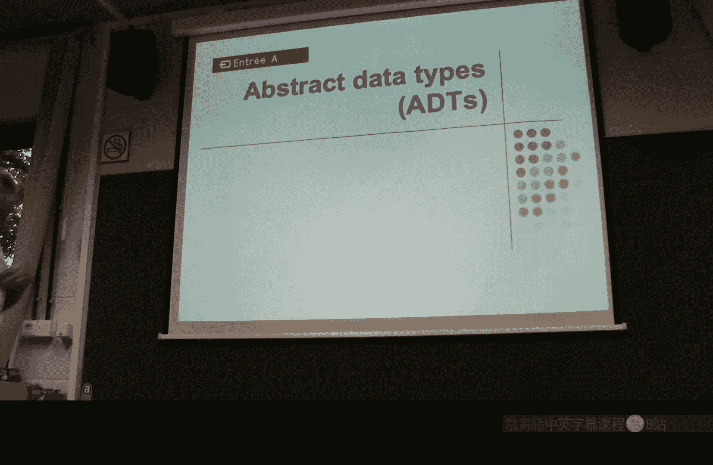
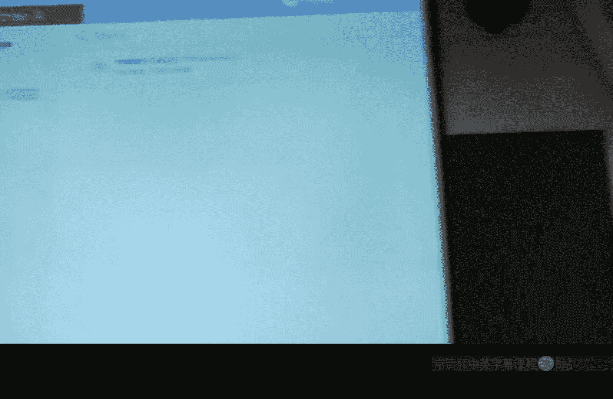
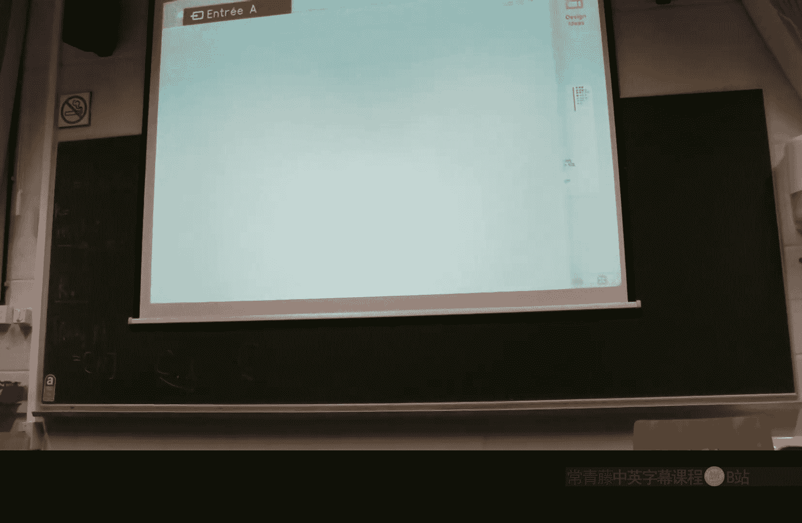
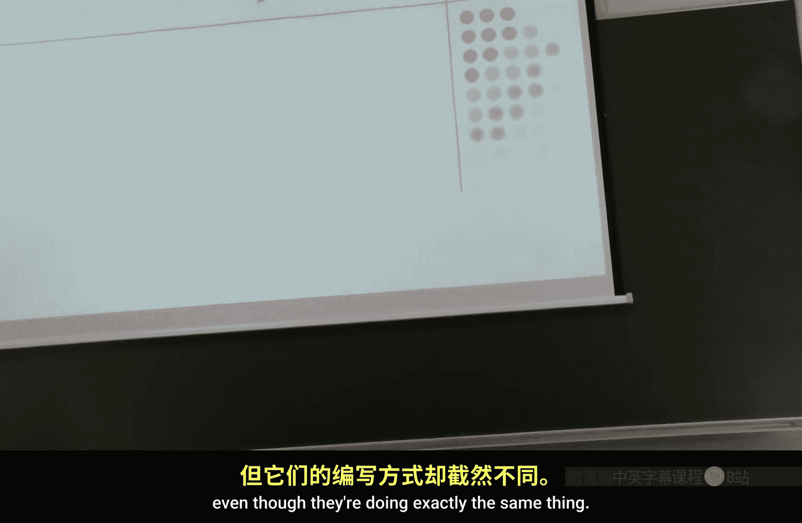
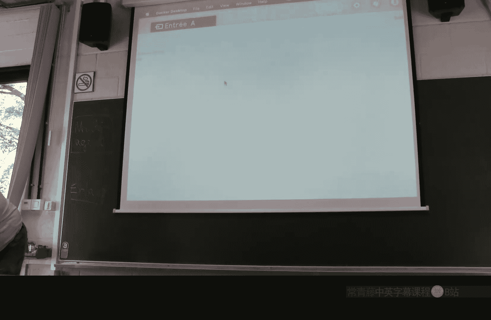

# 鲁汶理工学院【中英⚡高级编程语言概念｜LINFO1131, Advanced programming language concepts】 p33 P33 FO1131 Lecture 6 (2022) -BV1UDffBbEBZ_p33-

Okay。

Welcome to the course， today I want to talk about two things， first data abstractions。

 and second I want to start talking about multi agent programming。Both of those two things。

 first a few seconds of respect for their Ukrainians who are fighting for their freedom and for our freedom。

Okay， so we saw last week the limits of the clarityton programming， so we're going to go beyond。

Theclativeative programming。Great。And in order to start going beyond。

 I want to talk about data abstraction， this is partly refresher。

 but I will also go deeper into certain aspects of data abstraction that we didn't see before。

Data abstraction is the main。Oh， I'm really sorry about that black。

The black thing I hope it doesn't bother too much， so if the data abstraction is very important。

 it's what。It makess large computing systems possible。And it's a piece of a program。Be。

These two boxes together are one day abstraction。So it doesn't have to be the same part of the programmer。

 which is logically one day abstraction， this is the inside， and then there's an interface。

 there's a way of accessing it from the outside。And you have to follow a certain set of rules to access the inside。

 if you don't， then the data abstraction will not accept the operation， so the rules are enforced。

And if you do that， then you guarantee that the data abstraction is correct。So this is encapsulated。

And the programming language must guarantee that there is no way you can。Go inside the cheat， okay？

The encapsulation has to be supported。For this to be a real data abstraction， okay。

 and let's talk about different kinds of data abstraction。I will give you use this simple example。

Which is a simple stack。Wwhich uses a list， so mill is an empty stack。

 push and pump will put an element on front of the list and take the top element from the list and is empty we'll check if the list is nil。

The stack is represented by lists。This is the implementation。 This is not encapsulated。 Okay。

 these lists are not protected。 That means the user of this abstraction can see the lists。

I without actually using the interface， which is these four operations。You can read the stack values。

 you can actually create your own stack values， their lists， this is not protected。

 so this is not an abstraction， not a correct abstraction。

 it's an incomplete abstraction because it's not protected。The problem is we have to protect this。

 okay， and there's two main ways。Of arranging that。

And these are called objects and abstract data types。

They are fundamentally different ways of organizing data abstraction。And already in your programs。

 you have used both of them。Although maybe you don't。Realize when you're using each one。

An object will group。The value， so the internal state of the data abstraction and the operations in a single entity whereas an abstract data type keeps them separate okay so for example。

 a television set is an object。Because it is a single entity and it has an interface on off channel。

 selection， etc cetera， so this is an example of an object whereas a vending machine。

Is an abstractated type。You put coins in there and you get products out， a can of soda， for example。

 and the operation is the actual machine itself， the values are the coins and the products。

And the operation is the machine， okay？So the idea is that the coin is already。

Part of the data abstraction。 And so is the can of soda， Okay， and the machine。

 All of that is part of the abstraction。This is the real world。 so we'll look at it in。

Computer in then the computing system， how it works。

So the first one I want to explain is abstract phenotype。

 and this time I want to go into how how you can。Fix it so that it's protected， okay？

So with the previous course last year。

I showed you this magic kind of encryption wrapping routine， but today I want to show you how it to。

An abstractaneotype， so is a set of values and a set of operations。Integers， one to three operations。

 arithmetic。And languages like Java have integers as abstractive types。

 they also have integers as objects， so it's kind of。

Kind of a language that doesn't really know how to do integer because it has to both cases。

 but of course so many languages you already used to this。But it doesn't have to be numbers。

 it can be also very complicated things， okay？The point is that most of the time these values are constants。

 they don't have to be constants， I'll show you a case where it's not a constant。

 in fact the vending machine example， the can of soda is not a constant because when you drink the soda it's empty so there's a state。

 but the coinil is a constant。AndIn a programming language。

 most of the time these values will be constants and the operations also will be constant operations。

 no internal memory。And the only thing that's really changing is which operations which values you give to the operations and that's what I'll show you now。

 but I'll show you a little bit later， you can also have them。Have memory， have states。

 and that gives another kind of abstract data type。Okay。So let's implement our stack。As an abstract。

 they。The values will be all possible stacks， so they're not just numbers。

 but can be any stack value， and we have the four operations， new stack push prop is empty。

And have these operations。We create a new stack， we push X on the stack S， and we get stack S2。

 So these stacks， S and S2 are values。Same for P， we pop the top element。

 so x we bound to the top element and we have the new stack developed， the element S2， okay？

And I'll show you an example later， but if you take a new stack and then I push A and I push B。

 then the stack will have B and A on it， so B is on the top and if I pop，S。

 then the new stack would be just A。At the top will okay， so you see how it works。

So this is what we saw before， the implementation。This is not an abstract data type because it's not protected。

Okay， because you don't， you cannot guarantee。The good operation that you're only going through the interface that's essential because programmers will if they have the opportunity。

 they will look at the implementation so the program language must protect it otherwise even by accident they will look at it theyll say hey I can look at it let's look at it and do something and for a big abstractions that say if a 10。

000 line piece of code which is an abstraction， that kind of cheating is very common so the language has to make it possible okay。

So here this is not protected。The question is how can we protect it and make it a true abstract data type。

 we want to define a new one so in a language Act Java the integer is one， two，3。

 they are true abstract data type because you cannot look inside them。

But they're built in by the language， now we want to define a new。A new the abstract data type。

And protect it。ok。And the way we do it， so we have to protect the values。

And only the operations can look inside。And the way to do that is we'll do a kind of encryption。

It's called a secure Re。We will have a function， a rapidping function， which protects。

The value x and an unwping which looks at the value is able to look at the value。

 so these two functions are like a pair and they have some kind of internal key that they know so if I have the value x I call rap X。

 it returns W and I cannot look inside W it's protected。But if I call unwrappped on W。

 then I get x again， so these are just functions。Okay。

 and the idea is that only the implementation of the abstraction knows the function。オッケー。

And the way to imagine this is that rap and unwrappped are doing encryption and decryption。

 and there's a shared key。That is only known by these two functions。

 So internally they have this a key， and they're the only ones that know it， okay。

 so for each abstract data type。We need a new pair of functions if we can find one abstract at。

unrait。Then if we define another one， it has to have different wrap on raco。

 otherwise there's like a leaking between the two， so each abstract data type needs a new wrapped unwrapped pair。

So we have a function called New wrapper。So this is higher order which creates。

A pair wrapped unw wrap， so when I call new wrapper， I will create a new one。

 so basically it generates a new key。A new shared key。And it returns these two functions。

So this is a typical kind of higher order operation I need to have a new encryption and decryption。

Okay， and we're going to see how to implement this。嗯。Okay， so the point is。That。

We have to build a secure encapsulator。There are languages that do not support it， older languages。

 C or C++ or JavaScript。They are completely leaky in a language like C or C plus plus。

 you can do casting， and you can actually look at what's in memory a bit representation。

 So that's completely very bad。In terms of software engineering， that's really's completely broken。

So in language like Java， you cannot do that。Okay。You have to have these unbreakable boundaries。

And so for the abstract data types。We will use unforgeable keys。

So the shared key has to be something that you could not guess。

And you could not forage like for encryption。So the language has to support that if you want。

To implement the rapper in the language， you need to have the right concept， okay？

And usually the language will not let you implement rap unwpped。

 it will provide unwrapped unwrapped as magic。Functions， okay， but in this course。

 I want to show you how to implement rap on wrap。A language that lets you define abstract data types。

 usually it has some magic boundary， magic thing that lets you protect the data。

So you don't really know what's going on， but here I want to show you how you can actually program the rat unwrappped okay。

 and this is moving towards encryption。Okay。So the way to do it。

Is we need to add two things to the language。So it's like a new paradigm。

 remember you have the kernel language and you can add concepts。Now you add threads or you add ports。

 or you add cells， you add threads for concurency， here you need to add two concepts。To the language。

 because you cannot just do it。Without that。One of them is the unflgeigible constants。

 these are the keys。Okay， so there's a function called names， so in us they're called names。

And you have a function new name that creates an unforgeable key， so it's like a constant。

 n is a constant。And it cannot be forged， that means you cannot even print it。😡。

It does not have a representation as a string or anything， you cannot print it。

 you can only pass it to somebody， that means it cannot be guests。A program cannot try out strings。

 for example， name is not a string， okay？It's not an inger， it's a new kind of constant。

That is not crable except by new name and each time you call new name you get a new one。

 okay so it's unfortunate the only way that a program can know the name is if some other program gives it the name。

There's no way to get。So this totally guarantees。That the。

That it's unfortunatege you cannot guess it yeah just to keep clear because he mentioned encryption this is different from this is yeah。

 so this is a language property， this does not need encryption to be implemented。

 it's a pure language semantics。But if you have an adversary who can actually look at binaries。

 then probably you do want to look at encryption， but if the adversary is just a programmer who sees the source code。

 then that person cannot guess。So you don't need encryption to implement this。

 this is called language security， it's like， also it's for example， lexxiical scing。

The identifier in the scope。You cannot access it outside of the scope so that's a language property here the same thing。

 this unforgeable， the fact that it's unforgeable is defined by the language semantics and it does not actually need encryption to be implemented if your adversary is only a programmer looking at source code okay now if your adversary is a person who can actually look at binaries or look at the memory then you would need encryption okay but that's orthogonal。

 I'm going to talk today only about the language aspect okay if you want to protect the actual binaries so usually programmers will not cheat so far if I have a team of programmers building an abstraction。

And they use somebody else's library， usually they're not going to start looking at the binary because there's no need they're going to use the abstraction from the other team。

The other team would get very angry if they would why are you looking at our binary。

 we are not guaranteeing anything in the binary that can change all the time。

 you're an idiot if you do that， okay， but an adversary outside of the company might be doing that。

But if you're building a large system with different teams and each team has an abstraction that they want to protect。

hen you can protect it from the language point of view here。

 so this is a pure language semantics issue and encryption is an orthogonal thing that you can add。

 but that you don't have to add okay so I'm going to talk only about the language aspect。

Of the security here， okay？And it doesn't require encryption。In the implementation。

To be protected at the language level。So you have two concepts。

 you have the unforgeable constants which are called names in Oz。

 but they're just constants that you cannot even print them。You can't。

 they don't have any string or any printable representation。

 that means they cannot be guessed and you guarantee that。In older languages like LispP。

 there's a function called Gensim， which generates a symbol， but that symbol is actually a string。

 so you could guess it。But it's not intended to be ungeable， but here it's not a string， okay。

 it's actual constant that cannot even be printed， okay。

And the second concept is how you use that constant and this is， it's like a key in a lock。

 if I have a key that cannot be forged， I have to have a lock and the lock is actually a record。

 a secure record。That only has the dot operation to access the field that has no other operations。

And in O， normally their records have anerity operation that lets you see what all the fields are。

But if the field is a name， okay， if the record field is actually a name， so an unfortunate constant。

 then the the。人。The only way to access the field is if you know the name， so if I do a is new name。

And then I have a record。And I have the field name is N。Okay， the only way this is far。

If I want to access x， I can do r dot n， so in order to access this protected value x。

 I need to know the name。This is the lock aspect。But normal records are not secure because in normal record。

 you can do a。Of our。And that gives you the list of field banks， so that tells you what NA is。

 that's not very good， that's completely unseecure。

So the idea is that you have a version of the record type， which only has the dot。Operation。

 field selection， it has no other operations， so it's kind of restricted record。

 which I would call a secure record， okay？Now in Oz they call this， and Oz， this is called a chunk。

Okay， so I take any re directionion。And I can convert it to a secure record。

So if chunknu takes a record and returns， a secure record see。And C， I can do C dot N。

 If I do C dot N， then I access X。But I cannot do error。

 so this is completely protected if I only know C。I have no way of accessing the interns so with this with this I can build my rapa so you see I need these two operations unforgeable constants。

 which are like keys。And a way of。Encapsulating something with the key， the secure records。

 which you can consider to be kind of like locks， okay？And with this， we can actually build。

An abstract data type in the language， so now there's no magic， okay。

 I will show you exactly how it's done。So here is how you can define new wrapper。

So new wrappers and procedure returns these two functions， wrap and unwrap。So how does it work？

First of all， internally， it creates a new key， a new name。And this one。

 the lexical scoping guarantees that key is only visible from between pro and。

 so nobody else can know the key。But wrap and unwrap， they both know the key， okay？

And what RA does is it essentially just creates a secure record， and here I have a simple record。

 key colon X， that I put W as the label， doesn't really matter。

So x is locked inside the secure records。And then the unwrap takes a secure record W。

 and it just does W P。And notice that both the rap and unwrap have they no key。

It's part of their contextual environment， so they both have this shared key。

But nobody else knows it， only they know it， okay， see how it works out。Wrap it unwrap。

And now we can actually build。An abstract data type， okay？

There's actually a small detail if key is wrong， if you use it in the wrong way。

 you have to raise an exception。So we actually put this in a tri catch so that we have a well defined exception if there is a wrong argument。

 okay， that's a detail for software engineering。Okay， and now that we have this。

We can actually build a true abstract data type。And here it's how it works。

 so notice I have a local end here and I have these two identifiers rap on un wrap。

 so lexicalcoing guarantees that I can only see rap on under wrap。In between the local and the end。

 nobody else in the program can see it， okay？And so here I call New wrapper。

 so I create the new shared key and wrap button andwrap to lock and unlock。

And then and now I can build。My abstractivity type so have to protect。Things， so new stack。

 instead of returning nil， it returns wrap of nil， okay？

And the push the push operation takes a wrapped stack so how does it do that well first it has to unwrap it to look at the actual stack value。

 unwrap W， then it puts x in front x bar unwrappped and then it wraps again so essentially when you come into the operation you start by unwrapping。

 then you do the operation and before you go out you have to wrap it again so at the boundary you have wrapped unwrappped。

Okay。So， let me see if I。Make a picture。嗯。そして。The board， let me write it here now。

 let me make a picture of this。So the push operation， Wx。It does。R of X bar。Ira。W。

I like to make pictures of it， so if you have it like this。The W comes in。You start by unwrapping。😔。

And then you add the X in front， this is the bar operation， and before you go out to your wrap。

So you can see at the boundary， when you go in， you have to unwrap and before you go out you have to wrap and here you have the actual operation inside。

Which is using the representation， now this one is using the list。

 but the list is invisible on the outside。Okay。Okay， so let me。Show you some codes running here。

This should only create。This is the。systemてる。So here is the new wrapper。啊。This is how it works。

 but let me first show you how names work。Okay， so I'll create a new name here。

And now if I browser an in， the browser respects。It's semantic， so it knows that it's a name。

But there's nothing else that you can say， it's n， n is a name， and the identifier is n。

And I can't print it if I try to print it doesn't work。 The print will not accept this。

 This has no print representation。And by now， create。Let me create a。Ill wrapped unwrappped there。

rap。Right。新て。Oh don't know， I have to compile this one first， of course it started my third。诶。你认为。ル。

So if I say x is one memory。The browses X。It shows 100， but if I wrap it now。Rap of eggs。

And I do browse step W。Then it says it's a chunk， it doesn't know so the browser does not know what's inside。

 nobody knows， what's inside there。The only way to know what's inside。Is to use unr。

So if I do the browser onrap， then again I can see 100， so this W is a completely opaque thing。

 you cannot look inside it， okay？Yeah。Can you see how it works out？Okay， that tells you。How stuck。

Abstract data types or any abstract data that can work using the keys， okay？Okay。

 that's all I want to say now when abstract data types。They're very old。Okay。

It's actually just as old as object towards programming。

The first there was actually languages developed specifically for it， the most famous one。

 the first one is called clue， which was developed by Barbara Liskov。We did a lot of other things。

 and later she got the Turing Award， which is the Nobel Prize for Comp Science。So this was 1974。😔。

And this is almost the same time as the first object oriented language， Sul 67 in 1967。

These two languages were like。Pillas， they influenced many languages up to today， C++ Java， Monhawk。

Every language today was influenced by this。So the language clue has a similar rap concept like rap on rap。

 but it's magic， it's clue， you don't see it， you have syntactic support。

 you can create abstract data types and there's a behind the scene， there's a rap on rap， okay？

And other languages also support abstract phenotypes。

 so Java actually supports abstract phenotype typess。So it's not so well known。

 but Java objects are actually also abstract data attacks， they're not pure objects。

 so a pure object would be something where you could not look inside。But a Java。

 objects are actually abstract anti typess。But I won't pivot into that now， but in fact。

 languages today， they support both things， okay？So when to people talk about object oriented programming。

They're kind of being。Too narrow because most object oriented languages also support abstract data types。

The name is not so sexy， maybe I don't know object is like， wh， okay。

But but languages also support abstract data types Okay so that's all I want to say about abstract data types now let me talk about objects。

 so this is going to be kind of a refresher， but I'm going to give you also the semantics of an object。

No hand waving。 What I'm going to show you， you can see it as the actual semantic definition of an object。

Okay。So in an object， it's not like an abstract data detect， we have stacks and operations。

 the operations and the value are kind of melded together。And here's our stack object。

 so I create a stack object S， and then S itself knows how to do the operations Okay。

 so this is called a message sent push X。You can send as an S。

 so the object itself also knows the operations， which is not true for abstract data types some。

 the stack， you have a set of operations and you have the stack value and you give it as an argument。

Whereas in an object ored languages， the operations are part of the stack。Okay。

So this is something you know， so I'm not going to go so much in detail。

 I will give you the two main definitions。This is a typical definition of a stack object。

This is a semantic definition of in the languages usually they have a syntactic support for this。

 which is called the class， but here it's everything is shown， this is kind of kernel language。

 so this is actually the semantics you can see this as the semantics。

And what I do is I create a new stack。And a stack is actually a one argument procedure。

 so here this is an anonymous procedure with a dollar with one argument M。

And depending on the value of M， push X， P X， or isMTB， it will call one of these procedures。

 these three procedures are usually called methods。And they usually have some syntactic support。

 and they have an internal state， so the object usually has a cell inside or more than one。

 which is called the attribute， okay here is a stack with one attribute。

 which is the value of the stack。If I do a push X， then C itll be assigned to x bar the old value okay if I do pop x first I get s as the value of the stack。

 C will be assigned s dot2 so I'm popling off the top x will be equal to s do1 which is the top okay so these three procedures are the methods。

 so usually theres syntactic support。But here there's no syntactic support。

 I'm showing you the pure definition in terms of kernel language okay and since we know what procedures and cells and records are。

 this is actually you can see it as the semantics so nothing is hidden if I show you a Java object class you don't actually know the semantics you just know the syntax but here this is the actual semantic definition okay and the way you access the methods is using a procedure with a case statement。

 this is called procedure dispatching， so there's actually two kinds of ways of doing this procedure dispatching and record dispatching。

So the object semanically， it's a one argument procedure， okay？

And you have a method which is actually a message which is actually a record， and this record。

 it is a case statement that will select the method， dynamically at one time。

Of course the compiler can optimize and so on， but technically this is dynamically selected and in languages like small talk。

 it's completely dynamic that means you can actually create a new method。

 method and message on the fly and send it to the object even though the compiler doesn't know and it will select the right method okay and this cell here you can see it's hidden inside。

Using the static scoping。Notice you do not need。Wrap and unrap here。

Because of the static scoping because we're using state。

 so the state is hidden inside it and you can update it。The the thing， okay。

 but an object because it's combining the operations and the data， it does not need wrap on wrap。

 the wrap on wrap you need it because the values can live outside。Of the operations。

 and they have to be protected when they're outside。 But here。

 everything is always inside the operations and。The value， so you don't need to wrap andwrap。Okay。

So this is one way of defining object。The other way is called。呃。Record dispatching， instead of。

A procedure or one argument procedure with a case， I create a record here and the dispatching is done using the records。

 the dot operation， okay。So some dynamic up our languages， they would do either one or the other。

Okay， so this is called record dispatching， you can actually do stack dot push or dot pop to get the right method。

 but otherwise it's exactly the same。And in this slide， I'm actually comparing this。

With the abstract data type， so you can actually directly compare them。

You don't need rough on graph here because the values that are always inside。

 they don't have to survive outside， whereas here they do。Okay， I create a new stack。

 nil is the value， but it's outside so you have to protect it。

And then you do a push and then you have to unwrap it， but here when you do the push。

 the both the value of the cell and the push are both inside。The implementation。

 so you don't need the route because the value does not have to survive outside。Okay。

So it's kind of interesting any data abstraction。Can be implemented either as an abstract data type or as an object。

 So there's nothing。Any data abstraction you can decide， I want it like this or I want it like this。

 because either the things are together， so values and the methods， or they're separate， okay。

 you can decide。Okay， so a few comments on object， so objects of course are a big thing since。

 but it comes like I said from S 67， and then there was a language called small card。

 which is still used。which was in the 1970s and C+ plus which was the end of the 70s and then lots of object oriented language。

 So most usual kind of mainstream languages will be object oriented languages。

 but that's kind of a wrong name。Because they also support abstract data types of these languages。

 so a better name would be data abstraction languages， they are languages that support。

Data abstraction。 So that's a very important thing， of course。And when this happened。

 which was around the real transition when job V So was done who happened in the 1980s and object or programming was a big thing。

 and I remember before that，In the 1970s or 60s， people did not use object or programming at all。

 people did what they call structured programming where you have the big problem was you had languages with go to and you want to get rid of the go to or replace it by things like while loops and if statements。

 so that was the big thing in the 60s and then the 70s。Went beyond that。

And started supporting real data abstraction。Okay。So both objects and objectject types， okay？Okay。

 so that's objects and abstract data types， but it's actually more。

There's actually four kinds of data abstraction， and this is something that many people don't really understand even in industry even today。

 so I'm going to show you all four。I showed you already these two abstract data types where the values are constants。

And that means they're purely declarative， they don't use cells。

 so the stack I showed you is not using cells at all， so it's actually purely declarative okay。

And the object that showed you is using cells， so it's not declarative。 remember we have this。Brier。

 so because actually。That's actually kind of strange。

 Why are abstract data typess purely declarative and objects。

 they have attributes that you can change， So why is that it's purely historical actually。

Because that's how the first object joint languages were made。

 they started from imperative non declarative languages like C they added objects。But this is not。

Absolute， there's actually two different other kinds of data abstraction。

 You can actually have nondelarative abstract data types。

 and you can have purely declarative objects。 This is something that people don't really understand。

 So this is something that it's important for you because these things。Are in the past。

 they were not so much used， but they're starting some languages to be used a little bit。

 especially the functional objects are coming up， okay。

So that actually makes four kinds and let me show you how these two work and'm going to show you again how these two work so I show you how to implement these two。

 but let me show you how to implement those other two okay？So we can make it first diagram here。

So we have four kinds of。Da abstraction， one axis is whether they have states。

 they have cells inside or they're purely declarative， which I called stateless。

 and the other side is whether the values and the operations are separate。

 so this is what I call unbundd or they're together which I call bundled so add AT or object and this gives you four things。

So a Java integer， for example， would be an abstract data type with no state。

 whereas a typical Java object would be an object with state。

But now you actually can see languages with functional objects， this is actually used in big data。

 it's kind of funny， people are starting to like these things。And there's a language called Scala。

 which is a kind of extension of Java。 And there's things called fluidence in some of the big data tools that are actually functional objects。

 But the fourth one is not really used so much， Okay， maybe someday。It'll be used， okay？

So this third one is kind of coming up and two these two are like the traditional ones that exist for a long time。

 so this is kind of new thing and this fourthclo is still kind of not so much used， okay。

So you have these two。These two other ones， then a functional object。So this is like an object。

 so it combines the value in the operation， but it doesn't use cells。

And if you have not seen how to do that， it's actually kind of very weird。

 it's a very interesting use of higher order programming to define this。

So you cannot change the attributes， so how does it work while you invoke an object？

It actually returns another object with the new values， so you cannot change things。

 now you don't have cells。But you can create new objects。

 so you're creating new objects all the time here。And the second one is a stateful abstract data type。

 this actually was used before in C， the old the old language C。

 you built something which looks like an object like a structure record and you put stuff and you update。

 the update the values so the values can be updated， okay。

And you can see in a little bit if you have a class with a static attribute in Java。

 so a class is of value， okay， and when you send that class to the new operation。

It creates an object。 So the class itself is an abstract data type。

 And if it has an abstract as a static attribute， that means you can update the actual class value by updating the static attribute。

 if you understand Java。 So you can see that。It it exists， okay。

 this is an example of a state tool abstract data， but it's not so much used。Okay。

 let me show you the functional object now this is an amazing use of higher order programming。

So I really recommend that you run this。And try to use it。Now， how does it work。

 I have a function called stack objectject。And the argument is the value of the staff。And it returns。

It returns whenever I do one of these operations， via push and pop， it returns a new object。Okay。

 so stat object， if I call it， will create this is record so the record is an object。

But when I call push。I can't update anything， so what do I do if I return a new step object so it calls step object recursively with the new states。

Okay， so that means that stacked object is part of the contextual environment of push。

 so this is actually a really interesting use of higher order programming okay and it's semantically very interesting because there's no cells here and neuroec wrappers。

 this is actually the simplest of all data abstractions。

Because it only uses static scope and higher order programming， it does not need cells。

 it does not need rappers。So it's actually very， very simple。Okay， it's the simplest。

For of data abstraction that you can get， but most of the time people don't use this and if you have not used this。

 it can seem kind of weird okay， but it is a true abstraction。So this is actually the simplest。

Foral left stretch， Okay， so I have to show you how it runs。Okay。てくて。And create。Here we go。

Moern system， but let me show you now。So this is a functional object。

Here I have it with a little bit better indentation， so maybe this is a more readable version， okay。

So stand object。This only does push and simple versions。Push eggs and pop eggs bound to the top。

And so it it's a record with push and pop， and the new stack is just a stack object whose value is nil。

 so the state of the object is actually the argument。Of stack object， okay。Okay。

 so I compile on that。So， let me show you。How this works？

So S a stack object now and one with value new inside。文 does字 look来。응。It it is。So this is a record。

 this is using records。呃。Dispatch。So it has two operations， push and pop， but I don't see the value。

 you see the actual value， this is a stacked with nil。It's hidden the site there。

But if I want to do an aguration。I do something like this， S2 is equal to push。呃。Sorry， S the push。

And I put A in there。YouSee， it's actually very functional， I take S as that push。

So it's using the push method here。And A is going to be the thing I put on the stack and it returns a new stack。

 so S has not changed，So what happens when I browse S2， what looks exactly the same？

So S2 is a stacked with one value there， see how it works， S has not changed。

 it's pure functional here。It's kind of very interesting， so play around with things。

So this is something I really want you to understand， the functional object， okay。

 it's a really neat use of higher order programs。And languages use it， okay， it's not unused。

 this is actually used， of course they're not going to show you the definition like this。

 but basically you have something， you do an operation， you have like it's like a bunch of data。

And you do an operation on the data it's like a pipeline， and you get a new bunch of data。Well。

 the old bunch of data has not changed so that's exactly a functional object okay in big data。

 the S could be like a big bunch of data in a big data system and you're doing a transformation on the data and it returns the new version of the data。

 but the old version has not changed。Okay， so that's a functional object。

Okay so Scala is a language that supports this Sca is a very interesting language if you haven't used it actually a colleague Kes is using a lot Scala for his research Sca is a language that's both functional and object oriented and the interesting thing is that it uses the same virtual machine as Java so it's completely interoperable。

Combinable with Java， so it's like a future next generation kind of Java。And in scala。

 we can define an immutable object that returns another immutable object。

 that's exactly an immutable exactly a functional object， doesn it？

You can define a rational number class whose instances are rational numbers。

 so they're immutable like three over four or five over six， and if you add two rational numbers。

 it returns another rational number。So that's。Funny because it's like， it's like。It's lunch。

You're defining really new kind of data type。That are immutable， but they're still objects， okay。

Okay， so let me finish this data abstraction discussion by showing you kind of the most complicated one。

 which is the stateful abstract data type， and this is like the opposite of the functional object so the functional object was very simple。

 This one is using both。Rrappper and cells， okay？So oof， it's kind of a， so you have wrapped things。

 but what you're rapping is a cell。Okay， so the new den is a repist。So。

The empty stack and the content of the cells middle。And when you update it。

You actually inside the wrapper， you update the cell。So you don't have to wrap again。

 so if I do push， I will look inside， so see is what's inside， so that's a cell。I will update C。

But it stays inside the wrapper， it's kind of like。

I have this secure thing and I put my hands inside and I'm modifying what's inside。

 but the secure boundary is still there， it's a funny kind of way of doing things so when I'm doing push I have to do unwrap but I don't have to do a wrap。

The unwrappped tells me what's inside， but there's a cell inside so I can just update it。Okay。

 so only the new has to use a wrapped， all of the operations that do something will only do unwrapped。

Okay，They don't have to do。Wrap it all。So this is another funny kind of data abstraction using both a cell and a secure wrapper。

 okay， so this one is not so much used， but it could be， maybe it will。

 it's still a data abstraction， okay， everything is protected。But it's a funny native abstraction。

 but the vending machine is kind of like this。If I put a coin in a vending machine and the coin is a value。

 it's a constant and the vending machine returns as a can of soda。

But that kind of soda is like a rubit cell because I can drink the soda and then it's used up okay。

 and so it's like I'm modifying the value okay。So this could still have some use， okay？Okay。

 so that gives you。这。Conclusion of the parta data abstraction。

Objects versus abstract data type and declarative versus non-declarative so you actually have four kinds and if you look at the languages you use。

 they will be using bits and pieces of all of these even the stateful abstract data type is little bit used if you have static attributes in classes in Java is an example of a stateful abstract data type okay。

Using static scope in higher order， we can build it， but we need cells of course。

 for the nonrelarative ones， but if you want to define your own abstract data。

 you need this ungeable key。Thing， okay， you need the， you need。

a way of doing security in the language。So most languages， they don't give you this。

This is kind of a new thing， usually the languages they hide it languages are afraid of dont giving power to programmers they will let you build the abstractions。

 but the mechanisms are kind of hidden inside and only the compiler knows it okay but in this course I'm actually showing you what's inside there。

So this will help you hopefully understand better the languages that you use。Okay。

 so let me do break now， and after the break we start looking at multi agent programming so this is like the。

The one hour。Concentrated presentation of data abstractions。

 but after that we'll look at both the agent。So now Im going to talk about multi agent programming。

 this is actually a really good and powerful way of programming multi agent。

And this is based on ports of the communication channels we saw。Okay。

 and so what I want to talk about now is multi agent and this will go through several lectures， okay。

 I want to show you how to do really good multi agent programming and then I'm going to show you。

A real world system。Called AirL， which does multi agentent programming in a very powerful and nice way。

 so this is kind of under the radar compared to systems like Java， but this is used by many many。

 many companies， so I'll give you some examples of this， so typically I mean you are all using it。

 I'm sure if you any kind of gamer。So for example， most of the infrastructure behind the scene of Call of duty。

 this game is written in Para。And there's many examples of this because this is a very solid。

 robust multiagent system， so this is the best way to write concurrent。

 large scale concurrent and distributed systems。And so today I want to start talking about multiage programs。

 okay。I'll start talk about port objects， so with the port concept， message protocols。

 and then I'll show you some nice examples， this one。

 Flavius Josephus is an example because I want to compare multi agentent and deterministic data flow I want you to situate that so this will actually compare them。

And then I'll show how to write big programs。And the big example we're going to see is a lift lift or elevator control system。

 so many real world control systems， controlling complex real world devices are multi agent systems。

And they sometimes are well written， sometimes are not well written。

 but I'll show you how to do a realistic。Multti agent。

 and then we'll show what we'll talk about early， okay？

So the first concept is the basic concept is a port object。A port object。Is has internal memory。

So this is a state diagramma， it has an internal memory， and if you send a message to that object。

 so it has also a thread。Then it will change state。Okay。So each time you send a message。

 it will change state。 It has an internal memory， that's not called the state。

And each time you send a message to this object。It will go to a new state and there is a function that defines how the object works called the state transition function。

 that's theally how it works。This function will take the old state as0 and the message M1。

 and it will compute the new state， So this is like the functionality。You could even this is。

 and we will see a class can be considered a kind of state transition functioner。

 so we'll talk when we talk about active arguments。Okay。We can define this generically。

 so here is a generic。This is an actual abstraction called a port object。

When you call new port object， you give it the initial states and the state transition function F。

 and it returns。A running port object， okay？With that initial state and that transition function。

 so there it has three things， it has a recursive function。It has a thread。And it has support。

So combining a thread， a port and a repressive function， okay， so what you do is you create a port。

 notice， remember the port test。The name where you can send message。

 but it has a stream which is a list that is growing。

And this stream is going to be the list of messages that you send to the port okay and then you have a recursive function。

 which I call loop here， which each time a message arrives， so this case statement。

Is actually synchronizing， so this is concurrent。 this will wait using data flow when until the message arrives M and when the message arrives。

 it applies to state transition function， F， state M， and then it calls opcursively。

Then waiting for the next message， okay， so this internally there's a single thread。

 so it is a single threaded entity， a port object that accepts messages from outside。

CombinSo it's combining a thread a port and neighbor person function Okay now I want to first look at this a little bit more closely and then we'll start programming so the whole multi agent systems are built on top of this concept。

 okay。All of them， airline， everywhere， anyone doing multi agentent system。

 will be using this concept。It's always combining a port， a thread。

 and a recursive function to keep going。Okay， so let's first study this because in this course。

 I really want to study fundamentally。So this is the loop function， so this loop function here。

This is an interesting function， so this function is actually doing the state transition as zero。

 F as0 M1 gives F1 and so on， and each time you send a message we' create in which state。

So that's what the loop is doing， it starts with state and it does edge state M and it keeps going。

When the Ms arrivehu？So we've actually seen this function before。It starts from initial states。

It successfully applies F。To the previous date and a message which comes from a list。

To compute the next day， this function F is a binary operation。

We've actually seen this function before， and I've told you that this is a very important function。

 okay？Well this is one example where it's used， this very important function。

 it's also used in big data， it's one of the fundamental higher order functions。

Does it ring a available？What function that we saw before， I mean。

 the names of the identifiers are completely different。

But it's doing exactly something we've seen before。do have idea， do you remember fold？It's yes。

 exactly， this is a fold。This is a fold operation fold is a very important hi arteryic function。

 it one of the most important ones， it's also called reducea， reduces a synonym。

 this is a fold operation。That means the fourth objects。Is actually。Using fold， so here is forward。

 this is the definition of fold， so the fold it takes a list。A0 up to AN minus1 and an operation F。

 and it basically does the F' on all of them， but successively it starts with you some identity。

 this is like the initial stta， a0 is like the message， and F is binary operation。

So this is like one state transition。And A1 would be the second message， okay。

 A2 is the third message and so on。So the fold operation is what a port object is doing， okay。

 it is successfully transforming a state。So this is the definition of fold。

 I call it fold L because this one is left associative。

There's also a less efficient one called fold R， right associative。

 but the most common one is this one， the left associative one。

So we don't actually have to define loop。So in our court object， we have this loop function。Okay。

We create a port。With the name P and the stream S， and we can instead of calling loop， we call fold。

 so in it is the initial state， F is the state transition and S。The list is the stream。

 so this fold operation is a concurrent stream。Transformer， okay。Okay。

 there's actually a small bug here， what am I doing wrong here， so I replaced loop by fold。

 but I'm making a small mistake here， do you see what the small mistake is？So fold。

Fuold is a functioner。Functions are term values。So I loop some small wrong thing here。

 loop is it procedurec of。Actually doing it right will actually show me something。

 so the fold is a function， so I basically have to。It returns to value， eventually in。

But maybe it never ends， if the stream never ends， then this fold function will never terminate。

 it will just keep running forever。Okay， but you can see that the new port object becomes very simple if we use fold。

There's three things， it's a thread。A port and folds。Those three things combine together。

 make a poor object， this is a fundamental abstraction actually。This is a fundamental thing。

 you will see it everywhere all over the place， a port。

With fault and all of it is running in its own thread， okay？But fold is a function。

 so what is the result of this function here？This out value， what is that？Well。

 the fold will only terminate where this list ends in nil。How can they pay them new。

Well it ends a no when the port object turns。That would be termination of the court objects。

So if I have a close， so Newport doesn't let me do that， but if I can close the port。

 then the stream will end in nil。That would close it， you can not extend it。

 and then the fold would terminate so doing it like this is actually very nice because it shows us out would be the final state。

The final state of the stream object， the port object when it terminates。Okay。But usually， I mean。

 in the examples I'm going to show you， it's not going to terminate really， but it could terminate。

 okay？When you build port objects， sometimes you have to terminate them。

 but usually they are part of long lived systems。Where they don't actually terminate， okay？

So you see this actually， this is a very important abstraction。

 you notice how we're combining three very different concepts together， okay。

 now we saw this a little bit already in the previous course。We saw it。

 but I'm not going to refresh everything。😔，We saw examples of message protocols。

 we made port objects。But I didn't explain really that it was full。

Now this course we're going a little bit farther， but I showed how to do message protocols。

So a message protocol is a very important concept。If I have two？Towardt objects or agents。

 sending messages。They will send messages between each other and the messages。

 you can organize them as message protocol。So a message protocol is a sequence of messages between two or more parties that you can understand at a higher level of abstraction。

 it actually means something， it's not just the messages， something， it's doing some bigger thing。

Like TCP， for example。You have messages going between the node， the computing notess。

 but at a high level， it's a reliable byte stream that is being transferred between the two nodes。

Okay， so that's a message protocol and using port objects we can implement message protocols and when we do multi agent。

 we're going to do， of course， lots of message protocols。This is in the previous course。

 so I'm not going to really refresh all the protocols we saw before。

I just want to show you refresh a little bit your memory， so simple protocols。

 RMI is just two messages， so you have two port objects here， client and server。

 you send a message to the server and it replies， okay？We did that， we also did asynron in this RMI。

 so that's interesting you send a message。But you don't wait for the reply。

 you immediately send a second message。And the two messages will arrive at the server and they will each do the work in order and send a reply。

 so the two replies will come back in order， so this is assuming that you have a five phone。

 first in first out connection。That's the assumption that we're going to make we're going to assume in many cases that the connections are fifo。

Notice that this is faster。These two calls are overlapping。Okay， here the two calls are separate。

 but they are allowed if you allow asynchronous calls， they can overlap。

And it does not change the semantics because the surfer will still see them in order， okay？

And you have more of them， so here's an RMI with callback， you send a message to the server。

 but the server needs to get some data from the clients in order to do its results。

That means it has to send a message back， but this is strange because the client is single threaded。

 so why is it sending the message it's waiting for the results？

That means you need to create a second thread actually。

 so here typically the idea is that you create a second thread。For doing that。

Or you can use another technique， which we come to continuation， this is actually harder to program。

So using simple threads is by far the easiest way， that's one idea in this course。

 people tend to be afraid of threads， especially Java programmers。

 because threads are expensive and nasty if you have states。

But if you use them wisely for only declarative things like here， they are very easy to use。

So we're going to use very often work。and then we showed also a complicated one。

 asynchronous RMI with callback， so I have both the asynchronous one and the callback。

 so you have to create multiple threads on the server and on the client to make it work。

But if you do that， it's very easy， the code is actually this looks complicated。

 but the code is actually very simple okay so if youre already down from that you should look at that okay。

 but I'm not going to refresh that I want to really go on to。Multiage systems today。Okay。

 and in order to do that， I want to introduce active objects because we're going to define our multi agent systems very often。

 we're going to define using classes。This is the state transition function。

It's actually you can represent it as a class。And an active object is a kind of port object defined by the class。

Okay。So here we have port objects， so this is the one I just showed the where we have the state transition function and the fold。

But here you must。Object like we just saw in the first hour。

 which are defined by classes like in Java。But actually， you can combine both of those。

And this gives you active options， it's a poor object whose behavior is defined defined way class。

So it's not a standard job object， it's a port object concurrent thing。

But the state transition function is actually defined by a class。That's actually very nice。

To do that。But does classes have very interesting properties， okay。

 so I'm not going to go into all the detail， but you saw that already， you can have polymorphism。

Don program， remember？You know what that is， you can have inheritance。And if you combine these two。

 you can have it all for active objects， so you have this very nice concurrent。Part objects。

With polymorphism and inheritance， so active objects are actually a very nice way。

Of doing multi agent programming， okay？So I give you a very quick refresher on that。

 and then we will show an example which is Plevius Tracius。Okay。So this is the class syntax in Oz。

 which we saw before， this is just the syntax， okay？

Kind of weird syntax because I know the guy who did it and he's not always happy。

 but this was actually the PhD of a guy named Martin Hes。

 who is now a professor at the National University of Singapore， Triina。So you can find this。

 but this's actually a very simple kind of syntax。 You have attributes and methods。

So these attributes correspond to cells and the methods are procedures semantically okay。

 so here you have a class， a counter object， so initialization the counter。

 so these attributes are used like cells， the increment here you will have I gets the value of I plus xx and here you combine x to the value of I。

And then you can call new blue counter within initialized method， and then you canfuse this。

 so this is a standard kind of object。 This object is very similar to a Java object it behaves almost in the same way okay。

But now we're going to make this concurrent， we're going to make this a port object。

And we're going to combine classes and port， so how do we do that？Well we define a new abstraction。

 we take the new port object。And instead of having a states transition function。

 we actually give it a class as argument。And an init method， and it creates a new object internally。

 new class in it。And it has its own threat， again， just like before， it has a port， just like before。

 but instead of the fold。We are going to use a floor loop。Because the class has threads， okay。

 so you don't actually need to use a functional operation， you could just call the object。

In its own thread， so this for loop is going to synchronize， like the case。

On messages appear on the stream。Okay， and you return a one argument procedure。

 so this looks like an object， so this whole thing， it returns an object。

 something that looks like an object。But it's actually running in its own thread。

And that's called an active object。Okay， so an active object。Is like a regular Java object。

 except it's running in its own thread， which is not the case for a regular Java object。

So regular Java objects。Are usually called passive objects。And the one I just showed you。

 which is running in its own thread， is called anactive objects。

 so you can make a distinction between passive and active objects。

 so all the objects you use in a Java or Python program，Regular， if you use them。

 they're all passive objects。Because they don't have threats， they have no threats inside。😔。

When you call a passive object。It doesn't have its own thread。

 it executes in the thread of the color， so if I call a passive object。

 I'm in a thread and that's the thread running it， okay， they don't have their own thread。

But active objects have their own thread， and that's really important。This makes them very。

 very powerful and good。So an active object in a concurrent system is actually much。

 much easier and better than a passive object， passive objects are okay， so they're simple。

 they're what you see in Java， but they're actually not very nice， they're actually kind of broken。

 okay if you want to really look at it in a fundamental way， passive objects are not nice things。

 okay。And here's you how you can compare them。Okay so here is two threads。Running a passive object。

 so this counter is a passive object。Okay， now when I call the passive object。

 you cannot call it safely for more than one thread。In Java you learn that。

 if you have an object and you call it from more than one thread，oo， you have to protect it。

 you have to use synchronized objects。But if you just call it like this， this is one you have。

 you calling the counter from T1， you're calling it from T2 two threads。

 well you call them at the same time， the execution is overlapping。不。So that's very nasty。

 so you can have race conditions and you've still seen that right， it's very bad though。

And you have to do all kinds of weird stuff to make it work， which we will see in this course。

 you have to use locks and monitors and stuff， synchronized objects。

So passive objects cannot be safely posed from more than one threat。

The method executions here will overlap， so depending on what the scheduler does， this if you bug。

But active objects don't have that problem。Active objects are completely safe when called for more than one thread。

 so they're really nice to use， okay， because an active object has its own thread。

So when I called the two methods。They will execute serially in its own thread。

 there will be no overlap， so it's no problem okay and if you want it， so here's it more concretely。

I create a counter object， so this one is passive， I call it in two threads， I increment1。

 increment1， and then I display get X， I display the value。So now I do the same code。

But instead of new， I write new active， all the rest is exactly the same。

 so this counter is an active object， whereas the one on the left is passive object。

So it's very simple， the code on the left is buggy。And the code on the right is correct。Okay。

It's very simple， active objects， no problem， concurrency， so this one is buggy。You understand why。

 right， you have seen this。If you understand why， but I will refresh your memory。

 the counter is incrementing。And the increment will read the old value of the count。

 so here's the instruction， add one and then assign it， but these are two operations。

So the scheduler might put the threat to sleep in between。Okay， so I read both， I read。Both。

And they put the sleep and then I wake them up and they're incremented。

 but I so that means I'm only incrementing once。This could display one。Which is a bug。

 it's a race conditioner， should display two always。But the right one will always display to。

 and this is correct。Because the two methods will be executed serially sequentially by the threat of the active logic。

 so you can see active objects are the right way to do objects in a concurrent system， okay。

 see that's the lesson amount。So if you want to use object con current system。

 if you use passive object， it's a mess， okay， and if you really want to do this right， in Java。

 you have to do something called synchronized object。which is technically known as a monitor。

 which we will see later， which is actually quite complicated and it's kind of a mess and I don't like it。

 but I will teach it to you。But you should avoid it。

You should not use passive objects in a concurrent system， okay， because it's a mess。

 you should always use active objects。Okay， so that's the。Refresher on active objects。

 Now I want to compare。Poort object or active objects with。Deterministic data of flow。

 so let me say here I want to compare。Active objects。M agent programming。

I want you to get a good idea how it compares with what we saw before， thelarative。

 deterministic data flow。I will show you how to write to solve the same problem。

And we will write an active object program for it and we will write a deterministic data flow program and you see the programs are very different even though they're doing exactly the same thing。

And the example there is a very neat problem called the flavius Josephphus problem。

This is a very famous problem actually， with a lot of history behind it。And you can look it up。

 it's really neat very neat story， so this guy Flavavius Josephus， this was 2000 years ago。

 almost was a Roman historian but he was actually Jewish。

 he was from the Palestine region okay and there was wars in those days。

 Rome was expanding so they were taking over so poor Flavius Josephus was on the side of the Losrs。

 okay。So he was in a cave with fellow soldiers and there was Romans outside。

So they were very honorable， very good warriors， so they knew they were losing。

So there was 40 of them and they decided to commit suicide， these 40 guys。

And they stood in a ring in a very neat protocol， and they will count every third man， one， two。

 three， and then the guy commits suicide， you keep going。Until there's only one left。

So that's a famous story that's in part oflabes Josephus's memoirs that you can find in Latin。

 and you can find translation， Clabes Josephus is a very smart guy。

 he managed to place himself in the position of the last guy。Where is that， I mean。

 if you each time someone falls out， it's not clear where it was。

So maybe he stood in a corner and put pebbles， he figured out he had to stand in a particular place so that he would survive and he was the only guy surviv。

 so he didn't want to commit suicide， so he came out and then he became historian so he turned Roman and he made a very nice career everything。

 so the guy seat he was very smart。And you can see this story。So for us。

 we're going to use this anecdote to write the program to figure out which。Guys the last survivor。

 Okay， so here's a ring of 40 agents。One to come one to 40。And the way you do it is。

You count to three， one， two， three， and then this guy disappears， one， two。

 three disappears and you keep going circling around。Until there's only one guy left。

 the question is， what is the number of that guy， what is the number of the last survivor？

Not so easy。So Josephus did that for 40， but we're going to write a program that does it for any number。

 okay？And we're going to use a protocol for that。So we're going to define a message protocol。

 so these are all going to be active objects。Okay， but we will also do it using deterministic data flow so they will be stream agents reading streams。

 so we will write two programs， one of them will do this using active objects。

And the other program will do it using these streams where you have input stream。

 output stream purely deterministic declared， so you can compare the two and you really need to compare the two。

 okay？So I first defined the protocol。Let's say， okay。

 so I create a message called kill XS with two arguments。X counts how many live objects you traverse。

 1，2，3，4，5， and S is how many live objects are left。

So you start by sending killed one end to the first object。Kill one and here。And then。You can't。

So the first object， it's not a multiple of three， so he doesn't commit suicide。

 so he sends kill2 n to the second one and then this one sends kill3 n and the third one see3 is multiple of3 so it disappears and so the n becomes n minus1 see there's a protocol？

So whether or not you perceives kill XS。If it's alive。And S is equal to one。

 that mean there's only one live guy left。Then it is the last survivor and then we're done， okay。

 and that is the surviving object。If it is alive an x mod K is zero， then it's a multiple of k。

 the K would be three， but we're going to make a general program。So if it's xent k is zero。

 then it becomes dead。And it sends kill x plus one， S minus1 to the next object。

 You see x counts the number of five objects and S is how many。Live objects are left。

 so if it kills itself， the s becomes s minus1。Okay。

 if it is alive and x month k is different from zero， then it stays alive。

But it increments x and sends kill x plus1 s to the next do。 You see how it's going on。

And if it's dead。So the dead objects in the ring， the ring is like a ring stays there if it's dead just forwards。

Kill XS doesn't do anything else， okay？So it has a state， not a library dead。So that's the protocol。

And now we're going to implement that。オ。So let me show you some code now。So here is。The code。

 but maybe I actually copyied it。是不是。To mother because it will indentense it and look nicer。

I have to start this one again。😔。

Mentioning the start。The do image is so huge， it takes some time， so I put it here。And didn past。

Okay， so here is the。The victim collapse。So each object in the ring is this class。

And it has some identifiers， it has its identity， the number， it has the alive state。

 which is true or false， it has the step which is decay， how many men。

 and then there's a variable last， which is the last survivor， okay？And also， because it's a ring。

 each object has to know its's successor。So successor FUCC is。Will actually。

Tell me what is the next object in the ring so I can send a message to the next object。

And then the protocol is defined using this kill method。Okay。

 so each message corresponds to the message here is see how it works on。So kill XS， if I'm alive。

 then I do this。Else， I send kill access to the successor to see how this works。

If I'm alive and S is equal to one， then I'm the last one。

I'm the last one and last this is going to be a variable that is bound to the last survivor。

 so I will bind the last to my name， the number of me， okay， so this will tell you the number。Else。

 if x mod step is0， then alive is false， Ive become dead。

 and I send kill x plus 1 S minus1 to the next object。And if it's different from zero。

 I send x plus1 S。Ced myself if。A X mod step is zero， okay， otherwise I no。See how it works。

So that's how the protocol works， okay？So I can define fine that。But that's the definition。

 but there's a program in that order。嗯。He uses this。So here is the program。see。Let me put it here。

So I'll show you the program。NoAnd that's it， it's the victim class， so it's not so complicated。

So I define a function called Josephphus with n and K。

So the I'm going to call it with 40 and three and I will use us arrays I will make an array of。

N active objects。Okay， so this is an array from one to end， so I'm not going to explain how arrays。

 so a do I will be the I element of the array it like a vector， and this is a new active object。

G class victim， which I defined above， and it has the name I， so each output one is numbered。

 the step as K， and there' is a single variable lap so all of the objects will know the variable last and it's only the last survivor that's going a bind it Now I connect them into a ring。

So I do four loop from 1 to n minus1， and a do i， the successor is a。 i plus1， right？

Except at the end， a dot n， the successor is a dot1。I see， it's not so complicated enough。

And then to start the whole process。I send a first kill message one end to a up one。And that's it。

 so it's not so complicated， so this is a very nice concurrent program。

 each of these active objects is going to being so spread。So let me run this。You find feet rich。

I forgot to do a error just to say。あの诶。Oh， I have to define new active， I'm sorry。

 so I have to define this abstraction first， let me define it。诶。Otherwise， it's not。

This is an abstraction I me to find this。费。う。That good。Now I have trusteeus。

 I'm going to find this one。そす。That。诶。Okay， good， and now we can run it。Let me do a little one first。

5，2。え。Three， is that correct， we can check it out。So we had five， two is a simple one。

 we can do it by hand。One， two， three。Four five start here and you start every two。

 so I rid of this one， one， two， I get rid of this one， one， two， get rid of this one， one， two。

So the one left over is three。So that's greater seems to be working right。

 but now let's do what Josephus did。43。And now we will relive the exciting moments that Josephus was in that cave。

 imagine that you're in the cave and you're figuring it out， you want to survive， okay。

 you don't want to kill yourself， so this is very important for you， okay。

 imagine that you could make a movie on this。Right， okay。28。That's it， he has to put。

 but he repeats it again， he make sure doesn't make a mistake and while they're actually counting it。

 he is very careful to make sure that they don't make a mistake while they're counting of course。

 that one， two， three， this guy， okay， not someone else。So he's very。

 very careful because it's his life is at stake。28 so he puts himself in a position 28。

 he survives and the rest is history， and now we can read his memoirs and relive these exciting moments。

 okay？Okay， so we're almost at the end of today now。

 but I still haven't shown you the deterministic day flow program。 So here you see the。Here you see。

The program。Using active objects。 So it's very reasonable It's very nice， right。

 It's easy to understand。 It's completely concurrent。And we don't care。

 you can send messages to active objects and it will be correct。

 there's no race condition problem and each message in the protocol is just a method。Okay。

 so this is the protocol。And then you have another piece of code， which is we're setting up the ring。

 create an object， we set up the ring， and we start it。So it's actually very simple， right。

 it's quite simple。And you could program this in many languages that airline was still on up。

And it works very well， right， and you can even do more。Let's say you have a thousand in a ring。

AT guys in a ring and you count every tenth guy。63 is the one that survives。

 so it works for any case， so it does much better than Port Joseph get to do it on by hand。

So that's interesting， you see that but， okay， so I still haven't showed you the determinants benefit one。

But you'll see how different it is， it's very different actually。

 but it will do exactly the same thing。And you'll see also it's much sure that the termministic data flow will only be half the lines of code。

 how is that possible， this seems to be pretty short right。

 I mean this is not complicated enough it's exactly the protocol。

We're just writing down the protocol， that's it， we're not doing anything else， really。

But the determin data flow one will be even shorter than this。But it't we do exactly the same thing。

Okay， so we'll leave that for next week next week we will see in the next chapter and the exciting story of toci this question。

To request that you check the slide that are on because the section。

There's a mistake or' there' missing slide， Yes， I I updated the slides to add the active object slides。

 Yeah， I will update the slides and move yeah I do that today。We get the most recent person，没个。

