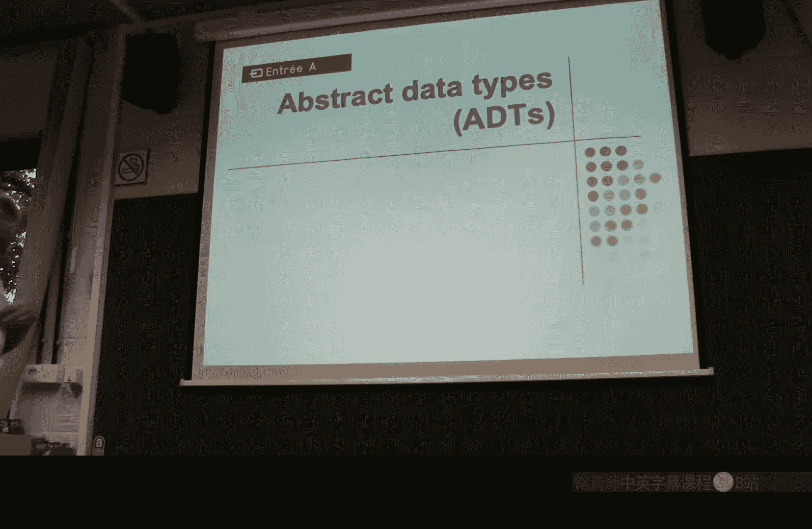
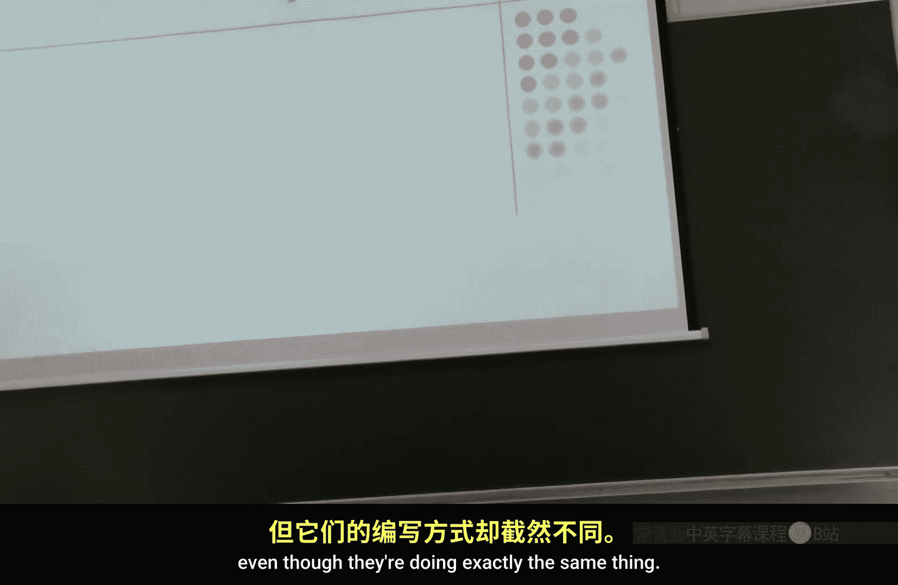

# 高级编程语言概念：6：数据抽象与多智能体编程入门

## 概述

在本节课中，我们将要学习数据抽象的核心概念，并初步了解多智能体编程。我们将探讨如何通过封装来构建大型计算系统，并比较抽象数据类型与对象这两种不同的数据抽象方式。最后，我们将引入多智能体编程的基本思想。

---

## 数据抽象：核心概念

上一周我们探讨了声明式编程的局限性，现在我们将超越它。为了开始这一过程，我们首先需要理解数据抽象。

数据抽象是使大型计算系统成为可能的关键。它是一个程序片段，由内部实现和外部接口两部分组成。外部必须遵循特定规则来访问内部，否则操作将被拒绝。这种封装必须由编程语言来保证，以确保数据抽象的正确性。

以下是数据抽象的两个主要实现方式：

*   **对象**：将数据抽象的内部状态和操作组合在单个实体中。
*   **抽象数据类型**：将内部状态（值）和操作分开管理。

你已经使用过这两种方式，尽管可能没有意识到。例如，电视机是一个对象，它是一个具有开关、频道选择等接口的单一实体。而自动售货机则更像一个抽象数据类型：你投入硬币（值），机器（操作）输出产品（另一个值）。

---

## 抽象数据类型

抽象数据类型是一组值以及一组作用于这些值的操作。例如，整数1、2、3和算术运算。在像Java这样的语言中，整数既是抽象数据类型，也是对象。

### 一个未受保护的例子

让我们以实现一个简单的栈为例。栈可以用列表来实现，`nil`表示空栈，`push`和`pop`分别在列表前端添加和移除元素，`isEmpty`检查列表是否为`nil`。

然而，这个实现并未封装。用户可以直接看到并操作底层的列表，而无需通过定义的接口（那四个操作）。这不是一个正确的抽象，因为它缺乏保护。

### 如何实现保护

问题的关键在于保护内部表示。我们希望定义一个新的、受保护的抽象数据类型。这通常通过一种“加密包装”机制来实现。

我们引入一对函数：`Wrap`和`Unwrap`。`Wrap(X)`返回一个受保护的包装值`W`，外部无法查看`W`的内部。只有`Unwrap(W)`可以返回原始的`X`。可以想象`Wrap`和`Unwrap`在进行加密和解密，并且共享一个只有它们知道的密钥。

对于每个抽象数据类型，我们都需要一个新的`(Wrap, Unwrap)`函数对。我们通过一个高阶函数`NewWrapper`来创建这样的对，它本质上生成一个新的共享密钥并返回这两个函数。

### 实现保护所需的语言支持

为了实现`Wrap`和`Unwrap`，语言需要支持两个核心概念：

1.  **不可伪造的常量**：在Oz语言中称为`Name`。通过`NewName`函数创建，它是一个无法打印、无法猜测的全新常量。程序只有通过传递才能获得它，无法自行构造。
2.  **安全记录**：一种特殊的记录类型，只支持字段选择操作（`.`），不支持列出所有字段等操作。如果记录的字段名是一个`Name`，那么只有知道该`Name`才能访问对应的字段值。在Oz中，这被称为`Chunk`。

有了这两个概念，我们就可以在语言层面（无需实际加密）实现安全的封装。`NewWrapper`的实现如下：它创建一个新的`Name`作为密钥，`Wrap`函数用该`Name`作为字段名将值`X`存入一个安全记录，`Unwrap`函数则用同一个`Name`从安全记录中取出值`X`。

现在，我们可以构建一个真正的、受保护的栈抽象数据类型：
*   `NewStack`返回`Wrap(nil)`。
*   `Push`操作接收一个包装后的栈`W`，先`Unwrap(W)`得到内部列表，添加新元素，然后再`Wrap`结果并返回。
*   `Pop`和`IsEmpty`同理。

这样，栈的内部列表表示对用户完全不可见，所有操作都必须通过接口进行。

抽象数据类型的概念由来已久，例如CLU语言（1974年）。有趣的是，许多现代“面向对象”语言（如Java）实际上也支持抽象数据类型。

---

## 对象

在对象中，值和操作是融合在一起的。对象本身知道如何执行操作。

### 对象的语义定义

我们可以给出对象在核心语言层面的语义定义，无需特殊语法。以下是一个栈对象的定义：

它本质上是一个单参数过程，参数是消息（一个记录）。根据消息的内容（`push(X)`、`pop(X)`、`isEmpty(B)`），它调用相应的方法（也是过程）。对象内部使用一个单元来保存状态（栈的当前列表）。方法的访问通过一个带`case`语句的过程进行分派，这称为**过程分派**。另一种方式是**记录分派**，对象本身是一个记录，其字段是方法，通过`Object.push`等方式调用。

与抽象数据类型的关键区别在于：对象的状态始终被包裹在对象内部（通过静态作用域隐藏），因此不需要`Wrap`和`Unwrap`机制。任何数据抽象都可以选择实现为对象或抽象数据类型。

对象编程自Simula 67和Smalltalk等语言以来影响深远。但值得注意的是，大多数主流“面向对象”语言实际上同时支持对象和抽象数据类型，更准确的称呼应是“数据抽象语言”。

---

## 四种数据抽象

实际上，数据抽象有四种类型，由两个维度区分：
1.  **捆绑 vs 非捆绑**：操作和值是组合在一起（对象）还是分开（抽象数据类型）。
2.  **有状态 vs 无状态**：内部是否使用可变的单元。

这形成了四个象限：

1.  **无状态抽象数据类型**：如函数式编程中的不可变栈。我们之前实现的受保护栈就是这种（尽管例子中栈内容可变，但包装器本身不可变，且操作是纯函数）。
2.  **有状态对象**：典型的Java对象，具有可变属性。
3.  **有状态抽象数据类型**：值本身可以被修改。例如，Java中带有静态（可修改）属性的类。它使用`Wrap`来保护对包含单元的值的访问。
4.  **无状态对象（函数式对象）**：对象不可变，操作后返回一个新对象。这是高阶编程的一个巧妙应用，仅通过静态作用域和高阶函数实现，无需单元或包装器，是最简单的数据抽象形式。Scala语言中的不可变对象就是例子。

函数式对象在“大数据”处理中很常见，其中数据转换管道生成新数据，而不修改原数据。

---

## 多智能体编程入门

现在，我们开始探讨多智能体编程。这是一种基于端口（通信通道）的强大并发编程范式。

### 端口对象

多智能体系统的基本构建块是**端口对象**。它是一个具有内部内存（状态）的实体，拥有自己的线程和一个端口。当消息发送到其端口时，它会根据**状态转移函数**改变内部状态。

我们可以定义一个通用的`NewPortObject`抽象：它接受初始状态`S0`和状态转移函数`F`，创建一个端口，并启动一个线程运行一个循环。该循环等待端口流上的消息`M`，应用`F(State, M)`计算新状态，并递归继续。

有趣的是，这个循环函数本质上就是**折叠**操作。`fold`是一个高阶函数，它依次将函数`F`应用于初始状态和列表中的每个元素。在这里，列表就是端口的消息流。因此，端口对象可以看作是`fold`、端口和线程三者的结合。

### 消息协议

当多个端口对象（智能体）相互通信时，它们遵循**消息协议**——一系列有意义的、完成更高级别任务的消息交换。例如：
*   **远程方法调用**：客户端发送请求，服务器回复。
*   **异步RMI**：客户端发送请求后不等待，可以立即发送下一个请求。
*   **带回调的RMI**：服务器在处理过程中需要向客户端请求更多数据。

使用线程可以简化这些协议的实现。

### 主动对象

我们可以将端口对象与类结合起来，形成**主动对象**。一个主动对象是一个端口对象，但其行为由一个类定义。它运行在自己的线程中。

与**被动对象**（如普通Java对象）相比，主动对象在并发环境中具有巨大优势：
*   **被动对象**被多个线程调用时，方法执行会重叠，导致竞态条件，需要使用锁等机制进行保护，非常复杂。
*   **主动对象**由于有自己的线程，所有发送给它的消息都在其线程中串行处理，因此从多个线程调用时是天然安全的。

因此，在并发系统中，应优先使用主动对象。

---

## 实例比较：Flavius Josephus 问题

为了对比主动对象编程和声明式数据流编程，我们以Flavius Josephus问题为例。

**问题描述**：n个人围成一圈，从第一个人开始报数，每数到第k个人就将其淘汰，然后从下一个人继续报数，直到只剩一人。求幸存者的位置。

### 主动对象解决方案

我们将每个人建模为一个主动对象（`Victim`类），它们形成一个环。协议消息为`kill(X, S)`，其中`X`是已遍历的活人数计数，`S`是剩余活人数。
1.  初始向第一个人发送`kill(1, n)`。
2.  每个活着的对象收到`kill(X, S)`后：
    *   如果`S==1`，自己是幸存者，记录结果。
    *   如果`X % k == 0`，淘汰自己，向下一人发送`kill(X+1, S-1)`。
    *   否则，向下一人发送`kill(X+1, S)`。
3.  已淘汰的对象只是转发消息。

这个方案通过创建n个主动对象并设置它们的后继来建立环，然后发送起始消息即可。代码直接反映了协议逻辑，清晰且并发安全。

### 声明式数据流解决方案

我们将在下一讲中看到此问题的声明式数据流解决方案。它将使用流和纯函数式转换，代码会更加简短，但思维模型与主动对象方案截然不同。

---

## 总结

本节课中我们一起学习了：
1.  **数据抽象**的核心重要性及其两种主要形式：**抽象数据类型**和**对象**。
2.  实现真正封装的机制，包括`Wrap`/`Unwrap`函数对、不可伪造的常量（`Name`）和安全记录（`Chunk`）。
3.  从**是否有状态**和**是否捆绑**两个维度区分的**四种数据抽象**，特别是**函数式对象**的巧妙之处。
4.  **多智能体编程**的起点：**端口对象**作为基本构件，结合线程、端口和状态转移函数（本质上是`fold`操作）。
5.  **消息协议**的概念以及**主动对象**如何通过将类与端口对象结合，提供一种安全、优雅的并发编程方式，优于传统的被动对象。
6.  通过**Flavius Josephus问题**的主动对象解决方案，初步实践了多智能体编程的设计思路。

下一讲，我们将继续深入多智能体编程，并查看Josephus问题的声明式数据流解决方案，以对比两种并发范式。