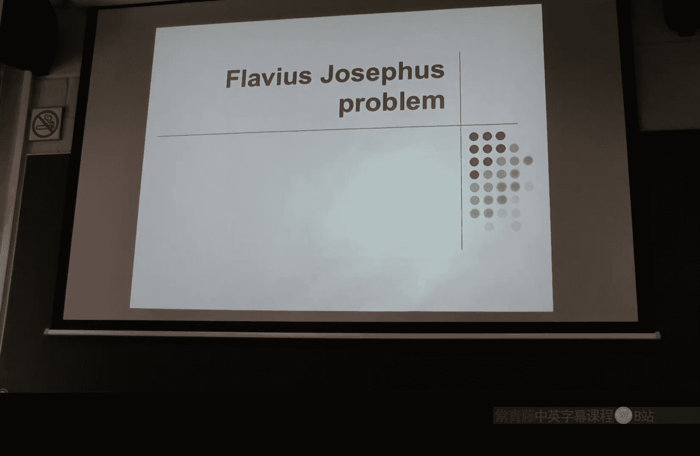
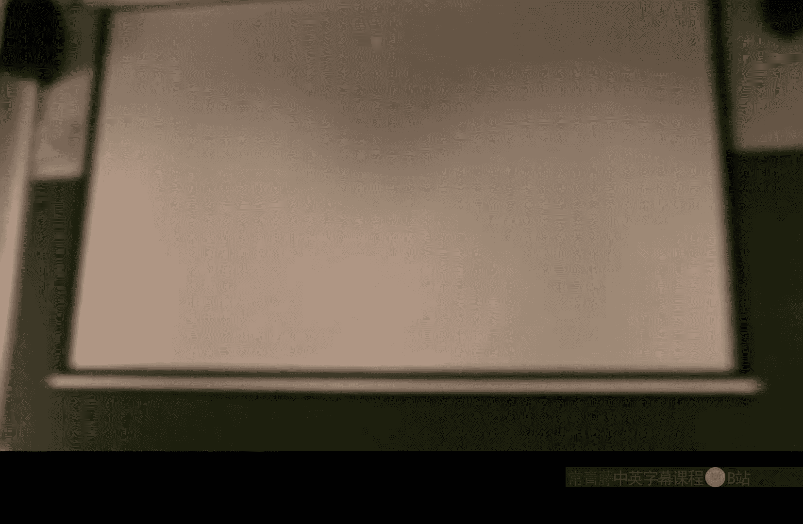
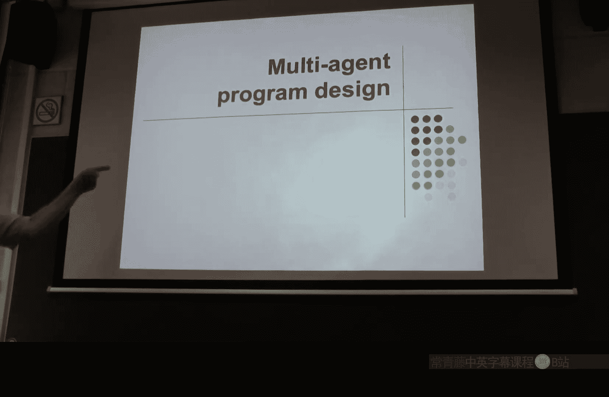

# 鲁汶理工学院【中英⚡高级编程语言概念｜LINFO1131, Advanced programming language concepts】 p34 P34 FO1131 Lecture 8 (2022) -BV1UDffBbEBZ_p34-

Welcome to the course。

After the midterm， the fuel did well in the midterm。Today。

 first I went to pause for a couple of seconds。To pay our respect to the Ukrainians who were fighting for their freedom and。

And today I want to talk， I want to finish the Flleby Josephus problem we started the last time。

Last time we saw an active object version of this。And now I want to show you the deterministic data flow version。

And compare the two， theyre very different paradigms。

 and it's very interesting to compare how the same protocol looks in both of them to give you an idea。

 okay？

So I recall the story， we have N victims in a circle numbered from one to n。

 and every case victim disappears and we keep circling until there's only one left and the problem is to find the number of the the last survivor。

Last time we defined a protocol。For this， a multi agent protocol。

each victim is an agent receiving messages and sending messages， okay， in a ring。Okay， very good。

 and now we're going to go to the thing that I want to really show。

I'm going to show you very briefly again the active object implementation。

 and then we will make a deterministic data flow。Implementation， which is very different。

And actually much smaller， you'll see how how to compare， so this one is something everybody knows。

 object oriented programming， active objects， which you can use in concurrent settings very nicely。

 so the protocol is very intuitive here。But this way of doing things is different。Okay。

 you have streams， stream object， this is the purelyative declarative way of doing things。

And so protocols are defined in a slightly different way， and you'll see how it works。

So let me first refresh and put in the active object。

 and then we'll go to the deterministic the flow。所的命。Again， very briefly。Show you the active object。

 so I have to define the abstraction that creates active objects first。全都。So this is the abstraction。

 remember， this is a very nice abstraction that combines three ideas here， an object。

 a port and a thread。And you can see that we're reading all the messages in sequence。

 and this four statement is doing synchronization whenever a new message appears on the stream we will execute the object。

 So this is a concurrent。This program， okay， it's not the same as a sequential。

 this stream is potentially unbounded， so this thing will keep accepting messages and the output is actually a one argument procedure。

To make it look like an object。 Okay， so that's just to make it look like an object。

 So I compile this。So this has been compiled。And now， I can。De findine the flavius Josephus。So。

 first， I'll show you the。S protocol。 So this will refresh memory。

 I'm going to very briefly just execute it again， and then we'll go to。

To the deterministic data for version。Here I define a class。With attributes and methods。

The attributes， there's an identity so the number of the victim， a bullolean alive。

 this is the case on the number of messages， the number of steps you take for killing。

 the last variable of the last survivor and successor gives me a reference to the next victim in the ring。

Okay， and I have two methods。 So a said successor， this is for initialization and a kill method。

 So this method is the heart。To finds the protocol， as we define it all the different cases。

 the victim is alive， if S1， then it's the last survivor and I'm done， I fine last to my identity。

 otherwise， I check whether I have to cure myself， X mod step zero。And otherwise。

 I just passed the message， notice in these two cases， I'm passing a kill message to the successor。

Either with S or S minus1， okay？And in the case that the note is dead。

 it just passes the message to the successor。In one previous course， clever students said， well。

 in the case it's dead， the victim is like a zombie， which does something but it's still dead， okay。

 so it's just passing the same lesson， so that's the victim class。And we run it。人。Here the region。

So doing it accepted。And now， the initialization of the。The Josephus of the。The ring。

 the creation of the ring and starting the program。So this is the function Josephus and K。

 I'm using an odd data structure called an array， so I'm not going to go too much in detail except that it allows me to index it index data structure so it kind of simplifies building a array so I first make an object here for I in1 to n。

Greatate for using the new active。I now connect them into a ring and now I have to do a little bit a trick becauseor one to n minus1 it's easier I have to set the successor to i plus1 but for the last one in the ring I have to set the successor to one okay so I have a little thing here and then finally to start the whole business I insert the kill message to a。

1 and then it runs and I return last so this thing will be running it's a concurrent program and eventually the last one will be bound okay。

So， that's。All were fresher， we saw that last time。Sorry。F region。So this is accepted and now we can。

Rund the state。40 guys in a circle， three， every third man must die and number 28 is the survivor。

 okay， but of course you can run it for much。这个。And that if I have 10，000 guys in the circle。

 every 100th sky， that's much harder to do in your life。Notice it's unbalanced。

Because it's actually running， running， running， running。Soren up eventually gets there。

 so it's doing a lot of work， well this guy will create 10，000 victims。Which is 10000 threads。

And each step， you have to pass over 100。Victims to get rid of the next guy okay and the more dead ones you have。

 the dead ones don't count so at the very end when most of them are dead。

 you're going to be passing over many， many， many， many victims hundreds。

 thousands before finding a do alive one day。 so at the end。

 this is actually doing lots going around very often in this ring of 10，000 threads。

So you can see he takes some time。We can actually optimize that。

Look at by removing the dead victims from the ring。 That's what I call the short circuit protocol。

 So I'll show you how to do that。 It makes it a lot faster。

 but now let's go to the deterministic data flow version。诶。Okay。

So with the tuistic data flow version。Let me first make a picture of how this thing should work。Here。

And there was lookinghel， so the victim。Victim I。Has an input stream。

 which I call I and then output stream JS。And the messages appear here， so there's a pill message。

 for example， X。The pis here， and then the next the output one can be something like this。我我两。

So the victim receives these killer messages in a stream。And has a case statement， Okay。

 and now we have to make a ring。So the victims are basically connected in a ring，1，2，3， and minus1 n。

Going around like this， and how do we construct the ring while we construct the ring by first making a pipeline。

From one2 to n。AndThen we connect the end to the beginning， Okay， so it's。A different way。

 but it's still going to be a ring theor， but these are all streams going around。Okay。

 so how does it look like in code in the code？Yeah。SoLet me show you now the code of this。But first。

 I have a I have a。A helper function called pipe。Which creates the pipeline。ok。

It creates a pipeline going from L to H， low to high， one to n， but from any number to any number。

With an input stream， X S， and the result of the pipe function is the output stream。

 So this is a recursive function。 So how does it work。So it basically works like this。

If I to create a stream going from L。To H。This is the pipe function。

It's basically going to be working recursively。So I have this recursive call here。

So this is pipe from L to H。 This one will go from L plus1 to H the output stream input stream Okay so this is basically just a recursive function。

 You see how it works it's not so complicated， very simple。So if L is less than or equal to H。

 I will create a victim， so the function F is creating a victim and this is that input to the recursive call。

 so that's pipe， so that's my helper function。And here's the Joseph Ps function。

And here's the victim。 So this victim function corresponds to the class in the active object version this victim function takes an input stream。

And returns an output stream。 It also has an identity。 The identity is just the second argument。

 which doesn't change。 Okay， I， which is the number of the victims。So now we have a case statement。

But reading messages from the stream kill XS message。And now we have to the protocol。

 so here is the protocol this corresponds。Very closely to the protocol for the active objectjectta。

 If s is one， then last is I。 So last is a global un variable and dill is returned。

Nil means this stream is done。 It's finished。 Okay， so this guy will actually clean up the ring。

 At the very end， the ring will disappear here。The ringbow completely disappeared， if x mod k is0。

 then the output is kill x plus 1 S minus1。Followed by Xr， but there's no recurive call。

 And here if x mod K is different from 0。Then the output is x plus1 S， so I go to the next guy。

 but I don't kill myself and I do a recursive call。Notice the difference between these two here。

 the recursive call means that the victim is still alive。Okay， in a sense， I'm recreating the victim。

 okay， the victim is still alive here。Whereas in this case， I'm not doing recursive call。

 I'm passing the input street X Xr to the output， so in this case the victim is dead。

 you see the difference， so the way to keep the victim alive is to either do a recursive call or not。

Okay， and that's it。 That's the whole protocol。And here I build the pipe。

So basically I build from one to end， here I have a function， so this is the function F。

 which is cravaving the pipe， which has the input stream as an argument and the name， the identity。

 the number of the victim， so I。Okay， which is the input stream here。

 and this function will create a new victim here inside its own thread。

 so this is a nice example of how order programming up。See how it works out。

So it's nice to look at what the contextual environment would be of this function since it's referring to victim。

 okay， which is defined there， okay？Also the victim function is binding last， which is defined here。

 So that's part of its contextual environment。 You see how functional programming makes it really nice structure。

 and so it's in a thread and the result of this call will be the output stream。Okay。

 so the pipe will create。From one to end。But then we have to connect the output to the input。

 so Zs is the output of the pipe burn at the very end。We have to connect it back to the input of Zs。

 but I stick in a kill message before， this is like the first message in the active object then to make it run。

So kill1 n bar is zS， that means there's always a kill message before ZS but Zs here will connect input put down。

 so this instruction here creates the whole okay。So it's very concise。In fact。

 the length of this code is very concise and it also automatically removes dead victims from the ring。

 so the ring gets very shorter and shorter， okay？What happened here。Oh， wonderful。 Thank you， Doctor。

我りです。I'll have to restart now there it is again。I am not sure what's the problem with Dcker。

 but I will have to read put in the code。Let me put in all this code。Re。This one。你 regionion。

And now I can run this pieces if you。Joseus。43。So it's not fun just if it's just if it's number three。

え。Justie is three。Insolutely brilliant。And it gives me 20 eggs， so that's goodhu。

But I want to let me run the other one now， the one that I did in the previous example。

 so we want to compare the two， the previous one I did 10，100， okay？It's actually much faster。

 you see， it only caused an instance。But here again， I'm creating 10，000 threads。And I'm circling。

 but this one is actually smarter than the active object。

This color is actually smarter because when the victim dies。

 it's automatically removed from the ring， it's very easy to do here。

So the active object one doesn't do that， so it's less efficient。That's kind of配。

So what I want to do now is make the active object one as smart as this one。Okay。

 I want the active object code also to remove the dead victims。 Okay， you see how it's working out。

 get the idea。 Okay， so let me make a picture。Yeah。

This means that the active of object code will get a little bit more complicated。嗯。

It's kind of a machine language so here's the active object version。😊，Okay， I have the ring。

 Let me just draw a piece of the ring here。Now assume this guy dies。

 and these are successive pointers。Each object points to the successor now assume I killed this sc。

I want to repair the ring， I want to remove it from the ring。

 basically I have to change this successor corner to put to that one。How do I do that？Well。

 it means I have to do some。Some administration， some bookkeeping here。Some plumbing。

So how do I do that？Well I have I'm here， okay， this is the object I'm running and I need to change this guy means I have to send a message from this one。

 let's say this one is I， I minus1。I plus1， I have to send a message from I to I minus1。

 It means I need a predecessor pointer。I need this one has to know the predecessor because it has to change this pointer。

This successor pointer， okay？That means all objects need a processor pointer now。

 that's a little bit more than before。Also。I have to also update the predecessor pointer。

 It's not enough to update the successor pointer。 It means this predecessor pointer of i+1。

 I have to change it also。So that means this object has to send a message to the predecessor and to the successor to update the successor pointer。

And to update the predecess pointer， okay。So you have to do two extra operations to fix the ring to remove this guy。

 you see that？Okay， so let's do that。So let me just show you the code that does that。

This is the one using this the short circuit version， which I call the short circuit version。诶。

It's a little bit longer as before than before。So this is the new version of the active object。

Now it has a successor and predecessor pointer， it has two ex methods。

 set successor and set predecessor。And now when the node dies， so most of it's the same。

 but when the victim dies， a lot it gets false， I have to fix the ring。

 I want to remove the note from the ring， so I send a message to the predecessor to give it a new successor。

So the new successor of I minus1。The new successor of I minus1 is actually the successor of I。

 it's this one which is the successor of I。So that means the predecessor， I send the message。

 said successor， and my successor， it's I that's executing this you see that？

See what I'm doing here and I have to do the same in the other direction the successor I have to set predecessor and the predecessor。

 the new predecessor is the predecessor of victim Iya here。

 so I have to send these two messages and then I do the kill。Okay， and now I'm done， right？Well。

 not quite， I'm not quite done， and the reason is this is a concurency problem here。

When this kill message is now going in the ring x plus1 plus minus1 it's going in the ring and it's going all the way around。

 eventually it will make its way back。So the kill message。Here goes in the arena。

And goes all the way。 eventually， it makes its way back here， but it it should see a fixed ring。

 It should not see a half fixed ring。 Both of these pointer。

 successor and predecesor have to be correct when the kill message comes back here。

So we have to prove that。I've put three messages in here。In the ring。And this is concurrent。

 this is a concurrent system， so all of these messages are basically traveling asynchronously， right？

So we have to show or we have to make sure that this kill message when it comes all the way back。

That it sees a fixed rig。That means that the two messages here have been trigger。

How can I prove that？we have to prove that。The combat gives you a hinter。It actually is true。

You can actually prove that when this Q message comes back， these two will already be done。

And the reason is because of PIO property。And the PIfo is。

 I can prove it as foes when I send a message to a port。

When I sent two messages to a port from the same thread。

The first message I sent will be arriving first， so the order of the sentences is the same as the order of the receive you see that because each time I do a I add it to the stream and so it has a position in there。

So you can actually prove now。That the ring will be fixed。Do you see how to do it。

 will me to do it for you， it not so simple， you have to think concurrently。Okay。

 here's how to prove it。Assume I'm looking， I look first at this one， I minus1。Okay。

 there's two messages going to I minus1。There's this one。The set successor。

 and then there's the kill message eventually when it comes back， okay。

 so there's going to be two messages。Which one is he first？Which one will arrive first to I minus-1。

 the set successor or the queue？And why。Nowら can you guysです。So basically， this is the question of。

 if you look at I minus1 here。There's going to be two messages coming here， the set successor。

And the killer， when it comes all the way back， which one will arrive first？ごきつ。Which one I at first。

 you tell me？You see what I'm doing here， I'm looking at I minus1 and I'm looking at the order of message arrive alone。

Which of those two will arrive first？And can you prove it？Well， what is the order of sin？

What is the order of the sins？Well， this set successor was sent before the kill。And this kill。

 it's not the one that's going to arrive when Ix1 because this kill will go through a bunch of victims and there will be another kill。

 so later on there will be another kill。Which means the set successor is sent to first。 You see that。

Because of FIFO， it will arrive first。You see that simple， right， right， is it simple？

So the second success said， oh， why is this stupid？Okay， so problem this doctor is a pen， okay？

Do is a baby。Yeah。Why does it something is。There is something going on on It must be an Internet thing。

Change the network。 You see the name。must be something like the keep in alive mean。

ADocker is such a great thing。我。What a great piece of suburura。そイーというが。嗯。Okay， so here。

So we know the successor will arrive before the kill， and that means once the kill arrives。

The ring this node will be repaired， it correct it will have a correct successor， so we're good。

 and the predecessor also is correct？And the same reasoning we can do here。

 the successor are correct， so it will come here。But here also there's two messages coming to the i+ one and because of FiIFO。

But here it's a little bit more subtle， I'm directly sending them to the same note， successor this。

 successor at this。But because I send the set thread before the kill。

 the set printread will arrive before， and it will fix the I plus one， and when the kill arrives。

 it will see a nice thing， so the kill never sees the plumbing that we're doing。

 it sees only a correct。Okay， so this is good down。オ。Now let me run this guy。Okay， but course。

 I have to。这。And I let define who I think again。どうする。very active course。

I have to explain this one first。It。Okay。good。 Now let me just do this one that。对。

This one is called Josephus 2。Let me do 43 just that everythings working。 This gives me 28。Now。

 let me do。Joseph is to10，100。You see it's much faster than beforea。

So the short circuit protocol actually succeeded in making go love faster。So here's the code。

For the short circuit， so when I set it up， I have to set up the successors and the predecessors。

 so when I build the initial ring I create n。Victims， I sent the successors here。

 and I also have to set the predecessors， so I have two pieces of code here。

 and then I stick in the kill message。 So this is the initialization。And this is the。The出 code。Okay。

So this is nice code， right？Well， if you're using Java。

 then this is the kind of code you have to write， or even airline you would have to write like this。

This is okay， right， you understand it。Let's compare it now to the to the。

Theterministic data flow version。Notice this one， the active object version。Essentially。

 two full screens。嗯。So， here is the。tererministic data flow version。Full version。超。いやもたな。

And this is in 2022 and they couldn't fix scrolling again， okay。

 so here is the themin negative flow version， complete version and it's doing the short circuit protocol。

And I have my little helper function。And I have the protocol itself。

 and here I'm building it on two lines of code。And it's very efficient。

both the two programs have similar efficiency。Now this one。

 it's only half as many lines of code actually as the other one。

 but it's doing exactly the same thing okay so you can see active objects is kind of low level compared to this this is much higher level in a stema。

 it's only half as much code。And it's more dense， it's much denser， the pipe， it's two lines。

 instead of having all this garbage about predecessors， successor pointers。

 mutable state and everything， I just have a very simple pipe of streams here。And removing。

A victim is very easy。喂。Either I recreate the victim by doing a person call or I just。

Pass the input stream to the output。 So there's no more victimma。So this is only half。

The number of lines of code so it's much denser and the more and it's even for bigger programs it's even more the case okay now this one only works if the code is deterministic and Flavus Josephus is a deterministic protocol。

 it's always giving the same result okay it's completely deterministic so you can write it like this。

There's no races or anything like that。So comparing the two， let me know show you。Some slides now。

Okay， so comparing the two。So in the active object and the deterministic data flow。

 each soldier victim is an active object， each soldier is a stream object。

 so here it's a passive object inside a thread， but here it's a list function。Inside thread。

Here on the left we have a class that defines a kill method that implements the protocol。

 here we have a function victim that reads kill messages and creates a new stream depending on the method case theme。

In the initialization， we have to set the successors or pointers。

Here we just have to build a rig so the pipeline with the output is connected to the input。Okay。

So you see the correspondence， but in the amount of code， this one on the right is much compact。系。

So we can explain a little bit。Okay， so the active object version， the short circuit。

 we actually have to implement that with a bunch of codes。Remove the dead victims from the ring。

 We have to update the successor pointer and apprentics or pointer of two notes。

 and we have to be careful that it's not pro giving any problems with concurrency。 Okay。

 it depends on the fifo properties。 This is important to understand this。The send is as PFO repar。

The order is the same as the receive order。So this you have to be careful。

 I cannot send if I change the order， then I send the messages it to be buggy， okay。

 so it's important。Now， the deterministic data flow version automatically very easily does this optimization。

 we remove the dead victims by replacing the recursive call。By simply the input stream。

 so there's no more victim， okay， the recursive call is actually eviction。

Doing a recursive call means that the victim is still alive。

 not doing the recursive call means there is no more victim。

 so it's very easy okay so you see semantically it's a lot denser， okay？

So that's a very interesting comparison。I think it's very interesting to compare them because when you start programming。

With industrial tools， you will almost always be doing active objects。There are very few tools today。

 theyre coming out that do the termministic data flow， but it's actually much denser。

It's actually easier to write than the deterministic data flow version， okay， less lines of code。

 less chances of bugs， and the efficiency is the same。

There's no significant difference in the efficiency between the two。

So that's the final conclusion of the Flavius Traciraa， interesting to see the two。

 so it's important to look at the two implementations and compare them。

 the paradigms are very different。They look very， very different and they look quite different。

 but they're doing exactly the same protocol。Okay， what do you think of that。Okay。

 so now we go to the next step， now I want to show you how to write very large multi agentent programs。

I'll introduce it today and we'll continue next week。This is used a lot， okay。

 program is a bunch of agentss that send messages to each other， like a whole constellation of ages。

And each agent has internal stains and they send messages。Okay。Now。

 the deterministic data flow is a kind of multi agentent， but a limited times。

 only with the deterministic behavior。With port objects or active objects which is port objects with a class。

 we can have programs that have non deterministic behavior。ok。

And so I'm going to show you a big example of this。But for today。

 I will just give you a simple introduction to that。Okay， we're going to define。

So this is what we're going to do next week a lift control system。

 or elevator control system when you go to a hotel， big hotel。

Usually if you have many lift cages or elevator cages like six。

 and the hotel might have 30 floors and then there's buttons to call the elevators and every floor has buttons and the lifts they' are all going up down six。

 for example， and there's stockment floors and inside each lift there's also buttons。

 which floor you want to go to and you can press multiple of them。

 you can press them anytime you want， so this is a large concurrent system。

You can see it's not so trivial， it seems up every floor has a button outside the floor that you press。

Calling the lift to go up or down。Every lift inside the lift has a bunch of buttons for the floors you want to go to and you have n lifts。

 maybe six lifts and you go up to 30 floors。 So whenever I go to conferences。

 I'm always in these big conference hotels， and it's always something thing like that okay huge number of lift cages。

 30 floors， lots of buttons and they have human beings using this， they can be in any floor。

 they can be in any lift and they can be pressing buttons anytime。And this thing has to work。

It's not as bad as a concurrent system up， I what you think of that so the usual way to implement that is as they hold the agent system。

 you cannot have one little Java program sitting here and each time you press a button it sends a message。

 Java comes back。ItDoesn't really work is what happens if it's a Java program that crashes the whole thing。

Is down okay， so usually this is multi agent thes have processors。

The floors have a little processor with the buttons， okay？And they can talk to each other。

 they can send messages to each other， and of course there's the users which are also a processor in their head。

 okay？This is the example I want to show you。And I want to show you a way to do it that makes it correct using state diagrams。

 okay？So here's the kind of overview of this thing。So you have lift shafts here there's three。

 but in a big hotel you can easily have six or more， I've been in those hotels， you have end floors。

So easily， can be 30 or something。And each of these shafts is controlling theor。

 so that's a separate feast， which is either in the basement or it's up on the roof with cables making the lift go up and down。

 but there's also a control here a processor here controlling the movement of the lift。Okay。

 so you have a lot of components in this system， and then you have the humans。The users。

They come to the floor， they press the button， they can also go inside the lifts。

 so you have a bunch of。Components here。 So in a big hotel， you can have six of these， six of these。

30 of those plus。Dozens of users， as many as you want pressing buttons all the time。

 okay and users love to press buttons time and know about done。

So this is a summary of the components and their protocols。

Okay so each lift is a will be an active object， each floor will be an active object or a for object。

 we will also model the users。Pressing a button will be modeled as a message sent， okay？

And then there's the controller。So what， so there's a bunch of possible messages here。

 the user standing in front of the floor presses the calls the lift。The user can be inside the lift。

Wanting to go to floor。 So that's called F message。The floor。

 when you do call it has to actually call there， so it sends call F to the lift。

 when the lift arrives， it sends an arrival， and when the lift is allowed to leave again。

 it's the floor acknowledges that it's allowed to leave。And the lift also talks to the controller。

Because the motor has to start and stop sometime。Whenever the lift wants to move。

 stepped message to move up or down， and then when it arrives at the floor， the control says。

 you have arrived， so sends a message back， so you have all these protocols running between these these agents and inside of each of these agents。

 you have a program。But you have a state。A state here， and whenever I call。

 whenever I send a message， the state is updated， okay， according to some complicated protocol。

 and I'll just briefly show you， but we'll go into it next week。

 so to write this program we're going to write this program we have to write the code for the floor for the lift and for the controller up。

 all three we have to write the code。And how do you write that code when you start？

By not writing code， you start by drawing picture， which is a state diagram。So for example。

 here's a state diagram of the controller。 I won't explain it now。

 here's a state diagram of the floor， and here's a state diagram of the lift。

 which is more complicated。But they're very systematic， you construct them systematically。

 and once you have the state diagrams， then you can run the code。

And then you have this very complicated thing， notice this is a concurrent。

 extremely concurrent and non deterministic system up。And you want it to work done。

A user presses the button that lifts past the comm。

And you don't want deadlock or any weird problem happening。Okay， okay。

 so that's what we're going to see next time。 we're going to see how to do。Multi agent program。

And many， many programme in the real world are like this。

 okay they're not like Java program and they will be using these little microconts which processors on them sending messages okay。

 but basically it's a multi agent system okay so let me stop there and so next time we'll actually be building this system。

