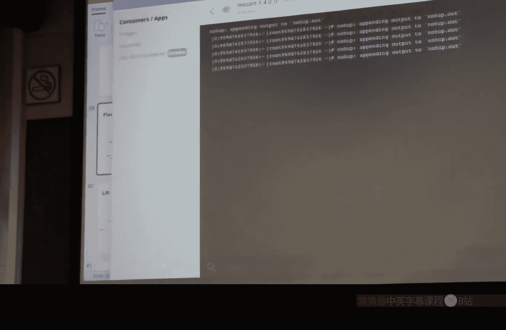
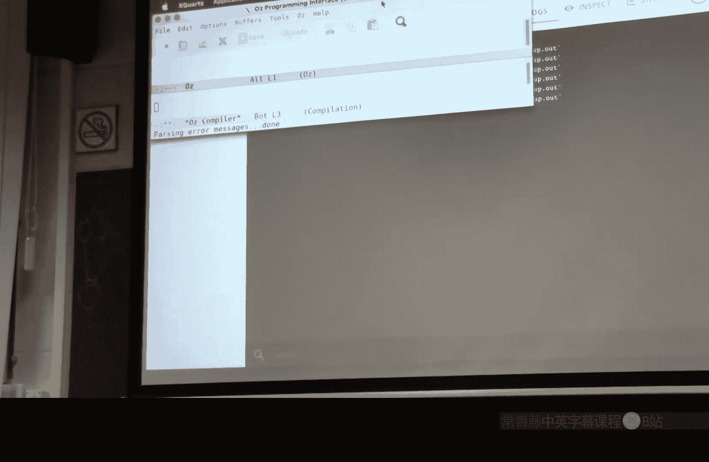
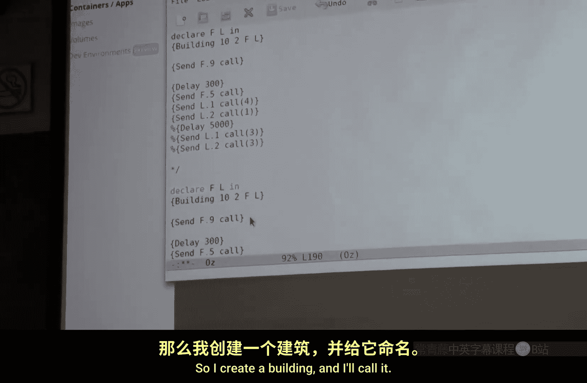

# 鲁汶理工学院【中英⚡高级编程语言概念｜LINFO1131, Advanced programming language concepts】 p35 P35 FO1131 Lecture 9 (2022) -BV1UDffBbEBZ_p35-

Today we're going to talk about multi agentent systems。

We started already in the last couple of lectures， I showed how to do active objects or flood use to CFphis。

But today we're going to see how to make real。Big。And correct multi agentging systems。

 and these are very important whenever you make a program that interact the real world。

It's going to be a multiage system， the real world is very concurrent。It's very distributed。

And it's very rare that you have sequential programs。Rning in the real world。Okay。So， I made them。

An overview here to give you a context， first I will give you the basic concepts。

And then we will apply them to the lift control system。

And we will just go through the whole methodology， this is actually not so simple to make it really correct。

 okay， so we go through all that。And all of this is actually an introduction to next week。

When we will talk about an industrial strength multi agentent system called airline。

And this is even stronger than what I'm saying here because it also handles failures。

So one of the strengths of airline is failure handling。Because when you have multi agentsent。

 maybe an agent fails or the cable breaks， it happens a lot， okay。

 so a real multiag system has to handle failure。The example I give today does not tend failure。

 you can extend it tend failure， but I prefer talking about failure in the context of a system that does it really well。

 Okay amonomy is probably the best。Syst them to do failure your hand lately。In fact， airdu is。

Kind of a hidden language。It's widely used， but there's not so much media attention but it survives。

 and it thrives， it is used a lot because it is by far the best language for failure handling a multiageent system。

O。So that's introduction。First， a few seconds of pause for the people in Ukraine who are fighting for their freedom and for our freedom too。

Okay， so in multi agents。We're going to program court objects for active objects。

 which I'm going to promote ages。You can call it concurrent components。

 so it's extremely concurrent for agents that' are sending messages all over the place， okay？

Colection of agents that send messages。 So it's if you do it wrong， it send S， okay。

 you have to be very careful， it's very easy to make this to hack something up that is really messy。

So that's one of the reasons we're able to show you a good way to do it。

And we started already with deterministic data flow。We had stream objectss， but that was very easy。

Because the deterministic data flow is deterministic it's functional。

 so the multi agentging programming is like functional programming。

So the deterministic data flow is like a very easy kind of multi agentent with stream objects。

 so we started in the Fl use to CF cell。With the victims， but we sell many other examples。Now。

 but it's not enough。Because it's deterministic， we will often need nondeterministic behavior and nondeterministic behavior。

 as we saw， is needed when your program interacts with the real world because where laws happen anytime。

 they're not really they're not very disciplined。And there might be timing and constraints or like in the lift control system。

 people can be pushing the buttons anytime。Okay， so there's humans involved or other kinds of machines。

 cars， driving on the roads， whatever， it's all nonistic， things can happen anytime。

This makes it a lot harder。Then deter deterministic data flow， okay。

 and so what I'm going to do today is give you kind of a way to do it so that it has a chance of working。

Okay。The basic principles， so it's very hard because you have interleavings。

 all the agents are executing at the same time， concurrently they' independent。And remember。

 we have the interleaaving semantic， so basically they're all making steps at any time。

And it has to be correct for all of those interleagus。 Okay， and that's a lot。 It's very exponential。

 So it's really hard。Okay， so I'm saying that over again it's hard。

 it's very hard because a lot of books， these systems have a lot of books because people don't really realize how hard it is。

But nowadays we have techniques to do them， we even have verification tools。

 there's actually tras or metros in Pariss that are completely automated。

 I don't know if you've taken the Orleyval from between the Anthonytony Station and Hney Airport。

Completely automated。And it was completely verified， so they used an approach。

Like this but even stronger because they had a software tool that is actually able to look at all the interleings and guarantee that it's correct。

 so they actually did a formal verification of this。

 not just testing okay so when you implement something。

 you test and you verify testing means you're running it in all kinds of conditions。

 but that's not enough because sometimes you have rare things that happen once every million executions。

And you never catch them when you test， so you have to do also a verification， okay。

 so I'm going to talk a little bit about that。And the example。But first。

 I want to introduce some the formal concepts。Of multi agent systems， some formal concepts。

 basic operation links， some examples， methodology， and then we go to the example。Inforces， okay。

So a concurrent component。Is basically。This is the thing that specifies an agent。

 so it's kind of like a class， okay， because when you run the concurrent component， when youvo it。

 it creates an instance and that instance is the agent。Okay。

So it's possible to have many ages that are actually have the same codeID inside because same they're instances of the same concurrent component。

ok。And our examples will use port objects。In Flavius， just we used active objects。

 but it's almost the same。Poort objects， the specification is that using a function。

 state transition function， but in active objects it's made using a class， an object oriented class。

But that actually is。Very close， there's a very close connection。

 so we're going to just do port objects。And I'm going to explain again， an example we saw before。

Which is the full matter， remember we did digital logic example。

 this was even in the previous course。But digital logic is deterministic data flow。

And we have a procedure called full Adder with five arguments。AndThis creates a logic circuit。

 So a running logic circuit， which behaves like a full add。 So that's basically a 1 bit add。

3 input bits and two output bits。 And there are streams， of course。

 because the thing is executing in time you can have many successive inputs。

 So the input bits are streams。 The output bits are streams。 This is an example of a component。

 And I'll show you this example， because it shows already this idea of。Component and instance。

And there's four basic operations， so instantiation is creating instances of a component。

We can also build a new component out of other components so you can have in the full letter。

 you have gates inside。And so you have components inside of a bigger component。

 that's called composition。You can also connect components。And this is the message channels。

 actually， okay， who can send messages to whom？So you can have different kinds of these connections in deterministic data flow。

 they're always。One source that means only one agent can send to another agent is deterministic。

But with report objects， you can have two agents sending to one agent， so it's non deterministic。

Okay。And so I'll show examples of that， and the final one is restriction。

 if you make a new component out of other components inside， you could have links that are hidden。

So it's kind of like leical scoping， okay， these are restricted and they're inside。

 so these are the basic formal concepts， okay now if you're a theoretician person。

 you can define a calculus。You can define a language， a formal language that has this。

 but I'm not going to do that because when we write this program in office。

We will see very clearly how。These concepts are used， okay。

 so when you have two agents connected together。They link together。

 there's a link between two agents， here's an agent connecting to another agent。

So there's a language。And there's different kinds of links， and this is very important。

What the kind of length is， because this determines whether it's deter deterministic or not and what kind of whether you stream objects or port objects。

Okay， so there's different kinds of links， there's one source links when the source。

 it's always the same source sending to the destination， or you can have multi。

Source list where you can have multiple。Sources。Sendending to the destination， okay。

 so one source here on the left， multiple source from many source。

 so the client server example we saw is a multi source。

But all deterministic data flow is always using one source。系。And then so that's one distinction。

 the other distinction is how many messages can you send on this channel？

Can you send one message or you can send a screen with messages？Okay。

 so that's what's called the One shot channel or many shot channel， one lesson you many。

 the One shot channel is just a data flow variable is very well you can it and once you find that it's done。

Single assignment。 So it's a channel that you could only send one message。 So why is that useful。

 you only send one message， It's very useful for eknowments， Okay， and it's also。

 you can guarantee only one message will come there。Because remember。

 this is we're in a very complicated world here， the bugs are everywhere。

 so if we can guarantee things， it's very good， so these one shot channels are really nice。

 whenever you only need to send one message you don't need stream okay you can just have a single assignment variable。

Its the way to model a one channel， so so only one message can be sent。

But you can also ask many shot or you can send many messages。So that's a stream。

 so that we saw already in the termministic data flow， okay。

 but it's more general when you have ports in persona， so a list that can be extended。

But in the one source， it's deterministic。Because the destination knows where the message is coming from。

There's no choice is done here， no non deterministic choice。

 so this is completely functional declarative， okay， termmin flow only has one source list。

This is we saw this already before， okay， now I'm putting in kind more general context。

Because we're going to multi agent， the thing we add is many senders， and we saw the concept for it。

So this is a mainstream stream and any thread can send。

If it knows the name and all the messages are added to the stream in a nontistic way。

 it depends on the timing， okay， any sort consent message and they are added。Whenever they arrive。

 so if you execute the same program more than once， the result can be different。

This is the weird thing about non termmin is the month。And let them multi agent languages。

Industrial languages like airline， they will be using。Only these many source things。

 I think that's kind of a mistake。Because airlineing does not have one source of things。

 but you can create programming patterns。Kind of abstractions that guarantee this。

 but the language Arablock only has these many substance things。

And there always going to be many shots， there are always going to be many messages coming in。

It's not very useful to have one message。Coming in through many possibilities。

 so one shot many source is not very much used today。Maybe someday， okay。So this is the distinction。

 okay， and we'll try always to use the most restricted one because of the buss， okay？

So here's an example let me have before。I'm going to show you and again it because this shows almost all the concept except many sources。

Here I have a full errorer。And it' created using set seven， sorry， seven gates。

 languages get mixed in1 hundred times seven gates here。And this is the circuit diagram。

 So all the letters here are strings。Whenever I execute， these are components and G and G or gate。

 x or gate， whenever I execute one of these I will create a running gate。

So I'm doing composition here， the full adders contains seven subcompons。

 and whenever I execute the full adder procedure， I would create a full adder component which consists of seven subcompons。

 which are running days。And the id here would be strings， and they're all going to be one source。

Okay， this， the inputs are connected to one output。

 there's no way to have multiple guys sending messages。

 so if you do digital logic like the microprocessors，They can see everywhere today。

 it's all deterministic， okay， to hold microprocessor， billions of gates。

 there's billions of these gates are completely deterministic。

 okay so the whole thing is deterministic， in fact， when this thing connects with the external world。

That's a problem because that's nondeminism love， So that's kind of neat let me just give you a picture。

 So if you have a microprocessor here。Microor， this is all deterministic。So you have millions。

 billions of gates， but it does connect to the external world。

 and these interfaces will be non deterministic， okay？And that's actually a problem。

 those are actually not easy to do。Like external interrupts。

 that requires a special kind of circuit to handle the nondeterminism so I'm not going to get into that。

 but just to say that most digital logic is completely deterministic okay so it's all using deterministic data。

And so today we're going to go away from that。And we're going to go to non deterministic multi agentsents。

OkaySo this shows you all of the concepts composition， restriction， linking， and instantiation。

All the four constants here。So we're going to keep those concepts but extend nondeminism。系。But。

We need to do it very carefully， So I'm going to introduce heres out of the methodology。

 So basically this is。Kind of a discipline that you have to follow。

If you don't want to have buggy programs， okay， designing multi agentian programming is more difficult。

Okay， that's an understatement。 It's much more difficult than designing sequential programming because of all the interactions that might give different results and bugs。

 the bugs can hide okay， So there are famous examples where people died because of these bugs。

 Okay I mentioned already there's theres in the 1970s。 So this is a long time ago。

They have these machines for。For in the hospitals， for killing tumors by irradiating them。

And there was a concurrent program in there， and there' was a keyboard， but they didn't verify them。

 okay？And so when the technician was typing on the keyboard， when he was very competent， very good。

 typed very fast。And he typed so fast that they never tested it into typing so fast。

And that gave concurrency bug and then the dose of irradiation was multiplied by like10 or something。

 so people dying because of these bugs， okay and now with cars with early volume。

 metro automated things， bugs here they kill people， so it's kind of funnier。

We have deter termministic data flow， which is really。

Simple and everything and easy to prove and correct。And nobody is functional。

But it doesn't work in the real world。But what we want is a system in the real world like metro or car。

My lift control system。But once we go to the real world。

 it's much harder and we introduce lots of buds， so all the nice but free。Programs。

 it becomes very buggy all of a sudden and dangerous， so it's funnier， going to the real world。

 all of a sudden makes the programs much harder to write。

And so that's why it's important to follow something like this so I'm going to follow this and you'll see how we do it。

 you can even do more rigorous than the extent so I start for informal specification so first we have to know in our heads this is very straightforward what is going on then we define what are the components in your system。

And that the products are talking to each other， so we define what are the message protocols。

And then each component will be an agent with internal states。And it has a state diagrams。

 so we have to define the state diagrams。And I will show you all that。

 so the hard part is these state diagrams， okay， really getting them right。

And this is still not code， this is pictures。Okay， what I like to do is define them by drawing pictures and you have tools to let you define state diagrams。

 and at the very end you write the code。So you do almost everything without writing any code。

And then you write the code and you test it。And all kinds of。Corter cases。

 fast and slow and everything， but that's not good enough。 You also have to prove properties。

And there's different ways to do this， these courses on this。So there's Charlotte Pe。

 his course on concurrent programming。Does this kind of thing， verification。

 there's techniques called model checking that let you verify this so I can write a do whole course on this。

But not why I'm just going to touch on it， but this is very important， also you have to do both。

So there three pillars you have to do a rigorous design。

You have to test it a lot and verify three pillars if you miss one of those， you're dead， okay。

 you will certainly have bugs and even if you do all three you have bugs。Okay。

 so this is what we're going to do for the example。Okay。

 one important thing is that the agents have internal state。They are state machines。

 so any running program is a state machine now， whenever the program changes the value variable。

 it's a state change。But here， the state machine is really the hard。

And so we're going to have the notation。Of state machines。 And so the states would be these circles。

And we will have stake transition。And the way it works。

Is first you enumerate what are all the possible states， there are all these balls here。

 all the possible states that the system can have。And the messages。That it can receive。

 So the component has all his states and messages come in。Okay， and whenever a message arrives。

The system can change states。It might change state in some way。And so we have a notation for that。

Okay， so there's many， this is a very widely used idea， it's called a finite state atmaton。Okay。

 but the notation I give you here is going to be really good for multi agentent。

So when I'm here in the first state， I have this arrow。And I have。

Something written on the arrow with the slashed here。So I receive a message。I received the message。

And that causes the transition， I can also add bullolean conditioner it's not always going to do this depending on whether the tradition is true。

 this is the condition。To make the state transition and on the right hand side of the s is the actions。

 what I do， so maybe I send another message， maybe the agent will also send a message。

 so there's a send message here， there might be some other action， okay， real world action。

Like in the lift control system， the lifts had motors going making them up and down or opening the doors。

 closing the doors， so this could be a ring world of action， okay？嗯。

The state transitions that are annotated with this thing with two parts。

 the left is the condition and the right is the action。Okay。

And the whole collection of all of these is called the F State Atana Fund。

 and that's what we're going to design。We're not going to write code in the beginning， okay。

 and after we write link the whole state diagram， then we write the code。ok。So the code。

People love to write code， but here the code is done at the very， very end。

Most of the work is without code， it's thinking about states diagrams and reasoning about them。ok。

Okay， so that gives you the the。The idea， the methodology。

 now we're going to apply to the control system。And we'll go from beginning to end。

 so you're really going to see the whole whole thing。

 the whole thing was all of the dirty colors that comes out of it， okay？

This is actually fairly realistic。It's actually similar to real lifts in motels and apartment buildings。

 so usually apartment buildings it's very simple， you have only one lift shaft going up and down。

 but maybe you can press buttons and lift can be smart or stupid。So for example。

 the list in the Department of Computing Science is very stupid， okay。

 that means if you click on a button， you will go there。But if you want to go to another place。

 you have to first go to the first thing you clicked on and then go to the second thing。

So it's kind of a dumb lift。What I'm going to show you here。

You can actually make it dumb or make it smarter， I'll show you how to make the code。

 you can put in some smart components。Or not， you'll see now to make it smart in a hotel usually there's many lifts。

啊。Like I mentioned before， so I go to lots of conferences and they had these big hotel hotels with3 floors and usually there's like four or six lift shafts。

Ples of buttons all over the place。 Okay， so when I click the button and I want to go to some floor。

 one of the lifts will come， which one I don't know。

 So the lift control system decides which one comes。

 Maybe it's already one here and it just opens the door。or maybe not， so if it's smart。

 it picks one that's close by， okay， or it picks one that's already coming down， but if it's stupid。

 it picks a random one and maybe the random one is that the third 30th floor is going up okay？

So you see there's a lot of possibility to make it smart or dumb or buggy also。

I'll start with the informal specification， I'm already starting with itA。

 I'm already telling you the kind of thing it's doing。

 overview of the system and how it's embedded in the real world， who presses the buttons。

 and we're going to identify which chart of components。And their message protocols， in this case。

 the message protocols are actually simple。Okay， but you've been not complicated ones。

 I'll show you some example of that。We're going to have three components that need the state diagrams。

A word design controller， floor and lift， we'll start with the simplest one which is the controller and then the floor and the lift is actually a pretty complicated state diagram how do you make it right。

 I kind of show you how to make it correct and then we write the code and I'll show you the running code and hopefully it works okay。

We can try it in lots of scenarios， pressing buttons。But that's not good enough。

 we also try reasoning。So you look at the state diagram。And your reason， if I press a button。

 will the lift come so there it state change， will can you prove that the lift will eventually come？

It's not so easy。Because anybody can press buttons all the time。

 people can be press buttons and it has to work， okay and all live to women at the same time。

Completely confirmed， Probably you've never written such a complicated confirmed program in your life。

I don't know if you have much experience with concurrent programs。

But this is every agent just concurrent and it's we wrote concurrent programs in deterministic data of flow。

 we made digital the logic， remember the adder， the digital adders with 64 bit adder uses like several hundred threads。

 so you have written program with hundreds of threads。

But the termministic day and flow programs are very easy。They're just functional。

 so they're not really hard， so it's not really very impressive to have 400 threads in deterministic data flow。

 it's very easy， it's much more impressive to have 20 threads in one of these programs okay because here it's all nondeterminist。

So this is probably the hard concurrent program。That that you've seen， which we move to write。

 and this is not even a very hard in a factory， you can have hundreds of machines that are doing product lines。

 so you have these product lines where the partial products are moving on transport networks。

From one machine to another， the robots are doing stuff， that's quite complex。

And it takes a lot of expertise to write those。Programs， it's really a special expertise。 Okay。

 so here's the the diagram of the lift。We have lift shaft。

 so each lift goes up and down in like a vertical tube， which is called the lift shaft。And each。

We have a number of floors， so theyre orthogonola， each floor will connect with each lift。

And they give have users， which are the humans， okay？So the users are also models。

 they're components instances。The users are also model， they also have behaviors and everything。

 it's just we're not going to write the code for the users the code is already written from these guys。

 we're only going to write the code for the list， okay。So what happens here， you have lifts。

 you have floors， but you have a third the same。Because the lifts are controlled by motives。

 going up to them with cables。And those motors are not in the lift， they're very heavy do things。

 they will be outside， they will be either in the basement or sometimes they're on the roof， okay。

 they could be on the roof， but there's one controller for every lift shaft。

So if you look carefully at a， a real list。In a system。

 you will notice that there is a controller somewhere。

You can see they're in the basement or on the roof at the hive。And this one will。Make the lift to up。

Now， each floor。As a button to call the lift。And the lift internally has also many buttons。

To go to different floors， I want to go to floor 1，23 up to 30。

 So there's many buttons and any of those buttons can be pressed anytime。 So that's basically。

The situation so this is all informal specification so now we've kind of identified the components。

 so there's actually four kinds of components， the users， the floors， the controls and the limits。诶。

So that's nice， but now we have to look at what are the。Protocols between these components。Okay。

 so here's a summary， the protocols here actually quite simple。

But you can make them more complicated， I'll show you a more complicated example at the end。

 but here it's very simple， so the human user can press the button is sitting on a floor pen who wants to call a lift so he presses the call button so that sends a call message to this floor component。

The user can also be inside of a lift， physically inside， and go to a certain floor。

 so basically sending a message to the lift saying I want to go to floor F。

 so when the user presses a button，Inside the lift， it's a call F message going to the lift。Now。

 the floor can also send called F messages because the floor can call the lift to come， come to me。

 so the floor will also send called F messages。靠度的。And then theres more messages。

 so the floor calls the lift。And this is a protocol actually， eventually a lift comes。

 and when the lift arrives when it's at the floor， it sends an arrive message to the floor it says I've arrived。

 usually that can be mechanical figure， it actually sits mechanically on the floor。

And then the floor will do things like open the doors， close the doors。

And when the lift is allowed to leave， the floor will send a confirmation back and you can go。

 and I will model this as a one shot because that's a single thing。

 so it's a single here it's already going to be single assignment that the acknowledgement says you can leave now。

Okay， so there's actually three messages call lift， the lift comes， and the lift is allowed to leave。

It's allowed to leave， it doesn't mean it actually leaves， so the lift is not free to leave。

And the lift also talks to the controller， so the lift knows where it wants to go。

 okay the lift knows that from all the calls and so on。

But the controller is the one that makes the lift move。

So we're going to model the controller in a simple way here。

 the controller will only move one floor at a time。

 it will move the lift up one floor or down one floor。So if you want to go up five floors。

 you have to send five messages to the controller。This is for making the code a little bit simpler。

 you could say go many floors， but then it's harder because what if you want to stop winding going up okay？

So somehow the lift has to tell each floor when it's there， even when it's going from 10 to 30。

 because what if the lift is going from 10 to 30 and somebody is at floor 20 and calls the lift while it's going up。

 it should stop fair， right and let the guy in。So the controller of this example is going to be one floor at time。

And so the lift says， I want to go to floor D， so I'm at floor F now or something the controller knows the floor that I'm at。

 maybe I'm at floor 10， I want to go to floor 30。And the controller will move either up one floor or down one floor and once the lift is one floor higher like floor 11。

 it will say at 11， it will send a message back。 So this is one step message and one at message。

And if I want to keep and then the lift， it's at floor 11， but it still wants to go to floor 30。

 so it sends another step message， I'm going to keep going higher， okay？An act。

Now you can even make the lift。Control here very smart， you know， real lifts。

 they don't have an undo， you notice I want to go to floor 30。

 but that was a mistake I don't really I pressed it by accident Well I had never seen lift where you could undo that。

But you could make a lift where you undo that where you can well， it no longer goes to floor 30。

 okay？Strange， you could improve the performance， but somehow there's a standard way of doing lifts and people doing like that for many years。

Okay。Okay， so that's the component。Now we have to make the diagrams。And this is a little bit harder。

And I will make the state diagrams on the board because it's like programming， okay。

 it's the real hard part is making the state diagrams， so I'm going to make them with you。

Peace by piece。So you see how to do them， okay？And this is where you have to actually do the thinking。

 so it's not writing the codeID， the code is easy once you have state diagrams。

We're going to start with the simplest state diagram。Which is the controller。So here it is。

 but Im not going to- I'm going to leave this slide here， but I'm going to show you how to design it。

Okay。So the controller。So first you enumerate the states and you have to understand what's in the states so the controller has basically。

Two days， it stopped or it's moving， running， okay， the lift is moving or it's not moving。Also。

 it has another， it knows what Floride says。So if it's at floor 10， it's F， then it starts running。

Until it gets to 11 and then the F becomes 11， Okay， and also each controller has a lift I L I here。

 it knows its own lift。 so I'll put that in this state。So you have everything there， okay。

So you have stop date。I'm stopped at floor F。And I'm my list is LID。

 and I have another state where the motor is running。Okay。And it's coming from floor F。

 and it's the same lift。Now， in order to make this really work。

I have to attach it to an electric motor， okay， I have to somehow interface the controller to an actual electric motor sitting in the basement。

 okay so in my simulation， I'm welcome to do that， I don't have an electric motor here。Actually。

 it would be nice to have a real example because we have cards that could do that little controller cards。

 but now I just want to do simulation。So what I'm going to do is I'm going to have a timer。

What I'm going to do is I'm going to define a timer。A timer component。

 which is going to be like modeling the electric motor， okay。

 and I'm going to send a start timer message。So the timer components。It's just。

So that I don't have to do real voters， okay？I will do start timer。

And it eventually sends a message back called stuff Time。Okay， so this is for my simulation。

In the real system， this would be an electric motor， okay？Okay， so what happens？

So now we have to design all of the state transitions。ok。And with the notation of showed you。

And so for example， we're here， it stopped at floor F。It receives a step message。Remember。

 this is a notation with the slash shot， receives a step message and F。

Is equal to the floor and wants to go to the destination。Well。

 that means we don't have to do anything okay， so this is a little loop back here and the action is nothing okay。

 so in the case when I do a step and I'm already at the floor， I do nothing。ok。

But now I can have another possibility I do I receive a step message and it was different from the destination。

Now I have to start the motor running。So I said a start timer message to the timer。

 let's say there's a timer ID here。And the controller I need here。

 because the timer has to send a message back to the controller and there's some time， let's say。

5000 milliseconds， okay， five secondsd so for our simulation， we lay it。5 seconds。

But we will be going to another floor。So the state will change。So we have to compute the new states。

 so I'm going to do it like this， new F。If F was less than destination， then I have to go up。

 so if I have to go to floor 30， a minus floor 10， then the new one will be F plus 1。

Otherwise it's f minus1， so the new f here will either be this old F plus1 or minus1？

If it goes up one， so then I' in this state。And I stay here。

UntilUntil something happens that I change。Eventually I'm going to receive a stop timer message after five seconds。

 so you see there's a time。There's time here，This is not just some mathematical thing。

 This is in the real world， there's a tiny aspect here，So after five seconds。

 I will receive a stop timer message。I remember the left side of this s。

 and then I will send an at message， at F to the lift ID。Like we said before in the diagram。

 the protocols， and I go back to stopped and that's it and I'm here again。That's the whole。

State dier。 Okay， notice it obeys。This idea， I do a step and an add message comes back。

So the controller state diagram。This is the full controller state diagram， you see that。

 how it works。That's pretty easy， right， now this one was a little bit tricky because of the timer。

Because we're doing a simulation， okay， this whole program。

 so I'm going to show you the running code and it'll be a simulation and it will be doing things at certain times。

 so it's running through timer。And so this timer is very important。

And this five seconds is very important because it kind of organizes the simulation of。

So this is my controller state diagram。Let me show you real quickly now just what the code would look like for this。

So I'm not going to run at the， let me just show you the code here。So， here's the controller。

See I can make it a a bit bigger。Is that readable？So this would be the code for that state diagram。

And this code。Is automatically generated。Once you have the state diagram here。That's every。

You can generate the code with some tool you don't actually have to。

Write the code if you have a smart tool， there are tools for doing this，Industrial toolss。

 so this will generate the code。So here I have the timer。

So the timer is a court object with no internal state up here。It receives a message， start timer。

It creates a thread。It delays tea and then it sends stop timer back。

 so it does exactly what I show there。And here is the code for the actual controller。

 here I have the new it's a port object， so it has a state transition function。Okay。

 and this is the function。And the state here is actually a syntactic convenience。

 the state is always going to be a tuple。So I'm going to model it as a coupleppple with three elements。

 so motor F and LID， and then message， so this is the state transition function。

 it takes the state tier and the message， so this already is a case statement。

This notation where I put the tuple inside the header here is just making the code a little bit shorter。

 it actually already has a case statement here， so here now I have the actual code and it's always two nested cases。

I have to do a case on the state。And a case on the messages。Here I have case motor running， stopped。

And then when I'm running， I wait for a stoptimer。When I receive the stop timer。

 I send a lift ID and a new date， so this is the result of the function is going to be stopped。

FLID and here the stopped in the case when I received the when I've stoppedump。

 if I receive a ST message。If F is equal to destination， then I'm done， I do nothing， I return。

 stop FID， otherwise if F is less than the destination。

 I send a start timer I hear it's one stepping up。I'm going to show you the simulation。

 so every second something's going to happen。And then the new state will be running F plus1 LD。

And in the case where F is greater than the destination， I said。Again。

m I start the timer and the state will be Fmins。And that's it。 So that's the color。For this state。

Okay。But this is the simplest one。Okay。The other ones are harder。

But maybe this is a good time to make a small break， since the other escape diagrams。

 this is the easiest one it'll be a little bit harder than this。

 so I make a break and then we will do the floor and the lift and then we will do the code and we actually run to the beast。

嗯了。So before the break， we showed we did the controller state diagram。

So now we have to do the floor and the lift， but the floor， let me do it completely from scratch。

So how does a floor work， we have to think how a floor works， well when the floor is doing nothing。

 nobody's calling it， it's sitting there minding its own business and let's say put it in a state。

 let's call it not called， so nobody is going to that floor that floor is not calling a lift， okay？

But then somebody comes。And upsets the poor floors， just mining in some business。presses the。Well。

 then the floor has to call the lift， okay？Let me go here， so there's a state transition。

 let me write later it does on this， so the floor can go into the state where it's waiting for a lift to come。

For some reason， okay， somebody press the button。 And then the lift actually arrives。

Well the floor to actually do work then has to open the doors because the floor is controlling the doors。

 okay， so there's another state。Let call this one。Doors open。Eventually it goes there。Doors open。

AndBut the doors don't stay open forever， mentioning the doors close and the floor is back to and the lift goes away or whatever。

 and the floor is back there。So the life cycle of a floor， you have this cycle， okay。

 it's not called， it's calling a lift。The lift arrives。

 the doors open and when the doors close again， the lift goes away and it goes back to no call。

But this is only the framework， now we have to look at the messages。Okay。

So what are the possible messages， but we actually thought about that already okay？

Here we have the floor。A call message， when somebody calls it， it will call a press call。

 it will call a list。And the lift arrives and the lift can。

 so we have to take care of these messages， basically the call message and the arrive message， okay？

诶。So there's a call message here。That's coming。It's not called call message。So what does it do？

So this is the Re part on the right there。What does it have to do now so it will transit to Cald State。

 but what does it do here？You can see it there， it has to send a message to a lift up。

And the floor has actually a number which doesn't change， let's put the number。Here。

 there's a number which doesn't change。It's like a constant， this floor， so it has to say call F。2。

 to some lift。Which lift does it send the call message to not to all of them but because all of them come。

 well maybe if it's really dumb， it sends to all of them and then when one lift comes the user goes in and leaves the other lift comes。

For no reason， Okay， Okay， fine。 but so basically， let's just say sense to one lift。

 Let's make it really， really。Stupid， some random fixs a random lift ID out of the six or how many there are。

And it sends call F message there。Okay， and then it comes in this state。And what happens then。

 well eventually you lift your eyes？We have this arise by coming of year。Right。

With some acknowledgement， this is telling me that I can go actually。And now I go to this state。

But now， I actually。If you think about it， in our simulation。

 we need another timer run because the door is open and the door is closed。

 there's another electric motor there。Managing the doors。 So there's actually also a timer here。

 So we send start timer。Sometime， whatever。So idea。Through the timer。Okay。

 so this model set the doors open up。For five seconds。And eventually。I have a stop timer。

Message arrived。And the doors closed again and they go not closed。But when the doors close。

 I have to tell the lift that it's okay to leave， okay， so I bind act。To some let's say， okay。

Soの constant saying you can go there。And the lift knows it's free to go。Okay。

 so that's the basic cycle of it， right， what you think？That's the basic framework of a floor。

But we're not done yet。Were by far not done。Because there's a principle that we have to follow。

All messages。Most。Be accepted in all states。So here we do a call button。

But if you're like me or many people。If the lift does not come in fast。

 you will press many times that call button none。And so the floor will receive many calm messages if we receive a calm message here。

So what we do， what happens if it gets a comment message here？

Well basically nothing because it's already following the list。But you have to handle it。 You see。

 you have to put in something like this。Also when the doors are open。You can get a call message。

But nothing is needed there， that's pretty stupid， you call lift and the door is open， okay。

 but it can happen。You have to handle it。 and if you don't handle it。

 then the code has some kind of a bug， did not。If these call messages will not go away， okay。

 what happens to the call messages so the call messages will stick around until they're taken by the agent？

So you have to swallow them。These call messages Sir。 So the call messages Sir。Are hand now。

Are we done。What do you think， it's over， we have a full， is this the full state now。

 is there anything missing or not， what you think？Without looking at the slides。

Is everything done the？Well， let's take a look at this principle。

 all messages when accepted in all states。The floor accepts another message， not just column one。

Which one。Which one。Does it accept？Not just call that there's another message coming to the flora。

The little arriving， Yeah， so the arriving is here。Now。Is it possible？To have them arrived here。

 arrived coming or here。If the floor is not called。Put a lift arrive there。 Of course。

 someone in a lift somewhere might want to go to that floor， so a lift can arrive at the floor。

 even if it's not called by the floor， so you need to have。Arrive here。 And there's another。

Value now， in fact， to be very smart， you have to manage all of these acknowledgements。

But I'll make it very simple。So we'll just bind them all together。

 so all the lifts are adding will leave at the same time。But in fact， in real lift system。

 you have to handle each lift because each lift will have its own door。But let's just for simplicity。

 say that when this guy is allowed to leave this one also。Okay， what about when the doors are open？

Is it possible to have an direct message here？What do you think have you ever been in a hotel with many lifts？

Of course there can be if I have a lift opening， there's a lift right next next to it。

 someone coming down and it opens， of course it can come up。So of course。

 I can have an arrive message。Coming here， but the doors will stay open。

 let's just make this very simple， in fact to be really correct， every lift has its own。

Door that opens that。 Well we'll just say it's a general doors opportunity to keep our code simple。

 okay。Is it completely correct now？Everything is fine。Yeah， technically。

 we have to reset the timer and stuff， but let's just keep it simple。给。

So am I good here is this is actually the other side of the slash。Am I good here？

There's still something question to。Right。What's missing here？If there's still something missing。

 right， there is something missing， what's missing？Something's wrong here。This is a boogegie tour。

Well， the doors open for five seconds， right， when I go from called to doors open。I start the timer。

 they open， and then they stop。But when I go from North culture， theres open。

I have to start the timer two， right？So I also need to do start time from Peter home。Hello。

 as before。Because the timer is not going to start myself itself，h， it only starts when I send。

So both， whenever I go came the doors open from another state。I have to start the timer。

 and then the timer will stop here。 What about this one？Does this one have to start with timer？

Now it's already started when I'm indoors open， the timer is already running。

Unless you want to be very smart and reset the timer because otherwise the w might come and there's only 50 milliseconds left。

You， will open but we'll make keep it simple， so technically you wouldnt have to reset the time here。

To do that as X as a。Exercise， so now we're good， right， How do we know we're good。Well。

 we have followed this rule。Okay， we have followed other rules that there is also that always the timers start when we're indoors open。

 there's a stop timer message here， we always tell the lift。

 the act is moving you stop the time and we tell the lift it's leave to go。

 so we're correctly following this protocol。So the Chronologist seems to be correct。

 so this seems to be reasonable right， this is the floor state diagram。

It's kind of dumb because we picked the random。And if you can be smarter here。

 I'll show you a little later if you have time that you can do this much smarter。嗯。Okay。

 so that's the。So here's the controller， this is the one in the slides。嗯。It's about。

 I think it's similar。This one is supposedly correct。系。Now I' the final one。

 which is the list state diagram。This is a tough fe， this is the hardest one because the lift。

 the lift has a real memory， if people in the lift click on1，5， 10， 15。

 the lift has to remember that it has to go to four floors。And if somebody calls it。

 it has to remember again， so it needs to remember a sequence of floors。That it has to go to。

The state of the lift is much more involved than the state of Florida。

 Florida doesn't have to remember very much。But the lift actually has to remember a whole sequence of floors that it has to go to。

If it doesn't， there are very stupid lift systems that don't do that。

Sometimes you see that in apartment buildings， you click on floor five。

And then you cannot click on anything else until the lift actually arrives in floor5 because it only can remember one number。

 I have actually seen very dumb lifts like that， but this lift is order。

 this one will remember the whole sequence， okay？So let's start designing it。Okay。

I'm not going to design it all from scratcht because they now would take too long but start designing it。

There's actually loops in there， the lift has to do iterations。

Because two nested loops actually has to do。Okay， so let me see just to make sure。

 So there's what what there's actually a schedule， which is the list of。F as it goes to。So。

 the lift has a。Let me call it a schedule， there's also a moving flag。W is是。Start by。

 in a very naive case。The lift is doing nothing， okay it also has to know a controller and it means make sure not too inconsistent and it's at a particular floor。

Well position。So this is the lift when it's doing nothing。It's sitting at some floor。

It has to go nowhere， so schedule will be a list。A floor is that it goes to。

And moving will be whether it's moving or not。So an Ile lift looks just like that。

But there's a way making the lift not id luck。There's actually several ways of making the lift not id low。

Somebody has to call it。So it has to actually be called to a certain floor。

 let me go back to the per。Here。So the lift will accept call as messages。To go to Florida。Okay。

And once it has a called F。It will add that into the schedule。Okay， so there's another state here。

It's that a position。And the schedule is different from little。For example， it has a call F。

And here's some on if the add F。To the schedule， okay。Let me just do it like this for now。

 and it's moving now。If the schedule is new， it has to be dooming， it has to be active。

 so it's moving， okay？And what does it have to do Well。

 it has to send a step message to the controller。ok。

As to send a step to whatever destination it goes， which will be the EA。Let's say this is a list。

 so let's say the first element of schedule to the controller。

So you see it starts getting more and more complicated than done。But， let me show you。

The diagram and I will explain how it works， so here is a is the lift state diagram。

And you can see it's not so simple。Okay， so here is the basic。The basic case。

 the lift is sitting on the floor。It has to go nowhere and it's not moving。And I call it to go F end。

If a is different from where I am， so this is important， then I have a new schedule。

 which is a list containing N。And I send step N to the controller and I move you to this space。Okay。

Mo is truth。And if I arrive at N， I go down here， now the lift also has to do something with the doors。

The lifter out as and it's the floor that's controlling the doors。Okay。

 but the lift is like attached to the floor when it arrives。

So the lift is not allowed to move as long as it's attached to the doors。If it tries to move。

 that's kind of it will break， it's kind of a bug， so it has to wait for the doors。

 that means it has to wait for the doors to close and it's not connected to the doors anymore。

 that means when it arrives。And。And a position and the position is the first out of the scheduler。

Then。It's here， it goes to wait for doors， it sends。The acknowledged message to the floor。

That's the other sign in the protocolla。It sends it to the floor and it waits。

It waits until the acknowledgement is bound。If there's nothing more to do， if scheduled up to is nil。

That means there's nothing more to do than it goes back to the idle state。Right。

 and the new position will be n past this new position。And the new schedule is ninging， so there's。

 there's a basic loop here also like this。But its actually much more can happen， unfortunately。ok。

So I can get many content messages anywhere。Now， to simplify a little bit， the call and messages。

 I will only accept them。In the two main states here。Okay， not what I'm waiting for the doors。

Because waiting for the doors is a temporary。It's a temporary state that has a short time duration and I cannot move anyway while I'm waiting for the doors。

 so I don't really have to handle the call end message here because after some time I will always go back to one of these two states okay so the call end messages are handled in these two states。

When I'm not waiting for the doors。So here's a call N， when N is different from the position。

 here's a call N， when N is equal to the position， so if the lift is there。

At my floor and I calling it。Oh， it just has to open the door， so it's this set date here。

 it since they arrive to the floor immediately and it waits for the door and so if the lift is already there。

 it can just open the doors，And they wait to leave， okay， so that's a simple condition。

If the lift is already there， if the lift is not there。Okay。So n is different from the position。

 I send a step to the controller。And the controller will send an act message back。Okay。

 now this is actually a wild loop。If the app coming back is different from Schule。1。

 that means I have to send another。Step to the controller and go back。

 So this thing is like a while loop。 It will keep circling until N pass equal schedulet to see that。

So this together with this is like a wild loop。See how it works。If I arrive like floor some floor。

 but it's not where I want to be， I send another message to the controller and then I arrive again and if it's not where I want as long as I'm not where I want to be。

I will keep reactivating the controller。Until I'm where I want to be。

 and post equal will schedule that one。Okay， so these two together。Is a wild。Okay。

But there's another while loop， there's actually two nested while loops。So let's say I'm here。

 I call N。The new schedule is and I have to go to Florida N， but now I'm moving to N。

But while I'm moving， someone sends another call Ed this is a different kind。

Going to a different floor。 And I add N to the schedule。So I have some function。

 this list scatters a lister， it's the list of floors I go to。But I put it at the end。

 so my naive protocol is if I go to floors1， five and 10， and if I have 15， I just put it at the end。

That means I always will go to one five and10 first and then to the next one。

 so my naive protocol is that any time a new call message comess。

 I stick it at the end this function schedule last， which basically adds n to the end of the list。

And then they come back here。 So schedule is updated。But meanwhile， this loop is still running it。

When I arrive at scheduleule dot1， I come here。I wait for the doors， when I'm allowed to leave。

 let's say I'm allowed to leave， but Sch do2 is different from no。

 that means there's still more floor。It's not the only floor。 there's still more floors。

 so I basically the new schedule is。The rest， it's scheduled up two。

 it's everything except the first， and again I reactivate the control。See that so， this thing。

These two here， basically the condition is scheduled up to is nil or different from nil。

Is another wild loop。There's two wild loops running here。Kind of at the same time。

 So while this one is running， going to a floor， I can add more floors。To it。

 and whenever I arrive at a floor。I will add if I'm not done， scheduled up to a different from bill。

 I will set the new schedule scheduled up to and I start again going to the next door。

 so it's like two nested while loops。See how that's working？

And the way to make it is you have to follow principle。

All we have to follow all the protocols and all the calm messages have to come in at the right time。

Very。So the call end， you have many comments and you add them to the schedule。ok。

Now these two here are the main wild loops， the big one。As long as Schule2 is different from nil。

 it's still moving， okay and looking for the floor， but once Sch do2 becomes equal to nil。

 then I'm done and it goes back to the island state。ok。But maybe it never goes to the island state。

If you can stay here forever， if people are always pressing call ends。Then this loop。sorry。

 whenever the lift arrives， the schedule decreases。You see that。But whenever someone presses a call。

 the schedule increases。So both of those things can happen so the schedule is like moving out。

 it's decreasing whenever I arrive at the floor but whenever someone calls it's increasing again。

 okay， and maybe it goes all the way to those people stop calling the lift it will eventually exhaust itself but if people keep calling。

It will grow and grow。Can it grow forever。Couldn' it become incidently long， what you say？两位啦。I mean。

Because it's limited amount because we limited enough floors so schedule last here。

 if n is already in the schedule， it's not going to add n okay so the maximum size of the schedule is just all the floors so there's no problem with memory but you see you have to think about it。

You have to think， get that if're totally naive， is we just add without checking that this list would grow but we're not that naive。

We first check whether M is already in the schedule。So the maximum is going to all floors。

 and that's it， but no more。So that you can stay forever then in this place if there's many people it's a very busy hotel。

 people are always suppressing buttons， but in the middle of the night。

 people eventually go to sleep and the lift becomes idle and it goes here。

You could even add a protocol where the lift goes back to the ground floor。

 and here it stops at any floor。Okay which is actually the baggg in the lift in the computer science if the lift is at floor two。

And nobody doesn' anything mean， it just stays there。But in hotels they usually don't like that。

 so in the middle of the night all the lifts come back down to the ground floor。

 so there could be a thing here that makes this lift as long as pauses different from zero。

 it couldn't be moved down to the ground floor so you could add spaces。For that you see that。

How it's working。So this is not so simple。What do you think of that。

So this is the state diagram for the lift， each lift is running with this。ok。

But maybe we want to see the code running for。诶是 code。So I't have to start mother again。いろんな？水泽鱼。

So here's the control the room。Here's the floor。And barely see it the whole thing。

Not called and called， so there's again， a newport object， a function。

 which is the state transition two missed cases。So you have the first。The first。

 the top level is the state called， not called and doors open。

And inside there's a second case on the message arrival， so there's always two nested case。

Which is on the state and on the message， you can flip them up。

You could actually first do case on message and inside there and do case on the state。

It depends on what your preference。So you see you can actually write it in a different way。

You have actually two things that are determining the action under the state and the message。

So if the message is call， I put in a browser here so we can see the simulation。

 I pick a random lift so lifts。Is actually a temple。Which contains all the lift diabetes。

One plus OS dot R mod with lifts， so this will give me a random lift。Okay， using the os。ren。

 random just to be random intoger and to that random leaf then we'll send a call。Okay。

 so I'm doing exactly what I'm doing in the state diagram here。So this code actually is very。

Faaceful， time is a little bit different。嗯。So if I'm called and the lift arrives。

 then I will send start time or message， okay？If the doors are open and I get to stop time your message。

Then I will say， here I say equal units， units is just a constant。s it constant？

That I use when I don't want to give a name to the constant， it's just some particular constant。

 you know that true and false are constants and there's two of them while there's also a single constant called units。

But this could be okay， and then this state goes back to not called。

If a lift arrives while I door open， I will merge the two aments。

So that I will let all the lifts leave at the same time， this is kind of a simplification。

What you really want to do is keep a tuckle of a and have a separate timer for each one。

 but that makes the code more complicated。And in this example is maybe too much。So that's the floor。

So you see this code is very straightforward。 It looks kind of complicated。But， actually。

It's just this。So you can see。That。The way to write multi agent system is to do this。

St diagram and not to do the right code first， to very badly。This is much better than。V code。Okay。

 now let me show you the lift。And that then we try writing this stuff。So here's the beginning of it。

 so I have this scheduled last function。ok。Maybe it's not good enough。哦。

If L is different from nu and the last element is equal to n， then I just return L。

 but maybe what I should be doing is checking whether n is a member of L。Oh， I'm not doing that。

 but you have to prove that this is enough。That you cannot bring in an N in the middle。Have you。

Every can who knows。AndOtherwise， they append。And to the end here。And here is the lift。

The lift knows about all the floors， or as the tuple floors。Again。

 there's a state transition function。It has the message， call， act。Is that the only thing， yes。

This is actually， look at that it filled it fits in one screen。

 it's not that much about even though the state looks more complicated。Because of the list。

 it's easy to man the lid manage the list， so if I about that position。And look at the scheduler。

If the schedule is。S。Schedule 2。So if I'm at a position， I take S， if I'm at S。

 I send an arrive message。And I wait for this thing to come back here。

 I'm using a syntactic trick of Oz。Where this arrived variable is actually an argument to wait。

 It's okay， this should be actually two lines。 So I said arrive to the。Floor。And then， I wait。

And if Schule two is mill， then I go back to an idle state otherwise。And going back to。

 I'm still in a moving state。 the new schedule is。呃Schedule2。So this is actually not so much code。

 even though the state diagram looks a little bit more complicated。ok。And。

And now I want to actually run a simulator， so I've designed a procedure called building。

which creates a building with FN floors and LN lifts and returns these two tuples， so lifts。

 I create a tu of NLN elements， I create for each element I in one to LN， I create a controller。

And I create a lift。Okay。liftftた eye。And for the floors， I going to couple。

 and for each and there I create a floor。I notice that lifts and floors。

 floors is an argument to lifts， so the lift knows all the floors。And lifts is an argument of floors。

 so the floors know all lifts。 So this creates building。

And then we can do some experiments with this， Okay， so I'm going to run I'll run it。

 so here's some things， so for example I create a building with  ten0 floors and two lifts。呃。

Floor 9 wants to do what does it call。For five does it call。Okay。Lift one。

 I'm standing inside lift one and I want to go to floor four， above four。

 I'm inside lift two and I want to do sort floor one。

 and then you'll see how the thing is running okay。So let me run this old business here。

ButLet me take these。Let me make it so it's one piece。So I need the new course object。Abstraction。

Can put here。He， let me。Happy this whole thing。Into the brother。嗯。Okay， I have to do it。嗯。对一。

嗯。诶。

就是。So this is the whole code。 Let me now do a。Please go。Okay， it's just afternoon。

Now that's right doing some stuff， let me copy this code here just to make it simple。啊。嗯。

So create building。嗯。

Howand。Now I needed to lift that floor night， so you see what it's doing， you？Chae9， open doors。

Close doors。And then it's nice though。Coect can the worst stuff， of course。So I can go many places。

So here's a bunch of things。So floor five is calling the lift。Lift one wants to go to four。

 lift two wants to go to one， the floor tank is calling lift。5。Okay。

 so you can verify that all the right stuff that happening， right？嗯。Ten needed to lift those doors。

南嗯。If I do something else， then I need lower market。你子。So two as well。2 goes to floor。When。

Now then it goes to the flu to， oh， that's kind of dumb up。

But both of these calls sent to the same lift， lift2。But somehow this one went first。

 so the lift is first going done all the way down to one and then goes back up to two。

 the smarter one would have actually opened it two right。

 so the schedule last function can be made smarter actually。

And let me now show you another kind of per quo。To make this thing smarter。

So we can add all kinds of protocol。To make it smart。

Depending on how much time and effort we want to do in this lift control system。

So let's say we want to do's， this is called a negotiation protocol。

Let's say I have a floor here and I have lift L1， L2。To L 30。And these are at different floors。

 maybe this one is at floor five， sorry 30 is a lot of things at six lifts。

 this one is at floor of 30， this one is at floor 21， so there's 30 floors that say。

And this is floor4。This one is at4 or5 going up， this is 30 going down， L3 is at floor3 going up。

 okay， so they all have different states。Now， the way it currently does is that when I call a lift at floor four。

 I send a message to a random lift。But in fact， I can do better than that。

I can do a negotiation protocol。What I do is I send a message to each lift saying， where are you？

To each lift， the lift will send your reply back。So this one is at floor five going down， et cetera。

The send were replied back。And then when this floor receives all the replies， it picks the best one。

 so the best one will be maybe lift three， it will say pick。With3。

And then it will send a message to the three， call forward。

This is an example of a negotiation protocol。Okay the same kind of protocol you can do。

 it's actually done on the web， you can do it if I want to get an airplane ticket， for example。

 you have thesem not sure what it's called these collectiveor sites。

I say I want to go from Brussels to Oslo， Norway and they will send messages to all the。Airlines。

And they will get the prices。And they will tell me which is the best。

 so they're doing something like this。This is a kind of negotiation protocol。

 and you could extend the lift control system to do this， you see that。

Which is kind of neatita to make it kind of smarter， another way of making it smarter。

Is that the lift will yeah。No question， so let's say the lift is going up from 1 to 30。

And it's at four five。Okay go to 30。And then once it's dirty， goes down。Okay。

 but once I'm at floor five。Let's say I want to go to46。

The naive protocol will go all the way up to 30 and then down to six。

 which is kind of stupid since six is on the way， so the smart protocol would see whether the floor is on the way and would insert it in the middle of the skin。

This is actually the protocol that's used for disks， magnetic disks， because the discs have a head。

I have a disc head， so this is a discA that's turning。

 people still use these things even though there's SSDs， have a head that moves back and forth。

And reads the track， study like concentric circles。But this is a mechanical thing。

And if I want to read a sector of the dis， I have to move to that， so it's like an elevator。

Both floors。But changing direction for this thing is very expensive because it's a mechanical device that has inertia。

 so it's much better that it goes all the way from the outer room to the inside once and then back。

 it sweeps back and forth。And that's what the protocol that's what this is used as a protocol if I need to write read a sector。

 it's moving in and I need to read a sector here， it will actually insert that into the schedule and this is actually called the elevator protocol okay and you know that it's called the elevator protocol because that's what a smart elevator will do。

But an even smarter one， if you have multiple lift shafts here， like multiple heads。

We'll do some kind of negotiation， okay。So you seeing the kind of thing that we can do here， let me。

So we can do tests now， so we have now the state diagrams。Okay。

Okay so we have all these state diagrams， we write the code， we translate them into port objects。

So we have three kinds of components， okay？And can do certain kinds of improvements。We can have。

 for example， a smarter scheduler， this is what I mentioned， the elevator scheduler。

There's another called the 415， while it stops at 15 from the way。

 it will not go all the way up to 30 and then down to 15。

 so this excuse the star center it's called the elevator algorithm okay。Now。

So far we didn't do any verification， we did a little bit of testing。ok。

And you can also verify reasons about the system。For example。

The lift will always eventually stop at a floor that is part of the lift's schedule。O。

How can we prove that， we can prove that by reasoning on the state diagram。Okay。

 soon there is something in the schedule or in the schedule。Some floor is part of schedule。Okay。

 well， we have。 we cannot prove we using。The controller property。

 we have to prove the correctness of the controller that eventually I will get to schedule do1。

 we can prove that， so we arrive at schedule1 and then we can prove that once we do that。

We will restart the loop with the rest of the list Sch。2。Until the last schedule is n。

 so if we follow the reasoning， we can see that we will eventually get to each floor that is part of the schedule。

 okay， purely reasoning on the state diagram here。And it's independent of。All the concurrency。

Because the schedule。See the thing is the schedule。

 this list here is a fixed is a stable data structure that's not affected by concurrency。 I mean。

 there's only two ways the schedule can be modified we remove an element from the beginning。

And we add an element to the end or somewhere else。

 okay we remove an the the beginning and we add some element in the middle。

 that's the only two ways the scheduler can be updated。

And if we notice that the loop is always removing elements from the beginning。We can show。

That we will always get to every floor notice you have to be。

 you have to take this function into account。I can build a scheduler that will not satisfy that property yet if I naively had end to the end。

Here， sorry， no， if I I naively add M。Let's see， how do I do if I don't go。

 let's say I go from one to 30， okay？If I instead of going from one to 30。

 if I always go to the nearest floor， I go from one， two， three， four five。

Maybe I want to go to floor six， but then someone presses five again。 Well。

 if the protocol is always go to the closest floor。

Then the lift will always be flipping between maybe five and six and it will never get to 30 and I will have starvation to see。

 so if that proof is not completely obvious， it really depends on this function。Which way， which。

 how do I insert the N in there， okay？So this kind of reason you have to do it because if you type the wrong function here。

 you can have starvation and maybe if there's too much activity on the lower floors。

 maybe it will never get to floor 30， okay but in this case it will get to floor 30 because all the new requests are put at the end。

It's actually behaving like a cube。But if it would behave like a stack。

Then you would have starvation because a sta， the new ones are always put on the top。

you can see that in a supermarket， in a supermarket， when you wait in line。

 you're waiting in a queue。That means。First in， first out。

 the first person waiting is the first person to be served and new people come at the end。

 But if it were a stack。Then new people would always go to the front of the line。

 and the guy in the back would never get served to see that at。

 So stack is not a good idea for a supermarket and not a good idea for this。ok。

So for this kind of reasoning， you have to do it。Okay。Or if call F is sent to a lift。

 then the lift will eventually arrive at floor F so you can prove small theorems like that， okay？

Okay， so now let me kind of give summary。So you saw this big example now and it's only the beginning you can make it smarter。

 you can add failure handling， you can see multiagent system is not so easy to do。

 but you can do it and there's three pieces。So we did today design， and we did little bit of testing。

 you have to do moreura。And little bit of verification in a real system， you have to do more。

 of course。And there is software support for all of these。

We've already seen maybe software support for testing， youth testing and so on， also model checkers。

 verification， also tools for help you design there's lots of support for this。

 but you have to do all three。If you leave out eight of the three， you are a living dangerous。Okay。

 okay， so that's all I want to say on multi agentent today。So you kind of see how to do it。

 give you a lot of tips and intuition。Using port objects。

How you build large multiags remember we also showed that deterministic data flow， if you can use it。

 its the best， okay， thatus Josephus is much easier compactor to write in deterministic data flow than in active objects。

 but it doesn't work， you can't do that for nondeterministic multi-agent like this it' an extremely nondeterministic at the lift control。

Okay， so next week I'm going to present a real life industrial multiageent language called airlineline。

Which has a lot of use， a lot of people are using this。

 and it has another thing that we didn't say today。It's really good。fa。It's so strong。

 nothing can competes with airline and how smart it does fail handle， okay？

The best system for failures and in multiage system。

 you will see always failures lift or out of order。

 the floor is someone blocks the door and it's open。Okay， or someone blocks the lift。Doesn't move。

ItHa to keep working with systems， of course。So airline lets you do that in really long， Okay。

 so let me end there today， so now you can go and do multi agent。せて練習。

