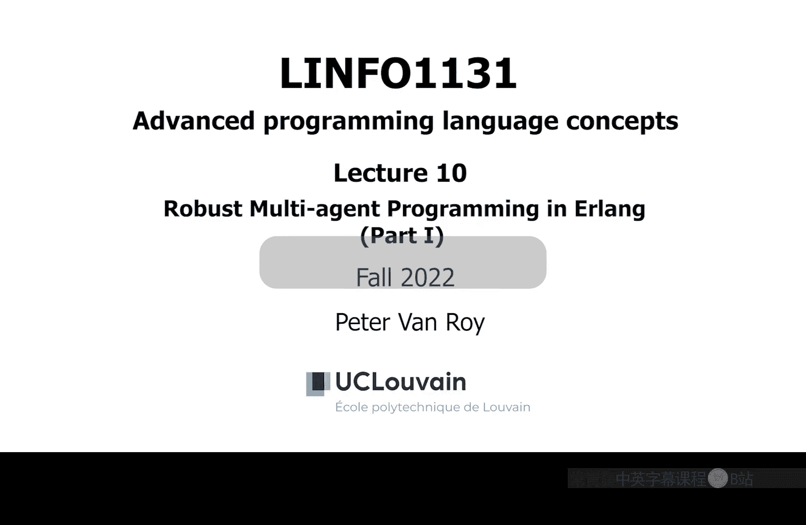
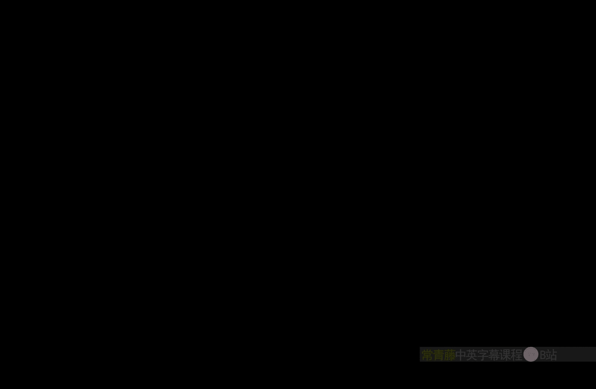

# 鲁汶理工学院【中英⚡高级编程语言概念｜LINFO1131, Advanced programming language concepts】 p36 P36 FO1131 Lecture 10 (2022) -BV1UDffBbEBZ_p36-

Bth。

Today we're going to talk about multi agent programming in airline。And last week。

Last week we saw how to build multi agent systems， it's kind of complicated because messages can go all over the place。

And we used pork projects and active objects。你 enormous good。

But there's actually an industrial system called airline。Which was the home in Sweden long time ago。

And which does it this very， very well。Very efficiently， and。With very good folk。Okay， first。

 a few seconds。To think about the Us who were fighting for their freedom and for our freedom。

So today I really want to talk about early。So I'm going to show you a lot of stuff about her alone and why it's really a very。

Very consistent with a very good。F conference。I'm going to first give you some kind of refresher。

We actually saw already a small introduction in Earlling in a previous course。

 but I wanted to say much more today， I really want to go into the details of how it works。

 how the supervisors work， how the generic behaviors work。

So I'm going to show you some of these patterns， the tools。The stable storage。

The supervisors and the stable storage are working together。

I'm going to show you how to build a generic server， how airline does a generic server。

And I'll show you some neat techniques for avoiding race conditions。

 for when you do multi a programming and doing asynchronous and synchronous calls。

 I'll show you how to build the supervisor。A supervisorvis is the airline thing that handles phone talks。

Okay。So a very quick overview of airline to refresh your memory， it was developed by Ericson。

 the Swedish company。For telecommunications， a long time ago。1986。

 so it's actually even older than Java。And it is released as a platform called OTP。

 Open Telecom platform， up until today， and there's a team in Arizonason maintaining it。

Up until today， thank you extend it。There's also a community and an organization called the Airline Ecosysem Foundation that organizes the whole community and mutual support and developing things in her life。

And you could download the airline lines free it doesn't have any kind of fee attached。

Airline is multi agentent， the programs are very lightweight， they call them processes。

 but they're like threads， they're very lightweight。

 the code processes because they don't share anything。Principle is that there's no sharing。

 and that's the main difference between port objects。In O and airline processes。

 each process is a complete thing。 There's no pointers。Cs， okay， no share。All data is copied。

And you might say， well that's inefficient， actually not so much。

It's actually very cleverly done and the processes that are on the same computer。

 sometimes they do share implementation， but semantically they don't share and if they're distributed。

 they don't share that is really important for fault tolerance because if one process fails。

 it affects nothing else， okay。Also， there's messages。And it's not like a stream， it's different。

 Ireland has a mailbox。They call it a mailbox and the difference between a stream is that you could receive the messages out of order。

 so if I send messages one， two， three， I can take message two out。

Without touching messages one and three， and that's very important。Because of the pattern matching。

 you can do that and that lets you do some very good programming patterns。

And airline is supporting very long lived。robustbu， distributed systems。

 and they have a very interesting philosophy called Let it Crsh。

And it's kind of strange because this works very well。

And so airlineiring is much better at doing fault tolerance than systems like Java and so on。

 so it's kind of strange， why is this technique not more used and it's mostly because of legacy。

I think that shared state concurrency is kind of the legacy approach， but the airline。

 no sharing that it crash philosophy is actually much easier and better for fall talk。

And one of the examples is， so Ericson makes telecommunications equipment。

 they have this ATM switch called the AZ301。Which has 1。7 million lines of airiring inside。

And their marketing department claims 99。9999999% availability。That's kind of a。A very extreme claim。

 because that would mean， so there's nine nights here。That would mean that every year。

Over what year the system would only be down for 30 milliseconds。

 okay per year because a year is 30 million secondscond。

 that is kind of unbelievable probably there's too many minds here。

 but it's still an extremely highly available system because of the way the airline organizes and we'll see how that works。

 so airline is by far the system that you built more reliable software。By far。

 if you want to build reliable software， it is the best system， okay。

In the slide I have some bibliography here， if you want to understand more about Er。

 Joe Armstrong is one of the main inventors and he has a book on programming Paralight。

 there's also a book on Designing for Scalability with Airlight。

By Francisco Carinni and Steve Vanowsky and a really good。

Website for Learn it is called Learn You some airline for Gr Good by thread in there。

 but there's other stuff， there's huge mountain。Documentation。Okay。

 but let me first show you some graphs。To show you the kind of performance that airline gives you。

So here's a graph that shows process creation， so a process in airlineing it's like a thread。

 but it's no share， so in that sense it's like a process business's share。

 but it's lightweight like a thread。And here is the number of processes。And here is the microseconds。

 how much long it takes to create a process。Now the red curve is airline。

And this was actually a graph done by Joe Armstrong in 2002。

 so probably you can multiply these numbers by 10 today here you have Java and C Sharp。

You see that the creation of a process in Javaancy sha takes。They talking in those days。

coupleuple of hundred microseconds， and you can only go up to1 thousand， couple thousand。

 and then it doesn't work anymore。Because actually， threads are very heavy weight。In Java。

 you can't have so many of them in airline。This graph starts at one microsecond， but up to 2000。

 a little bit more than 2000， the time is so low that it's even below this graph。

 so here it starting at 2，500 approximately it takes a few microseconds， but still less than 10。

And in this airlineing system， it went up to 20，000。No 2030，000 processes， okay。

 so you can see that creation is much cheaper than airline。And you can create many more， okay？

That's for the creation， now the message send， I send message to a process， how long does that take？

Okay， now Jo Ley shop are not really made for that。

But if you do message sending in in those languages， it takes several hundred or even much more。

Thousands of microseconds。And see Shark that would take things like something like 50。

Microseconds and airline。Even up to 30000 processes， it's。Less than one microsecond Okay。

 so today probably you can multiply these numbers by 10 and these numbers。

 you can probably divide them， but the relative position is the same。对。

So you can see message sending in airline is very cheap。For large number of processes。

 So the mindset in airline length is processes are。U are normal things， you can have many， many。

 many， many of them， so don't worry about credit。Okay， here's a web server。

Here the number of processes， so this goes up to 90，000。And here is the throughput， so again。

 this was measured by Jo Ar during 2002。You can see the through about20 kilobytes per second。

 so the red is airlight， it's a system called Yas， yet another web server running on airlinelo on NFS。

 green is apy on a local disk and blue is a patchy on NF， so NFS is a network file system。

Notice thepache。Doesn't handle so many。I mean， it stops here， it's still a few thousand。

 that might be like 4 thousand， you can say， wow， I can create 4。

000 processesth in an Apache web servers， but in airline。

That's nothing and if you have a web server that's highly overloaded， 4000 is really not so much。

So what happens is if you overload the airline。Web server， the performance can go down。

 you can see it goes down the bits， but it doesn't crash。Okay。So cuty would crashing around 4000。

Yalls will still give you 800。Kilbytes per second up to 80，000 processes。

 so you can see airline is very robust in handling large number of processes， it will not crash。

 it will keep going even if performance goes down with the overload。so again。

 number of proth is a pro very normal thing？Okay， here's the AXD switch that I mentioned before。

 so there's an article about it by Oligger， who's one of the developers in Ericrickson。

Of this switch， so this is an ATM switch， so ATM may say kind of a connection oriented protocol used for telecommunications。

 so the8301 is like a very big robust ATM switch。And it's written。

Well here they say it's1 million lines of airline， it also has some C+ plus a little bit of Java。

 there's also the airleOTP underneath which also has an airline in it。But if you see here。

 this is picture very interesting graph on the horizontal line， you have what's called Off Bloat。

This is the number of attendants。To make a connection， To make it call， telecommunication。

The number of attend。 So there's a。Assume that the system is made up to this is normalized。

 100% is the maximum is what it's designed to do the maximum and here is the actual throughput of the calls that are accepted okay here are the ones that are accepted。

 so offered load and here are the ones that are accepted so you can see up to this normalized 100% they all be accepted here。

Okay。But if you keep overloading the system。You have， so that's the real problem in big systems。

It's easy to make them work for a long， small load。

What happens when the load is very high and when you overload， everyone is trying to make a call？

What happens， does the system just crash or wilds？Well， in the AXD 301 case。

 you can see that this is the maximum throughput， but if you increase the offer node 150%。

 it stays the same， but if you increase it even more，100 percent。 So you off。

 you try to make 10 times so many low calls as the system can accept what happens this throughput will go down。

So the number of accepted code goes down because the system has to use some of its resources。

To explicitly reject costs， okay， it has to handle them so that it gives you this yellow load。

 the handling of the rejected costs， Okay so all of these calls are rejected， of course。

 because you can't follow this line up this is the maximum that the system resources can give you。

 but you can see it gracefully degrades， it does not crash。ok。

So it has the throughput drops linearly， pretty much went overloaded， 40% throughput at 1。

000% sustained load。Okay， so that's a very good behavior。

For a system that has to work in overload and any situations， for real world systems。Okay。

 so this is the kind of thing that airline can do and remember if the system is very highly available。

 it will not crash。Okay， available means that the probability of the system being。

There and able to do something at any given time is a very high percentage。

 it may not be nine nights， but it's very high， this is a very highly available system。

So this is one of the best ATM switches that exists， okay？And it was written in Ireland。

 it' from Erics。So that gives you some ideas of what airline is good for。

Now Er is also used for regular other things， and I'll talk about that。

 I'll give later after this technical presentation today。

 I will give another presentation which is given by a game。

 a game company engineer who uses airline for maintaining the infrastructure of massive multiuser games。

And there's many large games that are using Maryland behind the scenes。And for example。

 one of the big ones is call of duty， so all of the call of duties are using lots of airline behind the scenes because it has to keep going even under their eye overload。

Okay， so that gives you kind of the motivation。What Earlland is good for。

Now I'm going to refresh airline concepts， but then we go and I'll explain where all the real good parts。

 how does airlinee handle the f top first refresher。So Er is multiagent language。

 each process inside a process， it's purely function。

 so this is it's like kind of like a port object so it's essentially recursive function and whenever it reads a message it will do a recursive call okay the variables are single assignment。

 so it's actually very similar to the word object。Okay， you can also pass functions as values。

So it's lexco in high order， So inside the process it's a pure functional language okay。

 it has pattern matching， the pattern matching is more sophisticated。

And what we saw because of the out of order， and I'll explain that later。

 it's also Er is also a symbolic language。You have symbolic data structures， integers。

 arbitrary precision floats， atoms， but also symbolic lists， tuples。

 so the syntax is a little bit different from what we thought。

 so the lists have almost similar they have Thomas。The tuples use braces okay as a tuple。

Ds are list of ASI curves and it has an extra one which are binary vectors and this is important。

 so it's bit vectors of different lengths and this is so you can implement network protocols so you can even pack matching not。

Vineary thinkors。オ。Now， a very interesting topic。Dynamic typing versus static typing。So first of all。

 air is a strongly typed language， what that means， so there's two kinds of languages。

 strong type and weak type， strong type means the types are enforced by the language。

That you cannot break the type scheme in a program running in the language。

 And many languages do that。 Of course， Java theme， classical and are almost strongly typed。

 But there's also weekly typed languages。 And the most famous ones are C and C plus plus where you can use casts to basically look inside the internal representation。

 So that's very weak and it doesn't let you prove very much。 Okay， So airline is strongly typed。

 which is basically， in my view， the right way to build it。 Now。

 there's two ways to do strongly typed。You can either make your language dynamically typed or stly。

In a dynamically type language， you only know the time set run time。

 you can assign a variable to entities of any type， basically there's only one type in a sense。

 so a dynamically type language is like a stronglyronomy type worth only where everything is inside one type。

So you can assign variables to any entities of any type。

But then you also have statically typed languages。Where you declare types and compile time。

And then you have to， the compiler enforce that you will only assign variables of the right type。

Now static typing it seems to get a lot of good press。

 and allows catching more program errors at compile time， right？

The pilot we'll see if you make type error。But actually， it's very curious， static type languages。

 programs in them are not。More resilient they actually the errors that you catch are kind of surface errors。

 they're basically mistakes I call function with the wrong kind of argument， but real deep errors。

 errors and the logic of the program are not caught okay and it's very interesting because airline being dynamically typed is much more resilient。

thanhan any other language， even static type languages。

 so a staticly type language like Hawell would claim that the statictyping helps a lot for the robustness。

But there are no distributed long lived haske programs， okay， unlike Ireland， okay。

 you would not build a long lived， robust system in Hake， but you would do it in He if it works very。

So basically， the difference between dynamic and type is kind of like a red hairring。

 which means it's actually not so important。For resilience。

There's a lot of argument you will hear lots of religious words between those two guys。

 the two communities， but actually doesn't make so much difference the real importance is that your language is designed to handle failure and do the right thing and that is not related to ta that is a conceptual thing so airline does that okay and lets you build very robust。

Progress， okay， so that's one thing。 so airline is strongly typed。

Airline is a very classical language， the source code is organized as modules。

So it's not really very sophisticated that， so a module is like a file it exports。

Some function declaration， some declarations， and it will import， it may need other modules。

 so here is a module math which exports this area function， okay which has one argument。

 So you have a list of exported function。 It also imports from another module of lists。

 It imports a map function with two arguments So you basically have a dependency graphal modules。

 So that's very classical， there's nothing very sophisticated going on there。

 okay so that's the basics of airline。 Now you go more to the multiagent。Things， okay。

 so message passing。First。So an airline program consists of processes。

And you can create them easily in any process toreate another by calling a function called Spwn。

Where the argument fund defines the behavior。Of the function。

 So this may be some kind of recursive function。that defines the behavior and the process ID that it returns is kind of a constant that identifies the function that spot the process and you can send messages to it okay so here you could put anonymous or named functions。

So PD is a unique constant。And you can send messages using this notation with the exclamation mark。

Send message to process I D。And in order to know this process ID。

 you have to some if I eat either I create the process or somebody has。

Told me what the idea is you cannot forge them， create them。

And messages are sent asynchronously and all the data inside here is copied。

The process that receive it will get a copy， which is identical， but it's a copy。

 that means if there is a failure， a hardware failure， then the copy will still exist， for example。

And it's asynchronous， so it's very similar to ports in that sense。

And the messages are received by a statement called receive。

 they received statements and this one is it's。More sophisticated than streams and port objects。

Because there's a special concept in every process。Of the mailboxs。

Okay and the mailbox contains an ordered list of messages so it could either be empty or you could put message in there。

 they're ordered in order to variety。But you don't have to extract them in order。

 so if I have a budget of messages in the mailbox I can take out one in the middle， okay？

If it matches a pattern， it's not like streams and port objects。

 so the main difference is in a stream in a port object。

 the messages are read in the exact order which they're sentence。Whereas in receive。

 you take out the first message that matches and the others stay。Okay。

 so they stay in the mailboxs in order， but you can extract them out of work。

And the received statement uses pattern matching for that。

This is conceptually very similar to what we saw in August。

 you have a pattern show a symbolic Dave structure。

 but you can also have Boolean functions guard and you can have a bunch of patterns。

 so this received statement has a specific kind of semantics that I'll explain in a minute okay。

So basically it's like this， send PID， you send message and receive， you receive here。

 you have a pattern here patterns and some actions。And you can also add a timeout。

So if the receive can also say after 50 milliseconds。And there's no messages do something。

So that's basically how and the receive written。Now。

 I have to say something more precise about the receive semantics。Okay。

 because it's not like a stream。When I execute receive as a statement， if the mailbox is empty。

 it just box， and that's reasonable， it waits until there's a message。If the mailbox is not L。

It takes the first message， so this message is in order。

Takes the first message and triess all the patterns in order starting from the first。

 if it find a mentioned pattern， it takes the message out and executes the code and it does that for all the messages。

 okay if no pattern matches for any of the messages any messages that are in there。

 it blocks again and waits for another messages。Okay。And any unmatched messages？

They stay in the mailbox。 They just stay there。 So it's kind of like a mailbox。In human society。

 I take out the things that I interested in， and maybe I leave the junk mill in the mailbox， okay。

 it's removed by someone else later to put into trash。

So you can have multiple received statements taking out different kinds of messages。

So that is important for modularity， okay， different parts of a process can treat different kinds of messages。

And you can remove them out of port。So you can do multiple things in the process。

 you can actually have multiple things going on， even though it's one thread。

 and one part of the process will handle certain things and the other part will handle other things。

 and they will not be conflicting with each other。So that's very nice， there is one problem though。诶。

You can have memory leaks， of course if you leave a message forever in the mailbox。

 it will consume memory forever， so you have to be careful that messages don't stay in the mailbox。

ok。And the patterns are just similar data structures。

 very simple similar to uss with variable identifiers and boolean tests。

So that's how the receipt works， and later you see when we use it in the examples。O。Now let's go on。

There's more abilities than just spun and send receive。

 There is something called process registering。A process， a PID is just some kind of constant。

But maybe I want to give a more significant name， a name that means something to the process。

 so I could do that using register。I can register that the PID corresponds to some atom。

 some symbolic atom。And then I could send to that atom and it knows within the computing node this correspondence is maintained this is important because I can keep an interface unchanged。

Even if the process crashes and it's restarted or another， if when you restart it。

 it will have another PID。But the at that it registers with can stay the same。

And you can also unregister of course and you can also return the PID of a registered process。Okay。

 and find out what are all the registered processes。

 so this is important for maintaining an interface。Okay two。process。Okay， okay。

 that's interesting so that already it's we start now to move toward failure handling now I go to the main the concept。

 the main primitive concept。It's used to build failure hand and this is called processed link game。

This is the main primitive operation that airline uses to build fault tolerance。

The idea is very simple， two processes can be linked together。So there is a conceptual。

Born between them and you can do it asymmetrically。

 so any one of them PID1 will call it PID2 or opposite。But the link is symmetrical， okay。

 it's bidirectional， it doesn't matter which one creates it， once they're linked。

 it's a symmetrical connection。And the linking has the meaning of it is what happens when there's a failure。

Or when the process tufs。When a process terminates？It sends what's called a signal。

 So I'm not saying it's a message， not yet。 It can become a message， Okay， but it's a signal。

So when the process terminates， there's a reason for the termination。The reason might be normal。

Termination or might be crash。So， the system。Will， if the process terminates abnormally。

Let's say it there's an unotic exception， or maybe there's a hardware failure or something。

 process fails。Then you have another reason， another signal。

 and the exit reason will be some toppo where you have some reason here。

 and then some information about the state of the stack okay when there's some kind of runtime error。

So normal or not normal when it exit， but when you exit， there's some reason， okay。

 now these signals are propagated。Through all of the linked processes。ok。Now。

 the linked processes actually are set。If I have two processes linked together and a third one links to the second one。

 in fact， conceptually they form a set because the linking the transfer of the signal is transitive。

 okay so all the linked to processes in a connected that are connected together that I have some connectivity is one set。

Okay， all the link set。So this is a transititive propagation。And the default behavior。

When nothing is done is the link set， when one of them fails， they all fail， okay。

 when a process receives the next signal with reason different from normal。So it receives a symbol。

 that means the linked process faileds。And it's abnormal。So other than normal， it also terminates。

 so if any of the processes crash。You force it forces all of them to crash。

So it basically maps the failure of one to the failure of all of them okay you think that's kind of a very。

 very strong thing to do， okay， maybe have 100 processes linked together and one of them brushes。

Will you force all of them to crash？So basically， you map。The failure to some global failure state。

 simple failure state， so that's the default behavior。Okay。

 so the link set is basically making failure common， making failure。

 uniform failure for all the processes。That's the default。 But now you can change that default。

If I'm linked， if there's two processes linked， I can actually。Chaangnge my behavior。

 If I there's a flag called trap exit the flag。 If I set that flag to true。

 then the signal is transformed into a message。And then I will not fail， okay。

 so there's two possibilities。So if I have two late process here。嗯。He won。He， too， if this one fails。

That the other one will automatic will also be forced to fail。 That's the first thing。

 but the second possibility。Here I have the trap exit。来。If this one fails。Then there is a message。

It send to the second one， okay， so there's two possibilities。But only if the traffics。

 so the default is all of the linked processes will fail， okay， together。

But not if you send trap exit。Okay。In that case， the exit signal is transformed into a message which is sent into the mailbox of the other process which receives it normally and it can handle it。

 so you see in the second case the process P2 is actually observing， it sees the failure of P1。

And this is how you build supervisors， okay？All the worker process will stay in the first situation。

 they're all linked and they'll like a pool。🤧And supervisor processes will be observing them using trap exit and well see if there's any kind of failure behavior。

 okay， so this is this is how。The supervisors of airline are built using this primitive， okay？

So you don't need any other kind of magic， this is the magic， and this is supported by the system。

 okay？Now， if you know something about distributed systems， you will see that。

Detecting the failure of a process。It's technically's what's known as a perfect failure detector that means you will always detect it。

Without a mistake， the failure of a process。So air is actually made for systems that are tightly coupleuffled like clusters。

Okay， this is actually much harder to do for open internet。 And in that case， airline has。

Has to do maybe something slightly different things。

 so the supervisor trees would be used more like in clusters where the nodes are all tightlyly coupled and you can see for sure when there's a failure run。

If you understand just that for distributed systems， there's two kinds of failure detection。

 there's the perfect failure detection when you can always see then node fails。

But that's only possible if the nodes are close together， if the other node is far away。

 maybe it's in Japan somewhere and there's a network connection to it。

 it's kind of much harder to see what happens。With that other node。

 and so you don't usually have that kind of perfect failure detection。In the open Internet， Okay。

 but everyone is designed by default。Where you can actually see the failures， okay？

For building robust teams， this is very fine for。Cluster or even cloud systems， for example。

 if you have a cloud database， we have a bunch of nodes sitting in a data center and they're all connected together and they make one big database。

And then if one of the notes fails， the others will see it， the processes will fail， okay？

And so this is a good use case for airlineI， and there are databases。

 cloud databases that use airlineI， probably the most famous one is called。React。

So there's a number of very big cloud areas， so RiAC is a major cloud database。

 but it's written in airline。And it's used for very robust。Long lived systems。So。

 just to give an example。So the Danish healthcare Care database。So the national database in Denmark。

Which connects all of the patients， so all of the citizens， all of the pharmacies。

 all of the doctors and all of the hospitals。Is written in react runs and react。

 so this is based in early， so this is an example of a big application。

 so this kind of system is built on top of linking okay。When a process terminates。

When there's a with of road error。You can see that。 the system can see that。咁几。Okay。

 so here's a little example， process linking， so if process for example。

 it throws an exception inside the process that is not caught。Divide by zero。

 and there's nothing done， then the process will terminate abnormally and the exit stimulus linked process is said to all linked processes。

So here， for example， is a process。Where the track exit flat。

 So I create a process with this function go。I set the trap exit flag to true and then this loop is then is the cho。

 the process loop， this loop is going to do receive and it will receive messages。

For all of the linked processes that fail， Okay， so this is like a supervisor process， okay。And then。

 of course， there's a few extra functions that I'm not going to say so much。

You can actually send an exit signal without terminating。

 so this is for needed sometimes and when you implement supervisor trees。

 you can also send an unstoppable exit。Maybe the supervisor itself。

I something's wrong and I want to kill it， well then I can do that okay。

 so you can actually have layered supervisor truth。Okay。Okay。

 so that's the basic operation for building fault tolerance in Maryland。

There is a variation of it called monitoring， that's just an asymmetric version of blinkling。Okay。

 so this in Ar， this has nothing to do with monitors in shared state comparison。

It's an a terminology， so monitoring is just an asymmetric version。Of linking。

 sometimes you don't want the linking to be symmetric。If you have a client server。

If the server crashes， you want to kill the clients。But if the client crashes。

 we do not want to kill the server， so maybe the client crashes。

 but the server can keep running because there's other comments okay and we can do that using monitor so sometimes you want the linking to be asymmetric。

Okay。So PID1 can execute monitor of PID2。If PID2 dies with some reason， then PID1 will get a message。

But， it won't crash。So monitoring is just an asymmetric version of it。So that's the basic idea。Now。

 an airline system can be distributed， which means it runs on multiple computing nodes。

So you can have an airline system running on a single computing node， a single a multich processor。

 for example。AndBut you can also have an airline system running on multiple of these nodes connected together。

So you have a bunch of airline worktime systems， so these are called nodes， okay。

 and when you do message passing。You can't tell if I do PID， if I send a message。啊，还是PID。

I sent a message him。I cannot tell whether the process is on the same computer as me or somewhere else。

 so it's transparent， okay when using PIDs。And I can also spawn a process on another node with that version of Sp。

 which has the node identifier as an argument， okay？Registered， remember registering。

 that's local to a node， okay， that's in one node。Okay。

Now the heirom system will automatically make connections。Like TCP。

 other kinds of network connections， the first time I used the enable to node。

 the AM system will try to connect。And they're made transitally， so by default。

 air lung is a fully connected match， so every node is connected to every other node。So again。

 that's not so scalable because that means you have order x squared。

Connections so if the number of notess goes very high。It kind of goes up too fast， So this is， again。

 its designed for cluster computing。And if you want to use airline and open internet。

You have more recent versions of airline allow you to change this so it's more scalable。

But for a system like the As D301， that's actually running on a kind of cluster。

And with multiple processors， and there you have a fully connected match because that is the most robust one。

 okay when I have two nodes connected directly， it doesn't matter if other notes fail。

 it's only the failure of the two nodes。So again， it's made for robust systems run cluster。ok期。

And now the final thing。Before we get into fall torant stuff is the dynamic code update。Okay。

 an E system。Is made to never go down。And usually the reason usually for a system to go down is that there's crashes okay。

So the Earl supports that， it has supervisor trees and so on to keep running。

But there's another reason for systems to go down is that the software is updated。

And that also cannot allow the system to go down， so this Danish healthcare system， for example。

 it cannot go down。Because if it goes down， people can die。

If I need medication and the database is down， I won't get it， The pharmacy will not give it to me。

Or the doctor will not be able to connect。So this system is not allowed to go down even when the software is updated。

Okay， see， that's the second reason。对呃。You have to support that。

So this is a thing called dynamic codee update。We want to change the code。

 new version without stuff in the system。And many systems are not supposed to be stopped okay of course in biology that's very normal an organism but never stops。

 it keeps running forever during its lifetime okay so here's an example X20 satellite control system。

But there's many examples of these kinds of programs， even for gaming。It's the game who goes down。

Millions of users can be unhappy and unhappy gamers will stop using the game and use another game。

 so it's not what the companies don't like that， so it has to keep running。So how do you do that。

 How do you do dynamic code， how do you update the code？So Er has support for that。So， first of all。

This is the no sharing。It's very important here， that means if I change part of the system。

 I know the other parts will not be affected because there's no sharing。

So you see no sharing is also important for this son。

And the support that airlineling has is that each module in this system， so in the virtual machine。

 there can be two versions of the code。For each module， okay。And when you create a process。

 you will automatically be linked to the latest version。But a running process。

 one that's already running。Can still be using the older version， okay？And if the code has changed。

 then a process can choose。Which version it wants， So basically this allows the program to manage the update you can update and then that the actual running processes will keep using the code。

And then at some reasonable time， you will tell them now you switch to the new code。

 you can't just force them to switch at any time，huh？For example， it's a connection for a telephone。

 so it keeps using the old， but when the connection is done。

The next connection will be using the new version， okay。

 so you can update all of the concurrent processes at the right time because you have the two versions。

So here's some code code example。There's syntax support for that。

Here's a loop that receives a message and does work per call， okay so the this is received。

 takes the message from the database， so this is the message。Okay。

 others be this should be embraced and so it calls the function F。

 so the function F is part of is part of the argument here and it keeps going so this is just part of the codea now there's two ways to do it if I just write it like this。

Loop calls loop， it will use the old version， but if I say in module of them M colon loop。

That means use the new version， okay， so that means a running process。

Can decide when it wants to switch from the old version to the new version。

 so the idea is when you update the version， you first update the modules and then you tell all the processes now when you are ready。

 please switch to the new version。And when they are ready。

 they will switch and they will inform me that when they all switch to the new version。

 then I don't need the old version anymore， okay？And then so you only have two versions of three。

 yeah， three would be too complicated， so you have a kind of a transition protocol between the old and the new version。

But during this the code will keep running， of course the software has to be written in the right way。

 the new version of the software has to be compatible with old versions that are running， okay？

You have to at least during the time that they're still running。Yeah， question。

So if I understand correctly， if you only use old version calls and you update your program with the new version。

 it will never get up You are correct。 If you only use old version calls and you update。

So that means your program， so this mechanism， the two versions， it doesn't solve the problem。

 it gives you the ability to solve the problem， so the program has to do something and it has to switch so at some point you have to do one of these calls to switch over to the new version。

ok。And once they're all switched to the new version， then you can get rid of the cool version。

 so I'm not giving all of the details， but basically the program has to be written in kind of a compatible way but this is done using what's called the behaviors the way it's done in early is that。

The end the developer doesn't have to do all that。Turkey stuff。

 all the tricky stuff is inside and behaviors we'll say you see， so there's like generic。

Things if I want to make a server， there's a thing called GenS， Geneomic server。

 and all of the things， even the updating is handled in there， all the tricky code。

So I only have to give the functionality， but this is the basic mechanism， okay？Yeah。

 second question。So。I forgot。It's okay， when you're run with， you can ask。

I'm only giving part of the details here。Yeah， you have the question。

 if the new version has a failure。 so when a new version， there is a failure。

 does early roll back to the old one or it just crashes。It just preciouses。Yeah yeah。

 so then it up to the supervisor to what it restarts。

 it may say then the supervisor will decide so if there's no crashes。

The supervisor process will be notified and it decides what to do。Maybe it says I restart。

And in that case， it decides which version it has to use okay so then it knows more the supervisor has more information。

Then so you have all these worker node and the supervisors are sitting on top observing them。

And when the worker notes crash， the supervisor then decides what so I'll show you after the break how to write supervisors。

 but real supervisors， I'll show you a simple supervisor， but the real supervisors of course they。

It's kind of very tricky code， but's only written once， it's part of the urban library。Okay。

So one more small thing， so this is a system support so the virtual machine supports two versions of the code。

 but you can also do some update in fine grain way without system support so I want to mention that too using only higher order。

 of course you can also do update。If I want to update。This server here。

 so this server ability is this function。And when I do the super when it receives an RPC。

 so this is an RPC message sent here。It will run this function。With arguments， okay now。

I can also have another message called New Fund， which replaces this function argument by another one。

 fund one。And so the server， I can actually update it using just higher order。

 notice the underlying module code is not changed here。

 this is a more fine grainined thing so I can actually in a fine grainined way change the functionality of a process。

Without changing the code， so this is independent of the previous one。So this one， the previous one。

 is actually a heavy duty one where the whole system is changed。But if I just want to update a piece。

 of course， I can use higher order for that。But you don't want to use this for updating the whole system because basically you can。

 if I want to change， replace this server by something else， I can't， okay。

 all I can do is change the function。Whereas in the previous approach。

 I can change the whole structure of the system， okay so this is a kind of a fine grain update so I mention it so that you you can see that it's separate that there's two separate。

F， okay。Okay， so that's those are all the primitives。

 so up to now I've explained all the primitives so the spa， the Re mailbox， the linking。

 the dynamic code update。Those are old primitives。And now we'll have a small break and afterwards。

 I will tell you how airline uses all that。To build all the abstractions we need for making robust software。

So now we make an a break。Continue now。So now we sum all the primitive。

All the primitives that airline provides to make robust software。But in fact。

 I didn't really tell you yet how alytic organizes it， if you want to write an a application。

 what do you do， so let me explain now how alytic organizes writing so everything before the break was like the low level primitives。

And I explained them because in this course， I want you to understand how it work。

But in now on the second part， I will explain。The generic behavior so airline provides packages or like software packages which do all the hard work for you for update and for supervising and settlement Okay so let me explain how that works so first of all the airline philosophy so airline people like to。

Talked about this， and I think it's important because it gives you a kind of idea， the question。

 how do you make software robust？And it turns out most popular language as Java Python。

 they don't really give you the plate。For that。And so airline started from that idea。

 how do we make software robust， and they really invented these ideas to make robust software。

So there's a number of principles， so this comes from Joe Armstrong's PhD thesis。

 so Joe Armstrong is one of the key developers of airline。And in 1986 and after， and in 2003。

 he said。Maybe I want to get a PhD， so he wrote down all his ideas and he made a PhD defense from that。

And he got his PhD from KTH。Actually， I know this very well because I was on his PhD jury。

 okay in 2003， so this be theesis explains very well errors。

 so the first principle you cannot eliminate all errors。So you have to handle them。

 so the principle is no matter how hard you try， you cannot get rid of auto errors。

 there will always be errors that exist， both hardware and software errors。

And you have to handle them。So building software that is 100% perfect。Is the utopia。

 It cannot be done They will There will always be arguments。 That's the principle。

 So you must handle。 That's the first principle。 Second principle， you have to have。

What are units of failure， so if I have a big system made out of different parts？What can fail。

 What is the unit， What is the smallest box。That can fail。And in airline。

 these boxes are actually pretty big， these components in airline。

 it's not processes because of linking can actually be a big part of the system。And these。

 and when one of these boxes fails， the others are not affected。咁嘅。

So no share that there's strong isolation among the fairness the second principle。

 the third principle failed fast。When something goes wrong。You immediately fail。

 don't try to keep going， okay， just fail， fail fast， either you function correctly or you stop。

 okay， nothing in between。诶。Fourth principle， you have to be able to detect the failure the lead king does that and no share。

 okay， this is actually related to strong isolation， but even in the low level。

 no share of native structures。The softer components don't share anything。

 you only send messages that are copied okay Now people will immediately complain， wow。

 this is slow eta， you have to do so much copying， but actually that's not true if you really look at it。

 this does not affect so much def okay so there's some slogans that actually kind of summarize this。

 the most famous slogan of airline is let it crash。Okay。Instead of trying to fix things。

 let it crash so what does that mean when things start going wrong。

 the system goes into some complicated failure state when things are kind of messy and and early say don't do that map everything to one simple failed state crash。

So anytime something goes wrong， don't try to keep going with a partially correct state。

 just make the whole thing crash， let it crash。And the second principle is let some other process do the error recovery。

 so you have one piece of code doing the work。And another piece of code， doing the handover recovery。

 doing the fault tolerance， two separate pieces of code。It should not be the same one。Okay。

 there's a really nice example of this that I like to explain， which is a real story。

So this was happening， this happened some decades ago when there was in the Soviet Union still existed。

 and they had a base in Antarctica。Okay， and there was a surgeon there， one doctor who was a surgeon。

 but other scientists。And the doctor had an appendicitis。But there was no other doctor。

So how did he solve that？He basically operated on himself。

 And This is a famous story that you can find this。 He informed all of the。The nurses and everything。

 what to do， he installed himself in an operating with mirrors， so he was awake。

 he was local anesthesia， and he basicallygged cut himself open。And removed his appendix。On himself。

That's amazing， isn't it， the guy is a real bad as though and he survived okay。

 this guy and basically all of the nurses， he would tell them what to do and he had mirrors so he could see what he was doing。

Isn't that。 you don't want to do that。 Okay， It's very exceptional。 Well。

 the same thing is true for software。 Okay， if something goes wrong in the software。

 the software should not try to repair itself。Some other piece of software should prepare。

 so the normal way is if I have an appendicitis， there is a doctor a surgeon standing next to me who does not have appendicitis and who fixes me。

 okay that is the normal correct way and has the highest chance of success。Of course， in Antarctica。

 they didn't have any other possibility， so they were forced to do this。

But that's not what you should be doing normally okay so that's kind of I think that's a good story。

 some other process should do the error recovery and airline follows that which we will see a third principle is do not program defensively so defensive programming is this whole thing or youre adding tests。

 checks when you call function you check to see that the arguments are good whenever you do that when you return something you return to code to see whether it's good。

 So there's checks everywhere and if statements and checks and checks。

 this makes the program complicated。And this， of course， will not remove all errors。

 so the early idea is this is fundamentally wrong， don't do this。Don't do defensive program， okay？

And the advantage of not doing it is your program is actually a lot simpler。And if there are errors。

 just crash。Don't try to do any kind of check testing fixing the state， just crash， okay。

 a single false state， so no defensive program， okay？Okay， so how does airline implement this， okay。

 this is really interesting。An airline OTP， so the platform。

 when you download it is called OTP and has a whole bunch of libraries in there。

 it's actually a hierarchy。So the lowest level is the worker。

 this is a process that's doing something， okay？And a next level is called the behavior。

 this is like a concur pattern。A behavior is like a generic thing， a server， a generic server。

 a generic finite state machine， a generic event handler， a generic supervisor。

 which is the fault handler。So this is the generic pattern。And it's actually a concurrency pattern。

Higher to that is the application。This is all the software necessary to run an application and higher than that。

iss the release， the whole release of the system， so you have this hierarchy。

 so when I write an application， it consists of behaviors and the behavior has workers。

That are instances of behaviors， okay， so this behavior concept is really the key idea， okay？

The behaviors abstracts everything out， so we saw before the break， you have linking for failure。

 you have dynamic code update， you have this receive statement out of order， received。

 you have a spa and so on。That's all very low level。Usually the programmers don't。Do that。

 They use behaviors。And it's the behavior that does all the tricky code。Okay。

 so basically when I write my application。There's hard parts， difficult parts and easy parts。

 so the hard part is concurrency。Fll tolerance。Code update。 and all of that has to work together。

 That's tricky and hard。 Okay， And so that has to be written by expert programs。

 And then there's the easy part， which is the functionality of the server。

 Maybe the server will just。Be doing database query， maybe I'm just ordering something from Amazon。

 it's just some business logic。嗯。So that's kind of the easy part。

 I know that that part is none so so hard。So that one can be written by regular program。Programs。

So what does airline do， airline separate that out。All the hard stuff。

Is written in these generic components called behaviors， all the concurrency fault tolerance。

Code update， stuff。And start， whatever， all of the difficult is inside the behaviors。

And then all you have to do is fill in the function that gives you the functionality so they like programming patterns for robust current programs that's why it's actually very easy to write a robust program in early okay？

It's very easy， you don't have to be an expert in concurrency and phone tolerance to use all what I just told you before because it's all hidden inside the behaviors。

Okay。Okay， and so there's library support so all of this is in the documentation。

 of course so there's pile of documentation and examples， but they won't go into that。So。

 the standard。The airline system has five standard behaviors。That are like libraries。

 generic libraries， we fill in the blank。 There's generic server。Generic event handler。

 generic finance tape machine， application and supervisor， that's it。Okay。

 and they have a special name， so Gen Ser， Gen F Ed et on。So that if also。

 if I want to do client server on Amazon。I will use the Gen Gen server， and I will instantiate it。

 I will put in my functionality。But all of these stuff。

 registration starts stuff time out statement and we're going to air all the hair and then everything is handled inside the pattern。

 you see the idea？If I want to do event tenders， so there's streams of events coming in。

 use some interface events， network events， maybe I'm looking at a realtime system where there's like all kinds of real world events and I want to handle them。

 I want to sometimes send notifications， I want to log up them。do certain things， well。

 I use the event timer。And if I want to change things， I just call the event。

 I never have to do linknkIn by myself directly or product update data。And then the actual。

Functionality of the application。What computation is the application doing。

 that's actually a finite state machine， okay？So the state decide like all the values of the variables and when the application is a computation。

 the state changes。So that's the general way any application works。

 and in error you have the Gen FSN， which handles that。

Where you can put any kind of code in there and you can update the code and you can supervise it to none and know and that application is。

Combining all the pieces into one thing， which is the application。

 because maybe you have several of these other guys sitting there together。

 so you combine them into a unit that can be started and slept as one thing。And can be reused。

 so it's like a box application behavior， and the final one is supervisor。

 this is for cloud tolerance。Okay。So these five behaviors will hide the complexity。

Concurrency default tolerance become very simple。Okay and all of these behaviors are designed to be plugged into a supervisor。

 it's all made to be used together， these four behaviors are designed all to be supervised by a supervisor handling full tolerance so it's built into it you can see it was a lot of work building these things so the A team spent years polishing and making this stuff work。

But now that's done， it's there and it works， and if I want to build a robust。

Concurrent fault tolerancerant application and airline， it's very easy。 I just use behavior， okay？

Okay， so one thing I have not mentioned yet。Is the stable storage。

So I have a supervisor looking at what the workers doing the work and workers are sometimes failing and restarting and whatever the president observing does。

How do you， when you restart something， how do you restart it in a consistent state。

 when you restart a system， you have to restart it in a consistent state。

And the only way to do that is to have a stable storage， which is like database。

And a database with transactions is providing that。Okay， but that's already complicatedated。

 so airline has different levels of stable storage， so the two pillars。

The two pieces of airline's robustness， resilience is supervisor tree and Staple storage。

 so the supervisor tree observes your system， says when you need to restart it and the staple storage gives you the consistent state so you can restart it。

ok。So those are the two pillars of it， and Eing has three levels of that。So the ETS。

 which is in just in memory set variables that you can update except their stable。ok。You have debts。

 dis phase ETS。so this ETS is in memory， if the memory crashes it disappears， but thatx is on this。

 so these are like very simple databases， okay。Because you don't need full transactions。

 Er also has a full transactional database， sometimes you want transactions， this is calleddonnesia。

And this lets you do transactions using any kind of airline data structures。

But of course it's much slower， so Ed is very fast。It's like。

Updating a variable only it's stable and transactional database， of course， is going to be slower。

 So there's a tradeoff。 So airline provides you the different levels that you need。 Okay。

 Sometimes you need full transactions， but sometimes you don't。

 Sometimes you just need to store a simple name structure in the stable storage。 and that's it。Okay。

 and X， the X can be updated very， very， very fast to this very high performance。O。

So that's the second piece， Supervision tree and。Saable storage， okay。诶。

One other thing I want to mention is testing。So airline has a lot of testing tools。

 okay so of course all systems that you want to build realistic large applications that need testing。

 so airlineline is the most spectrum of testing tools， so unit testing。

 so you have done unit testing right in other courses， I hope so this lets you do。Test generators。

Scaaffolding， also a system testing framework。So you can do running tests in parallel random order for test race conditions or handling dependencies。

 so you're basically to be running a lot of things together。Simulating abnormal termination。

 so fault injection is very important， you actually run the system and you force piece of it to fail to test the fault tolerance。

 it's called fault injection。And then you have tools， and then one of the tools is called dialolyzer。

 so this is actually a dynamic type checkr。It actually can。Complicated errors in types in the types。

 Okay， so this goes a little bit beyond the it actually is smarter than a normal。

 a typical kind of static typer， because it's based on how the program executes， okay。

So this is a useful tool， so this gives you the tests that you can do。Okay。And now let me show you。

 I want to show you two things， the generic server and the supervisor。

 I want to show you how they're built， okay so normally you will not build them。

 you will use the Gen Ser that exists， but in this course I wanted for you to understand how they work。

ok。So we're going to construct it。A simple gender。And it's like a design pattern， but it's a library。

 okay， it's a library， genetic library， but it's like it looks sort of like a design pattern to use it in a certain way and lets you build a concurrent multitn system。

So these are the OTP behaviors and like I said， all the tricky things。

 border guard conditions are abstracted away， they're all inside the behavior。

 so now let's do the survey。ok。Okay， I want to do piece by piece。

So I start with a very simple airlight。Process move。So a kind of very simple server。

 how it was it to？Okay， so we like this。 I spun the server。Okay， and with this in function。

I have some initial state。And then I run the loop， so loop is this recursive function。

And it receives requests。That you have to handle on， so here's a tople hand on message。A new state。

 it calls a handle on message and the state。And then it goes to the new state， so this is。

 you can see this is very similar to report object done。

And so this is basically just doing one message after the other， it's very simple server。

 so this is the server， I want to split this code into two parts。

The part that does the work and the part that handles all the server stuff。

OkayThere's also here to notice there's a stop message， which will do some kind of termination。

And it will clean up， it will do something， so this is a kind of simple serverver。

 and you can see it looks a lot like the port object。

So how do we split it so that on one side you have this generic thing and the other side you have just the functionality。

ok。So we want the generic part， the Gen Ser， and we want a specific part。So generic part， spawning。

 storm data， how you do the sense， how you get the replies， receiving replies， stopping。

 this is very simple in a real one you would also have fault tolerance。Or update， Okay， redundancy。

 Okay， this is very simple。 and then the specific part would be。Okay， the server state。

 what is the loop data？How do you handle the plan best the function？

What is the content of your reply， so the basic data。For our。给你。Okay， so how are we going to do this？

So we're going to split this code， so this， I'm going to split this code into two modules。

A behavior module， this is a generic one and a callback module for the。

The one that the programmer does。And there will be a callback API and there will kind of agree， okay。

 so what that means when I need to write a server， I only have to write the callback today it will be the same for all servers。

Okay， so this is code reuse， standardized， fewer bugs。 and this can all kinds of stuff。This server。

 this behavior model， it can do statistics， it can do profiling， it can do tracing， logs， supervisor。

 whatever， it can do all kinds of stuff， and the callback does not have to change。

 so it's really nice to do like this。ok。So I want to do that， but let me make let me。Do an example。

So this example actually comes from the book by Franceco Siderini and Steve Fossky。

 So the figure comes from there。 I want to do a frequency allocator。 So here's my server。

And here's clients， so these are little early processes， this is an early process。

And this server knows which frequencies are used by the phones， 10， 11，12， whatever the channels。

So when a phone。Needs to call， needs to make a call， it needs a frequency， so it asks the server。

 please allocate a frequency and the server says you can use frequency 10。

Okay and another phone could say I want a frequency uses frequency 11 and the server keeps track of which frequencies are being used。

 so it's just like a simple database actually。And then when the phone is done， it says。

 I don't need this frequency anymore， de allocateate it and the surface says okay。

 the frequency is free again。And it gives a confirmation and then some other phone could use that okay。

So when a phone needs a frequency， it asks a server， please tell me what is a free channel。

And then the client， so the phone holds the frequency when the color is done， it deates， okay。

 so these are allarrow across the。So there's actually simple data structure here and you do allocate and delocate costs。

 okay？So this is kind of an example from teleco。So this is the API for this。When I'm applying， okay。

 when I want a frequency， I call allocateate， and I so this is a specification and this is not coD。

When I do allocate either I get a frequency， so I get a tuple saying， okay， and here's the frequency。

 so this is a variable well therell be some number here。Or I get a couple saying error。

 there's no frequency， maybe there's too many phones。And if I de it。

 I de a frequency and it just returns okay， so this is basically the API now， see how this works。

 it's not the actual code then。And I also to start and stopped so I can start the frequency server and I can stop it。

And internally， the frequency server keeps a data structure。So basically， it keeps。

Like a set of frequencies or a list， okay， 10，11 12，13，14，15。

 so these are all the ones that are free， and then these are all the ones that are allocated。

 So if I allocate frequency 10， then the free tuple becomes this。

The tender is removed here and it's added here， so basically it just keeps track of which frequency is free and not。

Okay， so this is very simple I'm just defining this so that we have an example for the Gen server row。

Okay。So I start the frequency server。I can allocate frequencies each time I call allocate to get another one。

 okay？If I allocate six of them， so these are normally going to be six different phones allocating them。

 this is the airline top level interface you can do interactive。

Messages so I allocate six frequencies and the last one， this is the last one I get。

 which is 15 Okay， so I'm assuming there's 10 there's six frequencies that 10，1112，32 to 15。

 So I allocate all six of them， six calls， if I try to allocate at seventh one here， it says error。

Okay， if I now delocate 11， I say I don't need 11 anymore， 11 is free， if I allocate again。

 it'll tell me 11 okay so it just keeps track of which ones are free and not and here if I stop。

 then it's done。Okay， so this is how the phones are going to use it。

 this is an example where I'm doing it interactively yeah。

 but these calls will be done by the phone so they allocate the other。See how it works。

 you have to understand that it's not a complicated thing， it's just managinging this data structure。

Because this is going to be my example。ok。Now I want to let me show you the architecture。

I'm going to show you two modules。This module， this blue module， is what the program writes。Okay。

 and this blue module is part of the system， so this is the behavior。Okay。

 so the programmer only has to write this。And basically。

 with a good has APII I would get the other kids started stop。And this generic module has。3。

Interface， start stop and generic call。And it will do codebacks。In it。

 handle and terminate what arere implemented here。Okay。

 so I only have to write these three things in it kind to terminate all of the work of the actual server。

Stuff dont here。こて。So that's the structure and this one， so I only have to earn this。

 but this one can be very complicated。I'm going to show a simple one。

 but in real life this one can be photos， it can do updates， it can do logging， can do profiling。

 whatever auditing， it can do all kinds of stuff。without changing this。诶。So this is a very nice gene。

So the frequency module。Looks like this。Okay， so it's basically， so theres a。

 so this is a module frequency。This is the interface， so this is what the phones will do。

 start stop allocateoc the， okay？And there's also a callback interface。In it， terminate and handle。

So the generic module we'll call these three things， so we need to start， so it's this。

So it's basically a total of two lists。Terminate which in this case is not doing anything and then handle which does all the computation when I do allocate。

Or delocate， so when I do allocate， I call this function allocate， which does this list。

 so this is list thing it's called the an element of this list。Return it。

Here and remove it from the free lists， okay， so this is just list operation and DK is going to be do the opposite day。

Okay。So that this is the code actually do the computation， this is the interface from the server。

And this is I'm calling this to， so interface， interface and computation。Okay。

So that's all I have to write。It looks like a lot， but in fact this is like border plate doesn't change and these things are just the server will always need that in inter termminate and hand okay and then the real work is done here。

Okay。So that's the frequency module with the program arounds and now the generic server module。

It has start stump and calm。So start。Stop and call okay。

 so start will spawn the server and register it to the name。Comong will。好。

The server and received the reply， okay， basically it goes through the loop period so this is like an RPC。

 I said and I received， so I'm doing round trip here and stop we'll stop everything okay。

And then the actual server is here。Notice the three red things are the Paulbacks。In it。

 handle and terminate， it's always like that so this is like a fixed code。

 the loop is receiving your request here it's going to do the handle， it's going to call handle。

And then it's going to reply。 So this comes back here。

And then there's a terminateinate and there's an an end， okay？So this is very simple one。

Because it's only doing the loop here， but of course， rail Gensr is going to do much， much more。

 okay？So you see how it works on。I'm splitting into two modules。So the organization is this。

 so the server will always call a inter terminate， so this is the callback interface。

The server interface is fixed， also it's always starts up and called。

And then I make my external interface and I will call the server interface and any computation that I have to do this here。

 so the program will only write this part okay so you see how kind of how it works。

How you can build it。A generic server， so this is very simple one out say。

 do you understand how it works？So have I expect you to understand this codeta。

To be able to read this， it's not so complicated， it's very similar to us except with different slightly different synaxs。

So parts of this are fixed。Start stop call， in terminate panel。

 and then this is the actual computation， okay？So if part of this is fixed， I always fix。

So the call interface and the server interface are fixed。And it's part of this thing。Okay。

See how it works。So that's a simple generics gen server。Okay。

 so that's a simple behavior and the real airline may of course is to do much more。Okay。Right。

 it's good， right。来 it。So this is aromaero。Okay， now we don't have so much time。

 but I want to also show you the supervisor。But so， maybe I will。都自。Just introduce。

So the other example I want to show you is a generic supervisor。

Now the code is also not so complicated， it's one page。It's one page of code。

But supervisor is a new thing which you have not seen before， or a server is something you know。

 okay， so even though the code isn't be one page， it's headed quite its new code。

 so it'll be take me a little bit more effort to really understand how it works。

So I'm not going to show the code， but I want to show you the ideas。Of the code。

 and then we look at the code next week。哎。So supervisor trees， so what's the idea？

So I have a system that's running。And one observation is most errors are transient。

And they heard problems， dropped packets， to of problems。Concurrent startupdom， how to order。

 So simply retrying this successful strategy。 So the supervisor tree。

 it can do anything the supervisor， but actually， it's designed to start。By just doing simple retry。

And actually， that solves already a lot of problems， okay。

 so supervisor trees are designed to favor simple retry。Okay。

So you have a set of processes that are doing the work， applications running。

And they're all linked to these supervisor processes， they're linked using the linking we saw。

 and the supervisors have authority so they can stop and restart these supervised processes。

 all of they can restart the whole system。ok。And what's really interesting is that。Very often。

 you have two layers of it。So the supervisors， what happens if they fail？

Oh who is moved to guard the guardians or know that expression if the guardians are？

Making sure the laws are obeyvaed， who is guarding the guardians？hi is it famous。

Phrase coming from antiquity， well， who is going to fix the supervisors？Well。

 you have a second layer of supervisors， so basically it's a tree。So it kind of looks like this。

 I then picture it， so I have work fair notes here。So these are workers。

And here I have some supervisor knows。And they will observe all the workers okay。

 and on top of that I have another layer of supervisors。

 so this is the highlight level of supervisors。And usually this one is very simple。

These middle supervisors can be actually quite complicated because they are handling all of the failure techniques。

 and this is the application。So typically， this high level supervisor is extremely simple。

And so simple that it's almost never going to crash。This one will not crash。

So usually the airline will be written like this， so the AXE301 actually has two level supervisored trees。

诶。So that's how it works。And these supervisor。Trees， so this layer here is very。

The code is not so simple， it's very careful to avoid race conditions。

 especially when you start up the system， you have to start things up in the right order。

So it's kind of tricky， but that's okay because it's inside the behavior， okay？

So just a few words are the principle， so the supervisor tree is a hierarchy with the root。

There's a set of supervisor nodes， and there's internal nodes。

 and each node observes the nodes that are below the childhood nodes。Okay。

 and it has some simple principles。There are actually three or four simple。Restart strategies， okay。

 so the main ones are one for one and one for all。So if the supervisor is observing a bunch of notes。

If one of them pressures。There are basically two possibilities， it restarts that one of the retry。

Or it restarts everybody。And it depends on whether the notes are doing independent tasks。

Or whether they're working together。If the notes are working together。

 maybe it's like a big logical thing where they're all implementing business logic or something。

 then you do one for all if one of those notes crashes， you restart all of them。

In a consistent state。Whereas if the notes are doing independent thing like telephone。

 each one is implementing one phone connection， well if one phone connection crashes。

 you keep the others keep running so you only restart that。

So the two basic ones are one for one and one for all。

 and then you have variations which I will explain later， rest for one and simple one for one， okay。

So the basic strategy is just restart by default。Of course， you could do more。

 you could make it more complicated， but the default。It。Following this principle。

 most false and errors are transient， so the basic body default strategy is just a response。

In consistent states， that actually solves many problems。But of course， it's not enough。

The number of restarts is limited。Sometimes。You will keep restarting。

It keeps failing in the same way。ok。It does die repeatedly for the same reason。

 well that's why there's a limited number of restarts。And if that limit is exceeded。

The supervisor that does the restart is terminated and a higher level supervisor will take some。

 let say， aha， this error is happening over again， we can't just restart we have to do something else。

オ。Maybe one of the processors。Is。Really failed， or maybe there's a disk crash。

And we can't use this disk game anymore maybe we have to reconfigure the whole application， okay。

 so that has to be done in a higher level。こテです。So that gives you this hierarchy。So here you have。

 these circles are the worker node。And then these boxes are the supervisor in notice。

 here I'm looking at only one for all and one for one， so the two basic strategies。

 so you can see it works because the default strategies are simple。You might say， how can this work。

 this supervisor idea because the system can fill weird， weird ways？

But it turns out that that that's not true the system。

It's going to fail in simple ways and almost always you can use just one of these two strategies and in this cases when it doesn't work。

 you can do more， but you only have to worry about that in that particular case， okay？Okay。

 so let let me stop here。 and next week， I'll show you the code for this。

And you'll see how airlift does the magic， okay， so let me stop here。Or test。

