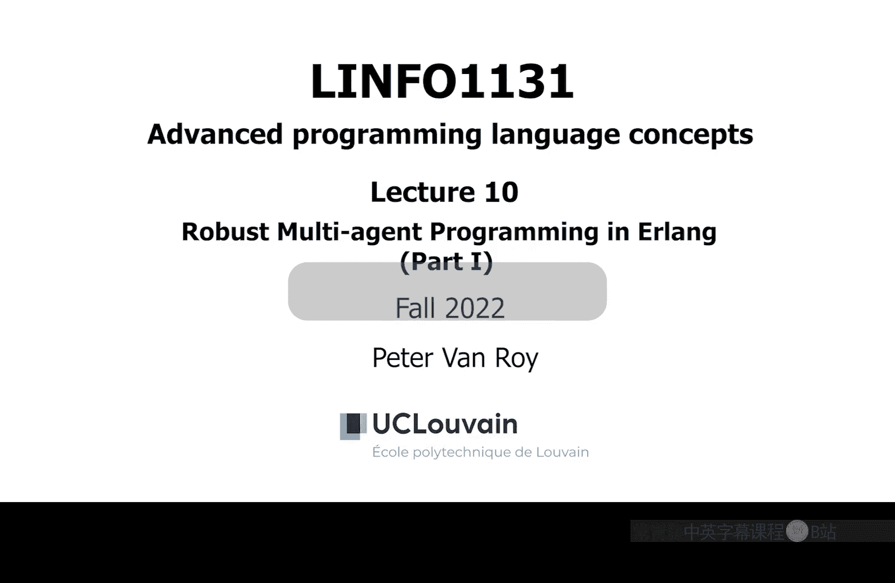

# 高级编程语言概念：10：多智能体编程与 Erlang




在本节课中，我们将学习如何使用 Erlang 构建健壮的多智能体系统。Erlang 是一种专为高并发、高可用性和容错性设计的编程语言，广泛应用于电信、金融和游戏服务器等领域。我们将探讨其核心概念，包括进程、消息传递、链接、监督树和动态代码更新，并了解其“任其崩溃”的独特哲学。

---

## 10.1：Erlang 概述与动机

上一节我们介绍了多智能体系统的基本复杂性。本节中，我们来看看一个工业级的解决方案：Erlang。

Erlang 由瑞典的爱立信公司于 1986 年开发，比 Java 更早。它作为一个名为 OTP 的平台发布，至今仍由爱立信的团队维护。Erlang 是免费的，拥有一个活跃的社区生态系统。

Erlang 的核心是多智能体编程。程序由非常轻量级的进程组成，类似于线程，但彼此不共享任何数据。所有数据在进程间传递时都会被复制。这种“无共享”原则是实现容错的关键，因为一个进程的失败不会影响其他进程。

Erlang 支持构建长寿命、健壮的分布式系统。其哲学是“任其崩溃”，这与 Java 等系统试图修复错误的做法不同。事实证明，这种哲学在构建容错系统方面更为有效。

一个著名的例子是爱立信的 AXD301 ATM 交换机，它包含 170 万行 Erlang 代码，其营销部门声称其可用性达到 99.9999999%。虽然这个数字可能有些夸张，但它确实是一个极其高可用的系统。

Erlang 也被用于许多大型在线游戏的后台基础设施，例如《使命召唤》系列，因为它即使在极高负载下也能持续运行。

---

## 10.2：Erlang 核心概念回顾

上一节我们了解了 Erlang 的用途。本节中，我们来回顾其核心编程概念。

Erlang 是一种多智能体语言。每个进程内部是纯函数式的，类似于我们之前学过的端口对象。变量是单次赋值。进程内部支持高阶函数和模式匹配。

Erlang 使用动态类型系统，但它是强类型的，这意味着语言会强制执行类型规则，但类型检查在运行时进行。虽然静态类型有助于在编译时捕获更多错误，但 Erlang 的动态类型系统与容错设计相结合，使其能够构建出比许多静态类型语言更健壮的系统。

源代码被组织成模块。一个模块导出函数，并可以导入其他模块的函数。

以下是模块示例：
```erlang
-module(math).
-export([area/1]).
-import(lists, [map/2]).

area(Radius) -> 3.14159 * Radius * Radius.
```

---

## 10.3：消息传递与邮箱

上一节我们介绍了 Erlang 的基本语法和模块。本节中，我们深入探讨其消息传递机制。

Erlang 程序由进程组成。使用 `spawn` 函数可以轻松创建新进程，该函数接受一个定义进程行为的函数作为参数。`spawn` 返回一个进程标识符，用于向该进程发送消息。

使用 `!` 操作符发送消息，消息是异步发送的，并且所有数据都会被复制。

接收消息使用 `receive` 语句。每个进程都有一个邮箱，用于按到达顺序存放消息。`receive` 的关键特性是，它可以根据模式匹配从邮箱中提取消息，而不必按顺序提取。这提供了比流或端口对象更大的灵活性。

`receive` 的语义如下：
*   如果邮箱为空，则阻塞。
*   如果邮箱不为空，则按顺序检查邮箱中的第一条消息。
*   按顺序尝试 `receive` 语句中的每个模式。
*   如果找到匹配的模式，则取出该消息并执行相应代码。
*   如果没有消息匹配任何模式，则再次阻塞。
*   未匹配的消息会留在邮箱中。

这允许一个进程处理多种类型的消息，但也需要注意避免内存泄漏（即消息永远留在邮箱中）。

进程可以注册一个易记的原子名称，而不是使用进程标识符。这有助于保持接口稳定，即使进程崩溃并重启。

---

## 10.4：进程链接与容错基础

上一节我们学习了如何发送和接收消息。本节中，我们来看看 Erlang 实现容错的核心原语：进程链接。

两个进程可以通过 `link` 操作链接在一起。链接是对称且双向的。当一个进程终止时（无论是正常终止还是崩溃），它会向所有与其链接的进程发送一个退出信号。

默认情况下，如果一个进程接收到一个非正常的退出信号（即链接的进程崩溃了），它自己也会终止。这意味着，默认情况下，链接组中的一个进程崩溃会导致整个组崩溃。这看似严苛，但将故障统一映射到一个简单的失败状态。

可以通过设置 `trap_exit` 标志来改变默认行为。如果一个进程设置了 `trap_exit` 为 `true`，那么退出信号会被转换为一条普通的消息发送到该进程的邮箱，而该进程不会崩溃。这样，该进程就可以观察到其他进程的失败并采取相应措施。

**监督者** 就是利用这个机制构建的：工作者进程相互链接，而监督者进程设置 `trap_exit` 来监控工作者，并在它们崩溃时决定如何恢复。

还有一个称为 `monitor` 的操作，它是链接的非对称版本。例如，在客户端-服务器模型中，如果服务器崩溃，我们希望客户端终止；但如果客户端崩溃，服务器应继续运行。

这些原语为构建容错系统提供了基础。著名的分布式数据库 Riak 和丹麦的全国医疗保健数据库就是用 Erlang 构建的，它们都依赖于这种链接和监督机制。

---

## 10.5：分布式系统与动态代码更新

上一节我们学习了进程链接。本节中，我们探讨 Erlang 的分布式特性和另一个关键功能：动态代码更新。

Erlang 系统可以分布在多个计算节点上运行。消息传递对于进程位置是透明的，你无法从进程标识符看出进程是在本地还是远程节点上。可以使用 `spawn` 的变体在特定节点上创建进程。

Erlang 运行时会自动在节点间建立连接（通常是全连接的），这适合集群环境。对于更广泛的互联网应用，新版本的 Erlang 允许更可扩展的连接方式。

对于需要永不停止的系统（如电信交换机或医疗数据库），软件更新是一个挑战。Erlang 支持动态代码更新。其虚拟机允许每个模块同时存在两个版本：旧版本和新版本。

新创建的进程会自动使用最新版本的代码。已经运行的进程可以继续使用旧版本。进程可以在一个合适的时机（例如，一个电话呼叫结束后）显式切换到新版本的代码。这允许系统在更新期间持续运行。

除了系统级的支持，还可以使用高阶函数进行更细粒度的更新。例如，一个服务器进程可以接收一条消息来替换其内部的处理函数，而无需更改模块代码。

---

## 10.6：Erlang/OTP 哲学与行为模式

上一节我们介绍了所有底层原语。本节中，我们来看看 Erlang 如何通过 OTP 框架将这些原语组织起来，让编写健壮软件变得简单。

Erlang 的哲学基于几个原则：
1.  **错误不可避免**：必须处理错误。
2.  **故障隔离**：通过“无共享”实现组件间的强隔离。
3.  **快速失败**：一旦出错，立即停止，不要试图继续运行在一个可能已损坏的状态。
4.  **另一个进程负责恢复**：错误恢复应由专门的监督者进程处理，而不是出错的进程自己尝试修复。

这些原则总结为著名的口号：“任其崩溃”和“不要进行防御性编程”。

OTP 将这些理念实现为一系列可重用的 **行为**。行为是一种并发设计模式库，它封装了所有复杂的部分：并发、容错、代码更新、启动/关闭等。

程序员只需编写“回调模块”，提供具体的业务逻辑。复杂的部分则由“行为模块”处理。这极大地简化了健壮并发程序的开发。

OTP 提供了五种标准行为：
1.  `gen_server`：用于客户端-服务器模型。
2.  `gen_event`：用于事件处理。
3.  `gen_fsm`：用于有限状态机。
4.  `application`：用于将多个组件打包成一个应用。
5.  `supervisor`：用于构建容错的监督树。

所有这些行为都设计为可以嵌入监督树中。

容错的另一个支柱是 **稳定存储**。OTP 提供了不同级别的稳定存储：
*   **ETS/DETS**：内存表和磁盘表，非常快，适合简单数据。
*   **Mnesia**：完整的分布式事务数据库，速度较慢但功能强大。

Erlang 还提供了强大的测试工具，包括单元测试、系统测试、故障注入和一个名为 Dialyzer 的强大的静态分析工具。

---

## 10.7：构建通用服务器示例

上一节我们介绍了 OTP 行为的概念。本节中，我们通过一个例子来具体看看如何构建一个通用的服务器。

我们将构建一个简单的“频率分配器”服务器，用于管理电话信道。客户端可以请求分配一个空闲频率，使用完毕后释放它。

我们希望将代码分为两部分：
*   **通用部分**：处理服务器进程的生成、消息循环、回复发送等。
*   **特定部分**：定义服务器的状态（哪些频率空闲/已分配）和处理请求的业务逻辑（分配、释放）。

以下是频率服务器的回调模块框架：
```erlang
-module(frequency).
-export([start/0, stop/0, allocate/0, deallocate/1]).
-export([init/0, terminate/1, handle/2]).

% 客户端 API
start() -> ...
stop() -> ...
allocate() -> ...
deallocate(Freq) -> ...

% 服务器回调
init() -> {Free, Allocated} = {[10,11,12,13,14,15], []}.
terminate(_State) -> ok.
handle(allocate, {Free, Allocated}) ->
    case Free of
        [] -> {reply, {error, no_frequency}, {Free, Allocated}};
        [F|Free1] -> {reply, {ok, F}, {Free1, [F|Allocated]}}
    end;
handle({deallocate, Freq}, {Free, Allocated}) ->
    ...
```
程序员主要编写 `init`、`terminate` 和 `handle` 这些回调函数。

通用服务器模块则包含固定的模式：
```erlang
-module(generic_server).
-export([start/2, stop/1, call/2]).

start(Mod, Args) ->
    spawn(fun() -> init(Mod, Args) end).
stop(Server) -> ...

call(Server, Request) ->
    Server ! {request, self(), Request},
    receive {reply, Reply} -> Reply end.

init(Mod, Args) ->
    State = Mod:init(Args),
    loop(Mod, State).

loop(Mod, State) ->
    receive
        {request, From, Request} ->
            {reply, Reply, NewState} = Mod:handle(Request, State),
            From ! {reply, Reply},
            loop(Mod, NewState);
        stop ->
            Mod:terminate(State)
    end.
```
这个简单的通用服务器展示了如何将通用逻辑与特定逻辑分离。真实的 OTP `gen_server` 要复杂得多，但原理相同。

---

## 10.8：监督树概念

上一节我们构建了一个通用服务器。本节中，我们探讨另一个核心行为：监督者。

监督树是一个进程层次结构，用于管理其他进程（工作者）的启动、停止和重启。其核心思想是：大多数错误是暂时的（如网络丢包），简单的重试往往就能解决问题。

监督树包含两种节点：
*   **工作者节点**：执行实际工作的进程。
*   **监督者节点**：监控其子节点（可以是工作者，也可以是下级监督者）的进程。

监督者采用简单的重启策略：
*   **one_for_one**：如果一个子进程崩溃，只重启该进程。适用于子进程相互独立的情况（如每个进程处理一个独立的电话连接）。
*   **one_for_all**：如果一个子进程崩溃，重启所有子进程。适用于子进程紧密协作，需要保持一致状态的情况。

监督者本身也可能失败，因此通常会有多层监督树。顶层的监督者非常简单，几乎不会崩溃。如果底层监督者在短时间内重启子进程过于频繁，超过了限制，它自己也会终止，并由其上级监督者采取更进一步的措施（如重新配置整个应用）。

这种层次化的“任其崩溃”和“简单重启”策略，在实践中被证明能非常有效地构建高可用性系统。

---

## 总结

本节课中，我们一起学习了 Erlang 语言及其 OTP 框架，这是构建高并发、高可用、容错分布式系统的强大工具。我们从其“无共享”和“任其崩溃”的哲学出发，探讨了进程、消息传递、邮箱、进程链接等核心原语。我们了解了如何通过监督树和稳定存储这两个支柱来实现容错。最后，我们看到了 OTP 如何通过封装了复杂性的行为模式，让开发者能够专注于业务逻辑，从而相对轻松地构建出工业级的健壮软件。Erlang 的设计思想对现代分布式系统开发产生了深远影响。