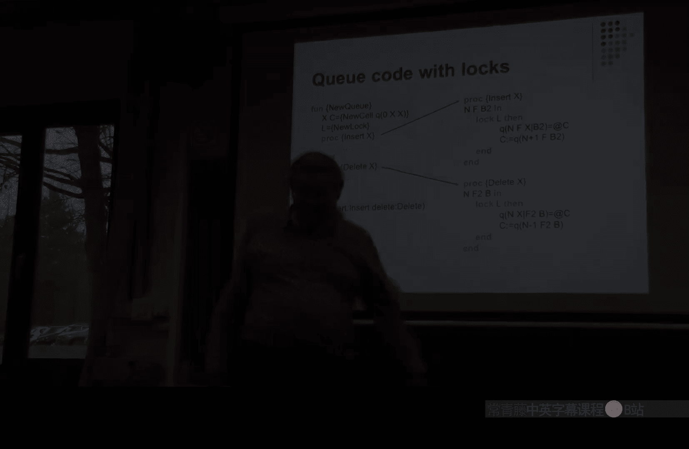
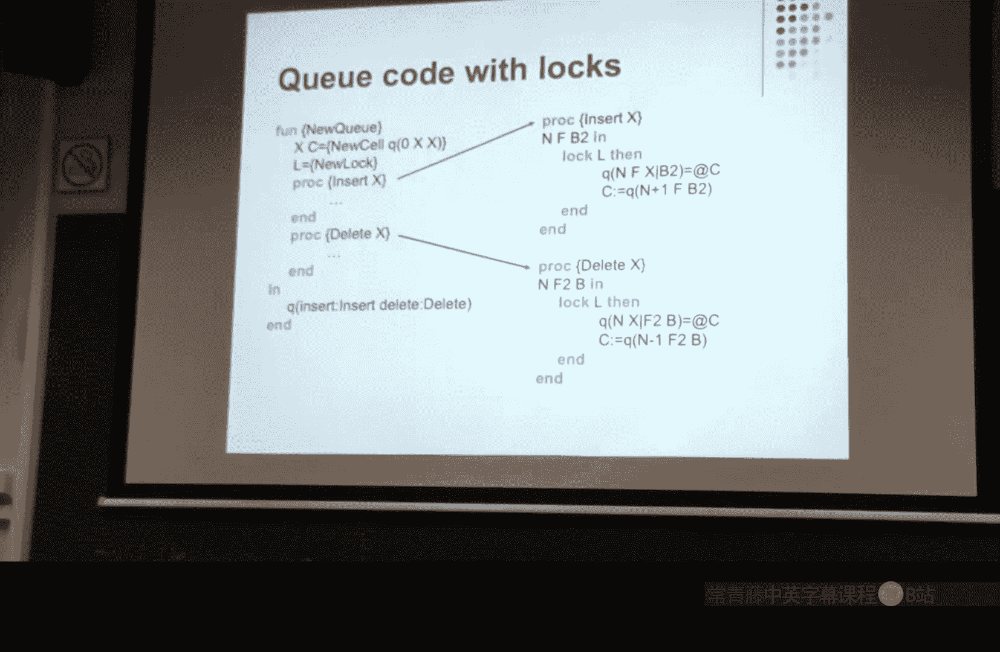

# 鲁汶理工学院【中英⚡高级编程语言概念｜LINFO1131, Advanced programming language concepts】 p37 P37 FO1131 Lecture 12 (2022) -BV1UDffBbEBZ_p37-

to yours。

Today I want to talk about shared state concurrency。First。

 a few seconds of respect for the Ukrainians who are still fighting for their freedom and ours。

And today I want to talk about shared state concurrence。But now we're getting close to the end。

 so to the brave souls who are here in front of me， I say， Bravo for being here。

And to guys who are watching me on video。You should have been here， but。

I will explain everything in the video。We have seen three so far paradigms for making concurrent programs。

Terministic data flow， multi agent programming， and another one。

 this was actually mostly in the previous course， deterministic data flow where you add ports where you need them。

These are the best ones。Theterministic data flow is the best one， but it's only deterministic。

 So this is the best one。 as you can see here， multi agent programming， it allows。Nondeterminism。

 interacting with the real world。And we saw how to do real systems with this。

 and we saw a really nice， very good language called Airline， which is used to do very hard stuff。

Using this paradigm。And the final one which is the best one。

 but still no language supports it's interesting is when you have deterministic data fill。

 but you just add ports where you need it， remember we saw a client server where you just have to add one port。

With a glance stuck to the server and all the rest dysfunction。

This one is the best one for writing concurrent programs。But so far。

 new language is supporting this one， maybe someday。Today， we're going to see a fourth。

Param for concurrent programming called shared state concurrency。

This is where instead of using threads and ports for multi agentent。

 we use threads and cells together， cells mutable states， very that you can update。ok。

And we will see three important concepts， Lockx is the basic。Critical sections。

 building intoomic actions， monitors， which is how threats can。Coord。

Work together and transactions is for it's for fault to for databases。

Or you can do upable actions that can actually abort。So if there's a problem。

 the transaction restores the state。So those are the three variations， but they're all based on log。

Ls。Transactions， monitors。Blocks are important， transactions are a very good concept for databases and faultover。

But， monitors。Are very bad。Uly things， very smelly， you don't want to use them。

They're very bad and it's very interesting because the guy who invented multi agent programming or one of them guys who's named Tony Hoer。

Was also the guy who invented monitors， this was around 1970。

 of course in those days it was very hard to see to the future。

 so monitors are concurrency on sharing state。And also， port objects are for concurrence multi agent。

But monitors are very bad， nasty things。But I'm still going to teach them because there's a lot of legacy code using them。

So Java uses them and they're called synchronized objects。So these are really ugly bad。

 I cannot emphasize how bad monitors are， the trash can is too good for them。

 okay but I'm still going to devote a lecture to them so I will waste two hours of this course talking to you about monitors。

But that's going to be next week， today I want to talk about shared state。Good currency Okay。

 so you see， I have a strong opinion on this and what is the best what is not good。

Everything is based on cells， I'm going to very quickly refresh so that you have everything in your mind on the cells。

Mauable state， so Sha shape state concurrency base on beautiful state so this is variables we can update multiple tans。

 this is used a lot so I'm not going to explain intuition， many languages， bird， Alpa， etc。

In this course， that concept up we call it a cell。Because the word variable is massively overused and mathematics is a variable is just a placeholder for a value in a mathematical expression。

 you cannot update data in computing， well there's many things that are called variables。

 it could be the identifier， it could be a variable in memory or it could be a cell okay so when I say a variable you can update。

 I will always call the cell。And I sell this two things。

 it's a box that has an identity in the country。So it's two things， the name of the box。

Is a constant。Which is in memory in。Process architecture is it's often called the address。

 if you have a memory， a memory， a cell or a piece of memory， a memory word。

The content is what's inside that box and in this course。

 the content will be always a variable in the single assignment， okay so two things。

A cell therefore is not like a variable in a single z store， which is just one figure。Okay。

And the cell has three operations。I refresh you so you can create the cell。

 so cells are never automatic。In a language like Java。

 it's all the time you define functions of methods， whatever， all the attributes。

 all will automatically create cells for you without having to say anything。

 that's actually very bad because cells are nasty things， you want to avoid them。

So here we have to create them explicitly， create a new cell with initial content A。

 and C is bound to the name of the cell， so that's a constant， C is a constant。

And they you have assignment operation。Which replaces the cell's content by a new content B。

And then you have a read operation， which I also call access。

 so Z is bound to the content of the cell， but this content is not changed。Okay。

 so those are the three operations， creation assignment。And access。Okay， and refreshing。

You have notion of earlier thing because you have the name and the content that is separate。

You can have two different cells with the same content or you can have two different identifiers pointing to the same cell。

 so here you have a cell identifier X variable x， so when I say this， this is the box。

X is actually bound to the name of the box， and zero is the content。

So here x the box will have cut in five， if I do y is equal to x。

Then the name of the box will be also in Y。That means if I change the cell the content。

 X will also see the change， okay， so this is called aliasing。

 this is something you have because you separate the name and the content。

And so this is a big problem。So X and Y， you can call the most of pointers， for example。

 so languages with pointers， it's like they're like this。

 they're doing like this I now update the content Y。陈。That means the cell content will be 10 but X。

Is the same cell X and Y have the same name？So the content of x is also 10。

So if I read X and I compare it to tagging will be true， also x and y are the same cell。

 if I put x equal y， it's also true because they are the same constant。

 but here I'm not looking at the content on。So you see。

 you have to be very careful distinguishing the name of the cell and the content of the cell。诶。

The semantics of this beast let me very simply remind you， this is added to the kernel language。

Now we will have two stores。Before we have the variable store， which called Sigma1。

 which contains variables and their bindings if they're bound， they can also be unbald。T equals 10。

 x equals c。And now we have a new store called the sell Store。Which contains pes。So here。

 for example， x column T where x is the name of a cell。

 so you see x is actually a variable in sigma of one。

Bo to the name of the cell and T is actually a variable in sigma1 which is the content。

 so you can actually have cells pointing to themselves。

 of course you could have x co and X So the content of the cell is the name of the cell itself。

 This is like pointer pointing to itself that's very reasonable， no problem。

 So every this is completely general， you can use it in anyway。 these two are variables。

But the first one， the only condition is that the first one has to be bound as the name of a stone。

That's what you get when you call Newa， okay？And I will use Greek letters， small Greek letters。

 the name of X will be see， this is at constant。And I give it this weird Greek name because the language already has other constants of。

 it has numbers and atoms， which are also constants。But C is not a number。

 it's not an integer a real number floating to it， it's not an atom。In fact。

 you cannot print this number， it's actually the same kind of constant as the negative constant we use to abstract data types。

 it's actually an unforgeable constant and also why here。Will be another cell。

So here I have Zeda another。Another。Greek glitter。And the content of x is t and the content of y is done。

 so you see that。Completely the semantics and the operations work like this。

 so assume I have an environment where X， Yz refer to little x little y little z。

 if I do x colon equal big z， that will change x equal t into x colon little z。And if I do access y。

 this will return the variable little double。How they work， okay。

 so that's cells that refreshes the memory， this is the thing we're going to use together with threads。

AndW which will be complicated， I'll show you why。There is a fourth operation。Called exchange。

Which is the added， especially for concurrency。We have it's an operation of three arguments。

 a cell and two variables。This exchange is the same as doing X gets the content of cell C。

 and C is bound to y after that。So these two operations are separate operations。

But the exchange is a single operation that does two thingss。

And so the difference between these two is that the scheduler can never stop in the middle for exchange。

 These two operations are atomic。Which means it behaves as if it were one indivisible action that means the scheduler is either begin before or after it will never stop in the middle。

 you will never explain in the middle， you will never see intermediate state。

Ex does read and write atomically。Okay。This is very important for concurrent programs。In fact。

 in very old books， if you get a computer science book from like 1970s。

You can do all what I've shown today。Without exchange。Theoretically， you don't need exchange。

 you can make build blocks。With only aomic freedom and right。But it's much more complicated。

 there is an algorithm called Decker's algorithm， which's written like this with twoKs。Which。

 if you are curious， you could look up。Ds algorithm。

 which shows you how to build blocks using only read and write。

This is a pretty complicated algorithm。And when people started making concurrent programs。

Like in the '60s and 70s， it started like this， then they realized。No， not good。

We don't want to do like this actually。And that's when this atomic c and write actually makes it much。

 much， much simpler， so this is much better operation for concurrent okay so that's kind of the history。

 if you're curious， you can see this is like a historical thing， nobody uses this algorithm today。

 but in the olden days it was a famous algorithm for doing lus using only read and write， okay。

Today we will use exchange and when we implement blocks like re blocks， which I will show you today。

 we will do it using exchange and with it's actually easy， okay。

 there's no reason to not use exchange。Decker's algorithm is the other way which I will not show。

It's a waste of time。And in fact， this is so important that the actual processor architecture have machine instructions for this operation。

 it's not just a language。invention， it's something that's added to all the machine instructions because concurrency is implemented in the hardware app。

 threads are supported in the hardware with interrupts。And it has to be efficient。

But of course it's not usually called exchange， if you look at like Intel or arm processors or whatever。

 there will always be instructions， but they have different kinds of names。

 but it's always a read and a write， so maybe it's test and swap。So test is a read。

 then swap is a right， then swap is where you exchange a value and a register with a value and memory of test and set。

Now stepE test is reading a bit and ST test is setting the bit。Compare and swap similar。

 So they all have names like that， something like that， but they're both doing read and write， Okay。

 so there's many variations of this。For certain kinds of efficiency reasons。

 but it's always read and write together okay， so that's the fourth operation and today we will use that and you'll see with exchange it's actually reasonable okay。

Okay。Now， let me talk a little bit about。Shaakes state Compcur and how to do it。

And basically how to build large atomic actions。Okay。Okay， so share state concurrency， we define it。

It's the program paradigm where you have both threads and cells。

And you use them together in the same program， Okay， so this is widely used。

 this is very old paradigm， almost all。Major languages， JavaScript D++ D sharp， whatever。

 there are languages that are going away from this。 finally， the airlineline goes away from this。

But languages like go with there other languages now going away and hopefully in the future。

 more and more languages will go away from this。 So there's a language called。

 which is built on top of the Java virtual machine， which is both functional and object。

 It's like a a modern version of。Of Java， and it has support for multi agent what they call actor programming。

 who has a subsystem called AA。Which is used for multi agents in Scotland， of course。

 in Java multi agentent there's really no support for them。O。So it's widely used。But despite that。

 it's very hard。It's like， people team。Pounding their head against the wall。 And that hurts。

But why do they keep doing it because they've always been doing it like that， so it's kind of weird。

 there is no logical reason to use this paradigm except maybe for transactions， but not for monitors。

 there's no technical reason to use it， the only reason is legacy code。

 okay and it's because it's so hard。And I will tell you why it's hard。

 so you will understand why it's hard。So here's what is side。

Here I explain the technical reason why shared state concurrency is so difficult。

Assume we have two threads， T1 and T2 so the time is going from left to right。

 and each of these little things is in operation on a cell。

 so both of the threads are referencing the cell， the same cell see。And these little operations， A0。

 A1， B0 B1， are operations on C that can be either read or write operations。Okay on this time。

How does this execute so assume each thread does n operations here I have 10 and here has9。

 but let's say each cell， each thread sorry does n operations on C。Now how does this execute？Well。

 the scheduler。Will flipped back and forth。 This has an interleaing semantics。

 so the scheduler will flip back and forth to execute Q T122。

 but the scheduler is really free to do that。And the question is。

 how many possible interleavings are there？In this， so for example， here A0 is first and then B0 B1。

 then A1， A2 B3， then B2 B3 before， so the scheduler has made a choice。How many？

Possible choices are there if each trend does an operation。Well， you can compute that。

 it's combinators。Assume we have two n operations， that means in the timeline there's actually two n slots。

 okay，2 n。And the A's are in the n of those， and the B's are in the other N。

That means the A's will choose N positions。Out of2 N， okay。So you have from 0 to 2 n minus1。

 the H will choose n。And the bees will have only one。

 there's only one possibility to be left for the bees。

 there will be end slots that open and the bees go in there。

That means the number of possible inter livingavings is to n， choose n。

This is a comment where it's also sometimes written in see。And end something like that。

 there's another way to write with C， but this is the usual notation， so you've seen that right。

 you've seen some combor。So you we can compute that。

 so that's2 n factorial divided by n factorial squared。We can actually approximate this。

We use Sterling's formula so there's a formula approximating the factorial。

 which is n over E to the power n times the square root of 2 pi n。

 so that's all we need you can do more accurate but that's not necessary here and that's good enough if we fill in this here。

This number is approximately 2 to the power of 2 n over square of pi n。

So square of p does not go up very fast when n increases。

But here we have this little n in the exponent and2 to the power to n， so this is exponential and n。

So the number of possible intuitive things for a program that is running， and the longer it runs。

 the more you have， it's exponential。And all of them have to be correct。

 no matter what the scheduler chooses。The program should not be buggy。

So how do you write a program where you have an exponential number of schedules that are all have to be correct？

Okay。Okay， so the number of interlying is exponential in the number of operations。

 we assume the program is correct， so all interly linkss must be correct。That's very nasty actually。

 even if you have a very small number of incorrect ones。The system will break。

Even if one out of a million is incorrect， then your program will crash very fast。Okay。

 there is no small number， any number that's different from zero here。

Will cause your system to crash very fast， okay？And you cannot rely on scheduler timing。

 you never can rely on that because the timing depends on the whole environment。

And weird things can happen，hu？The famous example， which I mentioned before。

 there's many examples but this one，'s in the 1970s。

 this radiation machine which has a processor in a keyboard and irradiating cancer cells to kill themom。

If you type very fast on the keyboard， this kind of makes the scheduler do something different and it exposes a bug that was not exposed。

During the testing， because the testing was done by typing slowly on the keyboard。

And so patients dies because of that， so that you could not rely on that。

There's two other ways to test correctness， so testing， like I said。

Can only check a small fraction of these exponential interleavingings。But you have to do it anyway。

 still a sense for that， also verification， verification is good， model checking。

 so there's a course by my colleague John Pecher which tells me how to do verification。

 that's also very important。Because it can do， it can catch bugs that are otherwise hard to catch。

 but it's limited。Again， because its the number between things is exponential。

 the amount of computation is very large。 Now there's many techniques and tricks for reducing data。

 for making model checking efficient。But still， you cannot。Completely kill that beast， okay。

 exponential， the exponentiality still shows so you can only verify parts or smaller programs。

But still very good technique？And rail systems have been verified like the automatic metro liness in Paris are all verified。

Completely verified， that was a big work actually， also things like the internal processors。

The earthmetic operations。And Intel processors are very complex。

 also have been the digital logic has been verified。

There was a famous book some years ago in the Intel Divide Op。

Wwhich you think there's millions of people using it， how could it be above and divide。

 but there was a above in the divide， and it were certain numbers， certain printed numbers。

 basically it would crash the processor。Well， at that point。

 they hadn't actually completely verified it， okay？

So that was really a strong hint that you should verify。See。

 because they're pushing very high efficiency so it gets very complicated， so this can be a good。

So both testing and verification are still very important， but they're not enough。You need the third。

You need a third pillar， there's three things， the third one is design。

 your program has to be correct by design， the design has to be such that it's if you are following the design it will be correct and that's what I'm talking about today。

Correctness by design， okay？Okay， so that's important。

But still these two testing of course are very important。

 there's many testing tools and verification is also very important， but they're not enough。

 you need also to do correctness by design， of course it seems like no brain or a if I want to build an airplane that doesn't crash the design should be a design that doesn't crash okay seems very logical。

 but somehow software is attracting people who are not so。So rational。

 so that's important to say that you have to design signals correctly。Okay。

 so what does that mean designing program， a con program to be correct。

 well basically it all comes down to the interleavings。This exponential number of between meetings。

 how do you make sure they're all correct？Well， the basic technique is to reduce the number of interilis instead of this big。

 large exponential number， we turn it into a much smaller number。And each of those。

 that smaller number can be checked by hand to the right tool。Okay。

And three paradigms have different ways to do this。

So this is the technique reducing undergra livings in the three paradigms。

 so the two we saw before and the one we see today。

This is always the technique we use deterministic data flow is somehow the best outs because all interleavings give the same result。

 so the interleavings have no more effect so it's like there's no interleavings all interleavings give the same result that is of course the best if you have a paradigm that forces because of the paradigm that the result is always the same no matter how the scheduler chooses that's pretty strong of course。

But the journalistic data flow does that。That of course， is the best if you can do that。

 and then there's no worries。But you cannot do it for the whole program。

 so you need to add a small number of ports。And for those。You have to check the interviews。

So you use the deterministic data flow most of the time， so no inters。

 so they're all the same and for the ports。You have to check the internings。

 but usually the number of ports is very small， so the internings there's very few and the client server。

 it's where the message arrives， there's one port， so typically you need a port whatever you interact with the real world。

Inside of the system， every part of the system that you are building that you control you don't need。

The nondeminism that comes with births comes because you have no control。

 and that only comes when you interact with the real world， okay。

So that's the best if you can do it so far no language is supporting that， unfortunately。

 but there's a second one which is pretty good too， this is the multi agent。

 the message passing with port objects。So each port object。Has one thread inside。

And it perceives a message， it does something， then it perceives another message。

 so the interleavings are very much small， it's only in between message。

So that what I I call method executions， you receive a message， you execute a method。

 and then you wait for the next message， so that whole method is executed sequentially。

 there's no interleavings， it's sequential， so internally the port objects are sequential。

This really makes the reasoning simple， okay， this is why that multi-aging programming is so nice。

 it really really reduces the number of interleagus okay because the interleaaving only comes between messages and not for every single operation you see that and this is successfully used。

 of course so airline relies on that。So you can write correct airline programs pretty easily。

 and the third one， this is the one we do today。We have shared cells， many threads。

 we build big atomic actions， so the single operation is too small。

 so we're going to group them together and build large atomic actions。

 a big one that's atomic and then another one， so the schedule will not stop in the middle。

And that will reduce the ajuity so that's the basic。And technique。For all of them。

 but we're going to use it today on this。Okay， see how it works out。ok。So the main technique。

For building correct shared statements and programs is to build big atomic actions。

And so the basic concept is a big atomic action， just called a law。

You have a whole bunch of operations， so here I have a lock， it's a piece of color them。

 I have a bunch of operations inside， but the lock is like a box and I enter it and I can fix it。

This is one at， it's like one operation for the scheduler。

 the scheduler will never stop inside there。It's either before or after。

So that really reduces the number of interleaaving sun。🤧。So that is the concept。

 that's what we're going to look at today， and then there's two refinements of that monitor and transaction。

 so they are both locks but with something extra added。So a lot just groups them。

But a monitor adds something more if I have a data structure that's used by multiple threads。

 like let's say I have a buffer， and I click me in and I take an on and found。

So the thread that takes the element out has to wait until the other one puts an element in so the two threads are kind of coordinating with each other。

 so threads sometimes have to wait so if the thread is taking an element out and there's nothing in there and the buffer then it has to wait so a monitor is like a lock plus ability of threads to wait on conditions so these things called weight sets。

So that's the monitors for collaboration between threads。And the final one is called a transaction。

 this is where instead of just exiting the transaction has two possible exits。

 so the commit corresponds to exit it's just a normal execution， but there's another exit called aor。

Which means that the whole operation is canceled。So the state at the abor is the same state as the input。

 so it's still autoomica， so it's like nothing happened。So this is very important。

For things like database stored on a disk。if you're doing something and the disc crashes。

And you can't do the operation。The only logical thing to do then is to cancel it completely if you wanted the program to be correct。

 So you add this book。 So transaction adds the ability of the atomic action to a vote okay so those are the three。

粉死。So there's kind of like a hierarch。Actually， there's many variations of these concepts， monitors。

 there's many variations。Transactions， there's many， many variations to a huge literature。

 you can buy books that show you hundreds of kinds of transactions。So here is kind of。

What it looks like from the distance， the simplest thing is called a simple log。

The most basic Poomaomic action， Chandva explained， a more refined one is called the reentrant log。

This is where the thread that's inside the lock can enter the same lock again。

You'll see just not possible in a simple lock， they cant monitor。

We have what's called a gating mechanism， so threads can allow other threads to go in or not so the threads are collaborating。

 and then you have what's called a lightweight transaction， this is a transaction in memory。

 so it's not on disk。You have things called， for example， STM software transactional memory。

 which where the transaction is purely in memory。But they do have the full transaction。

 which has what's called asset properties， atomic consistent isolation and durability。

 so this one is stable even with crash， so this one will use disk。Okay， and there's many variations。

 which I will not talk about， but you can find them。Easily on Wikipedia and so on。Okay。

So this is what we're going to talk about。In the course， okay。

 so this is this kind of a hierarchy each step below is the same as above plus something more。

So the monitor is basically on a reent lock， the light transaction is also a reentrant block。

 so everything is based on reentrant blocks。Okay， so that's kind of the organization of what we're going to talk about today I want to talk about locks next week we'll talk about monitors and the week after we talk about transactions。

Okay， so how do you prove things？Okay， so we don't have enough time in this course to really go through many proofs。

 but I'll just give you the idea。So I have a program。That uses locks。

 it uses these big atomic actions， and if it's well designed， it's actually kind of interesting。

 remember we talked about abstractions where the abstraction has a boundary。

Well usually it's a good idea that the locks are also kind of thatbbing the same boundaries， okay？

So the atomic actions are often going to be the same boundaries as the abstractions。

 that's very reasonable with to things， so the correctness of concurrency is very similar to the correctness of the abstractions themselves。

So that's well usually what you do。And then there's two parts。

So each atomic action is correct by itself。So I enter an exit。

 and this is usually there's an environment， so for example I have a buffer。

And the invariant is that there's a correct representation of some number of mes， and if I do put。

Then afterwards， there would be correct representation of elements plus the new element， okay。

 so there's an invariant。And the very is preserved， that means when I enter it's true。

 if you assume it's true on entering， it will also be true and so you have to prove that。

 so that's something you prove separately for each time with action。

 so that's pretty easy it's just a little proof for each lock。AndThen the sequence。

 so the real program is going to be executing a lot of these atomic actions。

 and there you have to prove that the program is actually doing something reasonable。

 basically that it's making progress。And this is called liveness， so it's basically。

You can see that the atomic action by himself is like safety。Remember safety and likeness？

ALittle bit， but you see it in other places so safety basically means that you don't do anything wrong。

And liveness means that you're actually going forward， you're making progress。

 so the sequence of actions。Is somehow make going forward。

 So we know that the invariant will always be maintained。 That's fine。

 But we have to prove that the program is actually advancing。 do go forward。

So we have to prove likeness， so we need some kind of a measure of progress。

How much work has been done？And that number has to increase， okay， in time。

 so remember the lift control system。We can prove liveness properties。

The lift will always eventually go to the lift that is first in the schedule and correctly update the schedule。

So the lift， they're part objects， so you can prove each time you receives a message you have a correct update of the state。

And then you can prove that the sequencing。Of these atomic actions is correct。

The lift will always eventually go to the lift that's first in the schedule。

 and it will then remove that one， it will update the schedule。so that's a liveness property。

So this is how you prove it。If you have baby atomic catchs。

And you see the big atomic actions gives meaning。To the program。

 you know single operation ourselves in the difficult when I show difficulty。

 the single operations when you do an assignment or an update doesn't really mean anything。

 it's very low level The meaning is big blocks when you do a whole bunch of things。

 it means something I've added something to the buffer or I have。

Completed a transaction or something。 So that has meaning。 It has a high level meaning。

So that's why this is actually good。W doing things， Okay， so that's kind of all very theoretical。

Now let's go to locks。And explain how they work。ok。老。

Essential actuallyly in the book which we want to see more， Section A and three。So a luck。

It's a language consider。That guarantees that only one thread at most。

 one thread would be running in a specific part of the program。

And that part is called a critical section， if another threat tries to enter that part of the program。

 it will suspend， will wait at the boundary。Until the thread that's inside leaves。

 and if you do that， then the action is a time， okay？So here's an example， so this is code。

And there's a lock know。So the same lock， so this is protected by L and this is protected by L。

 so if a thread comes in here， let's say there's a thread executing here。

 then no other thread can enter， notice the two pieces of code can be separate。

The same lot can protect many pieces all over， it doesn't have to be just one piece。

 so if there's a thread here inside。And another thread triess to get in， this part。

 it will wait at the boundary until this thread leaves， okay， and then this thread can go in。

If there's only one threat inside at the same time most。

That means the scheduler will can put that threat to sleep。

 but then it can just wake it up so there will be no switching of threads so the action will be atomic。

 okay。The scheduler can never switch one thread to another inside a critical section。

Okay you see how it works， so that's how it works and we can implement that。

We implement it after using exchange and cells， you'll see。So we can introduce an abstraction。

 so I'll show you how to implement it data with exchange， we can implement that in the language。

We don't need anything new。No magic， we can implement marks using cells。And using。

okay so here's an abstraction， so new lock creates a new lock L。

 we can also test whether L is a lock okay and we can store lock some of data structures the lock is is like a piece of data actually。

And then there's the guardian。Lock L then statement N， so this is the a syntax。Of this。

So us provides locks， like many languages provide box as part of the language， okay。

 so this guards the state log L， and you can have multiple statements protected by the same Loka。

Lg L then statement， you can put it in many places and all of those statements together are protected by lock。

If no threat is in any statement guarded by a law， then any threat can enter。

If there is a thread inside， another thread will wait， so basically it supenense。

So it stops right there。If it attempts to enter a artstand well there's another thread inside。Okay。

 but then there's another property， assumed the thread is inside the lock。It's inside。And inside。

It runss into another lock L statement， okay， so it's like this。So let's say I have Bob L。

Then and I'm running stuff， and what if I have another log L statement inside？第二。

So the threat is running here， what does it do？Well， it's already inside， so the reenttrant lock。

Is allowed to enter again okay the lock statement can be nested。

 so the property is inside or outside， So once you're inside the thread is inside the connector again。

 so that's what a reenttrant lock can do。You also have a thing called a simple lock。

 which doesn't do that， but it's easier to implement。

 so when we show the implementation we will show first the simple lock and then we show how to make a reentry。

 okay。So in the simple lock， this would be dead here。The simple life， if the thread enters here。

 the it stop here。It simpleが。Would actually do a didlock。

 the program would actually stop and nothing can start this thread up again。

Whereas the reenttro log will just continue and when it leaves here at the endimate。

And it keeps going， it's still inside actually it it only actually leaves when it leaves the outermost end。

Okay。So the reentrant lock is actually the right concept， simple luck is too simple， okay？

So that's how the abstraction works， so I'm going to show you now some code with that。

To show you how it's done。And you can see I love cues because I'm going to show you again a Q abstraction very similar to the Q we saw earlier at the course。

 but this time it's a concurrent cue， many many threads can put elements in。

 many threads contain take elements out so we'll have a concurrent cue。And will implement it。オッケ。

Assuming we have cells and lungs， so here we have a cu。

 so this greenish sequence is a cu with a Q as a front and a back。So A is in front and then B and C。

 so this has three elements， if I do insert D operation on this queue， then I add D to the back。

 okay？And if I delete an element from a Q， I will delete it from the front。

 so you add in the back if you delete it from the front。

 so if I delete x which is unbound then the A will be removed and x will be bound to A。

 so that's an output。So that's the you。So insert adds X to the back。

And the lead X removes the number from the front。And binds it to x。 So it's very symmetrical。

So we're going to implement this。So I'm not going to do a very complicated implementation。

 I'm going to reuse one that we saw before。I'm going to implement it as a difference list so that it's declarative actually。

So here I have a。The Q the Q here is bound to this tule， it's the three tuple。

So the three is the number of elements in the queue。And here I have the actual queue。

 so this is a difference list。So ABC was an un variable B， and then the second part is the B。

 so this is a difference list， remember the advantage of difference this is that you can append elements in constant time。

But it's epherola， but that's okay。嗯。That's okay because。I mean， in a good current system。

 you can call the queue for many threads， but there will always only be one version， okay。

 that's typically in a stateful system when I have a queue and I update it。Then I have a newQ。

 but the old one has disappeared， okay， so in a stateful system。

 all abstractions are kind of ephemeral by defaultfaa。So this will be ephemeral， but that's okay。

Because we have a stateful system。So if I insert D。

 then I bind the B here to d bar B2 and I replace the b by B2。

 so the new Q looks like this and the3 becomes43 plus1， so this has D in the back。If I delete x。

 then I will bind x to the first element， a。And I will replace this。

Part by the one where I removed the first element， so BC B2。So you see how tour are。

 you can do insert don very easily with this。Okay。Now， this Q。Will be stored in a。

And the cell would be protected by log because we can do this insert from many threads。

So we have to be careful that there's no problem， we have to build big atomic actions， okay？So。

 we will。Put the operations inside a log， so let me show you the code now for this with locks。

So assuming we have locks。So here's the new queue， this defines insert and delete。

 and you return this record here， which has these two operations， insert and delete。

 insert apps and delete X like I showed。Now here I have inside a cell and a lock。

I will define a cell， so the original cell is going to be have content 0 xx。

 so that's an empty humor。And L is a log， and here I how I define， insert and delete it。

Now I have to do I have to read the content of the cell。And I have to update it。

 so I have two operations， a read and update。But I don't want the scheduler to stop in the middle because that's inconsistent so I put them in the lock。

 so lock L here this one also is predicted what off。

 you see the same log protects both that means if I have multiple threads doing a and delete。

Then they will wait nicely， and each thread will only execute one of these if nobody is inside anywhere around。

Okay。See how it works in。So here I read， so I'm merely using a bind。

This bind as logical kind of operation I define N，F and B2。Okay。

 I will read the cell and bind it to this， which means I bind N， I bind F， and I bind this。

This automatically binds the end to x bar B2 and the new cell will be n plus1 and the F and the B。

 which this b is bound to this will be replaced， so that is the insert and the delete is kind of the opposite。

So n x bar F2B is bound to C， so this will bind x to the front， so that's the result here。

 and the new Q will have n minus1 and it will have F2 here。

 so the x is removed and the B is the same so I have read and right， read and right。

So this is two operations。So if I don't put the lock end， it's buggyham。If I don't put the lock end。

 and if I use it in multiple threads， then maybe the scheduler will put this thread to sleep here and then the other one will do it and then both of them will do assignments and the app value will be wrong。

So you have to combine these two in a vague at action。

And the invariant is that the content of the queue is determined by。

All the preceding inserts and deletes， so all the elements I've inserted will be in there except for the elements I've deleted which will be gone so it's like all the inserts minus deletes is what will be inside。

That's the invariance okay， and I can prove that this will maintain the invariance。

 so they're I good。They're very good。系。So there you see how to use locks， okay。

 let me make a small break and after the break I will show you how to implement the locks。

That's when it gets really interesting though。我。

So now I will first let me show you a small example of execution and the execute。Thiss cu here。

 so this one is supposed to。Was it form。So this is a Q。 This is the Q same Q I showed you。

And now we can actually define a cube。So I can insert A into this cube and I can remove A。

And you can see the A there amazing。So it actually works， okay。

 I always want to show real code and not just code on slides。To show really things executing。

 so this is room code it works。Okay。

Now let me say something about reenttrency。I show you an example to really so you really understand why it has to be reenttrant。

 so technically you want to nest the logs， but let's say I want to put make an operation， insert two。

 which inserts two elements into the queue because somehow they're connected these two elements and maybe two users of something and I want them to stay together。

And I nothing in between， so I do insert X and insert y。But that's not good enough， of course。

 because the schedulechedr could stop in the middle。

 I have to guarantee that X and y would be together in the cube and the only way to do that is to put the lock here。

 okay， lock L and。But the insert also has a log inside in this one too。But when we call insert X。

 the thread is already inside the lock， so the lock has to be reentd。

 so you can see reentance speeds really important when you're building abstraction。With the agency。

 it's very natural and you can do whatever you want。Okay。Okay。

 here I have a slide where I explain that it's possible to delete elements before they are inserted。

But let me not go too much on this。It's because I'm using because the variable store has logical form in us。

 it's not just like binding as assignments， they're actually logic， it's logic。

And that means logic can be done in any order。嗯，发。Insert， then I do binding， if I delete。

 I do binding。But bindings。Can be done in the order because it's just a logical formula at the end。

That means you can actually delete before inserting and it works fine， so this is not an accident。

 the system is actually doing logic programming and this only shows you a small piece of the power you get from logic programming。

So the main logic programming language still today is called prologue。This language is 50 years old。

50 years， 1972， and still going strong， pretty amazing。

And a couple of weeks ago on the 10th of November， there was a symposium on the 50th anniversary of Prooc。

In Paris， I attended that since I'm an old prolgue guy， okay， I did my PhD in prologue。

And Prologue is still going strong， why is that， why is this very old thing， 50 years old。

 still being used today， it's under the radar， but many applications。Are using program okay。

 because it does logic programming and this only gives you a small piece of the power。

 so this has some very powerful abilities。And the fact of that you can delete before inserting。

A is actually just a small example of the kind of power。So that's all I want to say。

 little extra shout out to prolo。Here's another implementation of the Jew without blocks。

This is now I show you change。Okay， remember， exchange Cx Y is the same as read and write。

 so basically you read the old and you update， so the exchange does both。And with that。

 we can actually implement the two without logs。Look at the assert operation because in the queue。

 we only need to do one read and one write， one read and one write。

 so you can combine them as an exchange if you look at the queue here。

I read the old value and I updated， so it's a very simple thing。Bigger abstractions will need more。

 but this is simple， so we can actually implement it using exchange。And we don't need logs。

So this is the old value，  Q and F x marginvin2， this is bound to the old value。

 and this is the new value。Notice there is a small trick here。

The n plus one operation has to be done after because if you do it before， the n is not bound yet。

 and it will block。Okay， because of data flow。If I put。

 so I will actually put an unbound variable here M。And then I would say a was equal to n plus one。

 so it has to be done after because we have to know n here also the n minus1 has to be done after。

 otherwise it will block， okay。So this works for the cu because we only do one read and one write。

But Q is a very simple abstraction， real abstractions will be doing lots of updates。

 so it doesn't work anymore， so I'll just show you this so to show you one example of a program using exchange so you can use exchange directly if you only do one read in one writing。

Okay， now let's implement blocks。This is where things get very interesting。

We will implement the art using cells and exchange。So inside the lock code。

 we will have still an exchange， so I'll do three steps that get successly more complicated I'll first show you a simple lock。

 so non reentrant。To make it reentry， we have to do something more because when a thread build tries to go in。

 we have to check whether it's already in。And the only way to do that is that threads have identities。

 so we have to know which thread is in， so that requires a little bit of code， so I'll do that later。

And there's another thing which is exception handling。If I'没 a law。And I divide by zero。

 and I raise an exception。The exception will leave the context。But I also have to leave the lock。

 so raising an exception is another way to exit the lock。

 that means the lock has to exit whenever I do an exception。

 so that actually has to be part of the code， this will be done using the Tri finally。

 so I need to do code for that。And so the final one is reent lock with exception handling。

 this is what all systems do， this is the standard lock used by everybody， Java， whatever。

 they're all using this。Reent block with the exceptionception hand。

And we will implement logs using a technique called tokenken passing。

 so how do you implement the locker as many threads trying to get in。诶。How does that work。

 how does a thread go in and once a thread is in， the others don't go in。And they have to wait。

 how did we implement that？Well， the technique is called token passing， so there's a token。

Which is a thing that there's only one of these things。ong in French， it's a thing and。In the system。

 there's only one of them。And each log has a token。

And in order to enter the critical section of the lock， you need the tone。The threat needs to token。

But there's only one token。So if there's a thread already inside。

 then that one has the token and the one on the outside will not have the token， okay？

If the thread tries to get in and it doesn't have the token， it waits， it says I want the token。

 please give it to me and it will wait there until it gets the token okay and when a thread leaves the critical section。

 it will forward the token to the next thread that's waitinging so there's like it's like a relay running coret where you have the token and I'm back on some kind of a stick I'm running and then I pass it to the next guy and then that guy starts running。

So when the thread leaves the critical section， it gives the token to the next thread waiting。

 so the threads are waiting in a sequencer。They're waiting in a line， it's not messy。

 they're all waiting in a line and the first one will get the token， it goes in。

 and when it goes out， it gives the token to the next one and so on。So it's using this technique。

 and we implement this technique using cells。So the cell somehow keeps track。

Of which thread is waiting for the token， and I'll show you how it works。 So here's the code。Okay。

 so this is a simple block。The token is here， so this is a cell。

 and unit is a constant and unit means if the value of the cell is a bound to something like unit。

 then I have a token。And here' is the lock。Notice this is using higher order programming。

So it's lock of P where P is a zero argument procedure， so instead of doing lock L statement。

The statement is inside the higher order， so I implement this using higher order，The P。

 the statement feesves of just as the procedure and the statement is inside there so it' said higher order。

And here's how it works， So here is the statement。And it's surrounded by these two operations。

Wight old。And new equilibrium。So way's old is waiting for the token。

And new unit is giving the token to the next guy。And exchange is how the token is managed。

 so it's like people waiting in line。Okay， and I think it's good to make a picture of how it works。は。

Because so each time a thread executes luck。It will run exchange。

 so the exchange is done outside of the critical section so this is the critical section。

 so all the threads will run exchange and the order that they go in is determined by the order that they do exchange and because exchange is atomic。

Each thread will do the exchange and the scheduler somehow chooses the order of the thread。

 but we don't care it doesn't matter what the order is， there will be some order。

 it depends on the order of the execute exchange。So that's how it works。

So let me show you how it works， let's say we have a bunch of threads， T1， T2， T3， and so on。

 threads。That we want to get in。want to， okay。Now the first one。So we have a lock， we have this lock。

😔，Which is。Lo P。 So let me do it like this。So here's a statement。That we want to execute and。

So this corresponds to luck。L， then， statement。嗯。It's only syntax。

 so the semantics is exactly samema， it's only syntactic sugar， this lo Emmama。

So all languages that have los will give you some syntactic sugar。

 but it's basically just high for program。Okay， now I do exchange。So I have this token。

So the thread T1。Doesn't needs change， so it gets old。The old content is unit。

And it has a new variable。And so the new content of the cell in the to is new。

 since this is a constantsonant， it goes in。So the first one is constant。

 so the first thread goes in。Okay's executing P。So the first thread。Does。Wait old。

So this executes fine and it starts running P， so it's here。And eventually we this， but not yet。

 Okay， now， so this one is running。Now the second thread comes。And it runs this， what happens？

Well the second thread will run change。And it will get an old。But actually， it's the same as。

This new。 So this is a new variable。 This is the new content。

 So the the second thread will get this variable from the exchange， but it's the same as new one。

 it's the same variable。And it will wait。On hold。Soth， this is of one then important one。So。You头。で。

So when weights are 02， but02 is still unbound。Okay， and it also there's a new new one， new two。job。

Let me just show you a third thread so that you can see the。Hows making。A line of threads。

 let's so this thread now is waiting here。T2 is waiting here， T1 is executing P。Okay， see that。

T1 isnt here somewhere， it's doing stuff。But since new is unbound， T2 is still away。

 it's just way here。 Now T3 comes along。And doest exchange。So T3 has a variable local3 and nu3。

But both three is the same as new two。Okay， so it will wait on0 three。皮皮。And here you hold new3。

 sorry， new3。Its。Okay， so what is T3 do Well T3 comes here， it gets old3， but old3 is unbound。

So it just waits here。You see how it's working？It's important us to understand。

 I expect you to really understand how important。So T1 is now running， now I'm use a different color。

T1 is running。T2 is waiting here， and T3 is waiting here。

Now let's say T1 finishes P1 and it exits here。And it binds you one to unit。Well。

 new one is the same variable as O2， so that means T2 will now。Start running in P2。

 you see when T1 leaves， it is essentially passing the token to T2 and T2 can now start running P。

 see howwards。So T1 is out now， it's doing something else， it's gone， T2 is now running P。And T3。

 well new2 is still unbound， So T3 is still waitinging。 Yeah。

 so it's possible to exchange unbound absolutely bound A variable can be bound or unbound。

 exchange will replace one content by another。 and the content of a cell can be an unbound variable。

 So we're using the data flow property to make this work， So let me get another color。

 if I can find another color here。ど有。我就是朗普。I agree here。He is great。Hopefully you can see it。

 So now we have T2 running here。And T3 is weight。And if there would be a T4。

 assume there's a T4 coming in。it would also wait because the old four would be the same as new three。

 so you can have many threads waiting， but here there's t3 waiting。

Now S T2 finishes P and it does this。So this is supposed to be a three。A。

New two is equal to unit that causes， so new two is the same as old three。

 it's the same variable in membrane。And the weight both3 will then continue and now T3 will start running2 so T2 is out T1 is out already a long time ago。

 T2 leaves is out and now T3 comes in。But deforest the win。

So you see so that the token is the status of this variable， so T1 starts by having the token。

 it does new and equal unit， and this passes the token to T2。And then when T2 is done。

 it passes the token T3 and so on， see how it works。

This is probably the easiest way to implement a block， okay， if you want to implement a block。

In without data of flow， it's much harder。 So this is basically a。

Completely correct implementation of a lock。 Now， this one is not reentrant。

Because what if T1 now what if so T2 is running here， what if inside this P？There's another lock。

 okay， another there's another call to this， it's possible everything's possible。

 this peak can have this。If that happens， T2 will do another exchange and it will wait。

 there's nothing special， any thread trying to get in which doesn't have the will try to get to token so that the exchange doesn't know that T2 already has it done。

 so this is not reenttered to。If teacher tries to get in again here。

 it will wait and basically the whole system is blocked forever then？Okay。So this is not reent。

 you see？Okay。5个。It'sNice piece of color now， isn't it beautiful。Okay。

 we have let's add exception handling to this。That's very easy actually。

 what happens if the statement inside P raises an exception？Well， we still have to leave， okay。

 if T2 inside here raises an exception， we still have to pass the token。Of course。

 as we're leaving the critical section， the way to do that is to put new equal unit to use tryfin。

 so try finally， this is something that will always be executed。

Even if you either raise or not raise them。So all languages with exceptions have something like this。

ll try finally。So this passes talking to the next trade， even if P raises an exception。

 so this new equal unit is always executed， when you leave。So that's it for exceptions。

That's pretty easy， right？Now we just try to make it reentry， so this is the real thing。

How do you make it reentrant？Well， right now， any thread that tries to get in will do an exchange。

Even if it's already in， it will do an exchange， okay but somehow we have to avoid that if it's already in。

 we should not do an exchange， we should immediately just start running pe actually。

 we don't need to do this exchange and wait if it's already in， okay？So the only way to do that。

We need a new concept， threads need to have identities when I create a thread。

 I have to know which thread is in， okay， somehow the thread needs some kind of a name。

So now the system has to provide that that's actually easy if you know that you need it now because a thread is just in memory。

 a data structure has registers and a stackca， but you can give it a name too so the thread has to have identity for this。

So that's a new concept。So a reald lock needs to know which thread is inside。

It needs to know the thread's identity because you know there's a thread inside。

 you should have to say is it me okay is it the same as me so you need to know the threads identity so in us you have a function of thread do this。

Which returns the thread's identity， but other languages will have something。

Depends on the but so fairness identity。So the procedure lock now is written like this。

 so this part is the same as before， okay， this is the whole bit with exchange and weight and the tryfin and so on。

But here I have now， I first， I want to check， is the thread that's inside the same as me if thread that this is equal to。

The content of current threat， so I need another cell out。I have to store somewhere。

The name of the thread that's already in there right so this is a setting cell called current thread let's say。

 so unit means there's no thread because unit is not the name of any thread it's just some random constant。

So it's part to sound that nobody is in。Okay。So there's another thread in。

 so let's say as thread cut goes in so here's the。The weight and the new the units。

 so that's the critical section， before executing P， I will assign this。

Currentn thread becomes thread up this， that means inside of P。

 I know that the current thread is this thread， okay and when I leave， there's no thread。

 so current thread becomes units again。So when I'm running P， there's actually， this is the threat。

Okay， and here if the thread tries to get in again。

It compares its own identity thread like this with。

What's in current thread and if it's equal that means I'm already in。

 I don't have to do all this garbage of bookkeeping of trying to get in， I'm in already。

 so it just runs P， doesn't have to do any of this。

 it's in the whole bit of getting in here and of leaving only has to be done once。

Once you're in and you're in and you don't have to do anything special。

 so it can just immediately run P， okay？And it actually doesn't even have to do the tri finally stuff because all of this。

 this running P it's actually still it's inside here， if this P raises an exception。

 I will come here， I will come to the outermost wherever it's running here， I will come on。

 so I just run P， that's it。ok。So you see the new thing is you have to manage this current thread。

And before you after you get in， so way old is very important， this is the bear era。

 this is where you get in， once you get in and before you execute P， you assign current thread。

And then before you go out， so a new equal unit means your' alta。

You assign current thread back to some value that says nobody is in， okay。Now， this is very。Tricky。

 you have to do it exactly in this order， okay？What can go wrong。

So these two statements have to be in this order。If they're switched。Your program is good。Basically。

 if they're switched。What happens， so new equilibrium unit means you go out。

That means once you're out。The current thread will still think you're in。

And if another thread tries to get in， so that's a problem， okay。

 so what can go wrong so you should try to imagine a buggy scenario。So this is an exercise for you。

 if I switch these two statements， you have to imagine a nasty scheduler。

 so the scheduler is a bad guy。How can the scheduler make your program go really bad if I switch these two？

So in the way it's written now no matter what the scheduler does， the program is right。

 it will never go， but if I switch these two， the scheduler can make it go bad， okay？So debugging。

Is important。So， you have to。Be able to answer these questions。So to be very clear。

 these could be exam questions， okay， what can go wrong if these two instructions are switched。

 what can go wrong if these two are switched？So here's the hint， way old， that's where you enter it。

New unit， that's where you exit， everything between way old and new unit is inside。

And everything on the other side is outside。So what happens if you change the current thread outside of the critical section？

Bad things can happen that means you think something is in there， but it's not that same， okay？

So if you switch these two you will update the current outside here also if you switch these two。

 you will update it outside， so way old new equal unit is very important。

 it is the boundary of the critical section。And anything between that is inside。

 so anything in between that， you're guaranteed there will be only one thread running this。

So this current thread gets thread than this， your gear teethd。

That only one thread will do this and the same thread will run P。

 that's the guarantee that the critical section is here。But if you switch them。

 you don't have that guarantee anymore。Okay， see that。So。That's you have to be able to imagine。

What can do wrong？俾。The program is not right to be written。So this program。

 the way it's written here。Everything is exactly in the correct order。

 so that critical section is between weight and new。The exchange is done before。

 has to be done before， not after。If it's done after the wage， the system will then let go。

Campton done after has to be done before that means exciting getting a ticket。

When you go to Media station， you want to buy a ticket， you get one of these。

Papers with a number on it， that's things exchange。

And if many people try to get in the critical section。

 they will all have a ticket and the order will be the order that they wait in line okay。

 so the exchange is getting a ticket。And the way old is when a。Acount， you said。

Becomes availableable， so that's the way wrote， okay， so those are two separate things。

So you have to this something you have to really understand and how it works， okay？

Then you really understand something if you don't understand that。Okay。So that's it。

 now you know how to implement reentrant logs。Uing token pass。

It's an example of a nontri concurrent programmer， so you see how we designed it piece by piece。

 bit by bit， simple law exception and reenterency， and we end up with this。

 which is completely correct in a concurrent system。So you have to understand who I am， okay？

So the picture on the boat is important。Okay， now let's go to another thing me and now I want to introduce a really new thing。

 a different thing。Ca。Tuple spaces。So top of space is a funny concept。

It's a thing that's somehow in between message passing and shoulds， how is that possible。

 it's a very interesting concept。But you can use it also to representcomp programs。

So it's kind of like locks。But a little bit different。Okay。

 so a tuple space is a multi set of tuples， and let me make a picture of that。

So you can see what's going on。And I explained it because many systems use this concept， systems。

 for example， what I called publish， subscribe systems， pops up。

 are actually using T space constants。So this actually very useful concept。

So here I have a couple space。This is just a sentence， so it's a multi sentence。

Multicent means that the same thing can be in there more than once。So here is a tu， here is a tu。

Here's another couple。Here is the same tu again， so you can have several a bunch of tus in there。

 and these tus are actually like tokens。Once you put a tuple in there。

 it's a thing that goes in the tus。So they really behave like tokens。

So what I showed you before was token passing。In tule space。

 you actually have the tokens in your hand in the sense。So here is the abstract。

 you have the multi sets， so you have a bunch of tuples， so the tus you like tokens。

 you have right T。So you add the tuple to the tuple space， so this puts a token。In the temple space。

 it adds one new thing， so even if the T T is already in there， it goes in it again。

 okay each token actually has an existence， okay？And then you can also remove a token。Read LT。

 so this one uses kind of pattern matching， this removes a token， but it kind of synchronizes。

 so it waits until there's at least one topple with label L。And then it removes one。

So in this tu of space， for example， so let's say this one is called TS。By do P S。Read。呃A b。

He will wait until there's a tumple with labeled A， but there's three of themh。

And then it will remove one of them， so maybe it will remove this one。So maybe we remove this one。

But the other two will still be there， so tuples are things， you add one， you have one more。

 you remove one， you have one less， they are things with existence， okay。So this is the read。

 so it actually waits， so it's a synchronization， so if there's no coupleple with label A。

 then it waits。Okay so you can see I now have kind of a concurrent abstraction on these tuples。

And there's also a version of read， which is non blocking read。Which three arguments， LT and B。

 same as read， but it returns immediately and B is a booleion。

And B is equal to false if there's no tuple with label L， otherwise if there is one。

 b is equal to true， so you see this one is checking， whether there's a tuple and it doesn't wait。

 so there's two variations of the read， there's a blocking and a non blocking version okay。

So you can see this is like the token concept。It's important so the tokens are real things。

 whereas in the previous one， I modeled the tokens using these datagaflow variables here the tokens are real tokens。

In this concept。This concept was first invented to get used in history in 1985。

 this concept by a computer scientist called David Gollerer。And he called it Linda for some reason。

Maybe that was the name of his girlfriend， I had no idea， so it was called Linda。

 but the reed operation did pattern matching。So the read can actually be very sophisticated。

 it can wait until there's a certain pattern。If you want， you can make it more sophisticated， okay。

So that's a couple spaces， so you see it's a very simple thing up。

 it's basically a bunch of tokens you can put in and take out tokens。Okay。

There's another name for this。Sometimes people talk about coordination model。

Sounds like a weird name， thats when a person says that it's exactly the same as a tuple space。

 so when you see this is a coordination model， it basically means it has tus so you can put it and take out。

 a language that supports tuple spaces is called a coordination language。So this is a funny name。

 but it's just a synonym for a T space just to give you the connection。

 and this is actually used a lot。And what's called publish subscribe systems。

So a published subscriber system is basically a big public of space。

And you can subscribe to items that say I'm interested in news about。Tesla， cars or something。

 and then publishers put in tokens， which are little news items。OnTsla。

 and there's other news items on Ford on Mercedes， on Ro Royce， but I'm not interested in those。

 I only want the Tesla one。So when I read from it， I only want Tesla tuples。

 that's why you have this pattern matching。And you can have many readers so that you have this huge distributed Tple space and you can subscribe to news items and you can also publish news items this is called Pub subscribe it's kind of message passing system it's kind of like a mail system。

 but it's not sending mail to people。But to topics。

 I send mail to Tesla topic and I can subscribe to Tesla topic or Rosroys topic or whatever。

So it's like email， except that you're not sending mail to people。

 but to special things called topics， the names of the， the topics。

So that's an interesting abstraction。SoBut this is interesting， let me this is actually combinations。

Of shared state and message passing。So it's kind of like shared state because many threads can access the same type of space。

 so it's like a memory， okay？But it's not really the same as a memory because you can never update the tuples。

 you can only add new tus or remove tus so the tuples are declarative。

And it's like message passage because you can send and receive tuples。

 so adding a tuple is like a send， removing the tuple is like a receive， okay？

So it's kind of an interesting in between concepts。

But it's actually much better than shapes being done。

 it actually has a lot of the goodness of message passing。And the basic difference。

 it's very interesting， so with message passing to send your nose to a receiver。

 I send a message to you and I know your name。But with tuple spaces。

 the sender does not know the receiver， the sender sends a message， puts a tuple。

 and the receiver can meet anybody who takes that tuple out。

 so the sender does not know the receiver， so it's like sending mail where anybody can receive it。

 you don't know who。AndSometimes that's useful that puffs up or print pews。I want to print a file。

 but I don't care which printer， so I put a print request and all the printers will take out print requests。

 so I don't care which printer receives it， okay？So it's like message passing except the sender does not know the receiver。

Okay， so let me show you a program with this。We can actually program the cube。Our famous。

 the cue that I love so much， we can implement it using tuple space。Okay。

But it doesn't need the tuple space， we will put it in Google do read right。

 so we put it tuled in and we remove it tu， so the Q state is in a tu， we take it out。

 we update and we put a new tuled in， but you don't need a lock。

Because temples are things that exist that you need， you put in a tuple you have it。

 when you remove it， it's not there anymore。嗯。So when you read tuple。

 it's like entering critical section， if there's one tuple， only one thread and remove it。

 the second thread， not see the tuple。谁都知道。It tu space。

 so this gives us three kind of nice implementations you can compare the two which a lot。

The queue with exchange， it doesn't mean lock and the queue with tuple space。

 so let me show you now the code of the queue with tuple space。Same cues before， same meet your face。

We have one tuple in the tuple space。 So this tuple space is not very big。

 Its only has one tuple in there， okay。So， that's okay。When I do an insert， I read the temple。

 which is this， which basically contains the state of the P。 I bind it to N F X y V2。

 And then I write。The new state。N plus1， F2。ok。And the league also reads the state。

And writes the new states， so you have two temple operations。But still you don't need to lot。

Because if a second thread， let's say you do the first one， you do insert。You start by reading。

 if somebody else wants to do a delete， they will blog here。Because the reed here， the tuple is out。

 so there's no more tuple inside， so the reed will wait until this guy puts it in tuple again。

 so you automatically have like synchronization， you see that？So that's kind of a。

 it's kind of a neat concept。Very elegant。The problem is it's not as efficient as reentered blocks to do it like this。

 you really have to manage this tu space thing which is like a complicated data structure。

 so it's by far not as efficient but for pubub sub systems it's quite okay。Okay。

 let me just finish to show you how tu spaces can be implemented。You have a multi set of tocos。

How do you implement that？Well， you can implement it using three things， a lock。

 you need one lock inside it， a dictionary， which I tell you what it is， and a concurrent here。

So I showed you how to do a queue with tu space， but to do the tu space you need a queue， okay。

 it's interesting。So here's a dictionary， a dictionary is to the hash table。

 we have keys and values so you can look at。The values。

 you can add new ones or remove So there's many operations。 but basically you can look up the value。

 and the key is going to be the label of the top。And value。

 this will be a Q and it will be all the tuples with that label， so if we have a tuple with label A。

 for example， and if there's three of them， then we have a cu with those three elements。Okay。

So the tuple operations will insert and delete elements in the queue。

 and if you insert a tuple and there's no label， then you will add a label。

 and if the queue becomes empty， you can actually remove this entry and the dictionary is a dynamic has table。

Can expand and shrink。So this lets you implement。so that's tuple spaces。

 tuple space is kind of a nice abstraction。It's usually used in for big applications。

 distributed things and pus up， it's usually not used for small programs because you can see this is more expensive than a reentrant and a log okay。

Reentry blocks are extremely efficient things。Okay， so that's kind of end for today。

Shamve state conracy we saw。Combining trends and cells。But it's hard。

 the number of inters is exponential。The operations solution。

 build large atnomic actions to reduce the inter readings。And three kinds are locks。

 monitors and transactions， tuple space is also a way。Of doing similar things to logs， okay。

 but also to communicate data。And today I show lots。And next week， I'll show one of。

And the transactions。And that's over today thinking。说了。

