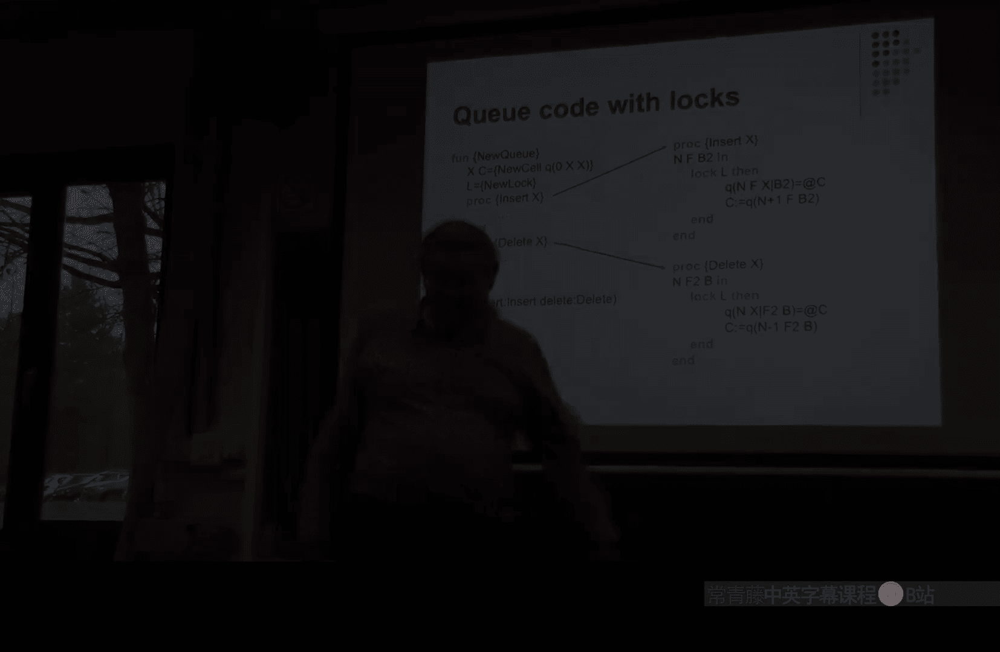
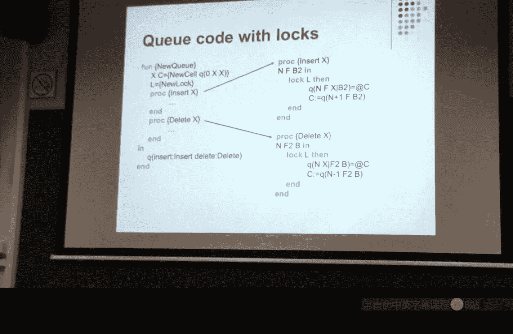

# 高级编程语言概念：第12讲：共享状态并发 🧵


在本节课中，我们将要学习并发编程的第四种范式：共享状态并发。我们将探讨其核心概念、面临的挑战以及如何通过构建大型原子操作来设计正确的并发程序。

---

## 概述

共享状态并发是一种结合了线程和可变状态（我们称之为“单元”）的编程范式。它被广泛使用，但也因其复杂性而臭名昭著。本节课，我们将了解其工作原理、为何如此困难，并学习如何通过构建锁、监视器和事务等原子操作来管理这种复杂性。

---

## 共享状态并发的挑战

上一节我们介绍了多种并发范式，本节中我们来看看共享状态并发的核心难题。

假设有两个线程 T1 和 T2，它们都对同一个单元 C 执行一系列读写操作。调度器可以自由地在这些操作之间切换执行顺序，这就产生了“交错执行”。

**关键问题**：如果每个线程执行 n 次操作，那么可能的交错执行总数是组合数 `C(2n, n)`。使用斯特林公式近似，这个数量级约为 `2^(2n) / sqrt(πn)`。这是一个关于 n 的**指数级**增长的数字。

**结论**：程序必须保证在**所有**可能的指数级数量的交错执行下都是正确的。即使只有一个交错执行存在错误，程序也可能很快崩溃。我们不能依赖特定的调度时序，因为环境因素可能导致任何交错发生。

为了应对这一挑战，我们主要依靠三种方法：
1.  **测试**：只能覆盖一小部分可能的交错。
2.  **验证**（如模型检测）：非常有效，但受限于状态空间爆炸问题。
3.  **通过设计保证正确性**：这是最根本的方法，即设计程序结构使其本质上正确。本节课将重点介绍这种方法。

---

## 通过设计保证正确性：减少交错

设计正确并发程序的基本技术是**减少需要考虑的交错数量**。不同的范式有不同的实现方式：

*   **确定性数据流**：最佳情况。大多数操作是确定性的，所有交错产生相同结果。非确定性仅通过少量“端口”引入，从而将需要检查的交错限制在很少的数量。
*   **多智能体编程（如 Erlang）**：每个端口对象内部是顺序执行的。交错只发生在消息接收之间，而不是每条指令之间，这大大减少了交错数量。
*   **共享状态并发**：我们将许多细粒度的操作**组合成大型的原子操作**（如锁）。调度器不能在原子操作内部切换线程，从而将交错限制在原子操作的边界上。

本节我们将聚焦于共享状态并发，并学习如何构建这些大型原子操作。

---

## 核心构件：单元

共享状态并发基于可变状态，我们称之为“单元”。让我们快速回顾其核心操作。

一个单元是一个具有身份（名称）和内容（值）的“盒子”。身份是常量，内容可以改变。

**三个基本操作**：
1.  **创建**：`C = {NewCell A}` （创建初始内容为 A 的新单元，C 绑定到单元的名称）
2.  **赋值**：`C := B` （将单元 C 的内容替换为 B）
3.  **访问**：`Z = @C` （将 Z 绑定到单元 C 的当前内容，不改变内容）

**一个重要概念**：别名。两个变量可以指向同一个单元（共享相同的单元名称）。这意味着通过一个变量修改内容，通过另一个变量访问时会看到修改。

**用于并发的第四个操作：交换**
这是一个原子操作，对于并发编程至关重要。
```oz
{Exchange C X Y}
```
其语义等价于原子地执行 `X = @C` 然后 `C := Y`。调度器不能在读和写之间中断，这保证了操作的原子性。现代处理器架构都提供了类似的机器指令（如测试并设置、比较并交换）。

---

## 锁：基本的原子操作

现在，我们来看看如何构建大型原子操作。最基本的形式是**锁**。

锁是一种语言构造，它保证**最多只有一个线程**能执行受特定锁保护的代码段（称为**临界区**）。如果一个线程在临界区内，其他试图进入同一锁保护区域的线程将被阻塞（等待），直到当前线程退出。





**抽象接口**：
*   `L = {NewLock}`：创建一个新锁 L。
*   `lock L then <statement> end`：用锁 L 保护 `<statement>`。同一个锁可以保护程序中多个不同的语句块。

**可重入性**：
*   **简单锁**：如果线程已经持有锁，再次尝试获取同一把锁会导致死锁。
*   **可重入锁**：允许已经持有锁的线程再次进入。这是更实用、更正确的概念，Java 的 `synchronized` 关键字实现的就是可重入锁。

---

### 使用锁的示例：并发队列

让我们看一个使用锁实现并发队列的例子。队列支持 `insert` 和 `delete` 操作，多个线程可以安全地调用它们。

**队列实现（使用锁）**：
```oz
fun {NewQueue}
   C = {NewCell q(0 X X)} % 初始状态：0个元素，前后指针均为X
   L = {NewLock}
   proc {Insert X}
      {lock L then
         N F B2 % 读取当前状态
         q(N F B)=@C
      in
         B=X|B2 % 在差异列表末尾添加X
         C:=q(N+1 F B2) % 写回新状态
      end}
   end
   proc {Delete ?X}
      {lock L then
         N F2 B
         q(N X|F2 B)=@C % 从差异列表头部取出X
      in
         C:=q(N-1 F2 B) % 写回新状态
      end}
   end
in
   queue(insert:Insert delete:Delete)
end
```
**关键点**：`Insert` 和 `Delete` 操作中的“读-修改-写”步骤被包裹在 `lock L then ... end` 中。这确保了每个操作都是原子的，从而维护了队列的不变式（如“队列内容等于所有插入减去所有删除”）。

---

### 锁的实现：令牌传递算法

理解了锁的用法后，我们来看看如何仅使用单元和交换操作来实现一个锁。我们将采用**令牌传递**的技术。

**核心思想**：锁关联一个唯一的“令牌”。只有持有令牌的线程才能进入临界区。令牌在等待的线程之间传递。

**简单锁（不可重入）的实现**：
```oz
fun {NewLock}
   Token = {NewCell unit} % 令牌，初始可用（unit）
   proc {Lock P}
      Old New
   in
      {Exchange Token Old New} % 1. 获取“票据”
      {Wait Old}               % 2. 等待令牌可用（Old被绑定）
      try {P} finally New=unit end % 3. 执行操作，最后释放令牌
   end
in
   Lock
end
```
**工作原理**：
1.  `Exchange` 是原子操作，线程通过它获取一个“票据”（变量 `Old`）。
2.  `Wait Old`：如果 `Old` 是 `unit`（令牌可用），线程立即继续；如果 `Old` 是未绑定的变量（令牌被占用），线程在此等待。
3.  线程执行过程 `P`（临界区）。
4.  `finally` 子句确保无论 `P` 正常结束还是抛出异常，都会执行 `New=unit`，这将令牌传递给下一个等待的线程（因为 `New` 和下一个线程的 `Old` 是同一个变量）。

**使其可重入**：
简单锁的问题在于，同一个线程无法再次进入。为了实现可重入，我们需要：
1.  线程身份识别：`{Thread.this}` 返回当前线程的唯一标识。
2.  一个额外的单元来记录当前持有锁的线程。
在尝试获取锁时，先检查当前线程是否已经是持有者。如果是，则直接执行操作，无需经过令牌获取流程。

**可重入锁的实现（概念）**：
```oz
fun {NewReentrantLock}
   Token = {NewCell unit}
   CurrentThread = {NewCell unit} % 记录当前持有线程
   proc {Lock P}
      if {Thread.this} == @CurrentThread then
         {P} % 已经是持有者，直接执行
      else
         Old New
      in
         {Exchange Token Old New}
         {Wait Old}
         CurrentThread := {Thread.this} % 设置持有者
         try {P}
         finally
            CurrentThread := unit % 清除持有者
            New=unit % 传递令牌
         end
      end
   end
in
   Lock
end
```
**关键顺序**：`CurrentThread` 的赋值必须在 `Wait Old` 之后（进入临界区后），而清除必须在 `New=unit` 之前（离开临界区前）。顺序错误会破坏锁的互斥保证。

---

## 元组空间：介于共享状态和消息传递之间

最后，我们介绍一个有趣的概念：**元组空间**。它像一个共享的多元组集合，兼具共享内存和消息传递的特点。

**基本操作**：
*   `{TS write(T)}`：向元组空间 TS 写入一个元组 T（令牌）。
*   `{TS read(L T)}`：从 TS 中读取并移除一个标签为 L 的元组，绑定到 T。如果没有，则阻塞等待。
*   `{TS read(L T B)}`：非阻塞读取。B 返回布尔值，指示是否成功读取。

**特点**：
*   **发送者不知接收者**：生产者写入元组，任何消费者都可以读取，实现了解耦。
*   **基于模式匹配**：读取操作可以指定标签进行筛选。
*   **应用**：发布-订阅系统的底层模型。

**使用元组空间实现队列**：
```oz
fun {NewQueue}
   TS = {NewTupleSpace}
   {TS write(q(0 X X))} % 初始状态作为一个元组放入空间
   proc {Insert X}
      {TS read(q(N F B) $)} % 取出状态元组
      {TS write(q(N+1 F X|B))} % 写入新状态元组
   end
   proc {Delete ?X}
      {TS read(q(N X|F B) $)} % 取出状态元组并解构出X
      {TS write(q(N-1 F B))} % 写入新状态元组
   end
in
   queue(insert:Insert delete:Delete)
end
```
**优点**：无需显式锁，因为 `read` 操作会取出元组，其他线程会自然阻塞在空的元组空间上，直到新状态被 `write` 回去。这提供了内在的同步机制。

---

## 总结

本节课中我们一起学习了共享状态并发：
1.  **核心挑战**：线程与可变单元结合导致指数级数量的交错执行，使得正确性难以保证。
2.  **解决方案**：通过设计减少交错，核心是构建**大型原子操作**。
3.  **锁**：最基本的原子操作构造，通过互斥确保临界区代码原子执行。我们学习了其使用、并通过**令牌传递**算法实现了可重入锁。
4.  **其他原子操作**：还简要介绍了**监视器**（锁 + 条件等待）和**事务**（原子操作 + 中止/提交能力）的概念。
5.  **元组空间**：一种有趣的并发模型，以共享多元组集合的形式，结合了消息传递和共享状态的特点，常用于发布-订阅系统。

共享状态并发虽然应用广泛，但设计正确的程序需要格外小心。锁是基础，但下周我们将看到，监视器引入了更多复杂性。理解这些构建块的原理，是编写健壮并发代码的关键。