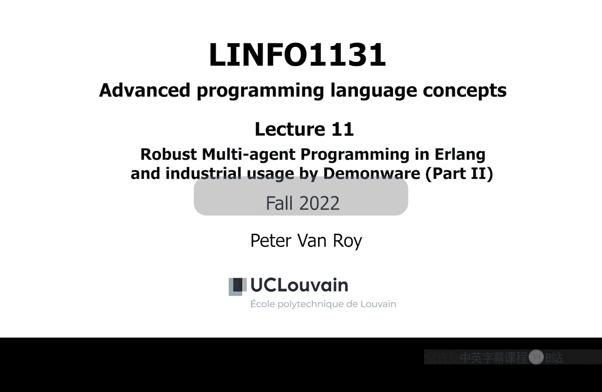
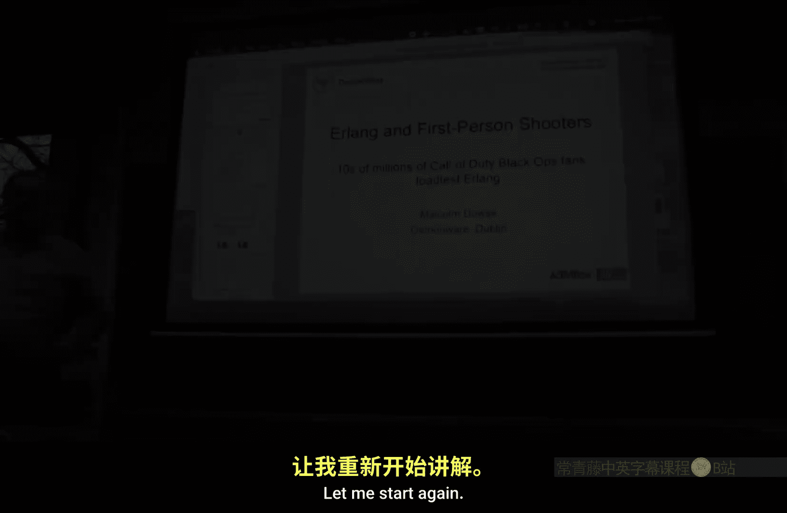

# 鲁汶理工学院【中英⚡高级编程语言概念｜LINFO1131, Advanced programming language concepts】 p39 P39 FO1131 Lecture 11 (2022) -BV1UDffBbEBZ_p39-

Of course。I'm happy to see so many of you。Many of you will make video on the video。Today。

 I want to continue finish talking about multi agent programming in。

I will start by giving you refresher。However works， the basic important concepts。

Especially the post of linking and also。Very quickly， Jim server and the patterns。

To get you back into the way of thinking。And then I want to talk about supervisors and I will show you the code。

The complete code of a simple supervisor， this is really the。The magic of airline。

 how the supervisors。Will it help make the behaviors reliable。And then in the second part。

 I will give you an industrial talk。This is the slides were made by an engineer from a company called De Ware。

 which does a lot of support for gaming systems， and this is a very comprehensive industrial talk。

To shows how airline is really used in a。Very complex and large industrial setting。

 So this is very and nice。 This gives you some experience how things work in the real world。Okay。

 so that will be the second part， so all of this stuff is not just theory。

 but it's really useful in practice。Okay， so first refresh refresher， but before that。

 a few seconds of respect for the Ukrainians who were fighting for their freedom and for our freedom。

Okay， let me first refresh you very quickly， I'm not going to go out through everything。

But I will refresh you on process linking。And the gen。So let's go to the lead game。

This is the basic mechanism that's used to build what I called the deep magic of airlinee。

 which is the supervisors and the behaviors that are supervised。The basic mechanism is the linking。

Where two processes are linked together。And when one process terminates。

A signal is sent to the other one， and this is transitive。

 if you link many processes it makes a set of linked processes。

And we distinguish between normal exit， everything's fine， which just terminates no problem。

 The exit reason is normal and so it。It could be ignored eventually。

 but if there is in any kind of an error。Runtime error， hardware error， software error。

 anything that causes the process to fail。The exit reason is given and the consent to all the linked processes。

So I said， its transitive。And a process can also not terminate when it gets the exit signal。

 but it can receive it as a message。Which means it can observe。The failed process。

 And this is a really important basic mechanism and it works because the processes are independent。

 remember， I said there's no sharing， there's no pointers， there's no shared memory。

 Each process is an independent little island。嗯。And one process can then observe the other。

 and this is the mechanism， this is all you need。This and the message passing is all you need to build the magic。

The real strong magic of earth。Okay。That's one thing。I want to refresh you on it。

We go for a little bit farther。I want to， so Airling has a certain philosophy。

 know that failure should be very simple， fit fast。

 the number of failure modes should be very simple。Let it crash。

And let you refresh your memory on the concept of a behavior。

 a behavior is like a programming pattern。But it's not just disciplined by the programmer。

 there's a software library that implements。The behavior。 And this is a concurrent。

Full total pattern， okay。The airline， when you write an airline program。

You don't use linking yourself， you don't actually send， even send messages yourself。

 you use the behaviors。And the airline platform OTP provides five behaviors that are standard four that are part of the application and the fifth one is the supervisor that's what I want to talk about today this one is connected to all the others so there's a lot of very clever code behind this。

Fcade， all of these other behaviors are supervised。 Okay， and the three important ones。

 And it's basically onpo leader is the generic server。

The generic event handler because events can travel in the system and the finite state machine。

 generic finite state machine， so this is actually very general any computation is modeled as a finite state machine so a state and an event gives you some actions and a new state okay so this is the core of the computation and then there's the two others are for how things are communicating and then there's the bundling of everything into an application that can be started and stopped together and this is the application behavior so these five behaviors are really the core and they're built on top of。

The simple message passing， making stuff。诶。That's the second thing。Now I refresh your memory on。

What we saw last time， the generic server， I showed a very simple generic server。

So let me just give you this picture first。This is generic module。

 so this is part of the system okay this is part of OTP。

 the generic server and you can use it and this one。

 the specific module module is what the programmer writes。Okay， so the programmer。

Calls the server starts to stop called， but the server has callbacks。

 so these two interfaces are part of the server。So the server interface。

 you start to stop and you call it and the callback interface， and that's all you have to write。

And the rest， the external interface is defined by this specific module。

 so basically all you have to do here is define what is the external interface and what is the actual computation。

 how you initialize something。How do youd actually do a computation handle and you terminate。

 so it's very easier， you start， you're working and you stop。So this is the generic server。

I showed you the code of a simple server， this is very simple one， okay。

 just to show you how you can separate。This specific stuff from the genetic stuff， but this one here。

It does not use a supervisor， the real Gen server， Gen server is supervised， okay。

 it's doing much more than this。Even though from the outside， it still looks very simple。

 so this guy is doing a lot of stuff and is supervised okay， for falls。诶。

So that's the second thing I want to refresh now I want to talk about two things， two little things。

Programming patterns， little programming things。That I didn't talk about last time to refresh also your memory on how。

People， you think how programming is done in their life。So here's a simple。Example。

 so message passing。You send message from one process to another， and sometimes you wait for reply。

 but sometimes it's tricky。 says hidden difficulties。 You can have race conditions sometimes。

 and I'll show you one of the problems of message passing when you get。When you want to do。

Call and get a reply。 This is done internally by Gen server。

 So the programmer doesn't actually have to do this。 The Gen server will do this。

 but it's important to know how it works。Okay， so here's the problem， so I have a client。

And I served。The client sends a requests to the server and gets a reply back。Okay。

 the client here sends a request to the server， so this is a tople and gets your reply back。

 So this is a very usual kind of pattern。In Ireland。But what if there's another guy。

Sending a message that has exactly the same。For as this replied。

How do we make the difference so this is kind of a race condition up you see this one is doing a request。

 but what if somebody else just sends a reply there， how can we be sure。

 how can we guarantee that this won't happen you see that because this reply might arrive first？

And then it gives a problem。 Okay， so here's another one。 This is sending reply。

 but this reply is maybe not the reply coming in from the server。

How can we be confident that the reply is actually coming from the server？And not from somebody else。

But with this code， we cannot do it， so this code is actually bad。透。But we can solve this problem。

 We can make sure。That the clients that they probably know it's coming from the story。

When you imagine how we do something like this， you didn't see how would you fix that problem？

How would you make sure。It's actually very easy to fix it。Okay， do you have。

 can you think what would be the way to solving that？You see the problem。

 so you somehow have to distinguish those and the idea is kind of to make this one unique， yeah。

Another content with a state that is only known to they Yeah， something like that。

 so you put something in here which is only known to the client。And that's very easy to do。

 You have to put some kind of a unique thing， obviously this is sometimes called the nu or some a unique value。

 So here's the fix。airline has a function called make ref。This creates a unique constant， okay。

 what they call a unique reference which cannot be made forged by anyone else。

 notice this is very similar to what we used the name of the concept basically the same idea。

And the fix then is you you create a unique constant ear ref， when you send the message。

 you send a tuple。Instead of just your own PD， you also put this。Unique constant in it and the reply。

 this tuple has an extra field， which is going to be the unique constant that means the receive。

 remember how the receive works with pattern matching， it can take messages out of order。

 it will pick the message that has this constant。So if there's another message。

 here's the fake message， Jen reply andre this is just an Adam， doesn't do anything， reply。

 it will not take this one， okay？So the receive will take the first message that matches。

 noticeice it's very important that the receive。Takes any message in the mailbox out of order。 Okay。

 that lets you。It doesn't matter which order these two messages are in there。

The receive will always pick the good one because of this unique concept Okay。

 so you see this is one way of making the messages unique and this works also because of the receive。

They can remove messages in a different order。This technique would not work for poor objects which received messages in the order。

There you would have to。Do something else， okay。But this is a simple pattern。That works for ErL。

 and this is used all the time to guarantee that the request reply is never corrupt enough。

 it's a secure request。So that's a simple pattern， so you see the kind of thing when you really do multi agentent that you have to worry about。

Another thing I want to talk about is synchronous and asynchronous calls。

So this is very simple and when you do。When you call， we send a message from one process to another。

 sometimes you need to reply and sometimes you don't okay sometimes you have to wait for a reply。

 and that's called the synchronous call and sometimes you don't。

And so the gen server will give you two patterns， to interfaces， which are called call and cast。

 So call here is actually a。A round trip， it waits for a return value。

 if you remember the frequency allocate example we did in the jet server， we use call， okay？

So notice， let me just go quickly back to the code for that。So notice when we call this。

 this is the specific module。Generic module， we use color， which means we need roundtry。But actually。

 for the delocate， we don't actually need to get a return。Its just enough to send the message。

So go back going back here， if you want to do an asynchronous call。

 sometimes you send a message but you don't expect to reply so the Gen Surer has another part of the interface called CA so the idea is cast when you cast this you just throw something you don't wait for a reply okay so the idea is you're just sending it and you're not waiting for a reply。

And the decate in our example， it could have used CA actually， I showed it the call。

 but actually if you want to make it more reasonable， you don't have to wait for a results so its。

Okay， so that gives you back， so this kind of stuff is automatically done out the behaviors。Now， now。

 let's。Go to。Building a supervisor。So first I refresh you on the supervisor concept。

 so the supervisor is really a key concept in para。

It is the concept really that makes airline a complete and very nice system for building robust software。

 okay so a little bit of motivation。So we're building concurrent distributed systems with failures。

Most faults and errors are transient， that means if you retry， the system will work， not all。

let's say 80 to 90%， but the others are not， but that means if you can already handle these。

 you will already have a good start so that simple retry is actually a very good strategy as the first strategy。

And supervisors started out like this。And then it was elaborate you can do much more， of course。

 but the basic design lets you very easily do retryry。Okay。So you have a set of workers。

They are supervised， so supervising means that there are processes that observe the workers。

 but only the failure of the workers， they don't care what the workers are doing they only worry about failure。

And the supervisors have authority that means they can stop and restart， they can control the。

Working of the supervised processes。And it's recursive， okay。

 the supervisors can themselves be them sort of okay， so it's a treat。

And the supervisor trees that are implemented， actually。

 it's kind of tricky to implement them if you really want to do it well。

 because when you start up the supervisor， you can imagine you have to start it out exactly right or what if there's a failure during the startup of the supervisor so you can see it's not so simple。

 but no problem， no worry， this has already been done。This is implemented in the OTP。

 so you don't have to worry about that。 problem This is already solved， okay。Okay。

 so the supervisors make a tree。You have supervisory node so the root node is the top level there is a top level supervisor and the internal node so this root node of course is very important if that one fails then you're really dead okay so this is typically an extremely small and very well tested piece of code。

So that's a very important thing， but it's usually extremely simple， this root no。

And so a supervisor has child processes。And all behaviors， the other ones。

Are designed from the start that they can all be supervised， so this is built into the system， okay。

And when a supervisor wants to restart the word Bruce， it has a strategy and their basic strategies。

 there are four basic built in strategies， one for one， one for all， rest for one。

 a simple one for one。So which I will explain。And you。

 the basic strategy is just to restart when there's an error。Many errors are transiented。

 surprisingly effective。This is something well known by people who use Windows。

If you had a window system as a problem， we just reboot。

this is kind of a running joke for Windows system， but it's a good strategy。To restart。But。

You have to。You have to carefully design it。You don't want to reach time forever。

The number of restarts is limited， so you don't restart too fast and the number is if the limit is exceeded。

Then the supervisor will terminate and there's a higher level supervisor says，ooh， there's another。

 it's another problem， okay， so the basic retriice strategy is only the first level， okay？And maybe。

 for example， there's a disc and each time you reboot it， it crashes again。

And this might happen once because it' is a piece of dust。In there and it works。

 or you have to reformat it or something， but then at the higher level， if something goes wrong。

 you might have to reconfigure the system to remove that disk so that's something that's done at a higher level。

Okay so the supervisor has this hierarchy。So here's some example。

 though the squares are supervisor processes and the circles are the workers。

The work is our standard behavior。 This could be Jen Ser。

And the supervisor so here one means it's a one for one and A means it's a one for all of explaining what it means。

 okay， so one for one basically means the children are independent and one for all means they're collaborating so if one of them fails you have to restart all of it。

So you have this hierarchy at each。Supervisor observes the children。Be of beloveds and workers。Okay。

So the two basic strategies are one for one and one for all。If any child dies on for what。

 it is restarted automatically by the supervisor with a consistent state。

And the others are not a thing。This happens when the children are doing independent things。

 you do that。And one for all means if any child dies， all the children are restarted。

Because they are working together in a consistent state。

 so this uses the stable storage when you restart to put everything in consistent state and there's actually two more strategies。

 so the one for one and one for all are shown in the picture。There's another one。

 rest for one is if there's a sequential dependency。If the， if the child fails。

 preciouses all the children that are started after。

Are restarted because there's a sequential dependency， maybe that this guy， this worker。

 has created like some。Contracted things to others。 So if this one dies。

 all the subcontractors have to be restarted， but not the previous ones。 Okay， so let's rest for one。

And simple one for one is a dynamic version of。1 for one。

where you can create new children and stop new children dynamically during execution。

 so really you have a bunch of independent processes that you could always start in stop。

So this is a more dynamic version of the one for one， okay， so that's idea， so you get the idea。

 but I'm going to show you the code of a supervisor now。And we go through the code in detail。

This is a very simple supervisor， but it supervisors， it doesn't follow anything。

So you have a supervisor with children。If the child terminates abnormally， it is just restarted。

 looks like one for one。If it terminates normally， it's removed from the supervision tree。

 so nothing else happens， so there's no further action， nothing happens to the others。

And if you stop the supervisor。You say I want to stop the supervisor。

 it basically stops the whole application， all the children are terminated。

 okay so that's a very simple supervisor and of course you can do much more sophisticated stuff。

This supervisor assumes。That nothing abnormal happens when the supervisor is starting out to children。

And so the real supervisor has to do that a little bit more carefully if the supervisor cannot start up normally the whole startup is a。

 so that means that the supervisor could not start。

 so it only works if the supervisor can actually start with children， okay？

And each child is started by calling a function， an airline function called apply。

Where you have a the module， a function and the arguments。

 So this function is the one that actually createates and links。The child to the parents， okay。

And we used linking for this， remember all linked processes， when the supervisor terminates。

 the linked processes will receive an exit， so this example is taken from a book called Designing for Scalability with He OTP by Francesco Carinni and Steve Minowsky。

 this is a really good book。And I'm only given a small piece， it has many。

 many code examples and a lot of very good explanation of how everything works， the philosophy。

 how everything fits together， so if you want one book on really understanding how Earlla does everything。

 this is probably the best work take for that。So I know France Francisco and he was be very happy complementing his book。

So here's the code。This is the complete code。And I'll explain how it works， this is a module。

 I call it my supervisor。It has three。And calls three functions that are exported， start。

 which starts up all the children。Initialize。In it， which initializes the loop。

 normally you don't need to call this one， but it's also exported just in case and this one is the stop。

 okay？So how does it work， you start up the supervisor， you give it a name， the name is registered。

 I didn't refresh but remember register as a way to even name。To a process， like an atom。え。

I will now create a new process。And this question module is a macro。

 it basically is just the name of the module， so itll be my supervisor and it will start a process and call in it。

With the argument is the list of child specifications okay so when you start it out。

 it starts this and then this one returns okay and PAD is basically the actual supervisor process okay now in it first of all。

 it sets that trap exit fact to true remember this means that the supervisor will not fail but receive messages and then it starts this loop。

So it's like a server loop， but this is the loop here。I explained in a minute and。

 first it calls the function， start children。So start children here。What it does is。

 so this is a very compact kind of a code， this is a list comprehension。

This will take this list here， child Sp list， it will create a new list。

For each element of child specialist， it will do something。 So it will child specialist is a list of。

Tuples that are triples， module function and arguments， or argument。

 and this one will actually create this function will create a child。And here I have a tuple。

 so the brace is a tuple one。So I'm creating a list， so the bracket is a list。

 I'm creating a list with two element temples， the first element。

 first I start the child by calling a apply。This one will return OK PID， but I only need the PID。

 so I'm taking the second element of this double element two。

And then I also have MFA in this couple here， because I need this if I'm going to restart the child。

 the children， Okay， so I have a list of tuples。Wwhich have two elements。

 the first element is the PID of the running child and the second element is the original child specification Okay so that's all the children are now started and this function when I will actually spawn and link so this is child specification all these children will be linked。

To the。The process that's doing this， so the supervisor， okay？And then this is the loop。

 so a supervisor， it's kind of like a server it handles messages coming in and what are the messages。

 Well， the messages are they exit messages from the children， okay。So there's two exit messages。

Exit PAD normal and exit PAD with some reason that's not normal。 So this normal is an atom。

 so this one will impact match first。So if a child terminates normally。

Then the supervisor will automatically receive this because of the linking。

And all it does is it removes that child from child list， so the loop has an argument。

 which is actually the list of PIDs or actually these coupleples of the children it' supervising so if the child terminates normally just removes it。

 it uses this paradigmline function he delete， which you're not going to imagine how it works so it will basically remove the element from the list。

Okay。So child is getting smaller， that's this one， second one， if the child crashes。

Any kind of failure， it does runtime error or whatever。

 then it get this message and reason will be different from normal。

What do you do then so if the child has crashed， remember Erling has this let it crash。Philosophy。

 any failure you crash so we know the child is crashed。So we restart the child。

Here we have the PD in the child list， so here is the function restart child。

So basically you looked up， so PAD is a constantor， it's the ID of the child。

 so we look up the child。Is here。From this one， and we create a new child。

 this one will have a new PAD now whenever you create a process， it's new。And then we call P replace。

 which replaces PID entry by this one。So remember Chillist has these tuples on， the PID and the MFA。

 which is for restarting it， so it replaces the PID by new PD。

 so this has basically restarting the child and it has put the PD of the new child in the list， okay。

And now I'm calling we're personally looped with the new child list。

Which is returned by research child。That's very easy。

 and the final message is stop that this message comes from。The outside， other should be lowercase S。

 this comes from the outside。 this will terminate so I can stop the supervisor。

 all of the children at once from the outside。So basically the determination， it will do a for each。

 so we'll go through all elements， all children， and it will basically kill them。Actually， very。

 that's very murderous，You're killing children here。Actually， this is kind of funny because the book。

The book that I just mentioned， it has a box saying，Be careful。

 people don't like when you say you're going to kill children so don't say that， okay。

 but that was the original terminology E was done like in 1988 and they were not so politically correct in those days okay so this is the full code。

Of the supervisor， so you see how it worksh？And so you have I expect you to understand how this code works。

 so this code is actually not so complicated， right？Note that you have linking。

 you have higher order。And you have this notion of separate processes with message passing。

 you can do this fairly simply you see that so I added a slide I'm going to put this new slide on the moon with some explanation because I realized that maybe this is a little bit complicated to understand like that it has things in it。

 so I added a slide so the question module is just a macro so early has this macro system values is the name of the current module。

So list comprehension is something that's used here。So Er has this concept of a list comprehension。

Where you can create lists。From other lists。Okay。And I'm explaining here what App does。

 what element 2 does。And the function F， this is the child specification。

 it spawns the child and immediately makes it to the parent， so to spawn and link。

 here's what it does。ok。And the supervisor loops， so this loop function here。

 so it kind of looks like a server， it has a loop。A couldlo who sit always doing something and waiting for things。

And the argument is a list of tuples， so these are pairs。

 the running child PID and the module function argument which you need to restart the child， okay。

So you see how that works， so this seems very straightforward， right， doesn't it simple？

But it's very powerful。 this what I'm just showing here is the foundation of why airline is so powerful for building robust systems。

Okay， let it crash， no sharing and supervisors。ok。So just to summarize a little bit。

This what I showed you is the generic part， I didn't actually show you what the children are doing。

 the code inside the children， I didn't actually show you anything but in the book by Carerenian and Penosky。

 they they give examples of what the children could be doing， you for example。

 it might be doing the frequency allocation， okay？So you spawn supervisor to Jane Clark。

 start children， you monitor， restart， clean up， so this is all generic stuff。嗯。

And the specific child to child dependencies， maybe the children depend on each other。

 that might actually affect the supervisor， what children， okay？

So there's a generic part and a specific part。ok。So that's how the supervisor works。

And this gives you a simple example of a supervisor and the rail supervisor just builds on this and it does much more than this。

 but it's just as easy to use， okay？Now I mentioned the second part。Of the supervision in airline。

 which is the stable storage。So， this is。Done here， you restart the children。You have to restart it。

 here it's nothing special， you have arguments， a， but really in real life the children might actually be doing something in the real world it might have some stake。

 maybe it's doing that phone connection spending money or whatever。So there's some stable storage。

So it's not enough just to restart the initial arguments。

And so then the second part of supervisors is the stable stone。

And airline has a really good support for that， the basic simple support is called ETS airline term storage。

This allows， this is the very fast stable storage when a process fails。The ETS does not disappear。

 The ETS is like it's like the global in some sense。

 it's kind of like global variables that are stable， it's in memory， so it's not in disk。

 so it's not as reliable as disk， but it's extremely fast， so this is the fastest version。

And that airlineline has more。Slower and more reliable functions。 So the ETS， then you have disk ETS。

 Dds， and then you have Indonesiaia， which is a full fledged transactional database。

 But here I just mentioned ETS because it's the one that it's used most of the time first。ok。

So the ETS is in memory。When the process crash， these ETS values are unaffected。

And you can actually the ETS tables are also managed。咁几。

So it's typically managed behind the supervisor。Not by the child process。

Because when the supervisor stops。Then the ETS table is deleted。

 so theres no garbage collection of ETS tables。 It's managed by the supervisor， okay。

 not by the child process。ok。And so this is the second part of the supervision nu。

Supervisor and stable storage。给。ok。Now let's take a step back and compare this。

 so later I'll talk about industrial use of air right now。

 let me just let's just think about it a little bit。So supervisors handle the errors。

When a child process has an error， it is designed to immediately crash。

 it does not try to fix the problem or remember the example of the surgeon who did the appendix side that remove his appendix on himself the child process does not do that that's very bad no't want to do that this child process immediately crashes and the supervisor does the rest so the child will not try to fix the errors。

So all error conditions are mapped to one。Failure about action， which is depression。诶。

So no defensive programming。It used to be that when you write programs， it was。

Kind of recommended to doing defensive programming， which is putting checks。

The children will be checking a lot of things。And there's actually some studies。ok。So for example。

 here's one done where you compare a system which is done in C++ and in airline。

 so the same functionality， so this is an example done at Motorola， two way radio communication。

So if you look at the airline implementation has 85% less code。

Which means it's like what6 of the size， 20%7% of the C++ code defense was error handed。

Whereas only 1% of the airline code met me。Okay， so typical studies， they show like the same results。

 so for the same kind of fault tolerance。The airline code tends to be a lot smaller。 You can say。

 so Ericson his study here。Wwhich isplex， which is a kind of imperative language and。

 local kind of eson language， and they also saw an enormous increase。

 tenfold decrease in the code size so you can say wow， that's amazing， I it really true。

 Why isnt everybody using airline with？Actually， airmen is used a lot。

And I will show in a minute that games gaming is an area where airline is used a lot。

 it's used a lot but you really need the thought， so the answer is that is used a lot okay？

So that is the conclusion for the first part。So from last week and this week。

I showed you the airline plus OTP， the behaviors。The primitives， so it's two levels。

 there's the primitives。And then there's the behaviors。

And I showed you the primitives because this is a course where I want you to understand the magic。

 but a programmer will only see the behaviors don'。

 so a lot of effort goes into the designing and the improvement of these behaviors。

So all of the work of the OTP team， most of it was in building the behaviors， okay， server。

 finance day machine， vent handler， supervisor trees， and the stable storage。

Is a very important department。The ETS， DTS and Venetia。Okay。So this is the conclusion。

 so you have here a system with the primitives and the high level concepts for building concurrent disturbity systems。

Okay。So that's the first part。哦这个。Of today's lecture。The second part will be。

Explaining I will give you an industrial。は？So this is important and this is a reality。

A real industrial experience。OkaySo there's many talks on airlines。

 so there's a lot of industrial conferences， things there's a conference called Code beam， which。

It's like twice a year， there's one in Europe and one in the United States。

And so this is a talk Pe chose， this was。In a conference called Earlling Factory。

 held in London in 2011。And it's called Bling and First Person Shooters。Okay。

 and so this is by a guy from a company， Malcolm Dallas from a company called Deware， in Ireland。

 okay？But maybe and this gives you a lot of industrial experience， maybe I get break now。

Very exposed， and after the break， I'll show you really get into the nitty degree of industrial。

And肃精。Let me start again。

This is a talk。This was what I'm going to present now。Is。Was a keynote talk。Done by an engineer。

 Malcolm Daos at a company called Demon Witter。Whi is based in Dublin。

 Ireland in 2011 in one of the main airline conferences。

 and those days it was called airline Factory， like this was in London。

Tens of millions of carlo duty black ups standss， low test error。

So this guy has given his industrial experience。And in several parts， first， the history of Deware。

 how did this company start？How did they get into airline， what are they doing？

So that's really interesting if any of you want to start company to see the experience of these guys。

The second part is how they use Earl now。Now this is 2011。

 it's still true today and what we have learned， so the lessons learned， mistakes they made。

And fixed。And things they would like to add。And what are the nice things and what do they especially like about Ima。

 so both the good note of that。Okay， Deware is a company that supports gamess。

And they do a number of things。Middleware for client， client game state transport。

 so you have two gamers exchanging data， you have encryption， you have NA traversal。

 these slides are on the Moodle and I've added some text in red on the bottom to explain some of the terminology that maybe you might。

All is familiar with， so when that is a network address translator is basically changes the IP address from inside to company or the house to outside。

Because they maybe be don't use the same My space， and so you have to manage that。Also。

 connection management peer to peer， peer to peer is that the clients are talking directly without contacting a server。

But you also have star anthology， a star where you have one server in the middle and all the clients are talking to the server。

 even when they send messages to each other， so you have both of these。So deep supports that。

 that's one thing they do。They also have， they basically support everything that is done。

 that is outside the actual game engine， so you know a game has a kind of a physics engine inside that models the real world to some degree of accuracy and all has all the game logic and it's very highly optimized so this part is non written in airline。

 this is a special， this is a very specialized high performance kind of engine。

But everything around that is what Deware does， and this is called the lobby servers。

 so before getting in。You go to the lobby server， so things called matchmaking， leaderboards。

 statistics， messaging， audio， video， websites， teams， and also things against cheating。

So the lobbyggage service is what allows players to meet and arrange the games。

As opposed to the game server that actually run the game。

 so you basically have lobby servers and in the center you have the game service。

So all of the stuff around the game server is what De War does。Okay。

 so how does this company started？It was founded in 2003。Development middleware for games。

 so basically a bunch of。Developer students， actually， 2005， they started hosting lobby servers。

In 2007。They switched to using air。And which I'll explain how that happened。

 they were then acquired by Activ， Activision Blizzard。And in 2011。

 they're one of the world's largest online game service providers that doesn't mean much in numbers of employees。

 they have 60 employees， offices in Dublin and Vancouver of Bay。

This is some games that use them this may have used some of these games， I don't know。

 call of dutyty， you've heard of call of duty， I guess so there's most of the call Lib games and also other ones。

嗯。Are using software from Deware。So there's a lot of support for games and many more。

 so Deware is really a big company for support， all the things that go around today。即嘅。

So that's even where。So what do they support。The full online infrastructure for C of dutyy Black Ops in 2011。

 this was the world's best selling game。Four of the top 10 games on Xbox Live。

Over 2 million pinnedcur userss， it's not bad for a piece of software。

 150 million registered users and its cross platform。So a bunch of hardware Xbox。

 the PS3 in those days， the we in those days。嗰仔。Coming soon three days。

But that is still going on today。How do they get into airline， Okay， so that's an interesting story。

So here it's very interesting， maybe for you guys， in 2003。

 it was founded by students from Trinity College， Dublin。Okay。

 so you can see that this was a bunch of students。They wanted to sell clientside。

 networking middleware to game studios， they thought how we could build support for games。

One year later， it didn't so far didn't work out so well， lots of polite interest。

 polite interest means oh yeah， looks very interesting。 goodbye a few customers。Okay。

 but the game studio was one。Online servers， they didn't want middleware。

 so they started creating this lobby services platform。ok。Xbox and。PlayStation， okay。

So Xbox live was kind of the standard in those days。So they started by using C++。Okay。

 and my SQL minusQL， so minusQL is a relational database management system， open source。

 very popular。Okay， so they made a C plus plus server。Kind of where single threaded。

They created somepro for service， and the application logic was in Crus bus that used my SQL。

Now this was their first date， so this was actually not very good。

 one OS process per connected user was not very good so you have like 80 concurrent users maximum。

So but the first game that they connected into did not have so many users。

 so also C plus+ crashes a lot。If the code is immature。

 so you need to do a lot of testing and debugging and testing and debugging。

 So it crash if the code is immature。And because code was im matureature and you crashed a lot， okay。

 so this was their first thing。But then they did better。They used Quick Python in the middle。

 they regrow all the C++ logic in Python， they maintain a pool of OS processes。

 a core server and C++ now they're able to handle thousands of printcurrent connections。

 they encrypt encrypt， dispatch they have messages， asynchronous messages。

 they even have some cheat detection licenses， duplicate login。Connection。

 but the code was very complicated。So C++ is no wrong language for concurrence the end it was very hard。

 the code was very complicated， impossible to maintain poor error handling， debugging was very hard。

 metric scalability was very hard。Whenever they had to change the configuration。

 they had to disconnect all the users。So note that an airline wouldn't have to do that， okay。

 so problems。Problems。Okay。So this is now in 2007。One of the former developers just。By。

Some kind of an idea rewrote the server and airline just to see what it would。

That's the server in the sequence plus。And after a few weeks。

 he got this prototype and it was running。Oh， and it looked nice。And then then they said， hey。

 let's turn this into something real and they took them four months。

Of development to turn it into something that was able to go live。 So in mid 2007。

 it was used for the first time。 see you know， it went， it's just somebody said， well。

 we're having so many problems than C++ Let's just try Earl seems to be maybe better， we'll try。

 okay， so they tried and in a couple of months， a guy actually got something nice。Okay。

 so some of the improvements， so it didn't crash， that was amazing。Configuration was easier。

 they could reconfigure everything without affecting the clients， amazing。Hot code， you can run it。

 refiuring that clients don't see anything。The logging administration is better。

 faster to vote far as he lines to go， so this is the industrial guy who's talking here。Okay， now。

 2007。Okay， still very small company， they have now several bunch of customers。

 so they have this nice lobby server now it's written in airlines working nicely。

 they have some customers， nice customers， Activvision， Yubisoft， etcter。

Activision like like did not acquire them。They had a few big games。You may know some of these。

But still no monster blockbuster。 so in 2007， they had。Games with 20，000 users it not bad。

 but it's not the huge blockbuster yet， and it's still kind of a tiny company。1even developers。

 three person handling the operations and three managers， that's kind of small。

So this but still there would be stuff。Then they get a real challenge。In 2007， a blockbuster arrives。

 This was call of duty4， okay？그7。You may remember it， I don't know。

This was the most popular game on the PS3 in those days。But for them。

It was lots of pain and suffering， so they have the system with 20，000 and it was working。

And then this huge thing happens。 A number of users was always growing， growing， growing five months。

 every always growing for five months。 New bottlenecks。 every weekend， things were going wrong。

 They had bottlenecks to solve lots of outages and late nights。 So this was like growing up。

For the company。Okay。They had to grow up， so before that it was a small company。20000。

And now all of a sudden，ooh， they're in the big leagues okay and so Earle actually caused few issues。

 they were able to scale up and they kept all the Gerline code so felt the switch to Erlinge the crisis could have been a real disaster。

 but they actually survived this crisis and actually got bigger and bigger。Okay， continual growth。

From 20，000 to two and a half million concurrent users slot。

 okay the number of requests per second of their system from 500 to 50，000 the number of servers。

 so you have lotss get millions of users， but you have a bunch of servers。Okay， the original。

 they have 50 servers， now they have 1，850 servers。Talking to each other， that's big system okay。

 and then the company grew its staff from 17 people to 60 people。

 still not that much job for something like this， spread evenly between Vancouver and Dublin。

 so Canada， North America and Europe。Also they grew incompnce， they' really matured。

They added many new features， services。In 2010。There was the Black Als launch。

 this was an enormous state， so it was a lot of work for them。Okay。

 so the core of this thing is airline with Python and MysQL。But many other pieces， so not just that。

 is a lot of different。Of things， okay there。So how do they use early？

So now you see kind of the growth， you see these are a real company。

 and you see kind of how they grew from just a few students doing something to a real company playing in the big leagues。

 okay？So how do they use early？O。Okay， Erling is their core server， so it controls Python。

 so it's lots of Python scripts， it manages 1 hundreds of thousands of concurrent TCP connections。

 it schedules tasks for the Python code， it gathers metrics。

 so statistics on maybe there's bottlenecks， so you have the system has to measure itself。

It has a presence server， so this is a kind of database， this is using Mannesia。

 a remember that I mentioned this in Iland， a fragmented version of Mannesia。

 which means it has on different servers and all everything is done using message passing， okay。

They also did other things with Carolina。They made other kinds of servers for lots of extra kinds of things。

 transient in game data， through servers， testing bandwidth， leaderboards， ranking in real time。

So basically the errorom was used for all the concurrency and glueuing the sequential code together and sequential code could be written in Python or for other languages okay so this was basically the core server。

Controrolling the concurrence。だ。So how do they do some of the things， so the TCP connections。

 the test coning for each connected using user there are two early processes。

 so remember we have the supervisors all the workers。

So you have two processes that are handling each connected user， and they use a simple one for one。

 which means you can start and stop them。Individualduly。And they delegate to work。

 these processes delegate work to Python， actual operating system processes。

 and if so there's a large supervision tree here。They have dedicated task queues。

 so you have lots of things going on。And you can restart or update the Python code without affecting users so this is pretty nice and it's all controlled user carefully okay they also have periodic tasks。

Using time。So this is the kind of。Structured per user， how it's done。

They did something called a presence server。This is something that you need to ensure that a user cannot not be logged in twice。

And there's no duplicate license keys， I on PCCs。And who is connected？So this provides a snapshot。

A concurrent distributed snapshot of who is connected and also supports all the inga messaging， okay？

This is using an airline library called fragmented Mannesia where the Bellitia is existing on multiple nodes。

 so this one actually scales very nicely。And robust。And the z so they have clusters。

 clusters which are。Collections of computing notes that are tightly coupled。

 so their biggest cluster was at 60。16 core devils。 So this thing more than 6。

 this thing has more than a0 cores。 Okay， that's pretty big。If the presence over。

They also do metrics in a big system like this， the system is always measuring itself。

And seeing whether there's bottlenecks， so you have to keep track of everything。

And ErL has this SNMP， so network monitoring protocol libraries， so they're used。

 so they monitor the user request per second， request times， queuing times， logins。

 logouts per second， why the users get disconnected or thrown out。

SoAnd then they make these real time。Rs。And the most used thing is an ETS。Remember。

 the ETS is like global variables so you can update very fast， stable in memory。

 ETS update counter so they're counting so they're calling ETS update counter a lot so this basic little airline function is really called。

A lot millions of times， okay。And also between all the clusters， they're combining the metrics。

To generate overall metrics， so pro se cluster。Mets， okay。

 so here bottom you can see I had sometimes a little red text， simple network monitoring protocol。这是。

ok。Each game has a different configuration， can be very complicated。

All different pieces have to be connected together in the right way。

And so the airlinelift Code handles all this game configuration with all the different options。

 the defaults。Ssenttiation inheritance， if you want to connect one configuration。

 depending on another one， upgrades between clusters roll back on failure， so this is nice。

 so roll back on failure when there's a failure， the system goes back to a previous consistent state okay。

And something called puppet integration。Puppet integration so there's a lot of kind of jargon buzzwords in the industry and puppet integration is an approach for delivering and running the software the same no matter where it runs okay so it's kind of。

Independent of where it's running， okay？And a lot of effort to make this as simple as puzzlele。

Usually configuration is one of the hardest things。So， this was。Something they worked a lot。ok。

There was also web interfaces， lots of web interfaces。

 and airline has this generic web server called YaWS。Ys yet another web server。

And they use Eol level which has a very high concurrency。

 you can use have many tens of thousands you saw the graph in the beginning last week。

For the Web console， this is for the developers， okay。And live debugging。

 to debu while the game is running， you can also do development。Web services。

 you can control the game message of the day， you can remotely see how popular game features are。

 you can control the customers remote so there's logs of web interfaces。For controlling。

 for debugging， for developing， okay？And they have a lot of services related to the game。

One of the things people like is the leaderboards。So giving the ranking of the users。

 so these are huge laser beauty works with 15 million users ranked in real time。

So this is using the PTTS stable storage and a kind of a tree special kind of tree managing module。

Okay， so that a basic data structure that lets you kind of rank things and find out which is the best dynamically。

Okay，Also to have key value store， a key value store is like a database。

 Its like a hash paper where you put things in there。

 the key and any kind of value so you can store and update this they built it on top of ES。

 So this like a very simple database And this lets you do things like。grouprouping the users。

 keeping little groups， managing channels， presence information， so it's like a little simple。

 very fast database built on ETS。Okay。So a key value store is like a hash table， a table of values。

 it looks by a key。GB trees are general balanced tree modules。

 so this is a way of managing a large amount of data organized as a tree that is dynamically balanced。

 keeping so you can always know which are the best ones。Okay， so this is a module of early。

Other things they did was then with testing。UDP packet blast。

 it's a nice way I've called you send huge number of packets。

 throw them at an airline server and see what happens and the climate can get the estimate of the Ben group。

 okay。So that's services they did。Okay， now what lessons they learn so you can see kind of what they're doing with EarlI。

 so what lessons they learn about EarlI？Okay， so this kind of reviews the stuff we saw and it about earlier。

The core data types。Records not of those binaries， midstreams， we didn't use them so much， the refs。

 the unique values。The LO list， a special kind of listz data type。Second， think functionally。

 think concurrently you have to think concurrently so forget all the sequential stuff。

 tailorcursion functional in structure， higher order， so they use lots of higher order。

 new processes really are that cheap。 So that's something people who are used to programming genre don't really believe that a process can be extremely cheap and they really are。

 he says okay。So simple things can go a long way。咁其咧。That you have a couple of ur features here。

 so Iollist， so this Iol list is a list to elements of integer， binaries or other t ol lists。

A Colel pole。Is。The current poll the file the scriptors。

So this increases IO performance with many descriptors， so it's operating system technique， okay？

So don't forget to read the red stuff。Underneath。Okay， now OTP， this is the behaviors。

What they find is。Use it， okay， religiously means only it and use gen servers， use the supervisors。

 avoid touching， receive and send。Don't actually send messages yourselves。

 do everything with behaviors。Don't do Spwn yourself， Spwn Li。

 which spawns and makes the leak at the same time， don't call trap exit， all of that is done inside。

To behave， so really use the high level stuff， okay？

Also split reused components into their own OTP applications if you have pieces of a system that is reused。

 turn it into an application and OTP supports。Applications， okay。Also the modules。

 earlyling is organized with modules。Keep them small。

No kicked non side effecting they don't they don't have side effect， they don't update global state。

嗯。Keeps them sequential， the concurrency is in the behavior， okay？

So the modules can be OTP behavior modules under the specific modules or simple nonside affecting sequential modules。

 so all the concurrency all the fault tolerance behaviors， yeah。Re me what OTP stands for well。

 it's the name that Erickson gave to the platform， it's called Open Telecom Telemunigations platform。

Because it's basically open source， so this is the name they gave when they made a public release。

So this is all the libraries， not just language， but all the libraries and system。

But they call it the open telecom platform because the original was for telecom。

And then there's another lesson， very general lesson， which is the kiss principle。

This is a very important principle， keep it simple， stupid。

 as slogan for system designers don't do things in a complicated way。Keep things simple， for example。

 avoid inter node dependencies。 dependencies are bad。 as general， say not just airline。 Of course。

 airline makes it easy to have connections between notes。 You just have PD of another one。

 or the node here is the computer，A single computer and a network of computers。

 they shouldn't depend on each other， so the no sharing principle， you have to use it also。

 not just let airline use it， you use it， okay。Avoid notes with special responsibilities。

 everything should be kind of decentralized。Okay， and you should expect that sometimes you have high laency。

 don't expect things always to run。Expect problems。Okay， interome network issues。Expect。

Problems because of dependencies。Complex inter process depend is very bad。

Be very afraid of processes which rely on each other。

You shouldn't have a bunch of processes all connected， that's very， very bad， okay？

And casts instead of calls remember， I mentioned casts and call。How is。Around trip。

 you sent and you receive， but a call is kind of a dependency。You call。And you wait for the result。

 so you're dependent on the other guy， so it's actual dependency and call。So what they find。

 these guys from even wear is you want to avoid that even a simple call can be nasty。

Because you wait for a result。What if no result comes？What if the other guy fails。

 what or something happens， so there's a delay， so waiting for something is very bad。Tasks。

 they don't wait。Cas you just， send it and forget， so casts actually are the way to do it。

 so your system should be asynchronous。Don't wait， Okay， the calls are waiting。 This is very simple。

 You think， why is this a problem Its so simple， It's a call， Even something so simple is a problem。

 okay。Because here， I mean， these guys have millions of years with then。

 even soft' problems can go into big problems，Okay， another lesson。Bottle length processes。

Now we're talking millions of users concurrently and there's been lots of processes handling linked this。

 What if one process is like bottleneck， it receives many， many， many messages？Huge number。

 so it is slowing everything down， okay？That you want to avoid it， avoid the bottlenes。

So you create a pool instead of one， you have several。

 and each one handles part of some of the messages。

 also make sure these processes are not actually doing so much work。

Because if they do work and they have many messages， not good。Okay。

 and manually purging the message to you。 So if there's a lot of messages coming in。

 sometimes you could get rid of some of them。Okay， so that's one thing。The second one。

 some processes do real work， they actually have to do work。Well， when it's doing work。

 leave it alone。Don't。Send messages to processes that are doing work seems very simple。Okay。And also。

 it decides when it wants to do more， don't overload somebody with work。

 but when that person is finished， that person with the process is finished， it asks for more work。

So you have a pull， not a push approach， but pull approach。you build big system。

Then each process will ask。For work。 And you don't actually push work。

 Don't stand work under processes， but wait for the processes to ask for work。

And that will let the system kind of balance itself， that really is important for big system， okay？

And some bottleneck processes are logging。A log of process。

 so logging is important because you want to keep track with what happens。

 so the log puts all the things that are happening to trace in a stable storage。

But if there's one process doing that， that process will get a lot of messages so you don't want one process doing the login or metrics。

 you want to keep track of performance。Also， if there's one process doing that。

 it will be overloaded， so these guys are important， but they tend to get overloaded， Okay。

 not important lesson。Okay， the stable storage。 So ET is not earn term storage。To listen is。

 ETS is great， use ETS。It's the standard solution for most of your in memory storage。

 it's blisteringly fast， they industrial people love to use the word blistering。

Blistering leaf fast so fast that you get blisters。Okay， it's also automatically cleaned up。Remember。

 I said it's connected to the supervisor， so it's actually deleted when you don't need it， okay？

It avoids single process bottlenes because the ETS can be accessed by many processes， okay。

Okay no monster crash dump so a crash dump is something that happens when system crashes and you have a huge dump of once everything what's in memory if you use ETS。

 then you don't have to do that so much all the stuff is in the ETS okay so use ETS。

 but ETS has limitations， it's just variables to of ETS， it's not a transactional database。

 Mannesia is a transactional database in their life， so don't reinvent manetia。

If you need transactions， use Netia， other use ETS。Also， what if you have a distributed system？

So ETS is on a single node what if fact multiple nodes， multiple computers？They have to store things。

 I have to make copies of the ETS tables， so you have to worry a little bit about that。

 but so that's a little bit harder。But the listeners use the test。Second lesson。IsMia。

 so I said there's like layers of database in airline starting with ETS and then D this ETS。

 and then menia， so the top one he tastes as fast but very primitive。

 the other one is slow but very sophisticated。Aesia is a very powerful database。It's distributed。

 it handles fragmentation andity's transactional， surreal， strong database。

 and it storess airline lengths data。And this is one of the main reasons they moved to airline they really liked Mannesia。

 but Manetia is complex， so this is a really complicated thing。

 big databases tend to be complicated up a lot of subtle custom code。It handles partitioning。

 it handles no death， I want to note crashes， it handles fragment distribution。

 how do you spread the database over multiple nodes？

So Manetia is kind of like a traditional relational database management system。It's powerful。

 it's fully featured， but it's complicated。And。This is the industry guy you will swear and pull your hair out。

 so I don't know if he was bald or something but。He pulls his hair out。But ETS is simple。

 but it's maybe sometimes too simple。 So you have this kind of dilemma。

 do you build something on top of ETS or do you use moneyia。Okay， so the idea is use Malayia， but。

Carefully， okay。ok。Testing very important。Automated tests。

 so you see that already here so this is the industry guide' saying it， they use E unit。

 which is the airline unit testing， testing full clusters。A system for stepping out modules。

Basically， making modules turn into a much exactly what that be sting out， sts。嗯。Faalult injection。

Killing random airline processes。 This is a very nice step。 You have this big running system。

With lots of early processes。Just randomly kill one。Or more of them， just start killing them。

And see what happens， that's a really nice way of testing it。Rdually kill the prothesis justin。

 and this is called fault injection because something else almost certainly will if you do that。

It keeps on working， then you're really good at them。Okay， I。

 there's pay attention to the dialolzer and FPf， so dialolzer and FPf are tools for airline for debugging profil type finding bugs。

And finally， end to end。L tests。You simulate 2 million users， so the test is huge。

Same where they have2 million simulated users of pounding on the system， okay？That's very important。

 okay？So these guys as you see， they're very serious， fault injection， heavy duty n blood testing。ok。

And a few other lessons。Keep your bsters apart。This is part of low dependencies。

Different localary networks， different cookies， keep your customers apart。

Beware of sharing course with other O processes， I identify multi corere。this score。

 and there's many OSs cur on there。Problem， don't do that。Okay， also process priorities。10。

000 relatively unimportant processes。Slightly inefficient， will clobber， will kill one vital process。

So a large number of unimportant low priority can actually affect an important process。

 so be very careful about that。Also， they talk about the hub ss。And the code replacement。

 so we saw that the primitives for that amazing， but often more effort than its's worth。

 don't do it all the time do it rarely， so don't be too。Enthusisastic about it。

So don't use it so much。And then things like kill switches， metrics， graphs。Okay， so a kill switch。

Is a mechanism that's used to shut something down in case of an emergency。

 so if something is going wrong， just shut it down， okay， lots of helper tools。

Remote shelves for looking for the binding。So this is all of the industrial stuff。

 so here you're really getting some real industrial lessons？Finally， finally， kind of a。

Political lesson。Be polite。 So airline is actually a small part of dealingware。

It's all the concurrency is done， so just three or four earning developers or doing all this concurrency stuff。

 all the other developers are doing Python and C++ and other things。

So your coworkers are not all airline fanbo， they don't care about airline like you do。

 don't force the user of your software to use airline syntax to read airline crashnos。

 have to understand airline code， so this is very general that don't force people to。

Do all your internal stuff， okay？Either you convert them all or you say well， it's a niche language。

 so airline is kind of a niche language it's used for small parts。

 but very important part to the concurrency， the fault tolerance。But that's actually。

 in terms of lines of code， it's only small parts， even though it's important。

So be polite because it's only one piece， okay？So that's the lessons。

Now they also have things they want to see in her。ok。Some things wed love to see。

 So these guys are really industrial users and。They want things。They weren things that didn't exist。

 maybe some of them have been added since 2011。They want improvements in Venetia。

Network outages no crashes， maybe combined Macishia with Cas room。So Casandra is another database。

 not only one， but has evental consistency and has good support for known crashes。

So they want eventual consistency。Automatic rebalancing。

And then they understand there's something called the cap theorem。Which maybe you have not heard of。

 has anyone heard of the kepts here， though？No， the CA care is a very important result in distributed systems。

That there are three properties that you want。Consistency that all your data is consistent with each other in a big distributed system。

 availability， which means that whenever you make your request。

 the system is working and answers your request in a reasonable time。And also partition tolerance。

If your system breaks into tubes， the network breaks。You want your system to keep working。

Now these three properties are all 3D， very important。

 but you can prove that it's impossible to have all three of them at the same time。

If you want a system that is consistent， available and partition tolerance， it's impossible。

 that's known as the CA theorem。That was proven in 2002， you can have two of them。

If I have partition tolerance and availability。But then maybe the system will be inconsistent。

 or I can have partition tolerance and have consistency。

But maybe sometimes the system will not be able to。

Relying when I make a request to it won't be available。

 so available as a formal concept availability means that if I make a request。

 the answer will come within reasonable time。OkaySo of course， they say we want Venetia to be better。

 but we know there's no magic bullet， okay？The CA fear was a general fear thats works for any distribution system。

Okay。What else do they want， automatic cleanup budget？Mnesia data。

Right now is not connected to the process responsible， so if that process dies。

 the mania data should be cleaned up。ok。So they kind of want that， want kind of extensions。

Were old and new incarnations of a node。It's the old for nu crashs and you have a new version。

The two have different data， okay， and you have to clean up the data from the old one。

 which might be spread around。Maybe you want that to be more automatic， okay？O。

Here is a very nice slide， they want improvements in OTP。

Here is this is actually what I like very much， receive， send， link， Sp is like assembly language。

It's very primitive。It's the primitives。Is the freedom don't want to use it？

But you still have to know how it works， but you don't use it。

 so what they want is more flexible supervision trees。Handcrafted dependency， they want better ways。

One for one， rest for one is kind of too primitive sometimes。They want better restart。

Remember I said the thing restarts， certain number of times。

 they want improvements like exponential backupoff， so exponential backup means whenever you restart。

 you wait a little bit longer。Or you multiply the timing。And this can reduce congestion， okay？嗯。

They want more ways supervised process monitoring can also be supervised， okay？

They want system messages to be handled quicker。Writing well behaved。

 blocking or busy process is messy， so they want a new behavior， Gen background scripts。我者。

So they want more from OTP。ok。Also， what they want is connecting Er to other languages。

E leg for them is not really general purpose， it's great for concurrency and hard con。

 but they would not use it for business logic they would do something else。

The ease of concurrency does not make up for the difficulty in interfacing with other languages。Okay。

 they want better interface to other language。 it's just too easy to moddle through without airline that meanss you can do all kinds of weird stuff without airline。

 it's hard。Because using airlinee is hard because of the inter， it's not the airline code。オ。

So scripting， they would like more scripting to be in early process， okay。

So and then there's a couple of themes， interfaces， so2 TP and J interface。同期。

Which I'm not going to say， but they want more connections with scripting kinds of things， okay。

Ar typess， st types， I camps。Maybe they want standardtype。Earling is dynamically typed。

 so it's strong but dynamic， which means that the variables types are not declared。

But there's a tool called dialolzer， which is able to do kind of a static analysis。Okay。

 so they maybe want more of that。They also want more dynamic features。

So they want something called monkey patching。So monkey patching means you can test the code that depends on global settings。

So you change it， so the code is there and you can tell you have to modify these global studies to make this code to test it。

But you want to do that only for the test， you don't want actually to permanently modify those Google settings。

So that is a technique called monkeypatching， okay？So they want stuff like that。

 so they basically want things like that。Chentler learning curve。Well， they said in airline。

 very hard things are possible。But very easy things are not easy， moving toin is a big commitment。

So they want more better guides， better documentation， improved syntax。

 actually this was made solved。Since 2011。Because now there is another language。elixir。

So maybe I'll make a picture here。So airline has a virtual machine called the Be。

And airline runs on top of that。But since a couple of years， there is another language。Called eixir。

 which was invented running on the same virtual machine。 So these two are interoperable。

 But eixir is more like standard。Python Ruy pan of syntax。

 and actually there's a largeelixir community， so the learning curve problem is kind of solved the airline。

 a lot of airline people using the beam using fault tolerance are usingelixir。Okay。

 and in addition to airline。做几。So that's something that they want。Okay。

 what do they love about parallel， its a little nice cute cat？Pretty much everything else。

 effortless concurrency， it is the complete solution for hard concurrent problems。

 So this is the industry gap says it， it's also open source。 Everything is visible。

 We can look under the hood， play around， you can do remote shells， easily lifeaver。

Robust and reliable。It's incredibly robust， in fact， no owner system is so robust。

They have these gameovers running for months。Without crushing。That's very normal。

 part for the course means it's normal。So they like that a lot， of course they complain of someone。

So blood pus。24 hour stepst， okay？Who said gamers are lazy for the past 24 hours。

 all the players in black ops have collectively killed more than the entire population of the USA shot 28 million enemies in the head。

 so this kind of statistics is maintained in airlineing， they shell out 16 billion euros in weapons。

 they stabbed 2 million enemies in the back。こにこれね。Okay。So to conclusion。

 airline helps make tens of millions of gamers happier across the world， and if gamers are happy。

 then we are happy。So Deware love airlineing and then they're hiring。

 okay so this was a keynote talk at an airline conference。

 so you have a big auditorium and there's like 500 airline developers there all doing airline stuff so of course there and those companies are all interested。

 successful companies are always。Interested in highway， okay， so there you have an industrial。

An industrial view on airline。So the guy is very honest though， the good and the bad。

But it lets them make very complex， concurrent， robust systems。So。

Hopefully when you guys later go into industry。Maybe you take a look at something like airline and not just stick with Cpl plus or child。

 okay？Okay， let me， let me stop there。