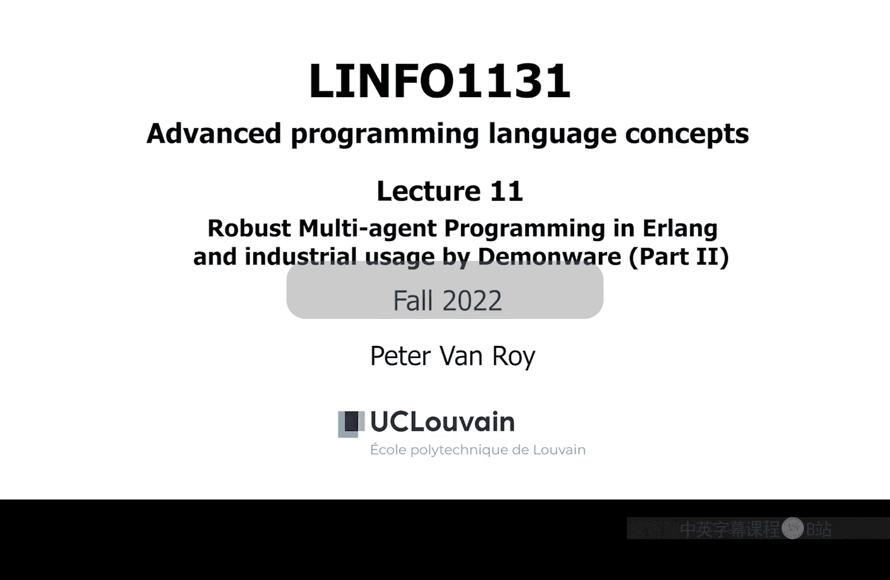

# 高级编程语言概念：11：多智能体编程与工业应用

在本节课中，我们将继续探讨多智能体编程，并深入了解Erlang/OTP中的监督者机制。随后，我们将通过一个来自游戏行业的真实案例，看看这些概念如何在复杂的大型工业系统中得到应用。

## 进程链接与基本概念回顾

上一节我们介绍了多智能体编程的基础。本节中，我们来看看构建Erlang强大功能（即监督者和被监督的行为）的核心机制——进程链接。

两个进程可以链接在一起。当一个进程终止时，会向另一个进程发送信号，并且这种链接关系是可传递的。如果多个进程相互链接，它们就形成了一个链接进程集合。

我们区分正常退出和错误退出。正常退出（退出原因为 `normal`）可以忽略。任何导致进程失败的运行时错误、硬件或软件错误，其退出原因都会被传递给所有链接的进程。

进程在收到退出信号时可以不终止，而是将其作为消息接收，从而能够观察到失败进程。这是一个非常重要的基础机制，它之所以有效，是因为进程是独立的，没有共享内存或指针。每个进程都是一个独立的小岛，一个进程可以观察另一个进程。这个机制和消息传递，就是构建Erlang强大功能所需的一切。

## Erlang哲学与行为模式

Erlang有一种哲学：故障处理应该简单、快速，故障模式应该尽可能少。这就是“让它崩溃”的理念。

行为模式是一种编程模式，但它不仅仅是程序员遵循的规范，还有实现该行为的软件库。这是一个完整的并发模式。

在Erlang中编写程序时，你通常不会直接使用链接，甚至不会直接发送消息，而是使用行为模式。OTP平台提供了五种标准行为，其中四种是应用的一部分，第五种是监督者，这是我们今天要讨论的重点。监督者与其他所有行为都有关联。

以下是三种重要的行为：
*   **通用服务器**：`gen_server`
*   **通用事件处理器**：`gen_event`
*   **通用有限状态机**：`gen_fsm`

任何计算都可以建模为有限状态机：一个状态和一个事件会触发一些动作并产生一个新状态。这是计算的核心。另外两种行为用于处理通信，以及将所有内容打包成一个可以一起启动和停止的应用（应用行为）。这五种行为是核心，它们建立在简单的消息传递机制之上。

## 通用服务器模式回顾

现在，我们来回顾一下上次课看到的通用服务器模式。我展示了一个非常简单的通用服务器。

通用服务器模块是OTP系统的一部分。程序员编写的是特定的回调模块。程序员调用服务器的启动、停止和调用函数，但服务器有回调接口。你只需要定义外部接口和实际的计算逻辑：如何初始化、如何处理计算以及如何终止。这非常简单：启动、工作、停止。

我展示的简单服务器代码没有使用监督者。真正的 `gen_server` 是受监督的，它做了更多的事情，尽管从外部看仍然很简单。

## 编程模式：消息传递的挑战

现在，我想讨论两个编程中的小问题，以刷新大家对Erlang编程方式的记忆。

第一个是关于消息传递的。你从一个进程向另一个进程发送消息，有时需要等待回复，但这有时会很棘手，可能存在竞态条件。`gen_server` 在内部处理了这个问题，但了解其工作原理很重要。

问题是：客户端向服务器发送请求并等待回复。如果另一个进程发送了一条格式与回复完全相同的消息，我们如何区分？这可能是一个竞态条件，因为伪造的回复可能先到达。

另一个问题是：我们如何确信回复确实来自服务器，而不是其他人？使用简单的代码无法保证这一点。

我们可以通过使消息唯一来解决这个问题。思路是在消息中放入只有客户端知道的内容。

Erlang有一个函数叫 `make_ref()`，它可以创建一个唯一的常量（引用），其他人无法伪造。修复方法是：在发送消息时，创建一个唯一的引用 `Ref`，并将这个唯一常量放入消息元组中。回复的元组中也会包含这个唯一常量。接收方使用模式匹配的 `receive` 语句，会挑选出包含此常量的消息。如果有一个伪造的消息，它不会被匹配。`receive` 可以无序地从邮箱中取出消息，这很重要，它允许你无论消息到达顺序如何，总能匹配到正确的消息。这是一种确保请求-回复不被破坏的简单模式。

## 同步与异步调用

第二个要讨论的是同步和异步调用。当你从一个进程向另一个进程发送消息时，有时需要回复（同步），有时不需要（异步）。

`gen_server` 提供了两种模式接口：`call` 和 `cast`。`call` 是往返调用，它会等待返回值。`cast` 是异步调用，你只是发送消息，不等待回复。在我们的频率分配示例中，解除分配实际上可以使用 `cast`，因为你不需要等待结果。这种行为模式会自动处理这些细节。

## 构建监督者

现在，让我们进入构建监督者的部分。首先，回顾一下监督者的概念。监督者是Erlang中一个关键概念，它使得Erlang成为一个构建健壮软件的完整且优秀的系统。

我们构建具有故障的并发分布式系统。大多数故障和错误是暂时的，这意味着如果重试，系统可能会正常工作。简单的重试实际上是一个很好的初始策略。监督者最初就是这样设计的，后来功能更加丰富。

你有一组工作进程，它们受到监督。监督意味着有进程观察工作进程，但只关心它们的故障，不关心它们在做什么。监督者拥有权限，可以停止和重启它们控制的被监督进程。这是递归的，监督者本身也可以被监督，形成一个树形结构。

监督者构成一棵树。根节点是顶级监督者，非常重要。监督者有子进程。所有其他行为从一开始就被设计成可以被监督。

当监督者想要重启工作进程时，它有一个策略。有四种基本的内置策略：
*   **one_for_one**：如果一个子进程死亡，只重启该子进程。
*   **one_for_all**：如果一个子进程死亡，重启所有子进程。
*   **rest_for_one**：如果某个子进程死亡，重启在该子进程之后启动的所有子进程。
*   **simple_one_for_one**：`one_for_one` 的动态版本，可以在执行期间动态创建和停止新的子进程。

基本重试策略只在第一层。重启次数是有限的。如果超过限制，监督者将终止，由更高级别的监督者处理。

## 一个简单监督者的代码示例

我将展示一个简单监督者的完整代码，并详细解释其工作原理。这是一个非常简单的监督者。

这个监督者有子进程。如果子进程异常终止，它会被重启（类似于 `one_for_one`）。如果子进程正常终止，它会被从监督树中移除。如果停止监督者，所有子进程都会被终止。

这个监督者假设在启动子进程时不会发生异常。真正的监督者需要更仔细地处理启动失败的情况。

每个子进程通过调用一个Erlang函数 `apply` 来启动，该函数接受模块名、函数名和参数。这个函数会创建子进程并将其链接到父进程。

我们使用链接来实现：当监督者终止时，链接的进程会收到退出信号。

以下是代码的关键部分解释：
*   `start/2`：启动监督者，注册名称，并创建一个新进程来运行 `init/1`。
*   `init/1`：设置 `trap_exit` 为 `true`（这样监督者不会失败，而是接收消息），然后启动循环。
*   `start_children/1`：使用列表推导式，根据子进程规范列表创建子进程，并返回一个包含子进程PID和原始规范的元组列表。
*   监督者循环：类似于服务器循环，处理来自子进程的退出消息。
    *   如果收到 `{'EXIT', Pid, normal}`，则从子进程列表中移除该子进程。
    *   如果收到 `{'EXIT', Pid, Reason}` 且 `Reason` 不是 `normal`，则重启该子进程（查找其规范，创建新进程，替换PID）。
    *   如果收到 `stop` 消息，则终止所有子进程。

这个代码展示了链接、高阶函数和具有消息传递的独立进程的概念。虽然简单，但功能强大。这就是Erlang构建健壮系统的基础：让它崩溃、无共享和监督者。

## 监督与稳定存储

监督的第二部分是稳定存储。当你重启子进程时，仅仅使用初始参数可能不够，子进程可能在现实世界中有一些状态。

Erlang对此有很好的支持。最基本且快速的支持是ETS。ETS是内存中的稳定存储，进程崩溃时，ETS值不受影响。ETS表通常由监督者管理，而不是子进程管理，因为当监督者停止时，ETS表会被删除。

除了ETS，还有更慢但更可靠的DETS（磁盘ETS），以及功能完整的Mnesia事务数据库。ETS是最常用的。

## 监督者机制的优势

让我们退一步比较一下。监督者处理错误。当子进程出错时，它被设计为立即崩溃，而不是尝试修复问题。所有错误条件都映射到一个操作：崩溃。没有防御性编程。

有研究表明，对于相同的功能，Erlang实现通常比C++等语言的代码量少得多（例如85%），因为错误处理代码大大减少。Erlang代码往往更小。

## 工业应用案例：Deware公司

现在，我将介绍一个工业应用案例。这是2011年Erlang Factory会议上，Deware公司的工程师Malcolm Dowse所做的 keynote 演讲。Deware是一家为游戏系统提供大量支持的公司。

Deware为游戏提供在线基础设施支持，特别是大厅服务（匹配、排行榜、统计、消息、反作弊等），而不是游戏引擎本身。他们支持了《使命召唤》等顶级游戏，拥有数百万并发用户。

他们最初使用C++和MySQL，但遇到了并发处理难、代码复杂、易崩溃等问题。后来，一位开发者用Erlang重写了服务器原型，效果很好。经过几个月开发，在2007年首次投入使用。

Erlang带来的改进包括：系统不再频繁崩溃、配置更简单、支持热代码升级、日志管理更好。随着用户量从2万增长到250万，他们成功应对了增长挑战，Erlang代码成为核心。

他们如何使用Erlang：
*   Erlang是核心服务器，控制Python脚本，管理数十万并发TCP连接。
*   使用监督树管理进程（每个连接用户对应两个Erlang进程，使用 `simple_one_for_one` 策略）。
*   使用Mnesia（分片）作为在线状态数据库。
*   使用ETS进行高速计数和指标收集。
*   使用Yaws作为高并发Web服务器，提供管理界面。
*   实现了排行榜、键值存储等服务。

他们学到的经验教训：
*   **核心思想**：函数式思维、并发思维、进程廉价。
*   **OTP行为**：坚持使用 `gen_server`、监督者，避免直接使用 `spawn`、`send`、`receive`。
*   **KISS原则**：保持简单，避免节点间依赖，避免特殊职责的节点。
*   **消息传递**：优先使用异步的 `cast`，而非同步的 `call`，以减少依赖和等待。
*   **避免瓶颈**：对于可能成为瓶颈的进程（如日志、指标），使用进程池，并采用“拉”模式而非“推”模式分配工作。
*   **稳定存储**：ETS非常快，是大多数内存存储的标准解决方案；需要事务时使用Mnesia。
*   **测试**：进行自动化测试、故障注入（随机杀死进程）、端到端负载测试（模拟数百万用户）。
*   **其他**：注意进程优先级，谨慎使用热代码升级，提供“紧急开关”，使用Dialyzer等工具。
*   **团队协作**：Erlang可能只是系统的一部分，要对使用其他技术的同事保持友好。

他们希望Erlang改进的地方：
*   Mnesia在网络分区和节点崩溃时能更好处理，支持最终一致性，自动重新平衡。
*   OTP监督树更灵活，支持指数退避重启。
*   更好地与其他语言集成。
*   改进类型系统和动态特性。
*   降低学习曲线（注：后来出现的Elixir语言部分解决了此问题）。

尽管如此，他们热爱Erlang：它提供了轻松的并发，是解决硬并发问题的完整方案，开源、健壮、可靠，系统可以连续运行数月不崩溃。

## 总结

本节课中，我们一起学习了Erlang/OTP中的监督者机制，它是构建健壮、并发、分布式系统的核心。我们分析了监督者的工作原理、策略和代码实现，并探讨了稳定存储（如ETS）的作用。随后，我们通过Deware公司的工业案例，看到了这些理论概念如何在真实的大型游戏服务系统中得到应用，并带来了可靠性、可扩展性和开发效率方面的巨大优势。Erlang的“让它崩溃”哲学，结合强大的OTP行为库和监督树，使其成为处理高并发、高可用性需求的强大工具。