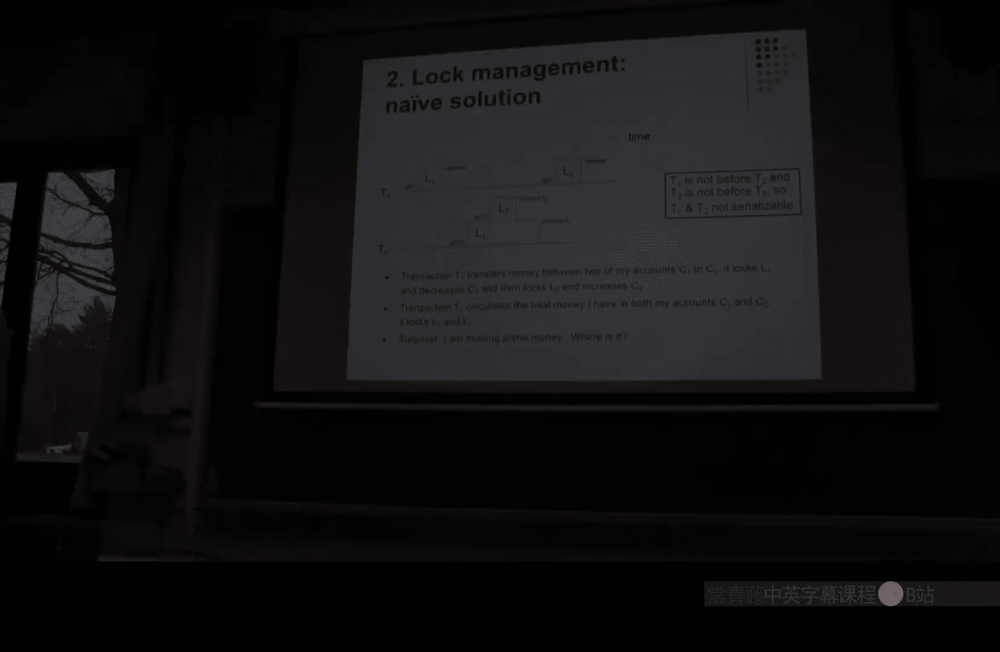

# 鲁汶理工学院【中英⚡高级编程语言概念｜LINFO1131, Advanced programming language concepts】 p40 P40 FO1131 Lecture 14 (2022) -BV1UDffBbEBZ_p40-

Of course。

And today is the last course。ItSays electro1 infection the week 14。Before we start。

 a few seconds of respect。Whether Ukrainians fighting。Today's course is about transactions。

It's also shared state concurrency。And。I'm not a big fan of Sha state contiency。

 you have probably noticed that except for transactions， transactions is actually a very good。

And powerful idea。So this is actually a very good way of managing states that has to survive crashes。

And it was all invented for large databases in the older days， I'm talking about like 1960s。

People started doing business with computers。 IBM was very big in those days。

 and they had databases and the databases crashed sometimes。And the data has to survive。

And you have to update the databases and manage banks， transactions were invented for that。

Large databases。Or actually the core of many， many companies， even internet companies as well。

 but Amazon， for example。嗯。And they have to be resilient。That means。If they crash。

 the data has to stay good when it's rebooted because it's critical information。

 also they have to have high performance if you have a bank。You can have millions of customers。

So they have to be scalable if the bank is growing。

You have to increase the size and it has to keep working。

 so these are like the three critical properties。And transactions are made for that。

They're made for performance， they're made for resilience and it still do， so let me show you。

Let me go back to this motivating example。Really to show you why you need transactions。

 so here's a database。It's a large array of cells so you can update each of these things。

 they could be bank accounts or something。 here there's 1000 of it there usually are millions。

Or hundreds of millions even in big databases。And I want to update this。

 I want to keep the data consistent。So I use a lock， right， so here's the lock。

So if I want to transfer money from one account to another， I get the lock， I do the transfer。

 and then I release the lock。That works。But it's very slow。Because the luck is a bottleneck。Okay。

 everybody has to go through the lock。So that's not good enough。So what do people do？Well。

 you actually put in one lock for each cell because it's the cells that are updated。

So if I want to update C0， I have to get the log for C0， so you don't have two concurrents。

Updates there。But in fact， it's not quite good enough， so here's an example。

 so let's say there are own bank accounts。Okay， and have money in each one of them。

Now let's say I have a transaction T1， which is a money transfer from C1 to C2。

And there's another transaction， a money transfer from C3 to C2， so money is going in to C2s。But。

These transactions， you have to be very careful because of their concurrent。And the scheduler。

 and they might overlap。T1 will read C1， for example。T2 will read C3。

And maybe T2 immediately writes C2， the luck。And then T1 gets the lock in rank C2。

That means this value is overwritten， the money that transfer from T2 disappears。Okay。

 so that doesn't work， so somehow individual logs is two fine grains。

 you have to have a way of combining them if you do things on multiple cells and that's the whole trick。

Of transactions。Okay。So。ok ， so诶。Motivation， if you do a bank transfer。You do multiple operations。

 maybe you read you write。You remove the amount in one and you add the amount in other it。

 it's already two rights， but maybe there's a third right， there's an audit， maybe there's a text。

 there's a fourth right， maybe you have to make a report， fifth rights， so there's many。

 many things going on。So you combine all that to make big atomic actions。

 that's the usual way we do it， okay， now the new thing here is that the thing can crash。8。Actions。

 that means these atomic actions， either they work。You say that you mix or。

There's a problem and then they have to be removed and we say they are boreds。

How can we make this work， so here's the basic idea of how it works。

So the database is stored on disk。But the disc might be corrupted。

 let's say I'm writing on the disk and it crashes in the middle Well the disc is still is still。

Uable one， if you reboot the system， you can read the dy。

 but maybe you only did a few of the rights and the other ones you didn't do。

 so the data is corrupted。So how can we ensure if it work doesn't happen？Okay， the technique。

Is that when you update。The date on the disc， you start by making all the updates in a special。

 temporary place on the disc。Okay， and when everything is on the disc， then you make a switch。

You say this is now moderate the current data。You write one word to the disk at the end to do the switch。

That means the hardware has to satisfy this property。A one word right to the disc must be atomic。

Okay， that means either it happens or it doesn't tap， doesn't happen in halfway。

 That is the condition of the hardware。For theで。And if you have a crash anytime。

 then when you reboot。If it crashes before this， right， then you restore the old value。

 if we crashes after you have the loo， so with this。

 you can guarantee that the database is not corrupt。ok。Okay。

 so how do you do and there's another technique to make things go very fast。

You make multiple eds can execute in parallel， and as much as possible。

 you keep temporary copies in the Rem。And only when everything is done。

 you make like a block transfer to the disk。Okay， so you minimize the number of transfers to disk and you make them all like blocks because a disk right can be very efficient if it's done as a block right。

Okay， so that's the basic technique。We're doing things。

 but still you have to arrange that the transactions when they overlap。

Even if there's no crash shunk， you have to manage the lus， so we're not done， by far not thundered。

就。The transactions have to have certain properties。 There's a famous acronym called acid。

Which is four properties， they're the four letters。

And this is the four properties transactions have to have。

 it's kind of tweaked so that it becomes a word， okay， we will see， so the A means atomic。

Either permit more vote。ok。It has to be atomic C means consistency that means the invariants of the database have to be respected。

 so this is actually A is the responsibility of the system。

 C is actually the programmer's responsibility。If you do money transfers。

 the total money in the bank should not change， of course that's an invariant though。

 so the transactions have to be designed for that。And the eye means isolation。

 that means transactions don't interfere with each other。 this is not the same as a Tmienia。

 it means the two transactions， it's as if they're done in sequential order。

 so they might be parallel for speed。But the semantics is exactly as if one of them was done before the other。

And this it's also called serializability， but the acronym is not nice with serializability。

 so that's why people talk about isolation， but isolation and materializibility are basically the same thing。

And the final one is durability， this is the fact that it survives crashes， it's permanent storage。

This also， the other word for this is persistence。But P is also not so nice for the acronyms that people talk about dubil。

 okay， so those are the four properties。And I told you how esity is achieved。Consistency is the。

Program responsibility when you write the transaction， but isolation is not so easy。Sealiz。

 this one is kind of tricky。Okay， and so we will。Spend a bit of time seeing how you can do that。Okay。

There's a variation。Clled lightweight or ACI， where you don't have durability where it's just in memory。

It's an aorable atomic action， so it's like a lock， but you can abort it。Okay。

 but it could be abort for many reasons。Some in very non satisfied。

 something you do some computation is not good。 So this is like a program abstraction， okay。

And when it aborts all the variables are restored， so it's actually much better than exceptions。

 okay you know that we have an error that can raise an exception and then the exception had their fixes things。

 that's actually pretty nasty and like we saw for early now in this kind of defensive programming it's not nice。

 but transactions is also a good fix to this because the transaction does all the work of restoring the variables。

So you don't have to worry about restoring variables in transaction。Implementation will do it。

 So a transaction is actually much better than exceptions。 You have。 Okay。

 This thing is sometimes called F TM。For example， people using Hakell have very often used STM software and transactional memory。

 so there's this STM acronym that's often used for this so that's just a comment。

Now I want to talk about。How do you manage this isolation。

 how do you manage that when the transactions overlap， they don't mess each other up and that。

There's a big field， huge amount of research in there that's called concurrency control。

So that's kind of a weird's name， but it's for historical reasons。

 concurrency control is all the techniques that you use to build systems with transactional properties。

 that is called concurrency control， okay。It's not transaction。

 implementation or techniques for transaction now it's called thepar control and so there's a lot of stuff going on here。

 so let me give you introduction to this。So in today's course。

 I'm going to give you a full algorithm for implementing ACI transaction。

 so I won't do the durability bit， but you can see you could add that so I'm going to show you a full algorithm so you'll understand everything and the algorithm does this it will do optimistic concurrency control with strict two phase locking and deadlock avoidance so these three highlighted things。

Are important， and many transaction systems have variations of them。

 so this is just one of many possible transaction systems。So these highlighted bits。

 we're going to explain them。And if you want to see the full code of this transaction manager。

 it's in the textbook， it's two quite dense pages of O code， the most complicated algorithm book。

 but it's completely there so I wont give you all the ideas of this。

 I won't show you the actual code of the implementation because you won't have time。

But I will give you all the ideas of the implementation of this。And if you really do this。

 you can see it the code in the textbook。It was not easy writing that code， by the way。

So the one time， I was thinking。ok。So con control， there's many different ways of doing transactions。

And there's many axes， there's many variable things that you can choose when you make a transaction manager。

And there's three main aes I'm going to talk about today。

 one is a transaction manager can be optimistic or pessimistic。That's kind of a strange thing。

 but I'll show you what that means。So optimistic means you just give the lock and you don't worry。

Because if there's a conflict to the transaction will the boards。And that's okay。

But pessimistic means you are very careful about giving locks。

Because it's very expensive when there's a company， so for example。Allocating。

This can be done in many systems trains running on train tracks。

 so the train can be considered a kind of a transaction and the track is like a cell as a resource。

 so if you allocate the track to this train， you don't want to allocate it to another train because maybe both trains go on the track if there's a conflict then people will die okay so there you will need pessimistic。

But optimistic， it's when the failures are not so costly。

 like allocating too many seats on an airplane， if someone has to give up a seat， and cares。Okay。

 the second access is lock management， this is for Syria aognizability。

 so this is pretty tricky and there's many techniques for this。

 and the final one is also a tricky one。Deedlocks。So this whole thing has some epi phenomenonomemenon。

 something happens。In this kind of system， which is called deadlock。So any system where you have。

Activities that need resources。That have to allocate。 You can have this this， this。

Thing that happens called deadlock where the system just locks up and doesn't do anything。

 So this has to be handled because it just happens。 It's a natural property of such systems。

 So we'll talk about that too。So those are the three proper things。Now， before we go into that。

 I want to talk to you about the properties， two kinds of the properties of this system where the system。

 there's systeming various， and then the system makes progress like no starvation so safety and liveness properties are important because you you have to when you define these it tells you how to build the system okay so when we start implementing these。

 to satisfy these properties， we will need some primitive building blocks， so locks you already know。

 locks control access。And it's important for safety， managing invariant， if you lock the system。

 you can't mess up the data， so the fact that the data is correctly representing something is an invariant is a safety property。

And that's managed by logs。But the other kind of property is the system has to advance。

 has to make progress。And never stop and that is called the alives property。

 and in order to manage that， we had another concept called time stamps。

And so we will give priorities to operations to make sure there's no starvation。

 all transactions in advance， okay， so this one will be very important for deadlock because deadlock will kill the lightness。

 okay？So we have two kinds of properties and two kinds of building blocks that we use。

To build transaction。So you see it's a really thick area， okay， I'm just scratching the surface。

And we will make one。Kind of we will show one actually quite nice transaction manager。

 but there's many others， okay。Okay， before that， I would like to make a small detour and talk about safety and liveness。

Because safety and liveness are really important ideas and they have appeared in many， many areas。

 so they appear here in transactions， but any time you build a large system you have safety and liveness。

 so maybe you've seen already， have you seen safety and liveness in another course。

 have you seen formal definition of it？Which course did you see it， do second。Ssテ for。Okay。

 you saw safety， What safety， did you see the formal definition of it， No， okay， so good。

 So you have already some idea what it is。 I want to give you a formal definition of them。ok。

So we want to build a system that's correct。That's reasonable。

 So there's some properties it has to satisfy。And if it sates those properties， it's correct。

But in fact， there's two kinds of properties。And safety and liveness are too fundamentally in different kinds of properties and the safety properties basically mean that bad things don't happen。

 so that's the intuitioner and the liveness says that good things will eventually happen。

So if you're traveling on the road， the safety property is that you respect the。The law。

 the traffic allows。But the Latin this property means that you actually arrive at your destination。

 okay， you can satisfy one of these two very easily。

 it's very easy to satisfy safety by doing nothing。Okay。

 it's very easy to satisfy laness if you don't care about safety。

 you just go ahead and you don't care about the laws。The problem is when you have to do both， okay。

 so that's intuition。But I want to make a formal definition now。And so these are properties。

 so a property P is a function of an execution that is true or false， so it's a predicate。

 an execution。So this goes back to the semantics， so I go back a little bit to the semantics of us that was seen in a previous course。

 so an execution consists of a sequence of execution states each state has。Threreads and memory。

 Okay， and it makes transitions whenever there's an instruction executed。 So it's this。

Potentially infinite sequence of execution states， okay。

 starting with some initial states and going on， of course， the scheduler makes choices。

 so even the same program if you run it more than once， you can at different executions。

 so this is the formal way of presenting of how a system runs。Okay。

And we will define safety in terms and likeness in terms of executions。And in fact。

 there is a very important property of safety and liveness， which I will not prove。

 but if you are mathematically inclined。You can find this pretty easily。

 but the proof is not so simple that it's using properties of topology。Any property of a system。

Can be expressed as the conjunction of a safety and aliveness property。 So this is a mathematical。

Result that holds for any property at all。So if you build a system and you had to satisfied some property。

 you can always separate that property into a pure safety and a pure liveness。

 so this was proved by Al and Schneider in 1985， so this is the famous for both。

Which that means is that safety and liveness are really the only two things that are important， okay？

So， but I will not give the proof。But it， but actually it's kind of neat。 You can look at it there。

You can look it up if you're interested。I will just define safety and madness。To prove them。

 I will introduce the concept two concepts， prefix and extension。So here is an execution， okay。

 which goes on。Could you go in for a long cut？A prefix。Is basically the first cave。

Execution states for some K， okay。So you basically cut off the tail。 So it's say finite size。

Sequence of execution states okay and an extension of a prefix is an execution that starts with the prefix。

 but then it just goes on in any other any way。 so you have a system that starts running like this and at this point it can keep running and because of the scheduler and so on there can be many possible extension。

So it's any execution that starts with the prefix。A particular so you have prefix and extension with these two concepts。

 we can define safety and lightness formally。First I you find safety。

I first give an informal version of the formal definition and then it gives the formalal definition。

So I'm not really。A ditro。Adept or in France or Bbaki apt for me intuition is very important in mathematics。

 it's not just formal results， so when I give you a formal definition I always believe give intuition okay so I'm very much an engineer。

 I like mathematics but I'm not really mathematician so the intuition is very important。

So a property P is a property of an executioner， full execution。

 it's a safety property that every execution which does not satisfy it。Has somewhere。A bad event。

 it means at some point the execution state is bad。And once it becomes bad， it stays bad。

So the intuition is I hold an egg。Okay， I'm walking with this egg， I throw the egg on the ground sp。

 okay， so the egg is broken。And I cannot fix it， okay， humumpty dumpty， when he falls off the wall。

 all the king's horses and all the king's men cannot put him together again so that the fact that he is alive is a safety property and when he falls off he's violating this property okay so the formal definition follows that once the system goes bad。

It stays bad。So here's the formal definition。A property P is a safety property if the following holds。

 so given any execution such that the property is false okay so we have an execution where safety is false。

 then there exists a prefix。s that every extension of that prefix gives an execution also false。

 that means at some point you can say the system breaks and no matter what you do after that。

 it stays broken okay so a safety property is a property where in a finite prefix。

You can already see the system break and any extension of that will stay broken， you cannot fix it。

 okay so that's a safety property if you can fix it， it's not a safety property。Okay。

 so that's safety。So here's an example of a safety property。Simple example。

 I send messages between two agents on an unreliable network。

So a message from agent one page and two， every message sent is delivered at most once。

That is a safety property， okay？So how can you break that？Well。

 it's very easy you deliver the message more than once。So it's delivered once。

 and then somehow for some weird reason， it gets delivered a second time。The property is broken。

 okay， but you cannot fix that。You cannot deliver a message。 You have delivered it twice。

 Whatever you do after that， the system is broken because you have broken the system by delivering the message more than once。

 Okay， so that's an example of the safety property。Once you break an invariant。It's all over， okay。

Okay， now I go to liveness， which is the other side of the opponent。So here is the definition。

 so given an execution， so this is the formal definition， any execution where aliveness is true。Okay。

 so whole we're looking at the whole execution， no liveness is true， that means。

Then if that is the case， then for every prefix， there exists an extension such that。It's true。

 that means you could always make it true。If you have a prefix and it's not true yet。

 you can always find a way to make it true， okay？So you could say this is something like。

 as long as there's life， there's hope， as long as the system is running。

It has the ability to make this。T true， no matter what happens in the prefix， okay。

 so here's an example。It's very similar to the previous one， messages again on a network。

 so the librarys property says the message is delivered at least once， not at most， but at least。

Once， okay。So this， we can see that liveness holds that this is a liveness property。

 so give it a prefix。If the delivery is there。We're fine， every extension satisfies P。

 so there's at least one。But if the prefix does not contain delivery。

We can extend it so that it contains a delivery。 that means the system， there is an execution。

 there is an extension where it does contain a delivery。Okay， so at least one。

That means even if the prefix does not contain the delivery。

 you can extend it so it does contain the lu。As long as there's life， there's hope， this is my way。

Visualizing this。Your mile may vary， so I'm a very visual person I like visual。

Representations of things。So here the top is safety。So here I have an execution。Okay。

 safety is false for this execution， if there exists a prefiingx。

 so here's the prefix such that all extensions are false。

So in this particular space the system is broken。Okay， and if it's false。

 you can always show it in finite time somewhere in here， okay， so that safety， liveness is here。

 here I an execution。For all prefixes， not just to exist， for all prefixes。

 I can find at least one way to make it true， to go forward。ok。

That means there's always a way to advance。The system will not block money。Okay。

 if whiteness is false。You can only show that in infinitefin time because in any finite time。

 it doesn't happen。It might happen later， today。We don't know the only way to show line this is false is to look at the whole execution okay。

 notice if you compare these two， there's a very interesting dwell yeah。

 exists a prefix for all prefix。For all extension exist extension。 So for me， this is a good way of。

Distinguishing them， your management theory， but I had that in case of comes too。Okay。So， some more。

Conclusion on safety， safety can only be satisfied in infinite time。 You're never actually safe。

 I walk grounds an egg。 I could always grow up at them。

And the only way to know that I have not dropped the egg is to look at the whole execution。

 which is basically infinite timer。So you're never。

 you can never be really sure that you're safe in the finite time you're having the only way that you can guarantee that you're safe is to look at whole execution。

 of course when it's violated， it's finite in the finite time when you drop the egg， it's broken。

If I have a property with the words never at most， cannot bh， bh bh。

 this typically will be a safety property。Sometimes it's called partial deants also。Okay。

 so that's safety。Lfeness is the other side of the coin。Okay。

 so liveness can be satisfying in finite time， so we're waiting for something good to happen and it happens。

But it happens in some final time。But the only way that it can be violated is to look execution。

So I'm driving around， I want to go to the beach。Do I ever reach the beach well the only way to see that I dont reach the beach is still a bit execution because maybe after 500 years I eventually will reach the beach。

 okay， so you can only violate that in infinite time。But it's satisfying find。

 we say it's kind of a due to safety and when you have properties have talked about eventually it must do this。

 at least。ok。So eventually， what that means technically that the thing will happen at some unknown point in the future。

 so some finite time。In the future， okay， so termination of an algorithm is liveness， okay？

That's a typical Latinness property。Okay， now to get your brains working a little bit。

 that needs a couple of questions。ok。So there's a different way of defining safety。

So we define safety as a property of the whole execution。But actually。

 that's not the only way you can define safety， you could define it like this。

That every execution state is safe， so for all execution states， they're safe。 so for example。

 I'm holding an egg， so I can say in each state the egg is not broken， right？In each state。

 the egg is not broken。That would be an another way of defining that particular safety property instead of saying that the egg is never broken in the execution。

ok。But， in fact。It's， there's good reason why it's not defined like this。

So now I'm doing a little bit specification engineering。

We have two ways of finding safety or property and whole execution。

 and here would be another way for all execution states， so this EI。

 so it's basically the thread state plus the memory and in particular incident。

So every state satisfies P， so this is a different P， this is a P that works on execution states。

 so this would be another way， seems simpler on because execution states are these fairly simple things whereas an execution is this big infinite thing。

 okay。But in fact， this way is not so good。This way has some problems。What you say。

Can you imagine a safety property that is nice and interesting？But that you cannot write this way。

 but you can't write it that way。第二。嗯。I dont the worry。Could you say in French， I will translate。

我 would的。嗯。关注。Time server interaction， you don't know the execution of the server。

 but you're getting what when you send。Request for a web page。

Your execution is the request and the next state is the answer， but know what server does。Okay。

 so you're saying your request is done。In one execution state and the reply comes in a later execution state。

嗯。So诶。So the the thing is that the。The property would be for every request。

 there is exactly one reply。That would be a safety property， right， something like that。对。

But that's actually an example， you could not represent it like this because you're actually comparing two different your execution states。

So when I make the requests in one execution state。Then there has to be one reply。

In the later execution state， so the property is a property of those two execution states。

 If I look at each one of them individually， I cannot determine it so that the thing is sometimes you need to look at more than one execution state for the safety in。

Which you don't do in the second definition。 Okay， yeah， so that's right。

 So that's kind of the reason， but it took a long time for people to understand that。In the 1990s。

 people were still sometimes in safety like that， in books and stuff。哎，就是。

Booked by Dira tell on distributedtri algorithms。 And he defines it from the 1990。

 He defines it like this。Yeah， it takes a while for people to figure out how things are supposed to be the right way。

So you see the difference。So this is important， so this kind of question。

Is important when I give you a definition， it's not arbitrary。

 there's good reason why it's this definition and not something else。

 so you have to always in your mind ask your question why is a plan defined like this and not some other way okay？

So that's a question。So here's another question for you， so I like buggygima， so I told you。

That safety and liveness were enough。So is every property really in safety or liveness。

 so for example， what about this property？Every message should be delivered exactly once。

Is that safe to your likeness， you。I啱'm呃。Playing with your mind here you have to be。

 you have to understand answer this。 It's enough to have clear thinking。 Yeah， both。 I would say。

 what do you mean both。It's both safety and London because before we saw that delivering at most once is。

Safety， at least one is liveness。 So if we combine the two， we get safety and liveness。Yeah。

 but this particular property is not both them， it's actually a conjunction of a safety and a Latinness property。

系。Because the property at most once is not a lifeness property。

 at least once is not a safety property。Okay， so you can the same way you can say this is neither。

 okay？same argument if you could say this one is neither it is neither。

 but it actually is actually the conjunction。 so here I'm making with your mind every property is not gladness or safety。

 but it can be written as a conjunction of little safety and their liveness but when you write it down when people write down properties they don't always think about that okay they sometimes just write down and that the property is like this one it's neither to safety or likeness so it's actually important that you split it。

Into safety and alive that you separate them， that's actually very important to get things clear because the implementation has to do very different things。

To satisfy safety your life， Miss。So a safety property so for example。

 safety property for a Tesla selfdriving car is actually very hard safety would for example。

 be that you never run into a human being okay that's a safety property， that seems to be quite hard。

 but liveness just driving on and and reaching the destination that's actually easier， okay。

The problem， the real trick is the safety， so it's important to separate them。 Okay。

 so that's important。Okay， so that's all about safety and liveness。

 when we build transaction systems， we will be clear to setate them。

And if you follow other courses so， there's another course that I give on distributed algorithms。

As 23， 45， there also were very。Clear to separate safety and loudness because otherwise ways you get messy and you're not thinking clearly。

 okay， if you want to really find a complicated algorithm， you have to clearly separate。Safety life。

 So when you define a system， don't mix them up because the techniques for satisfying them are very different。

 and you don't want to mix it， okay。So separating it safety lineness is important Okay。

 so what we're going to do that here， so you see the blocking is a liveness property。

It's a safety property sorry and the deadlock avoidance is a likeness property。

 okay so they're very separate things and the mechanisms are very different okay so let me go back and on to concur control。

 we're going to build a transaction manager now okay so we're going to build a transaction system that does everything。

It's a bit harder than the locks we did， it's a bit harder than the rancher box， so it's like this。

 a transaction system。So the system has this structure。

 each of these boxes is a thread with some kind of an agent。Here inside each of these tea boxes。

 we have a transaction， the transaction is actually managed inside this box by a thread。

 there's actually it's an execution of a piece of code and it's single threaded， okay。

 so the transactions will be single threaded。And they can send messages。

To this other agent called the transaction manager。

 So you see it's very interesting because transaction， which is a shared state concept。

 I'm implementing it using message passing multiagent ideas in because this is by far the easiest way to implement transaction managers。

Okay， so each transaction runs in one thread and communicates so it sends messages to the transaction manager。

And the transaction manager will then accept messages from all these guys and all the concurrency control is done inside the transaction manager。

So what does this transaction manager actually do well， the whole point is managing the log。

If a transaction needs to access a cell， it needs to log。And it asks the transaction manager。

 please give me the lock。And then the transaction manager replies。

And there's many possible replies it can say， yes， you have the lock。

 can give the lock or it can wait。It can delay wait because maybe someone else is using the lock and it will let this one wait or it can say no。

 you do not get the lock， you will not get the lock， okay。

 so there's different kinds of replies and the transaction manager is designed so that the system will be serializable but also make progress okay？

I want a transaction no longer needs the lock， so let's assume the transaction manager gives me the lock。

 so I'm a transaction。If I don't need the lock anymore。

 I have to give I have to send a message I tell the transaction manager I don't need it anymore Okay so this is the basic structure。

 So now the trick is what does this transaction manager look like inside okay so there's a lot of stuff going on in this little box okay。

So now we get back to our。Axxies of variation， because all of these different axes will affect the transaction manager。

 how we design it。So there's many there's thousands of possible transaction managers。

 very thick books have been written on theory of transaction managers。

 so there's a lot of theory behind it， there's a lot of possibilities， so I'm going to show you one。

Transaction manager completely， and I will justify this one。

 but there are many others and real systems can do different variations on this。

 but it's good to understand one， okay？So the first axis is optimism versus pessimism。

 then the second one is luck management that's through serializability and the third one is how do you handle deadlocks。

 so this is a kind of circular dependency that I will talk about okay？

And so we need to satisfy both safety and liveness， so the lock management is used for safety。

And the deadlock management is used for lightness and equal use timet so these two are very different。

 theyre kind of orthogonal okay one of them is needed for safety but it's not enough if you only do that but you don't do this then you will not have lightness okay and your system may just block forever so you have to do both to satisfy these both and they're kind of independent of each other okay so you see separating to safety。

 likeness is very important because it's very different techniques。But first。

 let me talk about a nice one， the first one。Which is optimism versus passengers。 And this is just。

 this is this one is just。An approach。Okay， there's different styles in a sense， okay。

So let's say a transaction starts。It asks for long。

And the transaction send message transaction manager said， I want this lock。Do I get。Well。

 it actually depends on the situation， this is the notion of locks。

 locking up a thing is not just important for data and databases。

 it actually is something that happens very often in the real world when I have activities that need resources。

 okay？For example， airline booking。Okay， an airplane traveling is determining all the passengers is a transaction。

Okay， a passenger booking a seat。It's a transaction。Now。This transaction will be optimistic。

 So what does that mean， Well， airlines。The point is that in order for the airline not to go broke。

It has to have a lot of paying passengers because flying an airplane is expensive。

 So typically airlines will sell more tickets，10 or 20% more，500 seats。 they will sell 120 seats。

And the reason it is that they will assume that some of those people will cancel and that at the end of the day。

 the airplane will be basically full。So they increase the number of average seats。

So that means when I ask for a seat。When I want to buy a ticket on an airline going from。

Brussels to Stockholm， for example， something which I've done many times。

 then the that you just says yes， you have a your fine and then you walk up to the gate and you have your boarding pass and everything and they say。

 us are you playful。 what happens here。 Well， it's because the airlines they always overbook。

 So that means the transaction manager will always give the locks。So the plane has 100 seats。

 so there's 100 blockss。But the transaction major just gives more， okay？It sells more tickets。

And so sometimes。It aborts， which means you cannot fly。Because but aboarding is not expensive。

 All that means is that you get rebooked on another flight。 They don't punish you。

 They don't whip you， You don't die。 Okay， so it's not very serious。 Okay， it's not very serious。

 So optimistic scheduleched， it means you， you are tending to give more lock。

 even if it might cause problems later， because the problems are easy to solve。

And it's important for certain reasons， so because of the average number now the other example of pessimism is railroad tracks plastic example。

 I have a railway track between two cities and it's very far away 10 kilometers so there's only one track for example in some segment。

 so if I trains going in opposite directions only one can get it okay so if I want to reserve the segment。

 so a track segment reserving track segment is a lock okay so getting the reservation is a transaction and being the transaction needs to block that segment。

But what are the two trains。Are reserving in opposite directions。 Who。

 the transaction manager is extremely prudent， pessimistic。 Okay， And this is actually。

 this can be a dynamic， It's not something in days and events。 You have signalling mechanisms。

 So when you actually are entering one of these。😊，Track segments。

 you can have a red light means you do not enter。 So the transaction manager will tend not to give you a lock。

's like buraucra time。You ask if Europeau has something they will usually say no， okay。

 so this guy is like that。You will only be allowed to go on the segment if it's absolutely sure there's no other train in the opposite direction and the reason is that a conflict。

 the problem is very expensive to solve so if two trains crash。

 you do need people die so you don't want that so you see this is a very different situation than airline booking up。

So here in the case of railway track allocation， the transaction manager will be extremely pessimistic。

 and in the worst case， the trains will be slowing down because of this， okay？But that's okay。

 slowing down is better than dying。So sometimes when you're in a train， youll probably notice this。

 the train just stops。In the middle of nowhere， why， because there's a red light。

 why is there a red light because there's a small chance that there's a conflict later somewhere so it just stops so the training companies are very。

 very certain okay so you see this is the definition optimistic versus pessimistic。ok。

I will show you today an optimistic algorithm because fixing problems with bank money going between bank accounts。

 that's very easy just reading and writing things in memory okay so it's not like an ATM or it's giving you actual bills okay if you do that。

 then it tends to be pessimistic because it's not going to give you more money than you have okay so the ATM。

 the money machines typically have a very pessimistic。

 but I'm just talking about now transfers between。Accounts。

 so it's just reading and writing inside memory so that'll be an optimistic outcome， Okay。

 so that's optimism versus pessimism。So that's the first axis， so this is kind of a choice。

Now we go to love management。This is the safety property。Making sure the transaction is serializable。

Okay， so let's say we have two transactions and give you just a simple example that's not going to work so you seem need to do something else。

 so we have T1。Transferring money between two of my accounts。 So say I have two accounts， C 1 and C2。

And it transfers money between them， my savings and my checking account， so what does it do it locks？

L1， for the state's account it takes the money， it releases the lock。

 it gets the lock on the other one， it puts the money in。Okay， fine。

 but in between that is another transaction which calculates the total money in my accounts。

 so it locks L1 and then it later on， so this diagramma is very important so time is going from left to right and each time I get a lock it's like one step upper so I get L1 lock。

 I get L2 lock， I calculate the total money， then I release the two locks。

But T2 will give the wrong value。I am missing money what's going on here。

 so there's a problem this lock management is not good to them， it's bad。

So we have to do it differently。O。But let's make a break now and I'll show you how to do it right after the break。

这是肚子。

So now we're doing lock management， which is safety thing。

 we want the transactions to be serializable， which means that it's as if one goes before the other one。

 so in this scenario it's not serializable because T1 is not before T2。

 T2 is not before T1 kind of overlapping in a funny way。And the result is clearly correct。

 so I will amm breaking invari of this system。The solution to this is to manage how the locks are given。

 the transaction matter doesn't just give locks in a naive way， it's a little bit smarter than that。

And。So we have to make it serializable， that means when the transactions ask for logs。

They have to get them in a way such that it's as if the two transactions are running in some order。

 and that gives they an interleaving semantic so T2 will see the end state of T1 or out。

And the technique that's usually used for this is called two phase locking。

Which means that basically a transaction will not do like in the previous one where it gets a lock and then releases and it gets another lock because that gives it leaves this gap。

 the transaction will only get lock。To do its work and when the work is done， it will release locks。

So it's basically getting lock to do its work， and then when the work is done， it's releasing them。

That means the transaction has two phases and this is called the growing phase and the shrinking phase。

 so in the growing phase it's only asking for locks here L1 and2 and it does work and if it needs more locks then it would keep going up but it can start doing work already when it has enough locks and when it's done it when it doesn't even lock anymore it release it so it release them。

If you do that， it they look like these little ladders is going up and down。And T2。

 you see that T1 now it keeps T1 at L1 while it' getting L2， so at the end when it releases L1。

 T2 can get L1， and if you do that， and you can prove that the transactions are serializable okay。

So that is the basic technique， it's called two phase locking。ok。

Not to be confused with two face commit， which is something for distributed transaction。

 totally different， here it's for making the transactions serializable and how you manage the locks。

Toothfacete locking， growing and shrinking face， basically all transaction managers that arerac ones will use some variation of toothpaste locking It's by far the most used technique for making transaction serial So you see it's not that hard actually to make them serializable of course。

 there might be some extra overhead。 maybe if you do that， maybe you keep the log too long。

Maybe I can I don't actually once I read L1， I don't need the value anymore， but I keep it anyway。

Until I'm completely done。 So， so I'm kind of。Being a little bit conservative in order to be safe。

To number break the environment。Okay， so two phase locking is the basic idea the end。

There's then one extra thing that is done。which is a kind of optimization。

 so two phase locking is enough the two phase locking， you will get serializable transaction。

 but rail systems usually will not do exactly two phase blocking。

 they will do a little variation of it。And it's because of this issue。

 so there's an issue that occurs。But it's not wrong。 It's just an efficiency and complexity issue。

 So let's say we have three transactions。 I'll give you an example， T1。Gets these three locks。

 and reduces locks， but somehow L1， the final one， it keeps it for a long time。Before releasing it。で。

Okay， sorry， it keeps this log， but it releases L1。

 so there's another log that it keeps for a long time here。But once it releases L1。

T2 can get L1 right away。 That's okay。 There's an L0， which is kept， but T2 doesn't need that。

 So T2 doesn't work。Okay， and when T2 releases L2， some other block， then。T3 can start getting L2。

 So you see， they're kind of overlapping because of the the。Growing in shrinking phases。

 it depends on the particular lock as soon as P1 doesn't need L1 anymore T2 if you get it。

That's fine now， it's completely correct。It's completely correct。

 but it gives a kind of strange behavior， so let's say T1 keeps going and it doesn't commit in it as。

Well， the system then has to force T2 and T3 to abort as well。Okay。Because T2 uses L1。

 so uses cell1 which has been modified by T1， but if T1 aorts， the L1。

 the cell value will be restored to its original one。

 which means that T2 was using the wrong value that means T2 has to abort as well。

 and for the same reason the T3 has to abort， and maybe there's more transactions connected。

 it's a chain okay it's a kind of what's called the cascade， so this is called cascading abort。Okay。

 so this is not incorrect I repeat， this is completely correct。

 it's just a behavior that causes the system to be quite competent。That means T2， when it commits。

 it's not truly committing yet。If there's a dependency， T2 depends on T1 of them。

So the commit of T2 depends on the commit of T1， so this creates dependencies between the transactions that the system has to keep track of。

Okay。T1 boards， T 2 and T3 must the board as well。 So T 2 and T3 have to dynamically keep track of the transactions they depend on。

 And it's a chain recur of。 it can get pretty long This is。If you could implement this。

 some systems do this。But it's complicated。So usually systems don't want to do this。

 so they actually make a variation on two face locking， so this doesn't happen。Okay。

 you can actually do a。A kind of stronger version of two phase locking so this cascading of what doesn't happen。

 so okay， so remember this is not an error right。Cascading board is perfectly okay。

 it's just something that's undesirable and causes complexity and implementation。

So usually what happens is we change a little bit the two phase locking so that cascading a board doesn't happen。

And the change is called strict to phase logging。So what that means is that there's still a growing phase。

 but there's no longer a shrinking phase， all the locks are released at the same time。

 that means there's no dependencies， the dependencies are not possible not， if I release a lock。

 then this one will use the lock and there's another one that goes and not happen anymore。

Okay if I release all the locks at once， of course I will actually reduce a little bit the performance of this because that means that some locks have to be kept longer than necessary。

 okay， maybe L1 or L3 here， maybe I can already release it here because I don't need it anymore。

 but I will keep it till the end， all the locks are kept until I don't need anymore。ok。

And they're all released at once。So there's a trade off here you see cascading aboard theoretically has higher performance。

 but it's more complicated， so maybe it's not that much higher performance because of the complexity。

 whereas this one is much easier to implement。But has maybe a little bit lower performance because you will keep the locks too long。

 that means T2 has to wait until T1 is completely done。

 so that slows down a little bit the system okay。But the trade off is that most transaction systems will do this。

So if you look at transaction systems， real industrial transaction systems。

 most of them almost of them will be doing strict to face lock， okay？

W enormously it simplifies because there's no dependencies between the transactions if you do that。

 once a transaction is done， it's over， the others are independent of it。

 and that's an enormous simplification。Okay， so that's what。

The transaction manager will be doing when I asked for a luck。When I release the lock。

 the transaction manager will release them all at the same time。

 so when the transaction doesn't need a lock anymore。

 the transaction manager will not give that lock to somebody else until the first transaction has released all of his locks and then it group。

Give them all， okay。See， that's stripped to physical， so that's guarantees safety serializability。

Now there's now the elephant in the room， which I had not talked about。Which is the third one。

 which is deadlinelock。This is much harder。But in order to introduce Nlock。

 let's build the transaction system， so we're going to start building one。

 I start with a very simple one。Let's design a simple transaction system。

It does optimistic concur to control and it does strip to face。Okay， so here's the algorithm。

For the transaction manager， it's quite simple when a transaction requests the lock。

And the cell is unlocked。 Nobody has it。 It gets the luck， okay。If the cell is already rogged。

Then the transaction away extend means the transaction manager will not send a reply。

 it will cause the transaction to weight。And it will keep waiting until it's unlocked and when a transaction that has the log commits or boards。

All the locks are released at once and then the weighting transactions will get those locks okay so this is a strict twoface lock you see how it works you get locks。

 but if someone else is using it you wait。So this is doing strict to face locking。

And it's optimistic， that means if the cell is unlocked， just give it， okay， okay。

Getting locked like that with no other conditions will not lead to problems， okay？

So this is already a transaction manager and it's correct， it's safe。

But it will not satisfy liveness。Okay， this one has a problem。

But it's never going to make a hair run。But it might stop running。It suffers from the duck。

This one is perfectly safe but not alive， okay？And so here's an example。

 so this now you see this is what we did， we build the correct one。

 safety is satisfied with not life。So let's here's an example scenario。Let's say T1 and T2。

 and both of them use cells C1 instance。Okay。And T1 first needs C1 and then needs C2 later on。

T2 will first use C2 and then need C1 later on。So these are two concurrent transactions。

 so the scheduler will be scheduling them。So T1 gets C1's log， sure T2 gets C2's log。

So that didn happen。The scheduler can。Can choose the execution of the threat like that。

And T1 then needs C2， and it will wait until T2 releases C2。

But T2 needs c1 and in will weight a T T1 reduces C1。

And they're each waiting on the other you see what's happening they wait forever。So， this is none。

This is still safe though， nothing wrong is done， it's just that nothing is done， okay？

So how do we fix that， that the fix for this is not so simple， it's harder than just one magic one。

 we need to think a little bit。There is some fundamental thing going on here。Okay。

 so let's understand what's going on， and then we can fix it。So you see this naive algorithm。

 it's nice， but。Still， there's something wrong。And the thing that's running is called deadlock。

And Denlock is a very general。Condition， and it can happen in many， many， many places。

 not just in transaction managers。It can happen in any system where I have active entities on one side。

 transactions or humans or cars on the road or airplanes， any kind of an active entity and resources。

And that the active entity needs resources to do something， and when it's done it releases resources。

So if I have such a system。And if I don't do anything special。

 such a system can always go into deadlock。So there's a classic example is the ropes in the。诶诶不就出。

An intersection。So here's a row， let me just give this simple example。So here is an intersection。

So now that there's these four。And there's cars， okay。Okay。Going and you have lights。这个 얼굴份。

Now so normally this thing will work fine with the lights。

 but let's say people get a little bit crowded， so there's resources and active entities。

 so the active entities are the cars， the resources are these squares on the intersection。

 so this resource A A， for example， will be used by this car or by this car these two cars will both need resources。

So assume that somehow the car has gotten done here。And then stops， this car has gotten here。

 this car has gotten here and this one has gotten here， so each car gets one resource。

 but it needs a second one and there's a cyclic dependency here and there's four cars So this actually happens in big cities and it's a major problem because the car cannot back up usually because there's a bunch of cars already behind so once this happens。

 things slow down a lot because the cars have to somehow get off of it that's an example we a dead off okay and it happens in many。

 many systems。And here it happens in transactions， so you have a transaction。

 the transactions T1 and2， and you have the resources which are the cells。

And a transaction will need resources to do tour。So you define tools to determine this。

 you need to define what are the overall dependencies between entities and the resources。

 so you define a concept called the wait for graph。So this is a graph with two kinds of nodes。

 the transactions and the cells。And we have， so it's a directed graph。

 we have an arrow between a transaction and a cell， if the transaction is waiting for the cell。

And we have an arrow between a cell and a transaction if the cell is locked by that transaction。

 so here， for example， C1 is locked by T1。And C2 is locked by T2。

 but T1 is waiting for C2 when T2 is waiting for C1， this causes a cycle， okay。

 so a cycle in the weight for graph means that the execution stops。ok。

So the problem is cycles in the wake for graph。So somehow this has been that you this should not happen。

🤧So how can we arrange that in our transaction manager so this is a very nasty problem okay so you see the formal definition now so we define this graph and while the system is running at any instant of the running system。

 there exists a wait for a graph and it's changing as transactions get locked and release log and any time the cycle occurs in this graph。

 that part of the system will stop。Okay。That is the thing。 So here's a cycle with two transactions。

 You can have any number。In this kind of cycle， in the example of the cars。

 it's a cycle with four active entities。But you couldn't have them with any number。Okay。

 so you see this is that you have to be very precise now。

 this is a formally defined thing not the wait for a graph。

 and so we are now looking at graph algorithms we have basically to do cycle detection in this graph okay and this graph is a dynamic graph that be it's always changing when the system is running。

ok。So you see this is kind of a fundamental problem。It's not something you can avoid easily。

 it's fundamental because it always happens in such a system where you have active entities and resources。

Deadlock is fundamental， so we have to do something to solve this， so how do we solve it？Okay。

 well let's discuss a little bit。So bedlocks can happen in many places in the real world。

 so cars in theoe section is one example or trains in a track or people walking on the street or people trying to go through a door。

 the door is a resource it can happen in so many places。So once you're sensitive to that。

 you see that there's so many places， usually humans have some kind of their brain as wires to see that there's a potential deadlock and they will do something to avoid it。

 but it's not always possible like in the car that really happens。

Now this is actually a real problem， you can say， okay， fine， but is it a real problem？

Let's say we have a bank。A big bank。And it's running lots of transactions simultaneously。

 hundreds per second。are being run or even thousands in a really big bank。

 it's a huge transaction processing system， you have maybe 10 million customers and certain at times of the day。

 so for example， when I go into a store and I buy something and I type my pin code。

That's a transaction now that will transfer money to be transferred from my account to some other account。

 so there's an actual transaction going on and you can see that many people can be buying simultaneously all over the world。

 okay， and that all goes to the different banks so there can be huge number per second。

So this system seems very busy， lots of stuff going on。

 let's say we have four transaction in a deadlock， these four have stopped。

They're just sitting there doing nothing， but all the others are still running。

 so hard it's not easy to tell。We have this big system and part of the system is dead， okay。

 but the rest is running， so the activity of the system still seems very high。So how you detect。

 how do you diminish this thing， part of the system is not working。Okay。

 so there's two ways to solve this。It's like you can consider deadlock kind of like a disease， okay。

 and the two solutions are prevention or cure。Prevention means whatever I try to make a look。

And this would create a cycle， I avoid it， I say no， I forbid it。

 so you never actually create a cycle and then love detection means that periodically you run a cycle detection algorithm on your way fore because these cycles will stay forever。

 so you don't have to worry about when you run this algorithm anytime fine。

 and periodically you run this algorithm。And when it sees a deadlock， you have to break the cycle。

 so usual way to break it is to force one of the transactions to a board， okay， it's kind of nasty。

 but yeah， so that's one way so there's these two ways。So we're going to do something now。

 and I'm going to show you a dead of avoidance algorithm。诶。

Deadlock performances and we're going to use priorities for this， so we have to add some asymmetry。

 we have this symmetrical situation which can not happen。Okay， so let's modify our naive algorithm。

So that it will never create a cycle。And how do we do that， Well。

 we give the transactions priorities。We say earlier transactions have higher priority than later on。

 so there's not symmetric。So when transactions are trying to get a lot。

Then we look at the priorities， so when a transaction tries to get a lock。

 and let's say the lock is already taken。That's a dangerous situation can lead to bed off， okay。

 if you wait。Well we compare priorities。If the lower priority transaction， how does the lock。

And there's a higher priority one that needs the lock。Then， we actually。

Abort the lower priority one and restart it， so we basically say you will abort and all the work you' did up to now is canceled。

 but you can restart， okay。And but when you restart its no locks and you try to get locks and the lock is given to the higher priority one。

 so the higher priority one will not be stopped okay， if it sees any low priority in its path。

 those are basically wiped away okay now if's the higher priority one。

 so if there's a low priority one。Once the locked and it's taken by high priority one。

 the low priority just weights， so you see it's non symmetric for what。So with this algorithm。

 you can prove that no deadlines will occur。Because the very highest priority。

 the very first transaction， will never be blocked， okay？

It will always continue and it will eventually terminate and when it terminates the next one has highest priority and the same pole。

 so the system will always progress and no cycles will ever cause you to stop okay so you see adding priorities will fix this and this is a deadlock avoidance。

Because you don't create the cycles if there's a tense that you have a cycle you。

Restock the other one。Now， of course， this has a price。😔，This will slow down the system， okay。

 because maybe that low priority to has already done a lot of work。So answer。Has to restart。

 and that's the price to pay in this algorithm for deadlock avoidance is that it causes a little bit slowdown。

But a little bit slowdown is much better than stopping。Okay， so here is the algorithm。

 so this is kind of a pseudo code。Of the algorithm。

 but so if you want to see the actual code you can see。

 but so here when you create a new transaction， you give it lower priority than all active transactions。

 so priority is autoatomically decreasing forever。So there's some integer that manages what is the primary level of？

When a transaction tries to get a lock。If the cell is unlocked， you just give it， again。

 it's just optimistic。But if the cell is already locked。But it's loved by a high priority。

 the low priority one is going to wait， okay。When I'm driving on the road and the prime minister comes。

 I stop and let him pass， okay， and then I wait。But if the cell is locked by a lower priority transaction。

 aha， I will restart that transaction， which basically means I will forcibly abort it。Bors it。

So you see there has to be more than just locks going between the transaction manager and the transactions。

 the transaction manager can cause force a transaction to a boards and restart。

 okay so it forces of the boards and restarts with the same priority， okay？

So the high priority transaction gets the log and continues。ok。And when the transaction。

 any transaction commits， it releases all its logs。

And then there are weighting transactions on the lockone， one weighting transactions is deed per log。

When a transge the boards。It will restore the states and release the locks and then de when waiting transaction for。

see so， basically the priorities will solve the problem。Now then， so here's a state diagram。That呃。

Shows the state of a transaction in this algorithm。 So the transaction starts here。

 if it's in a start state。And it starts running， so it's here， it's running， Dakota is running。

And it asks forlo。Okay， if the lock is not taken， it gets the lock， so I keep running with the lock。

And in this nice case， eventually I'm done， and I either commit more important， okay。

 but I could ask for a lock。That's already taken。Okay， so I wait。Okay， so normally I wait。ok。Now。

 if it's a low priority， then I get the lock， but if a high priority transaction needs one of my locks。

Any of my log， not even the one I'm waiting for then I restarted。Okay， here also。

 I can either be in the way or the running state， in the running state if a high private transaction needs one of my locks。

 so I'm running。So I't know， I'm minding my own business I'm doing very nice things。All of a sudden。

 some high priority action needs one in my locks。I'm dead， okay， it kills me I get restarted， yeah。

But doesn't that mean that if you just create。The flood of high priority transactions。

 the low priorities will never get done but whenever you create a transaction。

 it has lower priority than all the others。Okay， so yeah， so that we create a transaction。

If you create a flood of transaction， they will all have success lower priorities。

The first one that you create will be the highest。So the first one。Life is beautiful。

 Nobody can stop it。Does that answer you？The question， you can't just arbitrly give priorities。

 the system gives priorities， okay， that makes sense。And then you can show by induction。

 there's always one transaction which has the highest priority and nobody can stop it。

So here for example， let's say the lock is already taken here， I wait， okay。

 usually I will wait until the transaction releases the log and then I'm back here。

 but while I'm waiting，This nasty high priority guy needs one of my logs。

 and that's all it's over up。So the restart basically means you reset your state and you start again at the start state。

 so it's like you're cascading these diagrams， the restart will be a start in the next incarnation。

So you start again this diagram basically when you do a restarter。

It's the start state of the mixed incarnation， so the real diagram is you're connecting these if you want them。

And the number of gls is kind of arbitrary， depends on how many high yet priority transactions there are。

So this is the basic algorithm， you see how it works。you to understand how it works。

 So this algorithm is nice。 It's correct。It still has a smoke problem。

 so the implementation I shown you will not be exactly this one。The problem with this algorithm。

 there's well， I mean， the problem there's a complexity issue here， so this is a correct algorithm。

That's correctrr， but there is an issue。And it's kind of nasty of the implementation because it terminates a running transaction at an arbitrary point during its execution。

 so I'm running。And I have three logs。Some high priority tri action comes along anytime it needs one of those three logs。

 and it just kills me right there okay， while I'm running at some arbitrary points。

So I'm updating data structuress and stuff， so being terminated in an arbitrary point is actually not synized。

 you have to be careful， okay， it's better if you can terminate the transaction at a well definedund point。

For example。At the point when the transaction asks for a lock。You can be kind of nice， okay。

 so the high priority transaction can be nice and not brutal， it can say， oh。

 this low priority has a log that I need， let it run if it terminates。I let it terminate。

 so I waited but I'm sure it will terminate eventually， but if it asks for another lock， then I will。

Retor it。So we change the outlook a little bit so that the transactions are not arbitrarily killed。

But they're only restarted at well defined points。That means when the high priority transaction comes in。

 it doesn't immediately kill the low priority one， it marks it and gives it a little check mark。

And if that low priority tries to get a along。At that point。

The high priority one will step in and say， yeah， actually， I was here， I'm here。

 we will restart you and that appointment will restart。 So that's a somewhat improved algorithm。

So let's say， so it has one new state。Which are of probation。So this's running， okay。

 so the little priority one is running。And all of a sudden high priority one these my locks。

 well it puts me in probation state， so I'm still running now， so'm still I keep running， no problem。

And if if， if I eventually terminate。Then fine， it lets me terminate， so it's actually much nicer。

A transaction that has gotten on with slots and just running， I will actually let it terminate。

Because the high priority one will be a little bit slowed down。

 but still it's guaranteed to get the law。But if the low priority one asks for a new loan。Oh。

 during the probation， then it's all over， okay， so we're being nice but only up to a point to this guy。

 so if he asks for another lock， then we restart。Because that can lead to deadlock okay but this arrow here。

 there's no extra lu， so basically the it's just running。

 doing some computation and eventually will complete so there's nothing that can stop here around so we're assuming the transactions all terminateinated up。

The assumption is they will allow alternative。So a transaction in probation state is not allowed to get lock。

 if it tries to get allowed to restarts， it's like I call probation because it's like a prisoner in a prison on good behavior。

 they can let him out before the final day， if he's nice， and so he's on probation。

 but if he does any anything here， which is like a crime， so asking for Lock is a good crime。

 I think it was back into prison， okay？So you kind of freed the guy in advance。

But the condition is that it can do anything nasty， okay？

So that's what I call it a probation state with this。

The termination is always at a well defined point， it's at the point where the transaction asks for a lot or is way down。

So I a well defined point in the code where the transaction is actually stopped。

And then you restart it at that point， so all the data structures in a reasonable state， okay。

So that's how it works。Okay， I can actually run this guy for you。 I have the code here。嗯。里你。

I don't get something。唔司。手续月是。Here is。う。Here is the transaction manager。

 so this is the actual instrument of they' done。Transaction manager， so it's using active objects。

It's using the part Q， and here's the actual transaction line you see， it's a nice bit code here。嗯啊。

是人民。You know。And compile it。嗯。So I've compiled it now。Now。

 let me just show you an example of a limit。So there's no syntactic support done。

 so you'll see it's choosing higher order obviously see how it works。So here's some example code。

Let me show you how it works。Okay， so here's how it works。

So I have a procedure called nutrienttranss， and when I call it I create a new transaction manager and because transaction use cells。

 it doesn't use the cells of the system as its own the cells， so I knew a new cell primitive， okay？

So here， for example， I make a database， I have a couple with 1000 elements。

And each element did not I when we are a cell， so this is my example from the beginning I have a thousand cells。

And now how do transactions actually work？嗯。哦。here。If I want to run a transaction。

 I have to run this procedure trans。And trends will take。Any statement and run it as a transaction。

 which is a procedure， okay， it also returns things like abort and commit and abort。

 which I won't show here。So here I have 1000 array element， I take three random numbers。

 so let's say I here a random number generator generating numbers from one to 1000。

 I take three random numbers， IJK now。The cells has three operations。

Access assign and exchange okay the read write and so it's not doing the syntax， but it's the same。

 So these operations are usable inside because this procedure has an argument T and T is a record that contains all the operations I can do So t dot access will actually access the cell D do I So this is a cell that's been created by new cell T。

Acccess D dot J， axis D dot K， so I read three cells， three random cells。And then I will assign them。

D dot I， I will assign to a plus b minus C， D dot J will be a minus B plus C。

D dot k will be minus a plus B plus C。 if you sum these three。

 you'll see that the total sum of all the elements is going to be the same A plus a minus a that's a B minus B plus b is B minus plus b plus C。

 So these three assignments are just going to shuffle numbers around， it's just an example。

 and then to make it even weirder， I'm going to add another statement。

 if I is equal to j or I is equal to K or j is equal to K， then I can force an award。

So these three should be different numbers if any of the two are the same method on the board。

So this is a transaction， so this procedure mix will basically take three random entries of this database and mix them around。

 okay？Okay。Okay。And notice the initial value of each element is 。

 so that one cell number one has value one， cell number two has value two。

 so there's already1 thousand integers in there。Okay and I mixed them arounds。

 and now I have like another transaction here。I wonder to some of them。

This is a pretty big transaction， okay I will grade yourself as。I sign zero， I do 1000。

This operation。 So as is who to access some of this transaction is going to access all the values。

 but atically yeah。And it will return the sum of all the values。Okay， so if I run this。

 it will display the sum of the integers from one to1 thousand。And then I will mix them。

Here I will create I do a thousand of these mixed transactions， but in their own threads，ooh。

 so I'm very nasty yet。They all be done concurrently， so let me run this。你话第一个。And this woman。

And this one。喂。So all are good can up。I also define the sum function and itself。Oh， I missed。

The like this。There we go。Now let me run these guys。First， let me browse some。

 just do the sum transaction。Here一。500，500， that's good。Now I will run this guy。

I will mix up the elements。 so I'm doing thousand concurrent transactions。Oh。

It's going to mix everything up very nicely。And I run some again。And it's still。

The same invariance is maintained but did it actually do something well here's another transaction。

 I'm going to display the first 10 elements so you can verify that it's actually mixed so for one to10 I will display at the contents of D do I。

So you can three minutes。Kind of mixed up together if I were in this again。It will be mixed again。

And there would be different values。So these are different values， some of them are very high。

 some of them are very low， so you see the values kind of start getting extre。

The original one was from  one to 1，000， you have 143，000 minus 88，000。And。The sun should still be。

500500。O，So it seems to be but free。So that's the transaction manager running。

 so it's running this exact algorithm， what I'm showing you here。It's running this exact algorithm。

And let me just very quickly go， I'm not going to give you the vote code。

So basically I have new trends and it has creation creation of a cell and。

I can execute a transaction here， and I have four operations as access assign exchange and worked。

And I gave you an example， okay so how is this implemented， so it's choosing active objects。

 it's a multi agentent system， it's nice up in order to implement shared state thing I'm using multi agentent system。

And there several messages that possible， get blood。So the transaction sends messages。

It has us through the book。And here I can synchronize。I wait until sink is bound。

 but it could be halt， which means I have to stop。ok。I can also save state。Of the cell。

 I can commit and I can abort， okay。So it's a little bit more than just locks， okay， so I get a lock。

 I either get okay or halt， I can save states， okay， and I commit board， okay。

And the transaction manager keeps track of everything。Inside the transaction manager。

 each transaction has a record。Which the time stamp， remember're going the timetamp。

 a dictionary which contains all the same states because you need to avoid you ignore it， the body。

 the code that we're running。Okay， and the state。This is from our state。Diagram running。

 waiting on or probation。And also the result， okay。Each cell of。Information has a name。

 a unique constant。 It has an owner， which is the transaction that currently locks it。

 It has a queue。Which is a priority queue of transactions weighing on that cell。

 and then it has a current state， which is a real setup up。A real system cell。

 This is cell is the cell in the abstraction。And finally， there is a priority queue。

 so a priority queue is a Q， but the entries are always ordered。

 so each entry has a priority and when you put in a new entry if it's high priority。

 it's put in the front okay they're always ordered according to priority。

 So that's important because the transactions have priority So I insert X with an integer priority P。

 I D Q， when I D I will return the entry with the smallest。On a value。

 which is going to be the highest priority transactioner。

 I remove an entry with priority P which must exist， okay。

 so each v sale has a prior cu weight transactions。It guarantees that when the log is released。

 that the highest priority you will get it， okay， that's why you need pro。Prior Q， Okay。

 so that's it。 So you see the real thing， no magic。All the code is there。

 you see completely how it works， okay， no hand waving， no magic it's out there。So conclusion。

 transaction is big atomic actionss， very useful for fault tolerances， big fault tolerance systems。

 large databases， so this is a major thing。This kind of asset transaction is supporting very strongly that information economy。

So without transactions， it would be much， much harder。

Transaction system has strong implementation constraints， safety， liveness， safety。

 for serializability， liveness， deadduct， and also other properties。Resilience， performance。

 scalability。And we saw some concurrency control， so we saw optimistic concurrency control with strict two face locking and dead avoids so this phrase。

We saw it， okay， it's the most complicated algorithm in book。嗯。And if you want。

 you can see the code it's doing exactly the。State diagram must， Okay， so not worth the edit。

Maybe I say a few words on the exam， I don't know if you have any questions。

 so the final exam will be very similar to the midterm。There will be。Theory and practical questions。

 I can ask you to write code。Not thousands of lines。

 but small deaf things I couldn't ask you to write them。

 that could be variations on what we saw in the course， maybe active object， maybe monitor， okay。

 I can ask you semantics what semantic of monitor。What setics of lazy execution？

All of the stuff corresponding to the midterm will be in one question。

If you leave that question blank， you will get the points of the midterm and we are five points7。

If you don't need it anyway， I will give you the maximum。

So if you're happy with your bigterm results。They're yours， you keep them okay。

 but if you want to do better， you can answer the first question， okay。Okay， so that's it。

 I hope you liked the course and all the concepts we saw， some of them are not yet used in industry。

 but they may hopefully will be in some years， like the deterministic data flow with ports。

Probably it will eventually be used， but I'm not that optimistic it'll probably take 20 years or so。

嗯。But and other things I hope will be more and more complicated like monitors， I hope they go away。

 but unfortunately they probably will not go away and the proof is that。

People are still even using cobal programs today，Which is a thing that should have died long ago。

 but no， still alive。These even object orient in versions of Kobo。不夫。Bggles the mind， okay。

So that's it， thank you very much and good luck for the final exam。

