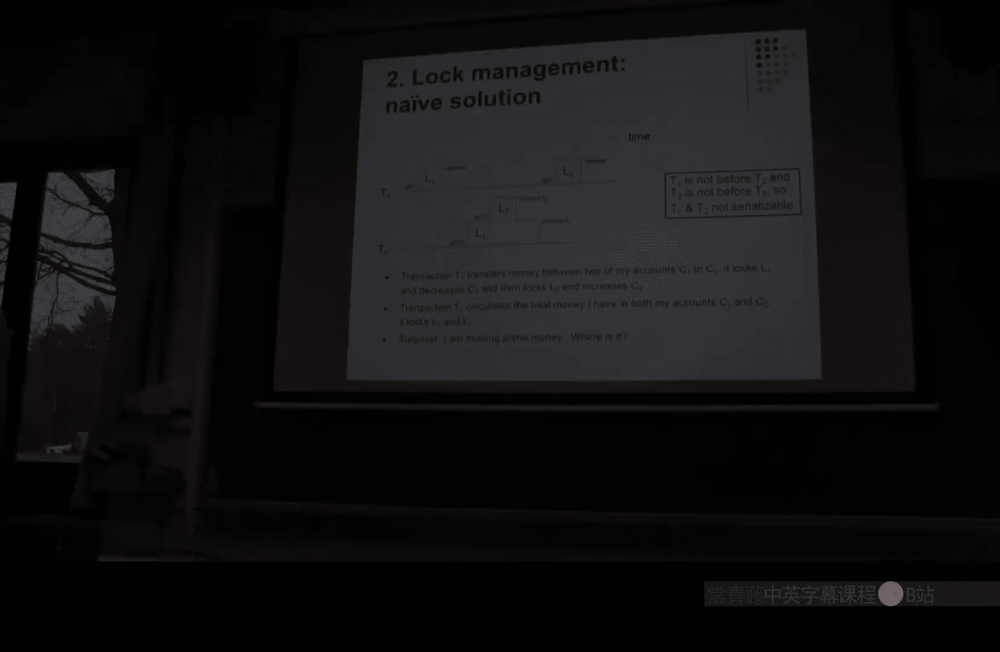

# 高级编程语言概念：14：事务处理 🔄


在本节课中，我们将要学习并发编程中的一个核心概念：事务处理。事务是管理共享状态并发访问的强大工具，尤其适用于需要保证数据一致性、高可用性和高性能的系统，例如大型数据库。我们将探讨事务的基本原理、关键属性以及实现一个事务管理器所需的核心算法。

---

## 概述 📋

事务是一个原子操作序列，要么全部成功执行（提交），要么全部不执行（中止）。它被设计用来处理共享状态并发访问中的复杂问题，特别是在系统可能崩溃的情况下。事务需要满足ACID属性：原子性、一致性、隔离性和持久性。本节课我们将深入理解这些属性，并学习如何构建一个支持乐观并发控制、严格两阶段锁和死锁避免的事务管理器。

---

## 为什么需要事务？💡

上一节我们介绍了共享状态并发的基本挑战。本节中我们来看看为什么简单的锁机制不足以应对复杂场景。

考虑一个包含多个数据单元（例如银行账户）的数据库。如果使用一个全局锁来保护所有转账操作，那么这个锁会成为性能瓶颈，导致系统非常缓慢。

一个自然的改进是为每个数据单元设置独立的锁。然而，这仍然存在问题。假设有两个并发事务：
*   **T1**: 从账户C1转账到账户C2。
*   **T2**: 从账户C3转账到账户C2。

如果T1和T2的执行顺序交错不当，例如T2先写入C2，然后T1再读取并覆盖C2，那么T2的转账金额可能会丢失。这表明，对多个数据单元的操作需要一种更精细的协调机制，这就是事务要解决的问题。

**核心思想**：事务将涉及多个读写操作的任务组合成一个大的、原子的动作。这个动作要么完全生效，要么完全回滚，从而保证数据的一致性。

---

## ACID属性与实现基础 🧱

事务必须满足四个关键属性，合称为ACID：

1.  **原子性 (Atomicity)**：事务中的所有操作要么全部完成，要么全部不发生。不存在中间状态。
2.  **一致性 (Consistency)**：事务必须保持数据库的完整性约束（不变量）。例如，转账前后银行账户的总金额应保持不变。**这是程序员的责任**，需要正确设计事务逻辑。
3.  **隔离性 (Isolation)**：并发执行的事务互不干扰，最终效果等同于它们按某种顺序串行执行。这也称为**可串行化**。
4.  **持久性 (Durability)**：一旦事务提交，其对数据的修改就是永久性的，即使系统崩溃也能恢复。

**实现持久性的基础技术**：数据库通常将数据存储在磁盘上。为了应对写入时崩溃导致数据损坏的问题，采用以下方法：
*   先将所有更新写入磁盘上一个特殊的临时区域。
*   当所有更新都安全写入后，执行一个“切换”操作（例如，原子性地写入一个特殊的标记字）。
*   硬件需要保证**单个字的磁盘写入是原子的**（要么完全成功，要么完全失败）。这样，崩溃后重启时，系统可以根据这个标记字决定是使用新数据还是回滚到旧数据。

为了提升性能，系统会尽可能在内存中缓存临时副本，最后以块传输的方式批量写入磁盘。

---

## 安全性与活性：系统属性的两个维度 ⚖️

在构建事务系统（乃至任何大型系统）时，我们需要明确两类根本不同的属性，它们对应着不同的实现技术。

*   **安全性 (Safety)**：指“坏事永远不会发生”。它是一种**不变性**。一旦被违反，就无法修复。
    *   **形式化定义**：属性P是安全属性，如果对于任何不满足P的执行，都存在一个有限前缀，使得该前缀的所有可能扩展也都不满足P。
    *   **例子**：“每条消息最多被传递一次”。如果一条消息被传递了两次，属性即被破坏且无法挽回。

*   **活性 (Liveness)**：指“好事最终会发生”。它是一种**进展保证**。
    *   **形式化定义**：属性P是活性属性，如果对于任何满足P的执行，其每一个有限前缀都存在一个扩展能满足P。
    *   **例子**：“每条消息至少被传递一次”。即使当前前缀中消息还未送达，总存在一种未来的执行方式使其送达。

**重要结论**：任何系统属性都可以分解为一个安全性属性和一个活性属性的合取。在事务系统中，**锁管理用于保证安全性（可串行化）**，而**死锁处理用于保证活性（系统持续进展）**。两者在设计和实现上是正交的。

---

## 构建事务管理器 🏗️

我们将设计一个事务管理器，它采用**乐观并发控制**、**严格两阶段锁**和**死锁避免**策略。该系统结构如下：



```
[事务 T1] ---消息---> [事务管理器] <---消息--- [事务 T2]
[事务 T3] ---消息--->          (管理所有锁和状态) <---消息--- [事务 T4]
```

每个事务在独立的线程中运行，并通过消息与中心化的事务管理器通信。事务管理器负责所有锁的授予、等待和释放，确保ACID属性。

以下是设计事务管理器时需要考虑的三个主要维度：

### 1. 乐观 vs. 悲观策略

*   **乐观策略**：假设冲突很少发生，先执行操作，仅在提交时检查冲突。如果冲突发生，则中止并重试事务。适用于冲突代价低的场景（如航空超售）。
*   **悲观策略**：假设冲突经常发生，在访问数据前先获取锁，阻止其他事务访问。适用于冲突代价高的场景（如火车轨道分配）。

我们的示例将采用乐观策略。

### 2. 锁管理与可串行化（安全性）

简单的逐个获取和释放锁可能导致不可串行化的调度。

**解决方案：两阶段锁**
*   **增长阶段**：事务可以不断获取新锁，但不能释放任何锁。
*   **缩减阶段**：事务可以释放锁，但不能获取新锁。
*   这保证了事务的可串行化。

**优化：严格两阶段锁**
*   在标准两阶段锁中，事务在缩减阶段逐步释放锁，可能导致**级联中止**（一个事务中止导致依赖它的事务也中止）。
*   **严格两阶段锁**取消了独立的缩减阶段，所有锁在事务提交或中止时**一次性释放**。这简化了实现（无级联中止），虽可能略微降低并发度，但被广泛采用。

### 3. 死锁处理（活性）

即使使用严格两阶段锁，也可能发生死锁。例如：
*   T1 持有锁L1，请求锁L2。
*   T2 持有锁L2，请求锁L1。
*   两者互相等待，形成循环。

**等待图**：用有向图表示事务和资源（锁）之间的依赖关系。边 `T -> C` 表示事务T正在等待资源C；边 `C -> T` 表示资源C正被事务T持有。**图中存在环就意味着死锁**。

**死锁避免策略（基于优先级）**：
我们为每个事务分配一个唯一的、递减的时间戳作为优先级。规则如下：
*   事务请求锁时，如果锁空闲，则获得锁。
*   如果锁被**更高优先级**的事务持有，则当前事务**等待**。
*   如果锁被**更低优先级**的事务持有，则**强制中止并重启**那个低优先级事务，让高优先级事务获得锁。
*   这样可以证明系统不会产生死锁，因为最高优先级的事务永远不会被阻塞。

为了更友好，可以引入“察看期”状态：被标记的低优先级事务可以继续运行直至完成，但如果它在察看期内尝试获取**新的**锁，则会被重启。

---

## 算法总结与示例 📝

综合以上，我们得到一个完整的事务管理器算法概要：

以下是事务状态转换的核心逻辑描述（非正式代码）：
```plaintext
事务状态：运行中、等待、察看期、提交/中止。

1. 事务启动，进入“运行中”状态。
2. 事务请求锁：
   a. 锁空闲 -> 获得锁，保持“运行中”。
   b. 锁被更高优先级事务持有 -> 进入“等待”状态。
   c. 锁被更低优先级事务持有 -> 强制中止该低优先级事务，本事务获得锁。
3. 运行中的事务，如果其持有的锁被更高优先级事务需求，则进入“察看期”。
4. 察看期中的事务：
   a. 若正常执行完毕 -> 可提交。
   b. 若尝试获取新锁 -> 被重启。
5. 事务提交或中止时，释放所有锁，唤醒等待该锁的最高优先级事务。
```

**示例操作**：
假设一个数据库有1000个单元，初始值分别为1到1000。
*   **混合事务**：随机选取三个单元 `I, J, K`，读取其值 `a, b, c`，然后重新赋值使得 `(a+b-c) + (a-b+c) + (-a+b+c) = a+b+c`，总和不变。如果 `I, J, K` 有重复，则主动中止。
*   **求和事务**：计算所有1000个单元的总和。

可以并发启动上千个“混合事务”，同时运行“求和事务”。尽管数据被大量随机修改，但每次求和事务的结果都保持为 `500500`（1到1000的和），验证了事务的一致性保持。

---

## 总结 🎯

本节课中我们一起学习了事务处理的核心概念：
*   **事务**是将多个操作封装为原子动作的强大抽象，尤其适用于数据库和需要容错、高性能的系统。
*   **ACID属性**（原子性、一致性、隔离性、持久性）定义了事务的核心要求。
*   实现事务需要区分**安全性**（如可串行化，通过锁管理实现）和**活性**（如无死锁，通过优先级和时间戳实现）。
*   我们探讨了一种具体的实现方案：采用**乐观并发控制**、**严格两阶段锁**和**基于优先级的死锁避免**算法来构建事务管理器。
*   事务是支持现代信息经济的基石技术，理解其原理对设计可靠、高效的并发系统至关重要。