# 鲁汶理工学院【中英⚡高级编程语言概念｜LINFO1131, Advanced programming language concepts】 p41 P41 FO1131 Lecture 1 (2023) -BV1UDffBbEBZ_p41-

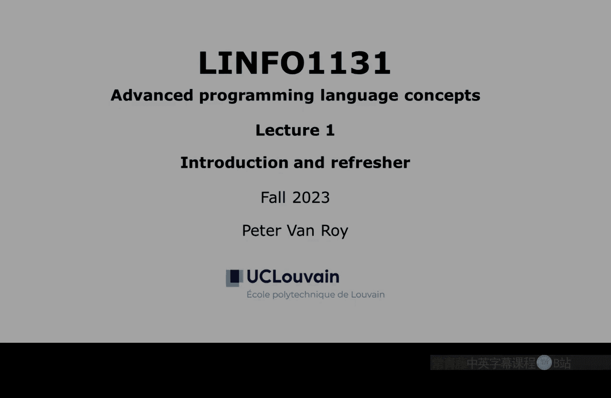

Okay， welcome to the course。First， course。This is。なるほど。11。31。

So just make sure theres the right group， okay？Im going to teach this course in English。

But what I opposed the history。Don't don know the。And I made you of answer in the language of Shakespeare's。

Even though I'm not as good as writer as。Okay， so let me start the tours， this is， a course。

 the official title is concurrent programming concepts。But in fact， it's more an advanced。

Programming concept of course。So I'll first explain the organization with the course and the grading。

 and then today I'm hope to give a refresher。Because this course is a fellow up。

To the previous course。不是。安初。104。So， we're going to go。A lot farther。

 deeper to many of the things we started to see here。

And so I will explain that today and I will give you refresher today of this creepvy course。

 so if you forgot this one， hopefully after today， you will remember again okay。

So of course it would be， so I am theater member， I I'm the teacher。

 there is going to be one teaching assistant。残年 okay。And there are four tutors for the lab sessions。

あ生ですね。ざです。你本な都。이 줄。刚才。So the lecture will be on Wednesday。

Three lab sessions per week that are planned。Monday， morning and two to Tuesday afternoon。

It depends on how many students are growth， in fact I don't know yet。

What is the 12 number of students， I see there are 40 students on the Google。

But the first week we don't don't really know， I will have to wait until there's official visit。

So there are three lab sessions per week， so normally you have to， you should attend one lab session。

And the lab start next week。Okay， so next Monday and Tuesday。

 the first lab session is Monday morning Day 830。I know this is very， very early。

 but it would be very nice if some of you would be there， okay？

And let me also explain how now of course。Would be graded。So there is going to be a project。

In the second half of the course， this project is mandatory。是由女孩。During the semester。

Okay and I've done groups of two， and there's plenty of time to do it。

 so normally I expect most of you to get very good points on this project。

There will be also a midterm。Which is word one fourth， this one is optional， don't have to do it。

 but if we do it， I highly recommend that you do it and if you do it。

 it can give you an advantage for you。There will be a final exam。よしす。right this way。

 it's worth three quarters of the points， but it's divided into two parts。

So the first part corresponds to the midterm。And I will give you the maximum of both that means if you do very well on the midterm。

 you don't have to do this part。And I'll only do this one。In fact， if we do very。

 very well off the project in the midterm。Then you already succeeded in the tourists。

And the final thing is there is a bonus。If you attend all of the lab sessions。

 all you have to do is attend the lab sessions。Pretend to be doing exercises。It's not much up。

 so if you attend all the lab sessions， you will get one extra point。On the exam。

 so we take1 minutes this is a dividend， so this might seem like a funny present that I can be。

 but in fact， I have a very good purpose with this。Because if you attend。

The lab sessions and automatically you will understand better the course。

 and you will get better points here， so this has actually a double effect。

So this and my experience works very well and people who do honest usually make very good points in this course。

Okay。So let me know。Give you some more information on the organization。Of course。

So there will be slides on the Google。

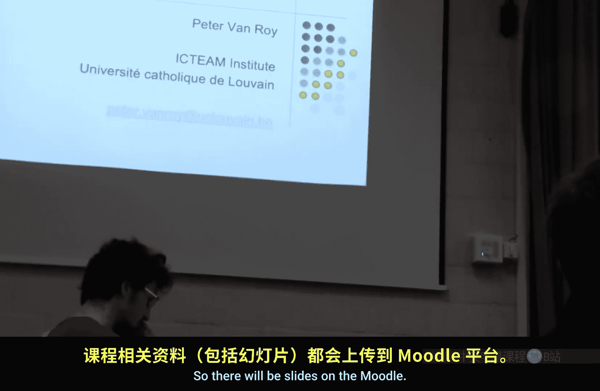

So every week I'm going to join the slides before I continue。

 I want to pay few seconds with respect to Ukrainians who are fighting for their freedom and also for euros。

ok。So I gave you a little bit of information on the course organization， the TAs of the course。

 the tutors。And what I'm going to do now is explain a little bit to the theme。

And I will give you today a refresher of the previous quote。Session。

 I will try to fill up your brains again with what we saw in the previous course。え。

So here is the organization， so this repeats a little bit to what I said on the board。

So notice there's a Moodle， so please enroll in the Moodle， people who are not aroll in the Mole。

 androll the mood， everything' is there， on sps， announcements， projects， information and so on。

 the midterm will be around week seven。Probably during the smart done。

 there is this special week that was invented in the faculty around week  seven where there's nothing。

 but it's a week where people can put things so it tends to fill up with many things。

During the photos of things that do not be done in other places。

So probably the midterm movie be done there。So that's how the course is organized。

 so great that already explained。The midterm of the project。Ex。And the one point vote。

In terms of software， we were using two programming systems。So the Mozar system。

 as you already know and appreciate from the group course， Mozar I。

 but also we will be using the airline OTP system。Which is the 3D available at ourline。org。

Because we will be studying how to build resilient， robust。Software， that doesn't crash。

And airline is the best system for that that exists， nothing is better。十期。

Let me say a little bit about what we're going to， the themes of this course。So， there。

A couple of themes that would be going through the whole course， one of them is concurrent。

This already started in the previous course。A lot farther in this course。

 so preparingcur programming is very hard because there is down determinism。

So we're going to show many techniques for making it easy， so that's the first。The first thing。

The second theme is declarative programming， this is based on functional programming。

 and this is programming without municipal states。So basically withoutty。This is a very curious idea。

 but it's very powerful。And this is the best way to program and more and more programs。

Are being declared， so this will， in some sense。We for the future， okay。

 we'll try to do this as much as possible。And the third theme is non the comparative programming。

 this is programming when you interact with the real world。

 when you have real world time and nondeminism， so this is much harder。

But we will try to make it as easy as possible。So those are the three main themes。

 and to be a little bit more specific。So we have here in the red box。

 you see thelarative programming in the black box non declarative。

 each of the little boxes inside is a programming paradigm，s the way of programming。

 so in thelarative programming we see sequential functional programming last in mid course 11th year four。

 we already saw a little bit how to do deterministic data film， which is a very nice。For programming。

But this person， we will see two more paradigms。Lay evaluation。Or by demand evaluation。

 This is a very powerful form of。The Twitter programming that。

For the program kind executes in the opposite direction。

 so you will see it's a very interesting way of thinking。And finally， we will combine these two。

Into lazy determining data flows， so this is the most powerful paradigm for theative programming。

Okay。And there's many things you can do， so you'll see functional， more than higher order。

 laing returns turns。Semantics an advanced algorithm design。

Something we did not see at all in previous course， how to make efficient declarative algorithms。え？

And then in the second part， we will go to non declarative programming， so this one。

 the red one you cannot do everywhere， unfortunately。You can't do that all the time。

 sometimes you need to go beyond when you interact throughout the world。

So we'll see that we'll see how to reduce the nondeterminism。

 so there's a kind of evil demon in there called nondeterminism， so we'll see it to minimize that。

She has do multiage programming and will see a lot on how to build。

Robust multi agent programs in airline， so airline。

 which is a language which is based on wealthy agents talking to each other。With no sharing。

 so the agents are basically communicating， sending messages to each other。But on top of this。

Its build a whole structure how to build applications。So when an agent fails， when it crashes。

Others do not cry。But they can be informed so they be see that this one crashes。

And you can use that to build very robust programs。So Air has a concept which is called supervisors。

 so we're able to see how to program use supervisors。

 so we will have several lectures on airline and Air has a kind of programming pattern。

Stuc called behaviors， so all of the complexity of supervisors and fall towers is hidden inside the behaviors。

 so that means the programmer can build robust applications very easily。

 so the most robust applications that exist，In the industry today are militant para。

 even if people don't advertise their tie， so for example， there is many games。Airline built them。

 especially multius in current games， like Public dutyty。

 millions of users has a huge airline based infrastructure so I'm going to give a talk。

An industrial viewpoint for early。So a company called Deware。

 which has built a lot of airline support for gaming。

 so we're going to learn about how they use early。So that's going to be a big part。Of the course。

Building robust software。 And finally， we're going to look at。

The more shaped state form of noninative programming lock monitors and transactions。

So when you have a beautiful state， like a database。Lots of data。

 but many people are accessing it concurrently。How do you make sure that they don't mess things up？

So for that， you had a concept called the lock。And then you have other concepts called monitors and transactions。

 so transactions are very good。Monitorors are really nasty things。Moniors are very nasty。

But they are still used a lot， they're still used a lot in legacy， okay。

 so I would recommend you to use monitors， but since you will see it in the legacy code so Ja uses monitors a lot。

 but monitors is actually a very bad way。Doing currency， but you will see it anyway。Because。对。So。

The schedule would be approximately like this， so the course would be kind of divided into two parts。

Declarative and non declarative。So the first week， so S1 is cement。

 the first week will be the it is today's the refresher。

Then we will talk about next week we'll talk about lazy valuation。

 so the media we go into lazy and lazy deterministic data flow and this is a very rich area。

 and we will talk about declarative currency and I will give you really the semantics of it。

And then we will talk about the advanced declarative algorithm design。

 these are very sophisticated techniques for building。

The clarity with algorithms that are very efficienticient。

You want algorithms that have very good time of complexity。And this shows like that。

And then we will end with the limits of declarative programming。

 and then we go into non-dlarative programming so I will continue on data abstraction。

 so you saw some of it already previous course and multi agentent programming。

 but then we will talk about robust multi-ageent programming in Para。

 so we had two lectures which are based on airline。

 so I gave on right an introduction to the para in the previous course。

 but we were going to go about to go much deeper into that。ですか。

And then we'll talk about shared state con， lock， st spaces， monitors， transactions。So this。

 the only really useful concept here is。Transactions。

 this is by far the most useful shared state concept。

 but it's important to understand shared state because it excused a lot still。

And in the final lecture I will review some of the more difficult parts。

 the midterm will probably be in week seven， it will be somewhere in the middle。

 so the midterm will typically the topic will be just declare。Part it will be。

So that's kind of ongoing the structure。Of course。Okay， so what I want to do now is refresh。

The previous course I'm going to give you very quickly many of the concepts of the previous course and with love with code。

So as you know， I'd love to write little pieces of its very important。ど that。So this is a refresher。

 so normally you have seen it already， but I understand students。

 I know of students that maybe they don't remember some of the things so long。A of last year。

But I will assume starting from next week that this is all something completely you perfectly understand。

 Okay， so the first two lab sessions will be bringing you back to all of the stuff we saw in the previous post。

Okay， so let me start now give you the refresher， so the first point is functional programming。Okay。

And I'm going to give you some different examples of that。

Functional programming where you find mathematical functions in higher order。

 so I will show you many examples of that today， so this is by far the best paradigm for testing。

 maintenance， improving correctness， and it's used a lot now。

When I started teaching these courses 20 years ago， it was not， and this is so much。

 so I was telling people this is so good they were saying， well， yeah， but why is nobody using it。

 but that has changed now。By nowadays， it's much more used。

Even even Java has the JBM has a more functional language pop closure built on top of it and many of the2 analytics tools are based on functional concepts。

 so if you take the cloud computing course，Which is very nice of course。

 I recommend you will see some of these analytics。Software platforms。 and if you look carefully。

 you will see that they are mostly functional actually。

 where they are mostly deterministic data load as a concurrent kind of function。

So that it's much more used today， because it's the only way to write it large， reliable。ど。オケ。

So in this course， we're going to push the functional programming as far as we can。

 as far as I know how to push it。Okay， so you'll see a lot of。Things un functionalal。

 so the determin is dator thought but especially the lazy form and the advanced。他です。Its best。

Basically， the idea of functional programming。Now let me go to some specific topics。

The first one is invariant programming。You remember invari and variants are important to loose。Okay。

Taale repressive functions are the same as wind loops。And。So that me give you as an example。

So if I define a factorial function。If I say something like this。

 n is equal to zero then1 else n times。Factctorial N minus1。Okay， so this is a nice factor function。

うん。Use是。Compations。SoHere's。反错人多。Quity that me make this one those the。Okay，Of course， you all know。

有会慢。That this is not a way throughout factor， you remember that？

This is actually a very bad way in writing factorial， you remember you know why？Why is this bad。

It's not Taylor person， but what does that mean actually in terms of the execution？

What's going to happen， what kind of bad thing will happen during the execution？

a big memory so the static size will grow and in disproportable to end and the reason is is that the function call that the recursive call is not the last。

CallSo what you really want is to make this thing tailored person。

 which is the function call is the last one。This corresponds exactly to a wild loop。

So doing it like this， here you have an explicit need for a stack， n times factorial n minus1。

When you do the reverse call factor to then minus1 after that call。Com back。To do the multiplication。

That means during the call factorial N minus1， this multiplication has to。Be in memory， okay。

 and because it's recursive， n times n minus1 times n minus2 times and so on， they're all in memory。

So if profit by new factoria 100， then the staff will be 100 levels deep。Okay。So， this is not good。

And especially it will not be good when we start writing concurrent programs in a concurrent program。

 this will be a function that will turn into a concurrent agent。

And the currentrent agent runs forever， okay， it keeps taking input。But if the snack size is growing。

 it doesn't work。So this is actually a completely wrong way of writing it。So the right way。

So here let me write it now another way。I add an argument。

So I corresponded to the N A is an extra argument of an accumulator。

And now I will lose some kind of magic。If I is equal to0， then zero， then I would return A。Otherwise。

 I do a arraycurive call and the arguments are I minus1 and I times a。Okay？And if I do this。

This I make mistake if I make mistake。嗯。This will give me the same result as before。

 so I have two arguments， one is called argument is called an accumulator。

 it accumulates the result and it accumulates the result before the workers call so you can see this。

This is a tailwork person。Program because the recursive call is the last operation。Now the question。

 how do we write these programs？It's kind of magic。The way to write them。Is by using invariance。ok。

The way to write them is to take the result。It'ster fortunate to take the result。

 which is end factorial。And to divide it into two parts。

 so in this case it's easy I factorial times A。L is the argument of the function。

 so L is a constant in this equation。Whereas I and A will be changing。

 you will have different values of I， so the idea is you will try to reduce the value of I。

And increase the age， so it starts like this。嗯。If I is equal to n and a is equal to1。

 then this equation is true。And then we decreased started。N minus1， and here we make it n times1。

So if I is equal to n minus1， and here we have a is equal n times1， the equation is still true。

And we keep going decreasing until this one。0。F factor is equal to one。

 and then this will actually be。The number here will be equal to n factor。

 so the idea is that this equation is always true。And this automatically gives you a tailcursive function。

 okay？So we're going to do more complicated loops。And declarative programs in this course。

 and the right way to write them is by doing parents。So this is refresher， we saw this before。

And sometimes the invaris are very useful， who will see examples where the invari is really the only way to write the program。

Okay。So here's in the code。So in the left， I did code in C。Or drop off。So here you see a wider loop。

 and A and I are the two arguments。While I bigger than zero， a becomes i times a and I did curve pi。

 so you see I'm changing both A and I。In the functional case， A and I are arguments here， okay？

And I do exactly the same thing， the a argument becomes I times a。

 and the I argument becomes I minus y。And when I'm done， when I is equal to zero。

 that IA will be the result of。So these two programs were basically executed in exactly the same way。

And so here you can see that A and I。That the memories used in the code this constant。

Because I just have two variables。The same is true here， because it's tail recursive。

 this recursive call is actually going to reuse。The staff frame。

So A and I would be stored in the same place as I times a I minus1。

So these two are doing exactly the same， so what's the difference if we're doing the same。

 the difference is that the second one is actually obeying the semantics of functional program。

It's actually declarative whereas the first one is not I can anybody can assign a where here I'm actually defining a mathematical function。

 so the second one， I can actually use it in a concurrent way and it will not make any bugs。

 it would be no race conditions not non。So even though they're doing exactly the same thing。

The second one is actually better because it's。Declared it's obeying the land of cculus。

So remember we saw down the calculus thing。Previous course。

 so remember that you the people were trying to get their brains around the Laly calculus。

 so the Latic calculus， which is that the core functional programming。

So you will be happy to know that we're not going to see lambda calculus anymore in this course。

But it's important to know it because it's the reason why a function program is so useful。

Because it obeys something called the church Roo theorem。

 this very simple calculus will give you the same result， no matter how it's executed。

So the program on the right is a lambda reduction whereas the one on the left is not。

 the one on the left is using mutable state in a very disciplined way。

 but nobody is guaranteeing that okay if I make a mistake on the left。

 then I can mess it up whereas on the right， I'm not using mutable state。

 it's a perfect lambda reduction。So this I saved this refresh your memory。

So remember we saw Lambda calculus， so I'm not going to repeat the lambmbda calculus in this course。

 it's not a theory course， and we don't have an unfortunately time to go on。

 but all of the declarative programs that we do will behind the scene are still with Lada。

When we do lazy determin concur， it will still be do London。Okay， so that's the inventance。

So when we do loops， we would base on the ver， so this is a general rule in all languages。

 in all paradigms， if you want to do a wild loop。Or telecurive function， which is the same thing。

 you have to write down the variance。And the right way to code is to start by right now。Okay。

 so that's one thing。Let me go on out。To refresh the next。

The thing you saw is called higherer order programming。ok。So in higher order programming。

 the idea is that functions are just values in the language。

There are data like numbers or records or lists， okay？And you can define a function anywhere。

And when call that function， it will always behave in the same way。Okay。

 so higher order programming is the concept underneath all data abstraction。So you will see many。

 many data abstractions。in languages， in different kinds of languages so there's a fairly new one called GoD done by Google。

 there's closure， there's rust， there's all kinds of new languages。

 and they will do be defining data abstractions。All of these data abstractions are based on hiring your programs。

So in C plus class you have classes， many classes，1 plates， well that's just high orrop。

It's all high， so let me refresh your memory on that。So let me can write again and piece code。So by。

Decl， for example。没。And equal to five， and I have a function。And then。X plus n。In this function。

This when I define this function at an n。You can see that the end here。Its not。And二。Okay。

 so what isn't well， the N exists in the scope of this function。So when I find the structure。

 the n is defined， okay。So this gives me 16， which is 11 plus5。Now I can make this general。

So I do make add and this make add function will return。的本式。

Here I'm doing real high order programming， the main add here， the N is not argument。

And instead of defining this function at n directly， I define it inside of make add。

 so the dollar is just to make it anonymous， there's no identifier， so this is just a value。Okay。

 which is the return value of this function and this function will take x and do x plus n， so again。

 n exists in the scope here。And it's going to be there， so each kind called make an。

I will create a loop。And new function。诶。This is a typical kind of example of higher order program。

 and you may add five。I will create a function called Add5， I will do make that。

10 as a function called at 10。Okay， so the same make add call。

Will that be create different functions？So add five returns。The argument goes5。

And had10 returns the argument。ten6ゼ twenty。So the way it works is that function values。

Are actually not just their structure。There is something dynamic about the， called the。好。

Conual design。对。Okay， so one of the concepts we saw in higher order programming is the order of a function here I'm calling it add add called the make add in the example code。

So the order of a function。A function that takes。Arguments that are not functions and return something that's not function。

iss a first order function and a function that takes a first order function as argument or returns to first order function is second order。

 so the order is a way of quantifying how abstract。The higher order program is。So here， for example。

 add this function add N， which returns the function， so what is the order of add N？You tell me。

Someone else， I know some people know the right。2， so the order of add that is2。

You see that because added returns。A function that takes x and does x plus n。

So it returns a function that。Takes a number and does an addition so that the function that it returns is first order。

 so add in is second order。So this is the second order function。Okay， you see how that works。

So if you do， for example， object oriented programming。

 and if Im an object that does computations with integers。Then creating that object。

 there's a function new， which takes a class and returns a new instance。

New would be the second order。And you can be funded。早くる。Okay， so a little bit of semantics。

So this concept， the function is of value。Is really very important and you will see it everywhere and there's many names for this thing。

 I call it a procedure value。Because in the kernel language you have only procedures。

 so I called it in last year's course， I called it a procedure value。

 but typically this concept is called a closure。In French you feminitudes。Soclosure does it closer。

 so it's a mathematical terms。Because it has its own environment environment。

Which is created when the function value is created。Okay。

 another way of saying calling it is aically scoped closure。TheWhen you create the function value。

 you look at。The identifiers that are leically， so textually。

I that that are defined where you define with the function。

So another way a synonym is calling it lexically scoped or statically scoped closure。

 so you will see this term all over the place， people love talking about it。

 so it's a very fundamental concept so we saw the semantics of this just to remind you。Remember。

 in the previous example， we had add five and add 10。Here semantically。

 let me give you just a little bit of semantics。Theres a variable memory。

 A1 which is bound to the S5 procedure， and this one has two parts， it has the code here。

So in the kernel language， the code is actually a procedure because it adds an extra argument for the output。

 so r is equal to x plus nmin， r and x are arguments， but endmin is not an argument。

And is defined in its own special environment， so the environment connects the identifier head with a variable in memory。

So this is the variable the little end will we equal put the5 for a1。But we also be defined at 10。

 and there's a healthy variable A2， and the environment here will refer to another variable little M。

Which is down to 10， okay， so this gives us two different closures。Now this is the semantics。

 so the left it has two parts， the left parts。Is to code， so in the actual implementation。

 this will be machine code， this will be instructions。

And the environment frame will basically be vector， a vector of pointers to variables， okay？

But semantically， this code is defining this procedure OK。And semantally。

 the vector is an environment。Okay， so whenever you implement a language now Victoria language。

 for example， you will have this kind of structure all over the place。

Paairers where you have code and an environment， a vector of variables。So this side。

 this is a very important thing and we're going to keep using it and functional programming is based on this and all data abstraction is based on this。

Okay so this refreshes you， so this is all very clear， right， you remember it all loud。で是啊。Yes。

 say yes， yes， good。You can always interact with me if you don't agree， if you have some comments。

Just to say， I prefer that you're more active。So here's another example。

This one map is an important higher order function。This one has two arguments， it has a list。

And a function， F， F which is a one argument function， and notice here we're using case。

 so I will talk about symbolic programming later when I traverse it now this list。helello。

And the end of the list is nil， otherwise the list has pairs。

 so basically I'm applying to function to every element of the list。オ。

Now that there recursive called here。I am creatingaving new list， so hell is an input list。

 but I'm creatingaving an output list and I replaced the value H by F of H and the vertical bar is the list。

Creation operation takes an element in a list and builds a new list from them。

 and I hear the re of call。So this。M look like it's not to person， but it is to。

Do remember why so this is this function map is a1cur function。Do you see why it is。

 do you remember why it is that？Remember？The factorial， let me go back。I don't have it here。

 but it's in them。The here。对。So this one on the top here， n times factor and n minus1。

 so after their curs call I still to do multiplication， so that's not killed。But in this one。

 in a math case。It is， I going the person called to Matt， and after I do that。

I will build a list using the vertical graph。It's not v， it's building it is。

 so it's a data structure。Construction。So unlike the factorial， this one is Ti。Okay。

 you remember why it's like that？これ？Does anybody remember why it's irrepressive， yeah。

 I no campaign for？Sorry， no waiting there's no waiting operations。

 why is there no waiting I mean the liz has the right like yeah， yeah added that's right。

 but so you understand， but there's a small， yeah， so you're right。There is no waiting operation。

 but why is there no waiting operation， So let me explain， today， so I can see that。

It's not always the。So this map function is actually procedure feature。In current language， LS。

It has a result。A function always has a result， so semantically that result。

 we make it visible in the kernel language by getting this a procedure。

And here we have r is equal to。FH。前嘅。Okay， so this result is equal to this now this。

 let me write this in language and you will see why that it's still recursive。ok。So they function F。

Let me say it's doing。Thanks is Andrew Page。Then there's map。Mat， I do you like this？T诶。R， R1。

And then I have r is equal to x bar R1。So this is the naive translation， I'm calling F。

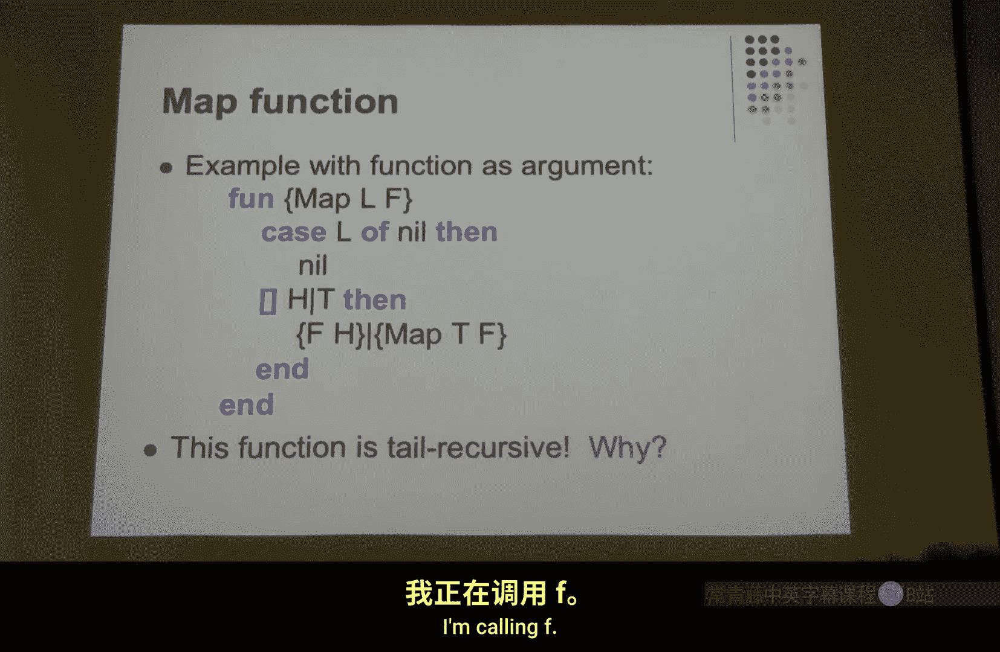

可你咩。So this one returns x， this one returns r1， and then the R is equal to x for R R1。

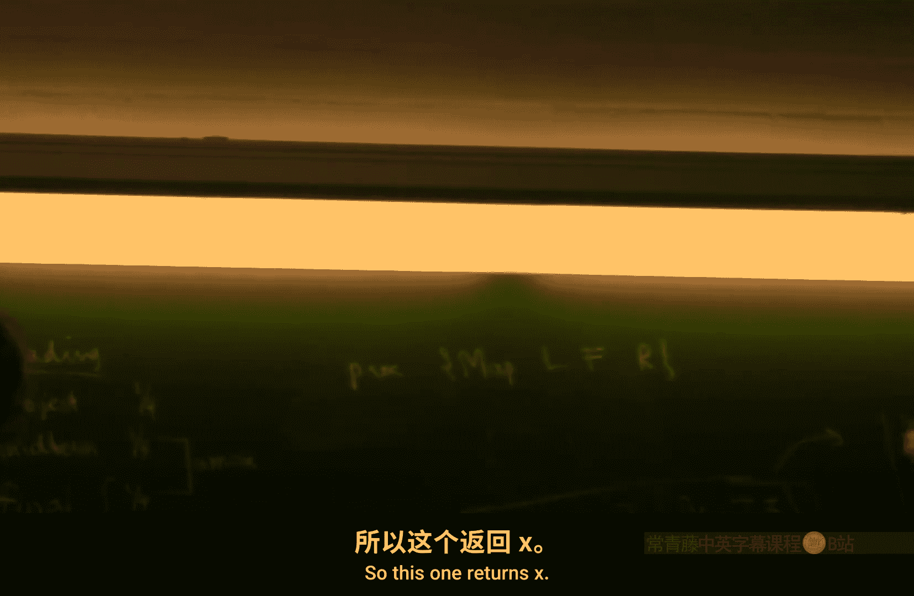

So it seems like this is done after。But。It's not。So this， you can actually do it before。

And I will explain why you can say far。Is equal to next dollar or1。

And you can do the math quality as then finally。So I'm actually defining。呃。R x1。

 so let me define them。So I call F of H returning PA。I create the list are。But R1。Is an unknown area。

So I can create the list， even though I don't know the value of R1 yet。

And then I will bind it in the recursive call， so this one is till rehearsive。

The reason why it works is that I have these unbound variables。

 so this is the notion of a single assignment variable。你。

This allows the map to be tailor in personive。Okay， because I can create data structures。

Data structures that have a hole in the， so this unbound variable is kind of like a whole lung。

 a twoop， and you fill in the whole layer。And it's still declarative because you can only fill the whole once。

Once it's filled， it's filled， you cannot change it， so it's still declarative， okay？

And this is very important， so it makes Matt tail recursive。But as' we will see。

It will allow us to do。Thelarative agents。Concurrennce agents。

So this notion of single assignment lets us。Turn the map into a concurrent agent。

So to remember how the current page works， so you have the map， for example， running in some thread。

Now I've learned a little faster the L is an input stream， and then you have another one。

 which is the output stream。So the list turns into a stream。

Because the elements are created incrementally。And the output stream is also created incrementally。

 so I have a concurrent agent taking stream of input and returning a stream of output。

And it all works。で解説してください。Okay。The agent is the map is still recursive。

 and what it means is that the memory use is constant。It has to be constant。

 otherwise it's not going to work。Okay。So you can see that。This。We add singular sign。

 so this is a fundamental concept in concurrent functional row。In a lot building declarative pages。

 so we're going to use them a lot in this course， as you will see。

 and we will do many things with these declarative pages and single sign。So this。

 it's like assigning a variable where you can only do it once。

So you can see it's like a restricted form of state， okay， it's restricted so that it's declared。

 it's not like I can assign many， many times， which is very nasty because you can always assign again and break something here can only assigned once。

So doing things once is good if you're only doing them once。So this is， it seems a very simple thing。

 but it's a very fundamental。ok。So let me go on though。So you saw many other things。

For high programming。And I'm not going to show them all now， we saw the genesity。

 generosity is when a function takes a function as input， instantiation。

 it when a function returns a function， like when you create a new object。

The new function in an object pointeded language is returning an object。

 an object which is actually a function of。And an object which is represented by a closure。

That's a case of instantiation， so this is used all the time。And then we saw other examples。

Composition， we saw a very important。H order function called fold。

 which allows hiding and accumulating。 I'm saying it's abstracting because。

From the outside you don't see， it's hidden inside the fold， so actually there's an accumulator。

 but you don't see it。So the fold lets you hide an accumulator， also we saw encapsulation。

 remember which is important for data abstraction， we also saw delayed execution。I take a statement。

And make a function out of it。And I give this function to someone else。

And when you execute the function， then you execute the statement。And it's like executive statements。

In its original place， only it's done somewhere else at another time。So with that。

 you can build control structures。So really higher order is a very powerful fundamental for。Okay。ok。

Let me go on。 So the next thing I want to talk about is。

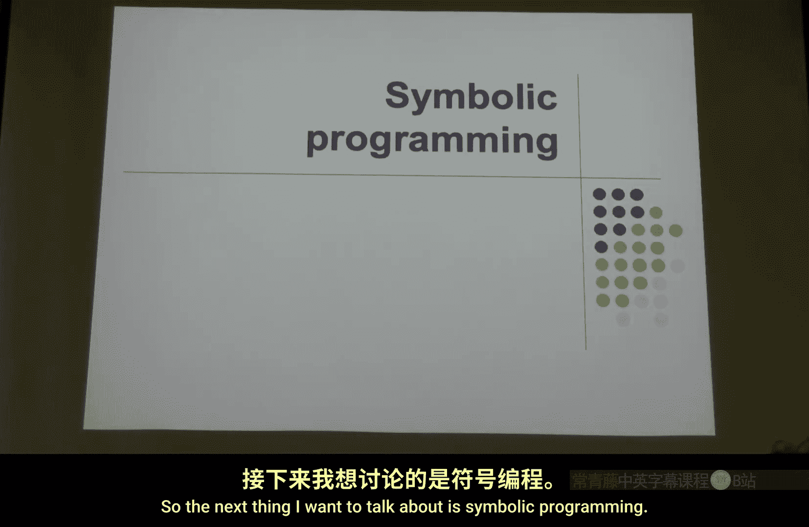

Symbolic programming。But let me make you smoke break now。

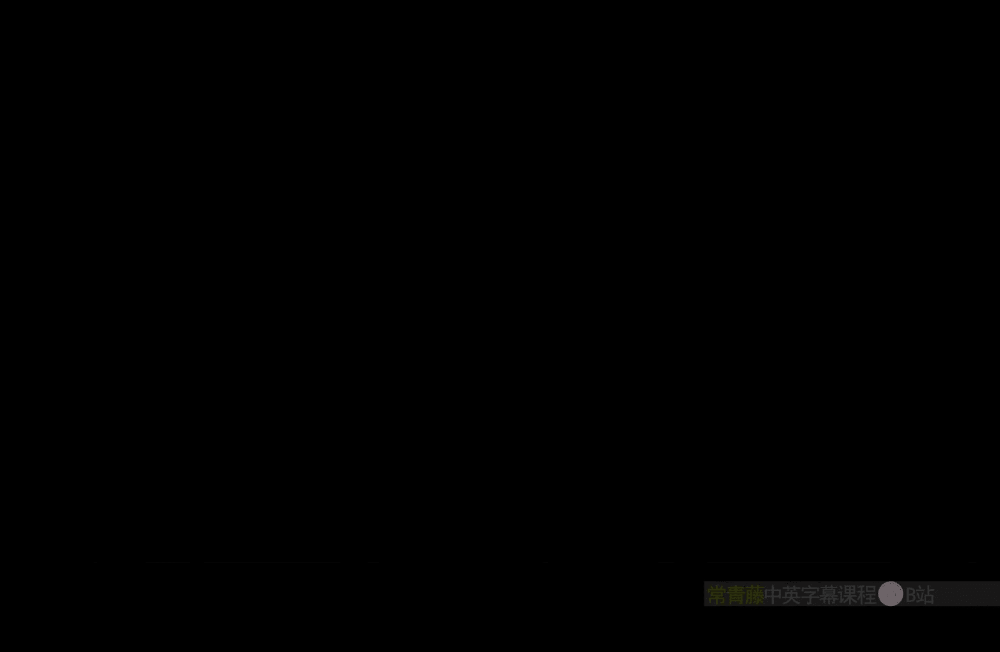

About symbolic program。Another thing we saw in the previous course。

Symbolic programming is programming with things that are representing a kind of that are not just numbers。

It was then structural things。For example， one of the important data structures we saw is called lists。

And we saw the ways to describe using a gra rule definition， so this is a recursive。At least。

Here is defined either being n or so the vertical bar in the grammar meet four or an element E。

Followed by a vertical bar， the closes means it's a part of the definition of the structure we're defining。

バのようです。So this is a recursive structure。That ends in nil， okay。

 this is one of the most fundamental symbolic structures it was first introduced by the list language which in the 1950。

 so it's very old thing。But it's you with this and it's a very important structure。

And many languages are giving detecting support to this， so A bar， B bar， C bar， n， in Oz。

 there's many ways the same same list， you can use the brackets crochet it。To denote the list。

 or you could represent them as a records completely explicitly where the vertical bar here is the title and you have the first argument is the element and second argument is。

The recursive list。オケ。We saw that graphical representation of this。

 so you can represent these structures as trees basically。

 but a list is a kind of degenerate tree where it's going down to the right。

So here this is the list one through three， so the vertical bar is the roots。The leftmost。

Branch is the element and the rightmost branch is the subs。

And then we can do an operation called pattern matching。

 where we take this stage structure and we compare it to a template， which is called a pattern。And。

We will then sign the identifiers in the template plates to parts of the negative structure。

There's a special instruction called case that lets you do that。

 so linegs that do symbolic programming like Tco or airline or many languagegs doing symbolic programming will let you do pattern matching okay。

We'll let you take part to these structures， so if I encase L of H bar T。

 then I will H barT is a pattern。Which is a kind of picture it templated。

 and I match it to be in an actual data structure， so L is the actual data structure in memory。

This part on the left， and I'm matching it to this。Calculate。And if it matches。

 if you can make it corresponds。Then you will bind the identifiers and here H and T。

 so H of equal to one team will be two v， three vil。But it might not match if I match this。With nil。

 for example， it will not match because nil is not matched with the vertical bar。え。And now let me。

 because now we're talking about lists。呃，人民。Show an important operation。

So I showed already E map as introduction， but now we go as a little bit farther。

 let me show you the full operation because it's a very important operation。

So it's using a higher order programming and there's an am sign and then way it works is in if I have a list a0 and1 to A a minus1。

 and a function F。I can define repeated application of the function。So， for example。

I do something like this。If I have a list one， two， three。

 and the function is additional and I start with the identity elements。I can repeatedly apply。

So this is a binary function， start with an identity and apply all the elements of the list。

So this will be what the fold operational computes。Okay， so it has three arguments， the list。L。

 the binary function F and the identity element U the start。这这个。The computation。So you can define it。

Easily， so this one is called fold L because it's left。Associative is another one called full R。

 which is right as sosociative， so the left associative one is the most commonly used one so here I'm doing pattern matching。

So if L is nomin to U， otherwise I will do one step。

 so the U will count as F of UH and I do a person call。对。

So let me show you how this works This is full is a very important function that occurs in many。

 many places。You see it。Appearing very often。Hello， you。対応さていう。E of no than you otherwise。HV T。So no。

 So T F doesn't change。 And instead of u now I put。The one step of the operation。

 so the binary average F UH。So this is the fold operation， so you see it's accumulating。

 so the you argue it' is actually an accumulator here， it's like the age in the factorial definition。

咁系必须要这波。So that in the browse。Fuold cell let's do one， two， three。That's the function here。X boys。W。

 and it started with zero。So here we have the three arguments， the list one and three。

 a two argument function。That takes x and y of x plus y and the identity the beginning of zero。

So this is going to add up all the elements。It returns six， K1 plus two plus three。And of course。

 you can do major variations of this。Here's no variation。这。In， I multiplication。

Now we're going to start with one。And then do one times one times two times three。What do you know。

 it's all so equal to say stuff？One， so the addition will return。在。So the red is question in red。

 so it's full to temporal recurive function。What do you think。Is full tail person。

 what is the last operation？What is the of isn？Yes， yes， I see someone nodded head， yes。

 it's still Christmas。So this is finally， it turns out that when we start building a declarative agent a concurrent agents。

It takes messages。It has an internal states。Okay。And each time the message arrives。

The internal state is updating， so that's usually how an agent works that receives messages and it does some kind of computation。

 updates the internal state。The fold is exactly the heart of this。

Because the list coming in is a stream of messages。

 the F is the state transition function and the U is the internal state of the agent。

 so this full operation。Is actually the heart of a concurrent functional agent interesting on and there from other uses of gold if you look at。

Cloud analytics tools。Theres a fundamental operation called map produceuce。

 what reduces just the synonym for， so the reduced operation takes a whole bunch of few things。

Combines them together。 So the fold basically takes a list and reduces it to a single elementom。

For example， by taking the sum or maybe the statistics， maybe these are data items。

that you're doing the big data analytics and you're doing some kind of statistics on them。

 well the formal corporation F， maybe it's doing with statistics is computing the mean and the variance。

So the fold operation is really very fundamental。So we will see it more in this course。Okay。

 let me go on now， let me now talk a little bit with pressure memory on data abstraction。

So we saw already a little bit about data abstraction in the previous course。

So data abstraction is built on top of fire borderer and it's a fundamental thing in computing technology。

 okay， so it takes a piece of program and puts it in a box and you can only access。

internals through the effects。

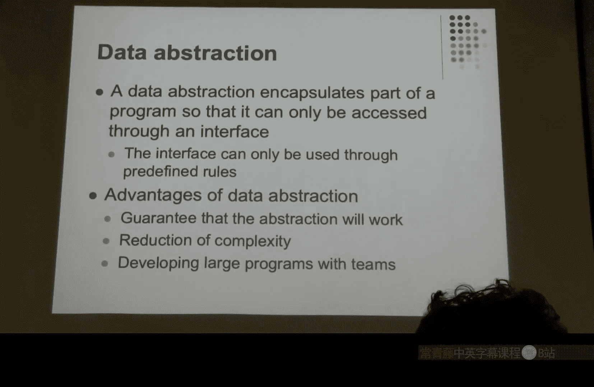

So if I have a program， I have here a box。

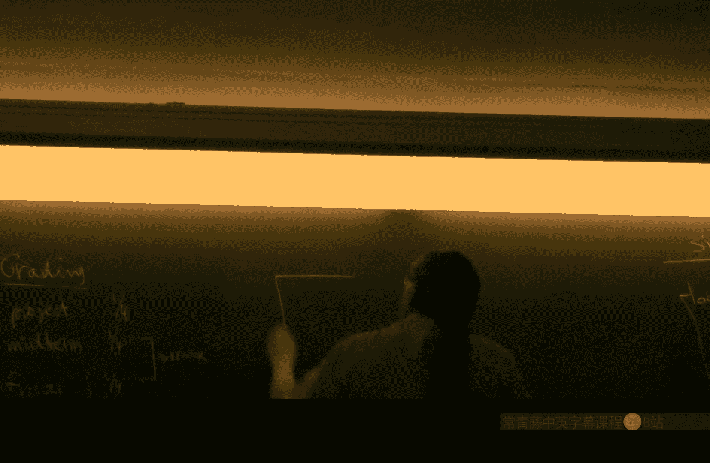

Inside and I had interface。And the only way to access the internals is by going through the interface。

 and this interface obeys certain rules。If you don't obey the rules， the interface will not the work。

 okay， you have to follow the rules。For example， if you're building a stack。You can push the pump。

But you could only do a pop if there is an element， so if there was previously a push。

 so that's a rule that the interface obeys。So all large data。

Programs are built using data abstractions， all programming languages supported。

And the three main advantages are that the interface guarantees that。The functionality works。

Because you are forced to obey the rules。Also， it produces complexity。

The programmer can use the abstraction without knowing how it's build it。

So that means in mind that the programmer， it does not have to understand the whole program。

So you can build programs in teams， and that's the third advantage。

You can divide a large programming task in pieces that are done by teams so this is what makes。

Computing technology practical， without that abstraction。

 we would not have the computing technology invading society and the way it's do it today。

Maybe you think you could say whether that's good or not， but it's made possible by being abstract。

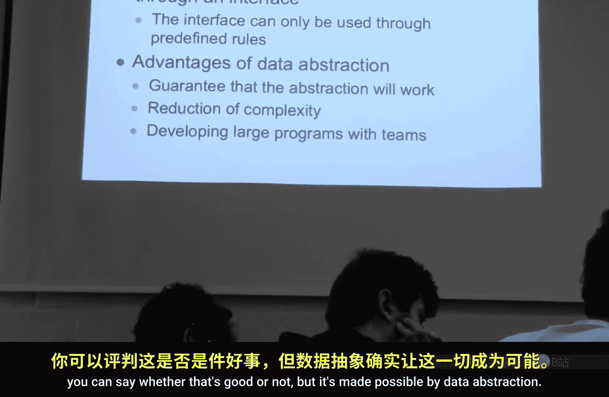

Okay， the main。Basis of data abstraction， well is flexibleical scoping and higher order program。

So leco smoking guarantees that data can be hidden inside。

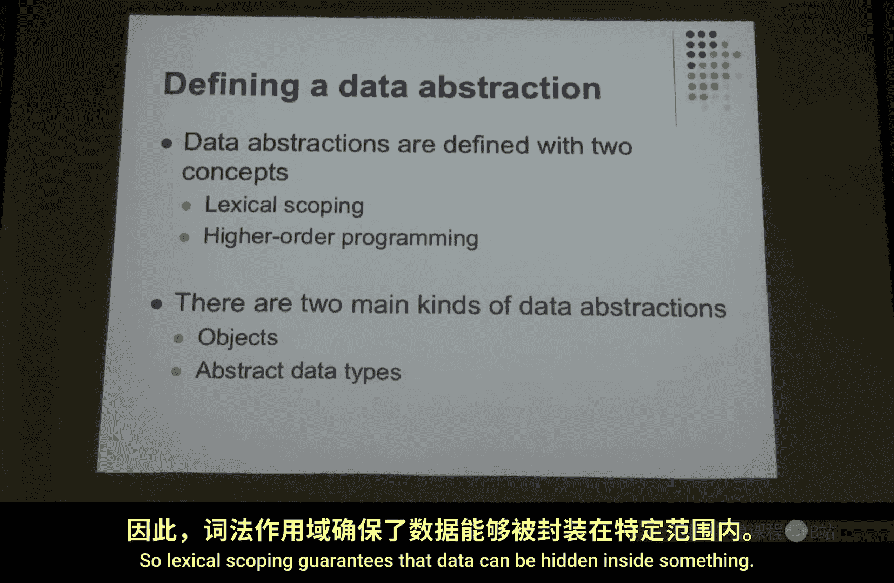

SomethingSo if I do local text it a piece of programming。

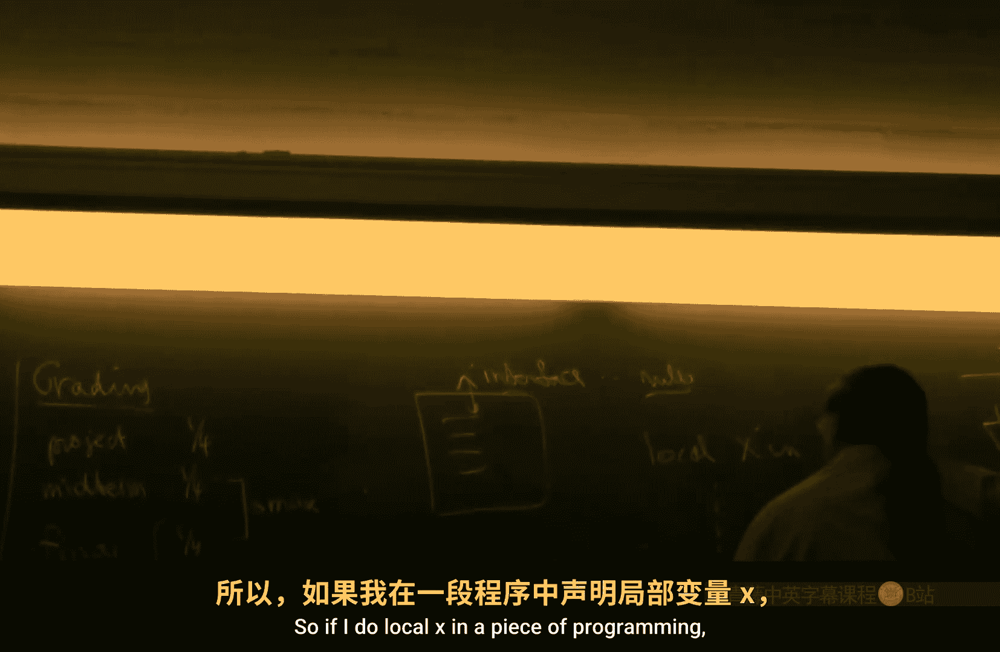

The X can only be accessed。In between the local and the。

So this is a lexical concept lexical means related on the text of the program。And。

Building data abstractions means you need to build these interfaces。

 so the way that's done is using higher order。So higher order programming is used for a building they have shut。

And then we saw that there are two main kinds of the abstracts。So this is fundamental。

 but if we look at the mathematics of data abstraction。

 you can see that these are two fundamentally different ways。buildinging data abstractions。

 so objects and abstract data types。And you will see in programming languages that usually they're mixing them。

Like for example， in Java you have integers like one plus two， well the one in Java is not an object。

 okay， it's an abstract data type。But also have an object version。Of the integers。 so Java kind of。

Is not doing it very well， but you have another language called small talk。

Where everything is an object， including the integers。So if you do one plus two。

 you're actually sending a plus two message to the object one。So an introduce also objects。

So that's a design decision， okay and we saw so I'm going to over。

 I'm not going to show you this red this color， but I'll show you how it works to make a picture。

So we had an example of a stack。Or you can create a loose stack， you can push and pop elements。

 and you can test whether it's empty。And you can define a ca as an data type， or as an object。

So it's actually really interesting to see how that works。As announced data title。

How does thecaps work？Here。It works using a。还个呃。Cryptographic。Function calledrap and unwrappped。Okay。

So these are special functions that we will define in this course。So if you want to do a push。

Of the statue。You push X on the step。You basically， so W is the stack which is wrapped。

 so this one is needed， you could not look inside it， so you basically unwrap it。

Which gives you the stack S。Then you can compute x bar S。

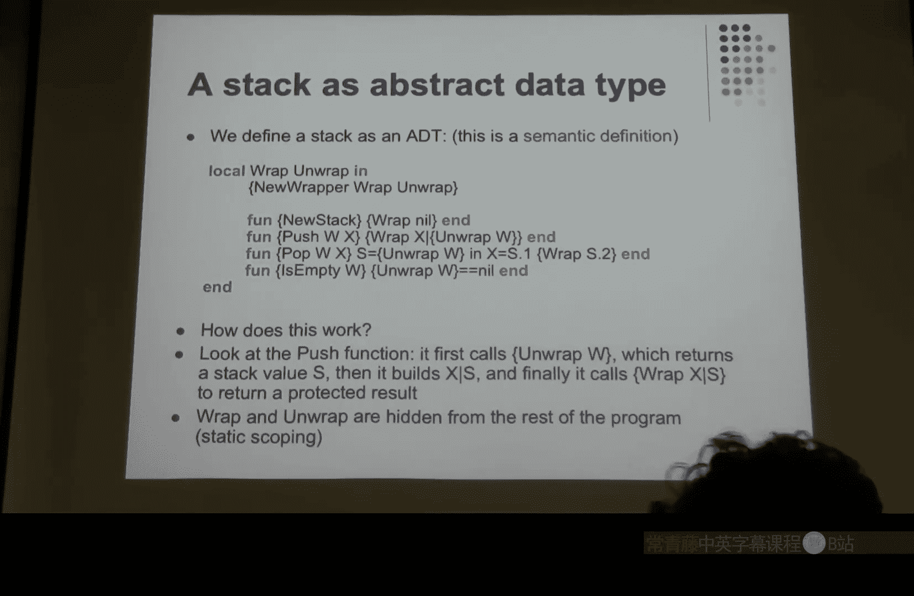

And then again， and then you wrap it。To return the result so the wrap and the N are what hides the outside from the inside。

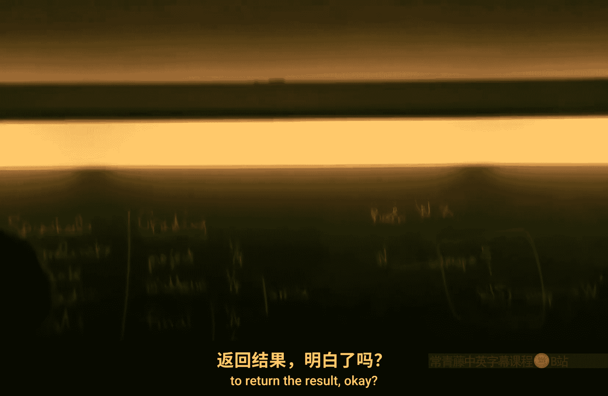

Okay， so the W is a kind of cryptographically hidden version of the stack。Okay。

So all of these functions are defined like that。So the stacks are values。

And the operations I've done inside these boxes by using unwrap and wrap at the interface。

 so that's something that we saw。Of course。But in this course。

 we go more into detail and I'll explain to you how that really works okay。

So another way of doing sta。Is that' an object。So the difference is that as an abstract data type。

 I have two things， I have stacks。

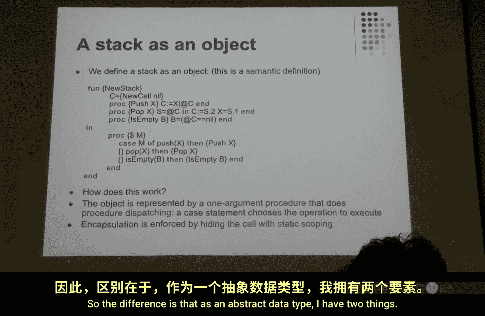

W are that don use operations。Okay。こしパ soは。

And these operations are functions that take stack as argument， so you have two things。

 stacks and operations。Whereas in an object， everything is together。

You have a signal entity which combines both the operations and the data。

 so here's an example of the stackAC。Now then I've introduced a new content here called the cell。

 so I'm not going to that right now， I'm just going to tell you that the cell is like an attribute which you can assign to and the push function will take this cell and。

Take the value of the cell and。Add an X to it and the strength in a sun。

And the object itself is then a one argument procedure。Which takes a message M。

 and depending on the message， push pop or hisceptee will call one of these internal functions。Okay。

 so the object is just a one argument procedure and it takes messages。オ。And it does。

 what's called procedure dispatching。So you basically choose which operation to do。

And the encapsulation is enforced by dexical scoping， okay， neuro static scoping。

 the cell is only visible inside this function of condition。So that's one way of defining objects。

So the object defined like this is very similar。Object or design like Java。

So most languages have a syntax for that。So just to refresh this code。Will actually run。

 you can actually define it like。But you can also see this code as a semantic definition because this code because we saw the semantics of all these operations。

And you can easily translate this in kernel language so remember we saw it in the previous course the semantics。

 so this code tells you everything， there's nothing hidden here， okay。

 it tells you exactly how the al words the semantics and the same for the stack。

 if I give you the wrap and unwrap。And I will give you this。Whereas most languages。

 they have a special syntax for objects。So the syntax kind of hides the semantics。

 so here is the a index， which is a little bit weird， but it's logical even though we get class ta。

 attribute C， a yellow method。Then the heading and then the volume of the method。

 so push X will do C gets x bar， fat will do C， and so on。

 so all typical object oral languages will have some kind of special syntax。

 but the syntax is not the same as the semantic the semantics is hidden behind it the syntax but the syntax is important because it guarantees that you're going to use the object in the right way。

So that you can only use the object in the right way by following the syn。还有。Okay， so that's。

What we saw in terms of data abstraction， so we're going to see more of that in this of course。

Let me now go to procurency。Theterministic data flow。

 So we saw something currency in the previous course。 We saw how the data flow works， Okay。

 so we saw some of。So let me refresh your memory on that。

Concurrency is what happens when you have multiple activities that are executing simultaneously at the same time。

And they're basically independent of that。さ。So concurrency and independence are kind of synonmous。

So the language has a new operation， a new concept called a thread。Which creates a new activity。

Which is executing independently of the other activities。

And most programming languages have a concept of type。What we saw now。

 we saw how you do this with functional programs。So you add threads to functional programs。

 and you also have the unbound variables， the single assignment variables。

 and this can be saw how to make the current pages。

And the way it works is by using a data flow concept。

So data flow is a very powerful way of doing concurrency， which is， again。

 becoming more and more popular， mostly through。Pre data analytics tools。So if I had two threads。

And they share very。So x is an identifier refers to a variable。

 so these two threads will share a variable， so the first thread will bind the variable to one and the second thread will do in operation x plus 10。

So these two threads are running independently。So we don't know which one is very first done。

 we don't know。But no matter what happens。The program will always display 11。

 the result is always the same。But the threats they don't know that they're during in court。

 each thread is doing its own thing， okay？So maybe I do x equal one before x plus n。Fine。

 but maybe I do X time before x equal one。Finally， so how does it work it works because of data and flow。

 so data flow is a very important concept。Okay。Day of both means that the computation。

Wait until the data arrives。Okay。The data drives the consultation。

So here I have the two threads I call activities， Act A and B， this one is doing the addition。

 this one is doing the binding。Now， assuming the first activity is running first， maybe it does。

We don't actually know the system is free to run the threats any way it once， okay。

 so if I try to do x plus 10。And if x is not bound。

Then data flow tells me that the operation is going to wait。It can wait until the day arrive。

So the first activity will stop here at point1， and it will wait。

And the second activity also was running。And eventually， the subject activity will do x equal1。

At  point2。And when that happens， activity A， which is waiting for X， can continue。

 so you see the two activities are kind of coordinating because of the data flow。

 okay and it's a very， very disciplined coordination。Because the variable is single assignment。

 there's only one conditioner the data is either available or it's not。

So no matter which activity is running faster。If A is running faster。

 it will wait until the data arrive。Where is it？Whereas if a is running slower。

 maybe when I do x plus 10， x is already bound to one， well that's okay。

 then I just do one plus step and I don't put it。In both cases， I will display 11。对。

Both cases have with this May 11， so that means the result does not depend on how the threads are executed。

This is very important because threads are messy things。

 if you use threads a job we you have to be very careful because if I have a state。

 if I am updating a variable with two threads， it's important which one is doing first okay。

 but here doesn't matter。So in the data flow case。The threats are。Still be very nice。

OkaySo that's very important and this is leading us to the date of flow and currency。Okay。

 and what we also saw in the previous course is how to do multi agents。

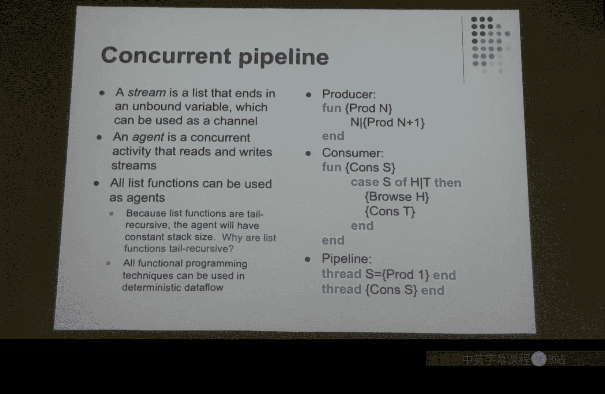

So you is an example of a。はいな。A producer， consumer。So the producer。

 the consumer will run their own threads。

Good， credit。对。えと？You basically have a pipeline。So the producer will create a list。

But it's not a complete list。It's a list that is a partially constructive list。Okay。

 so it will be built incrementally。One， two， three， four， and so on， okay。

 and the tumoror will read the list case statement。So we have data flow again。

 like in the previous slide then， if I do the case。And S is unbald。

The case statement has just going too away。Until the S is bound。

 so you see automatically the consumer will very nicely wait for the elements to arrive。

So this gives you a very nice。Data flow， stream， stream concurrency behavior。我る。

So let you just run this。T。So here that you find a function。Okay。

 the producer that I showed you is going to go very fast， so let me slow it down。

By putting in a delay， which。Stops the thread for a certain number of military， so it delayed thread。

So the other。So that we can actually see the results。As of H2 T then， and I will。Browse page。对。诶。

So these are producer and consumer， so the producer is building a list。

 you can see the list never ends。There's no deal。So the difference between the stream and list。

 maybe it ends in and it on。You that means the is。T。

But sometimes the stream keeps growing forever and never ends。

Notice that both of these functions are tail recursive。So particular， the producer here。

Is tail person。In the same way that the math is still discipline is also。这。

Let me show you the execution of this。But concurrency is very important。So I create a thread。Rduce。

3 one。I have no thread， I will consume。Okay， this one is actually。Procure。什么。そでです。

So here we have an concurrent program。You can see the one， two， three for every second。

 a new number of viewers。So here we have making inherent programs and two activities。

 and the stream is like a pipeline。SoEach time the stream gets extended。

 the consumer will read it and notice the synchronization is perfectly nice the consumer。Well。

 if it goes faster， so these two threads are independent。

 maybe one of them will go faster than the other， and I'll explain in a few minutes that means they don't know about each other。

 threads are independent。But that doesn't matter， because if the exuber thread is a faster。

 then it will use dataflow here to wait until the next element arrives from the street。

So the data flow makes everything nice。诶。So that's important。

 and that's something we're going to do to build lazy and current programs in this。Okay current。

 so now let me dive a little bit down deeper and give you a more fundamental explanation of what's going on here。

ok。So semantically， what's happening in these threads？

So this is very general every program language that' doing threads is going to be doing in methods。

 Okay， so this is generally applicable。 So each thread will execute as a sequence of steps。

 so it has its execution state。And it's executing like a sequential program。

 so each thread is a sequential program。Okay， and they're independence。

But they will be executing on one processor， okay， so I'm not talking about multicore。

 multicore is a separate concept that's orthogonal to this。

That we can do to speed up the computation by defining it into different pieces。 Okay。

 here I'm running on a single processor， so which is fundamentally what's happening。The processor。

 a single core， is executing one sequence。That means if I execute two threads。one processor。

 the threat executions will be interlead， it means once I will do one then the other then one and the other。

 but it's not synchronized I the do many steps of T1 and then one step of T2 then maybe the opposite。

 so they're not synchronized in any way， each thread is doing on its own。

Raing steps of the processor。So there is a part of the system。So how is this implemented。

 there is a part of the system called the scheduler。

 which at every step it actually chooses which thread。

So the scheduler has a lot of power you can see that you actually choose which drive to execute at every instruction。

 so all concurrent systems are doing like this they all a scheduler。And if you want this to be nice。

 the scheduler， it has to obey some rules。The first rule that has to obey is that it's fair。

Which means it cannot forget a threat， it has to give， it has to remember home。Okay。

 and execute them all。And in real systems， the scheduler is more complicated than that。

 it has time slices。This is for efficiency because you can't tap the scheduler choosing every single nanosecond okay。

 because it maybe will execute a big program to choose。

 so that will cause everything to slow down so what happens is the scheduler will say this schedule will execute for a certain amount of time and then there's a hardware interrupt。

And then the next one， okay， and also it has priorities because some threads are more important than others。

 a thread that handles the packet coming in from the network。

Its more important than a thread that's just doing computation because that packet is not the weight。

 more packets are coming in from the outside so you have to handle little。

So you have the notion of prayer， okay。No， this leads。To another concept。The scheduler has a power。

It is choosing which you credit。And it's not the program it chooses， the schedule chooses。

According to some rules。OkayThis is called nonminism。A program is unimistic。

 when it does an operation that is chosen。External。

 which means it's not chosen by the developer of the pro。It's chosen by another power。

 so the programmer is not all powerful。The programmer is not God in this program。

Because the Schr is another God， okay？So there are multiple gods in the little universe if you want to say it like that。

So the choices of the scheduler is an example of nonterminism。So it's inherentance， okay。

 non determinism is always present and in the current program。Of course。

 it can also be present in a sequential program nondjominism doesn't have to be。

As long as the program makes a choice， it chooses between one error and the other instruction。

But in a concurrent program， there are always choices because well you need at least two threats。

 if one threat it's not concurrent， but if you have at least two threats。

 there's always a choice so's。で不レす。NoTs are independent。

 scheduler makes its choice outside of the control of the programmer。And this in particular。

 it's inherent whenever the program interacts with the real world。

Ral world events are outside of the control of the program most of the time。

 I type a key of that keyboard， the program， it sees this event arriving and it has to treat。

And it's not controlling that。 So I am like。So this is a very important thing to understand。

What is nonminterminism and why is it inherent？We're a program that interacts with the real world。

They can happen at any time， okay， and they must be handled when they occur。え。

That means that if you want to handle these events。Your program basically has to be conren， okay。

 because they can happen at any time the program has to handle some。

Even if it was doing something else。It's doing something and then this event happens。Well。

 we have to handle the event。That means it's another activity compared to what the program is normally doing。

 okay， or maybe a program is doing nothing and it's only waiting for the external event that's possible too。

 but usually think programs always have their own mental activity。Even when nothing is coming in。

Okay， and we saw an example of that。So this is a very nice example because it kind of crystallizes the whole issue in a simple and very useful example。

This is not the only example of we see more examples in this course。But we saw clients sooner。

So in kind server。Is a it has to be。No。If you want to do it， it must be none。

If you have at least two points， and you can prove that mathematical， okay？

It is based on the specification of the client。If client makes a request the server。

 the server must respond in a timely fashion that depends only on the network travel time and the computation time of the request。

 that means when I am talking to the server， it has to respond based on what I am asking。

 not on what somebody else is doing， okay。Otherwise， this is very reasonable otherwise。

This system is not going to be satisfactory。啊。If I make a request and the server does not respond。

 I'm going to be unhappy。And if this system is Amazon， I will not buy it。

's the thing and Amazon will not make money， servers。Respond in a timely fashion。かけファイ。

That's reasonable， you see that that has to be like that。When I have many clients。

 each client makes a request and the Z has to respond reasonably in a reasonable time。Okay。

 so what if they have two plans。You're both making more requests。え？P1 makes zero request。

2 makes zero request。Which one arrives first？We don't know it depends。

Maybe time one is faster or plan two is faster， maybe the network is faster between one and the server。

 or maybe it's faster between two， maybe there's congestion， it depends on many things。

So you can learn。Determin the order。To see that， though。Ppends on the priceized time the server。

You don't know which client's request is going to arrive it's either one or two。

If there's too line and you don't know which， so this is non determinism。

Because you have to treat the first one that arrives。So you don't know which one it is。

 the programmer can not predict。ok。So the whole client server is non deterministic。Okay。

 see that turn。It's not。Even if everything else is purely functional， this point。Right here。

Where the suburb listens to the world。That point is a point where you have to make a non deter tissue choice。

 steal that does。This is a so thing， but it's very simple。Okay。包括这个。So we have to do it。

We have to write this program。It's not a。Okay。And the problem is it has to work correctly for all possible monochistic choices。

There might be an exponential number。If I have N clients sending messages。

 there are n factorial possible orders in which they can arrive。

And it's actually much more than that because a program like Amazon surffer is running for a very long time。

So the number of requests is basically unboundunded， so the number of choices is incredibly large。

And our program has to be correct。You can't test them all， it's too many， testing is important them。

 but you can't test them all， so what you do is well you have to be correct by the sign。

The design of the program has to guarantee the correctness。

That's one of the things we're going to talk about。How do you live with non determinism？Okay。ok。

So that's one of the themes of this course。How to live nonterminism and you have totainment。

 non theterminism is like it。A demon， okay， that's very powerful and you have to ta this demon。

 that's one of the hardest things for a programmer。It's hard in the current system。

 it's even harder in a distributed system， okay， so there's another course not teaching which is called。

然 for。45。Which takes this to the next level， because here we have a distributed system。

Which is running like many computing those， and they're sending messages to each other。

 and you can have failure also。So there's a new thing here that notes can fail。

Which makes it even more complicated， okay， and all of that possibilities have to work。You see， it's。

Not so simple， and the only way to do that is to make it correct by design。

Because you could not test the problems。So。So how do we do it？Well， we have already one solution。

Deterministic data flow。This is actually solving the problem。By designing。

The nondeterminism is hidden because of functional programming because this is functional。

 even over scheduleulr is doing nonneistic choices， the results are always the same。

 so this is the best if we can do with that。Probably we can't always do that。

So we have to do it as much as possible because this one。The problem is he goes away。

That's very nice when the problem goes away， so we try to do this as much as possible and it will make the problem go away。

But the problem cannot always be magically。This would be to disappear。

 because some non feminism is essential， is based on the specification， like the client server pace。

 you cannot magically make that go away。Because it's inherent。

That means there is some minimum amount。Of non deters that you have to solve。

And so that's what we're going to see in this course。How do you master that？

How do you reduce the nonterminism， Noterminism is really nasty。

I don't know if you've ever really had to solve an non problem，I know that because I， for example。

 we did research and distributed algorithms。And sometimes there is something non deterministic。

And so the poor PhD is to the institution， the PhD to do the work。

He's spending days and days trying to figure out why is it not working？

There's some little thing that's non deterministic that's about。And。被。

Big systems on the Internet by Google Search or Amazon。呃Facebook or。Twitter，2 X。

Those things have very complicated programs behind them。

And they have very smart engineers babysitting those programs all the time they had not okay。

 and those engineers are。Sometimes very， how you say， they get lots of gray hair。

Because many of those systems are not written in the right way。

They're not following this paradigm because they were written a long time ago。

So what I will try to do is tell you the best way to do this kind of thing。

So you will have the least amount of gray hairs in your career。Okay， so that's。That， basically。

Refreshes youth so value' about to speed， okay， so we're not going to talk so much about semantics or lambda calculus。

In this course， but we're going to talk about mastering。Declared the program。

 so mastering non determinism will be a main theme of this course。And next week。

 we will start talking about， well， it won't be next week because next week is the 27th。

Which is a holiday， so please enjoy the holiday， but there will be a lab session the next two weeks。

 okay two lab sessions。

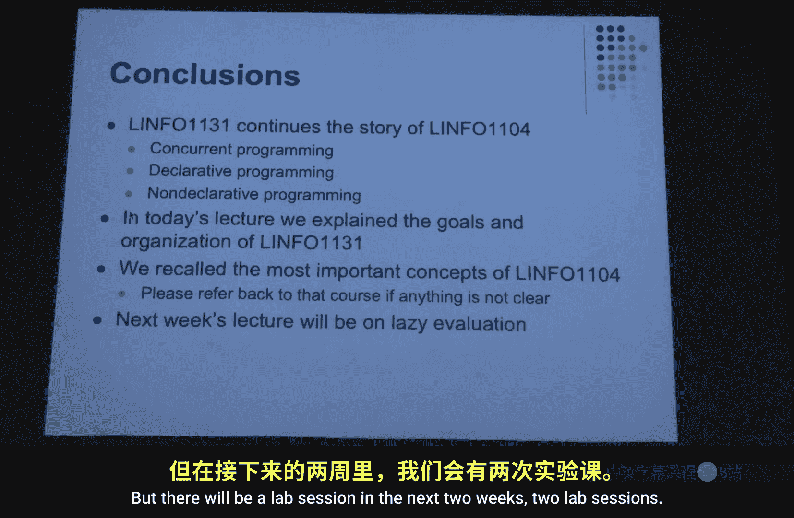

And then， the next。Menature will be in two weeks， and I'll start talking about lazy evaluation。

 which is a。

Powerful extension of the clarity really deep big and very good within the El seat。😊，Okay。

 so let me edit there。

