# 高级编程语言概念：1：课程介绍与回顾

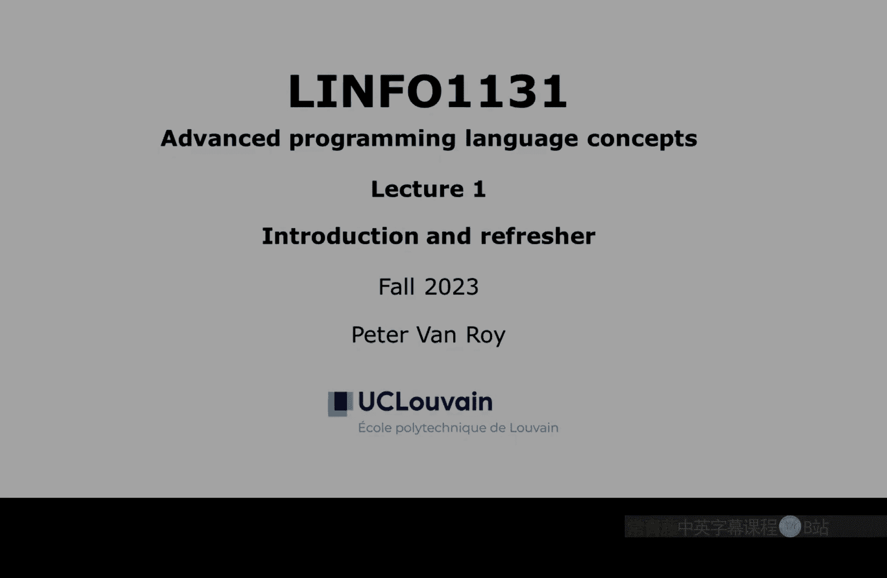

在本节课中，我们将学习《高级编程语言概念》这门课程的整体安排、核心主题，并对先修课程的关键概念进行回顾，为后续深入学习打下基础。

## 课程概述与组织

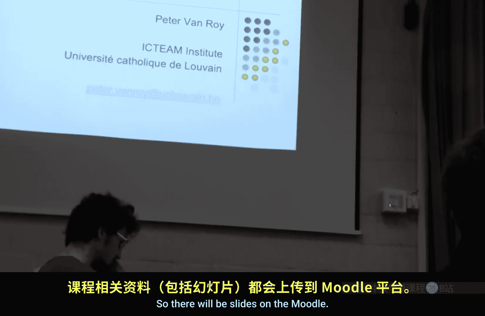

本课程名为《并发编程概念》，但实质上是一门关于高级编程概念的课程。它是先前课程（LINFO1104）的延续，我们将在此基础之上，对许多概念进行更深入、更广泛的探讨。

课程由一名教师和一名助教负责，并设有每周三次的实验课。实验课从下周开始，强烈建议每位同学选择并参加其中一节。

### 评分方式

课程的评分结构如下：
*   **项目**：在学期后半段进行，**必须完成**。建议两人一组，有充足时间完成，预计大多数同学能获得高分。
*   **期中考试**：**可选**，但强烈建议参加。成绩优异可在期末考试中获得优势。
*   **期末考试**：**必须参加**。其分值占总分的四分之三，但分为两部分。第一部分与期中考试内容对应，最终取期中考试和期末考试第一部分中的较高分计入总成绩。
*   **出勤奖励**：**参加所有实验课**可获得期末考试额外1分的奖励。此举旨在鼓励参与，实践证明这对理解课程内容和提高成绩有双重积极作用。

所有课程资料、公告和项目信息将通过Moodle平台发布。期中考试预计在第7周左右进行。

### 软件环境

本课程将使用两个编程系统：
1.  **Mozart系统**：在先修课程中已接触。
2.  **Erlang/OTP系统**：用于构建高容错、高可靠的软件，是业界在此领域的最佳实践。

## 核心主题

本课程将贯穿三个核心主题：

1.  **并发编程**：处理程序中的不确定性，展示简化并发编程的技术。
2.  **声明式编程**：基于函数式编程，强调**无可变状态**的编程范式。这是编写可测试、易维护、高正确性代码的最佳方式，代表未来趋势。
3.  **非声明式编程**：当程序需要与具有实时性和不确定性的真实世界交互时，必须超越声明式范式。我们将学习如何管理这种复杂性。

### 具体编程范式

课程内容可具体划分为以下编程范式：

**声明式编程**
*   **顺序函数式编程**：已在先修课程中学习。
*   **惰性求值**：一种强大的声明式编程形式，程序执行方向与传统相反。
*   **惰性确定性数据流**：结合了函数式和惰性求值，是最强大的声明式范式。

**非声明式编程**
*   **数据抽象**：封装数据与操作。
*   **多智能体编程**：构建基于消息传递的并发系统。
*   **Erlang中的健壮多智能体编程**：学习使用Erlang/OTP构建容错性极高的应用程序，其监督者行为模式能有效处理故障。
*   **共享状态并发**：涉及锁、监视器和事务。其中，**事务**是最有用的概念，但理解共享状态对于处理遗留代码至关重要。

### 课程日程安排

课程大致分为两部分：
1.  **前半部分**：聚焦声明式编程，涵盖惰性求值、声明式并发语义和高级声明式算法设计。
2.  **后半部分**：转向非声明式编程，深入数据抽象、Erlang多智能体编程以及共享状态并发。
3.  **期中考试**：预计在第7周，内容覆盖声明式编程部分。

## 先修课程核心概念回顾

为确保后续学习顺利，以下回顾先修课程中的关键概念。从下周起，将默认大家已熟练掌握这些内容。

### 函数式编程与尾递归

函数式编程基于数学函数和高阶函数，是测试、维护和保证正确性的最佳范式，如今已被广泛应用。

编写循环或递归函数时，关键是使用**尾递归**，它对应着循环的执行方式，能保证恒定的内存使用。实现尾递归的技巧在于找到并维护**循环不变式**。

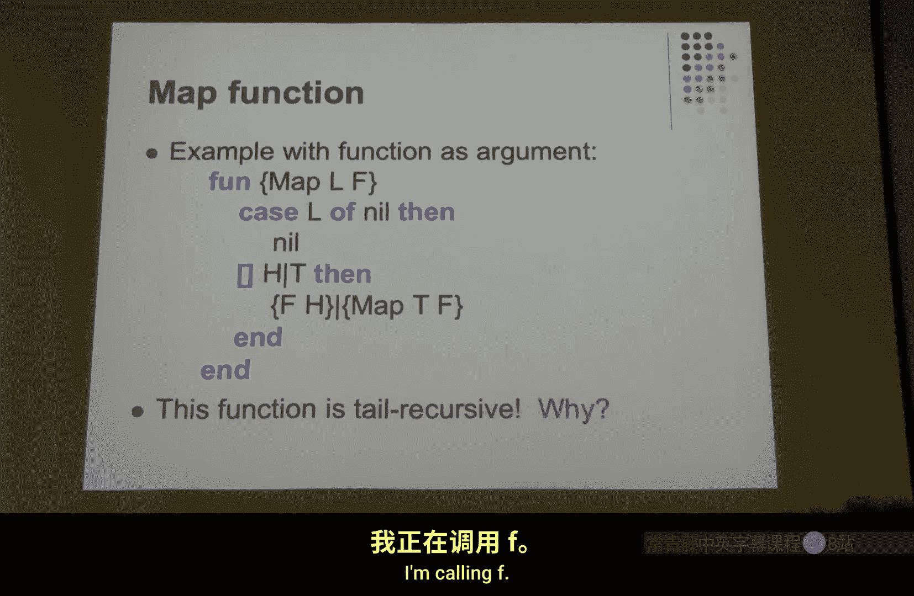


例如，计算阶乘的朴素递归版本 `factorial(N)` 不是尾递归，因为递归调用后还需进行乘法操作，导致调用栈深度与N成正比。

正确的尾递归版本需要引入一个**累加器**参数，并维护不变式 `I! * A = N!`。初始时 `I=N, A=1`，每次迭代递减 `I` 并乘以 `A`，直到 `I=0`，此时 `A` 即为结果。

**代码示例：尾递归阶乘**
```oz
% 非尾递归版本（不佳）
fun {Factorial N}
    if N==0 then 1 else N*{Factorial N-1} end
end

% 尾递归版本（正确）
fun {FactorialTail I A}
    if I==0 then A
    else {FactorialTail I-1 I*A} end
end
% 调用：{FactorialTail N 1}
```
尾递归函数在语义上等同于命令式语言中的循环，但它遵守λ演算规则，是声明式的，因此可以在并发环境中安全使用而不会引入竞态条件。

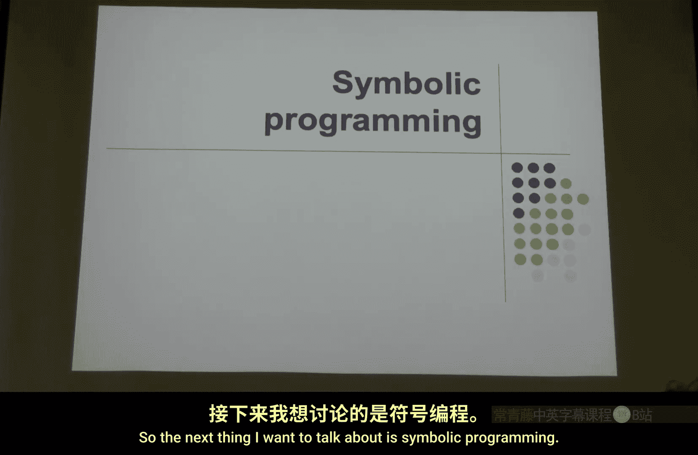


### 高阶编程

在高阶编程中，函数像数字、记录或列表一样，是语言中的**一等公民**。可以随时随地定义函数，并且函数的行为是确定的。

一个关键概念是**闭包**（或称静态作用域过程值）。当一个函数值被创建时，它会捕获其定义时所在词法环境中的标识符绑定。

**代码示例：创建加法函数**
```oz
fun {MakeAdd N}
    fun {$ X} X+N end
end

Add5 = {MakeAdd 5}
Add10 = {MakeAdd 10}
{Browse {Add5 11}} % 显示 16
{Browse {Add10 10}} % 显示 20
```
这里，`MakeAdd` 是一个二阶函数，它返回一个一阶函数。`Add5` 和 `Add10` 是两个不同的闭包，各自拥有指向不同 `N` 值（5和10）的环境。

高阶编程是数据抽象的基础，它支持泛化、实例化、组合、封装（通过Fold抽象累加器）和延迟执行等强大功能。

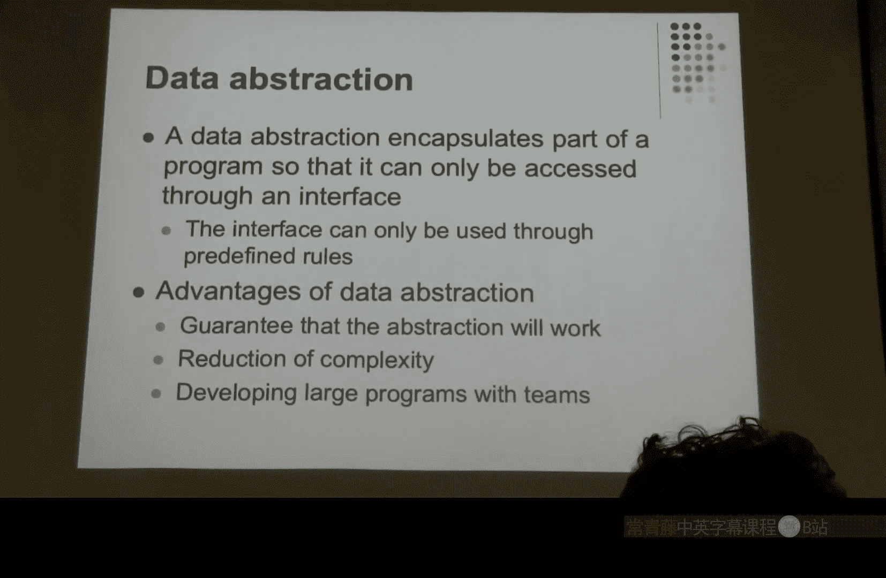


### 符号编程与列表操作

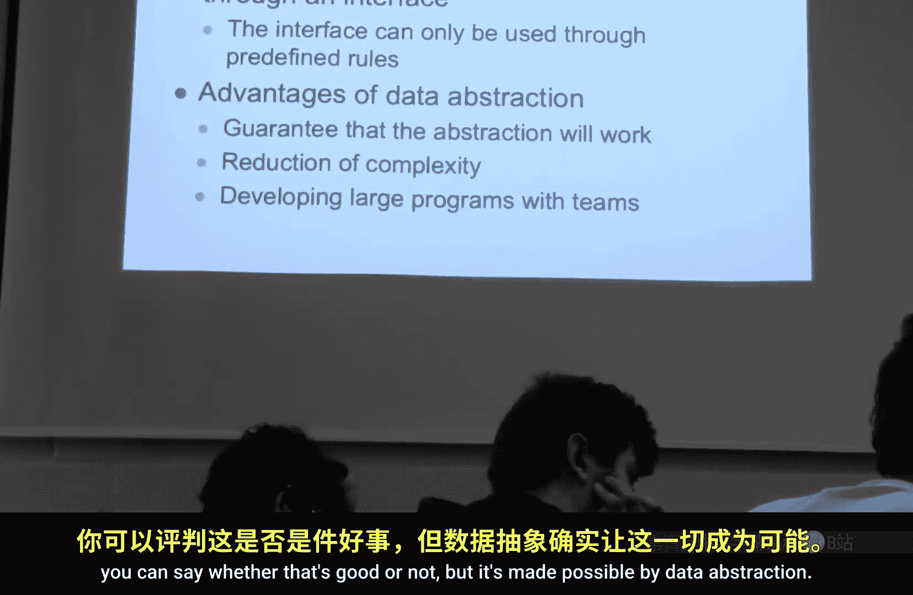

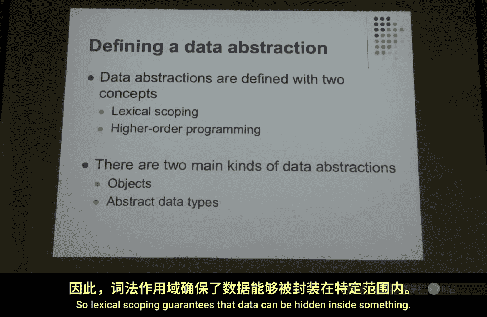

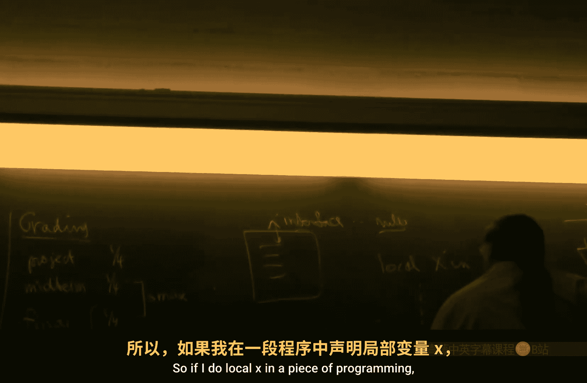

符号编程处理的是像列表这样的递归数据结构。列表定义为空（`nil`）或一个元素与另一个列表的组合（`H|T`）。

**模式匹配**是处理符号数据结构的核心机制，它允许我们将数据结构与模板（模式）进行比较，并提取其中的部分。

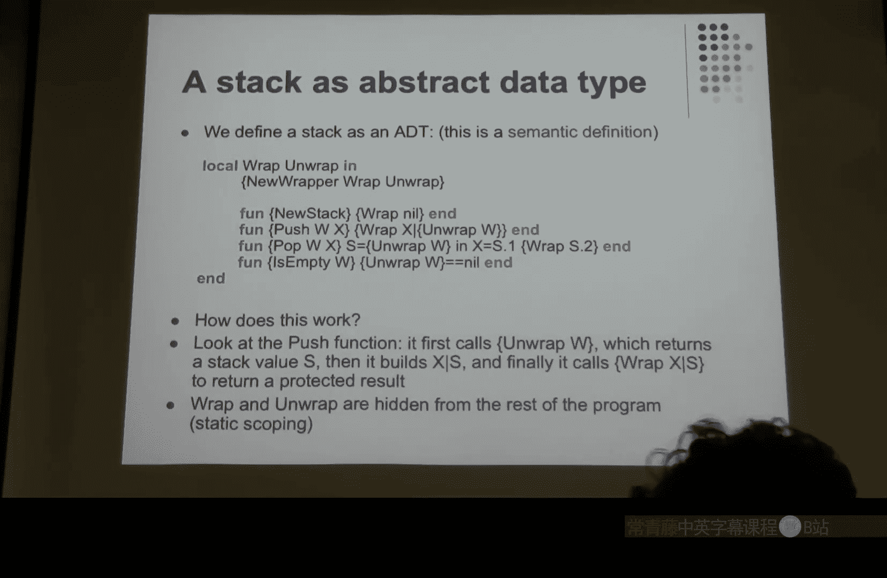


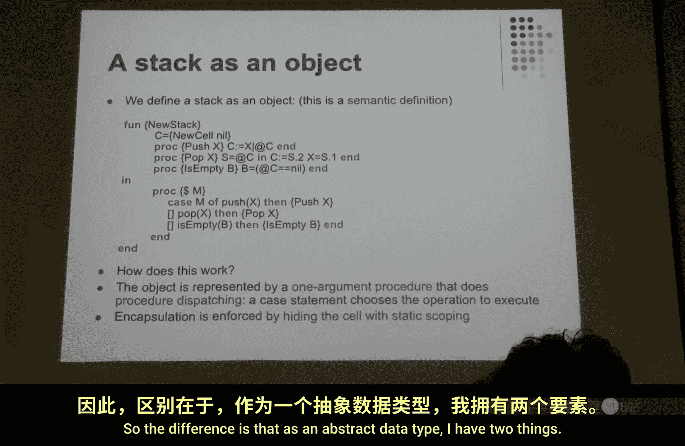


**Fold操作**是一个极其重要的高阶函数，它接收一个列表、一个二元函数和一个初始值，然后从左到右（或从右到左）将二元函数累积地应用到列表的所有元素上。Fold是许多并发智能体的核心，其中列表代表消息流，二元函数是状态转移函数，初始值是内部状态。

**代码示例：FoldL 定义**
```oz
fun {FoldL L F U}
    case L
    of nil then U
    [] H|T then {FoldL T F {F U H}}
    end
end

% 求和：{FoldL [1 2 3] fun {$ X Y} X+Y end 0} 返回 6
% 求积：{FoldL [1 2 3] fun {$ X Y} X*Y end 1} 返回 6
```
`FoldL` 是尾递归的。在并发智能体中，`L` 可以是一个无限的消息流，`F` 是处理消息并更新状态的函数，`U` 是初始状态。

### 数据抽象

数据抽象将程序封装在“盒子”里，只能通过定义的接口进行访问。这保证了功能正确、隐藏了复杂性，并支持团队分工。

数据抽象主要基于**词法作用域**和**高阶编程**。有两种主要的抽象方式：
1.  **抽象数据类型**：数据（如栈的值）和操作（如push、pop）是分离的。通过包装（wrap）和解包（unwrap）函数在接口处隐藏内部表示。
2.  **对象**：将数据和方法组合成一个单一的实体。对象通常是一个接收消息（如push、pop）并执行相应方法的一元过程。封装通过内部数据的词法作用域来强制执行。

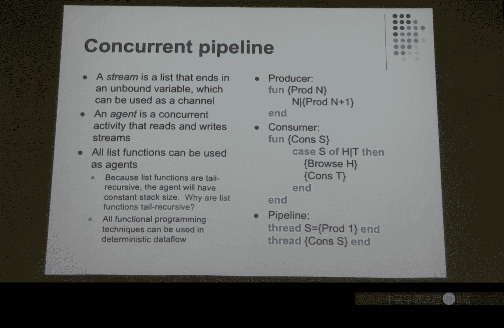


### 并发与确定性数据流

并发是指多个独立的活动同时执行。语言通过**线程**来创建新的活动。

将线程与函数式编程及**单赋值变量**结合，可以创建**确定性数据流并发**。在这种模型中，如果线程尝试使用一个尚未绑定的变量，该操作会等待（数据流），直到变量被另一个线程绑定。无论线程调度顺序如何，程序的最终结果总是确定的。

**代码示例：生产者-消费者**
```oz
fun {Producer N}
    if N<100 then
        {Delay 1000} % 每秒生产一个
        N|{Producer N+1}
    else nil end
end

fun {Consumer S}
    case S of H|T then
        {Browse H}
        {Consumer T}
    else skip end
end

local S in
    thread S={Producer 0} end % 生产者线程
    thread {Consumer S} end   % 消费者线程
end
```
生产者构建一个流（惰性列表），消费者通过模式匹配读取。如果消费者更快，它会在 `case` 语句处等待，直到生产者提供下一个元素。这种同步是自动且完美的。生产者和消费者函数都是尾递归的，内存使用恒定。

### 非确定性的本质

在并发程序中，**调度器**决定在任一时刻执行哪个线程，这个选择对于程序员来说是**非确定性的**。当程序与外部世界（如网络请求、用户输入）交互时，事件到达的顺序也是非确定的。

例如，在一个多客户端服务器中，服务器必须及时响应每个客户端的请求，但请求到达的顺序无法预测。程序必须正确处理所有可能的顺序，而由于可能性太多，无法通过测试覆盖所有情况。因此，程序必须通过**设计来保证正确性**。

**确定性数据流**是应对非确定性的优秀方案，因为它能将非确定性隐藏在函数式语义之下，使结果总是确定。本课程的一个重要主题就是学习如何**掌控和最小化非确定性**，尤其是在必须与真实世界交互时。

## 总结

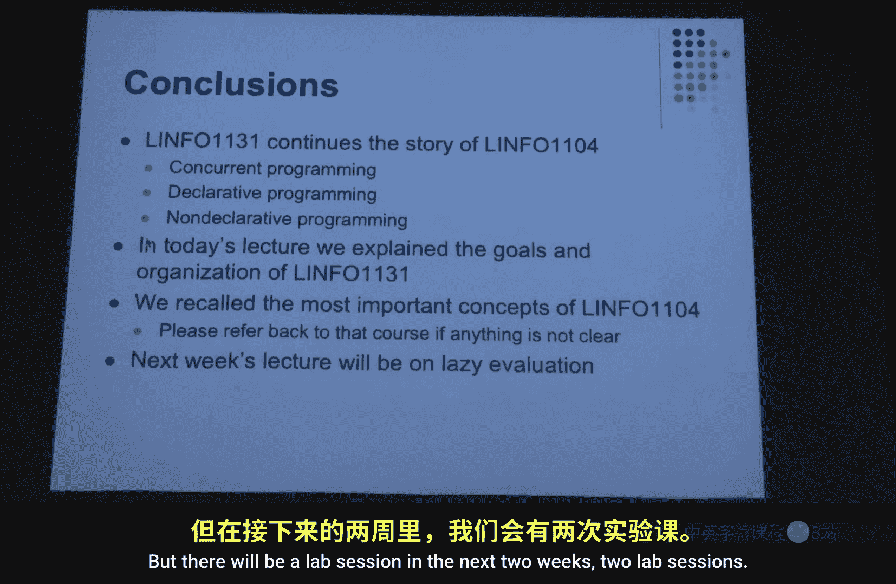


本节课我们一起学习了《高级编程语言概念》课程的整体框架、评分方式和三大核心主题：并发编程、声明式编程和非声明式编程。我们对先修课程的关键概念进行了回顾，包括函数式编程与尾递归、高阶编程与闭包、符号编程与Fold操作、数据抽象的两种形式，以及并发编程中的确定性数据流和非确定性的本质。这些概念是后续学习更高级主题（如惰性求值、Erlang容错编程等）的重要基础。从下节课开始，我们将正式深入这些高级主题。