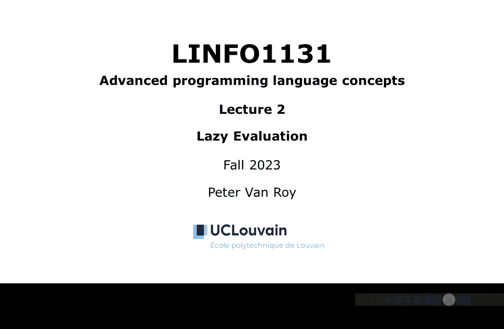
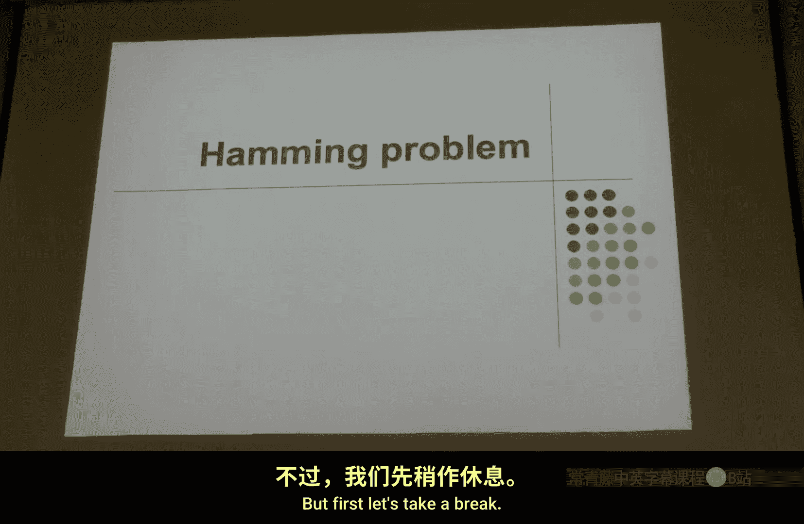
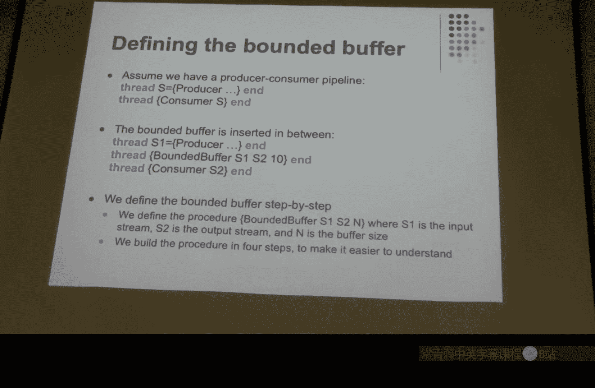

# 鲁汶理工学院【中英⚡高级编程语言概念｜LINFO1131, Advanced programming language concepts】 p42 P42 FO1131 Lecture 2 (2023) -BV1UDffBbEBZ_p42-

Welcome to the course。Everyone who is courageous enough come here so early。

Today I want to talk about lazy evaluation。Which is a very。Different way of computing。

 And if you have not seen it before， you， it will seem very。Weird than strange and powerful。

First a few seconds for the Ukrainians to watch still。Or there freedom？Okay， so I want to talk about。

Maing graduation。I'm going to start back。What it does， it's very easy to use is give you for example。

 and then I will immediately give you the semantics。

 it's actually very easy to define in deterministic data well。After that。

 I'll start programming with it， I'll show you how to do producer consumer。

 so the streams can be very powerful with lazy di。You can also program with infinite data structures。

I will show you how to do that and then a very interesting example was the having problem。

It's a recursive stream problem using lainess。And then if I have time， I'll talk more about it。

 how it's executing really with go detail， and I combine it with concurrence。

Because laziness is a very different thing from concur。

And it's very interesting to combine basicsness and concurrnce。Okay。

 first I want to give you some introduction， what is lazy evaluation？

It's just a functional program like we said before。Any functional program that we saw。

 you can run it la。And what does that mean， it means it executes。By need。

 that means where you call a function。It does not execute the function。It just creates。

Something called information suspension。And it will only execute the function when something else needs the function。

 Okay so that seems very weird， Okay， so let me give the semantics of lazy evaluation and the same time it will give the semantics of the data of flow execution。

Okay。So how does lazy a work？So remember， we saw the the semans of a program。

 you get it by translating into kernel language。诶。And so I'll show you how the lazy ad is translated into current language。

So here's the translation。So this add explain Y R is the result。And here's what it does。

 it creates a new thread。And in that thread， it waits。

There is a special operation called the weight needed。Which will wait。On far， the result。Is needed。

So the weight needed is a synchronization。And it will wait until another thread needs bar。

So what does that mean to need R， well there is an operation called weight in the system。

 which will wait until R is bound？Okay， so the weight needed will wait until another thread。

Does wait。So if I wait we did。Or this one will wait until somebody needs a threat。

 but if there's another thread。our。The other thread will do a weight。

So how does that work in the full system？I have to refresh you your mind on how the data flow execution works。

哎。So let's say I want to do x is equal to x plus y。Okay， this addition operation。Adds to numbers。

But remember， we are running a data flow， deterministic data flow functional language。

 which means that the addition has to wait until x and y are numbers because they might be un variables。

So this is translated as follows，- I'll show it here。I waited until X is bound。 I waited until。

Why is that。And then I will actually do the a instruction。

So there is some primitive added abstract that will only work for numbers。X plus y is V。

And then there is a bind operation。Which binds andbound variable。So that's what my nest means。

So the V is。我个。So this is how the data Club works whenever I do in addition。

I wait until X andY round， then I do the actual edition instruction。Primitive。

 which assumes the next of bound。And after that， it binds me to the results。

 and then I have a special operation bind。ok。So the semantics of this is weight x。

Will suspend the current execution until。X is bound to a value。Okay， and the bind operation。We们。

X2 value v。So whenever I do a bind of x to some value。

 then the weight if someone else is doing weight on x。

 the weight is going to continue okay so this is always how the data。So no matter what you're doing。

 every operation that you do。 if X and Y are， it will automatically weight。

 okay so that's part of the data flow execution。So weight and bond are used everywhere already in the system。

So all operations that the programmer uses are defined using weight， bind。

 and a primitive fund that doesn't wait。So the arithmetic additions， oftraction。

 also the case statement。It might be case。L of HRT。This one will also wait until L is bound。

 if L is unbound。It just waits and if when some other thread binds L。

 then the case will continue so remember we already have already done this this is something that's already done in the previous course。

 remember I explained all the data flow in the previous course。

So this is how the data flow is already working the deterministic data flow。

And it's always doingom like that， okay？And even things like function call。

 if I do F of x or F is a function。Well， F might be unbald。

So the function called F of x will wait until F is bound to function or the record operation R dot。

The field name。R has to be bound to a record， so it will also wait the top operation。

OkaySo this is how the data flow is already working and it waits forever there's no time now to something like that that just waits。

Until another threat finds the battle。And the lazy execution is just one more operation added to the data form。

 so I have weight and I have bind。And。To do lazy execution。

 I have now a third operation which is called W needed。Okay。So the third operation wave needed。

We need next。位置。Until。Another thread。Because。W X。You see this is a kind of。Funny。

 more sophisticated conditioner， the weight needed x will wait until another thread does weight X。

There's red that does weight X， it does weight X because it needs the value。

And so the weight needed is basically waiting until。Somebody needs develop。Okay。

So that's how we have laziness， so there's just this one new operation。

Be careful not to confuse weight and weight needed weight weights until X is bound to a value。

The weight needed waits， it doesn't wait until next amount of value。

 it waits until another thread does wait。Okay。So that's a little bit somewhat。

So this third operation is what lets us do。Lazing valuation。So that is a complete cementtic。

With that， you know everything about the data flow， but also how the laziness works。

 so there's nothing else。And I'm going to show you very clever programming techniques。

 we're going to do very neat things with La this。And all the neat things。Its just using what mean。

 there's nothing else， I'm not hiding anything。There's no other magic。

 The only magic is weight needed。オッケー？So you can actually use weight needed directly in the system if you want to play around with it。

For example， I can do weight needed X。And then after that， Id find X。Okay。So for example。

 I can do something like this。say。They clear。L needed eggs， and then I would bind eggs， for example。

 to 100。ので。Now I've had brow studies。And you just get an un there to see because the weight needed will be。

Waiting， still waiting because nobody has actually done weight， okay？But now if I do。

Browse x plus zero， you think it's good nothing be x plus zero， but the addition operation to plus。

Has to。Use that first argument that has to be a number。So this one will wait。And it's doing weight。

 and that means the weight needed。Well。Continued x so I the browse x plus0。人。

It will display 100 and the first browse， the first underscore score variable will also be displayed as so you can see that this causes the computation to continue。

Okay， so you see this is a very interesting way of controlling the computation。O。So in general。

 in Us， you can make lazy functions， you can say fun， lazy。

 and then you have your function F but arguments， and then it just looks just like a regular function。

But this will automatically be translated like this。It would be translated into a procedure。

 so here is the result R， I create a new thread。And in that thread。

 I wait until somebody needs the result。Okay， and when somebody needs the result， then I' go do。

Our equal expression， then that will do the computation。So when I call the function F。

I'm not executing immediately to function， I'm creating a thread that does what needed isnt okay？

And then I call that a lazy suspension。So the laziness happens exactly like this。

 there's no other magic。But you will see this is already a very powerful magic。

 as we will see in a little while。Note also， you might think this is kind of expensive I'm actually creating a thread just for a function call。

Yes， that is a bit expensive， but remember， the compiler doesn't have to do it this way。

The compiler only has to respect the semantics of this。

So there are many much more efficient ways of implementing laziness that I won't talk about。

 and there's programming languages that are based on laziness， so if you're interested。

 you should take a look at a programming language called HaL。

Which is completely based on lazy evaluation。 It's all functions are lazy by default and still it's very efficient。

 There's a very efficient compiler for this。So Haville actually has a large user community。

 and it's based on labor evaluation。So I'm not going to talk about Hake today。

 but if you're interested， you can look at that。And so you see， this is how all functions are trans。

So that's the semantics。 So now basically you know how it works。But now I'm going to run programs。

 so the rest of the lecture I'm going to show what you can do with this idea okay？

And the first example will be producer consumer example， and I will use freeze。that。

And then I will show you different versions of it， sequential， incurren and releasing。Okay。

Three kinds of producer consume。Okay， so I'm going to give the code of a simple producer consumer so the producer。

Will create a stream。hich is said to the consumer。So here is the event the code event。

Producer will go from L to H， so it basically creates a list L alpha pluss1 up to H。

 so I give it an n or otherwise it's an infinite loop。But as we'll see later on。In a lazy program。

 you don't have to give it a pen。But here are most specs are you nonetheless lens。

So I will wait for 1000 milliseconds， so I'm slowing it down。And here I' credit the list， so L。

 followed by producer El plus one page and our end with Neil， okay， so that's the producer。

And the consumer to make it do the work， it's going to add create a cumulative sum。帮德。

The elements that has seen。And it will output that as a news， okay。

 so the consumer has an accumulator。And it will take the string test and it will do accumulator plus H which is the first element。

 and then it follows that by a recursive call， so basically it's creating。

I a list of accumulatemative sum so if I have a list one two to three here and if theccumator starts of zero。

 then it will do something like this，13， six， it'll do one then one plus two。

 one plus two to three and so on。オッケー。And I will execute it in three different ways。Three ways。

which are different executions， sequential， concurrent and lazy。

 and all three ways will give me the same result， so technically this is just using the church Rosser here。

 so this is something we saw in the previous course， it means that if you have a functional program。

And you execute will any functional program。Is egg can be written as a lambda expression。

 which we saw before， so I'm not going to go into level happiness。

 but I just want to explain to you the foundation， so any functional program that we do here can be written as a lambda expression and the interesting thing about lambda expressions is that you can execute them in many different ways。

You can reduce， do reductions in many different ways， but they all give the same results。

 that's a very powerful property of land practice。And this is also called confluence。

 it means that if the executioners do a different thing。

 then they will eventually come back and give the same result。Sentence to me that it's comfortable。

So that's the theoretical reason for this， and so lazy evaluation is just another way of reducing lambmbda expression。

 so it's nothing outside of Lambda， it's just another way of reducing the same lambda expression。

Okay。是认定。Rights and so now。I'm going to show you this example。

 so I'm going to show this example completely because it's important that you understand it。Producer。

 consumer。C from L to H。No。It's greater than H than nu L L followed by crowd。E those one page。Oh。

 let me put the name there。So this is a producer。This will create a list of elements ones from one。

From L to page， so for example， if I do。Proud1，4。This will after four seconds。

Greatly is one to three4。问可。这决。2，3，4。So that's the producer。

 let me not show up rank the consumer here。So this one will take a stream and it has an accumulator。

え。H as。呃。H RRT。Then it will do the acculating your plus H。

And it will follow that by the consumer of teeth and cuumative plus。そ that数十チムの。

And otherwise if it's milled， it would just tend to mill。So let me show you an example。

So if I give the list one， two， three， four here， and the accumator is zero。It will give 1，3，6，1。

Okay， so this is a simple。Producing the list and reading list， Okay， good。

 now' let me show you how we're going to do this。And that has a street。

The first one will be a sequential execution， so I will do three executions。

The first one will be just sequential。Second one will be concurrent， but not lazy。前后。Eager。

 eager is the opposite place， so everything that we did so far is eager。

 eager means whenever you call a function it immediately evaluates， it's eager。

And the other one would be confirmedcurt， but also lazy。Which means that it's the same program。

 but the functions are lazy， okay？So here is a program。Browse S1， browses two。S1 is equal to pro 110。

 and S2 is consumer S10。So how is this going to execute？So the first example would be。Sential。

But so will browse S1 to be unbound them。And then I would do， that's why equal。結 to。

Consumer of this one starting with zero。So how is this going to execute when I execute this？

It will first display two unbound variables， and this one is two， and then I will run the producer。

But remember， the producer has this delay in there， okay？There's delayed here。

That means this producer is going to take 10 seconds。This call here will take 10 seconds。

 so during the 10 seconds here， nothing is displayed， though nothing， so I'm waiting 10 seconds。

And after the 10 seconds， the producer returns and it displays the result what to3 of the tenpoon。

 and the consumer can then run and show its results。Okay， so let me run this。So one， two， three。

 four， essentially。Why is it showing。Should't。I'm not sure what's going on there。The consumer， okay。

 so the producer。Now I'm perplexed， why did the producers show their results incremental？佢出就咁系当时我哋出。

Because when I call the function， it only returns a value at the end when it's completely done。

So it's basically binding of incomecrement。Okay， so basically， it's binding the result。OhOkay。

 so I'm sorry， I'm confused here， and I didn't expect the producer to。People call this。

 but you can see the consumer waited until the producer was completely done them。

So the producer is basically binding the output。While it's executed。

 that's something I didn't expect， even though it's not running in another thread。

But you can see the consumer po is everything all at once。So the consumer can only run。

When the producer is done。So basically the producer is finding incrementally the output。

 but the consumer will only run when the producer is completely done because here we have one thread。

 this is one thread。And while the producer is running。

 the thread is in here and the consumer will only run when the thread finishes the producer and comes down to the consumer。

 okay？That' is super。是。入れる。Yeah。So the consumer。Is doing a batch well it seems the producer is finding its results incrementally。

 okay？So this is something which I didn't expect， I'm not sure what's going on there。

 so I have to investigate that。But the consumer will only execute。When the producer is done。

 because there's a single thread here。So this is running one thread。So this producer。

 while it's running， it also going to be binding the X。

 but the consumer will only run when the producer is done because there's a single threat here。

That means the consumer， when it runs， it see it does everything cool at once。Okay。

 this is called batch execution，Now we do this other version。

Where we run the producer and the consumer in their own threads。Here we create two threads here。

And it means that when we run this， the producer will be running in its own thread。

 so immediately we will run the consumer， okay， the consumer does not have to wait until the producer is done because the producer is running in its own thread。

And the consumer will run。Also in its own thread， right away。

And the producer will be producing its output incrementally。

And the consumer will wait and also produce its result increment， okay？

So instead of waiting 10 seconds， the consumer will start producing results。Right away。After one。

So let me include this version， so now the producer will go in its own thread。With the consumer。さずれ。

So the producer， the consumer。If they are what we call agents， they are。

Concurrent programs that take input streams？Due computation， they might have output streams also。

So whenever this。The output will come inement。So， look carefully。

So you can see the consumer output is being computed incrementally。So after one second。

 you already get the consumer output。See that so the difference between the first version is in the first version。

 the consumer will do nothing for 10 seconds and then po everything at once。

 so that's a batch computation， whereas in the second case the consumer is a concurrent agent。

 so as soon as the input comes one by one， the consumer will already produce outs。

 and that's because it's running in its own。Okay， so that's the second version。

But now what I want to show you。Is the third version？类似就是。Okay。

 so I will make the producer of the consumer be lazy。So in order to do that。

 I would have to redefine them， I can't use the same definition， so I will redefine the producer。

To be lazy。So。So I'm not changing the body or the culture， I'm just making them lazy。微信。れジ。

But in order to have no confusion， I will call them L prod and L prod。で。

So that they don't override the previous ones。So I have a lazy producer。In consumer。

And now I will have the for。So。然后。So I define the lazy。We goer and I find the lazy consumer。

So remember how do these functions work？When I call the lazy function， it does not。

Compute the result， okay。It creates a lazy suspension， so basically it will do weight needed。

 it will wait until the result is needed and then it will。

Okay so you can see this is the result for lazy。It's exactly the same code。Okay。

 except annotated lazy。And has 200 pairs， so done nothing。

Why is it doing nothing because the result does not need，The result is not needed by anyone。

 so we have to need the results to make it work。How can we we have to somehow need the result so the browse does not need。

 browse can display un variables， doesn't care， it doesn't have to display validate。So， one way to。

Stay we need the result is to ask explicitly for the first element。Of one of the results。

So using adults。So if I do S2 don't1， the dont operation。We'll take the first element of this list。

And the dump operation will need that。So the dot operation is doing the weight in the data flowoma。

And so what that means is that it blew force。人。Lazy consumer to execute。So the lazy consumer here。

S2 do1， so when I do S2。1， you will force this one to execute。But this one is also doing a case。

And the S here is the S1。So when I execute the body of the lazy consumer。で。

Doing a case statement on S1， so it will need the first element of S1。

 and that will force the producer to execute。So you see， I asked for the first element of the result。

 this forces consumer to execute and the consumer needs S1 so it will force the producer to execute so that the need is going upstream it's going to the earlier and earlier things。

 so the producer will then run。Create one element。So you can see when I run that。

 it will display one。S 2。1 is1， and the producer of the consumer will each generate one element。

And then they stopped again。They will not run everything they stop after one。

 it's because of doing a recursive call。So when the consumer。Runs this case statement。

 it does a recurive call。Lcoms T。So this one will only execute when I need it。

 but I don't need it yet because I'm only needing the first element。I don't need the second element。

 Okay， so if I want the second element， I have to leave it together。So if I do browse， that's2 do1。

list， remember how lists are done， so you have C refresher， so S2。2。

Goes one down and the one gives me the first， so this is the second element。And now， I will need。

The T， there recursive call there， okay？And so the consumer need will be running again。

 and this will force the producer to run again， and they will each generate one element。

 and then they do the reive call。So you can see what's happening here， the producers makes one， two。

The consumer does one， three， okay。And so the three is o。And then they stop again。

 you see that they're doing the minimum work。The producer in the consumer。

 they're doing just exactly what's needed and not more， okay？

So it's quite different from the previous execution and this one is doing a lot less work。

But it's only doing exactly what you need。So here is the same thing on the slide。

 so nothing is computed。But if you do browse s2。2。1。

 then this will cause two elements to be computed because I'm asking you for the second elements。

And the reason is is that the dot operation needs its argument。

 and this causes the function to execute。But once the function executes， it will do a recursive call。

And their person call is also lazy。That means it will also wait till the result is needed。

 which means that the system will do the minimum work。Okay。O。So that's the e versus lazy example。

 and there's an interesting way to look at it。So you compare the eager and the lazy tree。

The eager stream， that's the normal execution， it's the producer。

That is generating elements and it keeps generating until it stops。In the lazy stream。

It's not the producer， it's the user， it's the consumer， the one who needs the result is。

Determining is making the result be genderativeative okay so the termination in the first case is decided by the producer。

 who keeps producing elements until it's done， but in the lazy case。

It's the consumer or basically whoever needs it does， the final consumers。

Determines what it's needed， so if this consumer needs nothing。

 then the producer will compute nothing。オッケ。So the termination is decided by the consumer？

So it's actually a symmetric situation now in the normal execution。

 everything is driven from left to right producer the consumer， whereas in the late execution。

 it's going from right to left， so the need is coming from the right from the consumer and not from the group。

Okay。ok。So that shows that we can actually go farther now。When catch compute with infinite lists。

 the producer can actually be an infinite loop in this way of life。Okay。With LA evaluation。

 with infinite loops， we can write programs with infinite lists。对。

And it works because the producer will only produce what you need。

 so you will only be computing part of the infinite stuff。

 so if we have an infiniteist ins n and followed by in n plus1 so that's an infinite loop。

But this is a lazy function。So if we call H1， we have an unbound variable。

 so it's not actually doing an infinite。So let me show you how that runs。It has to be lazy。

 otherwise it will be an infinite loop， but if you forget the lazy。

 it will be an infinite loop and it will blow up the memory and your emulator will crash。

So I can forget lazy here， and as I called it， it will create a list that grows very。

 very fast and it will crash the emulator so you should not don't forget。The the类。Okay， so I do this。

So this now is something you cannot prove a be eager of。

So we are doing something now you cannot do Mindiedie in the previous example with a producer went from LGH。

 we showed different ways of doing it， but now I'm showing you something that can only be done as lazy。

Because it's an infinite loop。So L is equal to。Is one。Browse spell。So I mind this。

 a written about is function。Its。And I call it。And it's just。

Creating an un theory so nothing is computed， okay。

 and the reason is that it's doing the way it needed， it only computes when we the elements。

So if I want an element。For example， I do like this。So this is Lduct2，duct2， do 2， do1。Okay。

 dot one is the first element，2。1 is the second element， so this is the second element。Third。

 this will be the fourth element done that I'm asking for， so I'm asking now for the fourth element。

So how does this work？Well， let L2 here。The dot will need L， and this causes it to run。

OkayAnd the ins will run and the recursive call will again stop。

But the recurive call then result is El do2 is doing a second dot2。

 and so the repressive call will be activated， and this will happen three times until we get the fourth。

And then it will stop because I'm not asking to perform？So if we do that。We get one， two， three。

 four， underscore， and we display four， which is the fourth element。

And then the competition stops again。Okay。So you see hows working now。

It's only computing what we needed。So it's not problem that it's an infinite littlequi。Okay。

 so you can see here's。A translation into personal language。It's very important then。

 because you can forget。The translation and just program lazy。

 And eventually you kind of think it's magic or whatever， but it's not。 okay， it's due to this。

So the MI function is translated like this， it creates a thread， in weigh in on the result are。

 and then it does compress call。So when we do browse R dot1。

This causes R to be needed and this causes this。Expression to be executed。N bar H n plus one。

 So are we bound to。N bar8 into1， so this causes one element of R to be known to be computed。

And then we have the recursive call， but the re personsive call will immediately suspend again because every re personive call will do this。

 okay so that means if I do browse R that one。I will execute the body and then the real call will suspendedpen again。

 see that done。Okay， so maybe I want to make lots of it。Maybe I need lots of results。

And you can see by default default when I run a lazy program， it shows nothing。

 so nothing is not very much。So I can define a kind of helper function。

To force me to see the first n elements， so here's a funny procedure called touch。

Touch like touching the list。 Touch L N。It says I need n elements of the list。So if n is zero。

 then I do nothing， so skip。And then I will do touch L do2 and minus1。

And I keep going until I touchedes。And elements so this is a strange procedure。

 it doesn't do anything， okay， it only traverses n elements of the list。

But this is enough for a lazy program， this， the L dot2 will need L。

 so it will cause the lazy suspension to wake up， and then in the recursive call I keep going on thatduct for n steps。

So with a touch function， I can force part of the results to be evaluated。

you see this is a very strange procedure in an eager program。It doesn't do anything， okay。

 it's kind of very weird， but in a lazy program it's very useful。

Because it tells us that we need some of the results。So let me show you how it works。Touch list。

 So I need L。 So if L is equal to。N is equal to zero， then I mean nothing。

 remember there's a skip obstruct which does nothing。L up2 and minus-1。Okay。

 so this is a very very simple function procedure sorry。In touch， now， let you try and grab it。

So we have already developed from before。The inch one， we have this L here， the inch one。

 so let me say I need 10 elements of this。And then we have 10 elements， one to 10。ok。

But maybe we need 20 of。Okay。And then it gets 20， and then it stops。Okay。

 so you see the touch lets you show part of the computation。Only Ed elements， and then it stops。え。

Okay， so this is， so now you see already the kinds of things you can do with lazy execution。You can。

 first of all， you can make。Things incremental。Sorry。

 you can make things sorry by these so that ego was instrumentable。This one is that。

And this one is why need the only computes what we need， that's one thing。

 but the second thing you can also compute。Infinite day。They're not actually in， they're unbounded。

Potentially infinite， and you will only compute the part that you need okay。Okay。

 so that's very simple。Now I want to go into another。Example， which is called the having problems。

Where I'm going to。So a complicated。Programming problem。

Which if you don't use laziness is very complicated， but with laziness。

 it's very easy Okay so this is called the heaven problem。So first let's take a break。

如果是。

So now I want to show you a real example。Program that's easy to solve。Easy to talk with laziness。

 but very hard if you don't have laziness。So this is a kind of problem。

's a recursive listeninging problem， so this is called hem problem。

And so because there's a guy named Richard Hamming who introduced it。

 so I have to say a few words about Richard Heming because he was an amazing character。

So he was delivered from 1915 to '98。He worked at Bill Laps。And he invented many interesting things。

 so the guy was an engineer。But also kind of a mathematician， something he was said， I was thinking。

 so probably you have already seen having stuff somewhere。Having a window and signal processing。

 having distance， maybe you've heard of that， maybe you've heard of having codes， okay？

Which are used sometimes to send information to space to。呃。

Pros in far deep space because they're very efficient， and redundant。

So this problem was also a dueom to having。And then I have to mention there's a very good book called the Arts of Doing Science and Engineering。

 Learning to Learn， this is He when he was very old。

 kind of takes all his intuition and ideas and puts it invisible。So if you're interested。

 if you're kind of curious。wantant to learn many things I can highly recommend this book。

So I have to say that when I talk about having okay。But today let's talk about the he problem。

 so it's a problem of numbered sequences。And it's a dynamic problem。

 so we do not know in advance how much we need to compute， you see。

 we have to compute a number sequence。But we don't know how much we need to compete。

So we have to keep going until we have everything we need so that's perfect kind of problem for lazy evaluation okay so with lazy evaluation the program is very simple。

 really， really simple but if you try to run it in a non-lazy system it's much more complicated because you have to manage all the needs stuff yourself。

 okay so let me explain the problem and then I'll show you how to solve it using lazy evaluation。诶。

So the problem is very easy， it's kind of a mathematical problem。

 so we have a set of numbers of the forms two to the A， three to the B， five to the C。

 so A B and C are integers。Okay， and so these are the numbers that are products of。

The first three primes， son，  two three5。And you want to compute them in decreasing order。

 so you have two to the A。Three to the B，5 to the scene and A。

 B and Z are integers that are starting from zero。え？So we don't know how many numbers we need。

We don't know in advance how many numbers。We will need we want to commit decisions sequence。

 so the first number is one， okay， clearly， the second one will be two， the third one will be three。

 the fourth one will be two squared。The fifth one will be five。Then we have six。

 which is two times three， seven is not in the sequence， then we have eight。9，10。 then we have 12。

 and it goes on。 So you see there's gaps，7，11。 and the farther you go。

 the more gaps theres going to be。 and we don't know how far。 So we need to go up to a certain。Lit。

But we don't know how many these elements there are， so that's say I need to go up to 1000。

So how many of those numbers are there， I don't really know， okay， because there's gaps。

So I have to go to a certain number， but I don't know in advance。

And I want to generate the sequence as far as I。I want to。

 when and I will decide when I'm generating it how far I go， see it's very dynamic。Very。

 very dynamic。Okay， so how do we do it？So here's an idea。

So we're going to invent an algorithm for this。And then we will implement it using a latest program。

So we have the sequence let's call it H。H year。Which is a stream， okay， one to start set this， one。

 two。Three and keeps going。オ。Let's say we have these three elementss， so the question is。

 what is the next element？So I write x， I'm writing an x there， so how do we determine this elements？

Well， intuitively logically， this element is going to be either two times one of the previous ones or three times one of the previous ones。

 or five times one of the previous ones it depends because the element will be A B and C。

 one of these numbers will be1 more， so it's either two times a previous three times the previous or five times。

Well we don't know which one because it's the first one， so it's going to be the least number。

 which is like that。So the way we do it， so let's calculate。The three possibilities，2 H，3， H and5 H。

So TH will be 2，4，6， and so on， so only with the elements we know 246， 3H starts 36，9。In fiveH。

 it starts5， 10。15。え。So this number is bigger than three。那个 problem。Color cr is bigger than three。

 so here is the first number bigger than3 in2H here the first number bigger than 3 in 3H and the first number bigger than three in5 h。

So this number， it will be one of these three numbers， okay， but it'll be the least of these three。

 so it's the minimum。Of the three possible next numbersers，4， six。Fine， okay。

 and so the minimum will be four。Okay， so that's good。 So it's for。But then we can keep going， okay。

 so let's try out the next number and we can take a green。Great job。So we put four here。

So what is the grade number now？Whether it be the minimum number per bigger than four。

 so it's either six or six or five？So again， we can compute it。From the previous list。

 so itll be the minimum of six。Six， five， so it's going to be five。Okay。And then we advance。

 so you see there's like a frontier here each time we take the first number that is bigger than the previous numbers in these three doses and we pick the minimum and then we advance。

Okay。So that's our algorithm。オケ。We take the three sequences， 2H， 3 H， and 5h。Okay， and。

So we have now a stream process。We have H is the stream we want to compute。

And we can compute it as a function of2， H，3， H， and 5， so it's a kind of recursive equation， okay？H。

Will be the next element of H will be determined from2 H3 H and5。

 Is that possible to take a two times of the same number。No， so each number occurs only once。

 so when we get to six the six occurs twice， but we only put a single six so the numbers of course are not repeated up we want all the unique numbers that are like this shape so sometimes we have two of the same then both of them will advance。

ok企。So we moved to write a program to do this。And so we will compute H。As a function of H。

 so there's two operations we need。So one is multiply the list elements by literatureteger。

 not like by two， three or five， the other one is merging two lists。So basically I will take2 H。

3H and 5H， and I will merge， so the merging will always take the smallest L。

So L1 and L2 here are an increasing order， L1 and L2 could be 2 h and 3H。

 and I going to merge them in increasing order， so itll start by taking two and then three and then four。

 and then six。And then 8， which is year of 9 and so。

But of course we had three and said this has emerged with two arguments。Okay。

So this is the program valve， this is the whole full program。Of the having。A problem。

So we have two functions， times， which takes a string that multiplies all elements by n and merge。

Which merges two streams， so two ordered streams， and it generates one ordered stream in increasing order。

And then H it's very easy to compute H， H is equal to one。

Followed by merging the3 times h2 times H3 and times H5， so we will call the merge function twice。

 okay。Notice I defining merge with only two arguments。You could define a merger of three arguments。

It would be more complicated， but so' I want to keep it simple。

 so it's okay to have mergeable two arguments because we merge two streams and then we merge the third one。

 so basically the final result will be the elements in increasing order。No repeat。

So you see how the merge works here， I will take S1 to bars2， so I have a pair。

 I would take H1 and H2， so the two elements of S1 and S2。

If H1 is less than H2 then it starts with H1， if H1 is bigger than H2， it starts with H2。

 and if they're equal， then it also starts with H1， but you look at the repressive call。

 so if H1 is less than H2， then I will advance in the first list but not in the second one。

If H1 is bigger than this two， I will advance in the second and none in the first， but if it's equal。

 I advance in both and that answers the question that there's no repeat， okay。

 if H if the same number occurs in both streams， I will go what step in both of the because in the number only one？

Okay， so that's the whole program。And。Times and mergech are lazy notice there is no termination these programs are the program is basically an infinite loop。

 okay， if times and mergech were not lazy， this thing would execute and would very quickly。

Expand the list of grow forever and fill memory in the system with craft。

Let me show you the execution of this。So let me declare first。

TimeSo this takes a stream and moves place all elements by Andrew。So age times n followed by times。

前两。And notice there's no new case here on。It's gone forever。In a lazy program。

 we don't have to care about termination， okay？So merge is one is two。That'm sorry。

So now I need to take one element from each of the two， so the first thing I do is I make compare。

 so the is way to do as one as far。2。And then I take one element from。This one of。

So the pattern isn't just a little bit more complicated though。So here I've taken H1 and H2。

 so if H1 is less than H2。Then the result starts with H1。

And the merge will advance in as1 but not as two。诶。And if H1 is greater than H2。That H2。

 which is the smallest， so start to H2。And so I don't do this and that's one but I do advancing dancing。

It's two in the final case。Is if H1 is equal to page2， then I can start with one of them。

Does't matter which one。But I have to advance in both， so this is not the same merge as in a sort of。

So in merge sort， you also merge lists， but you can't， if the two elements appear。

 they both have to appear in the result for sort because you can't have elements disappearing。

 but this is a different merge here I want all the elements in increasing order。

 but each element only occurs once。てであるね。Okay， so we am not making any books。

 so I find they merge and。Times。And now it is one of the main programs。The hamming lift。

 the final hamming stream， it starts with one。And then we have two， four， six， three， six， nine，5。

 115， so the next element will be the smallest of these three， so there'll be two， so we advance。

And then it'll be the small stuff five， three， four， so be three and so on that。

 so we start with the list with one element。And now we emerge。So times H2。

And then I had to merge together too。Times page3。本案。And then I think where I was kid。えし？

So this is a whole program。So it fits， it's not very many limits of code， you see。

 it's very short cut。So what Hemon made is this example， the code， if you have to explicitly manage。

All of the need stuff， of course， the program tend be much more complicated enough。

So hopefully you my code is correct。So here we have， we run this。And as usual， in the lazy program。

 so nothing is computed， it is one underscore。So now we need some elements。

So I will use touch procedure when you find before。To force this to compute synonm。So for example。

 I want five0。One to they five。オッケー。And maybe I won't。10。And then it will compute 10，6， eight，9，10。

12。Or maybe I want more elements。So you can see we can decide how many elements we want。

During the execution， we don't have to decide in advance。

 we don't have to allocate memory in advance for to try to predict how much it will be。

 we can do it all at the end。When we're executing， okay？So here I asked for 20 elements。

And you see it goes up to 36， now 25， 27， 30， 32， 36。Or can as a memorial。As many as you want。

And the memory it uses will only be the memory you need。For the elements that you are。

That you have decided， so 30 elements and goes up to 80， you see。50， 54， 60， 64。

 so you see the gaps get bigger and bigger as you go higher and higher。

So you can see this is actually a pretty easy program to write as a lazy program。

So you can see the power of laziness a with this sun。So this is the whole program。So this program。

In the execution， the only new concept is weight needed。

You can see that it's a very powerful concept with this concept and with the lazy functions defined between this concept。

 we can do right very new and different kinds of programs that we could not write before。

So this program is something you could not write。If you have not late， it's much more complicated。

 you could not run this code if you want to run this program。In a nonlzy language。

 you have to tell it how far， you have to compute how far you go。

 but then what happens if you need to go even farther？Well， then then you're stuck。 You have to。

Compute another piece going farther， so it's very complicated。

 so if you want to see how complicated if you try writing this， not lazy。Okay。O。

So let me now take a step back。And talk a little bit more about how this is executing， okay？

So remember， I introduced weight needed and I said everything is there。

 and now I start writing lazy code。But maybe you forget。Little bit how this is actually running。

 so I think it's good to take a step back and to look exactly at how this program executeed。Okay。

So let me try to show that。So in terms of lazy suspensions， so let me try now I want to。

Investiggate exactly how this program is executing， so it's fairly a bit complicated。The merge。

 the merge function， so when I need a second element of H。It will activate merge。

 so we willll execute mergech。But mergech needs。Times and another merge and then the second merge needs both times。

 so there's kind of upstream activation， okay， so I think it's interesting to look at that to give you a stronger intuition really in how this program is executed。

 okay？So this is in terms of lazy sp。O。Okay， so we defined lazy evaluation using threats and weightning fine。

 so this is completely correct。But doesn't actually show how programs are executing， okay。

 but let me now show you a little bit more in detail how programs， delay programs execute。Okay。

So let me introduce a concept called lazy suspension。Okay， so when I call， for example。

 L2 equal times L13 and times is lazy E。Remember， it creates a thread。

 a thread with weight he it inside， let me call that a lazy suspension and let me make a picture。

So the L2， which is the result。Is actually referred to this lazy suspension。

And this lazy suspension is just the call of times L13， which is waiting in a threat， okay？

So there's a thread suspended on L2 that contains the body of times an3。

 so let me write it like this。Make a kind of picture， so there's a lazy suspension attached。

The out to。So when I call this function， all I do is I create a lazy su。Okay。

 so now let's look at having again。So what happens when I run the having program。

 so the he program is this？This main expression， this is the program on the right team。

This H equal one this expression， that's the program that's running out。So when I call that。

 I actually create。5 lazy suspensions。So when I call H equal than that， M1。

 which is the rest of the list H， will have a laser suspension， merge T2M2。Okay。

 so I've introduced extra variables。To show all the lac suspensions and T2 has a suspension here。

 and2 has a suspension here， T3 has a suspension and T5 has a suspension。So this one's merge T2 and2。

It weights on M1， so the mergerch will only be activated when I need M1。everyone。So it could try。

Need M1， so I'm asking for the second element map of the am list。So I execute M1。1。

This will activate this lazy suspension。What it means is it will execute the body of this mergech function。

Now when you execute the body of this merge function， let's take a look at the Bible。

 this is the merge function， for execute the body of this， it will do a case。On S1 S2。

 so it needs the first element of S1， and it needs the first element of S2。

So that means it will activate these two lazy suspensions， it needs the first element of T2。

 the first element of M2。So you see this kind of recursive activation。I have M1。1。

 I activate merge T2M2 and running that will need T2M2， so that activates merge T3 T5 and time H 2。

 and the merge T3T5 when I run it， it will need the two types and so on。So， all five。So here I have。

Five lazy suspensions all five are activated。And they're right。And they will do recursive call， okay。

 you see that they're all recursive God the merge will do recursive call。

 time to do recursive call So when I do recursive call，I create a new lease suspension。So basically。

 when I do M11， a lot is happening up， a lot of things happen， I activate all five laser suspensions。

 they all run。And they will create five new lazy suspensions when they do their work of call。

 so these five will disappear and five new ones will be created。Woh like that。

 a lot of things going on and all I did was M1 do1。Okay， so you see that kind of。

Cuse causes as lots of things to happen and at the end of all that。

M1 dot one will be bound to two bar M1 prime。What prim have been book and one prime。

 and then there's these five suspensions attached。N one prime， so the same kind of shape as before。

 but now from another variable and one prime。オッケ。Okay。Let's look a little bit more detail。

 so I think it's important for you。That not to just take the lazy execution for granted。

 but to understand how the lazy functions are connected together。

So let's go a little more detail here， so I do browse M1。1。Remember the M1 here。

 all these suspensionpenors are attached， so what does this do？Well。

 this causes merge T2M2 to be activated， what does that mean。

 it means the body of that merge is executed， so basically I'm just executing the body。

So here's the body。Okay，It has a case statement。I'm not going to copy whole thing its inside here。

 I have empty T2M2 and it's taking two arguments， H1H2 from the two T2M2。So this case statement。

 it needs。Two os， H1 and H2。So this will activate further lazy suspensions you see。So the red one。

 the times H2 will be activated， so this is the one making T2 and the merge T3 T5 will be activated。

 this is the the green one making M2。Okay， so if you go back here。You can see that from。It's better。

 So when I execute the body here， it will do a case statement。

 and that will cause this one and this one to be activated。

 So you see that the activations that kind of go upstream to earlier earlier。

 So when I activate empty T to M2， I'm going to activate times H2 and merge 35。

And while these two are running， this case statement just to wait for son。So the green。

 the red and the green are now activated， so here I continue let me just continue once here。

 the red and the green once they' activated。So the red times H2， that means I execute the body。

Activating as mentioned is I execute the body。The function。And this will actually bind T222 bar。

 another variable， T2 prime to create a new lazy suspension with the rehesive call。

And then another one， the green one also I execute the body， this activates the two times。

 and so that goes further， I'm not going to go into all times。

 but eventually the M2 will be bound to three， which is the minimum of these two and create a new easy suspension。

And now now let me go back。To this original case in the Merch G2M2。

 so now we have computed the red and the green ones， okay。

 now we can go back to the original case which was waiting during this whole time。

 it was waiting for H1 H2。So now the red and the green have run。And so， that case can。

So whenever I activate something， I wait here， I need something， and I create them。

 and then I come back。So Ive made a picture of that。Which you should try to understand， okay？

And the arrows show the egg kind of execution flow， so I start by saying M1。1。

 this activates this merge， causes this body to execute。This causes times H2 to activate。

 it causes merge T3T5。To activate， so the times H2 would eventually minus T2。

 so there's an arrow going back。The merge P3 t5 will run the body of the merge。

 this will activate time h3， will eventually bind t3。

 it activates time t5 will bind T5 and then this body can execute。

 it binds in two will come back here and then this executes and it binds him1 a lot of stuff happens up in factor you see that。

OfWhat is happening。啊，对。Simple thing。So all of that is a consequence of。Adding one new thing。

 the way it is。So this is actually quite a complicated execution flow on。

 you see that the laziness is not so simple， actually what's going on。But it's all hidden。

You don't actually have to understand it if you run lazy programs。

So this is actually the power of laziness， this is a very complicated execution mechanism。

But it's still a simple functional program。So this is really the power of baziness though。

So if I do M1 do1 here。You see， I think you agree with me that lots of stuff happens and it's kind of complicated kind of agree with you with that stuff。

 and it's not so simple。So there's a lot of power。And laying his up。

 all this power is fitting in this functional net。Wch is pretty neat neat， isn' it isn't it neat。

 so laziness is one of the real powerful things of functional programming。

And it's still computing the same results。And it's all because some trickache。

 you can see it's very powerful， okay？So this is something I wanted to show you that lazy's execution does many things in a very simple way for the program where it's very simple okay。

 so lots of stuff happening up and the only thing I do is am one out one。

I typed four characters and one not one。And all of this happens。

 and then I actually display such he f and one one。All of this is hidden inside the basic evaluation。

So that's something I wanted to show， so this is something you should understand。

Because in this course， it's not just programming you have to understand what's going on so you need to understand this。

 but of course later when you make plays programs， you don't think like this。

A lazy programmer does nothing in this way， but it's important to understand that there's lots of stuff going on in an actual lazy execution？

And you can then also see， it's important that all of this stuff is based on only one new concept。

 which is what it needed。So a lot of power can come from one small thing。

So laziness is a major part and functional program。And you can see the power here。O。

So there I have kind of presented a little bit of the。The magic of laziness。I have one more example。

I won't be able to give it all where I combine laziness and concurrence。

So you see this program here is not really concurrent program I'm not creating threads here。

 the threads of course are used in the semantics of the laziness， but this is not a concurrent。

It's a lazy program and I'm activating and coming back there's actually only one thread of control era if you look at this diagram here。

 if you follow the arrows， there's actually only one thread of control。

 it's actually a sequential of execution laer， it's not the currentren seally。

 there's only one stream of things happening here， not multiple streams。

So bainess is not the same ascur， there' two separate things。

But you can combine laziness concurrency and that gives you even more power so the determin the data flow concurrency and laziness together。

 so the final example I want to show is，What does this power give you so you can see I'm kind of a megaman at yet。

 I'm always talking about power， but this is expressive power。It's that you can do a lot。F来。

So in order to introduce this， this final examination lesson will be about lazy and concurd。

So in order to introduce this， let me first recapitulate。So far。

 we have seen four ways of doing functional programming， regular sequential。

But then you can add un variables， so sequential with single assignment。

So this gives you already some extra power。Because this functions are tailorryive。

 so it's much more efficient in terms of membrane。Then there's the third one。

 which is the streams concurrency， this is what I call deter deterministic data flow， so threats。

 data flow， concurrent programming with streams， so you have the producer consumers streams。

And then the fourth one， which I just showed this morning， lazy evaluation by need with what needed。

So this allows program with infinite lists and infinite streams and so on。

You can have infinite streams。And then there's fifth one。Where you combine threats and lazy。

Lazy deterministic data flow。So the final example I want to show you what you can do here。

 here I have both lazy and concur， what can you do when you have both lazy and concur？

So this is the most powerful declarative paradigm。We're going to see。In this course。

It's the most powerful， efficient one， there exists more powerful ones than this。

 the more powerful one， the typical more powerful one is called straight programming。

But constraint program is not a general paradigm， it's used for optimizing。Complex problems。

But if you want to see a more powerful one than this you should follow the courses on constraint program。

 okay so I'm advertising for my colleagues here， so Gar Sch and E the view are actually experts in constraint programming so that's more powerful than this。

 but it's not general purpose， it's used for optimization okay this is the most powerful general purpose。

ParaDlared the paradigm I know， So just summarizing it is。Confluent， of course， church truster。

 it is high order， of course all the burden we are talking about high order functions。

 it is concurrent， you can have independent activities that are not synchronized with each other。

 they run independently of each other。And it has lazy evaluation。

 so where you run a computation only what its result is needed。So that has all of that。So。

 then the question。We have all this power， what can we do with it。

 so I'm going to show you an example that you can program in lazy deterministic N flow。

But not in any weaker paradigm， which really uses of this power。

So this example is a very simple idea， it's called a bound buffer。

And it's a concept that's really used a lot。两。But if you want to program this in a declarative way。

 you need both laziness and。え。You can of course program it in a nondlarative way in Java。

 but then you have none of the advantages of declarativeness。

 then you can have race conditions and you have to be very， very careful。

 but here it will be purely functional that I will show you。

So a bound buffer is actually a very useful concept that's used everywhere in computer specifically itself。

 there's millions well thousands of buffers in every operating system。

So let me first show you the intuition of a bound and buffer。

 so maybe you've seen already bounded buffers in other courses， I don't know。

 you've seen bound and buffer。Not so specifically， because you can also program founded buffer for Java。

 for example， so it's a typical kind of current program。But then it will not be declared。

So here it's a completely declaredlar of the government that was shown。Okay。

 so what's the idea of a boundary buffer， so I start with producer consumer， I'm producing stuff。

And then reading it and consuming it。Okay， but maybe there's some mismatch。Between two。哎。

Maybe the producer is very， sometimes very slow， sometimes very fast。

 sometimes it's very fast in making new things， but sometimes it slows down。

 and the consumer sometimes it takes a lot of time to eat one of the things。

 but sometimes it's very fast， for example， it could be video stream going over the network。

For video frames are being passed between producer and consumer， sometimes they arrive very quickly。

Sometimes they arrive very slowly。But you want to see them at a constant speed， Okay。

 so the problem is you have lots of variations in。Speed between producer and consumer。

And this could cause。Bad behavior， okay， so if the producer creates elegance too quickly。

And the consumer could use them。So either the producer stops or else it overflows the memory， okay？

If the consumer needs a lot of elements very quickly， maybe they're not there yet。

 the producer is too slow， so the producer and the consumer are。And of mismatched， okay。

So sometimes the producer search is idling or maybe you have memory overflows or maybe the consumer is idling to have this kind of mismatch。

Between the two。So the bounded buffer is kind of a component that you stick in the middle and it solves this problem。

It solves the mismatch。Between the producer and consumer speed。

So you see the producer and consumer are widely fluctuatted and so on。

So the bound of buffer will stored some elements。So let's say producers break fast。

But the consumer can not consume them。So。We don't want to slow down this nice， fast producer。

 so it stores the elementss in the bottom buffer。やち。

Or let's say the consumer needs a lot of elements very quickly。But the producer cannot produce them。

 well， with a little bit of luck， they're already produced in the buffer。

 so we take them from the buffers。So you see the bound of buffer is smoothing out the variations。

R the fluctuations between producer and consumer， so that when the producer is fast。

 it puts stuff in abundant buffer and when the consumer needs elements very quickly。

 it takes them from an abundant buffer， so even if the producer is sometimes very slow。

 doesn't work hurt or if the consumer is sometimes slow it doesn't。Okay。This smooths out fluctuation。

Okay， now， let's see。What this looks like in terms of。Lazyです。Okay， let's say we have a lazy producer。

And a lazy consumer。オ。The ved buffer fits in the middle。

And the code of the producer and the consumer is not changed， we have identical code。

 that's actually really nice up， we have the producer and the consumer， we don't change the code。

 we just stick something in the middle and everything is。系。So how does it work？Well。

With there two coupons。Let's say we're sitting at the producer and we look toward the consumer。Well。

 from the producer point of view， the consumer looked， the boundary buffer looks at the consumer。

 so it's consuming， it looks he consumer， and from the consumer point of view when the consumer looks at the bound of buffer。

It kind of looks like a producer elements are coming out。So the boundary bufferer is like two faced。

To the producer， it looks like a consumer and to the consumer， it looks like a producer。

So the producer and the consumer， they don't see any change。When we put this element data。

But soon now， the system is running and the consumer is not asking。

 the consumer is very busy and it's not slowed down， it's not asking。

So that means the producer normally would not produce。With the boundary buffer。

Will ask for elements will consume， will ask for elements even when the consumers does not ask for them。

So it makes sure that it keeps kind of stock es there。Okay， and also in the opposite direction。嗯。

When when the the。Consumer needs elephant but the producers not producing them while the consumer can take them from the bond of buffer。

 so you see the boundary buffer is like a storage stock。

 it stores up elements and it ships them to the consumer。In a nice way。It smooths out。Okay。

So what we want to do is we want to write this as a program。

 so let me just show you what it looks like， but I'm not going to write the code， okay。

 so here's producer consumer S says the street， producer， consumer and two threads。Well。

 the bound buffer is inserted in between。So S1 goes to the producer and S2 goes to the。

So what we want to do now is to that。But the bond bufferer will be lazy， but it's also concurrent。まこ？

So that the goal is to write the code now for the bound and bufferer。Okayけ。

And we will do that next week。So I stop here， so next week I'll show you how to write a declarative bounce。

