# 鲁汶理工学院【中英⚡高级编程语言概念｜LINFO1131, Advanced programming language concepts】 p43 P43 FO1131 Lecture 3 (2023) -BV1UDffBbEBZ_p43-

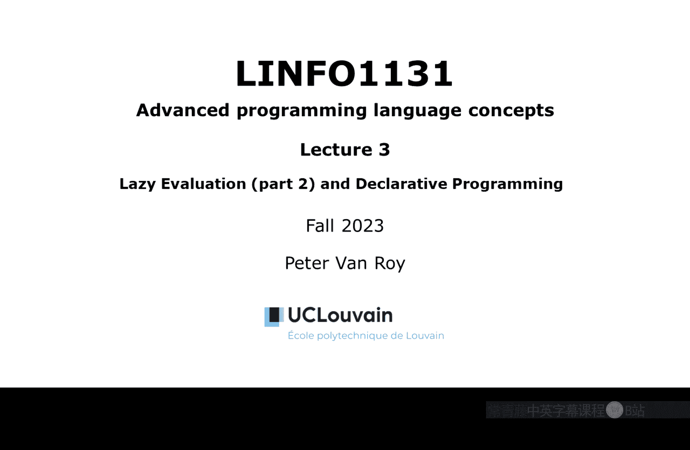

系广州。the course。So I feeling a little better， sorry I was not able to teach best you。

Which means that we have to change a little bit。S schedulechedule。Which means there will be。

 of course， next Wednesday today morning。And of course， during this smart week。That's unfortunate。

 but it's unpredictable。So I want to finish。Discussing the magic。Of lazy evaluation。

it's not all the magic， there's going to be more magic later on algorithms。So basic is actually very。

 very powerful。What I want to do， I want to start。By completing something from last time。

 so last time I showed a producer consumer。But there was something unexpected， in fact。

 there was a missing paradigm， so I updated the slides。

And it's better the way I've showed I was before。Parads number three。

 and that gives you a much better per so I will。Explain this。Then I'll talk about lazy suspensions。

 La determine this dictator flow， this is the most powerful one。

 and I'll show you how to do a bounded buffer。The code is very simple。

 but it's very useful to think exactly how it works， okay？This is a very powerful simple programming。

 and then I'll give lazy short sort， this is almost kind a miracle。

 this is where lazy evaluation will actually invent an algorithm。So remember。

 lazy evaluation only evaluates something when you need it。

 so it can turn a big computation to lots of small computations each time when you do you need it。

If you do that with Quick sorts， the result is very， very amazing， it's very smart。

 the algorithm is incredibly efficient。The efficiency is then for us。計学で。

So if I sort a list of1 elements。Normally， it's end market。But in the lazy version。

 the sort of list appears in cur， so you can ask for the first element， second element and so what。

 and you can ask for K elements， so if I use N elements。If I ask for1 elements。

The K smallest elementss of end。Okay， if you do the non lazy version。

 you have to do the whole quick sort and log in， but in the lazy version， you have to do only n plus。

Kの king。So that's much， much smaller。AndWhat's really amazing。 Yes。

 is that possible a such a lazy version for over a sorting algorithm。

 Sorry Is that possible a lazy version for over other sort algorithm Well， that's a good question。

 I this possible it is but I didn't study it for， it work not all sort algorithms。Okay。

 the algorithm， it works for lazy Quick sort because it's divided conquer。Algorithm。

 and the lazy will only conquer the part that has to conquer and not the other part。Okay。

 but we will get back to that one at to show the algorithm。

So what's really amazing is that the king is not known in advance。This is。Aility。

And that means when I run the algorithm， I maybe don't know how many I need。

 maybe I'm asking for evidence until I get a certain one that I want。

And I only know it when I'm looking at the elements。So even if you don't know the gu cave in events。

 you get this complexity， so it's really a very， very efficient location。

And that is one of the things that laziness can do for you。

It can really improve the algorithm experience。😊，So it's really very powerful， people don't realize。

The power of this approach。 So hopefully you will see some of the power。

And then I will talk about more general， so we have seen five paradigms of declarative programming。

 some of which are very powerful， concurrent lazy。But I want to give you a precise definition。

 what is it not actually declaredlar the programming， okay？And in order to do that。

 I will actually give you a small introduction to forced motor life。O。The notion， logical notions。

 where you have logical formulas that are true or false。And then what's called a model。

 a model is a structure， a which the us a true or false。

 this lets you understand really what's going on。Unfortunately， there's no more course on logic。

I used to teach a course on logic， but we have only a fixed number of courses。

 so the course of calculability gives you an introduction。这多全。

But not it doesn't give anything unfortunately， So I will give you a small introduction。

To force on logic is that's important， it's important to understand a little bit about logic。

And this will help us understand what is the collaborative program。Okay， first。

 a few sentence of respect for the premiums。

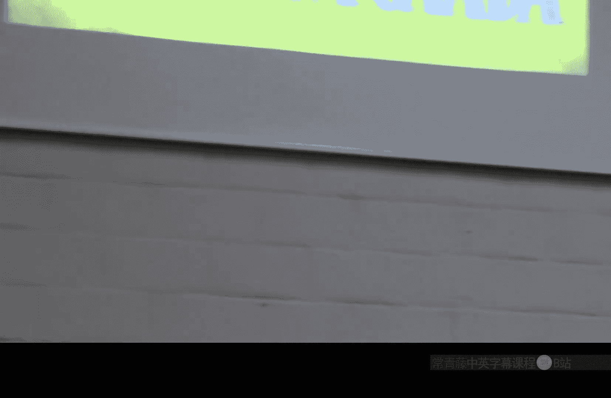

We fighting for for you。So let me first not give them。AS， I won't go over everything here。

Let me mostly give it as a。In diagram on the blackboard。Now。

 you should run the code that last time I ran some of this code。

 there's a producer and consumer code here。Okay， so we she had a producer。And consumer。

 this one was January the stream。Which contains sentimentdis for ones and10。我个啲。100 mill per element。

And the consumer was then computing the running sum。And out in this， okay？

So this is a simple pipeline to show what the kind of things you can do。

So let me now show you how this runs in four paradigms。And more。Foral explanation of what happens。

So its sequential function of programming。We a sequential functional programming。

Plus single assignment。Wch is。This is a small change。

 but it's a very important we have deter deterministic they to vote。And then we have they to others。

So these are four ways that you can run that code。Okay。So how does this work？

So here we have a string， which I would call S one， you will have a string which should call S two。

Okay， so I have updated the slides。To be agreeing with this。

 so the slides from the previous lecture are not complete。

 so I've put a new set of slides that is important you every year when I notice something missing I try to improve it。

So these are the four paradigms。So sequential functional programming。

So this is this traditional function language， there's no unbound variables， no single assignment。

 and there are many languages that do this， for example， Li E， ML， Ocal。Which are still used。

 even though they're not so much media types， there are still communities using these。

Then we have sequential functional programming with a single assignment。

 this is important because this functions help tell， this is an extra power。

Then we have the termministic data flow， which is a concurrent form。

Functional programming with threats。Data flow synchronization。

 so this one is used by many cloud analytics tools， based on map produced and flow one。

 so this is actually widely used。Even though。People don't say it so loudly。

 but it is very well used today。And the final one， which we talk about in this lecture is lazy evaluation。

 which is only adding one small concept。To the data flow， which is the weight needed operation。

 so it's almost the same is just one extra concept， nothing else， there's no other magic。So this。

 so all of the techniques that showed you are possible with that。And there are also languages。

The most popular one is called Hakell。This is a amazing functional language。

 and then there is acursor festival called Miranda。

And there might be there's other ones that are more research languages。

 but Hasel is actually also very popular， even though you don't hear it so much。In the media。

 for example。There is a crypto currencyr company called IOG。Which makes a blockchain called。

Cardano and a cryptocurrency called theta。And that is a haskell house。

 those guys are all doing it in high school。😊，So they don't say it so much。

 but they are very mostly programme in Hastel， so Hasel is actually a player in the cryptoer community and it is a basic functional language。

 okay。So these languages are actually。Use quite a bit for very powerful kinds of。

 so that was just introductions。Now this is something we did not see in the last lecture。

 so this is the paradigm that I forgot in the last lecture。

 so if we have a traditional sequential functional program with no single assignment，ok。

So there's no unbound variables， so we have to more slightly rewrite the code in O because Oz will by default。

 use the unbound variables to make it to recursive， but if I do like this。

 if I do the recursive call pro2 outputs on H equal S。S is not unbound to value， it's the result。

 and the result is L bar s， the low value followed by the rest。

 so both L and S here are bound values， there's no unbound values。So how will this thing run？

When you run it。So I run it here， so I browse this one is two。

 and I run a here probably two followed by con。The front2。

Will not return anything until it is complete， so when I call Prop2。

 it will do a recursive call here， but the result is only computed when this recursive call comes back。

Which means at the very end。That means the execution will be batch， batch， so they will be。

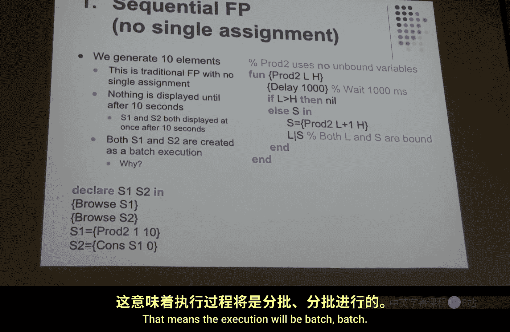

1 seconds。规。And then S1， and then pro 2 will z， and then S1 is displayed completely。啊关。3。Okay开。

And L2， so they will be displayed immediately。After 10 seconds。Because the cons。Has no delay。

 Pro2 notice it has a one second delay for each other， so the execution takes 10 seconds。

And once the 10 seconds is done， then return， so this one you can execute okay so this is what happens we have no singular assignment is one after the other。

Okay。Now the second paradigm， this is what I started with last time， this is actually more。

already more powerful because it's going to be tail recursive， okay so this function here。

 this return value is tail recursive， so let me explain how it works。So， this is the return。

Instruction， but in the kernel language， it's actually。It's naturally compliant like this。

Let me show you how it works。LH results。面下。H。So the way this one works， the second one。

 the singular of assignment。Is。This is the repressive call。In the current language。

 it's compiled them as follows， so this part here run。I won't show you the rest。

 I'm going to show you this part。Okay。Now， notice what happens is bars is the result here。

And the result is bounds。To L bar R1 and R1 is the re person call and then I do a re person call。

 that means while this thing is being executed， the result is already being bound during the execution。

And what that means is that。There's one new element every second。So this is incremental。Okay。

 S 2 will be batch。Everything。After 10 seconds。Nothing before。So that reason， can you see it。

 I don't want a computer with them？Is the video camera seen this？Yes。

So this is what I would call a match execution， so this is incremental。Okay here。

 in the previous case， they are both batchched。Batch means you have nothing for a long time and then you do everything at once。

So here you wait 10 seconds and during the 10 seconds， you have nothing。Here， every second。

 you have a new element appear on S1。But S2 is nothing， and when S1 is completely done。

 then we will execute S2， and it's because the thread there is only one thread here。

So this thread is inside here， so while the problem1 is executing， the thread is here。

 so the constant is not executed， only when this one is completely finished will you start the cons okay？

So that means that S1 would be incremental， but S2 is on his batch okay。

And the reason why S1 is incremental is because of the single assignment。

And it's the same reason why this distails person。えち？So that's the second one。

 so in the last lecture I did not show the difference between P21。

 so I noticed actually there was something missing， so now it's completely valid。

And then the third one。The third one is deterministic data flow。Now。

 both S1 and Prod and Coms will execute in their own threats。

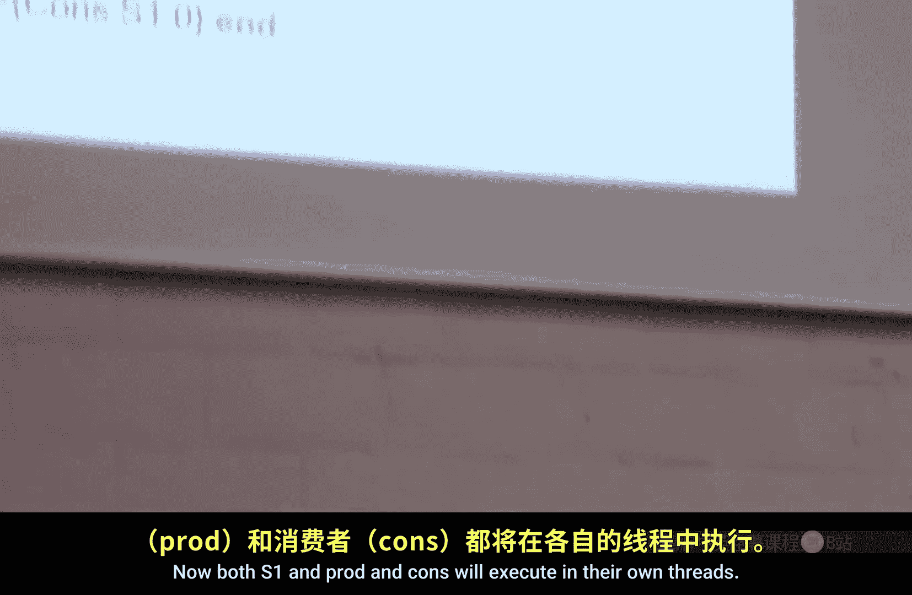

That means while the Prad is creating its elements here。

The council already executes in its own phrase。So there's multiple threads here。

 So this one will execute like a before。But it will not block the cons because this is executing its own thread and the cons also。

Okay。Otherwise， it suggested the same job， so the third one we have。

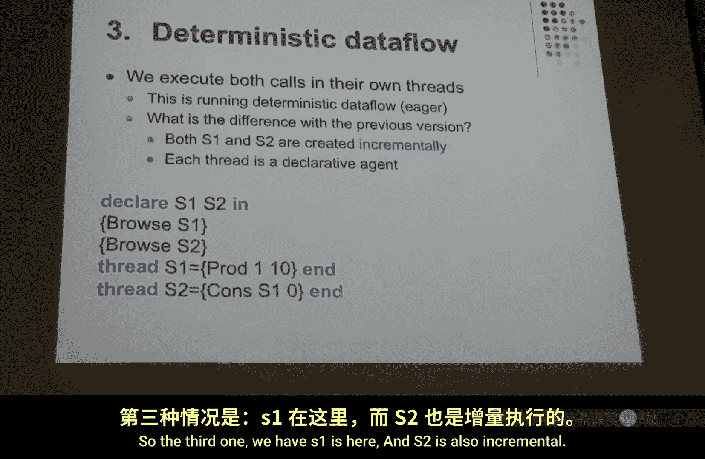

That one is incremental。

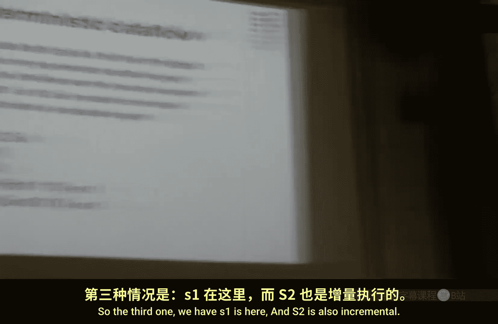

And this two is also looking tremendous。That means every second。

You have a new element here in S1 and a new element in S2 quote。T two of us a bit of time。

Because there's no delay in the cancer， when the drug creates an element。

 the K is immediately able to execute。And it will generate its own development。

 so you'll have two of us at a time of every second。So they're both。

So you can see the difference here and the increased power。So here there are both。Btch。

Here we have only one thread， so every thread is basically a unit of incrementality。

You can see that this one thread。When you。Of incremental execution。ok。

This is in this version here so now I have one thread executing everything， this is this number two。

 this is one thread which means the problem will be incremental。

 but since there's only one thread that comes is not executing。

 so it's not incremental we have incremental and batch。And then in the third one。

We have two threads and each thread will allow incremental execution。So， they were both big。Okay。

So that is the progression， so you see the power of deterministic data flow well。

You can also see that thermoso is exactly the same。This is because of church trust or。

It's just that the deterministic data flow is much more incremental than the standard。Niveive。

 sequential functional product。And single assignment is have the intermediate step。If you do this。

 then all you have to do is add threats and everything becomes incremental ro agent， okay。

 so that's the complete explanation of what we saw last week。

 but this is all just precursor to the fourth one。Which is the lazy。

So notice we still have exactly the same code as before。

We not obtain take the producer of the consumer as the Ba。And when you execute it。なぜ。

So that's one is two。Will be computed by me now。So they will also be incremental。

 but incremental by need。That means when I run this， nothing is displayed， okay。

 until I need the results， what does it mean to need the results？Well。

 the need is defined in terms of the weight。转身。So need is a threat。Does。为。

So that's the formal definition， so wave x is a synchronization that will block to thread or x' is bound to value。

The threat of this， then we say X。Thiss me。So if nobody is waiting on x， then x is not here to。

We defined a procedure called touch， okay？We will find a procedure called touch that does this。

To force the computation， so here the computation only be done is easy okay？Okay。

 so that completes the explanation of what we saw the last time。So now it's completed。

 so last time there was something missing。But now， it should be。Okay， so let me go on now。

 so that's time we saw infinite risks。Now， visuallysis is a new thing。

It is not possible to deterministic day of flow， because the deterministic day of flow。

 this would be an infinite loop。The inN n bar in plus one looks like the infinite loop for in lazy execution infinite loops are not a problem okay so this is definitely possible so we showed that and then we went into the hanging problem。

Where we need to generate。The numbers 200 A，3 to the media5 in increasing orders。

 this is nontriial because when ABC are increasing， the numbers will appear in any kind of order。

 so you want them in strictly increasing order。And in order to do that。

 we will create it incrementally with a stream。And the way is to have H be the result。

And then you have two h3 H and5H， and you merge them together。

 you take the smallest element each time， and so these lists are unvalueed。

So that whenever you see an unbounded list， you should have a little alarm be weing in your head。

That means you to do places， okay。So that means this is a very simple lazy program。

That uses two lazy functions， lazy times， which is very busy and lazy me。

 notice there is no mill here right。These programs are both。先。あけ。But in the lazy institution。

 we don't care about the base case， there is no base case。The streams are potentially unboundunded。

 so you see it's a very nice way to program but you can see why people programming hospital。

 they like it very much。Okay， because they never have to worry about termination。

That's a very interesting way of programming them。So this is the whole program。

You define the two functions， times and merge。Then you have one recursive expression。

 you see H is equal to some expression and which is also containing H？Okay， so we saw that last time。

But let me now explain a little bit more in detail how it actually runs to give you some more intuition。

Because I told you there's only one new operation， which is what needed， so technically， seically。

It's not so different from regular functional programming。

 but the problem is you many of these are connected together。Okay。

So you have threads and weight needed。So the weight needed is the new thing。

But the execution is actually very rich， even though you only have one new thing。

So I want to show you this。So in order to do that， let me introduce a canoe concept called the lazy suspension。

So I'm not adding anything to the model， but I'm just looking at the model that we have and I'm giving something a name。

 okay， so when I have L2 equal times L13，Remember the semantics。

 it framenks a thread that does weigh in。 Okay Well this thing I I'm going to call it a lazy suspect。

Because the thread is suspended the what needed， and I will make a diagram for this。A little note2。

Is there's a late suspension times L13 attached to L2。

And this one would only be executed when I need L2，And if you make that， then the having program。

 you can see you can write that expression like this。So if I run the program。

It immediately creates five basic suspensions。Okay。And they've always。O。

So mergech T2 M2 will only execute when you need M1。Merge at T3。

 T5 will only execute if you need them two， and so at time takes3 you'll only execute if you need T3。

 so each one of them is sitting there and waiting until the variable is needed。And now。

 how do you get this thing to execute where you have to force the need， you have to put in the need。

 So if I execute M1。1。That will cause the whole chain of execution。If execute M1。1。

 the dot operation。Once the first field of M1。And there is an implicit weight in there。

 the dot and the case and addition dont have an implicit weight。

 and that will cause the body of mergech T2M2 to execute。Now this body itself has a case statement。

 so let me show you now a little bit more detail， so let's say I do this， browse M1。1。

The do operation will cause the lazy suspension attached to M1 to execute， so that's very easy。

 it means that the body of this function is executed now， so here's the body。

I can go back and show you that， so the body is just the body of the function that you can see here。

So the body is executed。 now the body has a case statement。えな。On T2 and M2。

 and it meet the first two elements of T2 and M2。So this will recursively activate。

 you see itll activate T2， the invasive suspension on T2 and on2。So here there's a times HT2， H2。

 and Em T3T5 attached to these。And the case statement will just wait forever until these two are abouts。

 this is still a data flow point。But now I've activated the two other late suspensions。

 they will do their work， and they will eventually bind T2 and2。

 and then the they think it will continue。So you notice here's the red one I making color。

 time page two in red and the merge in green。So here again， I keep the red of the green up。

The body of time each two is executed， so again， this body has also a case statement and so on that stuff。

 okay？And the body of mech T3 T5 is executed again。

 and this mergech will again activate two more of them。And eventually things come back。To the case。

 the original case， and it was still just since they waiting and then it run hit excellence。

So here's the overall execution。So let me see if I can do it。はい。MiSo I need this。

This will activate this merge。That will'll execute this。Then it will activate this。

 will eventually come back。He will activate also this one。And it will go like this。

People will activate this one， people will come back。Do来。摔。favorite sure mouse。

Comes back here and then this runs finally， and then finally it binds the one。

 So you see there's like a single。Flow control here， okay， it's actually a a sequential execution。

 there is a thing that the line is actually a single line。When I activate， I go somewhere。

 I do something， and then I come back。It goes somewhere and then I come back。

 So the lazy execution is actually a kind of sequential execution okay。

So even though they find you thread and what needed that， that's just the cementities。

 if you follow the flow， you can see it's actually sequential。

 okay so that gives you an idea of how the basic execution is working。

 see it always when I need something， it reively goes upstream and it goes up up up up and then it eventually comes back down。

So that's just what you understand now， of course， you don't need do to know this when you run the heaven program up。

 this is done automatically。Okay。So now let's talk about the。政。被就。The deterministic data flow。

 So we have deterministic data flow， which is not negative。And we have lazy， which is sequential。

 the lazy is actually sequential。So there's actually in a lazy execution。

 if you don't create threads， potentially sequential。

So technically it's a form of coing if you want to use terminology， older terminology。

 but there's only one flow to control。So we've seen these four paragraphs sequential with those single assignments sequential with single assignments。

 so this allows data structure with holes， this functions still incurive。

 then deterministic data flow and con program with streams， so this allows multi agentent。

 so this is very popular nowadays。And lazy evaluation， this adds by me with what needed。

It allows program with infinite data structure， that's a new thing。

And there is language and there's languages that do this。不。Now I want to show you the fifth paradigm。

Where you combine the threats and the ma。So you see there are two different things basis by itself is sequential。

Okay， so lazy determinist dictator slope is the most powerful one that we're going to talk about。

So I want to give you sometuition how you program with this one。

 so what is the power while it's confent and these the result is always the same？

There's no race conditions， no nondeterminism is visible， and it's high order， of course， of course。

 all of this stuff is high order though。It's also concurrent。

Concurrency means that they can have multiple activities that are independent of each other。

 that means they're not actually lockedstep， they can be out of sync with each other。

And it has lazy evaluation， which means you only do computation when in speed。

So that's a lot of power and it seems kind of complicated to use all that power。

 so what can we do with build this power？And I'll give you one example will show step by step。

Use the power piece like piece。And we do to do that， I' show you。

Prerimitive is a thing called the bounded。So about buffer is a well known concept。

So I've mentioned it already in the previous lecture， but now we're going to show the code。

Sobound buffers are used everywhere， but usually theyre not implement in a declarative way。

Usually they're implemented in languages with beautiful assignments， so they're not so nice。

 they're not declarative， so you have to be very careful when you use them in a current setting and you can have race condition and so。

 so usually you have to be very careful。So this founded buffer will be purely。

You don't need any kind of beautiful assignment to do。Okay， so how does it work， so again。

 let's use stomach producer consumer， producer consumer is very common of course。

 in all kinds of computing systems， when one machine is sending something to another it's almost always a street or a pipeline。

Now， there is no problem with this。Producer consumer， and the v buffer solves the problem。

The problem is that the producer and the consumer are not always running at the same speed， okay？

They can fluctuate because they do different things。

 the producer is producing elements and maybe sometimes takes a lot of time。

 the consumer is consuming elements which is very different。

So sometimes one is faster than the other， so when the producer grants elements took quickly。

It has to stop because the elements are only created when the consumer is using them so we're assuming the thing is is not using any memory so when the producer is producing elements and the producer is not consuming them then the producer can producing them because we have to store them somewhere and we're assuming that there's no extra memory。

 so the bal buffer will be the thing that manages the extra memory effort。

 so when the producer creates elements too quickly。The consumer can use them so the producer stops。

And waits until the consumer is ready， okay that's an basic behavior。

 and opposite behavior is possible， the consumer needs an element。Right now。

So it asks the producer for the element so the consumer has to wait for the producer。

 so both of them are idly， they're weighting a lot。Okay， so that's not good。 That's inefficient。

 Okay， so we want things to be smoother。And that is the problem solved by the common buffer。

The boundary of buffer is the component that you should put to the middle is between the two， okay？

And it helps both sides， so when the producer creates elements。

Too fast and the consumer is not ready， then they're stored in the non buffer。

So moves the under before keep stuff， so it takes a certain amount of me， which you can define。

And if the consumer needs elements。Well， it can take elements from the mountain buffer so the producer can kind of get ahead of the consumer。

 foot elements in the mountain buffer， the consumer can take elements。

 and meantime the producer can produce even more elements。

 so the execution is much smoother and the idlo time is much reduced okay。

So the performance has improved， so it's very nice。

 so the code has not changed of the producer consumer and so it's kind of an invisible component you stick it in there。

We is exactly the same as before。Okay。So we're going to program it。

 so both the producer and the consumer will be lac。Okay， basic functions。

And we will put the dominantin buffer in the middle。And to the producer。

 the bound buffer looks like a consumer of the skin elements and to the consumer。

 the bound buffer looks。Like it's producing elements， so they look the same as before。

So the bottom buffer has like two， two faces it looks like the producer of one side。

 it looks like a consumer on the other side， okay？So even if the consumer does not ask for elements。

 the Bo buffer will ask for elements from the producer。It will consume elements。

 even if a consumer does not ask for them。But it doesn't actually consume them。

 it just stores them up。But it asks the producer， that means it forces the producer toqui them。嗯。

And then they will be stored here and if consumer needs elements。

 the bounded buffer will produce them， even if the producer is not ready to produce new elements。对。

Okay， we're going to break the code for this。So here we have a producer consumer pipeline which sort of looks like this so I'm going to be I'll run the code for you in a bit so this is the typical producer consumer S is the stream。

 we have a producer agent and a consumer agent。So we're going to stick the bomb buffer in the middle。

producerducer produces S1 and a consumer consumes S2。

 and the bottle buffer has S1 on one side and S2 and， okay。So we're going to find this procedure。

 vel and buffer， and10 here is the size of the buffer。

 so there's a certain maximum number of elements。So we can manage the memory。It's important to them。

Okay， so we're going to define it step by step。And I will show you the reason process in terms of concurrency and laziness。

 so we'll start by。Something very simple， and then we will make it a little bit better。

 better step past that， okay。So here is the first。The first step is the bound buffer doesn't do anything。

 so here we have procedure bound buffer， S1 is two， S2 is able to loop S1。

And look at this loop function， it reads as1 and it outputs exactly the same thing， H1 bar。Okay。

 so here is the bottom buffer that just outputs the same elements as it inputs that's basically what we want it's just the timing has to be a bit。

O。So that is the first step。I a v buffer that doesn't do anything yet。

 but it's like a transparent thing， so if you put this code between the producer consumer。

 everything still works， nothing has changed。Now the bound buffer has two phases。

 it has a startup phase and it has a Iranian phase， so when you start out the system。

 the bounded buffer would immediately ask for any elements。Okay that means when I write。

 when I start the system， the bound buffer it always tries to be full， so when I started up。

 it would immediately ask for end elements。So this is the following。Okay。只是对生活。Okay。

So here we've had a new function called。So this is coming from the list lag so I don't want to define anything。

 so list dot drop， so list do droprop is a lag function that removes the first elements and elements from a list。

 so if I have the list L which is1， two，3， four。That list the throughout。L，2 will be three，4。

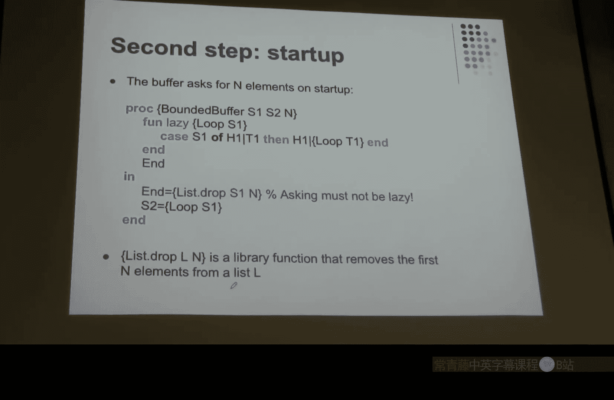

So it removes the first egg elements。That's strangehuh， but remember we're lazy now？

So this du drop is not this yet， it's immediately asking for you。

So that means it needs those n elements。Okay， it needs them。And so。It forces S1。

 it forces the producer to produce them。 this is lazy execution， so call this。Function will force。

The producer to produce an。

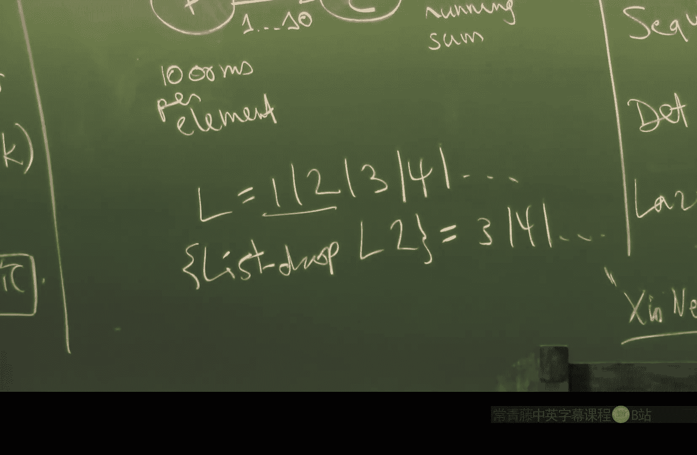

So what does it do so the screen S1？The stream S1 was already debus now， so we have your S1。So S1。

 we've already now have10 pillows。Well， it will be in the process of creating governance。

So we asked for them。S2 is still under ground。Because the consumer does not need anything else。

So on the startup， we will eventually achieve this， so the producer will start making elements。

It might take some time though， but we're asking for an。

So the producer starts ready and it starts producing end。

And because the stream is single assignments here， once we create these elements。

 they exist forever so the consumer could start reading the elements， whatever。

 so once we create this part of the stream， then it's there and exist forever。やれと？

So that's the start。No， no。We have to do the running。Face。Now assume the consumer asks for 1L。

 so it basically reads the first element fine。But if it does that。

 then there's only n minus one elements in the mountain buffer。

Okay so the buffer always tries to stay full， so that's the goal。

 so it's a kind of goal oriented that the buffer is trying to stay full。

And so when the consumer reads， the first。Then there's only n minus1。

 that means the bounded buffer has to ask for another element。

h and has to again try to stay full and no。So that's the stay full。反律思。

So this causes us to add new myth of code， So whenever the consumer。

Bs an element or ask for an algorithm， the buffer has to also ask for another element。

 so basically when the consumer reads this one， goes to the consumer。

The buffer has to ask for this one。Okay， so it's like this。

 whenever the buffer is always trying to stay full。え。So how do we do that， but we have this end。

Pointer， very， which is essentially。V bounds to the rest of the stream，So we're both use end。

And we're going to add it as an argument to our loop。

So the loop is each time the consumer reads one element。

 the loop is going to do one iteration because the loop， when the consumer needs an element。

 then I will activate this laser suspension， I will bind the output would be H1。

 the H1 will go here to S2， and then I do a person call， so each time this loop does one iteration。

 it means the consumer has pass for one element。オッケー。But when that happens， we need to ask。

The producer for example how to to that， well that's very easy。We have this n variable。

 but N is going from here， but we need this。So we do end dot2。

 that means end variable has to in by one。嗯。And this does operation will cause。这。

The ends variable good。Which has an latest suspension on the producer to activate and will force the producer to produce one more element。

So each time the consumer asks for an element， by activating， by reading S1， then by doing this。

 we force the producer to make one new album， to start， at least to start computing a new elements。

 okay？So with this， the producer and the consumer。The buffer will always try to stay full whenever the consumer has of this will force the producer to produce another element。

 and in the ideal case the buffer will always add end。

 but maybe the producer is very fast the buffer can emptyT of the books。

If the producer is very slow or the consumer is consuming them very fast。

 then we have a lot of these and toos。And the producer is doing it， but it's not ready yet。

 but that's okay， the buffer is always trying to stay full， but it may temporarily be this。

Now there's one more final step。And this is where we need the threats。

 so so far we're not doing immediate concurrence yet。But remember， a thread is a unit of weighting。

 that's another way of talking about that， the unit of weighting。So this code。

Conceptually it does everything except it will block too much。It waits too much。

And there's two places that it works。 The list that drop will only complete when the producer has made 10 elements。

 So this one， if I read this， it it will avoid the loop from being executed。

 It will stop the execution。So the list dug drop， it should not wait in the main thread。

 it should wait in its own thread， okay， so the next step is we put this this dug drop。

And it's so threatened。That means it still runs and it still asks the producer to produce elements。

But it's not going to block the main threads， okay， so remember thecur for Deeies。

 adding threads never introduces bugs。So I say here。

 threads are your friends in a declarative program。Threads are very nice。

 they will never break your program， they will never hurt anything。You can add them。

Without adding bugs， the effect is that they've removed the locking。

To make the program more incremental。So in a declarative programming threads are nice guys。

 they're your friends， it's not the case in Java， and Java threads are very nasty because they would say when you use it together with beautiful states。

 it's very messy and nasty， but in a declarative paradigm， it's not like that。Friends are。

Very nice and friendly。 And you can embrace them， use them wherever you want。

 So here we will add a thread so that the list that drop weights separately in order of the main thread。

 So that's good。 That means the producer will be the Ns。But it won't block the main execution。

And then there's another thread where you， this is the endduct2。

This is that the stay full apart need one more element here。But the end up two。

 again it will block until end is bound， okay， but we don't want this re person called loop to block。

So we will put the end up to in its own thread again。So the recursive loop will just keep growing。

Okay， this one， to end up to， the forced the producer to make a new element。オケ。

Maybe the producer's very slow takes a long time to produce this new element， okay？That's okay。

 it will wait in its own thread。It will not block anything okay。And no bugs are introduced。

 so the foundation of this of course， is intratroor theorem， this is all functional。

 in fact theoretically， this is all under the capitalist， okay。

 it's just a different production order， so adding the threads will not change the result it will just。

Remo the block so you see how decative programming is a very different and more powerful way writing programs than programming in a parent time。

Okay。So that's it， this is the home bounded buffer， so now it does it。

So you can see it's a combination of lazy and concurrency。

 so the laziness will make sure that it's only created on its on demand。Okay。

 and the concurrency is needed。To make sure there's no blocking。

 so the demanded buffer is free to ask for new elements without blocking the main institution。

 so it's combined in currency。です。是在政策。So I will show you the execution but in the little while after the break we show it。

 so we can create a pipe。With our original producer Ca。Now how does this run when I run？

So when I execute Pra， it does not okay， when I break the bombed buffer。

Then that immediately asks for three others from the produce， because the size is three here。

 I'll make it small so we can show it。And if I consume an element， so S3， if I do something like。

Brow history that one that's consuming an element。Then I will add ask the fourth element from the boundaryder bufferuff。

 so the boundaryder bufferler is always trying to stay forward， and maybe not succeeding。

 maybe I'm consumings too fast。It always puts in exactly the threats that are needed to try to stay full。

 so it converges to full， so if the consumer is not doing anything。

 the mono buffer will eventually fill up。But if the consumer is very， very， very。

 very fast and the producer is slow， then the bond buffer will always be basically empty。

But in real life， it's going to be in between those two cases。

So sometimes the consumer will slow down and then the buffer can fill up a little bit。

 or sometimes the producer is a little bit faster or the producer slow down and then the buffer will empty a little bit。

 so it's always some kind of a fluctuation in the real system， but it will smooth the fluctuations。

So that is the development buffer， that is one of the most subtle algorithms we have seen up to now。

 okay， and you can see the principles。Bres are your friends。

Laaziness lets you work for infinite data structures，え？

You have to think in terms of the clarityative program again。

 so everything you run will always be good， no matter what if you do it lazy or anything。Okay。

 so let me make it smell break and then I'll show you the code。

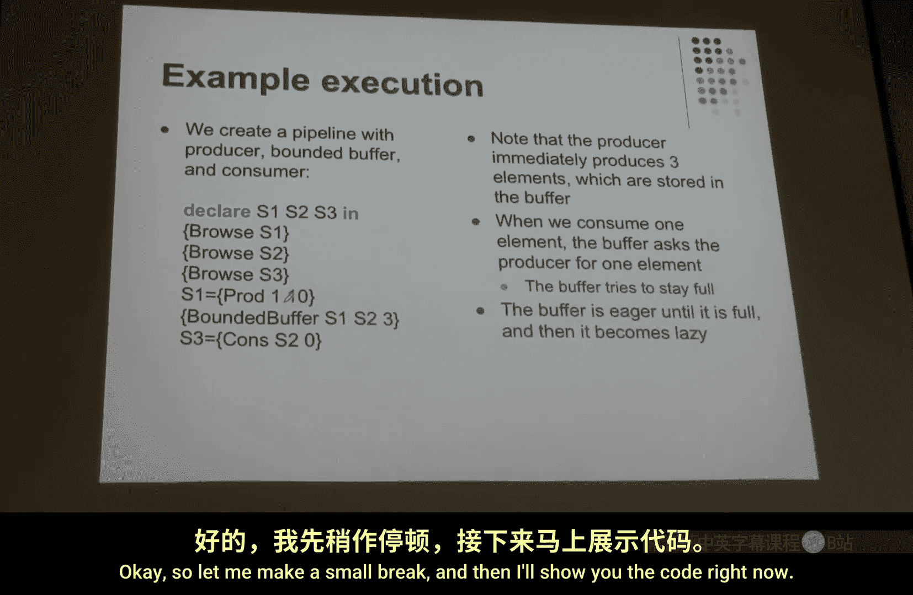

Right。The producer and consumer can show you how the money grow。

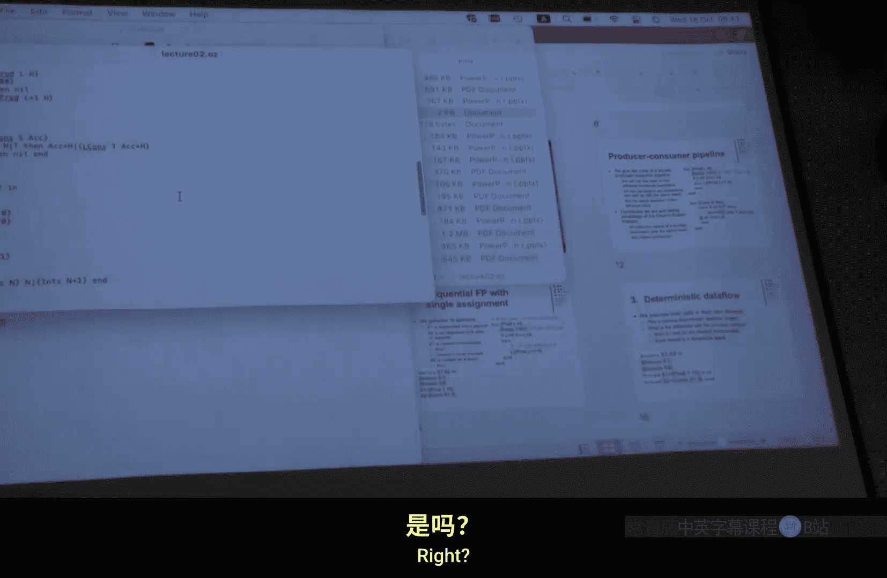

Okay， so I show you that it really works。Some theory， weird theory stuff， actually really works。

So here is the producing consumer， Let me。Keep the same。Okay，Defin the buffer。感。

Let me try to use the same。Notation here。That one is two okay。你确有。どし。Okay。

 so the moment buffer is one is two and。I have a lazy function here。6。特是。This one of each one。

So this asks the producer， and then I just output each one to the consumer。

But I have to ask for another element， so that is the thread end。六。And now I will。

And will run the actual thing。So I first time the introduce。Let me go from one to100。なんですか？

Round above S1 is two， very small one， three， so again， you see and empathy vocal。か。そ。Hili zero。

Okay this is。So I'm going to run the bump buffer， so I cr first El Prad， a lazy producer。

Whi is said put as we did before， one element per second， I will have the lazy consumer。

 which cuulative some which has an output tree， which is a cumulative sum。That has buffer。Okay。

 so I think I'm writing it。I have the loop function， which is lazy。Which takes S1。

 takes an element and H1， it just outputs it。And then does the recurive call on T wanted and with EdW2 in its own thread。

And then I have the startup here， list drop on its own thread。诶。呃 call。So those are the things。

 so that we compiled them。그。1。2。都说。I think I'm doing it right。

 so I'm doing it by thinking to'm not copy， so if I make a mistake you would have to correct it so I have three streams as one as two three。

 as one as the producer's three。Then I have that bounded buffer in the middle。

So it takes S1 that's input， S2 is the output， so S2 goes to the consumer。

 and then the consumer is an output put Stry。So what's been happen when I run this？

So when I run this， the consumer doesn't need anything yet， so I have no S3， S2。

 I don't need anything， these are own lazy functions。So when I run this， nothing is needed。

 so what's going to happen？What's going to happen when I read this？

You see what's going to happen in terms of the bomb left forever。So as a producer。

 what's going to happen with the producer？So the the still needs nothing。So what's going to happen。

 you tell me。If you understand what about buffer is， yes。

So it's going January three because are best re it's when I there。

 the bounded buffer will ask for three elements from the producer， then it will stop。え？One， two。

 three。And it stops。Now， if I want an element from the producer now， let's say I do this。

Browse S3 the1， so I want the very first element of historytuary， notice estu is and power。

So in order to do this， the consumer needs an element okay， so it needs an element from S2。

 so well ask the bounded buffer for this element， but the bounded buffer already has the element。

It's there one， so I would immediately give the results that way。And at the same time。

 the Bob Go will ask the producer you。For another element to stay full。 so I do this。

 So you see immediately I have or this is too small immediately the one there let me make this little bigger。

Okay， so the meeting， I can do it together you'll see how it works。

So I want now the second element of the output， so the cons will do culminating sum。

 so we do one plus two， so we'll display three again。

But this result will appear immediately because the number two is already there。

 it doesn't have to wait one seconds。See， so the consumers forecast cast because the tunes already't there。

 but then at the same time， at the same time， the bounded buffer ask the producer for another element。

 so so when I do this， you will immediately see the results and one second later you will see the bounded buffer filling up。

Okay。So you see immediately beat himself three ins， and one second invade you to five。

So the bound and buffer is always trying to be full。

But if I ask for too many elements from the consumer。

 then the bound buffer will actually completely and then the consumer has to wait its okay。

 and because it's so declarative that's not a problem。

 so there's no problem if the consumer have to wait， if the consumer needs four elements now。

 and the bound buffer only has three。3，4， five。Then the consumer will take the first three。

And we'll wage for and fourth。And we'll just wait， so in the very worst case。

 what can happen is somebody waits， okay， nobody is introduce ever。So you can play around with this。

 so I won't put this code， but it's easy code done。アドあグード。So it's a very。

 very straightforward within of programs， okay？So it really works， so this code is actually。一本で。

You can use it。OkayLet me go back now to the。First。So if you saw the example of execution。O。Okay。

 so let's go on， let me now show another nice example。Lzy principless。So， lazy evaluation。

Can make algorithms incremental， It means since I only ask for things that I need。

 maybe I only shoot little bit。Of stuff to make the results， you know。

 it asks for the minimum amounts basically that I need to make the。

And this can enormously improve the efficiency of an algorithm。

Now sometimes when I run the algorithm lazily， it only has to compute the small piece。Of information。

And I will show this with Quickoid， but it's true for many algorithms。

 not all we will see next time some algorithms that cannot make them incremental。For example。

 the reverse function， if I reverse the a list。And if I'm asking for the first element。

 I want the incrementalmento， the only way to do that is to reverse the lowness to some algorithms you cannot be incrementalmento。

But even in the case of reverseverse， we'll see not meaning how to avoid this issue。So it's very。

 very， very powerful， Okay， so the standard of quick sort has a complexity of N log N。好了。

It's worst case in square， but we're assuming if you picked the pivots。Rly then。The lazy cr zone。

 it'll be n plus k not K。So it's basically linear， not analog log N， but linear。

which is much more efficient and the log。The MO is only for the elements you compute。

So if I need all the elements， then it will be n plus n log n as before， it will be N log n。

 but if I need one element，I need to the smallest one， only one。That it will basically be ordered M。

オケ。But if I need some number of others， it became。Okay。And as I said before。

 if valueO does not need to be known in advance， this is a major advantage of lazy programming。

You don't have to worry when you design the algorithm。

 how many and how much you will need is the same advantage for the a problem。

How many elements do I need of this list？I don't know， but the la program will be efficient。

Will we always have the maximum efficiency， no matter how many elements you ask for？

Because it's very efficient in terms of memory。Okay， so this algorithm I will show to you and I will。

诶那个。they are new。Try。I dare you direct this up the job， okay？You can do that。

 and you see the difference。Okay， so quickword。Quick refresher， quick sort is one of the。

tookOne of the standard sorting algorithms， okay？We chooses a divided conquer approach。

 so here's the list L， so I picked a random element， which is called the pivot。

And I will partition the this element to two lists。

 one of them where elements are less than the pivots and have one where they're greater than equal to the pivots。

Okay。And then I will re talk to the cloud。To have two sort of lists。

 and since all the elements here are less than this， all I to do is aend of them。

And the result is that。So you can see this is an in logging algorithm because partition in event will be linear time and if on average the lengths of L1 and L2 are half。

 I have two times。Operations are enhanced， and if you write the re equation， you see it's an end。

So here's an example so I can do this on the board。So you can do quick sort。

Let me show you just a simple example of DCL。As we're going to make these。

 this is an unfortunate thing where understand understand how thiss working。So we take some lessons。

嗯。Whatever。I take the fingers。So could be any of them， but let me take the first elements for this。

So that's the pivot， then I have now one， which is called the elements less than three。

 which would be that we think this before。对。Lesson5。Would me to。You。Takeか two。

Because all the other very equal fund， six date。five，9， six。What does that right？

Then I do it for person sorts when have0。Here I perfectly have five five。え来？

And then I just kind of do together。So，2，4， five， five， six， eight，6，5。

 that's simple simple divided comfort algorithm。Itvented by Tony Hoor in the early 60s okay。

So we implement this， so we implement this inlar。So basically。

 I'm going to do a simple version with partition and app， so I will implement。icition function。

Pition。And太。Okay。Okay， partition and append。So here's a partition function。

It's a procedure actually because it has two outputs， so L is my list， original x x is the pivot。

 and 1 and L two or the outputs， so I will traverse L。Okay， if h is less than x， then I add it to L1。

So L1 is h bar n1 and I recursive we call it N1， if it's the other case。

 I add H to L2 and error recurive。You to okay。And when I El is Hill then the two of us are German。

 it's pretty simple， declared the function a linear time function。对。And now I have。Apen。

And quick sort， so a pen is very simple。So a pen M1 and two。

 so I take the first element of L1 and I do what Christ called A bar a pen。

And if L1 is still then the as well as T2， so this is a simple。To person。本身。哎。

So here is the quick sort。그个。So a quick sort of level。

 so for simplicity I will take the first elements。L as a pivot， you can take another column of them。

L of x bar M， the level of partitions。Hello。According to the Hus to L102， I do a reperive call。

Quriricks1， Quick two， and I append them。And that sense。对。So， let me。啊我我就不让。そで now。In this case。So。

then。H is less than x then I put it。完。Cal tea， thats。And one。To my。嗯。Otherwise， I had H。To thanks。

I do。す。这。だの。ち？And in the real case。ふ？So this is the partition function。The。Right， no very。And还去。

Remember this。这是恶。3 year。と。So it's。So it's two， two。

 it's basically all the other ones that's in  three and all the other ones great many people。欲しい。

That's partition。人当时。Time is actually a built in function， but let me define it。这是。比说に。two。No，s no。

It's correctrrect， right。What is correct。Please straightforward forward。分。was。Wh， you told me。

 I actually played a last year。Did food no purpose。

 its nice that the bug is there because you the bucket for me。What's这个。It's pretty obvious but great。

Yeah。Oh yeah， so you said， what is it like completely like ignore one list life？

It gave of L1 with and L2。So how to fix it？Maybe once you want the list is empty you take the olive Yes exactly see exactly。

 that's right， so the problem is when L1 is empty， the result is not mill as should be no2。

Try to type too fast to see see that's a problem when programmers can love to type fast as they make books。

So now we're even time food Lord。Hello。So the first thing is to do a partition。That was first。

No白就 case。了。Export team。And so I assume X is my pivot now。So thanks10 two。This one is equal to。

So it's wonderful。To it books or。す。な。To。And7 and。Swigs sort nose no。然后这是什么。

After I to declare some variables。1 and2。这是万。Still we're good number， very simple code， right？

Are we good here？What is税。A good， are we willing to bet  a thousand0 euro this is correct？

Maybe don Lucy。て。オケ。系。This is good that agree。Now actually this is a buggie， this program is buggie。

See why it's typical recursive。Oh。So the basic principle of a call。

Is that the argument has to be strictly smaller than the argument of the main column。

 otherwise you have move into the group right。Well， that's not true here。

So it seems to be very simple， but there's a stupid no mistake here。So what's the mistake？Yeah。

 iss that possible it to， to write trade and4 as 1 and as 2。

They don't have to be in their own threads， you could yeah。

 but they don't have I mean this is a sequential quick sort it's okay because don' the quickword is not walking down yeah you could put the quick one in this thread as the point that yeah you could and it would still be correct but it's not needed here yeah。

Ching， okay， but there's another problem。Assume I'll have one elements。

That we have a list of one poem。Then when we do partition。

That one element will go either a1 around two， right？Now we have a crystal called L1 to down two。

I means one of those recursive calls will also elicit one elements。See did something wrong there。

And if L has one element， then one of the two re of calls will have one element。

 so we I didn need to do， so I don't want to run this because。Theipulator will go into minimum。

this is a different move we see that。So this is just a little thing for Chris。

You you see why this is wrong to fix it， so this one is bugggy。Could be fixed。So the way to fix it。

Is that the recursient call has to have an argument that's strictly smaller。Then the government the。

that means these two。Qu short L1 and L2 have to be strictly smaller。

 that means that L is a list of one element。Those two have to be zero elder。あはで。

It so the way it's actually easy to fix instead。Partracitioning L， let me partition T。

 so T is guaranteed to have one of the best elements than L。That means L1 and L2。呃，Well。

Always have one less element than L guaranteed because in the worst case。

 one of them is new and that all the elementss go into the other one。

And it's strictly less than else though we're good not we。Were problematic。

 but the problem is we've missed the X。So we have to add the X。So were pending s1 and is two。

 but there's an x missing， but x should be in the middle of。Because x。

 all the elementss in S1 will be in less than x。So the x is actually at the end of S1。

 so we can put it something like this them。X bar is 2。Make sure we don't forget the X。

 so now this is correct。Interesting and small change。

But it's important we use this rightcursive function center。So we can try running this one。

then we see a beautiful sort of list。2，2，3，3， TV，4，4，4。Let's good up。这。O。

So the bug is also shown here up。We need an element that's strictly。

We need to have when I do the recursive calls， they have to be strictly smaller L1 and to2。

 not smaller or equal。十六やで。Okay， so now it's made it lazy。想区备种类置。

Well a quick sort becomes a lazy function and we have the lazy quick sorts。

 we have two reverseerssive calls， so we will make those lazy so that we only do the across deep。

And the app becomes lazy， also。Because maybe we don need one of the two。

 maybe we only need the first arguments。So the depends is also。But partition is not lazy。

Because we have to look at all the others。sorting does not work if you don't look at all the elements。

 if I want the smallest out of all the elements。I have to look at all of the right。

 if I don't do that， I will not。So if we make the partition。Lazy。

 it doesn't help because it will force the execution of the whole partition。Anyway。

 it's more complicated because part vision has two。Our close。

So would they actually be need one or the another， okay？

So the easiest way is to make partition eager and not least， okay。So this is the basic definition。

So a pen now becomes lazy。And quick circuit becomes lazy， but partition is the same as。That's it。

 we don't change anything else， we just lay those two lazy。

 so that's very conceptually very easy to look down。So remember that。Let me take you hands。所说的意思就是。

It。And。And also then we make。Lising resource。So I will try to make a nice version。

 put a nice version at this。最。So this is nice because we have two recursive toolss here。

And they're both lazy， that means only the one that we need will be executeded。

 so maybe we only need one of them and not go well see。是实之类。对。Okay， so let me do something like this。

 Let me do the same one。こ this。たす。Thens ave and I will browse this here。

I give them names because I want to see correct what's happened。Okay， so I see nothing I underscored。

类似。Yeah， I think we have to call elephant。All right， those thank you。My person was actually looking。

 thank you very much。That would have made it not as lazy as that one。So here I know I truly easy for。

这都可。OkayThe other one would be partly not lazy and it would give a weird time。result。

 but that was a fo。Okay。So how do we do what we have to need to do。

 so what is the smallest element of？Now， what that one？Smallest de is2。

 What is the second smallest development， Well， S L2 that one，'s also two。我 is the。

Third smallest elements。 you see that each time I ask one element and I can say what is the smallest。

 what is the second smallest， what is the third smallest， so here I've asked for three elements。

But the lazy will only do the little extra work， so when I ask for the second one， it does some work。

But I want to ask for the third one， it will not redo what it has already done here。

 it will only do the extra little bit it needs to find out the three， okay。

 so whenever I need a little bit more computation， it will not。对。that's very nice。

 it seems to work done。As you see。How much computation is done？What is the time complexity？

We can actually look at the execution， oh， this gets complicated。

If you actually want to trace through institution。I you can do that。The principle is the following。

 when I need a variable， I will activate the lazy suspension。

When that lazy suspension might not actually bind the variable， it might create new lazy suspensions。

 but that new one also needs s， okay， so you look。Hello。So let me explain part of this。

 but you can go through this by yourself so let's say I do L QuickSo 2， three，4， one。

And I need the first element， I do browse do1， okay， S dot1 here。So I need S。So I activate。These two。

And this one， if you look at the definition here， if I need S。I will run the body here。

 so I will call partition and I will pray three lazy suspensions， elephant， but the S。

The final result is the result of yellow pens。So it still种很不要的。So I activate these three。

 but I still don't know what S is。But there's a new laser suspension attached to S， which is LPs。是S。

Still needed， once needed forever needed。Still needed， so it activates the L dependence。

So when you run elephant pen， you run the body， then go back to the body。When I run a bed。

 it needs L1， you see I run the body， because does a case。So it needs L1， so it basically needs S1。

 which is the first argument of Lped that will activate this。Which is the recursive called two。

 which is this one， S1 the E quick sort of one， people do this。And， it will still not mind this。

When it would create a new laser suspension on S。So S1 is still needed， so needed is always true。

 it's like in declared programming when something is true stays true。So M S1 is still needed。

So it activates this help head， so what it will do is it will lead upper first argument。

 which is S1 prime。And finally that is nu， S1 prime is nu， finally we get to something。

 so we know S1 is1 bar S2 prime。Okay， because of this， and therefore we know that。

As one practice do here， you can see that that meet the other when it runs。

It returns the second argument， which is Bubar has two。Now this should be in as too proud。😔。

We welcomeで。And so the final result is。One with this。So it will display one。

So if you follow the execution， you can see it's the safet we're having it goes upstream。

But here we have an interesting thing。I knew a thing that we didn't see before。

When I activate the lazy suspension here。I run the body about pixels。

But the final call is also lazy function， so the result of activating this lazy suspension is that created new lazy suspension。

Here。But since the result is still needed， this new lazy suspension will immediately be activated。

 okay， so I create the lazy suspension elementmed and I activate it bely。

Because I still have no value that I will keep activating until I find the variable to value。

So as long as I keep creating latest suspensions， that keep being active。Okay。

 now what is the complexity of this beast？We did。 I can。So I'm not going to give a formal。

Pro of it because that's actually complicated， that was actually in a research paper。

 there was some hospital programmer who was very proud that he proved this。

 but the intuition is very simple。So let's say I have three， four， one。

 so I will first do partition and I will be one and three， four。

 and let's say I need the first element。Okay， so I first took a partition here。

But I need the first element that means this recursive call Quicksup will be activated。

 so again I will do partition， and I will keep doing the partitions on the left。

Until I get to actual elements， so I will return one。With something。 And then I'm done， okay。

So basically， when I do a partition， I have two halves。And if I want the first element。

 I would only continue on the left half， not the right。But if I need two elements。

 I'm going need to do a little bit more， okay， three elements， I need to do a little bit more。

So basically， I'm divided the big problem into smaller problems。And they finding today governance。

I will as soon as the partition gives me K， then basically I will do the full execution。

So the way to see it is to compute the case smallest element as soon as the partition gets to the smallest。

The king。Then I will have to do the full computation， because I use all K elements。

 and that's k along K。So the part will keep dividing the problem into smaller problems。

Until I get to a problem， which is the size that I'm asking for， which is chaos。

So I will be doing a full quick sort on the K elements， okay， K log K。

But the partitions will of course， take linear time if you add up these partitions is n plus n number two plus n number four。

 so that will be linear so it's n plus。呃。系なけ。Okay。So L is a partitions dividing the making the problem smaller。

 and K L K is the full really quick sort for the K elements when I happen。

The small that smallest decay elements。It will actually be a list slightly bigger。

 it would be the first。If n divided by power of two that's bigger than k。

So that gives us the complexity， that's the intuition you see how the works。

 partition is making from the problem smaller and smaller and smaller and once we get to the problem of size K。

 we have to do full ex。So the complexity n plus， so that's not a formal proof。

But that would go too far。try to make more。But you can see intuitively how it works。

The role of the partition is very important， is dividing the problem into smaller problems and because the left side is called the intelligence less than the pivots。

It's okay， we have actually divided the problem into two separate problems。

 and we only have to look at the smaller this and not the bigger one。So it works fine。

So there you have seen some magic， little more magic of laziness。Okay。Nowで是。Another to。

AAboutve the part， but I would just start about it。We have seen lots of declarative。

Program we've done a bit quite a bit already five paradigms， all get the same result。

 put in in orders， batch sugar cemental or lazy。诶。So we are seen five them。

Sequential scheduled and single assignment terms potential lazy men providing lazy currency。

And I'm telling you they're all declarative， so what does that really mean？Okay。So。

I want to define a little bit more formal what it means， okay？And it's all based on church truster。

 but church truster is not enough。So formally， all functional programs are allowed this。

This is what we saw in the previous course and all the oddsnotation that we use is just syntactic sugar for lambda。

 okay all functional programming is just syntactic sugar for lambda。

And there is a famous the called Church Russer saying if I start from one of expression and I reduce it in one way。

 and I reduce it in another way is usually there's different ways to reduce some。

 and we can see that in a concurrent multi agentent program。

 the scheduler can reduce it in different orders so there are different reduction orders。

So if EA reduces to EB and EA reduces to EC， then the theorem says。That there is a term ED。

 then B and C will go to that term。That could both reduce to ED， so if it's a termating computation。

Then the result will always be the same。Independent of。Reduction worth。

 that's a very strong strong result。And so what's the intuition of that？Well。

 I'm not going to be the proof of it， but the intuition is that each not reduction is。

Keeping something true， it's like truth， it's like deduction。When you add truths。Then truths。

 once something is true， it's true forever， and it doesn't matter how you find the truths。

 you will always end up with saying true things if your system is consistent。So basically。

 this is holding for the lab。But our scheme does more than just。是两个啊。

The syntactic sugar introduces new ideas concur， streams， or programs that can never interinate。

Single assignment variables。

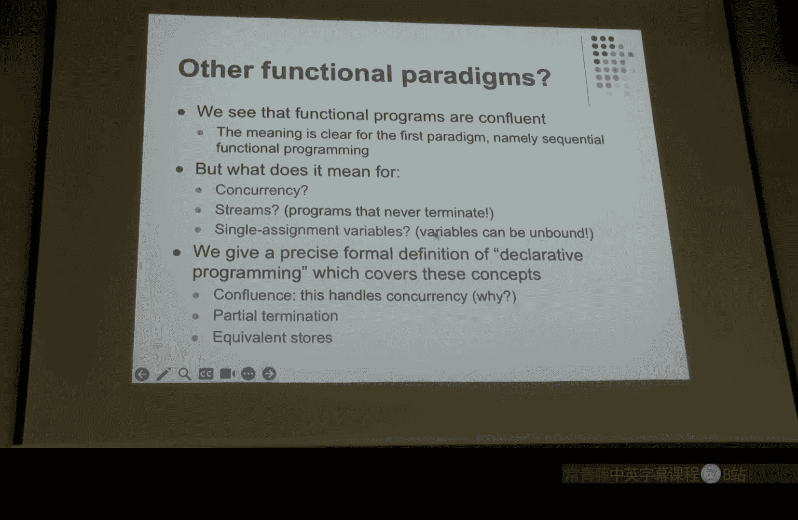

So this is not。Its，'s not simple how。The term with this in terms of level。

 so what does this really mean？So what I want to tell you is what declarativeness really means， okay？

And in order to do that。I will have to introduce a little bit of budget， so this is actually nice。

 I will tell you if you have like a quick introduction to first Pe。

So I don't know any of you have already seen budget in an over course， we've seen the。

First orderology。The same thing you do with a digital gate。Sorry。

 we have a delegate that we have a you have propositional logic there Okay。

 okay so digital logic you have。True false and truth tables。

 so you saw that so that is a form of logic called propositionpositional logic because you don't have relations。

 you don't have quantifiers。Whereas first learning logic。

 you have relations with quantifiers in them so you can say something like for all eggs。PX。デバイ？Qエ。

So you have relations with arguments and quantifiers， whereas in propositional logic。

 you have like something like this。You have only propositional variables which are true or false。

So the digital logic here， this is called propositional logic。

Whereas this is another or general form I'm glad before you have quantifiers。

 you have variables and you have relations， so this is called first order。

So you have seen propositionpositional logic right， and this is the logic you use for digital search。

Whereas if you want to do reasoning， mathematical reasoning， abstract reasoning。

 you need first or logic， proposition is not enough for that。

So first through electric is much more powerful。ReSo has any of you seen first orderer logic and of course。

Yes。You seen first story budget。Yes， Which course was that Ma Madi。

You saw again have introduction to first story logic， has everybody seen that？Good。

 have you seen prooffiy？Little bit， little bit， have you seen models， a model of it？

System of actions， you seen that？Little bit。They believe you remember okay。

 so you it's not completely new what I'm going to be saying。

 so I will refresh a little bit because logic is very powerful and very important。

 it's important to understand that there used to be a course on first term logic。But unfortunately。

 it's not given anymore。Whi is I think is too bad because that's one of the problems we only have a limited number of courses。

 so I'm going to give you as part of explaining what is theable programming and I'm going to refresh a little bit your memory on logic so that' I think because logic is very important。

Not just for programming。In general， for metaphor for reasoning。Okay。

 so I will do that but piece dump here today， so next week I will be a little bit of budget and then we will talk about advanced Declarative out。

I will show you how itll make very smart and efficient other algorithms。

