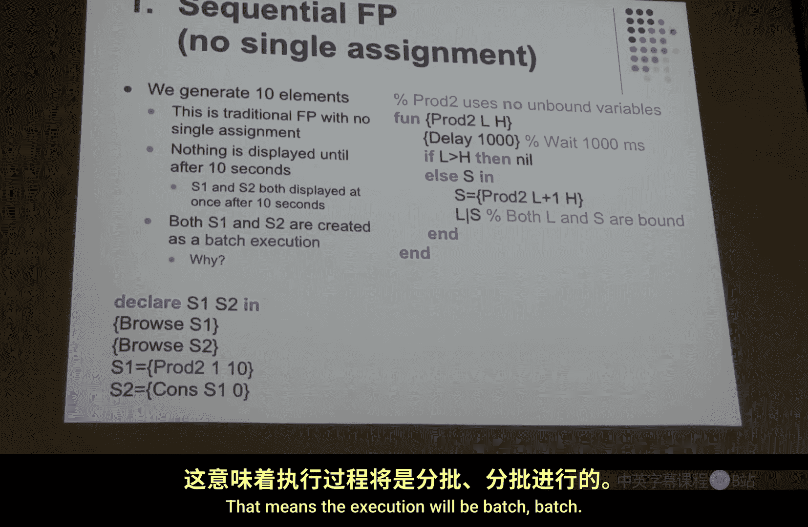
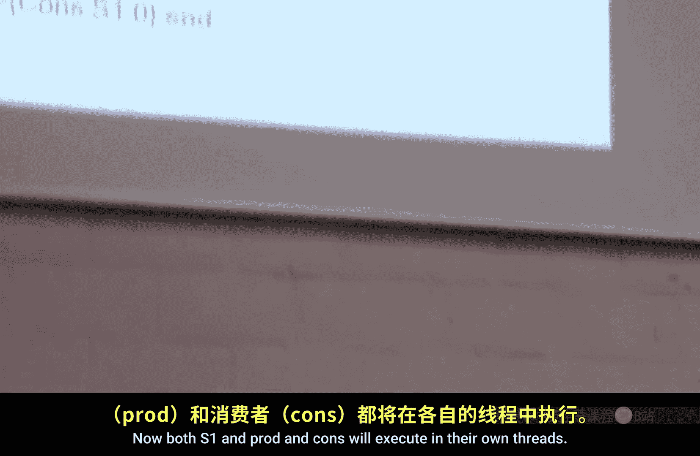
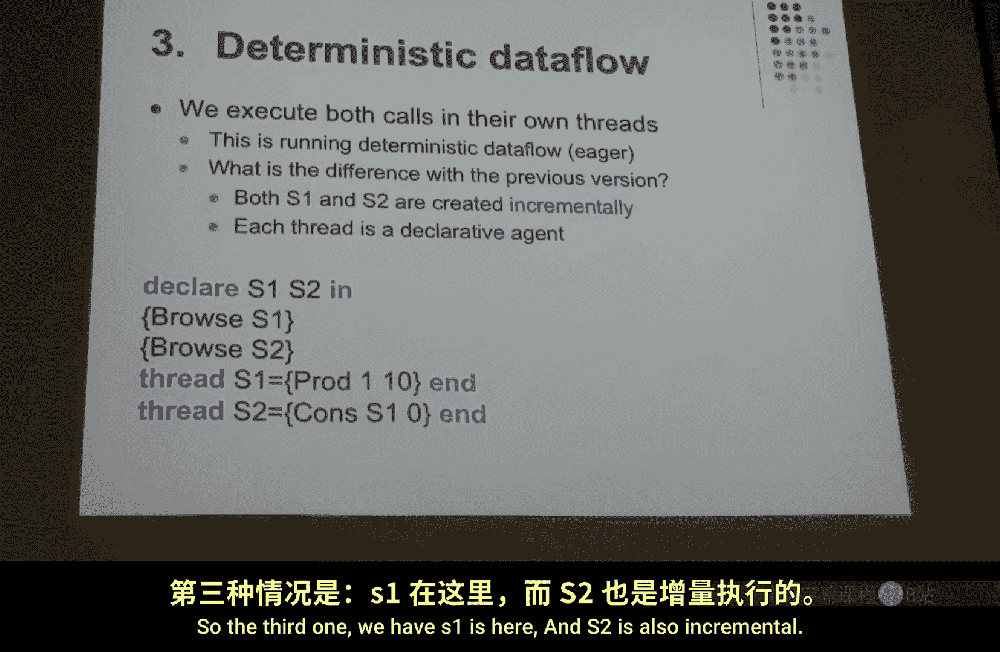
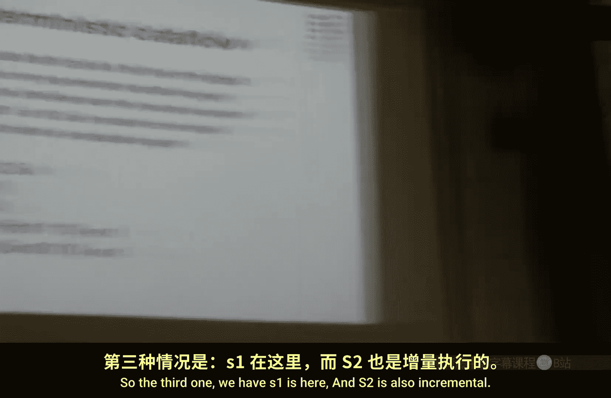
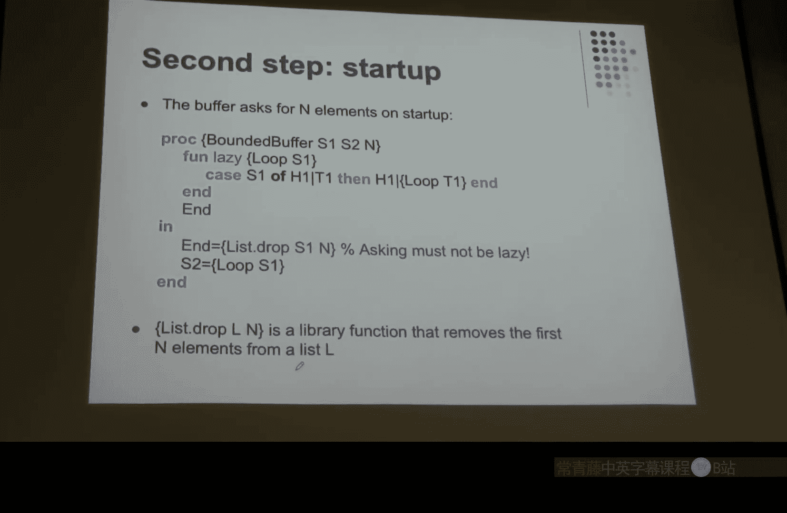
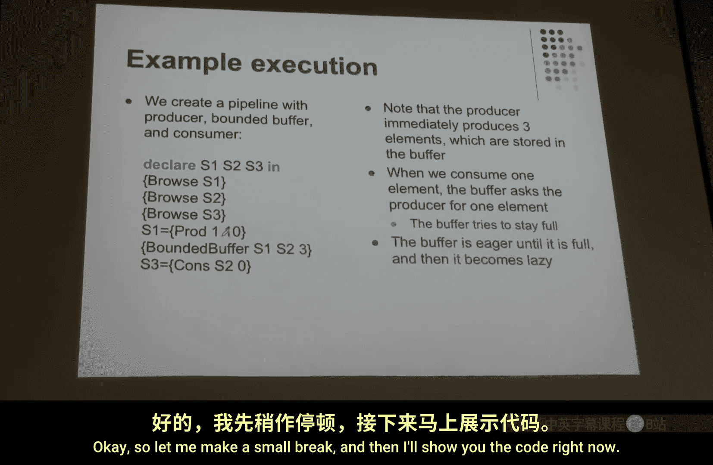
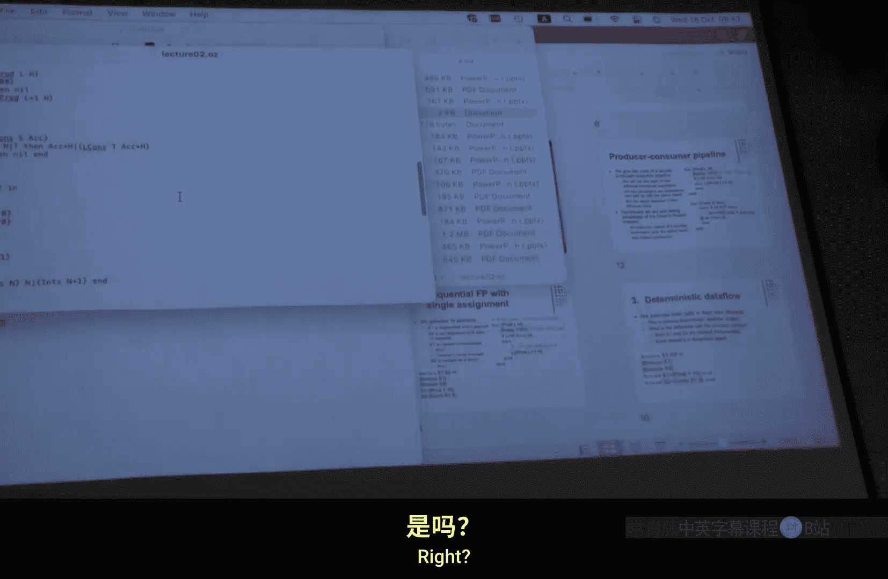
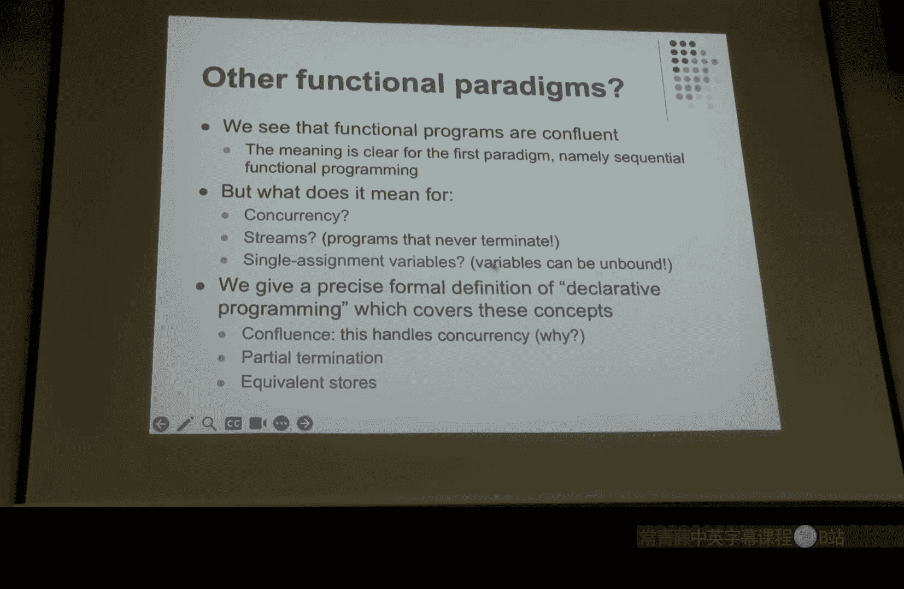

# 高级编程语言概念：L3：惰性求值、有界缓冲区与惰性快速排序


## 概述
在本节课中，我们将深入学习惰性求值的强大功能。我们将首先回顾并完善上节课的生产者-消费者模型，然后探讨惰性求值如何与并发结合，实现有界缓冲区。最后，我们将见证一个“奇迹”：惰性求值如何创造出一种极其高效的惰性快速排序算法。


---

## 回顾：四种编程范式

上一节我们介绍了声明式编程的几种范式。本节中，我们来看看它们的完整对比，特别是上节课遗漏的第三种范式。



我们以一个生产者-消费者流水线为例，它包含一个生成数字流的`Producer`和一个计算运行总和的`Consumer`。以下是运行此代码的四种不同范式：

1.  **无单赋值的顺序函数式编程**：这是传统的函数式语言（如Lisp、ML、OCaml）。没有未绑定变量，也没有单赋值。执行是**批处理**的：生产者完全运行完毕后才开始消费者。
    ```oz
    % 生产者：递归调用，结果完全计算后才返回
    fun {Prod2 N} H S in
        {Delay 1000} % 模拟耗时操作
        H = N
        S = {Prod2 N+1}
        H|S
    end
    % 消费者：等待生产者完全结束后才开始
    S1 = {Prod2 1}
    S2 = {Cons S1}
    {Browse S2}
    ```







2.  **带单赋值的顺序函数式编程**：这是Oz的默认模式。允许数据结构中存在“洞”（未绑定变量），支持尾递归。执行是**增量**的：生产者每秒生成一个新元素，但消费者仍需等待生产者完全结束。
    ```oz
    % 生产者：尾递归，结果在递归调用过程中逐步绑定
    fun {Prod1 N} H S in
        {Delay 1000}
        H = N
        S = {Prod1 N+1} % S 是未绑定的，但递归调用立即进行
        H|S % 结果链表在递归过程中逐步构建
    end
    % 消费者：仍在单一线程中，等待生产者
    S1 = {Prod1 1}
    S2 = {Cons S1}
    {Browse S2}
    ```

3.  **确定性数据流**：引入线程和**数据流同步**。生产者和消费者在各自的线程中并发运行。执行是**完全增量且并发**的：生产者每秒生成一个元素，消费者几乎同时处理并输出结果。
    ```oz
    % 使用线程实现并发
    thread S1 = {Prod1 1} end % 生产者在独立线程中运行
    thread S2 = {Cons S1} end % 消费者在另一个独立线程中运行
    {Browse S2}
    ```

4.  **惰性求值**：在确定性数据流基础上，增加 **`WaitNeeded`** 操作。计算仅在结果**被需要**时才执行。这允许处理**无限数据结构**，是本节课的核心。

**核心概念**：`WaitNeeded X` 是一个同步原语，它会阻塞调用线程，直到有另一个线程需要变量`X`的值。此时我们说`X`是**被需要的**。

---

## 惰性求值的威力：惰性快速排序 🧙‍♂️

现在，我们来看看惰性求值如何创造出高效的算法。以快速排序为例。

### 标准快速排序
标准快速排序是分治算法，平均时间复杂度为 **O(n log n)**。
```oz
fun {QuickSort L}
    case L of nil then nil
    [] Pivot|T then
        Left Right
    in
        {Partition T Pivot Left Right} % 分区，O(n)
        {Append {QuickSort Left} Pivot|{QuickSort Right}} % 递归排序和合并
    end
end
```

### 惰性快速排序
我们只需将递归调用和`Append`操作改为惰性的。
```oz
fun lazy {LQuickSort L}
    case L of nil then nil
    [] Pivot|T then
        Left Right
    in
        {Partition T Pivot Left Right} % 分区仍然是急切的
        {LAppend {LQuickSort Left} Pivot|{LQuickSort Right}} % 惰性递归和合并
    end
end

fun lazy {LAppend A B}
    case A of nil then B
    [] H|T then H|{LAppend T B}
    end
end
```



### 算法奇迹
惰性快速排序的魔力在于其**增量计算**的特性。


*   **如果你只询问前K个最小元素**：算法复杂度仅为 **O(n + K log K)**，远优于完全排序的 O(n log n)。
*   **K无需预先知道**：你可以逐个询问元素，算法会根据你的需求动态计算，始终保持高效。

**工作原理直觉**：当你需要第一个（最小）元素时，算法进行分区，然后只在**左子列表**（所有小于基准的元素）上递归地进行惰性快速排序，完全忽略右子列表。随着你请求更多元素，算法只计算必要的部分。本质上，它将大问题分解，并只“征服”需要的那部分。

---

## 结合并发与惰性：有界缓冲区 🧱

上一节我们看到了惰性求值在算法上的妙用，本节中我们来看看如何将惰性与并发结合，解决一个经典问题：**有界缓冲区**。





### 问题背景
在生产者和消费者速度不匹配时，会出现一方等待，导致效率低下。有界缓冲区作为中间组件，提供一定容量的存储，平滑两者的速度差异。
*   当生产者快时，多余元素暂存于缓冲区。
*   当消费者快时，从缓冲区预存的元素中获取。

### 实现步骤
我们将逐步构建一个声明式的、无副作用的缓冲区。

1.  **透明通道（起点）**：一个不做任何事的缓冲区，只是传递流。
    ```oz
    proc {Buffer S1 S2}
        {Loop S1 S2}
    end
    proc {Loop S1 S2}
        case S1 of H|T then
            S2 = H|{Loop T _} % 简单传递
        end
    end
    ```

2.  **启动时预填充**：缓冲区启动后，立即尝试向生产者请求`N`个元素（缓冲区容量）以填满自己。这里使用惰性函数`List.drop`来“需要”前N个元素。
    ```oz
    proc {Buffer S1 S2 N}
        Start
    in
        thread Start = {List.drop S1 N} end % 在独立线程中请求N个元素，不阻塞主线程
        {Loop S1 S2 Start}
    end
    ```

3.  **运行时保持充盈**：每当消费者消费一个元素（`S2`的`H`被取走），缓冲区就向生产者请求一个新元素，试图保持充盈状态。这是通过在循环递归调用中，在独立线程里对尾部流`T`进行`WaitNeeded`操作来实现的。
    ```oz
    proc {Loop S1 S2 End}
        case S1 of H|T then
            S2 = H|{Loop T NewEnd End2} % 输出元素给消费者
            thread End2 = {WaitNeeded NewEnd} end % 在独立线程中请求新元素，保持充盈
        end
    end
    ```

4.  **完整的有界缓冲区**：结合步骤2和3，并确保所有可能阻塞的操作都在独立线程中，以避免不必要的阻塞。
    ```oz
    proc {Buffer S1 S2 N}
        % 启动预填充
        thread _ = {List.drop S1 N} end
        % 开始循环，传递元素并保持充盈
        {Loop S1 S2}
    end
    proc {Loop S1 S2}
        case S1 of H|T then
            S2 = H|{Loop T _}
            thread _ = {WaitNeeded T} end % 关键：在独立线程中触发对新元素的需求
        end
    end
    ```

**核心思想**：
*   **惰性**：通过`WaitNeeded`，缓冲区只在需要时才驱动生产者计算。
*   **并发（线程）**：在声明式编程中，线程是你的朋友。它们将潜在的阻塞操作隔离，使程序更增量、更高效，且**不会引入竞态条件或破坏确定性**。

### 管道组装
最终，生产者-消费者管道如下运行：
```oz
% 声明流
S1 S2 S3
% 创建组件
thread S1 = {LazyProducer 1} end % 惰性生产者
{Buffer S1 S2 3} % 容量为3的有界缓冲区
thread S3 = {LazyConsumer S2} end % 惰性消费者
{Browse S3}
```
运行后，缓冲区会立即尝试填充3个元素。当你消费`S3`的第一个元素时，结果立即可得（因为缓冲区已预存），同时缓冲区在后台异步请求第4个元素，如此循环。

---

## 什么是声明式编程？ 🧠

我们已经看到了五种范式（顺序、单赋值、数据流、惰性、惰性并发），它们都被称为声明式编程。那么，其核心定义是什么？

这一切的理论基础是 **Church-Rosser 定理**（或合流性）。对于λ演算（所有函数式程序的本质），定理指出：如果一个表达式可以通过不同的求值路径得到两个结果，那么必然存在第三个表达式，使得这两个结果都能归约到它。这意味着，对于终止的计算，**结果与求值顺序无关**。

我们的编程模型（单赋值变量、线程、流、惰性）都是λ演算之上的“语法糖”。只要这些扩展遵守合流性，那么整个程序就是**声明式**的：程序定义了一组逻辑关系（“什么”是真），而非一系列操作步骤（“如何”做）。求值器可以自由选择任何顺序执行，最终结果保证确定无误。

为了更形式化地理解“逻辑关系”，我们将在后续课程简要介绍**一阶逻辑**及其**模型论**，这将帮助我们更深刻地理解声明式编程的数学基础。

---



## 总结
本节课中我们一起学习了：
1.  **完整回顾了四种编程范式**，理解了单赋值和并发如何带来增量计算。
2.  **探索了惰性求值的核心魔法**：通过`WaitNeeded`实现按需计算，并能处理无限数据结构。
3.  **见证了惰性快速排序的算法奇迹**：它将算法复杂度从O(n log n)降至O(n + K log K)，并能增量式地提供排序结果。
4.  **实现了结合并发与惰性的有界缓冲区**：这是一个实用的、声明式的并发模式，展示了线程在声明式范式中的友好性。
5.  **探讨了声明式编程的理论基础**：即程序定义了不变的逻辑关系，其结果由Church-Rosser定理保证确定性。


惰性求值不仅是一种求值策略，更是一种强大的算法设计工具，能够催生出像惰性快速排序这样高效而优雅的解决方案。