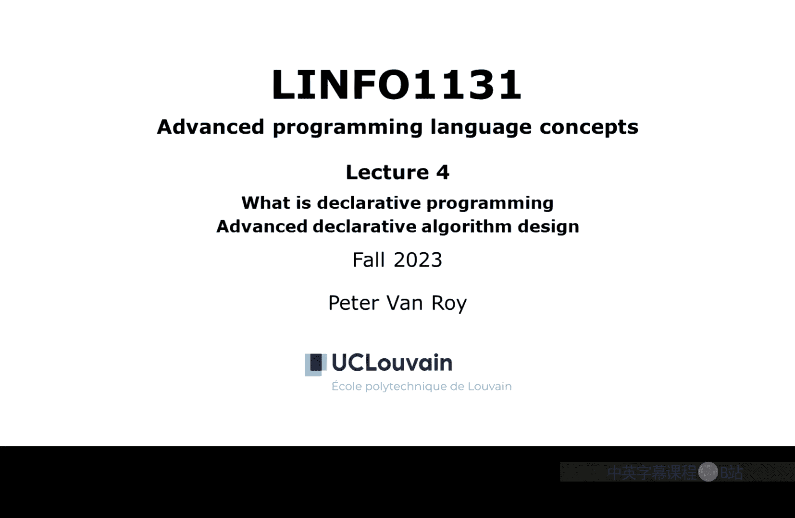
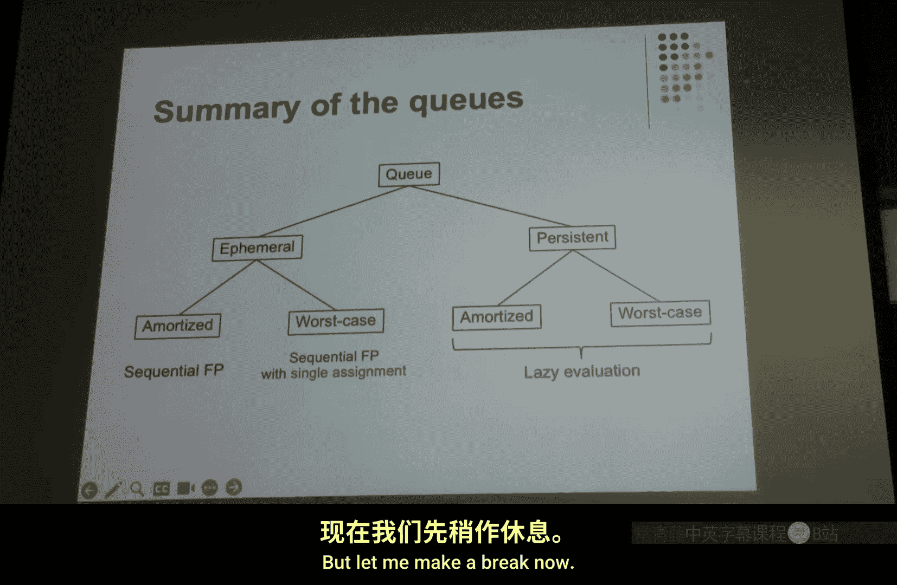
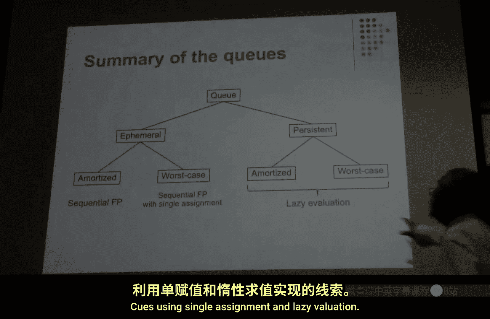
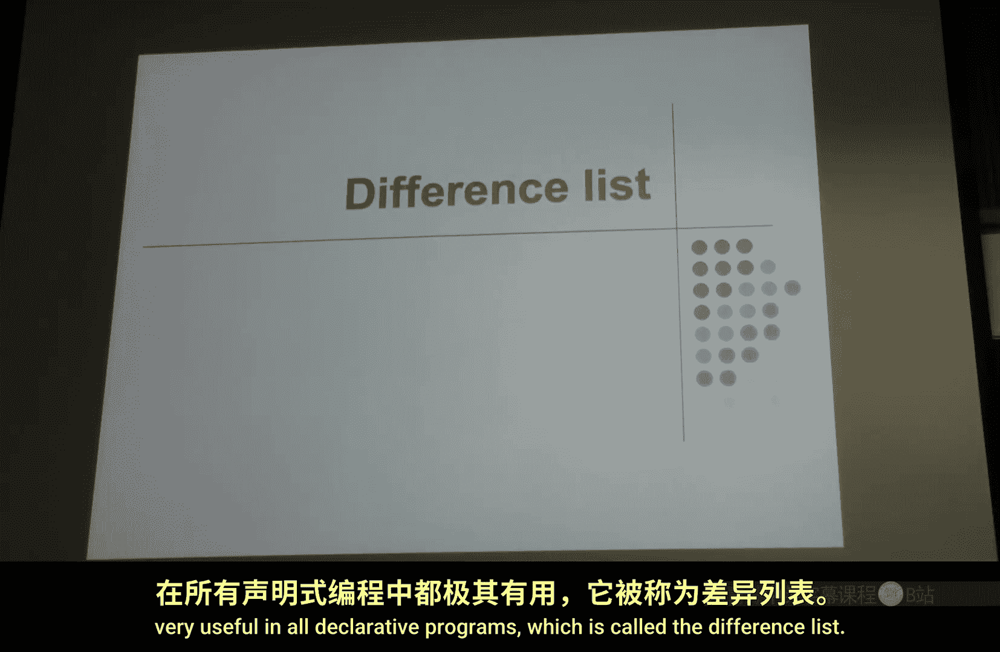
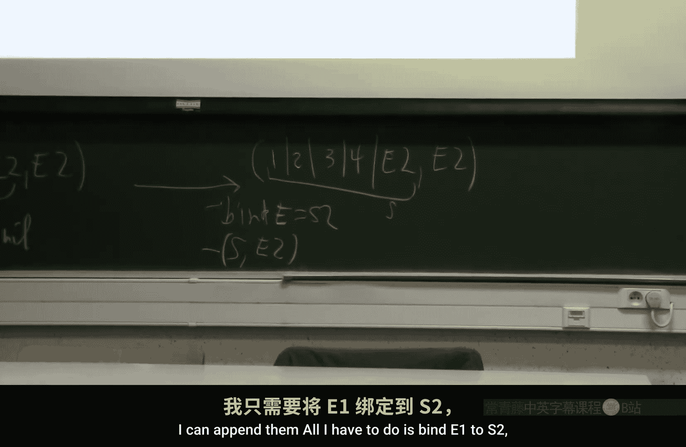
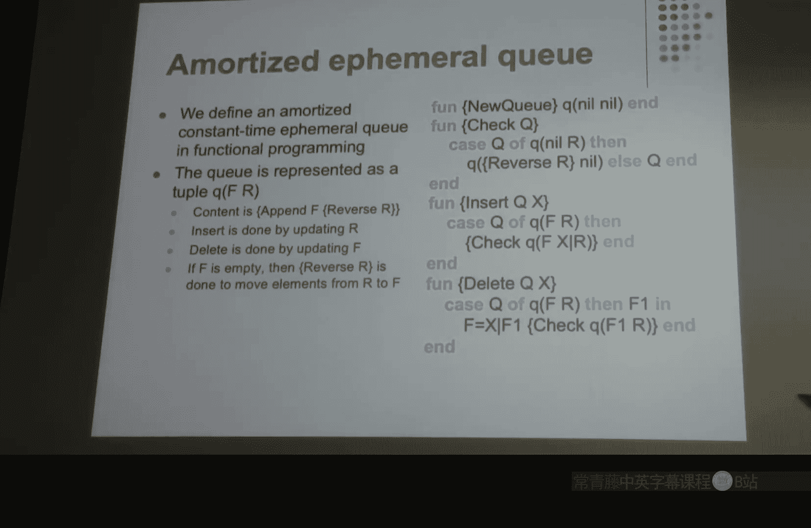
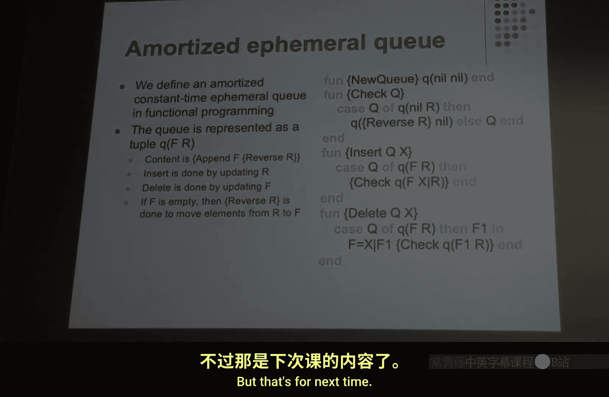

# 鲁汶理工学院【中英⚡高级编程语言概念｜LINFO1131, Advanced programming language concepts】 p44 P44 FO1131 Lecture 4 (2023) -BV1UDffBbEBZ_p44-

I'm very happy to see you this morning。嗯。At least there's a few people who are serious about science。

A fewew words for the Ukrainians who are still fighting for their freedom and for our freedom。Today。

 first， I want to talk about two things。First， what is the clarityative programming。

 I keep saying how wonderful it is and I show how to use it。What is it exactly。

 so I want to show that。And then the second thing is I want to show。

Some very advanced techniques for building nuclear development。

Using a single assignment and a lazy evaluation， you can make them very efficient。

This is stuff that is difficult to find。And in books， in my view， there's only one book， really。

It discusses the advanced techniques， which is this one。

Dly functional data structures by Chris Ocasette。そう。Take a look it's using。oh Cammo。

 so it's not using Oz or Haco。So but it's a very， very interesting book。Okay。

 so let me talk about the clarityical programming first。Exact， we have seen a number of paras。

5 paradigm。Sequential functional programming， sequential functional programming with single assignment。

 which allows to make tail recursive list functions。The deterministic data flow。

 so the concurrence training programming， lazy evaluation。

 and the combination of laziness plus concurrence。hi allows us to do things like the Bed buffer。

So I'm telling you they're all declarative。But what does really that mean exactly？嗯。

In the previous course， we talked about lambmbda calculus。

 but these things are far away from lambmbda calculus。Okay。So let me explain。

 that's the first thing I want to explain today。Okay， so it all starts。At the from the Land captains。

All functional programs can be encoded as Lada expressions。

So I'm not going to redo all the level capital， but I want to mention one。Very strong property。

 which is called the church Rosotheem。I won't show the proof。

 but you can find it very easily on the Internet。If I have an expression， E A。on the top left。

 and I reduce it， so I'm executing the program。And I reduce it in one choosing some reduction steps and I go to EC。

But I could also choose other reduction steps， usually these many possibilities。

I can go from EA to EB。Now the church Ro's theem says， if you do that， you could always。

Find an ED such that both EC and EB will reduce to ED， they will always come back together。

 okay so this property is also called confluence because they're flowing。

 it's flowing together or the church rosterer property。For programs that terminate。

 this ED is a final result， but this is true also for programs that don't terminate。Okay。

 so this is the four fundamental property that we're starting from， this is a very strong property。

 which is one of the reasons why the Lada cculus is the foundation。All programming languages。O。

So sequential functional programming， which is the first。Param。Is clearly confluent。

It's clearly functional because there's a fairly straightforward translation to lend the calculus。

Whi we saw in the previous course， all the operations you can encode them。As now things。

 and it's just doing love reduction。But we actually went farther。In our course。

 in declarative programming， we add concurrency threads。Okay， and a scheduler， fairness。

 we add streams。Which is programs that never terminate。Okay。

 the stream keeps growing and there's an output stream， we also add single assignment variables。

 variable can be unbound， but you combine bind it to one value。

So what does it mean for these things to be declarative？Okay。

 so I'm going to show you each of these three separately and I'm going to show you in three parts。

First of all， I won't spend so much time on concurrency because confluence handled that。Threreads。

 all that does is it changes which reduction is done at every step。

 the scheduler chooses the reductions， but because of Ttroer this is fine， okay。

 so I won't talk about this one more。But I will talk about the other streams。

 so these are programs that never terminate， you keep feeding an input stream。

And output stream keeps coming， what does it mean， so for that to be declaredative。

 so I won't talk about partial termination where the program actually can kind of stop。

Rest for a while and then continue and finally， what does single assigned variables do to this Well single sound variables is a very major big change because it leads to this front paradigm being a kind of logic logic programming。

So the stores。Equivalent stars， so when you have stars with un variables in them。

 the bindings be the variables can be done in different orders。

 but somehow the stars are still the same， so the equience is kind of logic。

 so I will give you an introduction to first order logic to explain that。Okay。

 so let me go step by step。The first is partial termination。Okay。

So here in the left we have a concurrent agent， the code is easy， we'll write the code。

 we have an input stream and an output stream。And it just multiplies each element by two。

So if the input stream is one and then on one variable， the output will be two。

 and if the input stream is extended， the output will extend it。

So how is this functional because this program doesn't terminate。

 this input stream can always go farther？Also， the streams have unbound variables。Okay。

 what does that mean？Okay， so first I'll talk about termination。

Well we can actually define a kind of temporary termination。If S1 does not change， okay。

 so if you do S1 is 100 score， and then you just leave it like that。

Then the program will execute and it will at some point terminate， it will stop， will finish。

 and the output will have a particular value。Okay， so if the input does not change。

 the output will eventually finish executing and get a value。

So this is I call this partial termination because the problem is not really completely stopped because it can keep going again。

 but for now it's temporarily stopped。And the point that it reaches is called the resting point。

 so its like resting for a while， but then if you continue binding this one。Like1， two。

Then the output will also be extended。 but then you have a second resting point or a third one。

 So as this stream。Input stream is extended。The program goes from one rest point to the other。

 and all of those are in some sense， functional execution， so S2 is a function of S1 always okay。

So that is how we can define functional execution for programs that don't terminate。

That's the first thing。But what about the unb variables？

So this is thises each straightforward the unbound variables。Okay。

So here we have to talk about two stores with variables that are bound differently。

 but somehow they're still the same。Okay， so here。Let me give you an example。

So we have a functional programming program that uses single assigned variables。

 and I'm claim its still functional in some sense， which I will define。Well， here's a simple program。

With two variables， x and y， which are bound to records， x equals fu Zw， y is s zw。

 and the third register is x equal y。Now， the bindings in the store。It depends on the scheduler。

 okay， if P1 and2 execute first。Then x would be bound to， so this is a store sigma。

 variable x would be bound to this record and y also two a record。And then that when I do this。

 T3 will basically do nothing because they're equal。But assume we have a different。

 the scheduler makes different choice。Let's say it chooses T1 and T3 first。Then P1 will bind x。

And T3 will bind x and y， so y will be bound to x。But not the food。

But you can see this x here is actually equal to F Zw， so in some sense these two are still the same。

 even though the actual bindings are different。Because of the scheduler。Some in some sense。

 these tours are still。The same， so how are they the same？Okay， how can we express that？Well。

 in order to do that， I have to give you a small introduction to first order logic。

So I will now give you an introduction to first and language， so this is an independent thing。So。

You have already seen some first herologic right in the previous course。

 so this hopefully will be refresher， but if you did not see it。

 then it's okay because this is kind of self contained so this is a very very brief。

Introduction to First Third Eli。Okay。So we introduced first third one。So I do it in a step by step。

 so I will basically define the concepts。So you will see precisely what is a form of logic？

But we're not going to do too much theorizing on it， I just want to show you the concept。

So first of all， formal logic， so formal logic is a form of mathematics which mimics reasoning processes。

 but technically it's three things。It's a language， like a syntactically defined language。

 like could be formulas。嗯。In some kind of a form， for each formula we want to know whether it's true or false。

And then we have two other things。We have what's called a proof theory。

 so we can actually do deductions。Okay， so simple deductions like if we have x equal5 plus6。

 we can make that x equal to1， that's a form of deduction， okay。

 so it's a set of rules to reduce other formulas to false， given a set of primitive formulas。

 so we assume there's some formulas that are，As suited primitive actually we call them as。

 and we have a set of rules that allows combining them to make inferences。

 that's called the proof theory so that's purely syntactic。But the third thing is。

Kind of what really makes it grounded。This is called the model of theory。Now。

 if the formula is true or false。It has to be true， false somewhere in some world， okay。

 and that's called the model of the exxiomus。Okay， and I will give you an example of that。

 so now this is true what I showed here is any formal of logic。

 so there are many different kinds of logic。There's propositional logic。First thirdology。

Second order logic， which I will not talk about， modal logics， all kinds of different forms of logic。

But I will present only first storyology。In some sense， first stlog is a sweet spot。

 it's kind of the nicest one in some very strong ways。

 most of mathematics can be formalized in forced orderlog。And you can build。

Efficient theorem improvers。so this is a very nice logic。 so what is it， So it's a formal logic。

 but you add you have variables like X and Y， you have quantifiers for all that exists。

You have predicates， which is basically relation with multiple arguments。

 and you have these connectors， which are this one is end， conjunction， equivalentvalence， and so on。

 you have other connectors that I will talk about with this。Built expressions， Okay， so here。

 for example。For all X， for all Z。Grandparents of Xz if only if there exists to Y such that parent X Y and parent Yz。

That's a syntactic。说明了。It may you might think it means something， but that's only an illusion。

 this doesn't mean anything it's just symbols。Okay， this could be blue， blah， and blue， for example。

 you don't know what's going on。It's just a connection between relations。

But we can give it a meaning。By adding a model。And the model for this one could be a set of human beings with the human parent relation。

 okay， in there。So you have parents， mother， father， children。

 so there's actually an actual parent relation between real human beings。

Then you can kind of make a mapping of this syntactic thing。

Two real human beings and real human beings who were parents or children， or grandparents。

 and then this axiom has a meaning。And maybe it's true or false， it turns out this one is true。

 you can say it's going to be true， it's actually defining grandparents in some sense。

So this axiom would be a true axiom in this particular model。

So you can see how this axiom is just a bunch of syntax。And the model is an actual thing。

 it could be in the real world， or it could be a mathematical sting structure。

That in which the axis are true or false。 Okay， so that is。The two parts of any formula。

Now you can actually build programming languages based on this。Okay。

isThe most famous one is called Prolo， which was invented created in 1972。

So last year was the 50th anniversary Sposium of Prola， which is still used。You don't see it so much。

 but it's still widely used， and there's many very good product systems and you can download them for free。

And it's based on first orderology， it's actually a fear improver， first orderology。

There's also constraint programming。At descendant the prologue。

 prologue kind of created the constraint partner， this is a very active research topic。

It's a very powerful paradigm， okay， but it's doing first order logic。

And there's one that everybody knows， SQL， SL。Which is for the database queries， well， a database。

And the query is in the database， it's just doing logical inference， okay。

 so SQL is also based on first learn legend， so it's actually quite widely used。

So that gives you some idea， so this is refreshing your memory， right？嗯。So this is okay， don。

So I want to give you some examples because I want to connect it then to the clear program。

So here' are some examples， on the left I have some syntactic expressions。

For all x x is less than x plus 2， that's pure syntax， doesn't mean anything。

There exists in x such that x squared minus3 x plus 2 equals 0 and so on。嗯。And I can have models。

So there's a first model which is called Z， which is the integers。Or I could have a model。

 which is the real numbers。So I give some approximate definition， okay？

So you could say the real numbers are all the numbers with an infinite decimal expansion。

 that's kind of an informal way of defining them。But all the formulas on the left are true in both of these models。

 if we assume that these symbols are given the right meaning， so this is subtraction addition。

 and so ona。Square operation。That's an example。Now I want to introduce some notation now because we're going to go back to。

We're going to go back to the corrective programming and we need to have some precise notation。Okay。

 so we have some formulas。Which I showed you examples， and F is the set of formulas。

And alpha and beta are just some random formulas， like the ones you saw in the previous slide。Now。

We can actually。Do some kind of logical notation of these formula of us。

And I said there was proof theory and model theory， so there's two ways you can connect the formulas。

 you can say， for example。A can prove B， or B can be proved or deduced。

Using the rules of deduction given A as an axial。And this is。Thenot with this turnst operation。

 this is a proof with a， I can prove because alpha I can prove beta okay， so given this。

 if this one is alpha。If exists in x such should x squared equals1。

 then I can prove that x equal1 or x equal minus。So this is pure syntax， it's proof。

So a running program could actually do this， that would be called the the improvement， okay？

But that's not the only connection， the other connection is in terms of models。

So a model is like a real world structure in which the formulas can be true or false。So here I have。

Beta is true in all models in which alpha is true。なて。So if I have any model。

And in that model alpha is true， then this is stating that beta will also be true in that model。Okay。

 so here's an example if this。For of stuff is true in the real numbers。Then this formula。

It also be true in the real numbers， but I can replace R by a model in which that is true Okay。

 the real numbers is just one particular model， there can be many， many， many models。

For a particular accent， okay？So these two notations are very different。

 so the first one is basically syntax， you can make the proof， sequence of deductions。

 and the second one is what we call the semantics， it's talking about truth in the real world or in some mathematical structure okay。

Wherever alpha is true， beta there would be true there as well， okay？So these are the two。

Kind of connections we can make。So is this familiar to you， have you seen this before？Yes。

 the difference between proof and model。You've seen that， everyone has seen that。Great， okay。

 so I'm happy that me know it's that good， so this is important to have some basic understanding of this。

Now I want to go back to our declarative program。We have the storage cinemaigma。ok。We want to define。

A mall。A model of the store， so the store sigma is just variable binding and the binding， okay？

So the model。Actually we can build a model， but usually it's done in two steps。

We first make what's called an interpretation。From the store。

 an interpretation is all the symbols we assign things to them。

So if we have this binding in the store， x equals Fx1 to xn。Then the F。this is just syntax。

 we will make it correspond to a function。A function with input variables， input values。

 and output values on some domain， so this is part of the model theory。オッケ。

Now if the store has this binding in it。Then this is going to be true。

Ifs the value returned by this function is equal to the value of x， so all the variables。

 we will also make values as to them。 So for example， the variables could be。

Real numbers and F would be some function on real numbers， okay？So if we have a store sigma。

 it's a bunch of these their bindings， okay， it's a conjunction。So x is bound to something。

 et cetera， et cetera， Z is bound to something。So if all these bonds are actually true in the real object。

 the mathematicalematic object， to then the store is true， so an interpretation is kind of。

Precursor to a model because formulas might be true and they might be false， okay？

But the model is the interpretation where all the sigmas are true。

 and the model is actually respecting all of the findings in the store， okay。Okay。

 so that's an introduction to。First order logic。So there now you know first turtle logic， right？Okay。

So now me go back to our program here。We have run this program， three threads。

We have Sigma and Sigma prime。And they're different， I mean， the findings are different。

But in some way， some sense， they are the same， how are they the same？Okay。

So assume we have Sigma and Sigma prime。The result of two executions of a decative program。

So they look different， but they're actually the same in some sense， okay？

The findingss are different， but the possible values of X and Y are actually the same。

So each star is at your relationship， so Sigma says that x is a record was labeled who and arguments。

 y is your record was labeled who in arguments。So that we can define a function that actually builds a record structure and memory。

 okay？And there's actually four variables in those stores， X， Y， Z， and W。And we can take any values。

 we can assign values to these variables。And there's two possibilities。

 either they are true in Sigma。Or they're not。Te in Sigma， if we bind x to a number。

 then clearly it's not true because the x's should be a record， okay？

So the store sigma is actually a logical formula， which couldn't be true or false。

In the particular interpretation。So we can write it as a logical formula。

 so let me write it as a logical formula。Okay， so the store there was variable bindings。

 which is a set of variable bindings。We can actually consider it to be a logical formula。

Now we can save whether the stores are equivalent。Okay。So intuitively， first intuitively。

 and then I would make a more formal definition。So each store represents a logical formula。

Which can be true or false， depending on the values of the unbound variables。

And two stores are equivalent。When no matter how we assign values。

 they're either both going to be true or both false。

 we cannot make one of them true and the other one false。

So they're basically saying the same thing in a sense。

The set of values for which they are true is exactly the same。

Now we can write that using logicit notation。啊。😮，Remember this notation。

All the models of alpha are also models of beta， beta is true and all models of alpha Now alpha and beta are actually logical formulas like sigma。

So two stories are logically equivalent。If。If I have a model that makes sigma true。

 Sigma prime will be true and inversely， Sigma prime is true in all models of sigma。

 Sigma is true in all models of prime， basically what that means。

Is that they're saying exactly the same thing if I ever set a model of them of the formula。

So a set of values that make them true that sigma sigma prime it's expressing the same set。

 so you can also write it this way， the same。So here I have another logical formula， Sigma。

 if and only if sigma prime。And this notation， where I don't put an alpha。

 it means it's true in almosts， so this one is a tautology。

That means in any model we look at anyone at all， this will always be equivalent to that， okay？

So the stores are saying the same thing， you see？They're basically expressing the same set of values。

嗯。Okay， that's okay， so that's all I want to say about logic。Okay， and now we can actually define。

Declared the program， finally we get to definition。

 which is actually after all of this it' actually very simple。Okay， what is declared program？

So I had a program。And I wrote。And the program is declarative if for all possible inputs。

All executions， so no matter how its schedule。Coses it， either they all do not terminate。

 so they're all infinite loops。Or they all reach partial termination and they give logically equivalent stores。

 so they basically end up in the same place。Okay， so either they don't， they both go into the loop。

But it's never the case that one of them is in loop， and the other one is stopping。

 and they always all go to an infant loop because you can have programs that are infinite looping。

Or they all will reach some partial termination。And once they do that。

 the stores are logically equivalent。ま回ね。So this is for concurrent programs。

 all possible choices of the scheduler。So one way of expressing this， which I said always before。

 the program has no observable non determinism。Which means that even though the scheduler is free to choose。

Not tuist clear， so it can choose independent of the programmer。

You can't see that because the stores are be logically equivalent， I mean。

 the actual bindings might be different。But they are logically equivalent。

So all the five paradigms we saw are declarative in this sense。

 so they're always giving logically equivalent scope。Okay， so that's。

diclarativeative programming okay so this is an observational kind of a property。

 it depends on the program is vague， so these are not necessarily implemented using Lambda calculus。

 I mean lambmbda calculus will give this， but this is a little bit more general than that。Okay。

So I want to talk a little bit more about that。Something which I call。Failure confinement。

So thelar of this is very powerful。We have seen some of the good properties a program that is correct will always be correct。

 there's no race conditions， so all the concurrent programs are simple and so on。

And so one of the themes of the course is that all programs should be declarative except where they can't be。

 and we will see later and that's where they interact with the real world。

 so there's some limitation。But。We want to keep them as dec them as possible。😡。

But what if the application？Becomes non declarative。Okay。So there's several ways。

An application that interacts with the real world。It can be non declarative because the real world can introduce observable non determinism。

That you cannot get rid of， so their stores will no longer be logically clone， okay？

But you could also have。A book。It makes program non declarative or some weird behavior。

 but that you can。You've been hired， you can mask it off。You can。If there is， I mean you。

Bugs aren't avoidable， okay？So you can say it is a truth universally acknowledged。

That a program of a certain size must have bugs。So if you have read Jane Austin。

 you know where that phrase comes from。No， pride and pedges。So here's a simple program， x equal1。

 y equal2， x equal y， this one will always raise an exception， okay？

Depending on the scheduler choices， we have three possible。Stors。Ex equal1， micro two。X equal 1。

 y1 and x equal 2 y equal 2， these are not co。This is an observable nontourism。

 and this can happen for some many reasons， maybe failures or maybe there's something where things are happening in different orders。

 okay so we may want to。Keep going and still have a declarative program so we can hide this。

And make the program decative again， so we can kind of encapsulate the non determinism。No declared。

 And this is called failure confinement。Okay， so here's one way to do it。

So we are now showing some non declarative programming again。

The way to manage the declarativeness to increase the declarativeness， so assume we have our program。

 okay， which is x1 equals1 y equals2 x equal y when we write it in a different way。

And if there is an error then we have an exception， so I'm not going to explain it now。

 I just want to kind of show you if an error has happened。

 then one of these two variables will be bound to error。

And then I say the result is always x equal1 y equals1。And when there's no error。

 I just passed the result of the program， so I'm basically masking the error， okay？

So that's a you to do。Okay。Okay。Now let me kind of summarizemarise。

There's lots of declarative paradigms， so this figure comes from。The book， the thick book， concepts。

 techniques and models of computer programming。And we saw all these， but do you can actually。

Technically do a little bit more， so you have eager and lazy in the horizontal in this direction then you have。

Values and data variables。 So single assignments and concurrence。

So we have seen different kinds of functional programming strict， lazy。

 so the language has school does laziness but does not have moneybound variables。

Then we have other languages that do strict functional programming， scheme and ML。

We have languages that are eager than not lazy but use unboundd variables， so prologue does that。

 but prologue does more than that。But pro logic programming does that。

And then we have the concurrent budget programs。So there's no named really named languages here。

 this is funny up。But this model does exist and it's used a lot。So these are typically used in。

In cloud analytics tools， when you have stream processing。オッケー。Okay， so let me summarize then the。

Part of the course on laziness and the for programming。So we saw laziness， okay？

And it's semanally very simple。We have data flow with weight and bind and we just add one operation where needed。

 and programs are much more general， we can use infinite lists and we can combine with concurrence。

 so this is very powerful， and then we've defined declarative programming。We define what it is。

In terms of confluence， partial termination mod。Frivolous and it's observational。

 that means' something we see the behavior。A ba program can behave declaratively。

 even if it's written in a non declarative paradigm。

So it doesn't have to be written in lambda capitals。Even though a lot of the c is declarative。

 you can be more general than that， you can have programs that are written and nonlar in a non declarativelar lab。

 but still behave。De个。Okay， okay， so now we will go to。The second part。Of course。Big group part。

This is the final lecture on Declarative programming the most。Sle one。

It's about designing algorithms。So I'm going to show you how to design algorithms that are declarative and efficient。

 okay， so the motivation is writing efficient algorithms in declarative paradigm。

People will tell you that the glares of languages are not efficient。That's not true， action， okay。

 and I will show you some techniques。I will ship for writing efficient algorithms。

Using single assignment and this evaluation， so we will make different kinds of algorithms。

Amortized and worst case， but also ephemeral and persistentence。

 so we'll see algorithms maybe that you have not seen in an algorithms course or be a little bit more general。

And I'm going to give a certain number of techniques first， what's called a difference list。

So a list with efficient operations like a pen。These are e federal。

 which we will see what that means， so it's basically very efficient list。

And then I will show you different ways of doing。Very efficient algorithms。And we can see them here。

So' I'll have one example which is kind of the standard one， and I'll write it in different ways。

A Q algorithm。And I will make different versions so constantant time。Q worst case constanttantine。

Then what's called a persistent cu and worst case persistent， and we'll see what that means okay。

Okay， so the motivation is。And this is the kind of theme for this course。

As much as possible if your program should be written， declared to， and that has many。

 many advantages， so the algorithms too， okay。Can you make efficient algorithms？

And declared the paradigms。Do you really need assignments， mutable states？Well， not really， okay。

Dlared that almost always make them efficient and I'll show you how that works。

So some of the examples are coming from this book。Purely functional data structures by Craigs focus up。

 So this is a very interesting book on。How to use lazy evaluation to make efficient others。Okay。

And it uses a functional language called standard MLL。Extended with an explicit laziness operation。

Okay， so now let's go into the course for algorithms。First， what concepts。

 so we're going to look at different kinds of algorithms， okay？And let me define them。

 so this is actually going farther than what you'll see in normal algorithms course。

So we'll have language concepts， complexity concepts， so this is a time complexity。

 but also different kinds of algorithms。So I'll talk about federal and persistent algorithms。

 and this is a very interesting。Distinction， very important。Okay。

So the language concepts we saw them before， it's basically two single sum variables and lazy values。

 those are the two declarative concepts we're going to use okay？Complexity concepts。

We're going to look at time complexity which we have you have seen right in an algorithm course。

 have you seen both amortized and worst case okay very good， so this will be a refresher。

 so we're going to define amortized algorithms and worst case algorithms and finally we're going to look at two different kinds of algorithms which are called ephemeral and persistent algorithms。

You may not have seen persistence outs， most of the algorithms you see in algorithm courses are ephemeral。

 so we'll see what that means okay。But persistence is very important。Okay。First。

 I want to introduce refresh your memory on complexity。

two kinds of complexity we're going to talk about， so this is time complexity。

 so it's basically an upper bound on the execution time。Min of constant factor。

And we're going to talk about amortized and worst case。Okay， so worst case， I'm not going to find。

 it's the big anotation that you have seen right which basically gives you an upper bound within a constant multiplicative vector。

 okay， so it's like。Ciling， and so the execution is below some value given big enough inputs。

So that's the worst taste complexity。But our very important concept also is anortized complexity。

If so， if you have N operations。And if you combine them all together， the complexity is O F of n。

That you say each of those operations has an amortized complex D F O， F of N divided by n。

 So it's like you're spreading the F of N over all of the。Individual operations。

So this is important because sometimes you have N operations and one of them is very expensive。

But all the other ones are very cheap， so it's kind of very cheap on the average。But occasionally。

 there's a very expensive operation， okay？And that happens a lot in algorithms that do things。

 for example， tree algorithms。Are usually very cheap， but sometimes they have to reorganize the tree。

 which is expensive。So that means sometimes I do an operation of which has OM。Complexity。

 but most of the time it's01， so amorts is the way of formalizing that， okay？So if I have a queue。

TheIndividual operations might have complexity or N。But if I do n operations。

 these expensive ones are very rareder。So that the overall complexity can still be o of1。

 so on the average it's constant time， even though once in a while there's an expensive operation in there okay so this is very。

 very common。For algorithms。It's actually very hard to make them always cheap。

 sometimes you can do that by making everything very incremental。

 but very often it's cheap on the average， okay？So amortized will formalize that。

So this is what we're going to look at these two kinds of complexity。So this you have seen。

 so you know this stuff though？嗯。But now I want to introduce something new。

Which is two kinds of algorithms。Eemeral and persistence。

This depends on how many versions of the data structure， so this is very interesting。

 so let's say I have a Q， Q1。And I do Q2 is equal insert Q1 and put a in the Q。

In the federal algorithm， if I do that。Then Q1， I can't use it anymore。So basically。

 I've created a new version， Q2， but the old version， I can't use it， it's gone。

So if I write algorithms in Java， it's almost always like that if I have a Q data structure in an object and I do kind of mutable updates。

Well， the old version is gone， okay， because I've updated it。

So almost all state algorithms are almost always ephemeral。

That means you can only have one version at a time where you create a new version。

 the old version is no longer available。So that's the normal way。

 so almost all algorithms you see in a。Stateful language like Java will be ephemeral， okay？

But sometimes that's not good enough， sometimes you need the algorithm to be。Stronger than that。

And that's what's called the persistence。Or persistent data structure。You can have many versions。

 so let's say I have a Q Q1， and I know Q2 is equal insert Q1 A， so this creates a new Q Q2。

But you one is still available。So if later on I can still use Q1。So when I create Q2。

 it doesn't destroy QN， that's actually interesting。All versions are still usable。

So you might say what is that good for， why do you want to do that because usually you only want the most recent version right。

 actually no， very often you want multiple versions。Now I introduce it because with laziness。

We can actually very easily write persistent algorithms， which are very hard to write。

In a stateful language， so this is a case where laziness is actually giving you a lot of power， okay？

So why do you need persistent a？It's used a lot。 You have already used it already。For example。

 people are editing the same text。They create their own versions。ok。

Or you have software repositorory， so you probably all use GitHub， Gitub supports multiple versions。

 and you can branch out， you can also merge them together the versions， but you don't have to。

 you can have multiple versions。So if I create in one version。

 the original version doesn't disappear， okay？Also， theres a number of databases。

 commercial databases that also support multiple versions。

 which can be very important when you want to do things like a rollback， for example。

 you want the old version to still be existing in some sense， okay？So that's actually very useful。

But usually you have to program it explicitly if you do it in a stateful language。

You can do explicit copy operations， so in Gitthub， you have to explicitly create a copy or version。

 okay or branch。So that's kind of clumsy， you have to do it all by head， okay？

But in the code I will show you today， it's all automatic。We don't have to worry about it。😔。

And then there's one extra operation sometimes you have that you add in persistent algorithms。

 this is called mergech。So if I have a queue and I'm making two separate。I have two versions。

 for example， sometimes I want to combine them again。Combed versions to create one version。

 so that's something doesn't think you even exist in an ephemeral algorithm because you only have one version。

 but here you can have many versions， you maybe you want to combine them like two people are working on a text。

And you merge them， and this is often done kind of automatically。

So the merge operation usually is a little bit smart， it's taking care of comfort。

So if I merge to texts， if there's two people edited the same line， it will somehow decide。

How to do that， okay？So persistence is a very useful thing。You camet see her。Okay。

So what am I going to show you today， I'm going to show you the same。Algorithm。

 the same data structure Q。It was different。algorithm different code， okay？Different implementations。

I'm going to show you five ways to implement the same cubee。

 so it's exactly the same cubee with exactly the same interface so I can use it and I don't know which one I'm using but it can be any of these five。

Okay so I'm going to give first a naive cu。Where it's an inn。Sequential functional programming。

The naive one， the insert is constantine。And the the link is。Not constant。

 it's all n where n is the size of the Q okay。So that's kind of naive naive algorithm。

And you see the delete is not very nice here，'s。So I'm going to show you better ones。

I'm going to show you that an amortized ephemeral cu。We're both insert and delete our constant time。

 that's nice， it's like how you would do in a job except it's declaredlar to you。

Both them are constant time。Okay， but it's amortized。Because sometimes they're expensive。

Well that's not too nice， I can actually make it better than that， I can make it worst case。

Constantine， that means all of the operations are always constantstantine。Okay。

 if you add single assignment， you can do that。So the single assignment lets you make very efficient ephemeral algorithms。

Okay， and we think going farther， if we use lazy evaluation， we can actually make very efficient。

 persistent。Algorims，So if you want to make a persistent algorithm。Laaziness is kind of the best way。

Of doing that， okay， because it's all done automatically as part of the lazy evaluation。

 you don't have to do any really explicit management of thergs， it's all kind of automatic。

And I'll show you an amortized persistent cue。Where all of the operations are constant。

 but these constants amortize so sometimes it's expensive。

 and then I'll show you a worse case persistent。Using laziness， this is a very subtle piece of code。

 this is maybe the most。Subtttle code we to see in the whole course。

 it's even more subtle than the bounded buffer， okay？So it's very interesting to think about it。

And how laziness lets you make efficient algorithms？Okayッケー。

So I make the kind of tree to summarize what we're going to see。So we're going to look at a cube。😔。

And we're going to look at federal cuws。And persisting。In theemerral pews。

 I'm going to show you an amortized constant time1。W in sequential function programming。

 and then a worst case constant time， this is when we add single assignment。

 so a single assignment lets you do worst case。Constant time， so always constant。オッケ。

And then persistence。Persistences is what laziness gives you with laziness we can make both the amortized and the worst case and make them separate as this worst case one requires some subtle technique。

 some more subtle thinking of how the thing is running okay so it's interesting toscriptive。

 the simplest one is just amortized constantine， but it's persistent。

That means you can have many these versions as you want， and it's still going to be constant time。

 that's pretty amazing okay。It's very hard to program that if you want to do it in an nonlarative way。

 so that's what we're going to see。Let me make a break now and we'll see code the code after。

Using single assignment and na evaluation。And used it a kind of very clever way to make efficient algorithms。

Okay。But singular assignments is so interesting。Then I have to show you another。Data structure first。

 which is a general one。Very， very useful in all decative programs。

 which is called the differenceence list。

So a difference list is basically a list。With very efficient operations。Okay。So a difference list。

It's just your representation of a list， a list， one， two， three。But I represent the list as a pair。

Of two lists。And E is a suffix of S， it means it starts。And then at some point does on E。

 so the difference list S represents the list S minus E， and I'll show you examples in the code。

 but let me first show you some examples on the slide。So if I have a list one two three noil。

I can represent this。As a difference list， so the difference is two variables that represent one list。

So there's many ways， so I could represent it as the pair， 1， two，3， x。Followed by X and X。

 it doesn't even have to be bound。X is an number variableable， which could be bound to any list。

 don't care。Structure represents the list one， two， three。X， but minus x， so the x disappears。

 so it's only one to three。Or I could even go farther， one， two， three，4， y。

 and the second element is 4 y， so that means this 4 y minus this 4 y， it's still the list  one，2，3。

Or I can have them with no one variables， one， two， three， four， five Ne， and then four， five Ne。

 so the  four， five n disappears， and I still have one， two， three。

So there's an infinite number of ways。Of representing a list as a difference list。

So why do we want to do this， why do we want to represent the list one through three Li as two variables？

Because it's very efficient。😔，All the operations on lists。Wecome very efficient。Okay。So let me。

 I have to show you some code， some running code on this。And then we'll go back to the slide。

 so a difference list。Okay， so let's say a abolist。And L is this one， too， fine。嗯。F， one， two。

But I can represent this list as a difference list。ますろ？And I can say， for example。

 that S is equal to one or two。一。So okay， fine。If I do bright S。I get。1， two。

 but not'm about variable， but s is not the list， the list is S minus E， okay？

Now let's say I want to， I take another list。Diffence list。S 2， E2。S2 is equal to3，4。It2。

So this is another difference list， okay？So it's not easy to display， of course。

 because it's the two variables， so it's S2 minus E2。😔，So I have two lists here， okay。

 represented as difference lists， I have the list。One， two， new。And I here I have the list。3， four。

 no。But now I can do very efficient operations。If I want to append them。Of these two。

I can append the two lists。And how do I do that？Well， I have， let me show。So I have one。2。咦。诶。

So this represents the list one two new， okay？So this variable is S。Now I have the other list。

 which is three。4 the2。To。So this is this S2， this refer to this three，4 hill。

I can append them in one binding。And let's say I want to append these two lists。Whether I do。

 I want to create a new difference list。What do I do well here I have 1，2， E minus E。Well。

 if I bind E。To S2。And then I take S and E2。So I find。E to S2。

So basically I'm kind of short circuitrcing it， the E will do to S2， so the S will be 1，2，3，4， a2。

And the resulting difference list is S。いつ？So basically I have SE。And S2， E2。

And I short took it the middle and I take SNE2， and this gives me a new difference list。嗯。

So if the difference is S E2。This is exactly the append of the two lists here。

But this binding is constant time。But if I would run a pen as a function。

 it would take time proportional to the length of the list。

But here I have appended the two lists in constant time。

Using the difference list to your presentation。Okay。So， here's the。The explanation on the slide。

So if I have two different lists， S11 and S22。Okay， I can append them。

All I have to do is bind E1 to S2。

And the result is given by the list S1 E2， so S1 which is from the first and E2。

 which is the end from the second， and I basically mine E1 as2 so I'm kind of short circing the middle。

So if I have A B Xx。And one2， y why。If I bind x to one，2， y。

And I take the first element of the first difference list and the second element of the second one。

 I get A， B， one，2， y，1， this is exactly the append。You see， this lets me do a pin。In constant time。

This is the main advantage of difference lists。I can take two lists， declarative。

 and I can append them in a single money。See this is nice， of course you can only do it once。

Once the x is bound。It's over， you can only buy it x1。

 the single assignment is only bound to one value。Which means that it's ephemeral in our terminal。

 it can only be do at once。But that's usually okay when I have a program that's building a big list by connecting smaller lists together。

Well， I usually only have to connect them once， so this is fun。

The fact that it's ephemermoral is usually not a problem。

So you see the difference list has a major advantage over the regular list， you see that。

And it's based on single sign and lets you do a pent in constantine。So it's much。

 much more efficient than a regular app。Okay。Okay， here's another use of a difference list。

Which is a little bit variation if I have a difference list。嗯。

I can add an element to the front and comes to time。But that's something you can do with regular too。

 if I have the list one， two new。L equal 12 nl， I can do0 bar L and the zero is in front， fine。

But with a difference list， I can also add the element at the end in constant time。Okay。

 so if five of the difference is S where e is non one variable。

If I want to add an element X to the beginning， all I have to do is S1 equal x bar S。

 and the result is S1 E。But if I want to add x to the end。I essentially extend the E。

 I do e equals x bar e1， and the result is se1， so adding x to the beginning and to the end is both constant time。

So a5 the difference list123 xx， so this represents the list one to three。

If I want to add four to the beginning。I get this differences4，123 xx。

But I can also add x to the end by binding X。I bind x to4 bar y， this gives me one，2，3，4 y。

 and it ends now with y instead of x。Okay， so I bind x to 4 bar y。

And I take the first element of the original。Together with y。

 and this gives me the elements added at the end so that the E or the x here。

It essentially is like a pointer to the end if you want them， it lets me add something at the end。

For a standard list with no unbound variables。One to through an n。

 it's not possible to add an element at the end in Constantine。

 the only way is to traverse the whole list。I create a new list， one， two， three， four new。Okay。

So using difference representation， I can add elements to the front and the back in constant time。

 and I can do aend in constant time。This is very， very useful in programs。

 and I'll show you one example。Which is flattened。ok。So the flattened function takess。

An argument which is a list of lists so they can be nested lists as deep as you want。

 and it brings it all to the top so here this argument will get13345， one two is a sub list。

 34 is a sub list。But flatip will turn it into one list where all the elements are at the top， okay。

So this is the naive flatten using a pent， the usual way， so here's a pent， I just show it for you。

 you see the append of L102， it actually has to do recursion on L1。

And so the time of this is proportional to the length。Of L1， the cardinology of L1。So if L1 is big。

I have to go all the way down， but even though it's tail recursive， of course。

 this one is already doing single assignments internally， it's tail recursive， but still it's。

Time proportional to the size of L1。So here is the flatten written。Rriip in using a pen， okay？

So XS is the input thumb here。If excess is new， then new。Otherwise， there's different possibilities。

So if excess is x bar Xr。And there's a built in front， and X is a list。And x is a list。

 then I have to call flatten recursively on x， okay， here， for example， one2。There's a list。

 so I have to call it Prily， and that returns so Platin X returns a list， Platin Xr returns a list。

 and I have to pen them together， so I have to call a pen here。But that's not efficient， okay。

Because the flatten X， this might be a long list。Flat the eggs and I have to traverse all the way down。

The final case is when x is not a list I。Can add it， then it's sufficient。

 so but here in the middle I have this call to append。It's not efficient then。

But I can get rid of this call to append if I use difference lists。😔，So here's the difference list。

 so look at this code here。It's flattened， it has a single argument excess。

 and it returns to flattened then。Okay。Now we replace the result by a difference list。

But a difference list is two arguments，an E， so I'm going to show it to you as a procedure。

 not a function。Okay， so I call it D flattened D for difference list done。

 so X is the input and S is the output S is a difference list， which is the flattened output。

How does it work？Well， if excess is new。Then it's empty。

 what's an empty difference list or S is equal to e， that's an empty difference。

What if X is not a list， I look at the third case。Then s is x bar M。

 and the difference this continues and E。Okay， but this middle case is interesting。

So here x is a list。So when I call D flatin on x， it returns a difference list as M。

And when I call Dflatin on Xr， it also returns to differences， these two differences。

 I have to append them， but that's very easy， I just have to make sure that the second argument here is the same as the first argument here。

 S and ME and the result is S okay S is the append of SM and ME and because these are the same variable。

 the append is automatic。Okay。So this version of Flton。Does not need app pen at all。

So it doesn't print any garbage。Whereas the first version。It will create a lot of garbage。

 it will make the garbage collector work， plus do extra work so the first version here。

Flalanten X creates a list。Which I have to append。But the list created by Fl and X。

I is not needed anymore after that。So even though the event has to do extra work。

 but I'm also creating extra garbage here。The result of flatten X is basically garbage that the garbage collector has to collect。

 so it's not just running flatten or running a pen extra， it's also creating extra garbage。

Whereas the difference list version。Creates no extra garbage， it's completely efficient。Okay。

It's absolutely efficient， there's no pen。Everything's constantine， there's no garbage。

 so this is an extremely efficient way of doing flat and honey。But I can。Let me run it。嗯了。😮。

It's always good to run code。All right， you agree。Let me make sure I use the same notation。嗯。Okay。

 so let me declare the difference this version， it's a procedure。Because difference list output。

Is two arguments。I mean I could return it as a pair， but the pair is also a native structure。

 so that wouldn't be so efficient， so for this is coming to make it the output would be a procedure。

So if excess is new。Then I need the empty differences， but an empty difference list is just。

OrS is equal to E， okay？In other words， I have x bar Xr。And then I'm using a built in function。

 which checks whether x is a list。Okay。And you will de flatten X。Yes。M， this could be any variable。

 but I choose M because I want to app pen them X R， ME E。That's it， I have to declare。

And the final one is x is equal to x v m。 So I add Im basically app x in the beginning。

 and then the recursive call is。Continue with MP。So this is the D flatter， if I don' make a mistake。

Okay I can run it now。Okay。Then me do like this， it's a procedure， so let me run it with。

I mean with the argument that I give here， S is the result。

 and the final result is the difference list S。But I don't care。

 I can turn it into a regular list by binding E to nil， so I given us argument S nil。

 and S will then be a regular list， won't be different to this。So I read this。And this returns 12045。

 so this is the most efficient version， this is extremely efficient it's hard to write even。

In any language， this would be the most efficient because it's basically implemented with pointers if you want。

 a variable bound to a value is used to the pointer。So this is a very efficient implementation。

Which both in time and in amount of garbage。You see that？So。In the previous lecture。

 we had a lazy quickword。Which used the pen。Actually， that's not the best way to do Quick sort。

Because you can different you can rewrite that quick sort to use difference lists。

Which will be even better， so you don't actually need the lazy append， okay。

 if you use difference lists。So if you want to do an exercise。

 you can writewrite the lazy quickword to use difference lists and not append。

 so usually any time you have a function，Which is returning a list。And which is using a pen。In there。

Alarm bells should ring and you should say that a pen is useless。

 you can always rewrite it using difference list。So in the book there's another example of a mergech sort。

 mergech sort is an efficient sorting algorithm too。Using difference lists， okay。

 so all algorithms that build lists out of smaller lists。You can implement them using differences。

And they're very efficient。Okay， I want to make a small comparison now。Difference lists。

Between linked lists and Java， or C C++， which are stateful。

 So linked list is basically pointers and you have an element and there's a pointer to the next one and so on。

And it goes like that， and you can combine them by tering the pointers， okay？

And you can also have a pointer to the end， so it kind of looks like a difference list。In some sense。

But it's not functional， that's the problem。So what's the difference then？

So both the difference list and a linked list are now officially building lists or change of elements。

But a difference list is qualitatively better。Because it's declarative， it has functional semantics。

 name means once you build it， you cannot change it anymore。

 it cannot break it as any functional programming program， it's a value， it's a constant。

But a linked list in Java， you can always have a program that kind of messes it up。

You can always modify。So it's much more fragile， okay， the linked list。

 the difference list is a much more robust implementation。Because of functional semantics。Okay。

 so that's interesting， that's for any program do lists， now let's get back to our cues， okay。

 because we volunteer to show you lots of things with cues， let me first explain what is the cu。

 okay。The Q abstract， so Q is a very simple kind of thing。It's a sequence。And it has two operations。

 insert and delete。Okay， and the insert happens on one side and the deletes on the other one。

So you can also say it's first in first out， it's PIFO。So it's kind of the opposite to a stack。😔。

AStck which is last in first out， life a stack。I've put an element and if I want to take an element。

 it's the last one I get， whereas in the delete， I insert one， two， three， four， five， six，7， eight。

And if I do delete， I delete one， so I delete the first one that was put in， okay。

 so this is a queue。So this is a standard based structure。

 I pick it because it's kind of nontrial and the code is not too complicated。

 so I can show you all of our algorithms who would be implementing this， this thing。

So I'll start with the naive one。是那一款。Okay。So simple to abstraction。

 it's actually not technically not a true abstraction because the inside is not protected。

 but that would add extra codes， I'm not going to show you that。嗯。

But you can assume that the inside is protected here。So here's the implementation， it's very simple。

New Q is just n， so the Q is just a list， okay， insert will add in front。

And delete will remove the last elements of the list。Okay。So insert we'll add in the front。

So Q x will become x bar Q and delete removes from the end。

 so we need a function that removes the last element， so here's a function called what last。

Which takes a list。It returns a newest， which is everything but the last element。

 and the last element is going to be returned here as an algorithm。

So if for this that's only one element， then it returns nil and the x is equal to y。

 otherwise it basically builds recursle， okay。So this is our Q abstraction。Naiveively。

 so this is naive functional programming。Okay， there's no single assignments or anything。诶。

So I can actually let me implement that。So the buttlash function。Takes a list and returns a new list。

Everything but the last1 minutes。So if it's a list of one element。

 there has to be at least one element here， x wave to y and Luke returns no。Otherwise。

Let me do it in the same way。Then I补。01， x。诶。So， this is our。Helpper function。But last of。1，2，3，4。

At this， let me declare。Thanks。Yeah。So if I run this。April basically return the list one to three。

And x will be the last element。Okay， and now we could define our cube from this。Okay so I have new Q。

 so the intervention will be the same for all our examples。So an emptyQ was just new。Insert Q x。

 we'll insert x to a Q and return the new Q。And it is。Q x。

We'll basically remove x and return the new Q， so it's basically blood last to x。全だらするか。

And now we can run it， for example。😔，そうです。Consert。Yes sir。诶你。So here I've just inserted two elements。

So it's B a。Okay。So the first element inurgence is A and the second element is B。

 and now I can do things like。Do meat and so on so that's a naive one。

So what's the efficiency of this thing？The complexity， well it research this constant time。

But delete has a time proportional to the number of elements in the queue。

 because it has to traverse。That's not nice， though。So this guy is。The lead is always O N。

 where n is the number of operations before。Okay， good， let's make better， let's do better now。

We can at least make amortized constant time in functional programming。

So the previous naive one was actually way too naive。We can be a little bit smarter。

Even in the regular functional program with fellows。Okay。This one will be amortized， constantsantine。

 ephemeral Q。Which means that on average， it's constant time。

 but sometimes there's an expensive operation。And how do we do it？Well。

 that we represent not the cu as a tuple。Q of FR。Where the F is elements。In the front of the Q。

 and Rs elements in the back， the reverse of the Q。So we can do。And insert by updating R。

If you look at the insert here， it's basically taking R and making X R R。

we can do with the by removing an element from F。F is equal to x F1。So the insert puts elements in R。

And the delete takes elements out of F and both insert and delete are constant time。Okay， okay。

 now that's not good enough because the R and the F are not connected。

 we have to connect them somehow。So the way we connect it is that every once in a while we'll basically take all the elements of art and put them in F。

H like that， So if the F is empty。Okay， we will put all the elements of r into F。

 but we have to do reverse R because the basically insert some of the opposite order that they're taking out。

 so we take reverse R。And move it to F。And that's done by a helper function called Chick。Up there。

So you see how it works， the insert and the delete are constant time。Here， constant time。

 constant time on average。But they all will run check。

So the check will make sure that if the F is nil。Here we have nil R。

 it basically moves all the R's into F。So it returns Q of reverse R no， so you see how it works。

But if it's not new， does nothing。So we have to do the check all the time， huh？

Because we never know when the。The LS might be no， each time we do a delete， it might be no， okay。嗯。

We also do it in the insert。To make sure that if the F before was nil。

 that it's not going to be nil afterwards because we might be doing delete after， okay。

 so we have to do the check also here。But if we do multiple inserts， it will only do one。Reverse。

 of course， now what all the elements。Once the Qd， the F is not built， it's happy， okay？

But what we do with delete is the F becomes nil。Then it。Has to do again a move from K。Okay。

See how it's working？How it why it's amortized。Okay。So let me show you。A kindind of picture of runs。

So on the top， we have the naive queue。And on the bottom， we have the smart one。

 the amortized conat of terminal Q with the F andR。Okay so the naive one。

 how does it work Well the insert is comes to time。

 so each little arrow is in operation ins means it to insert and the one is given me the time， okay。

 one， one， one， one， all the inserts are。Constantine， so assume I'm doing N inserts。

And now I do delete in the naive version。Well I have to do but last and there's1 elements。

 so it's parter N。And then I do another delete Well again it's and order end and minus1 and minus2 and I can delete all the n elements。

 so here at n and minus1 n minus-2， so if I sum them all up I get something which is proportional to n squared。

Okay。So what does that mean， I have N operations。And the time is n squared， that means。Aortized。

 it's also order N， okay， it's worst case， it' the amortize is not better。

Then because you so because all the elites are expensive， basically， I hope most of them are。

Some fraction of n of them are expensive， so amortize is also n。

But what about the clever one doing check？Okay， so I keep insert。I will run a check once。

 but only the first time。To make sure that the F is nonm。

 but all the further inserts will be pure constant of time。Then I do delete。オね？Okay， I remove。

 so the F will have one element， I remove it。Then the F will become ill， and I do a check。

But the check will put all the elements from R into F。So this delete test vote end time。

But as it's moving all the elements from R to X。But now the F list is pretty big。

So if I keep doing leadss。The next delete will be constantine because F。

I just take the first amount of F， the next one also， and so on。

So it's only the first one that is order n， all the others are constant。Okay， so I have N。Plus。呃。

And here。Let's see， No， if I just do this， I have n plus n minus1， which is 2 n minus1 plus n。

 so amortized divided by n， it's a constant。Okay， so the worst case is still end。

Because there's an end here。But the amort is constant because this is very rare。

 it's only once every end operations。see that。So this one。See how it works，h？

Is it clear how it's working？Okay。Now I can ask a question。This is pure functional programming。

So when I run the amortized one and I create a Q2 out of Q1， the Q1 is still existing。

 so it's actually also persistent。It's also persistent。So what's going on here。

 why do I say I'm Marel one， if I use this one， so the smart one not use it persistently。

 it will be correct。But what would be the complexity？If I use it persistently。

 now we have to think a little， if I take this smart one with FNR。And I use it persistently。

 I mean I have multiple versions。Then。Then what I can tell you it's no longer amortized a1。

It will be always or end。If I use， so this one is actually not a good persistent algorithm， I mean。

 it's good if you use it ephemeral。But use it in persistent way。It's not good。

You see why this is the kind of thinking now you have to。

 this is important because this is the kind of thinking that'll be important for the lazy when we have multiple versions。

The problem with the difference ppheral and persistent is that in an epherral。

 there's only one sequence here， whereas in a persistent version， we can have branches。

We can take this version here。And do other inserts or this version。

 and do other inserts so we can have bread cheese。But we can take this version right here。

And do another delete。But that other delete will be ordered and。

And if I create N versions from this version here， I'd create N new versions。

Which I'm allowed to do persistent， each of those new versions will take order n to create so and if I create n new versions。

Each operation would be order N。So it's not amortized O1， it's amortized O N。

 you see that So if I use。This one with multiple versions。

I'm not getting the advantage because the new versions do not take advantage。Of。This。

 what's going on here， if I take a new version from here， it'll always be an ON operation。

 see that if I do a delete and another delete to create another version and another one。嗯。

All of them will be ended so I don't have。The ON operation is not rare if I have multiple versions。

I can have them be very common， depending on how many versions I have。So if I have n versions。

It would be ON， even amortized。You see that this is a little bit subtle。So this FR algorithm。

Which is amortize a one if you use it in a feal way。It's not efficient as a persistence algorithm。

 even though it's correct。It's correct， but not efficient。Okay。So let me run the code。

 it's actually nice to see how it runs an algorithm like。Because it's a little bit subtle。

And since this is our first kind of non trivialvi algorithm。Then we show me how it works。Amortized。

Constant time。Andfe rope。So new Q。We'll have both fn R equal nu。Let me define my check。

 the check function。Which basically， if the F is nil。It moves it all to， let me do it like this。

 it moves all the RsF。Using words。Let me make this one bit wider。do it in one night。that's my check。

Then oh， I forgot a pointesis here， sorry。now I can do insert under。So basically it's like this。

 the insert will do F。So it will do this。Let me write it in piece and piece。 So the eggq is equal to。

QFR。And it will return F。Exper are。This。So this is the simple way of doing insert service。

But this is not good enough。Because I'm only growing the R， I also have to put elements in the F。

 so this is why I need to wrap it up in this check function。So I basically wrap it in check。Okay。

And if I do a delete。Case x of。2？far then so the simple。Operation will take F。Is equal to x bar F1。

Okay。So this binds x and it returnsq of F1。哦。So this would be the simple。The simple one。

where it's basically taking an element out of F and it's becoming F1。

 but the problem is what if this F1 becomes nil， then I have to move the Rs to the F again。

 so again I have to wrap it in and change。I have to wrap it in whenever I end up。

 I always have to wrap it in check，'。走。It's doing great。Why is it doing agree。几。

So this is the whole implementation。So it's not that complicated。But it is。

Much more efficient than the previous one， so let me pilot this。

And let me run it now and see what happens。Let me create some versions here。Q word is equal to new Q。

Wheres Q1。嗯。Wait， oh no。I'm sorry。で。St留问。No得。So this is too node。Okay。And now I insert。Insert。Q1。

 little A。Browse Q2 So what is this going to display when I look at Q2。

What does it called to show me？You tell me。So it's going to run insert now。

So it's going to do Q of Fx bar R， so F is n。It's going to do  Q of nil。And then I loose with A。

 A bar new， and then it run check。And check will do up there， so what will be displayed here？嗯。

It won't be nil followed by a Baril enough。DoYou see what will be displayed here？2。A and then。

You see why it's like that？So the insert will put that little A at the end。

But the chick brings it back to the front， okay？C得呢。And now let me book partner。

Let me to another answer。Q2 B。So what will be displayed when I do this？

So now you tell me somebody has to tell me。What would be displayed now？

So I'm using Q2 as the inputer。So Q2 is that the second line there。And I'm doing another insert。

The code is not so complicated， so what would be displayed here？Oh。

 I guess it's very early in the morning。Sorry maybe A B and then just B。Sorry。

 what is the first argument？So what is the span exactly， Yeah， I'm hearing good things。

 what is Q3 Q will be Q AB and then just B。AB， YAB。Oh wait no。Go step by step。

 so first it will do Q of Fx bar R， so that is A and B。Two lists this then it check。Cse two of。Q n R。

 but the first document is not N， it's A。Which means it doesn't do that， it just returns Q else Q。

So it will be what？あど。Oh， okay， you're forgiven because its very early in the morning。It's that。

Because the check will only move something into the F if the F is newer， but it's not newer。ですて。

So just makes sure that it's not new， that's all it does。Now if I do another one。

This time someone has to say it。If I now insert a third element。What is this plan there？

Now it shouldn't be easy， right？😊，Yes， so A， and then。Ba say or say Bay。

 because the C is put in front A and then C。Because the check will do nothing now because the F is not new。

 it's not new。So it's a， C， so if we keep doing inserts。

 elements keep putting there now that we do a delete。Let me create some more cues。2，5 is delete。

And let me put an X here。So it deletes from Q4 and it returns in x。And it will browse。Wheres Q5。

To browse。や。So now I'm taking the list。ACB。So that represents the cube。ABChu。

So if I delete an element。Then the A is deleted。I return A on the Fs As in the front of the。

The A is taken uphu？But then when I run check。The F1 is nil。

So the check will pick C and put it in front， so it will be Q BCC， Nil， see that？

The check is always guaranteeing it's notm， that's all I's doing， okay？So it's BC no。

You see how it's working？And the result， so a is output， it's the front， the S is the front is a。

But when I take A out， I get nil C。And the check will go， ahaa。Its a no。

 so I have to fill it up again。The check is just making sure that F is not new。So it will do reverse。

 it will put BC no。See how it's working？But that's really done once， and now I have if BC。

 BC could be huge long list if I do many answerss，Now I can do lots of deletes。

And the check is not going to be run。Because the F is not new， okay？

So the delete is only done once for n elements？Okay，So let me go back to this。

So basically I did this， son， I did a bunch of inserts。The first delete is going to run reverse。

But the second delete won't run reverse because the F is now a big list。

 so all these deletes are going to be very fast。So I'm basically collecting all the。

The elements and moving them in one big batch， I moved them from R to F。对了。Okay， o。

 so let me stop here so we've seen the first。Kind of clever algorithm。Okay。The first one。Is this one。

But this one is still not very clever。This is only scratching the surface。

But the next course will be on Friday afternoon with next weekend。Which is great， isn't it。

 it means we will all be very much k， right？😊。

The next one， the next examples。Much more clever than this， this is nothing。

We just wait to see the other ones， the new ones coming up。So this is already pen of nice。

But this is nothing compared to what we receive when we start using laziness。

You'll see it's much more cleverous。But that's for next time。

