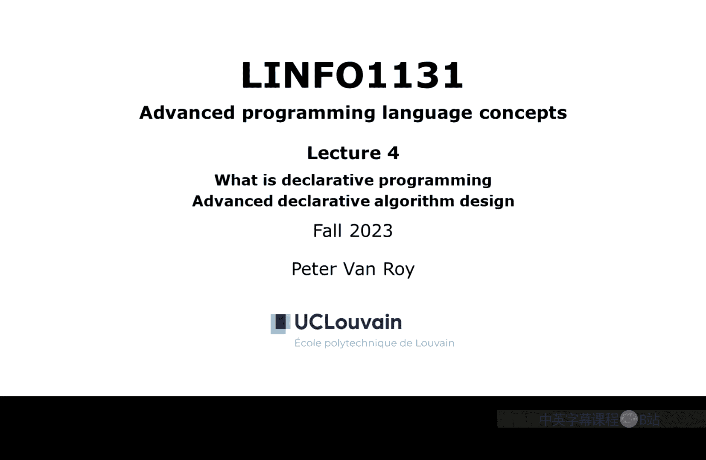
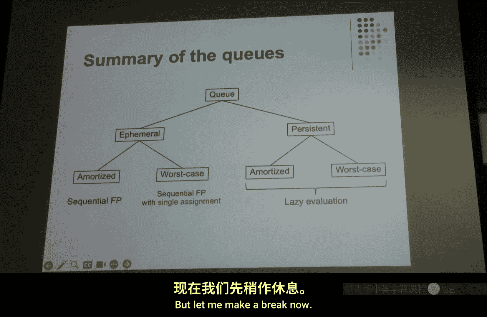
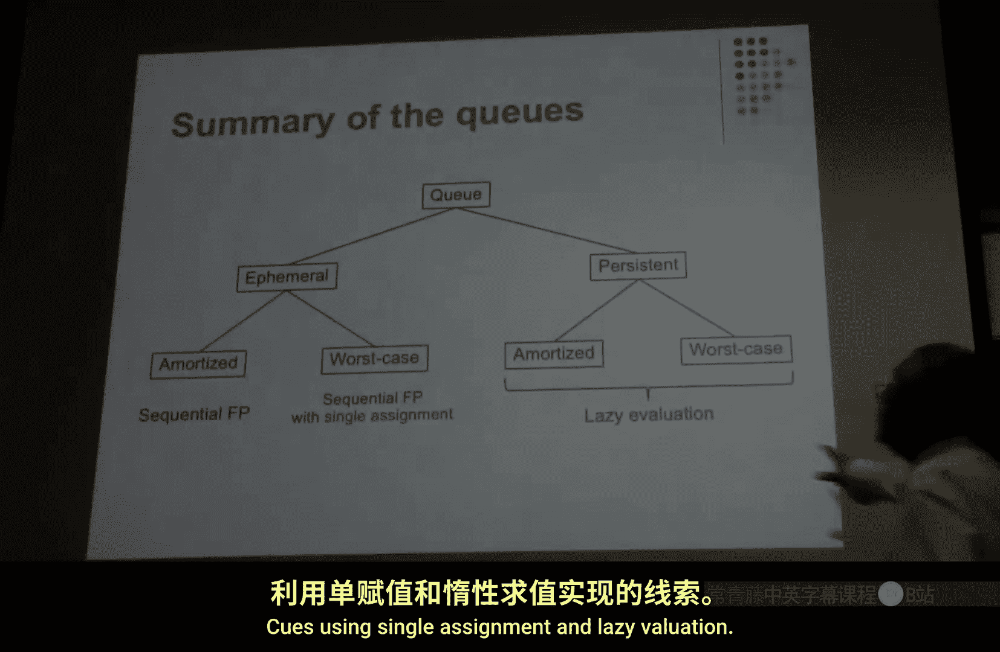
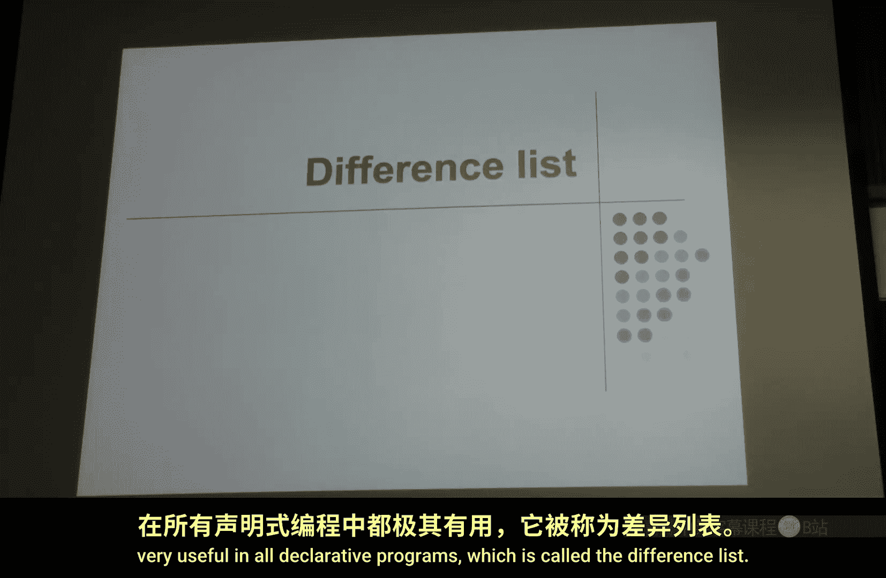
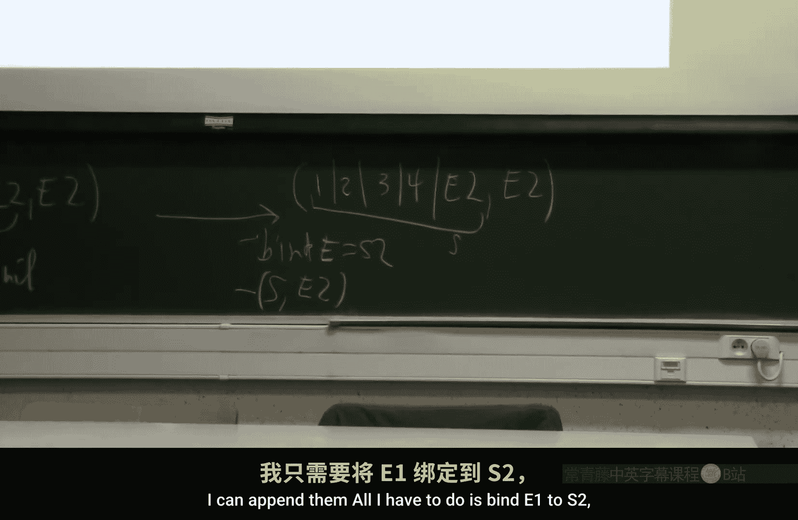
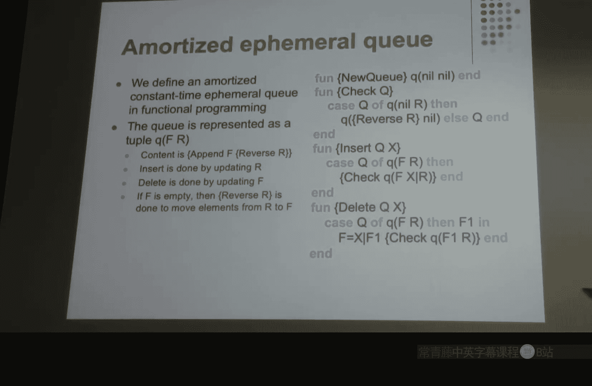
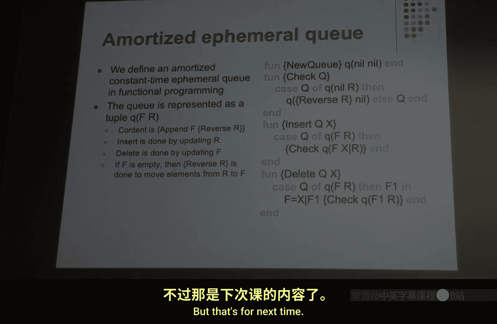

# 高级编程语言概念：4：声明式编程与高效算法

## 概述
在本节课中，我们将要学习声明式编程的确切定义，并探索如何利用单赋值和惰性求值来构建高效的算法。课程分为两部分：首先，我们将深入探讨声明式编程的理论基础，特别是它与一阶逻辑的关系；其次，我们将学习一系列高效算法设计技术，包括差异列表和多种队列实现。

## 声明式编程的定义

在之前的课程中，我们接触了多种编程范式，包括顺序函数式编程、确定性数据流、惰性求值以及惰性与并发性的结合。它们都被称为声明式的。但声明式编程的确切含义是什么？

这一切都始于λ演算。所有函数式程序都可以编码为λ表达式。λ演算有一个非常强大的性质，称为丘奇-罗瑟定理。该定理指出，对于一个表达式，无论我们选择何种归约路径，最终都能汇聚到同一个结果。这个性质也称为汇合性。对于终止的程序，这个最终结果就是最终值；对于不终止的程序，该性质同样成立。这是λ演算成为所有编程语言基础的重要原因之一。

顺序函数式编程显然是汇合的，因为它可以相当直接地翻译到λ演算。但在我们的声明式编程课程中，我们走得更远：我们添加了并发线程、调度器、公平性、永不终止的流以及单赋值变量。那么，这些特性如何保持声明式的性质呢？

我们将从三个方面来探讨声明式编程的含义：并发性、流（部分终止）以及单赋值变量。

### 并发性与汇合性
首先，并发性本身并不破坏声明性。线程和调度器只是改变了每一步执行哪个归约，但由于丘奇-罗瑟定理，这没有问题。因此，我们不再深入讨论这一点。

### 流与部分终止
接下来，我们讨论永不终止的程序，例如流处理。输入流不断进入，输出流不断产生。这如何是函数式的呢？

我们可以定义一种“临时终止”。如果输入流S1在一段时间内不变化，程序最终会执行完毕并产生一个特定的输出值。我们称这个点为“静止点”。程序暂时“休息”。之后，如果输入流被扩展（例如绑定新值），输出流也会相应扩展，程序到达一个新的静止点。因此，输出流S2始终是输入流S1的函数。这就是我们为永不终止的程序定义函数式执行的方式。

### 单赋值变量与逻辑等价
单赋值变量带来了一个重大变化，它使得这个范式类似于逻辑编程。存储中包含未绑定的变量，这些变量的绑定可以按不同顺序进行，但存储从某种逻辑意义上说仍然是相同的。

为了解释这一点，我们需要引入一阶逻辑。

## 一阶逻辑简介

一阶逻辑是一种形式化逻辑，它包含变量、量词（全称∀、存在∃）、谓词（多参数关系）以及连接词（如∧、∨、⇒、⇔）。它由三部分组成：
1.  **语言**：语法定义的公式集合。
2.  **证明论**：一套从给定公理推导出新公式的规则（纯语法操作）。
3.  **模型论**：为公式赋予真值的“世界”或数学结构。

例如，公式 `∀x ∀z (Grandparent(x, z) ⇔ ∃y (Parent(x, y) ∧ Parent(y, z)))` 本身只是一串符号。但我们可以为其赋予一个模型，例如“所有人类及其亲子关系”的集合。在这个模型中，该公式为真，因为它定义了“祖父母”关系。

编程语言如Prolog、约束编程和SQL都基于一阶逻辑。

### 逻辑符号
我们有两种方式连接公式：
*   **语法可证**：`α ⊢ β`，表示在公理α下，可以证明β。
*   **语义蕴含**：`α ⊨ β`，表示在所有使α为真的模型中，β也为真。

前者关乎证明过程，后者关乎真值。

现在，我们可以回到声明式编程中的存储概念。

## 存储的逻辑模型

程序运行后会产生一个存储σ，它是一系列变量绑定的集合。我们可以将存储σ视为一个逻辑公式。例如，绑定 `x = f(x1, ..., xn)` 在某个解释下为真，当且仅当函数f应用于变量`x1, ..., xn`的值等于变量x的值。

如果两个存储σ和σ‘看起来不同（绑定顺序不同），但它们“说”的是同一件事，那么它们在逻辑上是等价的。形式化定义如下：

两个存储σ和σ‘是**逻辑等价**的，当且仅当 `σ ⇔ σ‘` 是一个永真式（在所有模型中为真）。这意味着，任何一组使σ为真的变量赋值，也同样使σ‘为真，反之亦然。它们表达了完全相同的约束集合。

## 声明式编程的正式定义

基于以上概念，我们现在可以给出声明式编程的定义：

一个程序是**声明式**的，当且仅当对于所有可能的输入，所有可能的执行（无论调度器如何选择）：
1.  要么全部不终止（都进入无限循环）；
2.  要么全部达到（部分）终止，并且产生的存储是**逻辑等价**的。

换句话说，程序没有“可观察的非确定性”。调度器的选择是自由的，但程序员无法观察到其影响，因为最终结果在逻辑意义上是相同的。

我们之前学过的所有五种范式（顺序函数式、带单赋值的顺序函数式、确定性数据流、惰性求值、惰性+并发）都符合这个定义，因此都是声明式的。

### 故障隔离
声明式编程非常强大，但有时程序不得不与非声明式的部分交互（例如与现实世界交互），或者程序中可能存在错误（bug），这会导致可观察的非确定性。

我们可以通过“故障隔离”技术来封装这种非确定性，尝试恢复声明式的行为。基本思想是：如果程序某部分因错误产生非确定性结果，我们可以捕获这个错误，并返回一个预定义的、确定性的值（如一个错误标识），从而从外部看，程序行为仍然是确定性的。

## 声明式编程范式总结

声明式编程包含多种范式，主要可以从两个维度划分：
1.  **求值策略**：严格（及早）求值 与 惰性（延迟）求值。
2.  **变量特性**：仅值（无未绑定变量） 与 数据流变量（单赋值，支持未绑定变量）。

结合这两个维度，我们可以得到：
*   **严格函数式**：Scheme, ML。使用值，及早求值。
*   **惰性函数式**：Haskell。使用值，惰性求值。
*   **并发数据流**：Oz, Alice。使用数据流变量，及早求值，支持并发。
*   **逻辑编程**：Prolog。使用数据流变量（和更多特性），及早求值。
*   **惰性并发**：用于流处理和分析工具。使用数据流变量，惰性求值，支持并发。

## 高效声明式算法设计

声明式编程常被认为效率低下，但这并非事实。接下来，我们将学习如何利用单赋值和惰性求值设计高效的算法。

我们将关注以下概念：
*   **语言概念**：单赋值变量、惰性值。
*   **复杂度概念**：摊销复杂度、最坏情况复杂度。
*   **算法类型**：临时算法、持久化算法。

### 复杂度概念回顾
*   **最坏情况复杂度**：传统的O(f(n))记法，给出执行时间的上界。
*   **摊销复杂度**：考虑一连串n个操作的总时间复杂度O(f(n))，则每个操作的**摊销复杂度**为O(f(n)/n)。这适用于某些操作偶尔很昂贵，但平均成本很低的情况。

### 临时算法 vs 持久化算法
这是一个关键区别，在传统算法课程中较少强调：
*   **临时算法**：当你通过操作（如插入）从旧版本数据结构创建新版本（如Q2 = insert(Q1, a)）后，旧版本Q1就**不可用**了。大多数命令式语言（如Java）中的算法都是临时的。
*   **持久化算法**：创建新版本Q2后，旧版本Q1**仍然完全可用且可操作**。你可以同时拥有并操作多个版本。这在版本控制系统（如Git）、协作文本编辑、支持回滚的数据库中非常有用。在命令式语言中实现持久化通常需要显式拷贝，而利用惰性求值，我们可以更优雅、自动地实现它。

持久化算法有时还支持**合并**操作，将两个分支版本合并为一个。

## 差异列表：一个高效的基础数据结构

在深入队列算法之前，我们先介绍一个非常实用的声明式数据结构：**差异列表**。

差异列表是表示列表的一种方式，它支持常数时间的追加和末端添加操作。

### 定义与原理
一个差异列表表示为一对列表(S, E)，其中E是S的一个后缀。它表示的列表是“S减去E”，即从S中移除后缀E后剩下的部分。

例如，列表 `[1, 2, 3]` 可以用多种差异列表表示：
*   `( [1,2,3 | X], X )`，其中X是未绑定变量。
*   `( [1,2,3,4 | Y], [4 | Y] )`
*   `( [1,2,3,4,5], [4,5] )`

### 高效操作
差异列表的强大之处在于其操作效率：
1.  **追加**：给定两个差异列表 `(S1, E1)` 和 `(S2, E2)`，将它们追加为 `(S1, E2)`，同时绑定 `E1 = S2`。这个绑定操作是常数时间的，从而实现了常数时间的列表追加。
2.  **前端添加**：向 `(S, E)` 前端添加元素X，得到 `( [X | S], E )`，常数时间。
3.  **末端添加**：向 `(S, E)` 末端添加元素X，绑定 `E = [X | E1]`，得到新差异列表 `(S, E1)`，常数时间。

### 示例：展平列表
考虑一个展平嵌套列表的函数。使用普通列表和追加操作的实现效率不高，因为追加需要遍历第一个列表。

使用差异列表，我们可以实现一个无追加、无额外垃圾产生的高效展平算法。算法核心思想是递归处理子列表时，通过共享和绑定中间变量，直接“串联”差异列表，避免显式的遍历和拷贝。

差异列表在功能上类似于命令式语言中的链表加末端指针，但它具有函数式语义（不可变、更健壮）的所有优点。

## 队列算法系列

我们将以队列（FIFO，先进先出）这一抽象数据类型为例，展示五种不同的声明式实现，其复杂度特性各不相同。队列支持两个操作：
*   `insert(Q, X)`：将元素X插入队列末端。
*   `delete(Q)`：从队列前端移除并返回一个元素。

### 1. 朴素队列（最坏情况O(n)删除）
使用普通列表实现队列。`insert`在列表前端添加元素，是O(1)操作。`delete`需要移除列表最后一个元素，必须遍历整个列表，是O(n)操作，其中n是队列长度。

### 2. 摊销常数时间临时队列
使用一对列表`(F, R)`表示队列。`F`是队列前端，`R`是队列后端的**反转**。`insert`操作将元素添加到`R`前端（O(1)）。`delete`操作从`F`前端移除元素（O(1)）。

关键是一个称为`check`的辅助函数：当`F`为空时，`check`将整个`R`反转后放入`F`（O(|R|)操作），并将`R`置空。`insert`和`delete`操作后都调用`check`。

**摊销分析**：每次`delete`导致`F`为空时，会触发一次昂贵的`reverse`操作（O(k)，k为当时`R`的长度）。但在此之后，可以进行k次便宜的`delete`（从新的`F`中取）。因此，在一系列操作中，昂贵的`reverse`被“摊销”到许多便宜操作上，使得每个操作的**摊销时间复杂度**为O(1)。

**注意**：这个算法在临时使用时是高效的。但如果以持久化方式使用（保留多个旧版本并基于它们进行操作），摊销分析可能失效，因为针对同一个旧版本的多次`delete`可能各自触发昂贵的`reverse`，导致最坏情况行为。

## 总结

本节课中，我们一起学习了声明式编程的精确定义，它建立在λ演算的汇合性和一阶逻辑的模型论之上。一个程序是声明式的，意味着其所有可能的执行路径要么都不终止，要么都终止于逻辑等价的存储。

我们还开始探索高效声明式算法的设计。我们介绍了差异列表，这是一个支持常数时间追加和末端添加的强大工具。接着，我们以队列为例，分析了朴素实现和一种摊销常数时间的临时队列实现。后者通过维护前后端两个列表，并批量反转后端列表到前端，实现了高效的摊销性能。

在接下来的课程中，我们将继续探索更高级的队列实现，包括最坏情况常数时间的临时队列，以及利用惰性求值实现的摊销和最坏情况常数时间的**持久化**队列。这些技术将展示声明式编程在实现高效、复杂算法方面的强大能力。