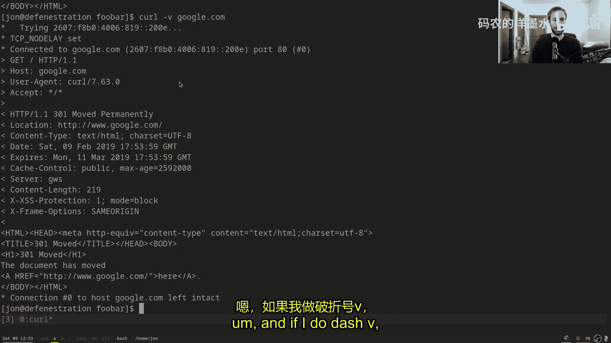
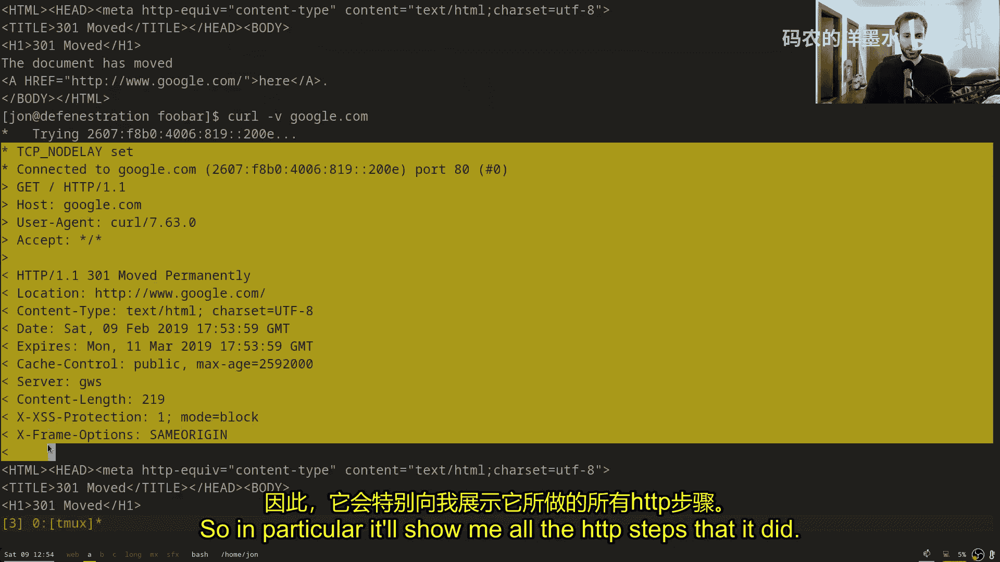
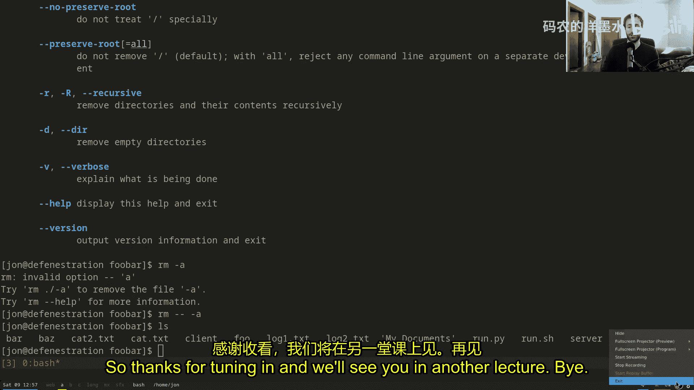

# 【全集】MIT麻省理工 黑客工具 中英字幕 1080P Hacker Tools p02 Lecture 2 - Shell与脚本 -BV1jcPTz6EE2_p2-

Hello， this is a re recordingd of the6HD， so the hacker toolsol class lecture on She and scripting。

 we sort of realized that this is a very。So of screen heavy lecture and it was really unfortunate that in the original lecture we did not actually have the screencast。

 so I figured I would just redo it with a proper microphone and with the screencast as you can see hopefully you find this useful the content is pretty much the same as the original lecture and I recommend that you open up the lecture notes for this lecture which is basically what I'll be going through adding some detail as we go along。

So the shell is a really efficient textual interface to your computer and it might be something you're familiar with。

 it might not be， but in general you can do almost everything through the shell and once you start becoming productive with the shell you should find that you don't really need your mouse all that much anymore the mouse is pretty much handy for the browser and not much else on your computer。

When you open the shell you're greeted with something that looks a little bit like what's on my screen right now so this is called your She prompt and it basically lets you run programs and commands there are a lot of common ones so for example there's make De let's just make a Fobar directory so this made a directory called Fobar in my home directory that I'm now going change directory into so I'm going to CDd into Fobar there are commands like LS which list what files are in that directory currently there are none and there's move and copy so for example if I touch will create an empty file so I'm going to touchF touch bar if I now LS you see I have the files bar and F MV moves a file so I can basically rename bar to B and now the files are bass and F and I can copyF into F bar and now I have three files and the contents of Fo bar are the same as the contents of F。

So this is sort of the very basic shell stuff that pretty much everyone knows。

 but the thing is the shell lets you do so much more than that。

 you can invoke any program on your computer and usually command line tools exist for doing pretty much anything you may want to do and they're often a lot more efficient than there's sort of goUI counterparts。

 they're graphical counterparts and we're going to go through a bunch of those in this lecture。😊。

The shell provides what is essentially an interactive programming language it's often referred to as scripting and there are a lot of different shells that all have effectively different languages you might have heard of or probably even used either SH or bash so the prompt I currently over have open is a normal bash prompt it is what you normally get when you install any Linux system S is so this is bash B SH the B again shell there is also SH which is sort of the original shell the two are mostly compatible S is a little simpler but in general S you will have on any Linux system bash youll probably have but you're not quite as guaranteed and it gets weird once you go over to other Uniix like system so MacOS for example has SH but also has a really old version of bash so if you're trying to write a script that will work across。

Different types of unixes you might want to stick to just S H there are also shells that match particular languages better。

 So for example， there's C shellll CSH， which looks a lot like the C language。

There are other shells that are more geared toward sort of human use。

 they often they're often referred to as like better shells so there is。

 for example fish which is the one I personally use which they have a slogan that's something like finally a shell from the 90s there's ZSH or Zish which is very popular which is basically someone who took bash and then made a version of bash that's still backwards compatible but has a lot of the sort of nice features you will want in a real shell。

 there's also the corn shell KSH that is pretty popular in general I would say just。

You can choose any of these that'll all be fine what I will cover in this lecture is primarily bash because it is the most ubiquitous one。

 but I would recommend that you look at either Zcher or fish as sort of your main shell because they are a lot nicer to work with and come with nice features like really good inline auto completion。

嗯。So shellll programming is a very useful tool in your toolbox and you can part of the reason for this is you can both write commands directly out on the command line like this this command line now will interpret what I write as a program that it's going to execute you can also stick these commands in a file so for example I'm going to create something like a run dotsh file and at the top I'm going to add this line bin SH and if I do this this is known as a hashb line if so here lets。

So if you try to run a program that starts with a hashb line。

 what will happen is Linux will take the entire file contents of that file and pass them to the program that follows the hashb so for example I'm going mark this file as executable so that we can run it and here let's say that I do echo which is print something to standard out and say echo hello if I now run this file notice that what happened was it printed hello。

 it's not particularly interesting but it turns out that you can do really fun things with this like I can do a run dot Pi where I set the hashb to user bin Python。

And then down here， I do print To from Python。And notice if I now make run dot pi executable and run rundot pi。

This now ran Python code。And so this hashbag trick is really useful if you just have some short program you want to run and you want to run it through some other program。

 then a hashbag will basically tell Linux that the way you execute this file is take its contents and give it to this program。

So in this lecture we'll primarily use B Bash， although keep in mind that anything that I put in this file。

 I could have also just run directly from the command line。

So let's start actually let's start at the command line with something relatively simple。

 let's say that I just want to do run some command a bunch of times well bash has four loops just like most other things。

 although you'll notice that it's a little bit weird let me just write it out here。

So this is an example， what this is saying， let's sort of walk through it line by line or token by token and unpack it。

 so this is you should read this as4 x in list， so this is the list， this is the x。

 this is just any variable， and it's going to you with the body of the loop with x set to every value in this list。

Semicolon terminates a command and new lines are semicollonons， semicollonons are new lines。

 and so this would be the same as if I put a new line right here， the semicolon。

 and for loops require that there's a semicolon before the do also notice that for does bash in general does not have curly brackets。

 which means that any construct that adds a block， whether that's a for loop。

 a while loop an if statement case like switches， they basically have a unique keyword for starting the block and ending the block so in this case do starts the for block and done ends the for block in other programming language this would be an open curly bracket and a closed curly bracket。

嗯。Now， the way this actually works in Bssh is that this list is really just space separated。

 so it's going to assign I for every space separated element in this list。

So how does that work exactly， well we'll get back to whitespace splitting a little bit later。

But basically， this thing。Right here， let's just run it to see that it works if you try to run this command。

 you'll see that all secec I5 does is print the numbers from one through five。

And so this is what is known as。This is what is known as program substitution。So basically。

 what it does is it executes this program in here， and then it replaces this entire thing with the output of that program。

 which means that this loop is equivalent to writing。

This those are exactly the same and then bash is going to so if I run this it does the same thing。

 bash is going to split this by white space and then it's going to assign I to each of these values and run the body of the loop。

 which is just echo hello， which is why we get hello five times with I set to that value。

Notice that everything in a She script is a command。

 so in this case Echo hellello Echo is also just a program on your computer， in fact。

 if we type which echo。Which E ECcho is a program that's located right there and what EC does is it prints out its arguments。

 it's very non fancy。And in fact， all of the commands that you can run this way without specifying exactly where they are。

 the way the shell finds them is using a variable called path so the path is a colon separated list of directories where your shell should look for programs so when I type E what the shell really does is it walks this list of paths and in each one it searches for a program called echo and if it finds it it runs that one and stops searching and my case echo is in user bin so it would look at this one。

 not find an echo， look in this one not find an echo， look in this one。

 find an echo and then run that program。嗯。Also notice that we have variables right so I here in this for loop is in fact a variable and what that means is we can also do stuff with that variable so if you go back here instead of echoing hello。

 we've got to echo I and what we then get is the numbers1 through5 notice that this is basically the same as just running sec I5 and we could do something more useful right so in here we could do for example LS which prints the files in the current directory and do something like4 F as in file E F and this will print all of the files in the current directory。

😊，Right， we can also set our own variables if we want em batchsh so you can do something like F equals bar and EF。

Notice though， that bash is really， really picky about syntax， if you do this。

What Baash will interpreted as is run the program fo with the first argument equals and the second argument bar。

hi is probably know what you wanted， and so for any variable assignment。

 you really do need to use it without spaces。There are a bunch of special variables too that are defined in all scripts。

 so if we go back to our run dots H program， there is0， which is the name of the current program。

 so sort of the name of self， there's Do1 through Do9 which is that argument to the program。

 so for example， if I now run run S H with A， B and C as the arguments。

 then Do0 which we print first print the name of the program itself， a1 printed A。

 and we could print Do2 to get B Do3 to get C， etc。

There are a couple of other things like you can echo dollar pound。

 which brings the number of arguments and dollar dollar。

 which is the process ID of the current shell of the current program right so in this case dollar0 was still the same dollar pounds of the number of arguments is three AB andC。

 and this is the process ID of the shell that's running that program。

So let's see if we can do something more useful， so we have this for Ls。

 let's say that we only want to print directories so let's make some directories here。

 we're going to make D1 and D 2 so if we LS here you'll see that D one and D2 are both directories is what this leftmost bit indicates these other bits are is it readable is it writeable is it executable the first three are for user the next three are for the same group so in this case the user group and the last is for everyone who's not the user and not the group。

So let's say that we only want to list the directories in this folder。

 well this will list everything which is not quite what we wanted。

 and so of course Bsh also has if statements， so I'm going to write it out and then explain what it does。

嗯。Okay， so what we did here was utilize an if statement。

 so we're only going to echo out D and then the the sort of the file that we were at if this is true now this construct might look a little bit weird。

 the setup here is basically if。Condition， then oops。Then body。

And then f right so here we have then is sort of the open curly bracket f is the closed curly bracket condition is a command that the shell is going to run and in general any program you run will always。

 but especially in the command line will exit with a particular exit code so for example。

 if we look at。And the exit code will always be printed in or stored in dollar question mark。

So for example， if I try to remove a file， that does not exist。

So this told me that it does not exist if I echo dollar question mark， it says one。

 if I try to remove a file that does exist likeF。And then try to echo Do Quemic and print zero in general。

 any non zero exit code means a failure where zero means a success。

And what if condition does is it runs the command and if its exit code is zero。

 then it executes the body， otherwise it does not。Test here is also a program that's on my path。

hi test and test， I recommend you look at the man page for test。

 but test basically takes an expression that can be all sorts of things。

 but it's the kind of things you expect like parentheses and or string comparisons。

 number comparisons also various kind of tests on files。

 so you notice I useDD file exits with through if file exists and is a directory which is what we wanted in this case right so for this loop。

If。If F is indeed a directory， then test is going to exit but status go0。

 and then it's going to do this echo。So that's kind of cool， you can also of course do LsF。

 so there's like an L if construct。Will you give some other command？

There's also an else if you want to do else。And I recommend that you take a look at man tests can do a lot of really useful things。

 one thing that you might have noticed is that oftentimes you'll see this in Bsh scripts。Instead。

Notice that it does the same thing。Open square bracket is not that special。

Open square bracket is also a program on your machine。

 it is literally called Open square bracket and in fact if we look at Man test。

 you'll see that a alias a different alias4 test is open square bracket。

So when you what this is saying to Bsh， this statement right here is run the program Open square bracket with the arguments D。

 dollar F and close square bracket， so closed square bracket is the final argument and in fact。

 if you run test as open square bracket， it requires that the last argument is a closed square bracket。

😡，嗯。So。You might think that， okay， great， we sort of did this correctly。

 but we run into some really weird cases like， what if I make a directory called My documents？

let's see what happens if I run this now， notice that my documents does not appear in this list even though we made it as a directory and if I LS。

It is there， right， and it is a directory。So let's think about why that is well。

 remember how the way Bch knows how to loop over things is by whitespace splitting this。

 so LS is going to list my documents。But when we loop over all the items of its output。

 my is going to be an item and documents is going to be an item， but not together。 So， in fact。

 we can test this just by removing the if。And echoing Do F。Oops。Yeah。

 that's not what I' meant to do at all。That's even less what I'm meant to do。

You'll see that when I do this loop。You see my and documents show up as separate things。

Even though when we actually list files， they show up as a single thing。

And this is a really big source of bugs and bash like this behavior on white space splitttting is just all sorts of problematic and it will cause you headache down the line。

 so let's spend a little bit of time on trying to understand exactly how that bit works so Bashli's arguments by whitespace and that is not always what you want and often the way to fix it is by doing quoting。

For example。Up in this example， remember how this is really just process substitution right so we could just as well say D1 D2 my documents。

 this is what the previous command spans do if I know that my documents is a single string I can do this I can quote it and now notice that it'll run。

 but it will exit with a different error。And the error is that down here。

 you'll see we have the same problem here with our if。If F is my documents。

 F is going to be just put here as my documents， which means that test or Open square bracket gets the arguments dashD。

 my documents， end square bracket， it is not expecting two arguments to followD。

 it's only expecting a file name。And so here we would have to also quote this variable in order for that to work。

 and then indeed it does work。嗯。Echo sort of happens to be okay because what Echo will do by default is it will print its arguments space separated。

So it's going to get my end documents a separate arguments。

 but it's going to print them space separated so it happens to work out in this particular case。

But what if a file contains something like a new line， right， like what if I make a directory called。

Like。Bad。Documents that Ha M is a new line。So if I L S， you'll notice here。

 it gets all sort of like when it tries to print out the files。

 it has to do all this escaping to show me what that file is。 If I now try to include that。OhSo。

 here。As a bad。Documents。You'll notice that echocho gets all sorts of confused because this new line is just like tripping it up entirely。

 in fact， what happens here is the new line is stored as a carriage return。

 which is go to the start of the line， and so it printsD my。

 veryD bad and that goes to the start of the line and then it prints documents which overwrites the previous of it wrote。

 which is probably not the behavior you wanted。嗯。So。Of course， as far as I've showed you so far。

 quoting is sort of the solution， but that doesn't really help right if I want to let me just remove this bad file oh man。

Yeah。Great。嗯。Because it's not always the case that I can just like replace this dollar Ls with that。

 right？Because。For me， I don't necessarily know the files in the current directory。

 that's sort of the point that's why I'm running LS in the first place。

 and so I can't just do the substitution。And so how do we fix this like how do we fix the script to do what we wanted to。

 even assuming that we quote this correctly。Right， this still does not work because of my documents。

 so you might imagine that I can do something like this。

But think carefully about what that actually means this means run LS。

 take its output and place it where this dollar open this dollar parentheses is What that means is all of the files are going to be a single string so if I run this I'll get nothing。

And we'll see why if I try to echo Do F here。Oops， like so。I would do。

It just prints all of the files as a single string。

 and that is because here we're just expanding LS into a single quoted string so they will not be subject to white space splitting。

 which is also not what we wanted。Well so what is the solution to this so the solution to this is a really handy thing in bash called Gloing so basically baash knows how to look for files that match particular patterns for example you have star which means any string of characters so match any string of characters you have question mark for any single character so let's see how that works so for example I can do LS star and that will show me that will run LS with the arguments of what star expands to star in this case expands to all of these let's do just to simplify a little。

😊，So I'm going to make a few files here。Bba okay， so if I do LS star。

 then star expands to all of these and Ls will just list all those files。 Similarlyly。

 I could also do echo and it will be given all those same things。

 Quetion mark is handy for when you don't necessarily want to match everything。 So for example。

 this matches any three letter file name。Right so it will not print run pi and run SH because they are six letters I also have curly brackets。

 which let me say something like anything that starts with B or R。Star。

Notice that this did not print F， so this expands to E B star R star and B star expands to bar buzzuzz and R star expands to Run dot pi Run dot S H。

And you'll notice that is， in fact， what got printed out。Um。

 there are a couple of other gling tools too， but none that are particularly important in this particular setting。

嗯。So going back to our for loop here， what we can do is just instead of doing LS。

 which is prints the files in the current directory， we can just do star and bash。

 when you use glbing it knows that those are file names and so it knows sort of what to split by and so this will actually assign F to every file in the current directory no matter what the name of that file is so independently of spaces and if I now go back and make this my documents thing and run it。

 my documents get printed the way we would expect it should be。

We still need to make sure to quote it when we use Doar F elsewhere， right like here。

 otherwise this would still get it as two different arguments。You can make pretty advanced patterns。

 too， with glbing， right？ So you can do things like anything that starts with a。

 or you can do something like。Any dot text file in the directory fo relative to where I am。

Or you could do even more advanced things like this。

 So any file that starts with P followed by two characters that ends with dot text in any subdirecty of fo。

Run this command for。Right， so you can combine these in interesting ways and basically name exactly the file that you want or files that you want。

Unfortunately， white space issues don't quite stop there。 For example， if we go back here。

Let's do something like if。Fu equals bar。Then。Echo Z。Actually， let's make this， I guess， dollar one。

If I run S H with no arguments。 sorry， if I run it with bar， then it does indeed print Z。

 If I print it with Baaz， it does not print Z。 If I run it with no dollar one set。

 notice that tests start complaining or the open square bracket program。

 which is tests starts complaining。 The reason for this is。

it is being run so the test program is being run with no first argument。

 So if this is an empty string， bash does not pass it as an empty argument。

 it expands to no arguments。So test is just being run with the first argument as equals and the second one is bar。

 which is definitely not what you wanted， right？And in fact。

 this is sources of a lot of troubles in bass scripts。

 one workaround that exists and that is pretty commonly used is to do this。

And maybe you see why this works right now， even if Do one is empty。This first argument is not empty。

 and the comparison would still go ahead。 In fact， we could test this。

 And this is a hack that's actually quite widely used now。Bar will still work。

 and the empty string will not fail。So this is a pretty common fix， but it's not very satisfying。

 right， It's it looks pretty ugly。 So the way to work around this， at least if you are in bash。

 is to do this。 double square brackets is not a program on my machine。 So if I do oops。If I do which？

Double open square bracket。 It says there's no such program in the path。

 It did not find that program。 And that is because it is a bash built in。

 and this program or this built in understands the syntax underneath。

 It understands that this should always be an argument。 It basically works the same way。

 Teslas like double square brackets is pretty much a reimpleation of test， but where it。

 it understands the bashisms underneath， specifically。With double square brackets。

 even if dollar one is empty， it will still be counted as the first argument。

 So if I now do runus H bar， it will work correctly。

 bars will print nothing and empty will print nothing。 And so you no longer need this X hack。

But notice that this is a bash built in。 So if I tried to run this with S H and on my system。

 SH is bash， so it doesn't actually work。 but if youd were to try to run this on the system that actually just had S H like if it had ash for example。

 so maybe we can just it's not important。 but so in general， if you use double square brackets。

 you will want to declare bin bash at the top not just bin S H。嗯。This also， if you use this syntax。

 you can also do things like double and， double m percent for n， double pipe for or。

 those kind of things， which are harder to do with the built in test program there you sort of have to use dash A。

 dash O for and and or。Okay， so we've talked a little bit so far about sort of the kind of cool things you can use the shell for and how to do very basic scripting。

 but where the shell gets really powerful is once you start talking about composibility in particular the shell is powerful because it lets you compose multiple programs specifically you can chain multiple programs together rather than have one program that does everything and the key character for doing this is pipe。

 this character。😊，If you write a pipe B， what that really means is run A， also run B。

 send all the output of A as input to B， and then print the output of B。😡。

To understand this a little bit better， you need to understand that all programs all processes you launch have basically three streams。

 they have an input stream which is known as standard In written like this they have a primary output stream standard out written like this。

 and they have a sort of secondary output stream called standard error。

 which is where you're supposed to write error output if any occurs and by default standard your terminal is going to say that standard in is your keyboard and standard out is the terminal display。

Which means that anything a program， so if I write Python program for example。

 and I use the print function， what that will do is send the characters I gave to print to standard out。

 which just so happens to be my screen and therefore it gets displayed Similarlyly if you use something I read keys or input。

 what that will give you is characters read from standard in。Sorry。

 print goes to standard out input takes from standard in。嗯。But of course。

 your terminal can change that Basically， if you type a pipe B， what that's going to do。

 what your cell is going to do is it's going to change A's standard out。

 to be equal to B's standard in。 So when B reads from standard in using something like input。

 it won't receive from your keyboard， it will receive from A's output and similarly when you call print in a。

 what that will actually do if you print or echo or whatever， it will print a standard out。

 but standard out will be B's standard in， but B standard output will still be your terminal and A's standard input will still be your keyboard。

You， you have some manual control over this， too， and you can play around with it。 like。

 let's say that I echo fo， right？ So actually， let's do。Stup cat。 So cat does a very simple program。

 It reads from standard input and writes the standard output。 So if I type echo。And then presenter。

 then it printed out echo。 notice the reason I see this twice here is because my terminal sort of be helpful to me。

 shows me the characters I'm typing。 So it shows me my standard in。

 But this is what I typed on standard in。 So that is what cat received。

 And then cat printed back the stuff it got on standard in。 to its standard out。

What I can do is I can do something like cat open angle bracket or sort of close angle bracket means change standard out to point to this file。

 So here I could do cat dot text。 Now if I type echo and then terminate cat with control D。

 which is sort of end of file end of input if I now if I now print the contents。Of cat dot text。

 you echo is a bad example here， I am a cat。If I cat that file， if I print the contents of that file。

 you'll say it says I am a cat。 So here when I catted into this file。

 what happened was standard out of cat became this file and so anything I type a standard into cat end up in that file。

 Similarlyly， I can use open angle bracket to change standard in to be the contents of a file。

 So here I'm telling cat that standard in should come from here instead of my keyboard and cat just prints whatever comes on its standard in so it prints that to I am a cat。

 In fact I can redirect both。So this is saying hey cat。

 your standard in is going to be the contents of this file and your standard out should go to this file so if you recognize this is basically copy right if I now cat cat dot text。

 it says I'm a cat and if I get cat2 text it also says I am a cat。And if this is confusing to you。

 I recommend you play around with it a little， you can also redirect standard error using two and then that。

 or you can redirect everything in bash using this。But those are less important。

 So let's go back to pipe because that is where we started。

 and that is arguably the most useful these commands。 Why is this useful？ Well。

 what it lets you do is it lets you manipulate the output of a program。 For example， if I do L S。

 let's say that I only want to include files that like contain an O。 I could do this with a Gob。

 but it might not be what I want。 Instead， I can pipe it through the program Gp。

 So Gep is a program that searches for a pattern in all of its inputs。 So I could Gep for O。😊。

And what that will do is for every line in LS， it'll pass that line to GE。

 GP would search for the character O and only print a standard out， but if the input contains an O。

And I could make this more complicated too， so Gr supports more advanced parameters than oh。

 like I can write full regular expressions here。 I'm not going go into that in this particular lecture because we cover that in the data wrangling lecture a little bit later in the semester。

U。But this is handy because now I can write one tool that is good at searching and I can use that across multiple places。

 For example， if I type PS， it lists all of the programs I currently have running if I run PSAuxX。

 it prints all the processes currently running on the machine and so I can do PSAuxX and then I could grab for like I don't know。

 grab for my name， and I will show me all the lines in the process table that contain my name anywhere in the line。

And notice， I did not have to make like implement that searching feature in P S。 Instead。

 P S just knows about printing things， Pri processes and Grps know how to search。

 and the pipe lets us combine those two。 And that is really powerful because you can go a lot further with that。

 For example， I can do journal C T L， which shows me the entire system log of my program since since of my machine since the last boot。

 I can pipe that through something like Gp for Intel。So this shows me all the messages。

 I guess I should have done B for the last boot， search for everything that contains Intel。

 the string Intel。Or like let's say anything thats says kernel， so that's a lot more messages。

 and then I could say pipe that again to tail which prints only the last n lines and do say tail n5。

So if I run this program， I get the last five messages from my bootlog that contain kernel。

And you'll notice that journal CTL did not have to know anything about searching or about looking at only some lines。

 GP did not need to know about how to print system logs or how to only select a subset of its inputs and T did not have to know about system logs or searching but still the pipe lets us combine these in useful ways and I really recommend you look at the data wrangling lecture for a lot more on how to build interesting structures like this。

I can also combine programs in other useful ways， like for example。

 one thing I might want to do is I want to send an email to myself showing me who is logged into the system well I can do that too who prints everyone is currently logged in。

 I could pipe that to send mail which is a program that takes as input an email message and sends it to a particular email destination and I could say like me at example co and now if I run this program。

 it's going to send the list of who's logged in as an email to this mail address。

 assuming I've set up send mail correctly。Bash also provides a number of other ways to compose programs。

 although many of them are even more sophisticated and maybe not something you'll run into very commonly。

 but we'll mention them briefly。 you can group commands with things like a。

Semicolon B in curly brackets， so for example， I could do。Journal C T， L， B， Gr I Intel。

 journal CT T， L B。Actuallyspecly， it's a better example of this。

Let's say that I want to search for everything that contains an O in both the files and the。Actually。

 no， let's just say I want to search for my username in both the process list and the list of people are logged in。

Sorry， that should be a。Prenheses。I guess， let's do head instead。

So notice that now it ran who and PS and it combined their output into GE。

 and then I took the head five， and so notice that this will give me these threearrow lines from who and these two lines are from PS。

And a lesser known。A lesser known but really useful one is process substitution。

I think I've mistakenly called the L one process substitution。 This is not process substitution。

 What I'm about to talk about is it's not terribly important what these are called。

 So process substitution is really weird， but it is basically if you write what's a good example of this。

Let's say that I want to look at the difference between between two different the output of two different programs。

 so for example， I want to look at the difference between my last two boot logs。

So journal CTL B minus-1 shows me my latest system。

 my latest boot log journal cL B minus2 shows me the boot log from the previous boot If I want to show the difference between these。

 I could do this log wandnda text。Log2 dot text， and there's a program called DF where I can give log 1 dot text and log 2 dot text。

 and it will show me the difference。Maybe not in a way that's particularly helpful right now。

 But nonetheless， it shows me that difference。 What's inconvenient here is that I need to give two file names to diff。

 right， diff only has one standard in， and it， it can't。 It's a little tricky to actually compare to。

The output of two commands， because you can only provide one command on as sort of the standard input to that process。

 And this is where process substitution comes in handy。 if you write this。Oh， like， so。

What this will do behind the scenes is Bash is going to start this program and start this program。

 create sort of a temporary file that iss going to put all of this program's output into and that it's going to take that temporary file name and give that as this argument instead of whatever is here so in fact if I did echo here。

See that the arguments that Echo actually saw itself receive are these。

 which are just sort of weird file names for things that the kernelel created for us or bash created for us rather。

That happened each one to contain the output of these programs respectively。

 And so if I ran diff on these， I would get the same thing as if I wrote them to files individually。

 but without having to create the intermediate files。One thing。

 so let's let's move on a little bit from composibility and talk more generally about the ability to run multiple things。

 One thing you might find is that sometimes you want to run longer term things in the background a good example of this is if you want to run。

 say a server of some kind and you also want to run a client。Well， the ampersand suffix。

 if you put that at the end of a command， it tells Baash to run it in the background will and it will give you back your prompt immediately。

 So let's make an example of this。 So I'm going to create server。

Which is going to do what most servers do， which is sleep for half an hour。So if I run server。

 you'll notice it sort of takes over my prompt， right， This is just gonna sleep。

 but imagine that it's some larger like web server or something。 I can't do anything now， right。

 if I type L， nothing happens， I have to wait for that。

 I have to kill that server So control C kills the current process， and then I can type L。

 but if I really wanted to like let's do client as well。Success， because that's all clients ever do。

So if I run client that print success， if I run server。

 but imagine that I have to run the server and now I want to run the client。

 I could open a new terminal， but I sort of don't want to do that。

 like there's no reason why I should have to do that。

 And so the ampers and suffix is really handy if you want to run two programs at the same time。

 For example， I can do server ampersent。 And now what bassh is telling me is， okay。

 I started I started what you told me as process I this。 and this is the job number。

 This is sort of the background job number of server。

 And now I can run client right I got my prompt back and the client is going presumably connect to the server and do whatever it needed to and print success。

And if I type jobs， it'll show me that this is one of the background jobs that's currently running and I can bring it to the foreground with FG and then percent1。

 So percent1 is job number one。 if I just leave leave off the percent then it's going to assume that I mean percent one and indeed then I get back the server。

 If you have a thing that's currently running in the foreground and you want to move it to the background you can press control Z So what control Z will do is it will stop the currently running process and put it in the background so now if I do jobs。

 you'll see that this process is in the background but it is currently stopped。

And then I can type BG percent1 to say run this process in the background and if I now do jobs。

 it'll tell me that this thing is now running again in the background and this is a good way to sort of move between multiple programs in the same terminal session Of course。

 if you're trying to run things that are relatively disparate like an editor and a server or something like that。

 you might want to use something like Tms or screen which we're going to talk about in the next lecture on the command line environment。

 but this kind of low-le job control is really handy for when you just like want to start a server and a client。

 for example。嗯。One thing you should be aware of， let me just kill this for a second。

 If you run a server like this， you can imagine you can also run this in a script like run dots right if I run server and and then I want to sort of keep around what hand what process that was。

 I can do this so dollar exclamation mark is the process ID of the thing that was last bond in the background under the process that was last run。

And now， I can sort of。Echo waiting。 And then I'm going to like， I run the client， E done。

 And then I'm going to kill。 So kill sends a signal to a given process。Telling it to， for example。

 shut down。 So the default signal that kill will send is the kill the kill signal， which basically。

tells that program to shut down and you give it a process ID so in this case that would be the PID that we stored from up here and if I now run run S H and then run jobs。

 you'll notice that there's nothing running in the background because the script sort of cleaned up the thing it ran in the background。

So what about other stuff that's running in your process， Actually， one more thing that's useful。

 let's say that I run the server and now I'm trying to like I want to log out from the machine。 Well。

 first of all， I'm going to lose all the output so I probably want to start this in the background with something like server dot log。

Right？But let's say I ran it this way。 And now I want to log out from my terminal。 Well。

 control C to put it in the background to stop it and put in the background。

 B G to run it in the background。 But now if I quit this shell。

 the shell by default also shuts down any of its background processes， any of the background jobs。

 And so there's an additional step you have to take disown， which basically says。

 I don't want to be responsible for this process any more。 So even if I die。

 let this process keep running。 And so you can do disown percent1。

 and now that will keep running in the background， no matter if you log out from your SSH session or whatever。

呃。Okay， so let's look at other kinds of sort of similar things。

 which is other stuff running on your computer。 So now we talked about background jobs。

 and you've already seen P right So P lists all the other things that are running on your machine。

 P A will show you all the processes running from all the users on the machine。

 And there are a lot of arguments to P。 So man is sort of your friend on the command line。

 which will tell you more about the different processes that are or the different commands you have available to you。

 So remember we looked at man test， right， There's also man P。

 There's man for most of these commands。 And usually the man pages will be pretty helpful about all the possible arguments you can give them。

 Sometimes it might be a little overwhelming。 but if you if you open this and then type slash。

 you can search in the man page for terms that are relevant to you like I can do search for something like all and enter and then end to go to the next matching next matching line。

😊，If you want to find a process， so let's say that I run the server in the background and now from some other shell or later on。

 I want to find the process ID of that server Well PGp for processGP will take the list of process and search for anything that contains the given name and so in this case I can do PG server and it will tell me that there are two process Is that have server in the name if you include AF it will also search the entire command line So it also search arguments and it will print out which command line that is running So in our case。

 this shows us that process ID this 200156 is in fact the server program that we ran just above here。

And let's say that we want to kill things some things later。

 so I mentioned the kill program kill send a signal。

 there's also P kill which is sort of a combination of P GrP and kill。

 so P kill server would send the kill signal to any process that matches server。

 which is sort of similar to。😊，This。Right， so sort of P kill combines P Gr and kill。

If we look at kill， you'll see that it has the ability to send a number of different signals if we do。

Kill dash L。 These are all the signals that kill can。It defaults to sending。Dash 9。

Which is the Sig kill signal。 So this signal tells the process to exit right now。

 So if I do kill dash 9 and then a process I D。What was our， I guess， 2156。

 the dash9 signal is going to force that process to exit immediately。

 It does not get an option to like clean up anything。 It just has to exit right now。

 the nicer way to tele aprogram to exit， if you just pass kill or if you do 15 or term。

So Sig term is sort of a polite way to tell the process like， hey。

 it would be great if you quit right now， the way these mapA commands， if you press control C。

 what that really means is you're sending Sig term so you're saying please exit。

Sig kill is tell the kernel to forcibly close this process right now and it is equivalent to control backslash so you press control backslash that immediately kills the current process no matter what it's currently doing you very rarely want to do that because it means it won't get to like flush things out to files and those sorts of things you generally want to stick to control C similarly to with kill。

 you usually just want to kill So if we look at man kill。呃。

You usually just want to use not specify the signal because then the term signal is sent。

 which is the polite way of asking something to exit。And as they say here。

 it's used in preference to kill because you sort of want to allow the process to perform cleanup before it terminates。

嗯。So there there's one more thing I want to cover before we finish up here。

 which is this notion of flags over the course of the commands we've run so far。

 you'll have noticed that in general， for most commands like if I type LS or P or PG or kill many of these take what known of flags。

 So these are things that start with a dash。 So for example。

 P I did dash capital A for P graph we add dash AF。 in general。

 flags are weights to modify the behavior of the program you're running。

 They usually come in both a short and a long version。 So if you look at man PG。

You'll see here that there's for I can either pass dash count or dash C and they're basically equivalent or dash delimiter or dash D usually so this is a short and a long version for every flag and the long version usually has double dashes where the short version has single dashes usually you can also combine the short ones so PG AF is the same as PG a F normally there's also a dash help or H which prints a short version of the man page basically it prints you sort of a condensed version of the help for that program and this can be a very handy way to get a quick overview of what you can do with a given program and what kind of flags it supports。

There are a number of flags that are pretty common that you'll see in almost every application。

 So I already mentioned dash H for help。 dash V usually means verbose。 So， for example， if I curl。

Google dot com。 So curl is a command line program that fetches the。Basically。

 the website at this address and download just downloads all the HTML。So if I curl Googleo。com。

 I get this value。And if I do dash V， it'll be more verbose about what it's doing。 so in particular。

 it'll show me all the HttP steps that it did。 so usually dash V means verbose。

 often you can pass multiple dash vs to make it even more verbose or just combine them because it's a short flag。

Similarly， usually dash capital V means version， so for most tools dash capital P V will print out information about which version of that software you're running。

Dash a commonlyly refers to like everything or all。 So for example you'll notice if I do LS here。

 I get these files， if I do LS dash a， it also includes dot and dot dot which are ways to move up so dot is always the current directory。

 dot dot is always the parent directory and normally those are not listed but with dash a which translates the dash all dash dash all prints everything。

And finally dash F usually means force， so normally let's say that you're trying to remove a file。

 it might say that this file is like right protected or something like that。

 so it will refuse to delete it if you pass dash F it will force remove that file even though it would normally not let you do that so generally you should be careful with using dash F flags。

呃。There are sometimes you want to create files and a this is a pretty neat trick。

 sometimes you want to create a file that starts with a dash。

 and this can sometimes be a little bit tricky， so let's look at touch。

Touch is a program that lets you basically just create so it lets you change the time of a file like when it was last modified。

 but if a file does not exist， it creates it。 So it's a handy way to just create files。

 But let's say you'll notice that it has an argument called dash A。

 let's say I wanted to create a file called the dash A。 Well， if I do touch dash A。

It says missing file opera friend， because it didn't get filed。 It thought that was dash A。

So how do I create this file quoting it didn't help？Well， normally for most programs。

 if you do double dash and then dash A， what the double dash means is everything that follows the double dash。

 so everything from there and to the right。You should not interpret as a flag。

You should only ever interpret as sort of positional arguments like file。 So if I do this。

 you'll notice I now have a file called dash A。 and I'll have the the same problem actually with R M。

 So if I do RM dash A， it's going to think that what I meant was the dash a flag to R M。

 which there might not even be one。 In fact， if I do RM dash A， it'll say invalid option。

 So here I can do the same thing。 double dash dash A。And now Da is gone。呃。

That's all I plan to cover for the shell lecture I recommend that you go to the hacker toolsol website and look at the lecture notes for the session where we also have a number of exercises that are useful just to familiarize yourself more with commands。

 how you can combine them and sort of interesting additional tools that are really handy to know about I also recommend that you go watch the command line environment and data wrangling lectures if you found this interesting because they go into a lot more depth on how you can combine these tools and how you can make your experience of working on the command line just sort of better in every way。

 how you can use other tools to improve your experience on the command line and be more efficient but this at least should have given you an introduction to basically what the shell is and the kind of primitives you'll be working with along the way。

So thanks for tuning in and we'll see you in another lecture。

