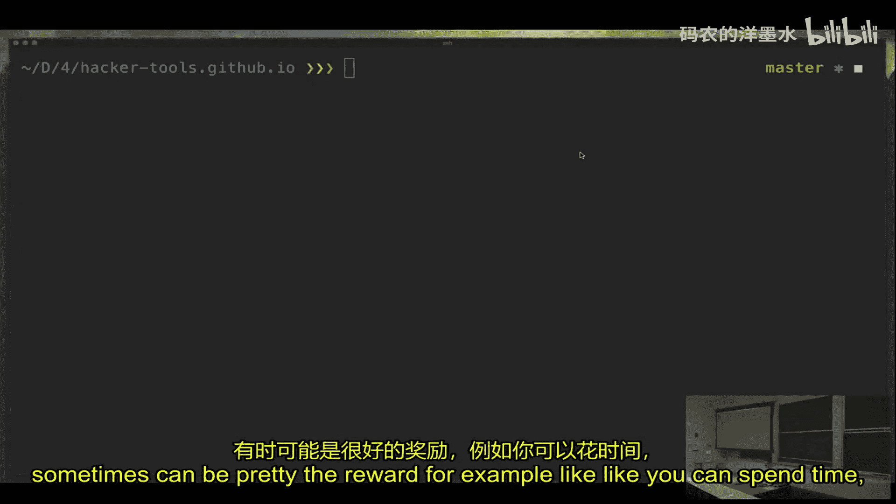
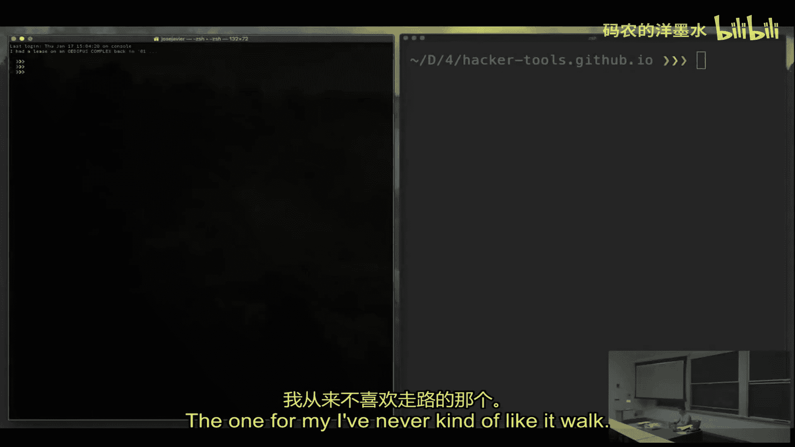
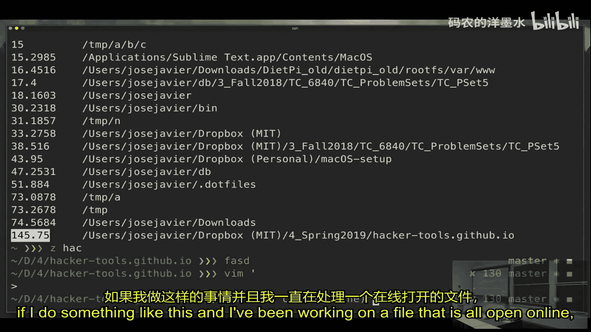
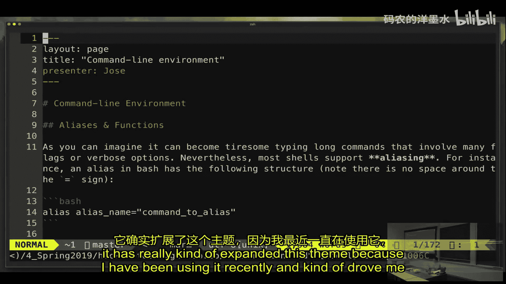
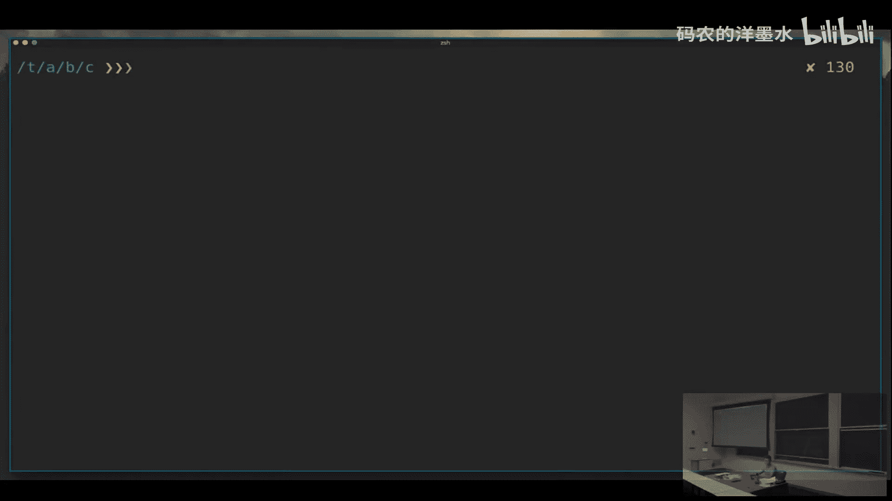
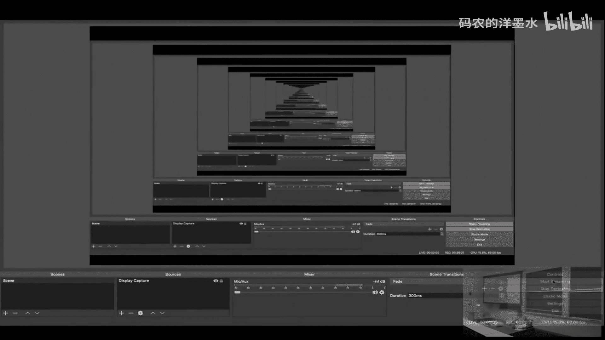

# 【全集】MIT麻省理工 黑客工具 中英字幕 1080P Hacker Tools p03 Lecture 3 - 命令行环境 -BV1jcPTz6EE2_p3-

はい。Hows I going to be teaching you on like。To stuff like common environment。Tuesday， we saw it right。

How I can call the bus。A little bit things and， if you're going to be spending a lot of your time。

In the sale is worth kind of customizing and making things easier for you if you're not going。

The tricks that you can do and the that people have already gone and how can you benefit from that？

诶你都讲咯。Tres on Alexad though。They't be you at any moment。Don't like fully understand what is going on。

 like feel free to stop me at me why that happened， where that came from。

 how did you manage to do this， and I'd be really happy to explain because that's the one a lot of this lecture like all this all this day。

When start going like he time were going to move our like different stream。But again， big pre't draw。

So the first thing is like we saw that like you can create all these comments and like there's like a lot of plugs that you can do to them and one of the really nice thing is like most cells allow you to make alls of。

Let's say that I do LS or minus L all the time。Then it may be war green like Anaals。

And I will say our L2， I'm going to create like L minus l。

And like now when I type2 that expands to that and then I'll have kind of to that really long pain that in this case seems to stupid like some default command that you will be using a lot of time that are like dumbly lock like for example。

 if you're in a if you're in a，You never。And youふ like needタト。

Seeing that you will be doing a lot of the time and it' stupid enough。

 having some areas that it like。い。大。Yes， I get the exact same result。

Is have like a bunch of kind of different properties， one of them is like for example right now。

 if I have like weeks and two that we just define。We felt me eyes。A lessment。Alysis can compound。

 so for example， if I just now define L3 is like go is L2 minus a。

 so I not only want to list kind of everything in kind of the long format。L life。

I also want to least kind of the hidden thoughtss。Here we saw individual three。

 we're going to see there is listing kind of these files that are hidden by default and what what' happening here is like L3 was expanded to L2 minus A and then L2 was again again expanded to kind of L and。

あスいス。like all this says are pretty smart about it and they also allow you to overcride the existing name so it doesn't not like a lot of primary languages doesn't really allow you to do that。

 but it's completely fine for me to say， oh， LS is a degree。

And right now what is going to be happening is going to have LS， LS is allS23， a 32L2 L22D program。

L and everything is being soldd from， for example， if you just do this a lot of the time。

It might be worth knowing， it's also sometimes you don't want to have the alias for produced sometimes you may want the raw function because you maybe have alias your Mac LS or like your Mac rep。

 kind of unique rep。A thinkme because， for example， Mac and Unix。

 you sometimes have a slightly different life。So if you want to look kind of call it without like the aS is being resolved without using the LC you just call like backwardber last less and it works with a regular one。

 same thing if you just do like common less。Or for a way， if you want to kind of permanently remove。

 you can literally get like Ananals Ls。Now weぱ ask。Which theles is literally pin。研究し？え。えクテン。え？かの。

This cannot know exactly in the sense of this or like。

knows like there is like a most unique space system。

 you have this like forla P and B kind of a temporary file system。

 So if you want to just like tinker with like creating files， moving stuff train stuff around。

If you have want like some temporary place to place or kind of temporary files for your script。

 PB will be kind of cleaned every time you read and it's perfectly fine to use you have you know。

Then remember to to gain， for for example。A you're here moving to it？And when I， oh。

 one more way before before I get into this， one thing with Ais is if I get like。A new cell now。

 and I ask for L2 L2 is not recommended because I define this in B cell and if I want。

To carry on different things， what technically I have to do is this commander I type where I say this is this。

 it's like a command that needs to be executed every time I enter a cell。

The thing is pretty much every cell has some bump filess and will lead some preferences in the notes。

That we agree， so for example， if you're using bus。You will have in your。In your homeer。

 you will have your。Baser C where you can pull like different stuff that will be read in it here so for example what I have in my buzz C is like oh check this is kind of syntax for check this file exists and if it exist kind of execute all the commands are in the path and if we go to。

If we read analysislysis， this is like a bunch of like we go on analysis and this is executed every time I open cell。

 all these analysiss are executed and I cant use them easy。And。

One nice thing of kind of factoring this out is that either you claim using mass or I using seas。

 I can also have my。诶。I think in my sister it's kind of same I here I also search in the same analysis so enough to kind of copy them wrong。

Referencecing both from the same。え。我也是。Yeah。Next thing we can do， we can go。

That kind of temporary folder we have created。And we can see the like。K of in the last class。

 there were like a bunch of stuff that kind of bath it and like we also mentioned there's like these all cells that kind of are slightly more convenient because it has like a bunch of useful features by default without you having kind of to define。

The one I'm going to look right now， only like alcohol things can。Gaay。

 kind of looking for work and you get all the stuff is seaSa。

 which is nice because it's kind of a super set of baths or everything kind of works bath breathe。

 works right away you see it， some cells don't work that way。诶。But it has some Greekmin， for example。

 the make。え？I'm creatinging here。ers。Yesす。シリとで。And now let's create， for example。

 here when I'm wearing green I'm green purple。Heace for father is created。嗯。

And I lead the structure right now， I have a polar B and a polar C and all these TxT5s。

We saw that Ging could be really useful if I wanted to kind of get all these TXD。

 it finally agree knew kind of that they are there， again just do something like this。

And like it will expand that to those things， but let's say I don't really know they're there。

 it will be re convenient to kind of have like a wild card for like an entire path and that's what like CC gives you with like the double laserers with double lossesers this thing expands to the same thing and another really convenient feature of CC is that you can let's say it's in blue because kind of telling me that I can expand this right away and say kind of having to wait for。

ForFor the proposal to that。That's also convenient because here doesn't pretty matter to Matt in some other cases it's bare because for example。

 they're using kind of the bandband water。So quickly that's replacing the entire first command here。

 and sometimes it's good to kind of see the entire thing because bad by default。

 when you're kind of subsiting substitutes and run diplomas。InPo we can move。語？

We have also sited by default all kind of looks like for some I years do like something like this。

 it figures out kind of interary folders。Yes， by trying all of them and convenient thing。

It allows you to tap completion， but allows you to select the things that you're using。诶。

Oh and like if you enable it， it also kind of if you crap it out and like type a command that doesn't really exist a lot of time will tell you can oh you mistype this part of the command do you want to kind of。

For me to correct LLS with LS。Which is also extremely convenient。

 especially if you have like a really long command and it figures out the correct。見せていただきる。え？

Moreover。Theres like a lot of， is that like it's more convenient things that like these different cells can work for you？

But a lot of people have a reinvest a huge amount of time on making like significant frameworks that give you like quality。

嚟诶。A lot of them have already been seen because they're kind of working by default， but for example。

If if I'm move into this folder， oh something that probably sees it， along with the left front。

 gives you like a right front where you can also like。スタトしの前。I think that you can also customize。

 So example， here I'm using Presto this。On the C framework， there are many more。案 games。

A C6 packaging installer is also online C， which is pretty famous and they which that you can customize。

Like don the of history， you can get like this stuff， for example here。

 it knows that I'm figures out this is like。Reository tells me the branch that I'm in and that tells me that there is like some modified file not 4000 each length。

安装。一。It's pretty convenient to gather other quality of life， things that gives you， for example。

 the thing that you were like saying before， since it gives you spell correction。

 a lot of these things give you syntax highlight。So they are kind of on the go for you now that like what I'm typing is kind of a valid format and if no they're kind of like highlighting in red or like all this。

Com on doesn't you like says。Yes that。He for example。

 he telling me kind of I just control see what I wastyping。

 she's telling me kind of the error comment， for example， if I try to。

Grab garbage in 25 gives me the error of one because grab gives you an error of one。全民出せ。

Ting and which is what we saw the。Theresa might for you。嗯。It's kind of giving you all， for example。

 if you provide an argument you can。error world too so you can customize out all of what you will be seeing and it's fairly convenient because it removes some steps in the long run that's very useful。

え。Some more others thought， oh yeah， for example， let's say I don't really know the flag for the take wrap which。

And really know that we're not the I don't remember poly well， like one of the plaques for is。

 this thing can kind of give you the。Access to print to pass demand page and give you like a sort description of all the flag without going to go to the page which depending on the command。

 it can be more or less scary because it's like a lot of detail that you need to go to。And。Oh yeah。

 no I think this is。Is they even more？Tre into sometimes I have have like issues in the puzzle。

 for example here， you can see that like when I'm typing stuff it's kind of autocomp in like being great and that's kind of because he's already doing some sort of cultural art in the background and like matching with my previous history and then kind of kind of like。

Right away， do。Of that will be previous values and easily have to complete on that。Oh。

 and a lot of them， if you don't really like machine with thece like where you have the school bars。

 there's like a lot of them from with like default， sometimes in same front。

 so you want to mean maybe for example that，When I keep a single one and this is one there are many just look around like be aware of like a lot of these cool stack existss。

Next thing is like right now when you're using yourself。

 like the cell is something kind of half of the equation。

 the other health is kind of the terminal emulator。

 which is like program that is running the cell that you're really using。So by default prim。

 all like unit distribution come with some emmbulator。

 but you may want to kind of use a different one because they offer different support。

Of them up their on rent or some。I would like better keep binding。

way and even if you just like choose the one that comes with default with your distribution。

 which sometimes can be pretty terrible， for example， like you can spend time， but for example。

 the one for Mac。

那个。

诶。え。There are like many parameters that you can crystalize。The font that you're using。

 you can customize the color scheme that you're using， which for example。

 like default human you don't have。あの。Again， for over time and stuff， very useful to know。

Even performance like newer terminals， like offloading some of the surfaces are rendering to kind of the GPU and they run the。

I think I didn't have to small with multi platform like I。DIPDI。Three convenient ones。

Another thing that you may want to be aware of is TO， which is kind of a terminal multiplexer。

 which is you can run multiple cells within kind of the same terminal window and need to be opening kind of multiple terminal windows to just run multiple。

Ts， I can just have like several tabs within the same terminal window。

 I can it's going be really that this is today by can kind of split and。

We're running kind of eight stopping here and we display this。

one of the really nice things of terminal multiple like heOs is that you can detch it and it still runs in the back I can go on with my life and then I can just jump back into kind of this layout of pains and that happened。

And they've done more than five three months。诶。I don't know if the stuff that is happening here。え？

Ba and again， for example， if you open your revinal demos and you open it， it has like this。

F mean by the board with no information， but you can go into the into。The Ds configuration file。

Which is。你 just阿げ啊。え？So you can just compute like a bunch of the stuff to your lighting into this place kind the CPU center。

 the detail of how the scroll happens， what happens， so when you copy。

 that's one thing to really be invest with all of these tools is having access to a bag or also like an own theazza again。

 like making your life easier。Kin oftyping comments into being being， for example， that do。

The other reason the terminal multipleply servers are really handy is if you're running a server。

 for example， in the background， you can open up two tabs and teamworks and have the server running in one on the client and the other。

 and then whenever you switch back and forth between the two， the other one keeps running。

And you can still get to the output if you switch to the other one。

And you can even like run a server and then detach it like what I will do with I have a server in the Netherlands。

 I will like SH to that machine， open up TeamOX on that machine， start some server there that's like。

Scanning the internet for something or whatever， detach and entirely disconnect from that SSH session and then later on like a few days later I can SSH back to the server and then do reattach TOs and then everything appears including any output that's been in between。

 just as if I've been connected all along。So like that that's exactly for example， here。

 this is one of my last servers that have like jobs running and have like some eax that is open and I can always kind of re att to it。

系。You recreate and it's kind of easier， you can always。

 we kind of soil it like first that you can like deown your process into the background。

 so just kind of adding the terminal and jumping back into it way more。Any questions so far？你八罪。

Oh yeah， that stuff it comes by default in the fish shell。

The thing you want to be looking for is history of insert。

 which as John said was kind of I think was originally created in the face cell and premat。

 all of the other cells cop it because。Thank you。😊，So like if you're using see to do some module。

 and I think as also as。close all your。And I think all of us are already on the top if you just look like you have。

 but yeah， we will post them somewhere。Next。Then another thing to be aware of is like a lot of the was motion on the general selfway。

 but then a lot of the time what we will be doing is running more command really simple stuff。

I me like quite hard， like， for example， let's say I want to。

Go to my few competition pieces from La Me， I need to kind of even with like nice tito competition。

🎼Really annoying pretty fast to kind of like move into。Some random polar， however。

 if I have a red be there， there's like one field that is usually referred to kind of as algen。

 is a huge time save， or it does， it does passy screen mapping。Pa instrument just tries to match。

 but like not like red or not like regular education， which which later just tries。

fin like the very map with different wordss and here if I do like something like PC piece65。

 it will take me to the exact same place。And what this common is doing is just keeping。

' just keeping like a history of like all the places that have been frequently and recently and this is scoring them so for example I've been working a lot in the kind of the rippo for the class。

 so these have like a really high value so even if I do something like that it directly takes me into that。

And you can not only like this autoium， the like certains。

 the one that you'm using which is called FASD， also allows you to have like commands that instead of doing the C just kind of。

Give you the files， for example。え。I can。use。え？So for example。

 if I do something like this and I've been working on a file， that is all online。

 which is going to be the one for this class， it already really kind of expanded this theme because I had been using it recently and kind of dropped me with gaming into it。

And moreover， you can like kind of combine this Oh well I will get to this like way over the next thing。

Similarly， if， if you're using。Lets。If you you using。点衡玉。Yeah， for example， here。

 like Ba is kind of like a replacement of。I forgot brain and the other thing if for navigating folders。

 the other thing that is what knowing and alone is like。Giner or something along those lines。

 like sometimes if you want to be exploring like some file system quickly。

 but you don't want to be doing it with the files expert， you can still have。

Com online explorers that we do for you， there are like many like MCCC and a lot of them also kind of allowed you to customize them when they kind of display images or like open with your default editor。

that。The thing I was sewing。If you're cutting files all the time。

 you're probably cutting like pizer like gold files or data files and it's nice high。嘴上 here。

Like it's nice having kind of syntax highlighting there。うう？L numbers in the。

So you alienlia is talked about right。Well， for example， as I say earlier， if I do CA。

Some of these files I get back。A lot of the exclude being。

 sometimes they try to follow kind of the tool they are replacing the closest like all the flies。

So sometimes在。Ting to kind that is to kind of how to un the areas。If you needて。诶。Similarly。

 there is like one called X， which is kind of a replacement for or less。Slightly senior default。

 like for example， when you do Ls minus L。There was raw amount of likeナs。

Like if you are thinking on like last files， it just your brain this stops understanding how many numbers have。

Ne， for example， tell you can。Dide like in kilowabytes or megawabyte， there one megawabyte pipe here。

You is slightly more convenient to color calling remes。also knows about like it so making ski。え？嚟家诶。

Yeah， next thing， if you're trying。So find is like tool the like album。Itri indiious。

 it will go through your kind file hierarchy and use a different flag so you can say， oh。

 I want a things that have some name， but soon is fine get if you cannot go through the mapping。顺的。

hi is really and doesn't understand， for example， that most of the time you don't want to。

You don't want to be finding。Filees in your Gi repositor like files are in the hidden folder of your Gi repository you know what there is so if we kind of by default a knows that the most likely thing you want to do is a like search for the current which find does not and then understand。

A lot of these skin files that you't want to be looking around， example if I do every Harer。

 go through all my directory and quickly find higher tools which is like the repository for the class。

It may be。理ケ。But if I do like every and I on the number of lines I printed。

 like if files running is just printing all the files that it finds because I didn't specify any pattern。

 if I count the number of lines that is output in like 59000 which is a lot and you saw how fast it was able to go through them。

 but if I do the same thing with fine。Due to all these hidden pies that you may get if you work photographergraph there。

Three times the many five。And also with find， if you want to try to do a search for a given file name。

 it's like find dots I name， present the search term percent， and you have to remember to quote it。

It's awful。Something like this。Yeah， then star pattern， star and double code。Right， except find not。

😀哦。Oh， by the way， controll A jumps to the start of the current line and control E jumps to the end。

 a very convenient way of moving back and forth without having to go to the open end keys。

And similarly， if you want to instead of finding what you want to do is grabvy in blank。飞见你交送翻嚟。

There are better tools that they are doing something like you can always do something that like like fine and then like grab or。

えこれた。you guys you。You can do like， but there are slightly more meaning tools that are like game have figured out。

Being are some facts。Sered code and also ignore what I all these files in your and ignore So one thing that I do a lot of time is let's say I know that like in some point I kind of roll some Python script where I use like the supercesible control function so I can easily use this tool which is regret telling it I want only files the like any with a high extension and I have the supercesal code。

And it kind of goes through these 59，000 files and gives me like all these folder that I have。

 these are all these files that I have and the language where found this pattern。

 so especially when you're like in Python or like late I find myself all the time using this so like。

 oh yeah I know this is somewhere search for a program like you and I did instead of going to Google and Green or stuff like over。

え？Also， if instead of doing kind of you find yourself doing something like， oh， let's do a PSO。First。

🎼Processing there。 And let's say， you start。If you're going to sleep and like back then。

At least this is a terrible example of think of it。

 but if you find yourself cutting many graphs or like redoing graphs all the time。

 one really need the tool is FCF， which again like it stands for like Pass Finder。AndBut LC of does。

 it's kind of like like a grab on the go。Kind of matching like latelyly but it。

For you now on the go the stuff that you want and you can kind of top this with like color tools so you can do something like heavy into FF so now I can let do。

Like not。下啲。Repoitory and you can even link it to kind of the same thing that I mentioned earlier like all these cells allow you to customize them。

 one thing that I've done is the control R instead of the default is called this script I'm doing like f timing on my。

On my history， so if I want to like search for like。

Like recent Gregs telling me like all these faces and it will drop in there where I didn't using it。

え。Another convenient one is that like when you。When you arrange something， eat for it。

Unless unless you missed and this didn't work， R deletes the file。However。

 that's not really what your file explored that when you didn't done。

 it usually moves it into like this draft， not like it's clear every so often。

 but it's slightly more forgiving because if you cannot forget go like let me try it like this。

not like a good backup for， but it's good to kind of have like that piece of mind that isnt completely deified。

 And again， a lot of people have like implemented a thing that does exactly that。The different ois。

have like different comments， those different voices handle the trust different。

 but if I trust now this see hold。If I trust now this。

Now I can see that instead of being completely removed。Is now sitting into the trust。

And which is exactly the OS folderer。here this。え？我 else。え。しし。Oh。

 another convenient one to know is like month babies are extingish。Like you can， again。

 like you can do like man fine and there is a lot of detail that you can go through and like if you are looking for something technical。

お没说把。I experience that it's way easier to kind of see some examples and kind of figure out the basic or like 99% usage of what command and then like some tools like people kind of have done。

one嚟哦你收啦。Oh， it just because the size of green。what this is doing is just kind of giving you of the basic usages。

 like people have just grid and these kind of small examples of really common comments and instead of kind of figuring out or like Google have like。

 oh， if I want to do some case in sensitive。嗯。Many， many times， I solve without just。え。

Fed by almost all the tools you've mentioned so far are written in Ru。Oh yeah， like F， X rip。TlDR。F。

And that's not also because for that's my。That's one thing and that's also for a reason like one thing you want to be doing when you're using all these things is you don't want to kind of become annoyed at yourself because it's going slow and a lot of these tools are really in the grass because rust is incredibly fast compared to kind of doing stuff like in bass or。

ythonLike someone will come out with some pretty， but it will be done in python and it will be extremely slow So one thing you want to be careful about is knowing something a launch stuff that you' really need that slows yourself because again like if you're using just all of time and it's kind of slow that's not looking。

Or do you have oh 안？You need a meeting one which sauce。ま these famous。And convenient one。

 which I don't know if it's very impressed， but like it's really difficult to kind of hard to kind of figure out what the。

我的。What be anarcom or like you know how to？あのし？Theres this so for example here I have just created this compressor of targetD here and thing is there's like a lot of plugs and if you want to uncompress it you kind of have to figure out that at least high。

 like you can understand it and I understood also point。

 but then it just becomes really convenient because you can ignore it is at， a safe a。

 you do something like unpack or like this thing， someone has a very kind dating thing all the pattern matching。

Also， never， ever unpack the staff in your working director right now。

 it always creates a new one in。Like oh， this thing just explodedly made report。必然后。All these fives。

诶。Or any questions so far。Being almost confusing。🎼And。Oh yeah。

 also when you're popping a lot of files either over the name。

 you can use this sorry in your lot file， you can use CP or like over the the name。

 you can use SCP Ts， both are kind of stupid and if the files are already there。

They copyied them again and that's like a lot of time you are like syncing a lot of file of that degree large file really stupid。

 it should be looking into R scene， which I think existss by default with most unique systems。

And this thing will figure out if the files are already there， you can also like give them like flag。

 like partial， but if you're coning huge files and the connection breaks。halfway we will figure out。

 oh， I have all this chance of I am continue from here。嗯。全なこ。公明さ会を。I way around the 5 minutes。

Againげか的。

In that case， we'll take a 10 minute break and then we'll do data wrangling。

To be insane， man。Itll be crazy。