# 【全集】MIT麻省理工 黑客工具 中英字幕 1080P Hacker Tools p04 Lecture 4 - 数据整理 -BV1jcPTz6EE2_p4-

Charging ahead。ラスの動きで。ご限です。嗯。All right so data wrangling data wrangling is a kind of weird topic。

 but it is what you usually end up doing on the command line and once you start getting used it and that is you have a bunch of text and you want a different bunch of text。

 usually you want less than what you're having for example。

 my system log or this is my server system log has a lot of stuff in it and it's really annoying to try to find anything in that log because it is just super longging。

 you're going to have to condense it down。And the commandline is actually really good at giving you tools for narrowing down the stuff that you're looking at。

We did a little bit of this in the past lecture talking a little bit about things like G。

That help you do very basic things and pipe that lets you combine command。

 but today we're basically going to look at all the tools that help you。

Massage data from one format to another into the kind of form that you want it to be in。

 we're going to operate basically from my own server log。So in this case。

 we'll probably cover us as age at some point。But the basic idea that you can。

Basically run a command on a remote machine， so for me this SSHS to a machine I have in the Netherlands and runs the journal CTL command。

 which just prints the entire system log， I happen to have done this。

Although I could have written all these commands of just piping it through whatever I write next。

 I'm going to instead use the TSB log file because that way。It has all the same stuff。

That way I just don't have to do it all over the network and if the network cut out。

 everything still works。So let's start。Let's imagine that we want to look at like S stuff。

 specifically， my server because it's public gets a lot of people trying to log into it。

 I run my server on an alternative S for， which is really nice。

 it means fewer people try to connect to it， but I still get lots and lots and lots of visits to that machine。

ISo of want to look at some statistics about it in particular let's try to figure out the kind of username that people are trying to log into my computer as right now starting with a log we might imagine first of all。

 that we're just going to。For SHD， actually， let me go to Bosh。いす。😊，Right。

 so we're going to grab for SHD and that's still far too much text， like this is a lot of noise。

 especially it is font size and you don't really know what you're looking for。However。

 you'll notice that there are these disconnected from messages。

So this says a username if we go further off。Disconnected from invalid user Okay。

 so it looks like those are lines that contain username， so let's actually look for disconnected。

So we find。All right， that looks a little bit better。

 so all of the lines that are printed now at least seem to contain username。Okay。

 so that's the part now we sort of want to get rid of the other crap that's on this line。

And the way you normally do this is using a tool called SE。

 so set is a streaming editor that basically lets you。

Write commands that edit a given line at a textile。In this case。

 we're going to use saidD and we're going to say we're going to substitute。

 and then I'm going to come back to what this means。😔。

So notice that what this did was cut off the entire beginning of that line。

 so if I give you an example， let's do tail。😔，So these are the last five lines from the thing above。

 those turned into this。Which is a lot shorter， right， so this command said。Can give you that。

No around it。This command， so I piped through said with this argument。So saidD is a line of。

 as I mentioned and the way it works is you give a bunch of commands that operate on every line of the。

In this case， every line is a log in a head and what I'm trying to do is at least remove the crap of the beginning of the line。

And the S command， for said， does that， it substitutes whatever matches the pattern between the first and the second slide。

With the contents that are between the second and the third s， in this case。

 it's replacing it good nothing。thereby removing it the stuff that's in between it's what's known as a regular expression。

 some of you may have heard these in the past and you may have some experience with them。

 regular expressions are pretty hairy beasts but they are really。

 really useful and so I go through some of the basics and then there will also I recommend you look them up on your own because they are really handy and you can do a lot of cool things with them。

In particular， if you have a regular expression， there are a couple of basic symbols that you're going to end up using a lot。

Dot means halfway places。要。Okay， don this fine so dot means any single character。

 it matches any single character no matter what is。

 so it's sort of like question mark when we talk about gling。

 star means zero or more of the preceding thing， the preceding pattern。So if I write dot star。

 it means zero or more of indie character。😡，which is basically any amount of text。

 so in the pattern above when we wrote。And we substitute it like this。😔。

What this really meant is substitute any string of characters followed by the string disconnected from。

W which is what trims off the entire beginning of the line， including the day， the host name。

 the name of the process， the process I， I didn't have to match this explicitly I just had any string of characters preeding this control。

You also have so star is zero or more plus is one or more。

 so this is convenient if you explicitly want to talk about things that are non- empty。

 you also have square brackets， so if you write something like this in a pattern。

 it means a or B or C， any single character from that set。So if I did this。

 it would be any sequence that is non empty of A's， B and Cs in any order。

You also have patterns like。Thisす。Where Arts1 and Arts2 are patterns。コピ？

This means anything that matches either pattern one or pattern two in this location。

So if it patches either， then this pattern matches， otherwise it does not， there is also carrot。

 so carrot means start of line。And there is dollar sign， which means end point。

These are handy for anchoring matches saying I want to remove from the end， for example。

 if I wrote a pattern like。😔，This， it would mean substitute the food if it's at the end of the line。

And substituted with nothing if there were other foods in that wine do would out there。

And then you get to combine these in interesting ways。

Basically let you express really complicated patterns。

 so we'll see how that turns out by looking more at this long。😡，Sid。

 so there are a lot of different implementation of regular expressions。

 saidD uses a particularly ancient one that's a little bit of a pain to use。

 but it is the tool that people most often end up using for this purpose。

 in general instead whenever you use any of these special characters except for dot star and square bracket you need to put a backslash in front of them。

 so inside a said command，If I wanted to do。Zero or more A's。One or more bees and。Like。C or D。

 if I wanted to write this with said， I'd have to put a backslash before all of these to make them have their special meaning。

This is just something to be aware of that said is a little bit annoying in this way。

 the other thing you can do if you don't want to write all those things is you can pass the D capital Eve like to set and then we'll just assume that all special characters are special。

This brings it more in line with regular expressions you might experience in another programming language like Pythlon and Ruby Wi。

嗯。Okay， so let's look back at what we had up here。So this worked pretty well。

 this set expression that was like dot star and disconnected from to remove the beginning of the line。

 however， it puts us in a little bit of an awkward spot because what if someone tried to log into my server with the username disconnected from？

So let's take an example line from this log。All， so this。Echo that line。

And then I'm going to replace the username with disconnected。

So that's the username they tried to log into my server using。😔。

Let's see what happens if we now try to use the same thing。

 so I'm going to ignore the grips because there's only a single line and we're going to try touse the same pattern。

It removed the entire usenname from the line too。This is because star and plus and rexes are greedy by default。

 they remove as much or they match as much as possible。

 this means that even though they encounter something that matches。

 they will keep going and see if they map something else later in the spring。Normally。

 if you have the same implementation of regular expressions。

 you can curb this behavior by putting a question mark after a start or plus。

 and if you do this you're saying don't be greedy about this operator。

 stop when you hit the first match unfortunately said is not smart enough to understand that operator。

We can switch to using Pearl instead， so Pearl also has like a line by line editor mode that supports things like substitutions。

 so if we do that， then you'll see it exhibits the same behavior as pearl as said。

 but if I put a question mark after the start，Then now it keeps the username。

 it basically does a non-grey match right and so generally using Pearl can be nice in these settings but SE is usually the tool that you have to work with because otherwise you require that the user has a pearl or Python or web command line whereas a said is just always installed it comes with every Linux distribution and Mac OS and like all of them。

So the question is how can we make this better well we're going to stick with SE and we're going to see if we can just make the problem go away by ignoring it for long enough。

 which is often a solution in computer science problems in particular let's ignore that problem。

And look at the log that we've got so far。It has a bunch of crap at the end of it right so following this sort of invalid user or authenticating user or user。

 there's an IP address， a port and some stuff at the end。

 we want to get rid of that too we just what the user makes is's all we care about。

In order to do that let's try to remove all the stuff at the end2 so this set expression we had。

 we're going to extend it to try to match more of the stuff that we have and here I'm going to add the dash E flag so I don't have to add all the backlashes in particular it's going to say something like disconnect it from invalid or。

あ好。ピケで。Question mark means zero or one of the precediving thing。

 so notice that this is saying there's going to be a bunch of stuff at the beginning。

 then it's going to say disconnected from， then it's going to say either invalid space or authenticating space。

 if at all， that's what the question means the question mark means， followed by a user。

So this is going to match anything that says disconnected from invalid user or disconnected from an authenticating user or disconnected from user。

Any of those are going to match this。And in fact， we contest test it。

This removed all the user stuff at the beginning， right now it just starts with the username。😔。

Although there's a space there that we can remove by adding a space。

 and then we're going to match on the username itself， which we have no idea it contains。

 right it's any string of characters， we could use it plus if we want because we know that it's not empty。

And then after that， there's an IP address， right， this business here。And the nipedras。

 we all know is really just anything that doesn't have a space in it。SoYou can do this。

Square bracketet remember was a set of characters right。

 you can prefix that set with a cart and that means anything that's not in this set。

 so what this is saying is any character that is not a space。Plus of that。

 so one or more non space carriers。Which will match any us because I give us ten of spaces。

And similarly， if there happened to be like an IPV6 address or a host name or something。

 those would also be matched because they cannot have spaces。Following that， it says pork。

And then there's a port number。Which we can do zero to nine。

So you can also have ranges inside of square brackets。

 ranges are any character that is between these three， so in this case 0 to nine means 01，23，456，789。

 so any of the digits and one or more of those will match all the port numbers that could possibly be there and then we'll notice some of the lines have this preal at the end。

 but not all of them like this one does not have preal at the end。

So we want to optionally match on pre off。And that's going to be。The end of the。

Let me see if I can give that to you with。もうきびにま。う。そしていう。Yay， don't worry。All right， so this pattern。

 it looks pretty complicated but you sort of see how we constructed it。

 right we sort of piece by piece go through what's in the line and how do we want that to be different。

So at the end here， what I ended up adding was。Optally right。

 remember this is a parent with a question mark， so this is saying either have the literal string space open square bracket。

 notice that backslash now is saying don't treat this as special。

 so square bracket3L n square bracket， either that or not that。Followed by the end of the line。

And you'll see that if I run this， I get lots of empty lines。And why is that well。

 it's because what we told set to do was replace anything that matches with the empty screen。

But we actually sort of want to keep the username otherwise this is pretty useless。

 it turns out regular expressions can support this too using something called capture groups。

 so anything any pattern that's enclosed in parentheses is automatically sort of saved by the engine so in this case I put parentheses around this dot+ which was the username。

This doesn't change the pattern at all， right the pattern still matches the same thing because parent disease don't match anything in and of themselves。

But this causes the thing that's matching to remember whatever was matched by the stuff that's inside the apprenheses。

 and you can refer to that by using backslash and the ornal number of apprenheses。So remember。

 there's one parentheses here， that will be assigned to box slash1， there's one parentheses here。

 thatll be box slash2， and there's one parenthees here， thatll be back slash three。So in this case。

 what we want to do is substitute with back slash2。Because B 2 is where the user is。Does make sense。

Because backslash1 is going to be whether it's said invalid or authenticating or nothing。

 and backslash3 is going to be whether it's set pre off or not。

The by2 is the thing we just added which by the username， so if we run this。

 we get the actual username。And now let's reflect on what happens if someone chose the username disconnected from。

Because we've told this that it has to match the entire line。

If it's said disconnected from as the username， that disconnected from would not match。😡。

This disconnected from at the beginning of the pattern。

Because it has to be followed by invalid authenticating user and the IP address and the report port。

😡，AndPole and then the end of the line。So this pattern actually gets rid of the entire problem with the user using it。

 were using it。Acciddentally or on purpose， I won't tell you。

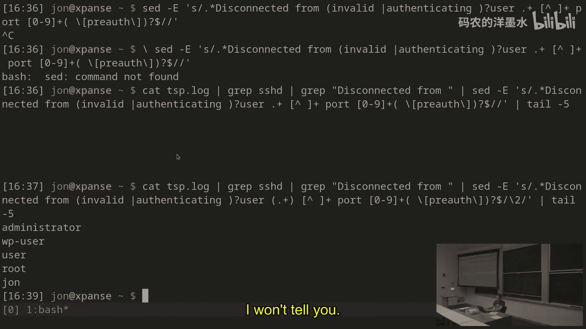

It turns out that there's some really good tools for dealing with this。knows this isか。言ちと나요。Yeah。

So I've linked to this tool called。It's 101。So this is an online regular expression tester。

And so here I've put in this entire pattern。And it will tell you how the pattern works so it will sort of explain the pattern to you in plain English and then you can give a test strings and see what matches one so in this case if I put the friends back around the user here。

 it will also highlight the capture groups right so invalid here is C group1。

WP user is captured group two and pre of is captured group three。

So this is a handy way to debug your regular expressions if they're not quite matching what you thought they would be。

😡，诶。And it will tell you like where are all the groups， which of these straights smashed？

I've linked this in the lecture notes， so feel free to check that out there。

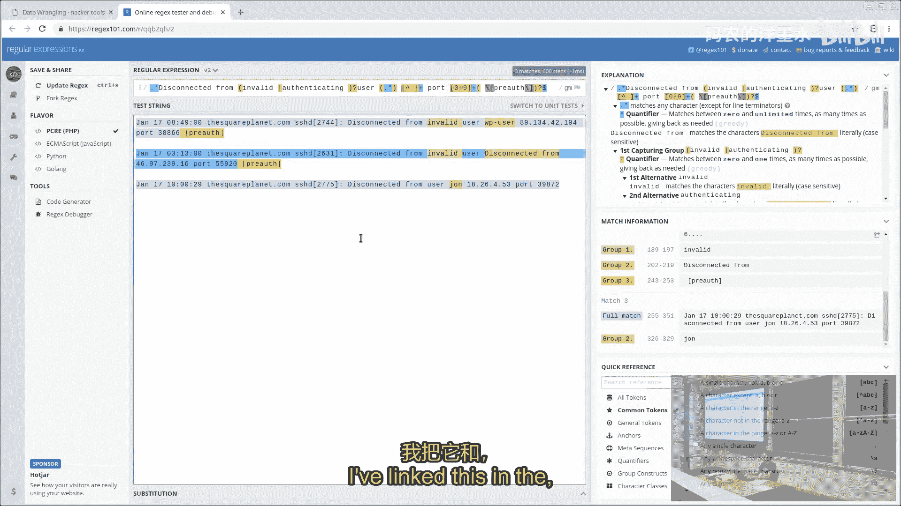

あ。All right， so back to this， now we have this list of username， so that's pretty exciting。

I'm not going to cover too much more about regular expressions except to say that they can get really。

 really hairy。

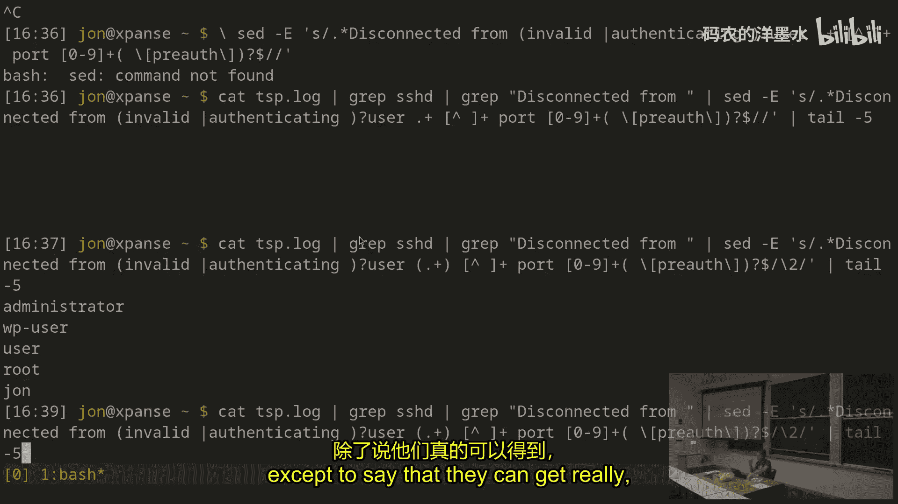

So there's one other thing I wanted to show you， which was。リックス？いい名？It turns out。

 you can write regular expressions to match nearly everything like you can match any email that's valid according to the RFC。

 but it's not entirely straightforward。So this worries me。I can't zoom anymore。Right。

 so look at this regular expression。This matches a valid email address according to the RFC。

 you probably don't want to write it yourself， but real expressions can do a lot of really cool things like。

This regular expression right here。Well， if you take any number and you print that many ones of it。

 and then you match it against this regular expression。

 it will tell you whether or not that number is applied。😡，It's amazing that this is possible。

 but it is。Raing expressions can do a lot of stuff， but because they have this flexibility。

 they're also sometimes a real paint tri and be and this is why I will not cover everything about radio expressions because I don't think I physically could。

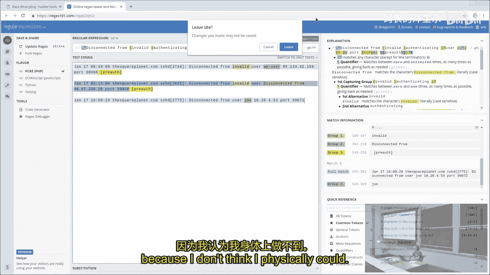

So we're going to continue just from sort of now we have the username， yes。Can you do this search？

ごりさ。If you didn't have this vlog， I like at JSO。Yeah， I mean。

 I'm just counting the file at the beginning here right， so I could， whatever file I had。

 I could totally run this on。If you're on the command line and you have tools that aren't there。

There are usually very good tools for extracting data from those files to text。

 so if you have J for example is a tool called JQ JQ in one of the exercises Ive basically asked you to try to figure out how to use JQ。

 but it lets you write patterns to extract data from JON， there's also one calledPup。

 which is great for extracting stuff from HTMLML。And there are tools for dealing with CSE files。

All of this， like there are good tools for it。In general。

 all the tools I'm teaching you here are for the sort of things that you compose once you have your data source right in some meaningful format。

All right， so we have usernames， great， let's see if we can do anything interesting with them。嗯。

All right。I have these reps at the beginning which are kind of bothering me。

 I mentioned that SE is like a line editor and it turns out SE is really powerful。

 basically as a complete built in programming language so I don't actually need these。

In I don't even really need the cat， I can do this only with set。

I don't think normally you would want to do this。So it said you can write multiple expressions by giving dash E so each thing that follows a dashE is a simple expression and they're run in sequence and each one modifies the line before the next expression is run on that line so one of the things that I can do is I can say that any line。

That啊。Mats SSHD is not deleted。In fact， SED has a lot of really powerful tools like it can inject lines into the file。

 we've also already seen substitutions， but it can inject lines above below。

 it can sample lines that are nearby， most people don't know all of things saidE can do and that's partially because if you look at the map page for SE。

These are the kind of commands that you get， They're all single character commands。

That are combined in really awkward ways。And do cool things if you look really the camera。In fact。

 if you want to give yourself a challenge， I suggest you try to do some of the exercises using only said as your data matter tool。

It's going to feel painful， but it's possible。All right。

 so we have this command that gives in all the usernames。That's。All well and good。

 but let's see if we can get something more interesting out of us。So in particular。

 let's try to look at usernames that people are commonly using right so if we type this through WCL which is word count and the dashL means count the number of lines。

 so this is telling me that there are 3，595 usernames since the last reboot of my machine that have tried to log in。

嗯But。Presumably all of those usernames aren't the same。

 so let's try to find out like which ones are people using and which are being used more than once or commonly So there's a tool called sort if you pipe things to sort。

 it will sort the inputs， it will give you the lines the input lines in sorted order and the output。

So now all the things that are the same are next to each other。

And then there's another tool called unique， not fully spelled out， most of。

Ls command line U have names that are fourth characters or shorter for various historical reasons。

Unique will normally just print for any。Any line that does not have other lines that are the same as it。

😔，So for example， it would only print Zimbra once。only for any consecutive sequence of lines。

 so it does not look everywhere in the book， just consecutive lines。

 it will only print one if there are many it will also if you print use the dash C flag。

 it will give you a count for each one so in this case we'll see that Zimbra was used 11 times Zs was used 23 whereas Zakka de Patia it was only used once。

U not surprisingly。This is still not very helpful though this isn't really telling me what the most common one is right I sort of love the ones that have the highest count towards the bottom or towards the top there's any way I can get that。

And so we're going to pipe through sort again， sort has also surprisingly or perhaps unsurprisingly a lot of really useful commandment arguments in us dash end。

Sos in numerical instead of likexiographic order。It has dash K。

 which lets you sort only by a given field of the em。So normally we'll sort by the entire line。

 which in this case would be fine because the number is first。

 but you can totally imagine that the numbers aren't first and I'm trying to teach you general tools so we're going to useK DK is really stupid in how it's organized。

This is the argument you have to give to sort by only in the first field。

The first thing that follows K is a one index of the first color you want to sort by。

And the columna one says， stop when you reach column1。

Otherwise it sorts by all the columns until the end of the line。😡。

This means you can do something like one two， this sorts by the first two columns， one。

 three does not sort by columns one and three， it sorts by the first three columns。

Which is stupid There are ways to make it sort only by like one to three by using stable sorts。

 but it's pain， but one one is generally what you want or something like three，3。

 which would sort by the third home。Those the 31 is not what you want to。So one one。

 now we're going to get this sorted by the count， so you'll see that perhaps unsurprisingly most of the logins are for me。

 there are also a bunch of login attempts from root， admin， test user， etc ceter。

 and various common usernames as you scroll further up you see less common username。

And we probably only want to look at the most popular ones of these， so let's do something like tail。

10So this will print the 10 lowest lines in the output in this case the 10 was popular if I wanted the top I could do head。

I could also reverse sort， so put the highest valued things on top and this gives me the same output except in the opposite order。

Or of course I could instead of giving the dash R flag a use T。

 which prints its input in the opposite order and like gives me。But that's all the necessary。

 so let's just stick with tail and ten。Okay， so now we have the tail， which is what we wanted。

 but let's try to do something more interesting。Let's in this case just show the usernames。

 we don't need the counts anymore now， you just want the usernames。

 we're going to use a separate tool called Al。So AC is another editor。

 it is also a line oriented editor， but the reason you sometimes want to use AC instead of said is that AC knows about field。

So a does not just operate on lines， it operates on the fields of that line。In particular， with A。

 I can do this。So let's talk about paste first paste。

Its inputs as lines and paces them together by the character that follows D so in this case instead of getting a list of usernames I'll get a comma separated list of usernames。

 it's really handy because you can do things like，Use plus as the delimiter and then pipe into a calculator。

And then it will compute the sum of them。Or you could deliver them by multiply and then pipe through a calculator and I multiplying them in this case I just wanted it not to be as many lines。

And this will indeed give me all the usernames。Actually。In' recent ones。

 and it gives the called that。So what does ARC do， what does this Arc print to business？

Orc is also line oriented and in A。Every。Every part of A is a combination of an optional pattern。

Followed by a block。The pattern is saying if this pattern matches。

 then execute the code in this block， if you leave out the pattern， it matches every line。

Within a block and within the pattern， you have access to a number of variables。

 10 is the entire line that you're currently on。Dollar1 is the first field of that line。

 Doar two is the second field， The three is the third， et cea。 by default。

 off will split by whitespace， Any sequence of whitespace and it will trim the white space at the beginning end of the line so that is why in this case。

 Do2 ends up being the second field in the output from unique。

 which is the username instead of the count if I made this print Do one it would print account instead of the username。

You can also change what the limiter is being used by using dash app and then giving a different character。

 so for example， if you wanted to parse CSD files， you could do this and now you can operate on A with the field being commdescent。

Or if it was tab separated， you could do this。Not that you can see that that's a tab。

 but that is a tab。I think you can also do like。Liten T and Bo， I think。For saying a tab。

 I could have a new light separated field list， I could have whatever， right？

The reason this is really neat is like this was a pretty simple example。

 AC is nice for just like if you're extracting a single column。

 but there are other tools that can do that better。Arc is really powerful。

 and I'll try to give you an example of why。あん。Let's say。That we want to find。

All of the username that are used only once and that start with the letter C and end with the letter E。

😡，In a， this is trivial。So。We're now going to take the entire list of username and counts I mean now we're going to add a condition and that condition is going to be that the first field is one so that is the count and also the second field matches the following w expression it starts with a C it then has any amount of non。

Non space characters， and then it ends with the E， and if that pattern matches， then print two。

And that gives me all the usernames whose count is one and whose's。The matches the pattern C。

 and this is any regular expression that I might want to write。

So this makes it really easier to work with column data。

 and usually what you end up with on the command line is column data in one way or not。

Like for example， if I pipe the output of PS with just all the processes。On my machine。

 then this is also column， right， so here I could pipe this through a。

And say that I want anything that is say， run by roof。Where the process ID is greater than。

Then I want to print。And printed run time。So automatically makes to really easily to express things in terms of problems。

Back to this though， I can back this to this and it will tell me， wow， there are four username。

of course， I could also say anything that's notzi。日コミトす。

I could have it print out if I wanted to both the count and the number。😔，嗯。All right。

 so what else kind of stuff can you do with A？😔，What I showed you previously was I was piping this through WCL。

 right， but again， all is programming language， we don't need WQ。

I couldn' have replace this entire command line with an orchestra。

 but I'm not going to do that because。Don't want to do that to myself。

 but A lets you write multiple patterns and blocks in a single expression。

 there's a special pattern begin that matches before it starts running where I have variables so I can say rows is zero。

Notice there's nothing in between here， just it's always just pattern and conditional， sorry。

 pattern and block。😡，Okay， so。姿勢てす。So what this is saying is first， at the very beginning。

 set a variable called rows to zero。で。For every line where the count is not one。

 so this is a username that's been used at least once， and the username starts with C。

 then add the number of occurrences， right， dollar1 is the number of occurrences from unique D C to rows。

And at the end， print groups。So this will give me the number of times a username that has been used more than once。

And stormks would see。Has been。64， not that's the staff I particularly know what needs or care about。

 but hopefully the sort of way the program was structured kind of makes sense。

This is an entirely arbitrary statistic that I chose to compute。あの。Right。

I've linked also a sort of guide to introductoryOc because again。

O is also one of those languages that it's a complete program of language that I'm not going to teach you。

 but this has hopefully taught to you the sort of basics of how you might use it in some kind of data random pipeline。

Okay， so let's talk about things that are a little bit different just because it's handy。

 I already mentioned this idea of paste。And using that to be math。So for example remember。あの。

We found out that there were。We found out that there were。3，595 log attempts to my。

 let's try to compute that a different way that is more inconvenient。外。So you need to actually。

Remember it gives us？The count wherever user name occurs。

 and so the sum of all the counts shouldn' be the same as the number of total occurrences， right？

Let's check that。Just so you know check map。So we're going to extract with a。Just the count， right？

That did indeed give me just count， then we're going to paste that by plus and we're going to pipe that to be it so that's going to look like this。

And then we're going to pipe that to BC。For a stupid reason requires the dash o flag。And hey。

 that gives us the same number and thin number， I could also do something like。

 I want to multiply that number by two， so I can use process substitution for this。

Do remember our friend process of？So this is saying， I'm going to print this string。

 it's going to be two times and then substitute out this entire command。

 which is going to be all those pluses we saw above and then take that entire thing asended to the captain。

That's not all way， oh， I'm missing an open。I love two times the entire level。美丽。Great， okay， that's。

You care about playing the first number。嗯。And this might not have been particularly interesting。

 but we can also do things like compute statistics about our data， which is arguably more important。

 so remember this gives us all the counts right let's say that I want some statistics about this there are lots of really cool command line tools that will just like you can just pipe stuff into and then you get statistics out but some of you might know like there's program language called R which is really good at doing statistical analysis well you can pipe things into R2 so what we're going to use is our's slave mode which basically lets you run R and then send stuff to it and have a compute and print things for you and I'm going to run the following program in R。

Right， so remember standard in from last time， quiet is true because I don't want it to print anything when it's scanning。

 and then print me a summary of the resulting， so X in this case is going to be basically an array in R or a single column matrix of all of the data points that we have in this case。

 all of all of the accounts， and then it's going to print me a statistical summary of that data。

So it's telling me well， the minimum and the mediumn are both one。

 so that means like most of the numbers are or most of the usernames only have count of one。

The mean is four， the max is 575 those me remember， and the third quartile is two。

 I could print to other things too like if I wanted to， I can guess。Standard deviation。So if you car。

 the standard deviation about list of numbers is 28。2。哎。嗯。😊，You can also do plot。So， let's do。

Let go back to sorting this again because they don't。😔，I' going print out those。

 and we're going to do tail。I want a bar plot at this， don't you？

So Gnu plot is not the best flooding tool， but it is really convenient for command life plot。

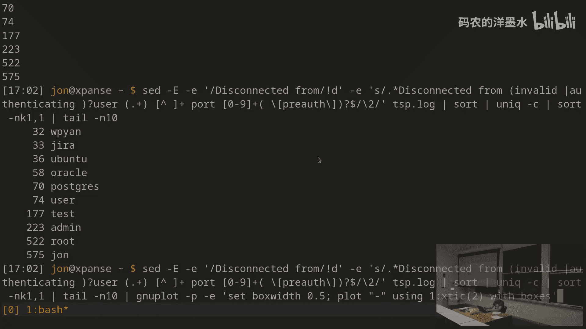

Barclud of the 10 most common login by Youenname County。

This is useful for just like quat visualizations of data。

 it is not what you should use to actually plot things。If you're like writing a paper or something。

 R has a really good plotting package called GG plotot2。

 which I recommend you use if you ever end up doing this。But this is a really， really neat tool。嗯。

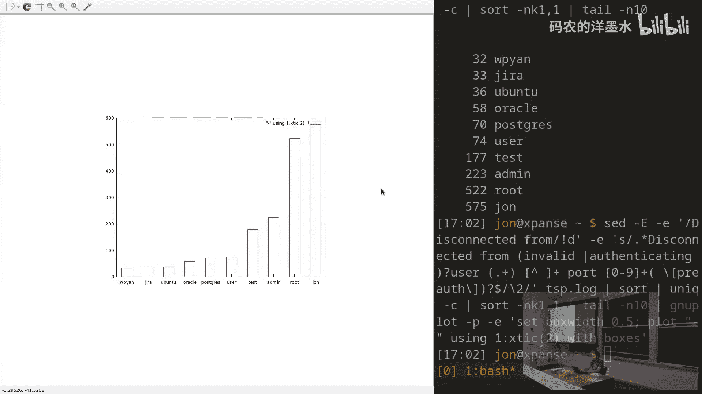

As for the syntax of new plot。And you can sort of ignore the thing at the beginning in those system make a nicer Canoe plot is basically plot followed by a dash。

 which they buy standard in like in the other command。using。

 and then you write which column of the input data should be used as the X axis and which column of the input data should be used as the Y axis。

And then you can say like with lines with boxes， with points， however you'd like to。

And the E is saying execute this program as the newpl program andP is make it permanent on my screen。

 like don't close it the moment the input finishes。嗯。So it gets us pretty far。

We're also going to talk a little bit about。How the command line can be useful outside of just like plotting and looking at data。

 so one command I actually ended up running earlier today。不 now。

So there's a tool called Ru up which manages your like rust installations。

 so you can have multiple versions of the compiler installed at the same time。

 there are similar tools in Python and Ruby， whatever。And it has this thing called a tool chain。

 so a tool chain has list of one version of color and I can list all the versions。

 I happen to have a bunch of these different old nightlies lying around and I won't be rid of some of the old ones。

And I ended up doing basically data rightly， so I grabbed for nightly right because I wanted to only remove things for nightly。

 then I did not want to remove the current nightly。

Which is the one that just named the one at the bottom that doesn have date in it， right？

So I did not want to match that。And then in order to remove them。

 I have to remove them by giving the name but not this entire prefix。

 so I want to substitute everything from X86 and onwards。诶。Oh， substitute with nothing。

So that gives me currently only the one night that's here in the when I last around this there were like 20 lines here。

 and then XRs is a really， really handy tool for saying take all of the lines of my input and make them arguments to the following command。

So for example， if I do XR's echo， that's going to end up calling echocho with the argument of the input。

How do I demonstrate this？点我。Sure， LS， so in this case， LS was given the argument nightly right。

 and it says NoOSSA file directory， and in my case what I wanted to do with this was rust up tool chain uninstall。

So now that's going to run the command， rust up toolts uninstalled with the argument of the particular compiler that I want to remove。

 in fact it's going to run it with all of them， all of the different9s that I wanted to remove。

 so instead of going through and removing all of them one by one。

 this command line lets me have the machine do all the work。Send me like copyping and past。

And this is what data R the open gives you， it gives you these really convenient ways for expressing things that would otherwise be a lot of manual。

Oftentimes you might want to end up with data that you're just going to like stick in Excel or some other programming language do actual data analysis on。

 but sort of the script， the She data rankgling， is handy for getting to that point to the first place when all you have are some fundamental law。

I think that's all I wanted to cover sort of at a high level。

 part of the reason for this was because if you have more questions about regular expressions or ac or scent or data analysis。

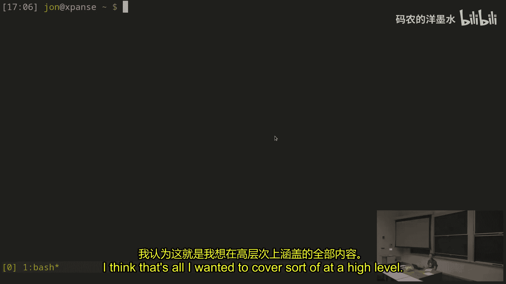

I wanted to have some time to go through those。Or like playing around with。With the visual debugger。

 I have more things I can tell you about regular expressions that are useful。

 but I figured I'd feel some questions if some of you， any of you haven't。

Anything that you are wondering how you might be able to do？

So at the bottom of the data wrangling page， there are a bunch of exercises do。

 and some of them are really neat。For example， they're telling you to do particular things with the logs in your machine。

 there are some that are doing like word analysis， so most of your computers are going to come with this word list and user or share di words。

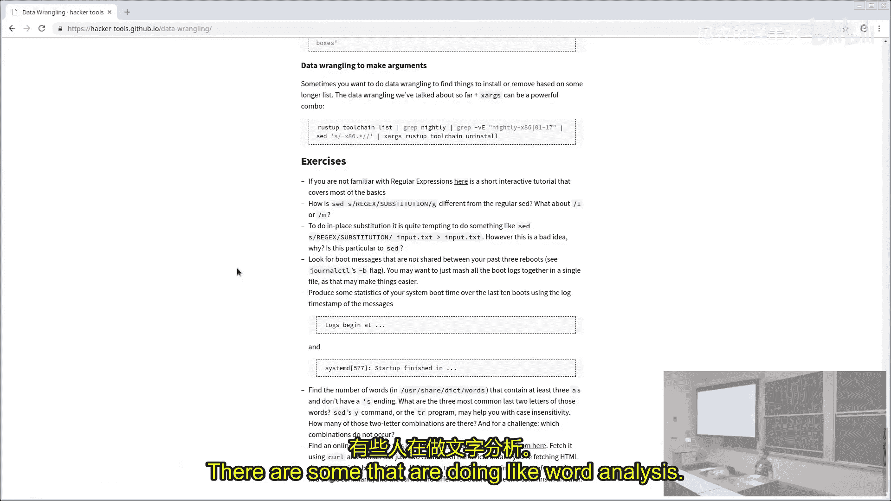

That has to。Words。Because。Sometimes it do hold time listen。嗯。

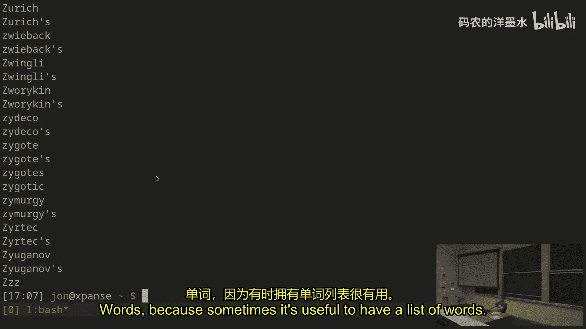

So there's some data wrangling exercises on those。There's also。

 someone asked earlier about analyzing data that's not just textual data。

 but it's like Jason and HTML， those kind of things， and so this an exercise in trying to extract。

Particular information using those tools。あそう。Thank you。

And there's also sort some challenges in how can you do things with fewer commands？

Like how you extract both the maximum and the minimum， for example， using a CM？

And often this will entail using some of the batch tricks we've talked about。

The shell lecture last time。So for PP， for example。Pop basically lets you write。So in this case。

 it's just。Okay， so it lets you curl so curl is a command that will access a website and download all of its source code and all of its HTML and then just print it to send it out and this is really handy for doing things like data right or just for fetching a script online。

 you might for example， have seeing pages that tell you just run like。

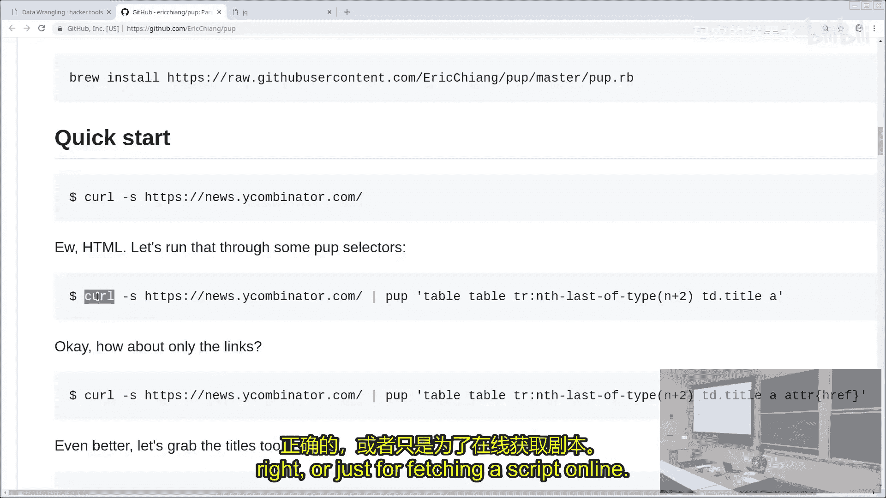

My website。Comme slash install。Pype it through it like pseudo as itch。

LikeThere are lots of in instructions that will tell you you do this， for example。

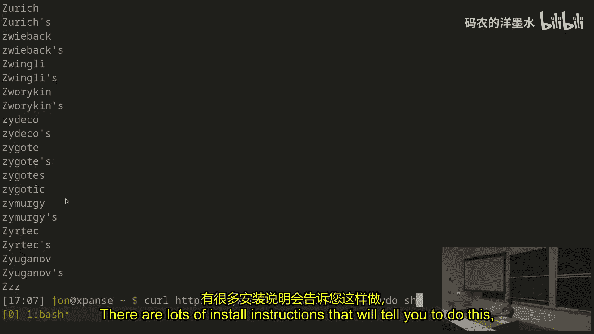

Just run this command。Some of you might at this point realize that this is not a great idea。

 what this is doing is it's downloading a script off of the internet and sending that script into your shell and telling the shell just run the words over whatever in that。

 I'm sure it's fine。You may not want to do this， but at least now you know what that does and probably why you shouldn't do it in any case curl is a really handy tool because what it does is it gives you the source code but usually that's just like a bunch of HTML tag right so this is what the HL types of this particular page looks like this is a mess to try to parse out with regular expressions or graphs and settings right trying to parse this would be a pan instead you can use P which takes a standard input of HTML code and then you can write selectors for those of you who know CSS these are CSS selectors so in this case this is saying find every table and every table that's contained inside of one of those tables find the table row that is the。

Every third row starting from the bottom。Find the column of that row whose class name is title and find the linkIn。

And then give me the cs of those types。Trying to parse this using regular expressions would be a paine。

 whereas this actually parsees CHML and gives you the appropriate stuff。

 but can even extract things like attributes， so in this case it's extracting the target of all of the A's and all the anchors。

 all the links in the page。Similarly， JQ is a tool for operating with。Jason Bs。Great， so again。

 they're sort of given this example of want to curl something curl just gives you in this case is going to give you some Jason back。

 so Jason is the JavaScript data notation which has all like those squiggly brackets。

And JQ similarly lets you write selectors for extracting data from Jason。

 so in this case it's saying extract the following parts of objects。So you can subset things。

 you can also say extract only the following attribute of like every item in a array so that what you end up with is not Jason。

 but it's like line separated text， for example， and once you get the line separated text。

 then you can start to combine that with all the tools that we've talked about today to do other interesting stuff。

诶。嗯。So。For example。This is one of the things that I link to on website。

 these are various like open data sets that you can find on the web。

Many of them come in like CSV or Jason or whatever， and extracting these。Download CSV Fl filess。

So these CSV files， we now know that we could just operate on using all。

RightD Fcoma is going to give you the。啊。Yeah， so some of the exercises here try to like download some of these data sets and try to do like interesting stuff with them。

 it does have to be information that you care about but just to get exercise in how to do this data of manipulation because the way this ends up being convenient for you is to do it over and over so that you sort of immediately remember what kind of commands you end up writing very often you're just like combining the same types of things you're likeing。

And then you're setting to remove the stuff on the either end。

 and then you're walking to get fields and then you're like pasting together at some useful baing。

In that case， if there are no more questions， I think we'll probably。

Unless you have other things you want me to go through。有。All right，nice。

Thanks for coming next time we're doing Eds and version control。Yeah。そごた全面け。

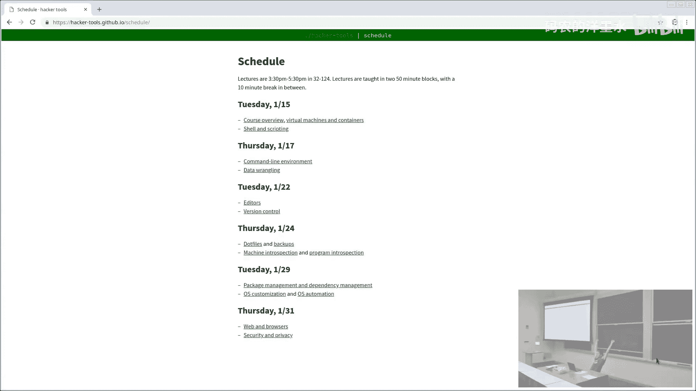